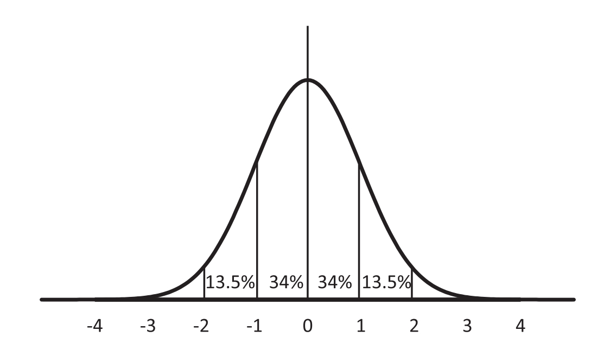
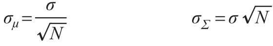
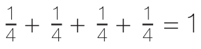
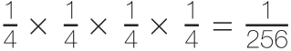
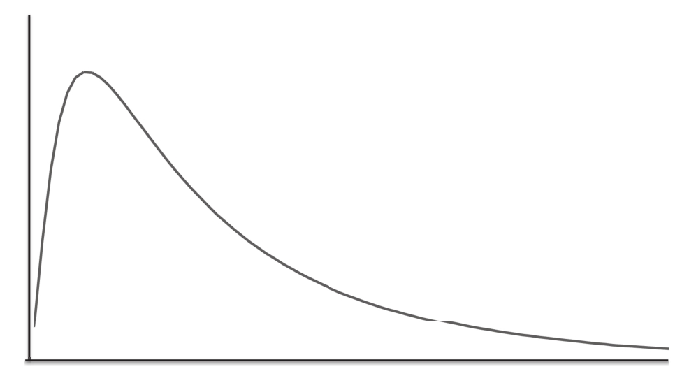

# 别小看那条钟形曲线：从正态分布到长尾世界

费曼有句俏皮话：他不敢说自己比另外 65 个人更聪明，但敢肯定自己高过这 65 人的平均线。这句话拿来理解分布，意外地贴切——平均值很重要，可只看平均值又会漏掉太多东西。

分布不是统计学课本里的配角，而是建模者的底层工具箱。接下来要搭路径依赖、随机游走、马尔可夫模型，也绕不开它。想度量权力、收入、财富的不平等，做统计检验，同样得靠分布知识。我们不从统计学家的角度出发，而是站在建模者这边追问两件事：为什么要用分布看世界？分布为什么重要？

下面按“结构—逻辑—功能”三层展开：先看正态分布长什么样、怎么产生，再看它为什么重要，最后看它如何被用来解释小样本异常、显著性检验和六西格玛管理。再往后，把“相加”换成“相乘”，世界就会从钟形曲线滑向对数正态分布，不平等也会被放大。

## 一、结构：分布到底在描述什么

分布做的事情，是给事件或数值分配概率。每天降雨多少、考试考几分、身高多少，都能用分布给每个可能结果配一个概率。统计量则把分布里的信息压缩成单个数字：均值就是平均值，比如德国黑森林树木平均高 24 米，开胸手术后平均住院 5 天。社会科学家也爱用均值比较国家：2017 年美国人均 GDP 为 5.7 万美元，法国是 4.2 万美元；但法国人的平均预期寿命反而比美国多 3 年。

均值之外，第二个关键统计量是方差，衡量数据离均值有多散。它算的是每个点与均值距离的平方的平均值。若所有点都相同，方差就是零；若一半数据是 4、一半是 10，均值是 7，每个点平均离均值 3，方差就是 9。标准差则是方差开平方。

可能的分布无穷多，纸上随手画条线都能解释成概率分布。好在常见分布类型有限。最常见的正态分布就是钟形曲线，如下图（）。它的均值两侧对称：均值若为零，抽到大于 3 的概率和抽到小于 -3 的概率一样。正态分布由均值和标准差决定，也可等价地由均值和方差决定。所有正态曲线长得都差不多：约 68% 的结果落在均值一个标准差内，约 95% 落在两个标准差内，超过 99% 落在三个标准差内。理论上它允许任意大小的结果，但“大”事件极罕见——偏离均值超过五个标准差的概率只有 200 万分之一。

有了这套规律，就能给范围算概率。假设威斯康星州密尔沃基市房子平均面积 2 000 平方英尺、标准差 500 平方英尺，那么当地 68% 的房子在 1 500 到 2 500 平方英尺之间，95% 在 1 000 到 3 000 平方英尺之间。再如 2019 年福特福克斯平均每加仑跑 40 英里、标准差 1 英里，超过 99% 的车每加仑能跑 37 到 43 英里；消费者当然希望越省油越好，但每加仑跑 80 英里基本不可能。

大多数物种的身高和体重也呈正态分布，围绕均值对称，不会冒出特别大或特别小的个体。我们没见过 1 米长的蚂蚁，也没见过 1 千克重的麋鹿。正态分布用均值和标准差就能刻画，极端偏差稀少，这正是它的规律性所在。

## 二、逻辑：为什么随机加总会冒出钟形曲线

太多现象呈正态分布：动植物体型、学生考试成绩、便利店每天销售额、海胆寿命，等等。解释这种普遍性的，是中心极限定理。

它说的是：只要各随机变量相互独立，每个变量方差有限，且没有少数变量把大部分变差包揽，那么 N≥20 个随机变量的和就近似正态分布。关键是，随机变量本身不必服从正态分布。它们可以是任何分布，只要满足有限方差、没有小部分变量贡献大部分变差这两个条件。

举个直观例子。一个 500 人的小城镇，人均每周消费 100 美元。有人这周花 50、下周花 150；有人每三周花 300；还有人每周在 20 到 180 之间浮动。只要每个人的支出变差有限，且没有一小撮人贡献了总支出的大部分波动，全镇每周总支出就会近似正态分布，均值是 50 000 美元，并且围绕均值对称：高于 55 000 和低于 45 000 的概率相当。同理，人们买香蕉、牛奶、炸玉米饼的数量，也会呈正态分布。销售数据、投票总数这类总量数据，往往可以写成许多随机事件的总和。

人类身高也能用这套逻辑解释。身高受基因、环境及二者交互影响，基因贡献可能高达 80%。研究显示，至少 180 个基因参与长高：有的影响颈部或头部长度，有的影响胫骨长度。虽然基因间有相互作用，但不妨假设每个基因对身高的贡献相对独立。若身高等于 180 个基因贡献的总和，它就会呈正态分布。同样的推理也适用于狼的体重和大熊猫拇指长度。

## 三、功能：小样本、显著性与六西格玛

正态分布不只是“长得像钟”，它还能解释不少现实怪象。

### 1. 小群体更容易冒出极端结果

为什么罕见结果更常出现在小群体？为什么“最好的学校”往往规模小？为什么癌症发病率最高的郡县人口少？答案藏在平方根法则里。

N 个相互独立的随机变量，若每个标准差为 σ，那么均值的标准差和总和的标准差由下式给出：  。均值标准差公式说明，总体越大，均值波动越小。换句话说，小样本里好事和坏事都更容易冒尖。现实正是如此：最安全的居住地是小城镇，最不安全的地方也是小城镇；肥胖率和癌症发病率最高的郡县，人口往往较少。

若不看样本量，直接把离群值当因果证据，就可能推出糟糕政策。美国统计学家霍华德·魏纳把均值标准差公式叫作“世界上最危险的方程式”。20 世纪 90 年代，盖茨基金会和一些非营利机构就以“最好的学校都是小学校”为依据，推动把大学校拆成小学校。这个推理的漏洞，用两所学校就能看清。

假设一所小学 100 人，一所大学 1 600 人，学生成绩来自同一分布，平均分 100，标准差 80。小学校平均分的标准差是 80÷√100＝8；大学校则是 80÷√1600＝2。若把平均 110 分以上叫“优秀”、120 分以上叫“非常优秀”，小学校平均 110 分只比总体均值高 1.25 个标准差，发生概率约 10%；平均 120 分高出 2.5 个标准差，大约 150 所学校里才碰上一次。换到大学校，110 分已高出 5 个标准差，120 分高出 10 个标准差，几乎永远不会发生。于是，“最好的学校普遍很小”并不能证明小校教得更好；即便学校规模毫无影响，平方根法则也会让好学校看起来偏小。

行动上也有启发：防止骚乱，关键常常是在极端情绪点上安抚人群，而不是只盯着把平均不满压下去。

### 2. 显著性检验：两个标准差的门槛

正态规律还能用来判断均值差异是否显著。社会科学家常定下规则：若经验均值与假设均值偏差超过两个标准差，就拒绝“两个均值相同”的假设。

比如假设巴尔的摩和洛杉矶通勤时间相同。数据说巴尔的摩平均 33 分钟，洛杉矶 34 分钟。若两地均值标准差都是 1 分钟，二者只差 1 个标准差，就不能拒绝原假设。可若洛杉矶平均 37 分钟，差距达到 4 个标准差，就该拒绝。

物理学家通常更严格，因为他们的数据集更大，也更“干净”。2012 年证明希格斯玻色子存在时，所用证据在 700 万次试验中随机出现的次数不到一次。

美国食品药品监督管理局的药物审批也含显著性检验。制药公司声称新药能减轻湿疹，就得做两项随机对照试验：两组相同的湿疹患者，一组用药，一组用安慰剂，试验后比较平均严重程度和平均副作用发生率，再做统计检验。若药物显著缓解症状、且没有显著增加副作用，才可能获批。FDA 并非机械执行双标准差规则：治疗致命疾病且副作用轻的药，统计门槛会低于治灰指甲却可能抬高骨癌风险的药。它还会看检验效力，也就是测试能证明药物有效的概率。

### 3. 六西格玛：把波动压下去

六西格玛方法由摩托罗拉在 20 世纪 80 年代中期提出，目的是减少误差，做法是根据正态分布给产品属性建模。

设想一家生产门把手螺栓的企业。螺栓直径规格是 14 毫米，13 到 15 毫米也能接受。若直径呈正态分布，均值 14 毫米、标准差 0.5 毫米，那么超过两个标准差的螺栓就不合格；两个标准差事件概率约 5%，对制造企业来说太高了。

六西格玛要做的就是缩小标准差，降低不合格率。企业可以通过更严的质量控制减少误差。2008 年 2 月 26 日，星巴克 7 000 多家门店停业三小时，重新培训员工；航空公司和医院用的检查清单，也能减少变差。标准差降下来后，即使出现 6 个标准差的误差，也能避免故障。按螺栓例子，直径标准差要压到六分之一毫米；6 个标准差意味着误差率仅十亿分之二。实际业务默认 1.5 个标准差的漂移不可避免，所以六西格玛事件实际对应约 4.5 个西格玛，允许误差率约为三百万分之一。

这里有个微妙之处：六西格玛其实悄悄用了中心极限定理的加性误差模型，却很少有人点破。企业不可能精确测量每个螺栓，只能抽样几百个来估计均值和标准差；再假设直径变差来自机器振动、金属质量变化、压力机温度和速度波动等多种随机效应之和，于是用中心极限定理推断正态分布。有了基准标准差，企业才能花大力气把它降下来。

## 四、乘法世界：对数正态与不平等

中心极限定理的前提是“相加”或“求平均”。如果随机变量不是相加，而是以某种方式相互作用，或者彼此不独立，结果就不一定是正态分布。事实上，通常都不是。独立随机变量的乘积，得到的是对数正态分布。

对数正态分布缺乏对称性。大于 1 的数，乘积增长得比和快：四个 4 相加是 16，四个 4 相乘却跳到 256。小于 1 的数则相反：相加得到  ，相乘却得到  。把 20 个不均匀分布在 0 到 10 之间的随机变量相乘，多次相乘后，乘积里会混着一些非常接近零的结果和一些相当大的结果，于是形成如下图（）的对数正态分布。

对数正态的尾巴有多长，取决于相乘随机变量的方差：方差小，尾巴短；方差大，尾巴可能很长。一组很大的数相乘，会造出非常大的数字。英国农场大小、地球矿物质浓度、从感染到症状出现的时间，都可见对数正态分布。大多数国家的收入分布也近似对数正态，只是最顶端会偏离，因为高收入者“太多”了。

一个简单模型能解释收入为何更接近对数正态而非正态。多数企业和机构按百分比加薪：表现高于平均的人拿更高百分比，低于平均的人拿更低百分比。也可以按绝对金额加薪：普通员工加 1 000 美元，表现好的人多些，表现差的人少些。这两种做法的差别绝非文字游戏。

若每年绩效独立且随机，按百分比加薪就会产生对数正态分布。哪怕后来表现相同，过去拉开的收入差距也会继续扩大。假设一名员工因前几年表现好，收入达到 80 000 美元；另一名只有 60 000 美元。如今两人表现同样出色，都加薪 5%，前者拿到 4 000 美元，后者只有 3 000 美元。绩效完全相同，不平等却会制造更大的不平等。若企业按绝对金额加薪，两名绩效相同的员工拿同样加薪，收入分布就会更接近正态。

## 五、收束：规律性与长尾之间

这一章从结构、逻辑、功能三面看了正态分布：它用均值和标准差刻画；中心极限定理解释了独立随机变量相加或求平均时，钟形曲线如何出现；均值与总和的标准差公式又带来一连串后果。小群体更容易出现异常事件，若不理解这一点，就可能做出错误推断和不智行动；假设变量服从正态，科学家才能判断统计检验的显著性和效力；过程管理也能借正态假设预测失败概率。

但并非每个量都能写成独立随机变量之和或平均，所以并非所有事件都正态。有些量是随机变量之积，于是呈对数正态：只取正值、尾巴更长，既有更大的事件，也有更多非常小的事件。高方差的随机变量相乘，尾巴会拉得更长。长尾分布可预测性较差，正态分布则意味着较强规律性。作为预测规则，我们当然更偏爱规律性，而不是发生巨大事件的可能性。也因此，理解分布如何生成，会让人受益匪浅：很多时候，我们宁愿随机冲击相加，而不是相乘，好让大事件少一点。