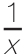
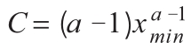
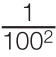
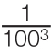
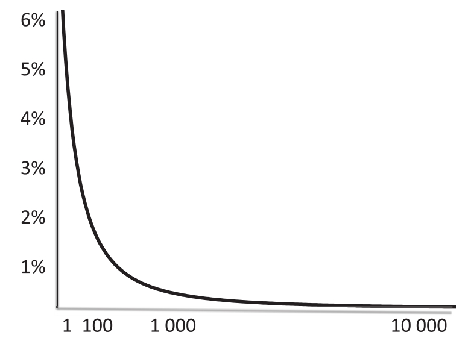
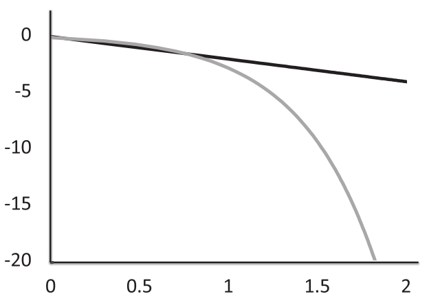
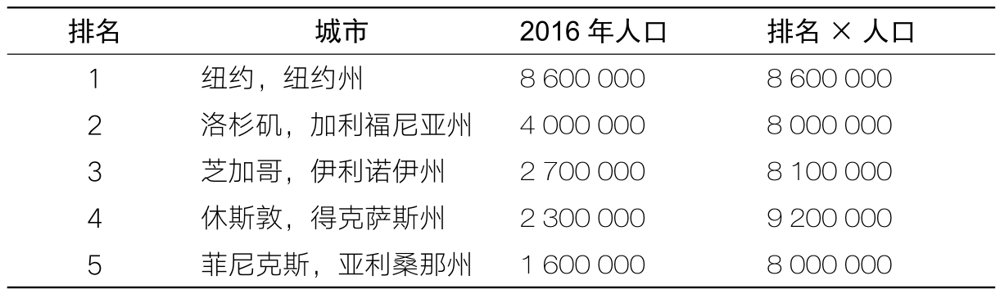
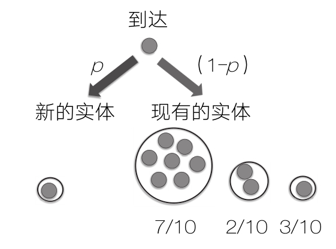
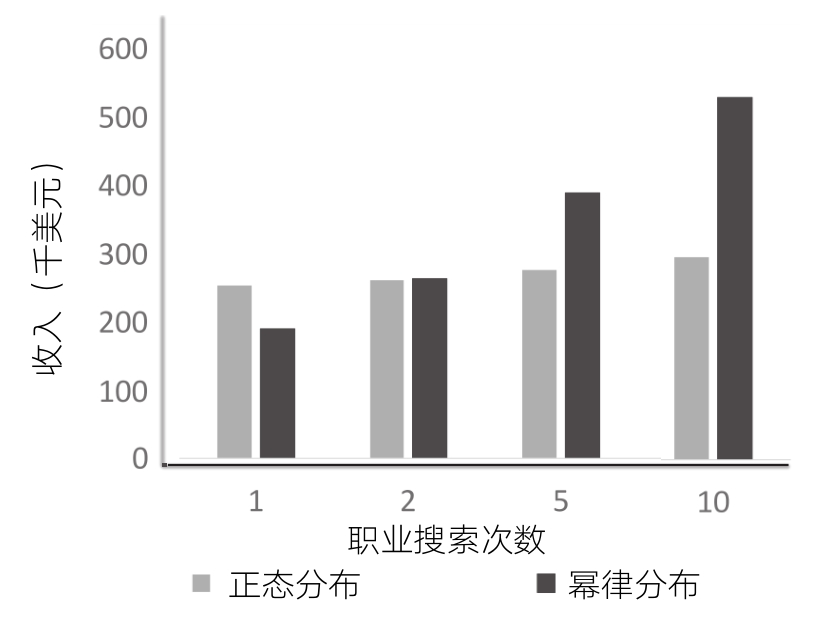

# 06　幂律分布

每个基本定律都有例外，但是你仍然需要定律，否则你所拥有的只是毫无意义的观察。那不是科学，只是做笔记。

杰弗里·韦斯特（Geoffrey West）

在本章中，我们将讨论幂律分布。幂律分布就是通常所称的长尾分布或重尾分布。在把这种分布绘制在图上时，会产生对应大事件的沿水平轴运行的长尾。例如城市人口分布、物种灭绝、万维网上的链接数量以及企业规模等，所有这些分布都有很长的尾巴，视频下载量、书籍销量、学术论文引用数量、战争中的伤亡人数、洪水和地震的分布也是如此。换句话说，在这些分布中，都包括了非常大的事件：东京有 3 300 万居民，J. K.罗琳的“哈利·波特”系列畅销书卖出了 5 亿本，1927 年密西西比河的大洪水将面积相当于西弗吉尼亚州的地区淹在了 9 米深的水下…… ¹  

要想对幂律分布与正态分布之间的巨大差异有一个直观的了解，不妨想象一下人类身高的幂律分布。如果人类身高与城市人口的幂律分布类似，而且假设所有美国人的平均身高为 175 厘米，那么美国人当中将会有一个人比帝国大厦还高，有超过 1 万人比长颈鹿还高，同时身高小于 18 厘米的人也将超过 1.8 亿人。 ²  

产生幂律分布要求非独立性，通常以正反馈的形式出现。 ³  图书销售、森林火灾的发生和城市人口都不同于光顾杂货店的次数，这些并不是独立的。当某个人买了一本《哈利·波特》后，其他人也可能跟着买；当一棵树着火时，火势会蔓延到邻近的树木；当一个城市的人口增加时，这个城市的基础设施会随之改善，工作机会也会随之增加，从而对其他人更具吸引力。社会学家罗伯特·默顿（Robert Merton）把这种已经拥有更多的人未来也能够得到更多的现象称为马太效应（Matthew effect），正如《圣经》中所说：“凡有的，还要加给他，叫他有余；凡没有的，连他所有的，也要夺去。”（马太福音 25:29）

既然在各种领域中都能发现发幂律分布，那么如果有某个机制可以解释所有这些幂律分布就太好了，可惜的是，这种机制并不存在。如果幂律分布的每一个实例都有一个独特的解释，那将更好，可惜的是，这也不是真的。相反，我们只拥有一系列能够生成幂律分布的不同模型，每个模型都能解释不同的现象。

在本章中，我们将重点放在两个幂律分布模型上。第一个模型是优先连接模型（preferential attachment model），它能够解释城市规模、图书销量和网络链接等；第二个模型是自组织临界模型（self-organized criticality model），它能够解释交通拥堵、战争伤亡，以及地震、火灾和雪崩的大小等。在第十二章中讨论熵时，我们还会研究第三个幂律分布模型，在那个模型中，幂律会在给定均值的条件下最大化不确定性。在第十三章中，我们将证明随机游走模型中的返回次数也满足幂律分布。还有其他一些模型则表明幂律会从最优编码、随机停止规则和组合分布中产生。 ⁴  本章还将讨论幂律分布的结构、逻辑和功能。在讨论中，我们重新评估了特别大的事件的影响，并描述在预防和规划这些事件上的能力局限。

### 幂律分布的结构

在幂律分布中，事件发生的概率与事件大小的某个负指数成比例。例如，我们熟悉的函数就描述了一种幂律。在这个幂律分布中，一个事件的概率与其大小成反比：事件越大，发生的可能性越小。因此，在幂律分布中，小事件的数量要比大事件要多得多。

**幂律分布** 

一个定义在区间［*x* * [min] * ，∞）上幂律分布 ⁵  可以写成如下形式：

*P* (*x* )=*Cx* ^(\-a) 

其中，指数*a* >1 决定了尾部的长度，同时常数项确保总概率的分布。

幂律中指数的大小决定了大事件的可能性和大小。当指数等于 2 时，事件的概率与其大小的平方成比例。大小为 100 的事件，发生的概率与（或一万分之一）成比例。当指数增加到 3 时，该事件的概率与成比例。对于 2 或更小的指数，幂律分布缺乏一个可明确定义的均值。例如，从指数为 1.5 的幂律分布中抽取出来的数据均值永远不会收敛。换句话说，它会无限地增加。

图 6-1 显示了网页链接数量分布的近似图。

**图 6-1　网页链接的近似幂律分布** 

大事件的可能性将幂律分布与正态分布区分开来，因为在正态分布中，我们实际上从未见过大事件，而在幂律分布中，大事件虽然也很少见，但是它们发生的频率足以引起注意和准备。即使是百万分之一的事件也必须加以考虑。例如，地震大小的分布接近于指数大约为 2 的幂律。如果发生了震级大于里氏 9.0 级的地震，不但建筑物会被夷为平地，整个地形地貌都会变得面目全非。这是一个发生的可能性只有百万分之一的大事件，在一个世纪的时间中，这种规模的地震发生的概率为 3.5%。 ⁶  

为了更清楚地分析概率为百万分之一的大事件在正态分布与长尾分布之间的差异，现在来看一看由于恐怖袭击所造成的死亡人数的分布，它遵循幂律分布，且指数为 2。 ⁷  在长尾分布中，概率为百万分之一的恐怖袭击事件是一个差不多有 800 人死亡的事件。如果由于恐怖袭击造成的死亡人数满足一个均值为 20、标准差为 5 的正态分布，那么概率为百万分之一的事件将只会导致不到 50 人死亡。

幂律分布有明确的定义，不是每一个长尾分布都是幂律分布。要想快速地检验某个分布是不是幂律分布，可以用双对数坐标系把该分布画出来：双对数坐标系可以将事件大小及其概率转换为相应的对数值，并将幂律分布转换为直线（图 6-2）。 ⁸  

**图 6-2　双对数坐标中的幂律分布（黑色）与对数正态分布（灰色）** 

换句话说，在双对数坐标系中，自始至终都呈直线的图形就是幂律分布的证据，而一开始是直线然后逐渐下降的图形则与对数正态分布（或指数分布）相对应。对数正态分布图形向下弯曲的速率取决于产生分布的变量的变化。 ⁹  当我们增大对数正态分布的方差时，对数正态分布的尾部增大，从而使在双对数坐标系中的图形更接近线性。 ¹⁰  

齐普夫分布（Zipf distribution）是幂律分布的一个特例，即指数等于 2 的幂律分布。指数等于 2 的幂律分布的一个重要特征是，事件的等级排列序号乘以其概率等于常数，这个规律被称为齐普夫定律（Zipf's Law）。单词符合齐普夫定律，最常见的英语单词 the 出现的频率为 7%，第二最常见的英语单词 of 出现的频率为 3.5%。请注意，of 的等级排列序号 2 乘以频率 3.5%，恰恰等于 7%。 ¹¹  

**齐普夫定律** 

对于指数为 2 的幂律分布（*a* =2），事件的等级排列序号乘以它的大小等于常数，即：

事件等级×事件大小=常数

包括美国在内的许多国家的城市人口分布大体上符合齐普夫定律。从美国 2016 年的城市人口数据可以看出，每个城市的人口排名乘以它的人口总数的值接近 800 万（表 6-1）。

**表 6-1　城市人口分布** 

### 幂律分布的逻辑

现在，我们着手讨论若干产生幂律分布的模型。如果没有适当的模型，幂律分布就只是一种无法解释的模式。

我们要讨论的第一个模型是优先连接模型。模型假设实体以相对于其比例的速度增长。优先连接模型刻画了罗伯特·默顿所说的马太效应：更多导致更多。这个模型考虑了通过新移民到来而实现增长的人口。新到达的人，要么加入现有的某个实体，要么自己创建新的实体。如果是前者，那么加入现有某个实体的概率与该实体的大小成正比。

**优先连接模型** 

一连串物体（人）一个接一个地到达。第一个到达者创建一个实体。后续每次有人到达时都应用以下规则：在概率*p* （较小）的情况下，新到达者创造一个新的实体；在概率（1-*p* ）的情况下，新到达者加入现有的某个实体。加入某个特定实体的概率等于该实体的大小除以到目前为止所有到达者的数量。

不妨想象一下大学新生进入大学校园时的情景。第一个来到学校的学生创建了一个新的社团，第二个到达的学生以较小的概率创建了自己的社团，更有可能的是，他会加入第一个学生创建的社团。前 10 个到达的学生可能会创建 3 个社团：一个有 7 个成员，一个有两个成员，一个有一个成员。第 11 个到达的学生只会以极小的概率创建第 4 个社团，如果不创建新的社团，她就加入现有的社团。如果这样做，那么她有 70%的可能性加入已有 7 个学生的社团，有 20%的可能性加入已有两个学生的社团，只有 10%的可能性加入只有一个学生的社团。

优先连接模型有助于解释为什么网络链接、城市规模、企业规模、图书销量和学术引用数量的分布都是幂律分布。在这些情况下，一个行动（比如一个人购买了一本书）会增加其他人也这样做的可能性。如果从某家企业购买商品的概率与它在当前市场的份额成正比，同时如果新企业进入市场的概率较低，那么优先连接模型预测企业规模的分布将是幂律分布。同样的逻辑也适用于图书销量、音乐下载量和城市发展。

我们要讨论的第二个模型是自组织临界模型，它通过在系统中建立相互依赖关系的过程产生幂律分布，直到系统达到临界状态为止。自组织临界模型有很多种。其中，沙堆模型（sand pile model）假设有人将沙粒从距桌面几十厘米的地方洒落到桌子上。随着沙粒不断增多，一个沙堆开始形成。最终，沙子的堆积会达到临界状态，此后每加一次沙子都可能导致“沙崩”。在这种临界状态下，多加入的沙子通常要么没有影响，要么最多只会导致一些沙子下滑。这些属于幂律分布中的数量众多的小事件。但有时，只要再加入一粒沙子就会导致大规模的“沙崩”，这就是大事件。

森林火灾模型（forest fire model）也是自组织临界模型的一种。假设树木可以在一个二维网格上生长，这些树木也可能会随机地被闪电击中。当树木的密度较低时，由闪电引发的任何火灾的规模都很小，最多只会蔓延到几个格点。当树木密度变得足够高时，再被闪电击中就会导致森林大火。

**森林火灾模型** 

“森林”最初只是一个空的*N* ×*N* 网格。每个周期在网格上随机选择一个格点。如果该格点为空，那么就以概率*g* 在那里种上一棵树。如果该格点上已经有树，那么闪电会以概率（1-*g* ）击中该格点。如果该格点有一棵树，那么树会着火，火势会蔓延到所有连接到该格点的有树的格点。

这里需要注意的是，在森林火灾模型中，被闪电击中的概率等于 1 减去种树的概率。这种结构使我们能够改变种树与闪电击中树的相对速度。这是一种简化，减少了模型中参数的数量。在对各种各样的种树速度进行试验之后，我们发现，当种树的速度接近 1 时，树木的密度会增加到一个临界状态：在这个相对茂密的森林中，被闪电击中有可能摧毁很大一片森林。在这种临界状态下，森林中斑块大小的分布，以及火灾大小的分布，都满足幂律分布。此外，森林还会自然而然地趋向这种密度水平。如果密度较低，密度会增加（因为火灾很小）。如果密度超过了阈值，那么任何火灾都会毁掉整个森林。因此，树木密度自组织地达到了一个临界状态。 ¹²  

在沙堆模型和森林火灾模型中，宏观层面的变量，也就是沙堆的高度或森林的密度，都具有一个临界值。当有像沙崩或火灾这样的大事件发生时，宏观层面的变量值会减小。这两个模型的一些变体可以解释太阳耀斑、地震和交通拥堵的分布。不过，当事件发生时，不断增加的宏观层面的变量会减少，这虽然是必要的，但对于自组织临界性来说是不够的。均衡系统也具有这种特征。水通过溪流，流入和流出湖泊，但是由于水流很平稳，所以湖水的水位是逐渐变化的。通过自组织达到临界状态的关键假设是压力平稳地增加（就像水流入湖中一样），同时压力在爆发时迅速减少，这包括可能发生的大事件。

### 长尾分布的含义

在这里，我们讨论长尾分布的三个含义，即它们对公平、灾难和波动性的影响。根据定义，与正态分布相比，长尾分布意味着少数几个大“赢家”（大崩溃、大地震、大火灾和严重的交通拥堵）和很多的“输家”；而正态分布则是关于均值对称的。长尾分布也可能增加波动性，因为更大实体中的随机波动会产生更大的影响。

#### 公平

如果某一个人写的书更好、创作的歌曲更有吸引力、发表的论文学术水平更高，那么他应该比其他人获得更大的名声和更多的金钱。但是，如果另一个人只是因为表现得稍微好一点，或者完全靠碰巧走运就比其他人赚到了多得多的钱、获得了大得多的名声，那就有失公平了。就像我们在优先连接模型中看到的，因为马太效应，正反馈创造了少数大赢家。在市场中，要发生正反馈，人们必须知道别人买了什么商品，而且人们必须有能力购买商品。就手机上的应用程序而言，根本不存在可能会减慢正反馈的生产限制，但是卡车就会面临这种约束。福特公司不可能无限增加 F-150 卡车的产量，但是财捷集团（Intuit）却可以无限量地销售 TurboTax 应用程序，只要有人愿意下载。

实证研究表明，社会效应会创造更大的赢家。在音乐实验室的实验研究中，研究者让大学生挑选和下载歌曲。在第一个实验组中，被试不知道其他人下载了哪些歌曲，下载量的分布具有较短的尾部，没有出现下载量超过 200 次的歌曲，且下载量少于 30 次的歌曲也只有一首。在第二个实验组中，被试知道其他人下载了哪些歌曲，下载量的分布具有较长的尾巴，有一首歌的下载量超过 300 次。而且，超过一半歌曲的下载量都不到 30 次。

尾巴变长了，社会影响增加了不平等。如果社会影响只会导致人们下载更好的歌曲，那么这种不平等也不会造成什么问题。但事实上，这两个实验组的下载量之间的相关性并不强。我们可以将第一个实验组中每一首歌的下载次数解释为歌曲质量的一个表征，那么这项研究表明，社会影响并没有导致人们去下载更好的歌曲。大赢家的出现不是随机的，但它们其实并不一定是最好的。 ¹³  

当然，我们必须非常小心：不能从一项研究中就得出太强的推论。然而，我们确实可以推断，卖出了 5 000 万册书的畅销书作家、学术论文得到了 20 万次引用的科学家当然是值得赞许的，但是这种极端的成功本身就表明中心极限定理是不成立的。人们不会独立地购买书籍或引用论文。惊人的成功可能意味着正反馈，也许还有一点运气。在本书的最后一章讨论收入不平等的原因时，我们还会回到这些思想上来。 ¹⁴  

#### 灾难

长尾分布还包括灾难性事件：地震、火灾、金融崩溃和交通拥堵。尽管模型无法预测地震，但确实可以深入解释为什么地震的分布会满足幂律。这些相关的知识告诉我们各种强度的地震发生的可能性。我们至少知道会发生什么，尽管不知道什么时候会发生。 ¹⁵  

而且，森林火灾模型已经可以指导行动了。人们可以通过选择性地在森林中采伐一些树木来降低树木的密度，以防止大火灾的发生，也可以制造防火带。有人会说，在模型告诉我们应该这样做之前，我们早就懂得采伐树木或建造防火带了。这当然是事实，但重要的是，森林火灾模型能够让我们意识到临界密度的存在。临界密度可能因森林而异，可能取决于树木的类型、盛行风速和地形。这个模型有效地解释了为什么森林会出现自组织临界状态。

我们还可以使用这个模型来做一个很好的类比。请回想一下，第一章中讨论了席卷整个体系的金融机构的破产，我们可以将森林火灾模型应用到那种情况下：把银行和其他金融机构想象为网格上的树，网格上的邻接则表示存在未偿还的贷款。一个银行破产相当于一棵树着火，而火势有可能会蔓延到邻近的银行。

当银行的“密度”变得越来越高的时候，这种看似浅显的森林火灾模型就预示着大规模的银行破产随时可能发生。不过，在深入探析这个类比时，我们可以发现它存在四个方面的缺点。第一，金融机构的网络并未嵌入物理空间，各家银行的连接数也不相同，有的银行可能拥有几十项金融债务，而有些银行则可能只有一两项金融债务。第二，森林中的树木不能主动采取行动来减少火势蔓延的可能性，但是银行却可以，它们可以提高自己的储备水平。

第三，一家银行拥有的连接越多，其破产会产生连锁反应的可能性就越低，因为它的损失已经分散到了更多的银行身上。例如，如果一家银行只从另一家银行借款，那么如果它在借来的 1 亿美元的贷款上出现了违约，第二家银行可能会破产。但是，如果第一家银行是从其他 25 家银行分别借款的，那么任何一家银行都不至于受到重创。在这种情况下，银行体系可以很好地消化这个违约事件而不会崩溃。 ¹⁶  

第四，从一家银行的破产到另一家银行的破产，这种蔓延会不会出现还取决于银行的投资组合。如果两家“相连”的银行拥有相似的投资组合，那么当一家银行破产时，另一家银行也可能早就脆弱不堪了，这时银行破产蔓延的可能性就很大。如果整个网络中的所有银行都拥有相同的投资组合，那么最糟糕的情况就很可能会出现。在这种情况下，当一家银行破产时，就可能会出现普遍的银行破产。 ¹⁷  但是，如果每家银行分别持有不同的投资组合，那么一家银行表现不佳并不意味着其他银行也表现不佳。在这种情况下，银行破产就可能不会蔓延。因此，一个模型要想真正有用，就必须考虑到各种不同的投资组合。如果没有这些信息，那么即便知道哪些银行对其他银行负有未偿还债务也不足以预测或防止银行破产，而且银行之间的高互连性的净效应也是不明确的。

#### 波动性

最后，我们讨论最微妙的一个含义。如果组成幂律分布的实体规模出现了波动，那么幂律的指数就可以作为衡量系统层面波动性的一个代表。由此可以推断，企业规模的分布应该会影响市场波动性。例如，我们可以将某个国家的国内生产总值视为数千家企业的总产量。如果各家企业的生产水平相互独立且变差有限，那么根据中心极限定理，这个国家的国内生产总值分布将服从正态分布。也就是说，企业生产水平的差异越大，总体波动性就越大。如果企业规模的长尾分布导致生产水平上更大的变差，那么这种长尾分布也必定与更大的总体波动性相关。

对美国波动性模式的实证研究表明，波动性在 20 世纪 70 年代和 80 年代有所上升，然后在接下来的 20 年间又下降了，有人将后面这 20 年称为“大稳健”（Great Moderation）。 ¹⁸  但是，从 2000 年前后开始，波动性再次上升。研究显示，可以通过企业规模分布的变化来解释这种波动性演变的模式。 ¹⁹  随着企业规模分布的尾部变得越来越长（越来越短），最大的企业对波动性的影响越来越大（越来越小）。换句话说，总体波动性会随企业规模分布的尾部变长（变短）而增加（减少）。1995 年，当总体波动性较低时，沃尔玛的营业收入为 900 亿美元，相当于美国国内生产总值的 1.2%。到了 2016 年，沃尔玛的营业收入增加到了 4 800 亿美元，占国内生产总值中的百分比提高到了 2.6%，沃尔玛在美国国内生产总值中所占的份额增加了一倍多。2016 年，沃尔玛收入的增加或减少可能导致的总体波动性因而也增加了一倍多。

没有人能够反驳这个观点的逻辑。因此，相关的问题是，一个经过校准的模型到底能不能生成与实际波动水平相对应的效应。校准拟合结果表明，确实非常接近。企业规模的分布很好地对应于大稳健时期的历史证据。虽然这种相关性并不能证明是企业规模分布的变化（而不是政府对经济的有效管理或更好的库存控制）导致了这种变化，但是它确实足以“阻止”我们拒绝这个模型。 ²⁰  这些证据还为我们在未来评估各种波动时将这种模型加入我们的工具箱提供了很好的理由。

### 设想长尾分布的世界

在长尾分布中，大事件发生的概率必须加以考虑。在本书讨论的多个模型中，长尾分布是由于反馈和相互依赖性而产生的。我们应该高度注意这个结果。随着世界中相互联系性的提高和反馈的增加，我们应该会观察到更多的长尾分布，同时现在关注的这些长尾分布的尾部也可能会进一步拉长。这就是说，不平等可能会增加，灾难可能变得更大，波动性也会变得更加剧烈。这些都是不可取的。

到目前为止，我们都是在宏观层面上讨论这些事件的可能性的。它们也同样可能发生在更小的尺度上。波士顿的中央隧道工程（Big Dig）是一条穿过市中心的长达 5 000 多米的隧道，它是一个中等规模的灾难的典型例子。这个项目花费了 140 亿美元（相当于最初预算的 3 倍多），并成了美国有史以来最昂贵的公路项目。根据模型思维的方法，我们不会把这个项目简单地视为一个单独的项目，而是作为很多子项目的总和：挖掘深沟、浇筑混凝土隧道、设计排水系统、建造墙壁和“顶盖”。项目的总成本等于各个子项目成本的总和。

如果每个子项目的成本都是相加的，那么这个项目的成本分布将是正态分布。 ²¹  然而，各个子项目的成本是相互关联的。原本计划用来将顶盖黏合到位的那种环氧树脂强度不够时，就不得不用成本更高、强度更大的另一种环氧树脂来代替，从而增加了项目的成本。而且，第一种环氧树脂的失效还产生了移除和更换折叠顶盖的额外成本。这些工作反过来又需要重做项目的其他几个部分。于是总体成本增加了一倍以上，因为每个项目必须撤销然后重做。这种相互依赖性最终导致了一个大型且昂贵的事件。

大事件发生的可能性使计划变得非常困难。像地震这样自然灾害的分布符合幂律分布。因此，大多数事件都是很小的事件，但是有些事件一旦发生就会很大。如果灾难性事件遵循指数为 2 的幂律分布，那么政府就必须时刻保留大量的储备金或者至少做好应对的准备，必须未雨绸缪。如果政府为了这个目的而在应急基金账户中保持了巨额盈余，那么如果没有大事件发生，政府可能会阻止自己花掉这笔钱或减税。

**搜索与机会** 

我们可以在某些搜索模型中应用关于分布的知识来解释为什么一个人获得机会的数量可能与他的成功经历密切相关。在这里，事实上是将一类模型（分布模型）嵌入了另一类模型（搜索模型）。我们在搜索的时候，无论是搜索新鞋、工作职位还是度假胜地，其实是不知道所选择的价值的，直到去真的尝试它。不过，我们可能会对所选择的价值的分布有所了解，例如它的均值、标准差，以及这种分布是正态分布还是长尾分布等。

在这里，我们将职业选择建模为一个搜索过程。给定某个行业，一个人尝试某条职业道路。我们将这种行为建模为从一个分布中抽取某个事件。假设，这个人可以坚持这个职业选择或再试一次，再试一次对应于从分布中的另一次抽取。例如，考虑一个有才华的年轻科学家的职业选择。她可以选择去医学院深造，也可以选择去研究量子计算。医学院提供了一条更安全的道路，选择研究量子计算则可能成为一名创业企业家并承担更多风险。为了解释这些差异，我们将医生的工资分布表示为均值 25 万美元，标准差 25 000 美元的正态分布，并把量子计算企业家的工资分布表示为指数为 3、期望工资为 20 万美元的幂律分布。 ²²  

再假设，在每个行业内，这位科学家也可以尝试多种职业。也就是说，她可以搜索。医生可以从肿瘤科转入放射科，一个企业家破产后也可以重整旗鼓继续尝试创业。但是每一次转换职业都要付出一定的成本：对于一个医生来说，这意味着要接受更多的培训；对于一个从事量子计算的企业家来说，这意味着需要付出更多的时间去从事没有报酬的工作。

另外再假设，这位科学家认为这两个职业同样有意思，并且会根据薪资水平来做出选择。我们的模型证明，哪种选择更好取决于有多少次尝试新职业的机会。如果她必须坚持自己的第一个职业选择，那么成为一名医生就可以获得更高的期望工资；如果她有足够的资源持续尝试，努力成为一名企业家，那么最终她将从长尾中获得高薪。假设在每个职业中分别进行 1 次、2 次、5 次和 10 次职业搜索，下图显示在 20 次测试中得到的平均最高工资。如果这位科学家有机会在量子计算初创企业中尝试 10 次，那么她的薪资将会是她选择进入医学院深造并尝试 10 个职业后收入的两倍。

如果拥有的财富和家庭的支持与一个人不得不尝试新职业的机会数量相关，那么模型的预测是，更富有的人将选择风险较高的职业。 ²³  专利证据与我们的模型是一致的。一个人成功申请专利的可能性与他的数学技能相关，数学能力排名前 1%的人更容易获得专利。而且在这数学能力排名前 1%的人当中，收入排名前 10%的家庭的人更有可能拥有专利。 ²⁴  至少有两个模型可以解释这种差异：一个模型假设更贫穷且有才华的学生没有上大学的机会，他们可能正在从事日常工作，从未有机会在进入医学院深造还是去研究量子计算之间做出选择，另一个模型则假设更贫穷的学生会选择更安全的职业。

机会的增加可以创造风险激励，这个逻辑可以应用到很多领域。风险资本家经常冒险，因为他们有机会进行多项投资。只要投中了一个独角兽（市值 10 亿美元以上的公司），不仅可以补偿多次失败的投资，还可以带来很大的利润。研究药物的实验室也愿意承担风险，花费数十亿美元用于药物开发。甚至在决定午餐吃什么时，我们也可以应用同样的逻辑。长途旅行并在某个不熟悉的小镇短暂停留时，我们一般更喜欢选择连锁餐厅用餐；但是，如果真的搬到那个小镇去居住，我们就会尝试多家餐厅。