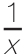
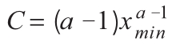
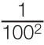
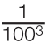
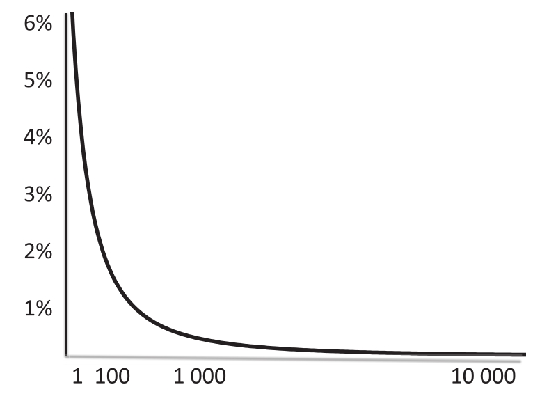
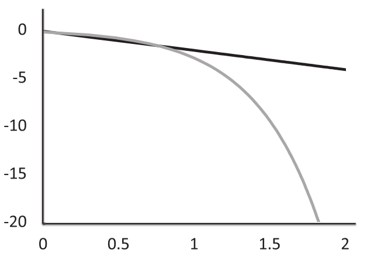
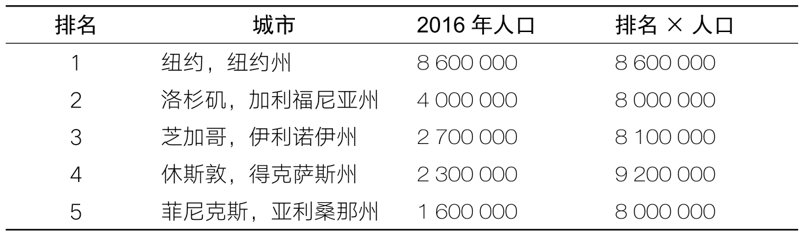
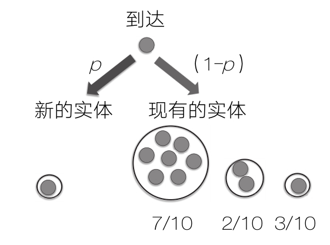
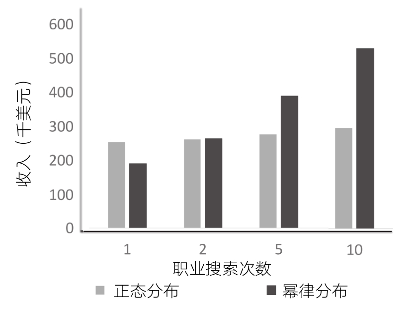

你有没有想过，为什么少数城市能聚集几千万人，少数书籍能卖出几亿本，而绝大多数事物却默默无闻？这背后往往藏着一种神奇的规律——幂律分布。

幂律分布也叫长尾分布或重尾分布。把它画在图上，你会看到一条拖着长长尾巴的曲线，而“尾巴”上站着的，正是那些极端的大事件。城市人口、物种灭绝、网页链接数、企业规模、视频下载量、书籍销量、论文引用、战争伤亡、洪水和地震，统统逃不出这个模式。东京住着3300万人，《哈利·波特》卖了5亿本，1927年密西西比河大洪水把一片相当于西弗吉尼亚州的土地淹到了9米深——这些都是“尾巴”上的巨兽。

你想直观感受幂律和正态的差距吗？做个思想实验：如果人类身高也按城市人口的幂律分布，并且美国人平均身高是175厘米，那么美国会出现一个比帝国大厦还高的人，超过1万个人比长颈鹿还高，同时有1.8亿人身高不到18厘米。荒谬？但这就是幂律的威力。

为什么会产生这种分布？关键往往在于非独立性，通常表现为正反馈。买书、火灾、城市扩张，都不是“各干各的”。一个人买了《哈利·波特》，会带动别人也去买；一棵树着火，火会烧到旁边的树；城市人口变多，基础设施改善、工作机会增加，于是吸引更多人。社会学家默顿把这叫“马太效应”——《圣经》里那句话：“凡有的，还要加给他，叫他有余；凡没有的，连他所有的，也要夺过来。”

虽然幂律在各处都能见到，但你别指望有一个万能公式解释所有情况。现实是，不同现象有不同模型。这一章我们聚焦两个：优先连接模型和自组织临界模型。前者解释城市规模、图书销量、网络链接；后者解释交通拥堵、战争伤亡、地震、火灾和雪崩。另外，在熵和随机游走的章节中，还会看到其他生成幂律的机制。

从结构上看，幂律的概率与事件大小的某个负指数成正比。比如函数就是一条典型的幂律：事件越大，发生的概率越小。严格地说，定义在［x_min，∞）上的幂律可以写为P(x)=Cx^(-a)，指数a>1决定尾巴长短，常数项保证总概率为1。

指数的值很关键。当指数等于2时，大小为100的事件，发生的概率与（也就是万分之一）成正比；指数升到3时，这个概率变成与成正比。如果指数小于等于2，这个分布甚至没有明确的均值。比如从指数1.5的幂律里抽样，样本均值永远不会稳定下来，只会越攒越大。

图6-1展示的是网页链接数量的近似幂律分布：。

大事件的出现频率，正是幂律和正态最大的区别。正态分布里，你几乎看不到极端值；幂律分布里，大事件虽然少见，但发生的次数足够让你不得不防。哪怕概率只有百万分之一，也得认真对待。地震规模就接近指数为2的幂律，如果发生9.0级以上的大地震，别说房子，连地形都会被改写。这种“百万分之一”的地震，在一个世纪内发生的概率大约有3.5%。

再看恐怖袭击造成的死亡人数，也服从指数2的幂律。百万分之一的袭击，会造成大约800人死亡。但如果换成均值20、标准差5的正态分布，百万分之一的极端事件，死亡人数还不到50人。

当然，不是所有长尾都是幂律。有一种快速检验法：把数据画在双对数坐标上。如果图形是一条直线，那就是幂律；如果开始是直线、后面往下弯，那多半是对数正态分布或指数分布。图6-2展示了这种区别：。对数正态分布的弯折速度取决于变量的变异程度，方差越大，尾巴越长，图形越像直线。

齐普夫分布是幂律的一个特例，指数正好等于2。在这种分布里，事件的排名乘以它的大小是个常数，这就是齐普夫定律。英语单词就符合这个规律：最常见的“the”出现频率约7%，第二常见的“of”约3.5%，2乘以3.5%正好等于7%。美国城市人口也大体如此，2016年的数据显示，城市排名乘以人口数的结果都在800万附近（表6-1）：。

幂律不是凭空出现的，它需要合适的生成逻辑。我们来看第一个模型：优先连接模型。这个模型描述了“更多导致更多”。假设有一串人依次到达，第一个人创建实体，之后每个新来者要么以较小概率创建新实体，要么大概率加入现有实体，而加入某个实体的概率与它的大小成正比。规则可以用表示。

想象新生刚到大学：第一个人成立一个社团，第二个人很可能加入而不是自己另起炉灶。前10个人可能形成3个社团：一个7人，一个2人，一个1人。第11个人来了，大概率加入7人那家，小概率加入2人那家，更小概率加入1人那家。这种机制解释了网络链接、城市规模、企业规模、书籍销量、学术引用为什么服从幂律。

第二个模型是自组织临界模型。沙堆就是典型：不断往桌上撒沙粒，沙堆逐渐变高，最后达到临界状态。之后再加沙，可能什么也不发生，也可能引发一场小坍塌，偶尔一粒沙就会导致整堆沙崩掉。小崩、大崩的大小分布，正好是幂律。森林火灾模型也类似：树木在网格上生长，闪电随机点燃。树木密度低时，火烧不大；密度高时，一次雷击就能烧掉整片森林。有意思的是，森林会自己调整到临界密度——太密容易被一场大火毁掉，太稀又会慢慢长密。

自组织临界性的关键，是压力平稳积累，然后在爆发时快速释放。光有“压力积累到临界值再释放”还不够，因为普通均衡系统也这样，比如湖水涨落。更难得的是，系统能自发调整到那个临界点上。

长尾分布对我们有三层含义：公平、灾难和波动性。和正态分布不同，长尾意味着少数大赢家通吃，大量小角色分点残渣，波动性也因此被放大。

先说公平。如果一个人书写得更好，挣得多也算合理；但仅仅因为稍微好一点，甚至纯粹靠运气就赚得盆满钵满，那就有点不公平了。偏好连接模型告诉我们，正反馈会造出少数大赢家。而且，数字产品比实物更容易放大这种效应：福特不可能无限扩大卡车产量，但TurboTax应用可以无限卖。音乐实验室的实验很能说明问题：一组人看不到别人的下载量，下载分布尾部很短；另一组人知道别人下载了什么，结果出现了一首下载量超300次的歌，同时超过一半的歌下载量不到30次。社会影响让尾巴变长了，也加剧了不平等。更关键的是，两组的下载结果相关性并不强，说明社会影响并没有把人们导向“更好的歌”。赢家不一定是最好的，可能只是获得了更多关注。一本书卖几千万册、一篇论文被引几十万次，固然值得赞赏，但这也说明中心极限定理根本不成立——人们买书、引用论文从来不是独立决定的。

再说灾难。长尾里藏着地震、火灾、金融崩溃和严重堵车。我们虽然无法预测某次地震，但通过幂律可以知道不同强度地震的发生概率——至少知道会发生什么，只是不知道何时发生。森林火灾模型还有实际用途：通过采伐或设置防火带控制树木密度，就能降低大火风险。这个模型还启发了对金融系统崩溃的理解：把银行看成树，贷款关联看成网格连接，某家银行倒闭就像一棵树着火，可能蔓延成系统性危机。不过这个类比有四个明显缺陷：金融网络不在物理空间里，各银行的连接数差别很大；银行能主动提高储备来自保；连接越多，单个违约损失分摊到更多机构，反而可能不容易引发连锁反应；最关键的是，还要看银行的投资组合是否相似。组合相似时，一家倒可能家家倒；组合分散时，单点危机未必扩散。所以，光知道谁欠谁的钱还不足以预测银行破产，系统性风险的净效应远比想象中复杂。

最后是波动性。幂律指数本身可以看成系统波动性的晴雨表。一个国家的GDP等于成千上万企业的产出之和，如果企业之间独立且波动有限，GDP会趋于正态分布；但如果企业规模服从长尾分布，那大企业的波动就会拖累整个经济。实证显示，美国经济波动在70、80年代上升，随后20年进入“大稳健”期，2000年后又开始上升。这个模式可以用企业规模分布的变化来解释：当大企业占GDP的比重变大时，整体波动性也跟着变大。沃尔玛就是典型：1995年它营收900亿美元，占美国GDP的1.2%；到2016年营收4800亿美元，占比2.6%。它占的份额翻倍，那么它自身的起伏对全国经济的影响，自然也比以前翻了一倍还多。

幂律分布就像世界的底色：极端事件必然出现，关键不是假装它们不存在，而是理解它们、预防它们、甚至与它们共处。

**越连接，越敢重试：波动与机遇背后的建模视角**

这套推理很难被正面推翻。真正要紧的问题是：一套调校到位的模型，能不能在输出里复现现实世界那种幅度的波动？答案是相当接近。把企业大小分布与经济平稳年代的史料对照，两者几乎重叠。当然，关联并不等于因果；我们无法断定，让那段日子格外平静的是企业格局的改变，还是政府高明的调控，又或是更精细的库存管理。但至少，这组证据让我们不好意思把这套模型直接扔掉。以后研判波动时，它理应在我们的工具包里占有一席。

在一种“厚尾”世界里，极端事件不是可以忽略的例外。本书谈到不少机制都表明，厚尾来自反馈回路和相互缠绕的依赖。上述结果该让我们警惕：世界越是互联，反馈越是密集，厚尾就会越常见，而且尾端可能拖得更长。换句话说，贫富差距会更刺眼，灾难会更具破坏性，市场波动也会更剧烈。没有哪一样是大家乐见的。

大型事件的可能性并不仅限于宏观尺度。把镜头拉近到城市，那条被戏称为“大挖掘”（Big Dig）的穿城隧道就是一面镜子。它全长超过五公里，最后的账单高达140亿美金，是最初估算的三倍还多，也创下全美高速公路造价之最。用模型的眼光来看，这绝不是一整件工程，而是许多分项作业的总和——挖槽、浇筑水泥结构、布设排水管网、建造墙体与顶盖。理论上，若各分项成本彼此独立，总开支应呈现钟形分布。

麻烦在于这些分项并不独立。当初用来粘合顶盖的某种胶合剂质量不过关，施工方只好换用更贵、更结实的替代品，开销立刻上升；更要命的是，第一轮胶合失效后，还得把已经装好的折叠式顶盖拆下来重做，又迫使后续好几个环节跟着返工。于是整个项目花销翻番还不止——因为每一环都被迫推倒重来。正是这种一环套一环的纠缠，把一个局部麻烦放大成了代价惊人的巨型事故。

极端事件的高发性，让提早规划变得很棘手。地震这类天灾，规模大致服从幂次规律：绝大多数是小震，但偶尔会冒出一场超级大震。倘若破坏力符合幂次为2的模式，官方就得始终备着一大笔专款，要么起码制定出成熟的应急方案，把准备工作做在前面。可这笔钱长期趴在专款里，如果一直没有大灾发生，政府反而会被它绑住手脚——既不能痛快花钱，也谈不上减税。

**搜寻与机遇**

分布知识还能用来解释一种现象：某人撞上机遇的频次，往往与他的成功记录密切相关。这里其实是把分布类模型嫁接到搜寻类框架里。人们找新鞋、找工作或选度假地时，都得先尝试，才知道手里的选项到底值多少；不过事前我们可能了解选项的分布特征，比如均值、离散程度，以及它是钟形还是厚尾。

把择业当作某种搜寻历程：选定一行后，尝试一种岗位，就相当于从一张概率签里抽一回奖。人既能待在原地，也能再抽一回——所谓再抽一回，就是换一种新尝试。举个年轻研究者的例子。她面前有两条路：读医科，或者投身量子信息创业。医科之路意味着稳定；量子信息则可能让她成为创业型老板，风险高得多。不妨这样设定：医生的薪酬围绕25万美金的中点浮动，上下偏差约2.5万美金，呈钟形；而量子信息创业者的收入，则符合幂次为3、预期值20万美金的厚尾模式。

接着设想各行各业里她都有本事尝试多种岗位。换言之，她可以进行多次搜寻：一位大夫能从心血管部门换到神经外科；搞创业的人栽了跟头，也能收拾心情再来一局。但换轨总要付出代价：大夫得花时间回炉充电，创业的人要搭进更多没有报酬的时光。

还有，若她认为行医和创业同样好玩，就会完全按收入来定夺。模型给出的结论是：哪条路更优，全看她有几回重来的可能。假如只能一条道走到黑，医科的预期收入显然更高；假如资源充足，能反复折腾创业项目，最后反而更有望从厚尾里钓到大鱼。在同一行业里分别试1次、2次、5次和10次之后，模拟算出的最优薪酬均值显示：若能在一家量子信息创业公司试上10次，她的收入会比读医科并在10个科室间轮转后高出整整一倍。

当然，这套推断有一个前提：家境殷实与否，往往决定了某人有几回失败的余裕。要是家底和被迫试错的机遇多寡挂钩，逻辑推导下来，钱包越鼓，越敢押注高风险赛道。专利申请的数据也指向同一种规律。能否拿到专利，与数学素养相关：数学素养位居前1%的人群，获专利的概率明显更高；而在这批数学尖子里，出身于收入前10%家庭的人，专利持有率还要再上一个台阶。对此至少存在两种解释。其一是：家境贫寒但天资聪颖的孩子可能连高校都进不了，只能做普通工作，根本站不到读医科还是玩量子信息的岔路口；其二是：穷人家的孩子更倾向于挑安稳的行当。

机遇更充裕，会催生冒险意愿，这套逻辑放之四海而皆准。风投人敢下重注，靠的是同一个项目组合里握有多张牌。只要押中一家估值达到十位数美元的企业，亏掉的本金全都能找回来，还能赚得盆满钵满。制药实验室也一样，几十亿美金的研发预算说砸就砸。连午饭吃什么都能套用：出远门时路过陌生小城，人们偏爱找认识的连锁店牌子；可要是在当地长住下来，便会挨家挨户去试小店。

归根结底，连接塑造分布，分布反转过来塑造选择。世界的牵绊越多，尾部越厚；你能重试多少回，也悄悄决定了你是该走稳路，还是该去厚尾里搏一把。