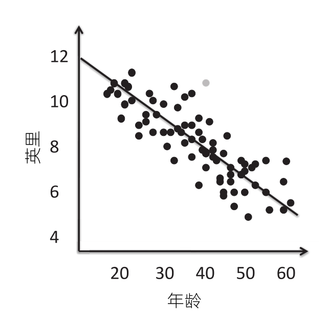
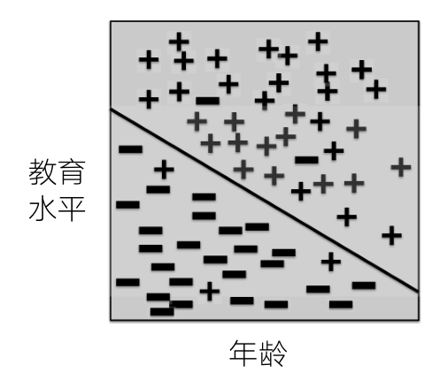
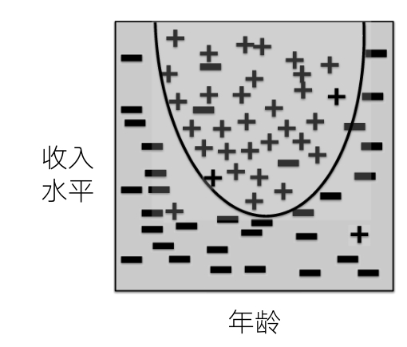
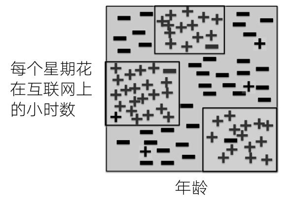

# 07　线性模型

是的，我承认我在说谎。但为什么你非要强迫我给出一个线性解释呢！线性解释几乎总是谎言。

埃莱娜·费兰特（Elena Ferrante）

模型通常假定变量之间存在某种特定的函数关系。这种关系可以是线性的，也可以是非线性的，或者可以包括阈值效应。在这些模型中，线性模型是最简单且应用最广泛的。本章的重点就是线性模型。教育对收入的影响、因锻炼而增加的期望寿命，以及收入对选民投票率的影响，都可以用线性模型来解释。

在本章的开头部分，先回顾一下单变量线性函数。然后讲解了如何通过回归将数据与线性函数拟合，并揭示各种效应的符号、大小和显著性。我们还讨论了为什么误差、噪声和异质性意味着数据不会全部落在回归线上。接着，我们扩展了线性模型以容纳更多的变量，并讨论了如何拟合多元线性模型。为了建立多变量模型的直觉，我们将成功建模为技能和运气的线性函数。本章的结尾部分总结了如何依靠数据和回归指导行动、减少错误，但是这样做也可能会导致边际行为，进而导致保守的行为。确实，“唯大系数论”思维可能会扼杀创新。为了确定更多的创新项，我们可能需要考虑构建其他更具推测性的模型。

### 线性模型

在线性关系中，由于第二个变量的变化而导致的第一个变量的变化量不依赖于第二个变量的值。假设树木的高度与树木的年龄呈线性关系，那么树木每年生长的高度相同。假设房子的价值随它的面积（平方米）线性增加，那么房子面积扩大 200 平方米所带来的房子价值的增量，等于房子面积扩大 100 平方米所带来的房子价值增量的两倍，400 平方米的扩大使房子的价值增加了 4 倍。

**线性模型** 

在线性模型中，自变量*x* 的变化，会导致因变量*y* 的线性变化，用如下方程表示：

*y* =*mx* +*b* 

其中，*m* 等于直线的斜率，*b* 等于截距，即当自变量等于 0 时的因变量值。

线性回归模型的目标是找到能够最小化到各数据点的直线。线性回归可以解释犯罪、洗衣机销量，甚至可以解释葡萄酒价格的变化。 ¹  假设我们找到了一组年龄介于 20 岁到 60 岁之间的成人的年龄数据以及他们每个星期走路的距离，可以发现如下回归方程：

第*i* 个人步行的英里数=-0.1×年龄* [i] * +12+ε* [i] * 

这个回归方程不仅告诉我们这种效应的符号（距离随年龄的增长而减少），还告诉我们这种效应影响的大小（年龄每增加 1 岁，距离减少 1/10 英里）。在这个例子中，截距并不重要，因为它位于数据范围之外，也就是说，数据原本就不包括年龄接近于 0 的人。根据这个方程，我们可以预测，一个 40 岁的人每个星期步行 8 英里，而 50 岁的人则每个星期步行 7 英里。但是，用于产生回归的数据不会全部都落在回归线上。

图 7-1 显示了用于生成回归线的假想数据。其中灰色圆圈代表的人名叫博比，他 40 岁了，每个星期步行 11 英里，比模型估计的要多走 3 英里。为了使数据与模型一致，我们在方程中给每个数据点增加了一个误差项，用ε表示，等于模型估计值与因变量实际值之间的差异。博比的误差项等于+3 英里。

**图 7-1　散点图和回归线** 

在社会环境和生物环境中，我们不能期待会有完美的线性拟合。结果通常取决于多个变量，但是根据定义，单变量回归只能包含一个变量。由于这些被省略的变量，预测值可能会偏离实际值。博比走的路可能要比预期更多，因为作为植物学教授，他要带他的学生到树林里采集标本。这个模型没有把职业作为一个变量，但是职业有助于解释为什么图 7-1 中的数据点没有落在回归线上。ε项也可能由测量误差引起。如果人们忘记随身携带智能手机，或者将智能手机借给他人，那么利用智能手机收集的健身数据就会包含误差。此外，环境噪音也可能导致误差，比如人们可能会因为坐在颠簸的汽车上而获得额外的步行里程。 ²  

回归线越靠近数据，模型解释的数据越多，*R* ² 就越大（得到解释的百分比越大）。如果数据全部都恰好位于回归线上，*R* ² 就等于 100%。

**符号、显著性和大小** 

线性回归可以告诉我们关于自变量系数的如下内容：

**符号：** 自变量与因变量之间的正相关或负相关。

**显著性（** p**值）：** 系数上非零符号的概率。

**大小：** 对自变量系数的最佳估计。

在单变量回归中，回归线与数据拟合得越好，我们对系数的符号和大小就越有信心。统计学家使用*p* 值来表示系数的显著性，*p* 值等于基于回归的系数不为零的概率。*p* 值为 5%意味着数据由一个系数等于零的过程生成的概率为 1/20。显著性的标准阈值是 5%（通常用\*表示）和 1%（通常用\*\*表示）。但是，显著性并不是我们唯一关心的东西。一个系数可能是显著的，但是却很小。如果真的是这样，就可以对相关关系很有信心，但是变量的影响其实不大。又或者，也可能系数虽然不显著但却很大，这通常发生在有噪声数据或数据带有许多遗漏变量的情况下。

为了阐明如何利用回归来指导行动，不妨想象一下这样一家销售香料的公司。该公司供应超过 100 种香料。客户会购买包含 6 种、12 种或 24 种香料的包装。客户下单后，员工负责包装和运输。将每 8 小时的班次的订单数量作为员工工作年限的函数进行回归，结果如下：

完成的订单数=200+20 \*\*×工作年数

在上面的方程中，工作年数前面的系数 20 的显著性水平为 1%。我们可以确信它是正的。如果这种关系是因果关系，那么这个模型就可以用来预测每个员工每个班次可以完成的订单数量（作为工作年数的函数），还可以使用这个模型来预测某个在职员工明年可以完成的订单数量。在这里，有一个模型的实例，既可以给出预测，也可以指导行动。

#### 相关关系 vs. 因果关系

回归所揭示的是变量之间的相关关系，而不是因果关系。 ³  如果先构建了某个模型，然后用回归检验模型的结果是否得到数据的支持，但那也不能证明因果关系。但是，在我们能够用回归发现显著的相关性之前，有一种方法远比回归方法好，这种方法就是通常所称的“数据挖掘”（data mining）。但是，数据挖掘存在识别与其他因果变量相关的某个变量的风险。例如，数据挖掘可能会揭示维生素 D 的水平与身体总体健康程度之间存在显著的正相关关系。人们多晒阳光有利于吸收维生素 D，因此这种效应可以归于生活方式更积极的那些人在户外度过的时间更长，从而健康状况更好。或者回归可能会发现，某个大学的学术表现与参加马术队的学生人数存在显著相关。但是，马术队与学术水平之间可能并不存在直接的因果关系，但它们与平均家庭收入和学校资助水平相关。

数据挖掘还可能导致虚假的相关关系，即两个变量只是偶然相关。我们可能会发现，名字较长的公司可以获得更高的利润，或者居住在比萨店附近的人更容易患流感。事实上，使用 5%的显著性水平阈值，每检验 20 个变量就会发现有一个是显著的。因此，如果尝试足够的变量，肯定会发现某些显著但虚假的相关性。

我们可以通过创建训练集（training set）和检验集（testing set）来避免报告虚假相关。在训练集上发现的相关性，如果也存在于检验集上，就更可能是真实的。但即便是这样，我们仍然无法保证那就是因果关系。为了证明因果关系，还需要进行一个实验来操纵自变量并观察因变量是否会随之发生变化，或者也可以想办法找到可以证明这类因果关系的自然实验。

### 多元线性模型

大多数现象都有不止一个因果变量和相关变量。一个人的幸福可以归因于身体健康、婚姻美满、子女、宗教信仰和财富等。一栋房子的价值取决于室内面积、庭院大小、浴室数量、卧室数量、建筑类型以及当地学校的质量等。在解释房子价值的时候，可以把所有这些变量都包含在回归中。但是必须记住，随着添加更多的变量，也就需要更多的数据，不然无法得到显著的系数。

#### 实力-运气方程

在讨论多元回归之前，先引入迈克尔·莫布森（Michael Mauboussin）的实力-运气方程，以便对多元方程有一个直观的认识。 ⁴  这个方程说的是，任何成功，无论是日常工作中的成功、体育运动上的成功，还是游戏时的成功，都可以视为实力-运气的一个加权线性函数。

**实力-运气方程** 

成功=*a* ×实力+（1-*a* ）×运气

其中，*a* 位于区间［0，1］上，是技能的相对权重。

如果给实力和运气分配适当的权重（也许通过利用现有数据进行回归，可以得到这样的权重），我们就能够运用这个模型来预测结果。例如，假设一家休闲汽车销售公司的经理发现，用销售数量来衡量的成功有很大的运气成分，那么他就会期待回归均值：本月取得了很好业绩的销售人员下个月可能会回到平均水平。然后，这个经理就可以利用这个模型来指导行动了。比如，他不会为了争取一个连续两个月都取得非常不错业绩的销售人员而付出比竞争对手高很多的薪资。相反，如果回归表明运气对成功几乎没有任何作用，那么连续两个月的业绩就可以作为未来业绩表现的一个很好的预测器。在这种情况下，经理就应该为这个最佳销售人员提供有竞争力的报酬。 ⁵  

同样的逻辑也适用于 CEO 薪酬的决定。在那些“运气决定了成功”的行业中，董事会不应该向 CEO 发放高额奖金。石油公司的利润取决于原油的市场价格，那是一个公司无法控制的变量。因此，一家石油公司的董事会不应该因为某一年公司业绩不错就给 CEO 发放巨额奖金。相反，广告公司则不然：如果广告公司业绩表现良好，那么给 CEO 发放巨额奖金就是一件明智的事情。简而言之，要奖励实力，而不要为运气去买单。事实上，那些很成功的公司都不会为运气付出太多。

即便是最简单的模型，例如上面这个实力-运气方程，也能帮助我们得出深刻的见解。进一步思考这个方程可以发现，即便是在那些成功几乎完全取决于实力的环境中，例如跑步、骑自行车、游泳、下棋或网球比赛，如果不同的参赛者之间实力差异很小，那么运气就会在很大程度上决定谁输谁赢。我们可以预期，在竞争最激烈的比赛中，比如奥运会，进入决赛的选手之间的实力差异很小，因而运气就非常重要了。莫布森把这种情况称为“实力悖论”（paradox of skill）。

历史上最伟大的运动员之一迈克尔·菲尔普斯（Micheal Phelpls）可以说同时位于这个悖论的两端。在 2008 年奥运会的一场决赛中，菲尔普斯在 100 米蝶泳快结束时仍然落后于米洛拉德·卡维奇（Milorad Cavic）。然而幸运女神眷顾了他，菲尔普斯率先触到了池壁。然而，在 2012 年奥运会的一场决赛中，菲尔普斯一直领先于查德·勒·克洛斯（Chad le Clos），但是幸运女神这次没有眷顾他，勒·克洛斯率先触到了池壁。菲尔普斯拥有令人难以置信的实力，但是上一次胜利和这一次失败，却都是运气的产物。

#### 多元线性回归

多元线性回归模型拟合了具有多变量的线性方程，当然同样要最小化到数据的总距离。这些方程包括每个自变量的系数。下面的方程反映了这样一个假设的回归输出：学生在数学考试中的成绩，是学生学习的小时数（HRS）、学生家庭社会经济状况（SES）和上“快班”课程的数量（AC）的函数。

数学成绩=21.1+9.2 \*\*×HRS+0.8×SES+6.9 \*×AC

根据回归分析的结果，学生每多学习一个小时，数学成绩会提高 9.2 分。这个系数有两个\*号，因此它在 1%的水平上显著，这意味着很强的相关性，尽管不是因果关系。这个方程也表明，每参加一个“快班”课程，数学成绩能够提高近 7 分，这个系数也是显著的，但仅仅在 5%的水平上显著。家庭社会经济状况这个变量的取值为从 1（低）到 5（高），系数也为正，但是与零没有显著差异，因此我们可以认为它可能没有什么因果关系。

有了这样一个（或任何形式的）回归方程，我们就可以预测结果。这个模型预测，如果花 7 个小时学习，并同时参加一个“快班”课程，数学成绩就能够达到 90 分左右。这个模型还可以用来指导行动，但必须保持谨慎，因为我们无法推断因果关系。数据表明，花时间学习和参加“快班”课程的学生成绩更好。但是，花时间学习和参加“快班”课程这两个因素也可能没有什么用，因为也许存在选择性偏差（selection bias），那些花更多时间学习、参加“快班”课程的学生，数学成绩可能本来就更好。

即便回归不能说明是什么原因导致数据呈现出来的特定模式，但是至少可以排除其他解释。以美国种族之间的巨大财富差距为例：2016 年，白人家庭的平均财富（约 11 万美元）是非洲裔美国人家庭和拉美裔美国人家庭的 10 倍。各种各样的原因都可以用来解释这种差距，包括制度因素、收入差距、储蓄行为差异或结婚率差距等。回归可以为其中一些解释提供支持并排除其他解释。例如，回归分析表明，非洲裔美国人的婚姻状况与家庭财富之间没有显著关系，因此婚姻状况不能成为这种财富差异的原因。此外，收入差距虽然相当大，但是也不足以解释这种财富差距。 ⁶  

### 大系数与新现实

如前所述，线性回归模型在科学研究、政策分析和战略决策中都发挥着重要作用，部分原因是因为线性回归模型容易估计和解释。而且，随着数据可得性的不断改善，线性回归模型得到了更广泛的应用。“要信只信上帝，要认只认数据”（In God we trust. Everyone else must bring data.）这句话在商界和政界都可以经常听到。对数据的这种依赖（通常意味着线性回归模型），可能会导致我们过于倾向边际行动（marginal action），远离重要的新思想。企业、政府或基金会，都致力于收集数据，拟合线性回归模型，试图找到有最高统计显著性系数的变量，这种努力几乎肯定会导致调整该变量并获得边际收益的行为。

在采取行动的时候，最好选择具有较大系数的变量，而不要选择具有较小系数的变量。与此同时，“大系数至上”这个思路建立在“保守主义”的基础上，它会使我们将注意力集中到较小的改进上，而无法再关注全新的政策。“大系数至上”的另一个问题是大系数的大小对应于给定现有数据的边际效应。正如我们在下一章中会阐述的，通常这种效应将会随着变量值的增大而减少。如果确实是这样，那么当我们试图利用它时，大系数就会变小。

**大系数与新现实** 

线性回归揭示了自变量与我们感兴趣的（因）变量之间的相关程度。如果这种相关是因果关系，那么具有大系数变量的变化就会产生很大的影响。基于大系数的政策在保证能够带来改进的同时，排除了涉及更多根本性变化的新现实。

“大系数至上”思维方式的替代者是“新现实思维”。如果说，大系数思维可以拓宽道路、建造高利用率的车道以减少交通拥堵，那么新现实思维就相当于建造了铁路和公共汽车系统。大系数思维为低收入家庭的学生购买计算机提供补贴，新现实思维则直接为每个人都提供了计算机。大系数思维改变了飞机上座位的宽度，新现实思维则创造了一个使用可互换吊舱的飞机机舱。大系数思维已经相当不错了，因为基于证据的行为是明智的，但我们也必须同时关注重要的新思想。当我们遇到重要的新思想时，可以用模型去探究它们是否可行。对青少年交通事故的回归也许会告诉我们，年龄的系数是最大的，这意味着提高驾驶年龄的政策也许能起到一定作用。还可以采取更多的政策，例如禁止夜间驾驶的宵禁、通过智能手机自动监控青少年驾驶员或限制青少年驾驶汽车的乘客数量等。这些新现实政策带来的效果可能比大系数带来的要好。

### 小结

总而言之，线性模型需要假定效应大小不变。线性回归为我们对数据进行第一轮加工提供了一个强大的工具，有了它，我们能够识别出变量的符号、大小和显著性。如果我们希望了解咖啡、酒精或苏打水对健康的影响，就可以进行回归分析。我们可能会发现，喝咖啡会降低心血管疾病的风险，适量饮酒也有同样的效果。这也就是说，在现有数据范围之外推断线性效应时必须非常小心。我们绝对不能推断，喝 30 杯咖啡、6 瓶葡萄酒会是个好主意。我们不应该用线性模型对过于久远的未来进行预测。从 1880 年到 1960 年，加利福尼亚州的人口增长率为 45%，如果进行线性预测，那么我们将会预测 2018 年加利福尼亚州的人口会达到 1 亿人，但这超出了实际人口水平的两倍。

请记住，线性模型只是一个开始，大多数有趣的现象都不是线性的。因此，回归模型通常会包括非线性项，例如年龄的平方、年龄的平方根，甚至包括年龄的对数。为了解释非线性，我们还可以将线性模型首尾相连，这些连接起来的线性模型可能近似于曲线，就像我们可以使用直边的砖块来砌出弯曲的路径一样。虽然线性可能是一个强大而不切实际的假设，但是它至少提供了一个很好的起点。在给定了数据的情况下，可以使用线性模型来检验我们的直觉判断。然后，我们可以构建更精细的模型，其中变量的影响会随着它的增加（收益递减）或变得更强大（正回报）而减弱。这些非线性模型正是下一章要研究的重点。

**对数据的二元分类** 

在当今这个大数据时代，组织普遍使用根据模型建立的算法对数据进行分类。政党可能想要了解哪些人投了谁的票，航空公司可能想知道常客的特点，某项活动的组织者可能想要了解哪些人会参加这项活动。在所有这些情况下，它们所使用的方法都将相关的人分成了两组：一组是“正”的（+），也就是购买了、贡献了、注册了的人；另一组是“负”的（-）。

分类模型应用算法根据人们的年龄、收入、教育水平或在互联网上花费的时间等性质，将人划分为不同的类别。不同的算法意味着不同的属性与结果之间关系的基础模型。应用多种算法，也就是使用许多模型，能够产生更好的分类。

**线性分类：** 在图 a 中，“正”（+）代表参加投票的人，“负”（ -）代表没有参加投票的人。在此基础上，可以用一个反映人们年龄与教育水平的线性函数来对某个人是否会参加投票进行分类。数据表明，受过更多教育的人更有可能去投票，同时年龄大的人也更有可能去投票。在这个例子中，图中的直线近乎完美地实现了分类。   ⁷   

**图 a　用线性模型对投票行为进行分类** 

**非线性分类：** 在图 b 中，“正”（+）代表航空公司的常客（每年飞行超过 1 万英里的旅客），“负”（ -）代表航空公司的所有其他旅客。中年人和收入更高的人更有可能乘坐飞机旅行。要对这些数据进行分类，需要先利用某个深度学习算法（如神经网络算法）找到一个非线性模型。神经网络模型包含多个变量，因此它们几乎可以拟合任何曲线。 

**图 b　用非线性模型对航空公司的常客进行分类** 

**决策树森林：** 在图 c 中，“正”（+）表示参加科幻大会的人，基于他们的年龄和每个星期花在互联网上的小时数。在这里，我们使用了三棵决策树对数据进行分类。决策树根据各种属性不同的条件组合进行分类。图中显示的三棵决策树分别为： 

决策树 1：如果年龄<30 岁

且每个星期花在互联网上的小时数介于［15，25］岁之间

决策树 2：如果年龄介于［20，45］岁之间

且每个星期花在互联网上的小时数>30

决策树 3：如果年龄>40 岁

且每个星期花在互联网上的小时数<20

**图 c　用决策树森林对会议参与者进行分类** 

树木的集合称为森林。机器学习算法会在一个训练集上随机构造出树，然后将那些在检验集上准确分类的树保存下来。