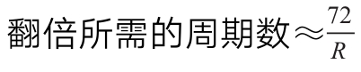
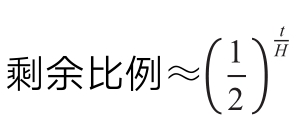
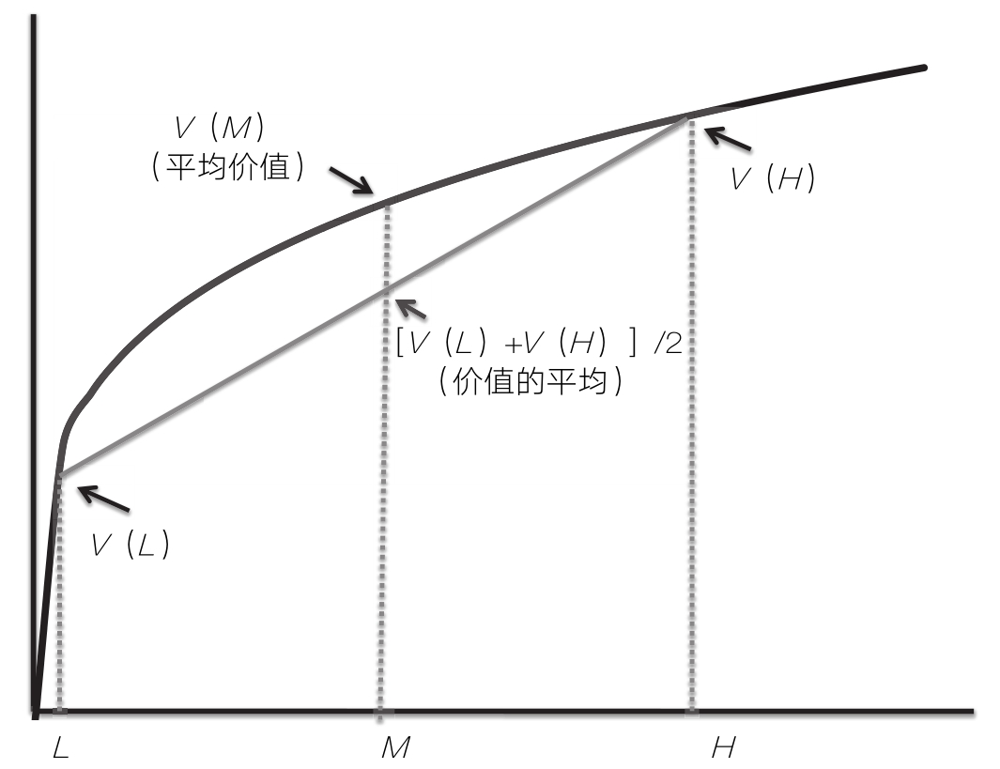
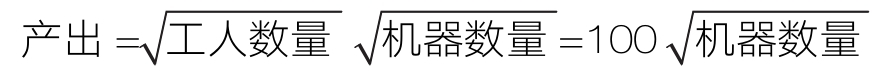
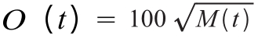
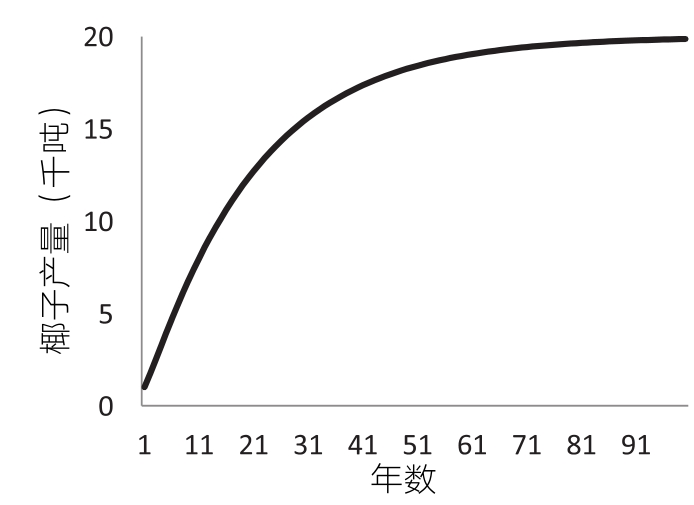
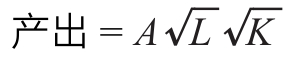
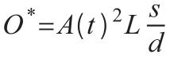

# 08　非线性模型

讨论非线性科学，就类似于讨论无大象的动物学。

约翰·冯·诺伊曼

在本章中，我们介绍非线性模型和非线性函数。非线性函数可以向下或向上弯曲，可以形成 S 形，还可以扭结、跳跃和波动。在下文中，我们将会讨论到所有这些可能性。现在先从依赖于凸性和凹性的模型开始讨论。我们阐明了增长和正反馈是如何产生凸性的，收益递减和负反馈又是如何产生凹性的。在绝大多数学科中，都包含了这两类模型。

关于生产的经济学模型假设交货期和库存成本会随着企业规模的增大而减少，从而使每单位产品的销售利润成了企业规模的一个凸函数，这也就解释了为什么沃尔玛能够获得如此高的利润。 ¹  关于消费的经济学模型则假设效用（或价值）是凹的，也就是说，第 5 块比萨带给我们的享受比第 1 块比萨小。在一个生态系统中，当一个新物种入侵并无须面对任何天敌时，其“人口”会以恒定的速率增长，这就产生了一个凸函数。但是随着“人口”的增长，它们的食物就会减少。因此，作为种群规模函数的适合度（fitness）是凹的。

本章由三个部分组成。第一部分讨论凸函数，包括了人口增长和衰退模型。第二部分讨论凹函数。在这一部分中，我们将会看到凹性意味着风险规避和对多样性的偏好。在第三部分中，我们研究了一系列经济学中的增长模型，它们结合了凹函数和线性函数。

### 凸函数

凸函数的斜率是递增的：函数值随度量值的增加而增加。例如，在一个人群中，可能结成的“对”的数量是这个群体人数的凸函数。一组 3 人，可以结成 3 个不同的“对”；一组 4 人，可以结成 6 个不同的“对”；一组 5 人，则可以结成 10 个不同的“对”。群体规模每增大一些，都会导致“对”的数量有更大的增加。与此类似，每一次，当厨师增加了一种新的香料时，他可以使用的香料组合数量就会增加很多。

我们要讨论的第一个凸函数模型是指数增长模型（exponential growth model），它描述的是一个变量的数量（通常是指人口或资源）与它的初始值、增长率和周期数之间的函数关系。

**指数增长模型** 

时间*t* 的资源值*V* * [t] * ，其初始值为*V* [0] ，且以速率*R* 增长，可以写成如下方程：

*V* * [t] * =*V* [0] （1+*R* ）^t 

这个单方程模型在金融、经济、人口、生态以及技术等领域中都发挥着核心作用。当我们把它应用于金融问题时，这里的变量就是货币。利用这个方程，我们可以计算出，年利率为 5%时 1 000 美元债券在一年后的价值会增加 50 美元，而到第 20 年将增加 100 多美元。为了得出清晰的推论，我们假设增长率固定不变。根据这个假设，可以利用指数增长方程推导出 72 法则（Rule of 72）。

**72 法则** 

如果一个变量在每个周期内以*R* （增长率小于 15%）的百分比增长，那么下面提供了一个很好的近似：

72 法则量化了最高增长率的累积效应。1966 年，津巴布韦的人均国内生产总值为 2 000 美元，是博茨瓦纳的两倍。但是在接下来的 36 年里，津巴布韦几乎没有增长，而博茨瓦纳的年平均增长率则达到了 6%，这意味着博茨瓦纳的人均国内生产总值每 12 年就会翻一番。于是在 36 年中，博茨瓦纳的人均国内生产总值翻了三番（增加了 8 倍）。因此，到了 2004 年，博茨瓦纳的人均国内生产总值达到了 8 000 美元，相当于津巴布韦的 4 倍。

同样是这个公式，还揭示了为什么房地产泡沫必定会结束而技术进步则不会。2002 年，美国的房价上涨了 10%。这个增长率意味着每 7 年翻一番。如果这种趋势一直持续 35 年，那么美国的房价将会翻五番，即增长 32 倍。这也就是说，一栋在 2002 年价格为 20 万美元的房屋在 2037 年将上涨到 640 万美元。当然，价格不可能一直这么涨下去，泡沫必定会破灭。与此不同，摩尔定律（Moore's law）则指出，可以安装在一块集成电路上的晶体管数量每两年会增加一倍。摩尔定律之所以持续存在，是因为用于研发的投入带来了近乎恒定不变的进步速度。

人口学家则用指数增长模型研究人口问题。如果每年增长 6%，那么人口在 12 年内就会翻一番，在 36 年内会翻三番，在 100 年内则会翻八番，即增长 256 倍。早在 1798 年，英国政治经济学家、人口学家托马斯·马尔萨斯（Thomas Malthus）就观察到了人口数量呈指数增长的现象，并在给出的一个模型中指出，如果经济体生产粮食的能力是呈线性增长的，就会出现粮食危机。短期的变化如下：人口增长模式为 1、2、4、8、16、32……；而粮食生产的增长模式则为：1、2、3、4、5……。马尔萨斯预测，灾难很快就会发生。幸运的是，出生率不久之后就下降了，工业革命的到来也极大地提高了生产率。如果这两件事情都没有发生，那么马尔萨斯的预测应该是正确的。关键是，马尔萨斯忽视了创新的潜力。本章下面将要给出的模型重点就是创新，它颠覆了马尔萨斯担心的趋势。

指数增长模型也可以用于研究物种的增长，当然不仅仅适用于兔子。当你受到细菌感染时，那些肉眼不可见的细菌会以极高的速度繁殖。人类鼻窦中的细菌每分钟都在以 4%的速度增加。应用 72 法则，我们可以计算它们每 20 分钟就会翻一番。一天之内，每个初始细菌都会繁衍出超过 10 亿的后代。 ²  当然，由于鼻窦的物理空间有限，它们不可能一直繁殖，没有空间时增长就会停止。食物的限制、天敌的存在、生存空间的缺乏，都会减缓增长。有些物种，例如生活在美国郊区的鹿，或者被毒枭巴勃罗·埃斯科巴（Pablo Escobar）带入哥伦比亚的河马，虽然繁殖速度远远不如细菌，但是由于受到的限制很少，它们的种群迅速增大。 ³  

具有正斜率的凸函数会以递增的值增加，具有负斜率的凸函数就会变得不那么陡峭，也就是说，最初具有较大负斜率的凸函数将逐渐走平。半衰期模型（half-life model）中的方程就是如此，这个模型可以用来刻画分解、折旧和遗忘。

在半衰期模型中，每*H* 周期，数量就会衰减一半。因此，我们把*H* 称为该过程的半衰期。对于某些物理过程，半衰期是恒定的。所有有机物都包含两种形式的碳：不稳定的同位素碳-14，以及稳定的同位素碳-12。在活的有机物中，这些同位素是以固定比例存在的。当有机体死亡后，体内的碳-14 开始分解，其半衰期为 5 734 年，碳-12 的数量则不会改变。美国物理化学家威拉德·利比（Willard Libby）意识到，通过测量碳-14 与碳-12 的比例，就可以估计化石或人工制品的“年龄”，这种技术被称为放射性碳年代测定法（radiocarbon dating）。现在，古生物学家已经将放射性碳年代测定法应用于测定恐龙、猛犸象和史前鱼类遗骸的年代了。考古学家则用这种方法来判断古生物的真伪。利用这种方法，考古学家估计，在意大利阿尔卑斯山发现的冰人“奥茨”（Ötzi）的遗骸有 5 000 年的历史。而于 1357 年首次出现在公众眼前的“都灵裹尸布”则被认定为是 14 世纪的物品，而不是某些人所声称的用于耶稣基督葬礼的那一块。

**半衰期模型** 

如果每*H* 周期，剩余数量的一半会衰减，那么在*t* 周期后，剩余的比例为：

半衰期模型的一个新应用是在心理学中。早期的心理学研究表明，人们几乎以接近固定不变的速度忘记信息。人们记忆的半衰期取决于事件的显著性。 ⁴  2016 年，电影《聚焦》（*Spotlight* ）获得了奥斯卡最佳影片奖。假设，人们对奥斯卡获奖记忆的半衰期为两年，那么到了 2018 年，有 1/4 的人会记住这一事实；但是到了 2026 年，将只有 1/1024 的人还会记得这件事情。但对任何特定事件的回忆因人而异，对《聚焦》的导演汤姆·麦卡锡（Tom McCarthy）来说，他可能永远不会忘记他是哪一年获得奥斯卡奖的。

### 凹函数

凹函数与凸函数相反。凹函数的斜率是递减的。具有正斜率的凹函数会呈现收益递减的特点：当我们拥有的东西越来越多的时候，每个额外东西所能带来的价值会越来越少。几乎所有商品的效用或价值都呈递减趋势。闲暇越多、金钱越多、冰激凌越多，甚至与爱人共度的时光越多，对我们的价值就越小。一个直观的证据源于如下事实：包括巧克力在内，对任何事物的消费越多，我们就会越不觉得享受，同时愿意为它付出的代价也就越少。 ⁵  

收益递减可以解释很多现象，包括为什么异地恋往往能够带来很大的幸福感。如果你每月只能与你的伴侣相聚几个小时，那么每多一分钟都是一个莫大的惊喜。而在一个月不间断的相处后，幸福曲线的斜率就会变平，从而额外增加的相聚时间就变得不那么重要了。 ⁶  同样的逻辑也可以解释为什么房地产开发商喜欢邀请人们在周末免费去他们的海滨公寓。在短暂的周末，你无法在海滩上享受足够长的时间，你会很想把房子买下。相反，如果让你在海滩上连续待上十天半个月，你可能就会觉得无聊。

当我们假设了凹性时，也就隐含地假设了对多样性和风险规避的偏好向。要证明前者，只需要给出一个有多个参数的凹函数就可以。如果人们的幸福曲线是凹性的，而且闲暇和金钱都在增加，那么人们就会更偏好休闲和金钱的组合，而不怎么喜欢只有金钱、没有闲暇或只有闲暇、没有金钱。而风险规避则意味着更偏好确定的有把握的事情而不怎么喜欢彩票，也就是不确定的事情。例如，一个厌恶风险的人会更喜欢得到 100 美元，而不是只有一半机会得到 200 美元，另一半机会什么也得不到。一个厌恶风险的人也更喜欢双层冰激凌甜筒，而不怎么喜欢要么没有冰激凌、要么可以得到四层冰激凌。

图 8-1 说明了为什么凹性就意味着风险规避。这幅图描绘了 3 种结果的幸福价值（幸福感）：高结果（*H* ）、低结果（*L* ），以及前两种结果的平均值（*M* ）。给定形状向下的曲线，平均结果的幸福感会超过低结果和高结果的平均幸福感。凸函数情况下则相反。凸性意味着风险爱好：我们更喜欢的是极端值，而不是平均值。可以购买的股票数量是其价格的一个凸函数，因此，股票买家更喜欢价格波动。如果价格不断上涨和下跌，买家最终能够获得的股票比价格保持不变时获得的更多。 ⁷  

**图 8-1　风险规避：平均价值>价值的平均** 

### 经济增长模型

接下来，我们将构建一系列经济增长模型。这些模型不仅揭示了增长的原因，还可以解释和预测各国的增长模式，还可以指导例如提高储蓄率等的行为。为了给对增长模型的研究奠定基础，我们先引入一个标准的经济生产模型，其中产出取决于劳动和实物资本。经验证据和逻辑都支持产出是劳动力和资本凹函数的假设。保持固定资本，随着投入的劳动力的增加，劳动力的价值应该变得越来越低。同样，在保持工人数量不变的情况下，添加更多的机器或计算机会增加更少的价值。逻辑推理还表明，产出应该是线性的，工人数量和资本总额翻番应该能使产出翻番。这就是说，一家拥有 60 名工人和一栋厂房的扫帚生产企业，在新建了一栋同样大小的厂房并多雇用了 60 名工人后，它的产出肯定应该翻番。柯布-道格拉斯模型（Cobb-Douglass model）是经济学中使用最广泛的模型之一，它同时包括了这两种性质。产出是劳动力和资本的凹函数，而且从规模上看是线性的。这个模型既可以应用于单个企业，也可以应用于行业或整个经济生产。 ⁸  

**柯布-道格拉斯模型** 

给定*L* 个工人和*K* 个单位资本，总产出如下所示：

产出=常数×*L* * ^a * *K* ^(（1-) * ^a * ^） 

其中*a* 是介于 0 到 1 之间的实数，表示劳动力的相对重要性。

接下来，我们利用柯布-道格拉斯模型来构建经济增长模型。简化起见，我们假设经济体中有 10 000 名工人，并暂且不考虑工资和价格，这使我们能够专注于分析机器数量的变化是如何影响总产出的。然后，将资本投资与增长联系起来。为了使模型尽可能简单，再假设只生产一种商品——椰子。椰子含有丰富的椰汁和椰奶，可以作为食物。然而，椰子长在高高的树上，所以工人需要使用某种机器才能把它们摘下来。接下来，再做出一个非常不现实的假设，即机器本身也是用椰子制成的。这样可以简化模型，同时也保持了当前消费与未来投资之间的关键权衡。作为柯布-道格拉斯模型的一个特例，我们将生产函数写为工人数量的平方根乘以机器数量的平方根，即：

如果经济体中只有一台机器，那么产量等于 100 吨。如果人们消费掉了所有 100 吨椰子，就不能投资制造新机器了，从而明年的产量将保持不变，也就是经济没有增长。如果他们投资 1 吨椰子制造了第 2 台机器，产量将增加到 141 吨，增长率为 41%。如果他们制造了第 3 台机器，那么产量将增加到 173 吨。 ⁹  通过不断地投资，经济增长率却逐渐下降，因此产出是一个凹函数。

我们已经大体知道投资是如何推动增长的。现在可以构建一个包含投资规则的更加精细的模型。假设投资等于储蓄率乘以产出，并假设机器按某个不变的折旧率折旧。例如，到了年底，不能再用的机器数量等于机器总数的某个固定比例。然后就可以得出，下一年的机器数量等于上一年的机器数量加上新投资的机器数量，再减少因折旧而减少的机器数量。于是，这个完整的简单增长模型由 4 个方程组成。

**简单增长模型** 

**产出函数：** 

**投资规则：** *I* （*t* ）=*s* ×*O* （*t* ）

**消费-投资方程：** *O* （*t* ）= *C* （*t* ）+*I* （*t* ）

**投资-折旧方程：** *M* （*t* +1）= *M* （*t* ）+*I* （*t* ）-*d* ×*M* （*t* ）

其中，*O* （*t* ）=产出，*M* （*t* ）=机器，*I* （*t* ）=投资，*C* （*t* ）=消费，*s* =储蓄率，*d* =折旧率。

假设这个经济体中有 100 台机器，储蓄率为 20%，折旧率为 10%，产量等于 1 000 吨椰子，消费量等于 800 吨椰子，新投资 200 台机器。再假设，因折旧而损失的机器为 10 台，也就是在新的一年开始时将有 290 台机器。通过类似的计算可知，在第 2 年，产出将增长为 1 702 吨，而第 3 年的产出则将为近 2 500 吨。 ¹⁰  由此可见，在这前 3 年，产出以递增的速度在增长。但是这种凸性只会在前几年出现，原因是机器的初始数量很少，因而折旧几乎完全不会产生任何影响。

随着时间的推移，机器数量的增加和折旧开始变得十分重要。从长远来看，产出的增长将完全停止（图 8-2）。只要分析一下模型，就可以找到原因。投资是线性的，因为增加的新机器的数量是随产出呈线性增加的，同时产出则是机器数量的凹函数。因此，随着经济的增长，投资与机器数量的关系也是凹性的。然而，折旧与机器数量之间却是线性关系。最终线性折旧会赶上产出的凹性增长。

**图 8-2　简单增长模型中前 100 年的产出** 

在经济的长期均衡中，投资的新机器数量等于折旧损失的机器数量。在这个简单增长模型中，当经济体拥有 40 000 台机器并生产 20 000 吨椰子时，这种长期均衡就会出现。在这一点上，经济体在新机器上投入了 20%的产出或 4 000 吨椰子，恰恰等于因折旧而损失的机器数量，也就是 40 000 台机器当中的 10%。因此，因折旧而损失的机器数量等于通过投资和停止增长所创造的新机器数量。 ¹¹  

#### 索洛^(\*) 增长模型

现在构建一个更一般的模型，它是索洛增长模型（Solow Growth Model）的简化，因此我们在索洛后加了一个**星号** 。我们用实物资本取代机器，并将劳动力视为一个变量。此外，还添加了一个技术参数，它可以线性地增加产出。创新会使这个参数增大。与简单增长模型一样，当投资等于折旧时，长期均衡就会出现。不过，在这里，人们认为均衡时的产出水平取决于劳动力数量和技术参数，以及储蓄率和折旧率。 ¹²  

**索洛** ^(\*) **增长模型** 

经济体中的总产出由以下方程给出：

其中，*L* 表示劳动量，*K* 表示实物资本量，*A* 表示技术水平。长期均衡产出*O* ^(\*) 由下面的方程给出： ¹³  

长期均衡产出随劳动力数量的增加、技术的进步、储蓄率的提高而增加，同时随折旧率的上升而下降。这些结果都不足为奇。更多的工人、更先进的技术和更多的储蓄理应可以增加产出，更快的折旧理应减少产出。但是，产量随着劳动力数量的增加和储蓄率的提高而线性增长这个事实却着实令人惊讶。劳动只能带来递减的收益，因此如果不考虑模型，我们可能会预测长期产出与劳动力数量之间是凹性关系。但是，随着劳动力数量的增加，产出也会增加，投资也会增加，进而带来更高的产出。从长远来看，投资的正反馈恰好抵消了收益递减。均衡产出与折旧率之间的关系是凸性的，折旧率降低 20%可以使产出增加 25%。

长期均衡产出也会随技术改进的平方而增加。因此，创新增加的产出要比线性增长更快。我们可以使用这个模型来了解其原因。如果从一个长期均衡的经济体开始，并将技术参数提高 50%，那么产出将会增加 50%，投资也将增加 50%。然后投资超过了折旧，经济继续增长，投资将继续超过折旧，直到经济再增长 50%为止，在这一点上，因折旧而造成的资本损失抵消了投资。这个计算过程揭示了创新乘数（innovation multiplier）的存在，创新有两个效应。首先，创新直接增加产出；其次，创新间接导致更多的资本投资，从而导致产出再次增加。因此，创新是持续增长的关键。 ¹⁴  

需要注意的是，产出的这些增加不是瞬间发生的。当技术出现了一个突破时，技术参数的变化是相当缓慢的。直接效应的影响需要随着时间的推移显现。旧的实物资本必须被新技术的新实物资本所取代。当计算机技术进步刚刚发生时，一般企业的计算机不会马上变得更快，只有当技术发生了变化并且企业购买了新计算机之后，它们才会变得更快。实物资本投资增加导致的二阶增长则会发生在更长的时间范围内。技术与技术对增长的影响之间的滞后，可能意味着创新在出现后的几十年时间内都会导致增长。火车是在 19 世纪早期发明的，但是镀金时代（Gilded Age）并没有马上开始，直到 19 世纪的后半期才到来，这是一个长达 50 多年的“时滞”。另一个例子是，在阿帕网（ARPANET）出现整整 30 年后，互联网才开始步入繁盛期。 ¹⁵  

#### 国家缘何成功与失败

我们还可以将增长模型应用于一系列重大政策问题，例如，落后国家是否可以赶上发达国家？为什么有些国家取得了成功而有些国家却失败？政府在促进增长方面能够发挥什么作用？这些研究揭示了增长模型的价值和局限性。为了便于说明，不妨从低国内生产总值的国家实现快速增长的能力开始讨论。模型证明，资本积累可以实现快速增长，技术投资也可以。一个实物资本较少的落后国家，有可能通过新的资本投入进入技术前沿，从而实现难以置信的高速增长。 ¹⁶  

创新对长期增长来说是必不可少的，这种必要性也意味着一次性进口新技术有很大的局限性，而持续增长需要创新。

这些模型也表明，攫取和腐败，也就是政府将经济体的产出挪用于政府开支，会减少储蓄，进而削弱增长。对经济增长率的跨国比较研究的结果支持以下这些观点：减少攫取和腐败以及促进创新，都能推进经济增长。实现这些目标，需要一个强大但有限的中央政府来促进多元化。强大的中央政府能够保护产权、贯彻法治。多元主义能够阻止精英的俘虏，精英往往更喜欢现状，可能不会接受创新，因为创新往往可能具有很大的破坏性。

举一个破坏性创新的例子：克雷格列表网（Craigslist）。用户可以自行在这个网站上发布待售和求助广告。在 21 世纪初，克雷格列表网导致美国平面媒体行业失去数十万个工作岗位，但其实在那个时候，克雷格列表网本身只雇用了几十名员工而已。虽然许多人失去了工作，但是克雷格列表网通过增加技术参数使整体经济更有效率。而在一个多元化程度较低的社会中，平面媒体行业可能会游说政府禁止克雷格列表这样的网站。很显然，这样做将会减缓经济增长。

**中国的经济优势** 

**线性模型** +72**法则** ：从 1960 年到 1970 年，日本的国内生产总值以每年 10%的速度增长。根据线性模型的预测，连年 10%的增长，会使日本经济每 7 年翻一番（运用 72 法则）。1970 年，日本人均国内生产总值约为 2 000 美元（以当前美元计）。如果这种增长趋势持续下去，那么到 2012 年，日本的人均国内生产总值将会翻六番，也就是说，人均国内生产总值将达到 128 000 美元。 

**增长模型** ：增长模型对日本经济增长的解释为实物资本投资的结果。这个模型还预测日本经济增长在一段时间内将会是凹性的。具体来说，这个增长模型的预测是，当日本的国内生产总值接近美国和欧洲时，日本的经济增长率会降低到 1% ～2%的跨国平均值。   ¹⁷   证据支持这个预测。从 1970 年到 1990 年，日本国内生产总值的年 增长率大约为 4%。但是从 1990 年到 2017 年，它的增长率仅为 1%或更低。 

**中国的增长** ：从 1990 年到 2010 年，中国国内生产总值的增长率接近 10%。2016 年，中国的人均国内生产总值达到了 8 000 美元左右；正如增长模型预测的那样，增长速度已经放缓了。从 2013 年至 2017 年，增长率接近 6%。同样，在中国，10%的增长率不可能一直持续下去，这与 72 法则相悖。如果中国经济在整个 21 世纪一直保持 10%的增长水平，那么到这个世纪结束时，中国的人均国内生产总值将会超过 1 亿美元。 

### 这毕竟是一个非线性的世界

之所以要构建非线性模型，是因为我们感兴趣的现象很少是线性的。在本章中，我们看到收益递减和收益递增是许多经济、物理、生物和社会现象的共同特征。我们还看到，在模型中包含曲率是有重要含义的。也许最重要的是，我们看到了函数形式能够影响我们的思维，用函数拟合数据有助于做出精确的表述。科学家可以使用碳-14 数据来计算人工制品的年龄，经济学家还可以估计经济小幅增长的长期影响。

本章的一个核心结论是，一旦包括了非线性，直觉就变得不够用了。直觉可以告诉我们影响的方向：储蓄的增加、劳动力的增加和技术创新可以加快增长。模型还揭示了这些影响的形状和形式。正如我们所料，储蓄具有线性效应。从长远来看，劳动力的增加也是如此，即便模型假设短期收益递减。创新的增加还会产生乘数效应，我们对这种效应取其平方。第一个增长是创新的直接影响，产出的第二次增长则来自资本的增加。

在模型的帮助下，这些见解会变得很清晰。如果没有模型，我们通常可以推断出上升和下降的内容，但缺乏对功能关系形式的理解。我们会倾向于以线性的方式来思考，从而得出日本的经济将很快成为世界霸主的结论。利用模型，我们可以更好地思考非线性效应。也就是说，本章中介绍的凹函数型和凸函数，在非线性模型的巨大海洋中，只不过是沧海一粟。如果我们希望提高在复杂世界中推理、解释和行动的能力，就需要更深入地研究非线性现象。