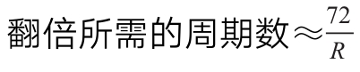
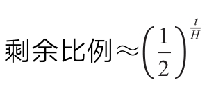
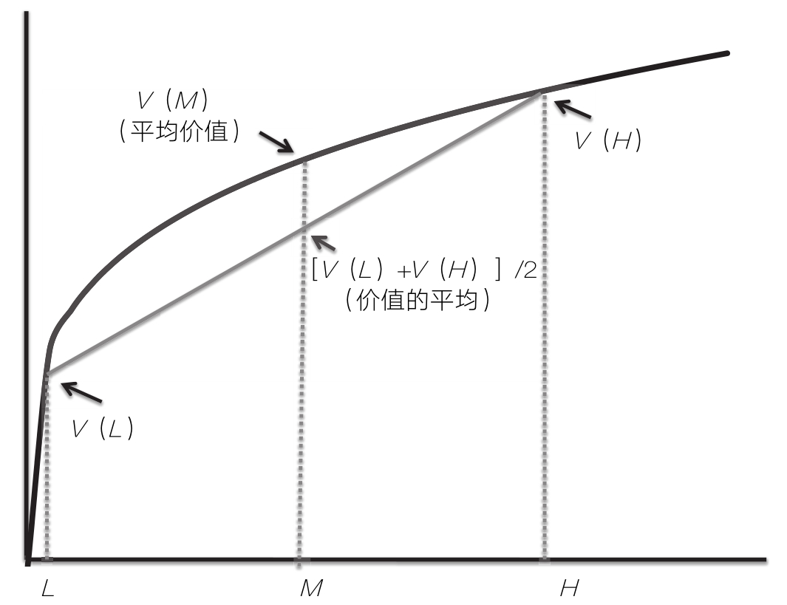
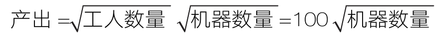
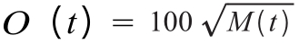
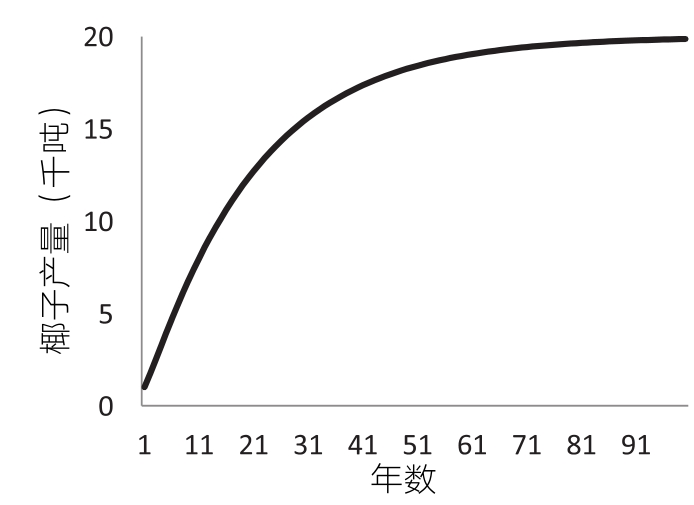
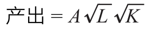
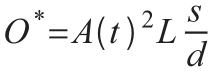

# 别被直线骗了：真实世界的增长、遗忘与风险，都藏在曲线里

冯·诺伊曼曾打过一个很妙的比方：谈非线性科学却绕开非线性模型，就像讲动物学却假装没有大象。现实中的曲线也的确不老实——它们会向上翘、向下弯，会拉成 S 形，也会扭结、跳跃、起伏。理解这些弯曲，往往比记住一条直线更有用。

非线性函数大致可以归入凸性与凹性两类。增长和正反馈会把曲线推成凸形；收益递减和负反馈则让曲线向下弯。很多学科都同时装着这两套模型。下面就从凸曲线说起，再看凹曲线，最后走进经济增长模型。

## 一、凸性：越增长，增量越猛

凸曲线有个鲜明特征：斜率一路走高。度量值变大时，函数值不只增加，而且增加得越来越快。人群里能结成的“对子”就是例子：3 个人能配出 3 对，4 个人能配出 6 对，5 个人则能配出 10 对。人数每多一点，“对子”数量就蹿升得更厉害。厨师每多添一种香料，可搭配的组合也会陡然增多。

最典型的凸函数模型是指数增长。它描述一个变量在初始值、增长率和周期数共同作用下的变化，在金融、经济、人口、生态和技术领域都能派上用场。把货币代入其中，年利率 5% 时，1000 美元债券一年后多出 50 美元，到第 20 年则会多出 100 多美元。只要假设增长率固定，就能从指数增长方程推出一个便捷工具——72 法则。

72 法则把高增长的累积效应说得很直白。1966 年，津巴布韦人均国内生产总值是 2000 美元，达到博茨瓦纳的两倍。可接下来 36 年，津巴布韦几乎原地踏步，博茨瓦纳却保持年均 6% 的增长。按这个速度，人均 GDP 每 12 年翻一番，36 年就是翻三番、变成原来的 8 倍。到 2004 年，博茨瓦纳人均 GDP 达到 8000 美元，反而是津巴布韦的 4 倍。

同样的公式还能解释房地产泡沫为什么终会收场，而技术进步却可以延续。2002 年美国房价上涨 10%，意味着大约 7 年翻一番。若这种趋势硬撑 35 年，房价会翻五番、涨到 32 倍，一栋 20 万美元的房子将变成 640 万美元。这显然不可能无休止地持续，泡沫总有破灭的一天。摩尔定律则不同：集成电路上的晶体管数量约每两年翻倍，而它之所以能持续，是因为研发投入带来了近乎恒定的进步速度。

人口学家也爱用指数增长模型。若每年增长 6%，人口 12 年翻倍、36 年翻三番、100 年翻八番，也就是增长 256 倍。1798 年，马尔萨斯就注意到人口呈指数增长，并推演出一个结论：如果粮食生产能力只是线性增长，危机迟早爆发。短期看，人口按 1、2、4、8、16、32……增长，粮食按 1、2、3、4、5……增长，差距确实越拉越大。但后来出生率下降，工业革命又大幅提升了生产率，灾难没有按他的剧本上演。马尔萨斯漏算的，正是创新的潜力；而创新，恰恰是后文增长模型的重点。

指数增长并不只属于兔子。细菌感染时，那些肉眼看不见的家伙繁殖极快。人类鼻窦里的细菌每分钟增加约 4%，按 72 法则约 20 分钟翻一番，一天之内一个细菌就能繁衍出超过 10 亿个后代。当然，鼻窦空间有限，食物、天敌和生存空间都会踩刹车。美国郊区的鹿、被毒枭埃斯科巴带进哥伦比亚的河马，繁殖速度远不如细菌，却因为限制很少，种群照样迅速膨胀。

凸曲线也可能带负斜率。这样的曲线最初下降很陡，随后逐渐走平。半衰期模型正是如此，可用来刻画分解、折旧和遗忘：每经过 H 个周期，数量衰减一半。

有些物理过程的半衰期很稳定。活体有机物中，碳-14 与碳-12 保持固定比例；有机体死亡后，碳-14 开始分解，半衰期约 5734 年，碳-12 则基本不变。利比由此想到，测量两者比例就能估算化石或人工制品的年龄，这便是放射性碳年代测定法。古生物学家用它判断恐龙、猛犸象和史前鱼类的年代，考古学家用它辨别古物真伪。阿尔卑斯山冰人“奥茨”被估算为约 5000 年前的人；1357 年首次亮相的“都灵裹尸布”，则被认定是 14 世纪物品，而非某些人所说的耶稣葬礼用布。

半衰期模型在心理学中也有新用途。早期研究表明，人们遗忘信息的速度近乎固定，而记忆的半衰期取决于事件有多醒目。假设人们对奥斯卡获奖影片的记忆半衰期是两年，那么 2016 年拿下最佳影片的《聚焦》，到 2018 年只有 1/4 的人还记得，到 2026 年则只剩 1/1024 的人记得。当然，个体差异很大，对导演汤姆·麦卡锡来说，他大概永远不会忘记自己哪一年捧起奥斯卡。

## 二、凹性：越多，未必越值

凹曲线和凸曲线正好相反，它的斜率逐渐走低。正斜率的凹函数体现收益递减：拥有得越多，每一份新增东西带来的价值就越少。几乎所有商品的效用都逃不过这个规律。闲暇、金钱、冰激凌，甚至与爱人相处的时光，增加得越多，边际价值往往越小。一个直观证据是：包括巧克力在内，任何东西消费得越多，我们越不觉得享受，愿意为它掏的钱也越少。

收益递减能解释不少生活现象，比如异地恋为什么常常幸福感很高。如果一个月只能见伴侣几个小时，那么每多一分钟都是惊喜。可要是连续相处一个月，幸福曲线的斜率就会变平，多出来的相聚时间不再那么金贵。房地产开发商喜欢周末请人免费住海滨公寓，也是同样逻辑：短短一个周末，海滩还没享受够，人很容易动心买房；若让人在海边连住十天半个月，可能就只剩无聊了。

当我们假设凹性时，其实也隐含地假设了人们对多样性和风险规避的偏好。只要给出一个多参数的凹函数就能说明：如果幸福曲线是凹的，而闲暇和金钱都在增加，人们会更喜欢“二者兼有”的组合，而不是只有钱没闲，或只有闲没钱。风险规避则意味着更偏好确定性，而不是彩票式的不确定。一个厌恶风险的人，会更愿意稳稳拿到 100 美元，而不是一半机会得 200 美元、一半机会什么都没有；也会更喜欢双层冰激凌甜筒，而不是要么没冰激凌、要么一次拿四层。

图 8-1 把凹性与风险规避的关系画得很清楚：高结果 H、低结果 L，以及两者的平均值 M。曲线向下弯时，平均结果带来的幸福感，高于高结果与低结果幸福感的平均。凸函数则反过来，凸性意味着风险爱好：人更偏爱极端值，而不是平均值。可购买的股票数量是价格的凸函数，所以股票买家反而喜欢价格波动；价格涨涨跌跌，最终能买到的股票可能比价格不动时更多。

## 三、增长模型：凹产出遇上线性投资

接下来看经济增长模型。它们不仅解释增长从哪来，还能描述和预测各国增长模式，甚至指导提高储蓄率之类的行为。先搭一个标准生产模型：产出取决于劳动和实物资本。经验与逻辑都支持“产出是劳动力和资本的凹函数”——资本固定时，投入的劳动越多，新增劳动的价值越低；工人数量固定时，添置更多机器或电脑，新增价值也会递减。同时，产出在规模上应是线性的：工人和资本总额翻番，产出也应翻番。一家有 60 名工人和一栋厂房的扫帚企业，再建同样厂房、再雇 60 人，产出理应翻倍。柯布-道格拉斯模型同时装下这两种性质，既可用于单个企业，也可用于行业或整个经济。

产出 = 常数 × L^a × K^(1-a)，其中 a 是 0 到 1 之间的实数，表示劳动力的相对重要性。

现在用柯布-道格拉斯模型搭一个增长故事。为简化，假设经济体有 10000 名工人，先不考虑工资和价格，只看机器数量变化如何影响总产出。再假设只生产椰子，椰子长在高树上，工人得靠机器采摘，而机器本身也用椰子制成。这虽然很不现实，却保留了“当前消费”与“未来投资”之间的关键权衡。作为特例，生产函数可写成工人数量的平方根乘以机器数量的平方根：

如果只有一台机器，产量是 100 吨。人们把 100 吨椰子全吃掉，就没法造新机器，明年产量不变，经济没有增长。若省下 1 吨椰子造出第 2 台机器，产量升到 141 吨，增长 41%。再造第 3 台，产量到 173 吨。继续投资，增长率却会逐渐下降，因为产出是凹函数。

把投资规则、消费与折旧放进来，就得到一个更完整的简单增长模型，由四个方程组成：

产出函数：  

投资规则：I(t) = s × O(t)

消费-投资方程：O(t) = C(t) + I(t)

投资-折旧方程：M(t+1) = M(t) + I(t) - d × M(t)

其中，O(t) 是产出，M(t) 是机器，I(t) 是投资，C(t) 是消费，s 是储蓄率，d 是折旧率。

代入一组数：100 台机器、储蓄率 20%、折旧率 10%，产量 1000 吨，消费 800 吨，新投资 200 台机器；折旧损失 10 台，于是下一年开始时共有 290 台机器。照此计算，第 2 年产出增至 1702 吨，第 3 年接近 2500 吨。前三年产出加速增长，但这股凸性只出现在早期，因为机器基数小，折旧几乎不起作用。

时间一长，机器变多，折旧开始发威，长期看产出增长会彻底停住（图 8-2）。原因不复杂：投资是线性的，新机器随产出线性增加，而产出是机器数量的凹函数，所以投资与机器之间也呈凹性；折旧却与机器数量保持线性关系。最终，线性折旧会追上凹性的产出增长。

长期均衡时，投资创造的新机器正好等于折旧损失的机器。在这个简单模型里，经济体拥有 40000 台机器、生产 20000 吨椰子时达到均衡：拿出产出的 20% 即 4000 吨去投资，刚好等于 40000 台机器中 10% 的折旧损失。新机器补上旧机器，增长停住。

索洛增长模型（这里用带星号的简化版）更一般：用实物资本替代机器，把劳动力视为变量，再加入一个能线性提高产出的技术参数，创新会让这个参数变大。和简单模型一样，投资等于折旧时出现长期均衡；均衡产出取决于劳动力、技术、储蓄率和折旧率。

总产出由下式给出：

长期均衡产出 O* 为：

结论是：均衡产出会随劳动力增加、技术进步和储蓄率提高而上升，随折旧率上升而下降。这些方向都不难理解，但有两个结果值得玩味。第一，产出会随劳动力数量和储蓄率线性增长。劳动本身只有递减收益，照理该预测出凹性关系，可劳动力增加会带动投资增加，投资的正反馈恰好抵消了收益递减。第二，均衡产出与折旧率之间呈凸性，折旧率降低 20%，产出可增加 25%。

更有意思的是，长期均衡产出会随技术改进的平方而增加。也就是说，创新带来的产出增长比线性更快。从一个均衡经济体出发，把技术参数提高 50%，产出先增 50%，投资也增 50%；投资超过折旧，经济继续扩张，直到再增长 50%，折旧造成的资本损失才抵消投资。这里藏着“创新乘数”：创新先直接抬高产出，再间接引来更多资本投资，让产出二次增加。所以，创新才是持续增长的关键。

不过，这些增加不会瞬间发生。技术突破出现后，技术参数变化相当缓慢，直接效应要随时间显现，旧实物资本必须被新技术资本替换。计算机技术进步刚发生时，一般企业的电脑不会立刻变快，得等企业买了新电脑才行。投资增加带来的二阶增长，则要更长时间才能兑现。技术与增长影响之间的滞后，可能长达几十年：火车在 19 世纪早期就发明了，镀金时代却要等到 19 世纪后半期，时滞超过 50 年；阿帕网出现整整 30 年后，互联网才步入繁盛期。

国家缘何成功与失败？答案或许就藏在这些弯曲的曲线里：增长从来不是一条直线，投资、折旧、创新以及技术扩散的时滞，共同决定了经济能走多远。

增长模型不只是学术推导，它能用来拆解现实里最关心的几个政策难题：落后的国家有没有可能追上先进国家？为什么有的国家起飞了有的却卡住了？政府在推动增长上到底能做什么、在哪里会越界？这些讨论既展示了模型的解释力，也暴露了它的边界。

先从“后来者能否快速起跑”说起。模型里很清楚，资本的累积和技术的投入都能带来提速。一个实物资本存量很低的发展中国家，只要引入新的资本，就能一下子连到技术前沿，从而实现看起来不可思议的高速增长。¹⁶

但注意，这只是起步的故事。长期的持续繁荣离不开创新。一次性照搬别人的技术有明显天花板，真正能推着经济往前走的是源源不断的原创。没有自主创新，再快的导入速度也会掉下来。

模型对制度的提醒同样尖锐。掠夺式的征用、腐败，实质就是把社会的产出抽走去填政府的开支，这会直接压低储蓄，最终拖累增长。大规模的跨国比较也印证了这一点：削减掠夺与腐败、同时营造创新环境，经济增速普遍上行。要实现这两件事，需要一个强有力却边界清晰的中央机构来培育多元竞争。强有力的中央能守住产权、落实法治；多元则能避免被精英俘获。因为精英往往偏爱稳定现状，而创新天生具有破坏性，容易触动他们的利益。

破坏性创新的典型就是克雷格列表网。用户自己就能在上面发布买卖求助信息。进入21世纪后，这个网站让美国平面媒体行业裁掉了数十万人，却自己长期只维持几十人的团队。虽然短期里有人失业，但从整体看，它通过技术让信息撮合更高效，经济更省力。如果社会多元化不足，报业集团完全可能游说政府封杀这类平台。封杀的结果显而易见：增长被人为按住。

**中国的经济优势**

**线性思维的陷阱 +72法则**。1960到1970年间，日本人均GDP以年均10%的速度攀升。按线性逻辑和72法则算，10%的增速意味着约每7年翻倍。1970年日本人均GDP大约2000美元，以当前价计。如果这条直线一直拉下去，到2012年人均水平会变成约12.8万美元，翻了六番多。

**增长模型的解释**。模型把日本的高速解读为实物资本投入带来的追赶效应，并预言增长会呈现凹型。当经济体接近美欧水平，增速会回落到1%到2%的跨国均值附近。¹⁷ 事实基本应验：1970到1990年日本年均仍有约4%，1990到2017年则滑落到1%甚至更低。

**中国的轨迹**。1990到2010年，中国GDP增速长期贴近10%。2016年人均GDP已到约8000美元左右，和模型预期的那样，增速开始放缓，2013到2017年均值接近6%。10%的速度不可能一直走下去，这和72法则的直线幻想相反。若中国在整个21世纪都保持10%，世纪末人均GDP会突破1亿美元大关，这显然不现实。

### 这终究是一个非线性的世界

我们构建非线性工具，正因为真实世界很少按直线走。本章反复看到的递减收益和递增收益，是经济、物理、生物和社会现象的共同底色。把曲率放进模型，结论会立刻不一样。更关键的是，函数形式会重塑我们思考问题的方式，用合适的曲线去拟合数据，才能把判断说得更精确。考古学家用碳-14测年，经济学家也能用模型估算小幅增长在数十年后的累计效应。

核心启示是：一旦承认非线性，直觉开始失灵。直觉能告诉我们方向，储蓄增加、劳动力增加、技术创新都会拉动增长，但模型揭示的是作用的形态。储蓄在长期里大致呈线性影响，劳动力也是如此，即便短期有递减。创新则不同，它会产生乘数，效果被平方放大。第一层是创新的直接红利，第二层来自创新带来的资本深化。

有了模型，模糊的感觉才会被看见。没有模型，我们只能判断涨跌，却看不清函数关系的形状。人很容易线性外推，以为日本会一直称霸世界。借助模型，我们才能正视凹性和凸性这类非线性特征。事实上，本章提到的凹函数和凸函数，只是非线性海洋里的一点浪花。若想在复杂的世界里更理性地解释和行动，就必须更深入地研究非线性本身。