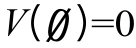
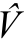
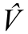
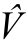
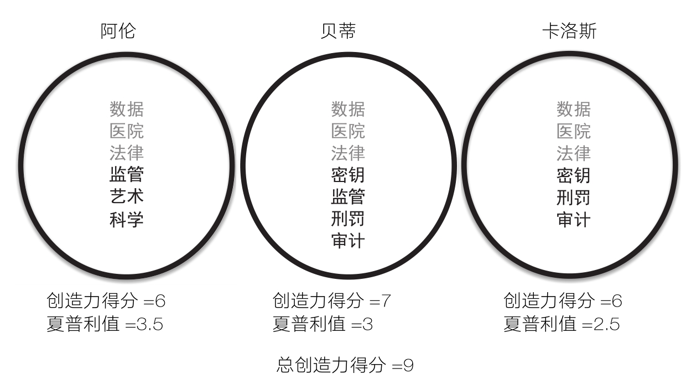
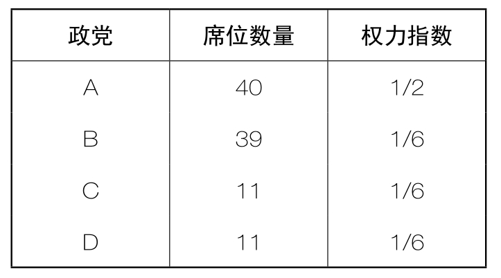
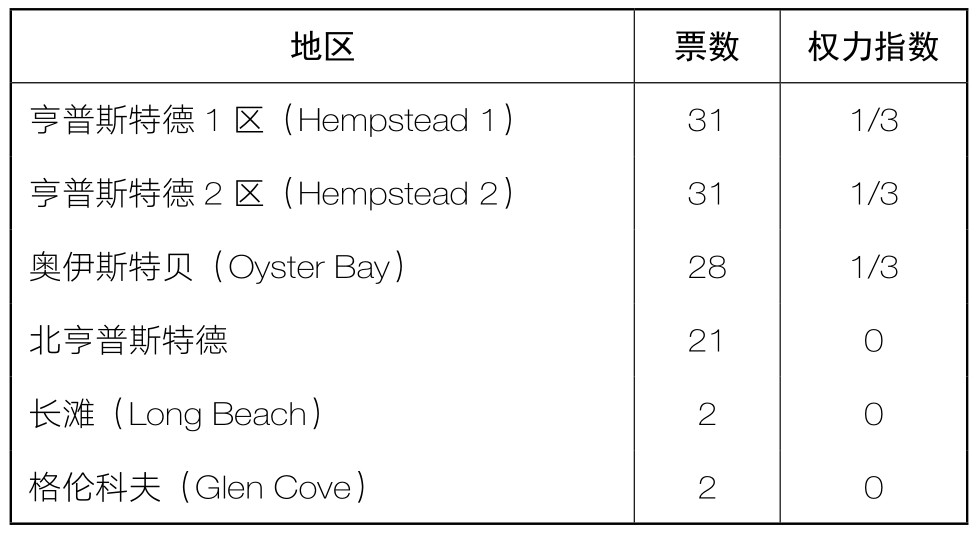

# 09　与价值和权力有关的模型

你的价值不在于你知道了什么，而在于你能够分享什么。

罗睿兰（Ginni Rometty）

在本章中，我们讨论对个体行为者的价值和权力进行量化分析的模型。有些情况很容易处理。当一个群体的总产出等于每个成员个人贡献的总和时，每个人的价值就等于自己的贡献。但是，当集体产出不能分解为单独的组成部分时，例如当一组计算机程序员编写软件程序时，或者当一群创业企业家提出了新技术的某种创造性用途时，要分清每个人的贡献就会很困难。在美国，将权力授予政党时也会出现类似的问题：一方政党控制的议座数量与权力相关，但是这种相关并不是完美的相关。

在本章中，我们定义了度量价值和权力的两个标准。第一个标准是“最后上车者价值”（last-on-the-bus value，简称 LOTB），它等于一位行动者在团队已经形成的情况下加入团队时的边际贡献。第二个标准是夏普利值（Shapley value），它等于行动者遍历所有可能的加入团队的序列，加入团队时的边际贡献平均值。例如，在一个由三个人组成的团队中，要求出一位行动者的夏普利值，先要求出他以第一、第二、第三位加入者的身份加入时的边际贡献，再计算平均值。我们是在合作博弈模型的框架下定义这些度量标准的。合作博弈模型由一组博弈参与者和一个价值函数组成。这个价值函数为每个可能的博弈参与者子集分配一个集体收益。

本章由四个部分组成。在第一部分中，我们定义了合作博弈、“最后上车者价值”和夏普利值，并给出了一些实例。在第二部分中，我们讲述了夏普利值的公理基础，并证明它是唯一能满足四个条件的度量标准。其中有两个条件分别是：对永远不能为团体增加价值的博弈参与者必须赋予零值，所有博弈参与者的价值总和必定等于博弈的总价值。在第三部分中，我们将夏普利值概念应用于执行某个创造性任务的团队。在这里，创造性的团队指每个成员都有新想法的团队。我们将阐明在这种情况下，夏普利值是怎样产生直观的价值衡量标准的。在第四部分中，我们考虑如何将夏普利值方法应用于投票博弈这个特殊情况。我们利用这个概念区分了投票权与投票百分比，结果发现两者之间并不总是一致的。某个拥有 20%席位的政党，在这一次投票中可能完全没有权力，但是在另一次投票中却可能得到 1/3 的总权力。

### 合作博弈

合作博弈由一组博弈参与者和一个价值函数组成。这个价值函数为博弈参与者的每个可能的子集（通常称为联盟）分配一个值。合作博弈的目标是刻画集体工作和联合项目。在合作博弈模型中，假设人们都会参与，以便我们可以专注于讨论如何为他们的参与分配价值。

**合作博弈** 

合作博弈由*N* 个博弈参与者和一个价值函数组成。这个价值函数为任何子集*S* ⊆*N* 分配一个值*V* （*S* ）赋值。这些子集称为联盟。没有博弈参与者组成的联盟的价值等于零，即。所有*N* 个博弈参与者的价值*V* （*N* ）等于博弈的总价值。

在合作博弈中，一个博弈参与者的“最后上车者价值”等于当他是最后一个加入团队的人时，他所能增加的价值。“最后上车者价值”刻画了边际博弈参与者的价值。如果雇用 4 个人来搬运一张桌子，假设搬运这张桌子产生的价值为 10，并且要 4 个人一起动手才搬得动，那么每个人的“最后上车者价值”均为 10。如果只需要三个人就可以搬动这张桌子，那么每个人的“最后上车者价值”均为零。这里需要注意的是，“最后上车者价值”不一定是博弈的总价值相加。特别是，如果价值函数表现出了规模收益递减的性质，那么“最后上车者价值”的总和将小于博弈的总价值；如果增加的价值表现出了规模收益递增的性质，那么“最后上车者价值”的总和将超过博弈的总价值。

一个博弈参与者的夏普利值，等于他在所有可能加入的联盟的次序下对联盟边际贡献的平均值。换句话说，我们要在想象中按顺序将博弈参与者加入联盟中并计算每个博弈参与者为每个序列增加的价值。例如，考虑一家同时在西班牙和法国运营的小公司，它至少需要一位会讲法语的人和一位会讲西班牙语的人开展日常业务。假设该公司有三名员工：一名会讲西班牙语的人、一名会讲法语的人和一名既会讲法语又会讲西班牙语的双语人士。

现在假设，这个合作博弈为任何一位能讲法语和西班牙语的人分配了 1 200 美元的价值。如果该公司能够运营，这个金额就等于公司每日的收入。如果任何两名员工来上班了，那么第三名员工就不是必需的。因此，在这个例子中，每个博弈参与者的“最后上车者价值”为零。

为了计算只会讲法语的那个人的夏普利值，我们要考虑这三个人来上班的所有 6 种可能的次序。在这 6 种次序中，只有在一种情况下，也就是只会讲西班牙语的人第一个到，然后这个只会讲法语的人第二个到时，这个只会讲法语的人才增加了价值。因此，这个只会讲法语的人的夏普利值就等于 1/6 乘以 1 200 美元，即 200 美元。与此类似，只会讲西班牙语的那个人只有当他第二个到且只会讲法语的那个人第一个到时，才能增加价值，因此他的夏普利值也等于 200 美元。而在其他四个次序中，既会讲法语又会讲西班牙语的人第一个到或者第二个到都能增加价值，因此，他的夏普利值等于 800 美元。所有这三个人的夏普利值总和等于 1 200 美元，也就是这个博弈的总价值。

**夏普利值** 

给定合作博弈{*N* ，*V* }，夏普利值的定义如下：

*N* 个博弈参与者加入联盟的次序有*N* ！个，让*O* 代表这所有*N* ！个次序。对于*O* 中的每一个次序，将博弈参与者*i* 增加的价值定义为当博弈参与者*i* 加入时价值函数发生的变化。博弈参与者*i* 的夏普利值等于他在*O* 中所有次序上增加价值的平均值。

在了解了上述基本概念的基础上，现在可以构建一个更加复杂的例子了。想象一下，在赛艇比赛中，一个团队通常由四名桨手和一名舵手（舵手通常个子较小，控制划桨节奏和方向）组成。现在想组建一支赛艇队，就需要找到六名赛艇运动员，也就是合作博弈中的博弈参与者：五名高大强壮的桨手和一名舵手。在参加比赛的时候，四名桨手和一名舵手上场的团队价值为 10；或者由五名桨手上场，但由于重量过重，整个团队表现不佳，这样的团队价值为 2。

为了计算出夏普利值，假设这些博弈参与者以各种可能的顺序加入。如果舵手以第一、第二、第三或第四位的次序加入，那么他不会增加任何价值；当他以第五位的次序加入时，他增加的价值为 10，这种情况出现的概率为 1/6；如果他以第六位的次序加入，那么他将取代一位桨手，所增加的价值为 8。将所有这些情况平均，可以发现舵手的夏普利值等于 3。

而对于任何一个桨手来说，当且仅当他以第五位的次序加入时，才能增加价值，这种情况发生的概率为 1/6。如果舵手没有加入，那么以第五位加入的桨手所增加的价值为 2。如果舵手已经加入，那么以第五位加入的桨手所增加的价值为 10。由于舵手最后一位加入的机会是 1/5，同时舵手在前四位加入的机会是 4/5，因此可以求出每一个桨手的夏普利值为 7/5。 ¹  从直观上就可以看出，舵手的价值应该超过单个桨手的价值，同时考虑到桨手可以在没有舵手的情况下参加比赛（尽管成绩会“很差”），因此舵手的价值应该比所有桨手的总价值低。有无数种方法都可以在满足上面这两个约束的前提下分配价值，夏普利值只是给出了其中一个特定的分配方案：给舵手分配 3，给所有桨手分配 7。

### 夏普利值的公理基础

我们现在讲述夏普利值唯一满足的公理，这也就解释了为什么要优先考虑夏普利值而不是其他。第一，我们是通过对所有可能次序中博弈参与者的边际贡献来计算夏普利值的，因此任何永远不能增加价值的博弈参与者的夏普利值都为零。第二，对任何两个相同的博弈参与者，即对每个联盟贡献相同的任两个博弈参与者，也必须分配给他们相同的夏普利值。第三，由于所有次序的价值总和等于博弈的总价值，所以夏普利值的总和也必定等于与博弈的总价值。这里需要注意的是，“最后上车者价值”虽然满足前两个性质，但是却不满足最后一个公理。

在这三个公理的基础上，还可以增加第四个公理——可加性。这个性质要求，如果合作博弈的价值函数可以分解为两个价值函数，并把每个分解出来的价值函数分配给一个不同的合作博弈，那么复合博弈中一个参与者的价值应该等于他在两个分博弈中的价值总和。很容易看出，夏普利值也满足这个性质。不过，这四个公理唯一刻画了夏普利值这一点其实并不太明显。

证明一种度量唯一满足一组公理，也就为这种度量奠定了坚实的逻辑基础。如果没有公理基础，或许也可以找到某种直观的度量，但是我们可以认为它是武断的、似是而非的。上述公理告诉我们，如果选择任何其他度量，就不得不至少放弃其中一个公理。当然，这并不意味着夏普利值是唯一合理的标准。罗依德·夏普利（Lloyd Sharpley）这位伟大的经济学家和数学家，可能是先写出了这个标准，然后才构造了这些只有它唯一满足的公理的。当然，谁先谁后其实并不重要。即便这些公理是用后向方法构造出来的，只要我们接受，就应该采用这种方法。衡量标准的适当性取决于公理的合理性。就这些公理而言，前三个公理是无可争议的。第四个公理（可加性）虽然看上去比较复杂，但也是合理的，如果没有这个公理，博弈参与者就会有很强的动机去合并或分割联盟。

**夏普利值的公理基础** 

夏普利值唯一满足以下公理：

**零性：** 如果博弈参与者为任何联盟增加的价值都等于零，那么该博弈参与者的价值等于零。

**公平性／对称性：** 如果两个博弈参与者对任何联盟都具有相同的增加价值，那么这两个博弈参与者具有相同的价值。

**完全分配性：** 博弈参与者价值的总和等于博弈的总价值*V* （*N* ）。

**可加性：** 给定两个定义在相同博弈参与者集合之上的博弈，它们的价值函数分别为*V* 和，那么在博弈（*V* +）中，一个博弈参与者的价值等于该博弈参与者在*V* 和的价值的总和。

### 夏普利值的应用

现在，我们将夏普利值应用在基于替代用途测试（alternative uses test）的合作博弈中。在测试中，每个人都必须为一种常见的物品想出一些新的用途，比如砖块。这种测试的目的是根据人们想出来的用途或用途类别来衡量一个人的创造力。我们在计算夏普利值的过程中，发现了一个直观的评分规则。

想象一下有三个人参加了某替代用途测试，分别是阿伦、贝蒂和卡洛斯。测试要求他们想出区块链的替代用途，这是一种分布式记账技术。如图 9-1 所示，阿伦和卡洛斯分别提出了 6 个想法，每个人的创造力得分均为 6；贝蒂则提出了 7 个想法，因而得到 7 分。他们这三个人组成的团队的总创造力得分为 9，因为总共有 9 个不同的想法（不同人提出的想法，有些是重合的）。

为了计算夏普利值，可以写下这个团队能够形成的所有 6 种可能的排序，而且只有当某个人为团队提供了独特的想法时才“给分”，然后再对所有 6 种情况求平均值。或者，在计算夏普利值的过程中，我们可能已经注意到了，某个人因某个想法而“得分”的概率等于 1 除以所有提出了这个想法的人的数量。任何一个提出了一个他人没有的独特想法的人都可以获得满分。图 9-1 用粗体字来表示这类想法，例如阿伦提出的用区块链进行艺术交易的想法。

如果两个人提出了同一个想法，那么每个人都有 1/2 的机会首先加入该团队。同样，如果所有三个人都想到了同一个想法，那么每个人都有 1/3 的机会首先加入。这就是说，在想到同一个想法的人之间平等地分配得分能够产生夏普利值。因此，它是分配满足 4 个公理的值的唯一方法。这些值表明，虽然阿伦不是提出最多想法的那个人，但是他却增加了最多的价值。 ²  

**图 9-1　在替代用途测试中应用夏普利值** 

### 夏普利-舒比克权力指数

接下来，我们将夏普利值应用于一类投票博弈。在这种投票博弈中，每个博弈参与者（代表某个政党或官员）控制着固定数量的席位或投票权，而且要采取行动，就必须获得多数席位或支持票。在投票博弈中，夏普利值通常被称为夏普利-舒比克权力指数（Shapley-Shubik index of power）。 ³  通过对这个指数的计算，我们发现一个博弈参与者（政党）控制席位（投票权）的百分比与其权力之间并不存在直接的转换。

为了计算权力指数，考虑各个政党加入联盟所有可能的次序。如果某个政党加入了一个联盟并获得绝对多数，那么这个政党所增加的价值等于 1。在这种情况下，我们就称这个政党是“关键的”。否则，这个政党不会增加任何价值。

假设议会中共有 101 个席位，分别由 4 个政党掌握：A 党控制了 40 个席位、B 党控制了 39 个席位、C 党和 D 党则各控制了 11 个席位。在这个例子中，如果 A 党首先或最后加入，那么 A 党就不会成为“关键的”政党。但是，如果 A 党在第二位或第三位加入，就肯定会成为“关键的”政党。因此，A 党的权力指数为 1/2。如果 B 党在第一位或最后一位加入，那么它就不能增加任何价值；如果 B 党在第二位加入，那么当且仅当 A 党已经在第一位加入时，B 党才可能成为“关键的”政党。如果 B 党在第三位加入，那么它要想成为“关键的”政党，唯一的机会是 A 党在最后一位加入。这两个事件组合发生的概率分别为 1/12。因此，B 党的权力指数等于 1/6。C 党和 D 党也可以在两个与 B 党类似的事件组合中成为“关键的”政党。如果 C 党或 D 党在第一位加入，那么不可能成为“关键的”政党。如果 A 党在第一位加入，那么只要 C 党或 D 党在第二位加入，就能成为“关键的”政党。如果 A 党在最后一位加入，那么只要 C 党或 D 党在第三位加入，也能成为“关键的”政党。因此，C 党和 D 党的权力指数也分别为 1/6（图 9-2）。

**图 9-2　席位与权力之间的脱节** 

这个例子表明，一个政党控制的席位百分比与它实际拥有的权力之间可能存在着脱节。A 党和 B 党控制的席位数量几乎相同，但是 A 党的权力却是 B 党的三倍；B 党控制的席位虽然比 C 党或 D 党多得多，但是所拥有的权力却不比它们大。与这个例子相似的席位分配在现实世界的议会制度中经常出现。因此，只拥有少量席位的政党往往可以掌握很大的权力。例如，在以色列议会中共有 120 个席位。2014 年，利库德集团领导的联盟共有 43 个席位，反对派联盟则拥有 59 个席位（仅略低于多数席位），正统派联盟拥有 18 个席位，但所有这三方都拥有相同的夏普利-舒比克权力指数。当然，相同的权力指数并不意味着正统派联盟在现实世界中确实拥有完全相同的权力，不要忘记，所有模型都是错的。但是它确实表明，正统派联盟的影响力超过了他们的席位数所占的百分比。

20 世纪 60 年代中期，纽约拿骚县（Nassau County）监事会出现过惊人的席位与权力脱节的情况。该监事会由 6 名成员组成，每个成员控制的选票与该成员所代表的地区的人口成比例（图 9-3）。投票事项要多数通过，需要得到 115 张票中的 58 张或以上。在三个最大的地区中，任何两个地区合作都可以稳占多数。因而另外三个地区的投票永远不可能是决定性的，这三个地区没有权力。例如，虽然北亨普斯特德（North Hempstead）地区拥有 21 票，超过了总票数的 18%，但是并不能影响投票结果。

**图 9-3　拿骚县席位与权力脱节** 

理论上说，夏普利-舒比克权力指数适用于任何席位或投票权分配不均等的情况，比如欧盟或美国的选举团，但这并不意味着它在所有情况下都是适当的方法。就美国选举团制度而言，50 个州可以有 50！（3×10⁶⁴ ）的不同次序。

当然，考虑到选民偏好的区域相关性，并非所有联盟都是可能的。密西西比州几乎不太可能与纽约州组成联盟。为了提供更有效的权力衡量标准，我们需要将某些联盟置于更优先于其他联盟的位置，或将某些联盟排除出去。在后面的章节中，我们描述了允许排除某些联盟的迈尔森值（Myerson Value）。

### 小结

个体的夏普利值与为联盟增加的平均贡献相对应。它是衡量增加价值的一种标准。在投票博弈中，也可以将夏普利值解释为权力的一种度量。不过，夏普利值可能并不一定总是最好的衡量标准。假设威胁是可信的，那么在一个群体已经形成的情况下，个人的“最后上车者价值”可能是衡量权力的一个更好标准，因为它能够度量每个人通过威胁离开可以攫取多大利益。

在这些情况下，联盟会希望减少“最后上车者价值”。通过扩大联盟规模，可以创建出一个具有很高的总价值、同时“最后上车者价值”又足够低的联盟。不断加入新成员，会使现有成员变成“可以放弃的”，从而使“最后上车者价值”趋向于零。我们在实践中确实可以观察到这一点。例如，雇主会通过雇用多余的工人来削弱工人的权力，制造业企业会向多个相互竞争的供应商采购中间产品，政府会与多个承包商签订合同，等等。

同样的直觉也可以用于解释美国立法机构中出现的联盟。国会游说者和政党领导人希望通过法案（价值的一种结果），同时又试图限制个别众议员和参议员的权力。 ⁴  如果游说者努力争取到了通过法案所必需的最低数量的众议员和参议员的支持，那么每一个众议员和参议员都会拥有很大的“最后上车者价值”。任何一个人都可以通过改变自己的投票来推翻那个法案。在这种情况下，游说者可以通过收买绝大多数众议员和参议员来降低他们的“最后上车者价值”。同样的逻辑也意味着，只拥有微弱多数的政党可能是非常难以驾驭的，因为每一个成员都拥有很大的“最后上车者价值”。而在某个政党拥有了绝大多数席位（投票权）的时候，没有任何众议员或参议员能够拥有太大的权力。

将视野放大到现代互联网世界，我们发现应用“最后上车者价值”和夏普利值的概念来思考权力问题非常有用。无论是个人、组织、企业，还是政府，抑或是恐怖组织的权力，都部分取决于偏离合作制度可以造成的损害的程度，也就是“最后上车者价值”。一个技术高超的计算机黑客，由于拥有摧毁大量财富的力量，因而拥有巨大的权力。即便黑客完全不能给社会创造价值，这个结论依然成立。

在考虑跨国企业或其他跨国组织的价值时，夏普利值可能是一个更好的衡量标准。在这些情况下，退出本身就是一个不可行的选择。能源公司必须参与能源生产博弈、能源分配博弈、房地产博弈、环境博弈、就业博弈等。这样的公司的总增加值等于各个领域的增加值之和。

通过合作博弈论的视角来思考权力和价值，可以得出很多深刻有力的洞见。合作博弈还指出了我们下一步应该关注的地方。在政界和商界，并不是所有联盟都是合理的。不过目前的模型假设它们合理。更丰富的模型需要考虑到世界的连通性。咨询公司和金融公司要从科技公司购买软件，科技公司和咨询公司通过金融公司进行投资和借贷，金融公司和科技公司要聘请咨询师。在这些网络中，每个参与者都能增加价值并发挥影响力。要计算出这种环境下的权力，我们需要网络模型。