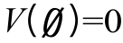
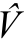
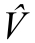
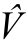
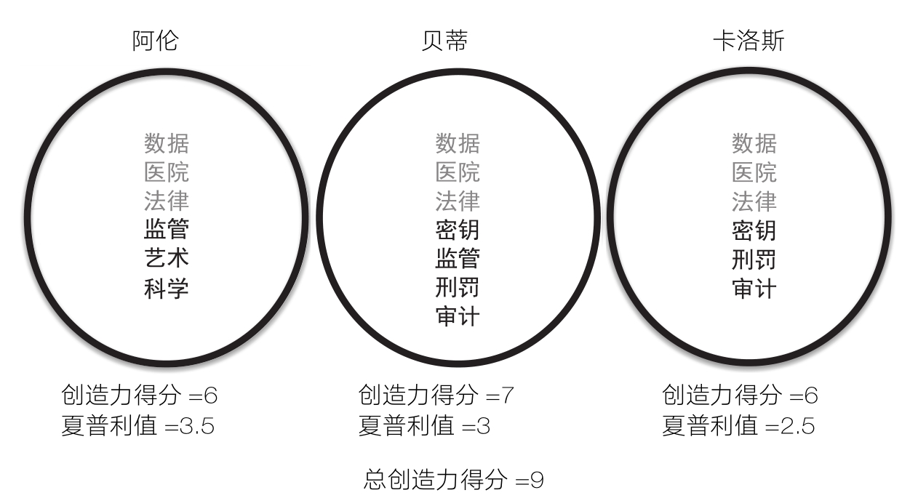
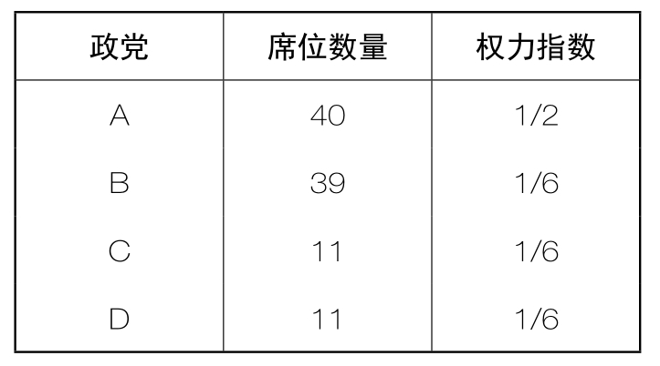
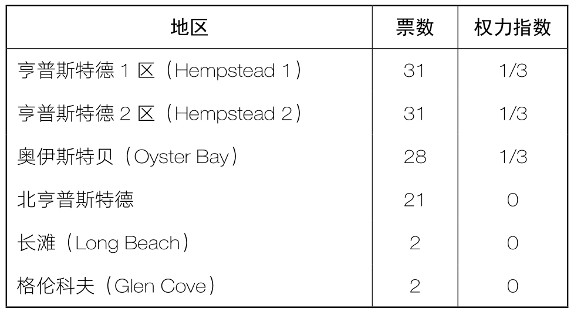

# 席位多，权力就一定大吗？用两个模型看懂“价值”与“权力”

罗睿兰有一句话很耐人寻味：一个人的价值，不在于他脑子里装了多少东西，而在于他愿意、也能够拿出多少与人共享。

这句话背后其实藏着一个难题：当一群人共同做事时，怎么判断谁贡献了多少、谁又真正拥有权力？有些团队很容易算账——总产出正好等于每个人贡献相加，那每个人的价值就是自己的那份。但很多合作并非如此：程序员一起写软件、创业者把新技术玩出新用途，成果是拧在一起长出来的，很难拆清楚谁该分多少。政党政治也一样，一个党掌握的席位数和它实际能施加的影响力，并不是完美对应。

为了处理这类问题，素材给出了两把“尺子”。第一把叫“最后上车者价值”（LOTB）：团队已经搭好之后，某个人再加入，能额外带来多少价值，就是他的LOTB。第二把叫夏普利值：把一个人以各种可能顺序加入团队时的边际贡献都算一遍，再取平均值。它们都建立在合作博弈的框架里——一群参与者，加上一个价值函数；这个函数会给每一个可能的参与者子集（也就是联盟）打分。空联盟的价值为零，即；全体参与者组成的联盟，其价值就是整场博弈的总价值。

LOTB刻画的是“边际人”的分量。比如四个人一起搬桌子，桌子搬动产生价值10，且必须四人同时上手，那每个人的LOTB都是10；如果三个人就能搬动，第四个人的LOTB就是零。要注意，LOTB加总不一定等于总价值：如果规模收益递减，各项LOTB之和会小于总价值；如果规模收益递增，反而会超过总价值。

夏普利值则更像“多剧本平均”。设想一家小公司同时在西班牙和法国做生意，至少要有一位会法语的人和一位会西班牙语的人才能运转。公司有三名员工：只会西语者、只会法语者、法语西语都会的双语者。只要公司能开门，每日价值为1200美元；任意两人到场，第三人就不是必需，所以三人的LOTB都是零。再看夏普利值：只会法语者只有在“西语者先到、自己第二个到”的那一种次序里才增加价值，概率为1/6，因此分得200美元；只会西语者同理，也是200美元；双语者在其余四种次序中都能增加价值，分得800美元。三者相加正好是1200美元。

再看赛艇队。合作博弈里有六个人：五名桨手加一名舵手。四名桨手加舵手上场，团队价值为10；五名桨手在没有舵手的情况下上场，因重量过大表现不佳，价值只有2。算舵手的夏普利值：他排第一到第四加入都不增加价值；排第五加入时增加10，概率1/6；排第六加入时会取代一名桨手，增加8。平均下来是3。对任何一名桨手而言，只有排第五加入时才可能增加价值，概率1/6；若舵手还没来，增加2；若舵手已来，增加10。舵手最后加入的概率是1/5，前四位加入的概率是4/5，算得每名桨手为7/5。五名桨手合计7，舵手3，总和为10。直觉上，舵手比单个桨手重要，但又低于全体桨手的总价值；满足这种直觉的分配方案有很多，夏普利值只是其中一种特定分法。

夏普利值之所以被看重，是因为它是唯一同时满足四条公理的度量。第一，零性：如果一个人对任何联盟都加不了价值，他的值就是零。第二，公平性／对称性：两个人若对每个联盟的贡献都一样，拿到的值也必须一样。第三，完全分配性：所有人的值加起来，必须等于整场博弈的总价值。第四，可加性：给定两个定义在相同参与者集合上的博弈，其价值函数分别是V和，那么复合博弈(V+)里，某参与者的价值等于他在V与中的价值之和。LOTB满足前两条，却不一定满足“完全分配性”。这四条公理也为夏普利值提供了逻辑地基；否则，再直观的度量也可能显得武断。前三条争议不大，第四条看似复杂却合理——若没有它，参与者就会有强烈动机去合并或拆分联盟。

夏普利值还能落到创造力测试里。让阿伦、贝蒂、卡洛斯分别想区块链的替代用途：阿伦提出6个想法，卡洛斯也是6个，贝蒂有7个；但团队合计只有9个不同想法，因为有些点子撞车了。按夏普利值来分，一个想法带来的分数由所有提出它的人平分：独一无二的想法拿满分，两人撞车各得一半机会，三人撞车则各得三分之一。这样算下来，阿伦虽然不是提出想法最多的人，却增加了最多价值。（图9-1，）

把夏普利值用于投票博弈，就得到“夏普利-舒比克权力指数”。在这里，参与者是政党或官员，手里握着固定席位或票数，想成事就得拿到多数。一个政党控制席位的百分比，和它实际拥有的权力之间，并没有直接换算关系。某个握有20%席位的政党，可能在某次投票中毫无权力，换一次投票却可能拿到三分之一的总权力。

素材中的议会例子很典型：101个席位，A党40席、B党39席、C党和D党各11席。A党若第一个或最后一个加入联盟，成不了“关键者”；但排第二或第三加入，就必定关键，所以A党权力指数为1/2。B党排第一或最后没有价值；排第二且A党已在第一，或排第三且A党最后加入，这两种组合各占1/12，合计权力指数1/6。C党和D党也能在类似组合中成为关键者，权力指数同样各为1/6。于是出现怪现象：A、B席位几乎一样多，A的权力却是B的三倍；B席位远多于C、D，权力却不比它们大。（图9-2，）

现实中也能看到类似错位。2014年以色列议会共120席，利库德集团领导的联盟有43席，反对派联盟59席，正统派联盟18席，但三方算出的夏普利-舒比克权力指数却相同。相同指数当然不意味着现实世界里三方真的完全等权，毕竟所有模型都有偏差；但它确实说明，正统派联盟的影响力超过了其席位占比。

更夸张的是20世纪60年代中期纽约拿骚县监事会。6名成员按所代表地区人口比例握票，总票数115，要通过事项需至少58票。三个最大地区中任意两个联手就能稳拿多数，另外三个地区永远成不了决定性力量。北亨普斯特德地区有21票，超过总票数18%，却依然影响不了结果。（图9-3，）

理论上，夏普利-舒比克指数可以用于任何席位或投票权不均等的场景，比如欧盟、美国选举团。但它未必处处合适。美国选举团有50个州，可能的加入次序多达50!，约3×10⁶⁴种；而选民偏好有区域相关性，密西西比州几乎不可能和纽约州结盟。要更有效地衡量权力，就得让某些联盟优先、把某些联盟排除出去，后文提到的迈尔森值就是为此设计的。

回到个体与组织：夏普利值衡量的是一个人为联盟带来的平均贡献，也可以解释为权力；但它不一定永远是最佳尺子。若威胁可信，LOTB可能更适合衡量权力，因为它能看出一个人靠“离开”能撬走多少利益。也正因如此，联盟会想办法压低成员的LOTB：扩大规模，让现有成员变得“可替代”，LOTB就会趋近于零。雇主多雇一些工人来削弱工人的议价力，制造企业向多家供应商采购，政府与多个承包商签约，都是这个逻辑。

美国立法场同样如此。游说者和政党领袖既想让法案通过，又想限制个别议员的力量。如果他们只凑到刚好过关的最低票数，每个议员都拥有很大的LOTB，谁改一票都可能推翻法案；反过来，收买绝大多数议员，就能把每个人的LOTB压下去。只握微弱多数的政党往往很难驾驭，因为每个成员都很“关键”；而拿到绝大多数席位后，反而没有哪个议员能拥有太大权力。

放到互联网时代，这套思路依旧好用。个人、组织、企业、政府乃至恐怖组织的权力，都部分取决于它们偏离合作制度时能造成多大损害，也就是LOTB。一个技术高超的黑客，即使不直接创造社会价值，只要拥有摧毁大量财富的能力，就可能拥有巨大权力。

衡量跨国企业或其他跨国组织的价值时，夏普利值可能更合适，因为“退出”往往不是可行选项。能源公司必须同时参与能源生产、分配、房地产、环境、就业等多场博弈，其总增加值等于各领域增加值之和。用合作博弈的视角看价值与权力，能得到不少有力洞见；它也提醒我们下一步该往哪走：现实中并非所有联盟都合理，更丰富的模型必须考虑世界的连通性。咨询公司、金融公司、科技公司之间会互相采购、投资、借贷、聘请，每个节点都在增加价值、发挥影响力。要算清这种网络中的权力，就得引入网络模型。