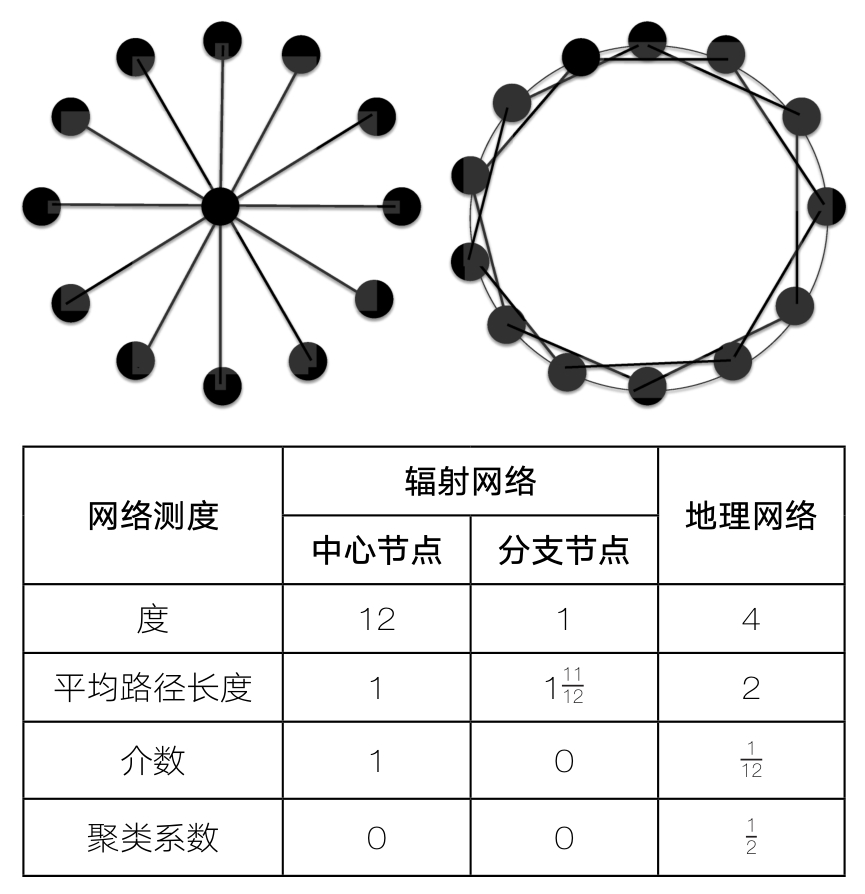
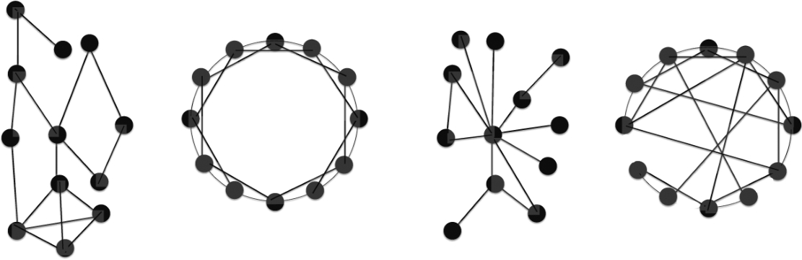
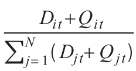
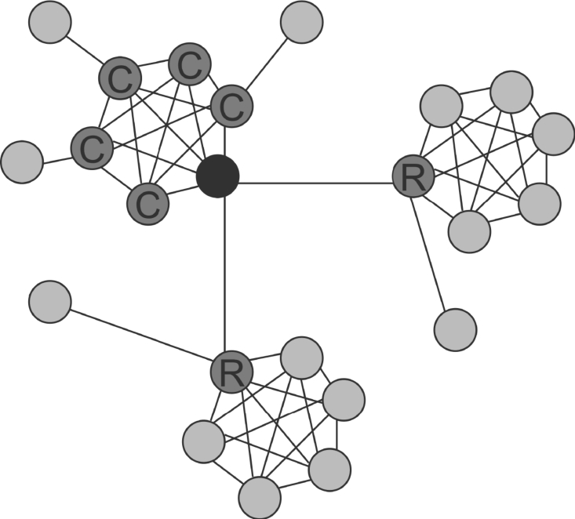
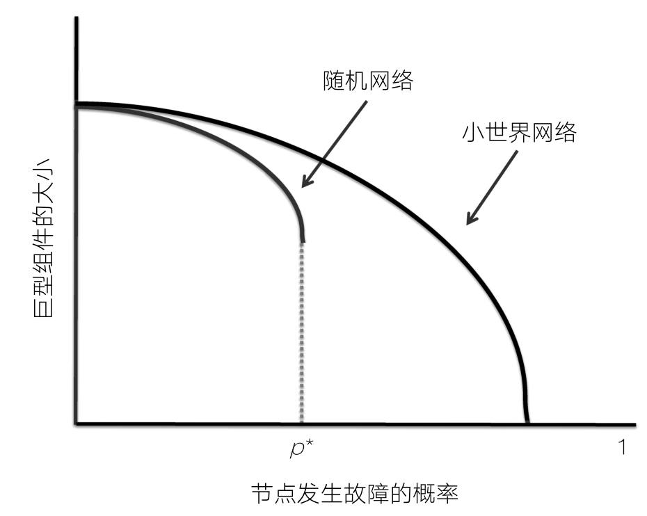
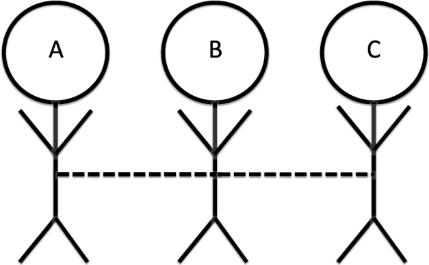

# 10　网络模型

网络理论是科学的一个完整分支。但是就过去的二三十年来说，它相对较新。我们还没有机会把所有这些理论从大学中拿出来，然后问自己：“我们应该建立什么样的网络？应该将网络用于什么样的目的？”

安妮-玛丽·斯劳特（Anne-Marie Slaughter）

本章将介绍网络模型。对网络进行全面研究，需要写好多本书。因此，我们在这里只专注于一个更加温和的目标：只希望了解有关网络的基础知识，能够给网络的各个组成部分命名，并讨论它们对于建模的重要性。我们得出的答案是，网络几乎总是很重要。我们构建的任何模型，无论是市场模型、传染病传播模型，还是信息传播模型，都可以通过将参与者嵌入网络中而变得更加丰富。 ¹  

网络无处不在。人们经常会谈起贸易网络、恐怖主义网络，以及志愿者网络。不同物种会组织成食物链，那是一种网络形式。企业会建立供应链，那也是一种网络。如前所述，将金融系统视为一个支付承诺的网络会很有效。网络对于理解社会关系一直都很重要。在人类历史的大部分时间里，社交网络受到地理限制，难以扩展。由于技术的进步，许多社会互动和经济交易现在都是通过虚拟网络进行的，并且可以使用模型进行分析。

本章内容仍然遵循前面用来讨论分布时所用的模式，即结构—逻辑—功能。我们首先用一系列统计量来表征网络结构，包括：度、路径长度、聚类系数和社区结构等。然后我们讨论了一些常见的网络类别：随机网络、中心辐射网络、地理网络、小世界网络和幂律网络。之后探索网络形成的逻辑，我们构建了一些微观层面的流程，生成所能观察到的网络结构。最后讨论功能，也就是网络结构为什么是一个重要的问题。

本章主要关注网络结构的五个重要含义。我们首先从友谊悖论入手，在对它进行了全面分析之后，描述六度分隔理论和弱关系属性的强度。最后讨论了网络在节点或出现故障时的鲁棒性，解决了网络上的信息集结问题。本章最后还讨论了网络会如何影响模型结果。

### 网络的结构

网络由节点以及连接节点的边（edge）组成。由边连接起来的节点互为邻居。如果沿着边，可以从任何一个节点到达任何其他节点，就将这样的网络称为连接的网络。网络可以用图形来表示，也可以用边的列表表示，或者也可以用由 0 和 1 组成的矩阵表示，其中第 A 行、第 B 列的一个数字表示节点 A 和节点 B 之间的边。虽然人们更喜欢用图形来表示网络，但是其实用列表和矩阵来表示网络，才更适用于计算网络统计数据。

网络中的边可以是定向的，也就是说，可以从一个节点指向另一个节点。在信息网络中，一条有向边表示一个人从另一个人获取信息。在生态系统网络中，从红尾鹰到灰松鼠的一条有向边表示红尾鹰吃松鼠。边也可以是非定向的；连接两个朋友的边就是非定向的。在非定向网络中，一个节点的度（degree）等于连接到它的边的数量。

网络以一组网络统计数据为特征。对于每个统计量，我们可以计算网络平均值和所有节点的分布。例如，友谊网络的平均程度告诉我们平均每个人有多少个朋友。度分布（degree distribution）告诉我们某些节点是否比其他节点连接得更多。社交网络的分布比万维网、互联网和引文网络更加平等，后面这几类网络都有很长的尾巴。

路径长度，指两个节点之间的最小距离，与度成反比。当增加边时，就缩短了节点之间的平均距离。在航空公司的航线网络中，路径长度对应于人们从航线网络中的某个城市到另一个城市所需的航班数量。如果要在两家航空公司之间做出选择，在其他所有条件（即价格）都相同的情况下，旅客会更喜欢平均路径长度更低的那家航空公司。平均路径长度也与信息丢失相关。经过多人中转传递的信息比直接在两个人之间传递的信息更容易遭到扭曲。最短路径上的节点在网络中起着关键作用。如果信息是通过最短路径传递的，那么就必定会经过最短路径上的节点。节点的介数得分（betweenness score）等于通过该节点的最小路径的百分比。在社交网络中，介数得分高的人掌握更多信息并且拥有更多权力。

最后一个统计量是聚类系数，它等于节点的邻居节点对当中，同时彼此也互为邻居节点对所占的比例。例如，一个人有 10 个朋友，这些朋友可以组成 45 个对。如果在这 45 个对当中，有 15 个对本身也是朋友，那么这个人的聚类系数就等于 1/3。如果所有这 45 对都是朋友，那么这个人的聚类系数就等于 1，这也是所有可能值当中最大的一个。整个网络的聚类系数等于各个节点聚类系数的平均值。

**网络统计量** 

**度** ：节点的邻居数（即边数）。 

**路径长度** ：从一个节点到另一个节点必须遍历的最小边数。 

**介数** ：经过某个节点连接两个其他节点的最短路径数量。 

**聚类系数** ：一个节点的邻居对当中，同样也由一条边连接的邻居对所占的百分比。 

图 10-1 显示了一个辐射网络和一个地理网络，它们各具有 13 个节点。在这个辐射网络中，中心节点的度为 12，所有其他节点的度均为 1，因此平均度小于 2。这种度分布是“不平等”的。中心节点与其他每个节点的距离均为 1。所有其他节点与中心节点的距离为 1，与中心节点之外的任何一个节点的距离为 2。因此，这个辐射网络的平均路径长度也小于 2。中心节点位于任何两个其他节点之间的最小路径上，于是介数得分为 1。任何一个分支节点都不位于连接其他节点的任何最小路径上，因此它们的介数得分均为 0。最后，在这个辐射网络中，连接到某个节点的任何节点都不彼此连接。因此，网络的聚类系数为 0。

**图 10-1　一个中心辐射型网络和一个地理网络** 

在这个地理网络中，每个节点都连接到位于它右侧和左侧的两个节点，因此平均度等于 4。每个节点到 4 个节点的距离为 1、2、3，因此平均距离恰好等于 2。从图 10-1 可见，这个地理网络的度和距离分布都是简并性（degenerate）的，因为每个节点都具有相同的度和相同的平均距离。可以看出，每个节点的介数都等于 1/12。 ²  每个节点都有 4 个邻居，可以构成 6 个对。在这 6 个对中，恰好有 3 对是相互连接的：直接靠着该节点的左右两个节点分别连接到再外一点的节点，并相互连接。因此，聚类系数等于 1/2。

刻画网络的聚集程度的另一种方法是将节点划分为不同的社区（community）。在年轻人的友谊网络中，这里所说的社区可能对应于对艺术、体育或科学感兴趣的青少年。或者，社区也可以通过种族和性别来定义。政治联盟网络可能可以分为地区性的或意识形态上的盟友。可以用来确定社区的方法有很多，其中一种方法是依次移除具有最高介数的边，因为介数高的边更有可能将不同的聚类连接起来。还有一种方法是将社区的数量视为给定的，并在特定的目标函数下寻找最佳划分方法，例如最小化社区之间边的数量或最大化社区内部边的比例。 ³  

我们可以使用社区检测算法（community detection algorithm）去查看网络数据的问题。有研究表明，人们可能会生活在“网络泡沫”（online bubbles）当中。这也就是说，我们所属的社区，可能是由只从类似来源获取新闻的人组成的。如果真的是这样，那么无疑会对社会凝聚力产生重要的影响。在互联网出现之前，情况可能也是这样的，但是很难用数据证明。现在，数据科学家可以在网络上抓取海量数据，从而将人们的新闻来源准确地识别出来，实际上我们确实在一定程度上生活在“泡沫”当中。现在，模型可以给出社区的正式定义，数据可以揭示这些社区的力量。结合我们的判断力，就可以根据数据做出明智的推断。

#### 常见的网络结构

在分析网络时，我们遇到了网络过于多样性的问题（图 10-2）。少数几个网络统计量无法确定具体的网络结构：人们可以构建出数十亿个具有 10 个节点且平均度为 2 的不同网络。还可以通过检验它的统计指标是否与某个常见的网络结构有显著差异来表征网络。例如，当一位法官引用了另一位法官的判决时，一个研究者可能会收集司法引用的数据并将其以网络的形式表示。这种网络从图形上看似乎有一个很特殊的结构和集群。我们可以将这个网络的统计数据与具有相同数量的节点和边的随机网络进行比较，以检验这个网络是不是随机的。在第一种常见的网络随机网络（random network）中，聚类系数等于一条随机的边的概率，因为一个节点的两个邻居并不比任何其他随机选择的节点更可能包含一条边。

**随机网络的蒙特** ·**卡罗方法** **  ^((5))  ** 

为了检验一个具有*N* 个节点和*E* 条边的网络是不是随机网络，可以创建大量具有*N* 个节点和*E* 条边的随机网络，并计算出度、路径长度、聚类系数和介数的分布。然后，执行标准的统计检验，以确定接受还是拒绝那个网络的统计数据可能抽取自该模拟分布的假设。 ⁴  

理论模型通常假设某种特定的网络结构。有的研究者偏好假设随机网络，而有的研究者则偏好假设规则的地理网络，例如这样的网络：节点排列成圆形并且每个节点在每个方向上都连接到最近的节点。这也是第二种常见的网络，有一种地理网络将节点排列在棋盘上，并让每个节点与自己东、南、西、北的邻居相连。大多数常见的地理网络都具有较低的度，即节点仅连接到本地邻居，并且具有相对较大的平均路径长度。在地理网络上，介数和聚类系数不会有变化。

第三种常见的网络是幂律网络，这种网络的度分布是幂律的。少数节点有许多连接，同时大多数节点的连接则非常少。第四种常见的网络是小世界网络，它结合了地理网络和随机网络的特征。 ⁵  要想构建一个小世界网络，可以从一个地理网络开始，然后进行“重新布线”，方法是随机地选择一条边并把这条边所连接的其中一个节点替换为一个随机的节点。如果“重新布线”的概率等于零，所拥有的就是一个地理网络；如果“重新布线”的概率等于 1，那么就有了一个随机网络；而当概率介于这两者之间时，就会得到一个小世界网络，以小集群区别于通过随机链接连接到其他集群的地理网络。社交网络看起来类似于小世界，每个人都有一群朋友，以及若干随机的朋友。

**图 10-2　随机网络、地理网络、幂律网络和小世界网络** 

### 网络形成的逻辑

现在简要讨论一下几个描述网络形成的模型，这些模型给出了解释网络结构的逻辑。我们遇到的大多数网络结构都是从个体行为者做出的关于建立连接的选择中涌现出来的。友谊网络、万维网和电网都是如此。这些网络不是计划的结果。不过，也有一些网络，例如供应链网络，确实是计划的产物。我们希望按计划构造的网络对节点的故障具有鲁棒性。当然，自发涌现的网络结构都具有鲁棒性这个事实是一个谜。

我们已经讨论了如何创建随机网络和小世界网络。只需要随机创建一组节点，然后绘制连接随机节点对的边，就可以创建随机网络。通过构建一个规则的地理网络（常用的方法是在一个圆周上排列节点并在每个方向上连接*k* 个邻居），然后随机“重新布线”一部分边，就可以创建一个小世界网络。

电网形成的模型依赖于经济和工程原理。电网必须为家庭、企业和政府提供电力。无论生产者是营利性企业还是公共事业公司，都没有动力去创造聚集程度很高的网络，因为那种网络效率低下。但是，聚类的缺乏降低了网络的鲁棒性。经济和工程方面的考虑也排除了远距离跳跃——跨越网络连接的可能性。电力公司不会建立从芝加哥到达拉斯的直接连接。然而，人和企业却可以，一个芝加哥人可能会与达拉斯的某个人建立起友谊，新加坡的一家公司可能会与底特律的一家公司进行交易。正如后面将看到的，这些远距离跳跃有助于提高网络的鲁棒性。

要创建一个具有长尾分布的网络，可以利用优先连接模型的一个变体。先随机创建一些节点，然后画出从新节点到现有节点的边。如果我们令连接到节点的概率与节点的度成正比，就可以产生幂律的度分布。在这个模型中，越早“到达”的节点的度越大。但是这个模型有一个缺点，那就是，它不允许节点质量有任何差异。更高质量的节点本应具有更高的度。不过，质量和度的网络形成模型（quality and degree network formation model）纠正了这种缺憾，并且产成了长尾分布。

**质量和度的网络形成模型** 

创建*d* 个互不连接的节点。在每周期*t* 中创建一个质量为*Q* * [t] * 的、从分布*F* 中抽取出来的新节点。根据其他*d* 个节点的度将这个新节点连接到那些节点上。用*D* * [it] * 表示在时间*t* 时节点*i* 的度，那么给定*N* 个节点时选择节点*i* 的概率等于：

如果新节点质量的均值和方差都足够低，那么这个模型就类似于标准的优先连接模型。如果质量分布有一条长尾，那么质量很高的新节点的度可以增长到非常大的程度。 ⁶  

### 网络的功能

前文中，已经提到过友谊悖论；事实上，在任何网络上，平均来说，人们确实不可能比他们的朋友拥有更多的朋友。我们可以利用辐射网络来说明出现这种情况的原因及其背后的逻辑。在辐射网络中，12 个人中的每人都只有 1 个朋友，只有 1 个人有 12 个朋友。有 1 个朋友的那 12 个人都连接到了中心节点，中心节点有 12 个朋友。这个特征，也就是度更高的人与更多的人连接在一起的事实，驱动了结果。在中心网络上，平均来说，所有人只有不到两个朋友。然而，平均而言，每个人的朋友都有超过 11 个朋友。

友谊悖论适用于任何网络：电子邮件网络、学术引文网络、银行网络和国际贸易网络等。平均而言，一篇学术论文引用的参考文献被引用的次数比这篇文章本身更多；与一个国家的贸易伙伴进行贸易的国家数量，要比与这个国家进行贸易的国家更多；食物网络中与单一物种相连接的多个物种的连接比该物种自身更多。在具有更加分散的度分布的网络上，朋友的数量与朋友的朋友的数量之间的差异会变得更加明显。例如，根据 Facebook 的数据对友谊网络进行的一项研究结果表明，一个人平均大约有 200 个朋友，而他们的朋友平均来说有超过 600 个朋友。 ⁷  

**友谊悖论** 

如果网络中任何两个节点的度不同，那么平均而言，节点的度会低于其相邻节点。换句话说，平均而言，人们的朋友比他们自己更受欢迎。 ⁸  

友谊悖论的逻辑可以扩展到任何与朋友数量相关的性质。如果活跃、快乐、聪明、富有和友善的人平均而言会拥有更多的朋友，那么一个人的朋友平均来说会更活跃、更快乐、更聪明、更富有、更友善。 ⁹  想象一下这样一个网络，在不快乐的人中，90%的人有 4 个朋友、10%的人有 10 个朋友。而快乐的人的情况则相反：在快乐的人中，10%的人有 4 个朋友，90%的人有 10 个朋友。人们的朋友将不成比例地由拥有 10 个朋友的人组成。由于那些人中的大多数都是快乐的，因此绝大多数人的朋友都会比自己更快乐。

现在，我们来看一下六度分隔理论，也就是地球上的任何两个人都可以通过 6 个或更少的朋友联系到一起。虽然友谊悖论适用于任何网络，但是六度分隔却只适用于某些类型的网络。这个术语源于美国社会心理学家斯坦利·米尔格兰姆（Stanley Milgram）在 20 世纪 60 年代进行的一项实验。米尔格兰姆向内布拉斯加州奥马哈市和堪萨斯州威奇托市的 296 人寄出了一些包裹，那些包裹最终需要转寄给在马萨诸塞州波士顿市的一个人。收到包裹的人必须遵守相同的规则：所有参与者只能通过邮政系统将包裹寄给他们认识且他们认为更有可能认识那个波士顿人的人，并附上同样的指示。每个参与实验的人都要在一份记录路径的名册上签名，并邮寄明信片给研究者，以便研究者可以跟踪链条上的断点。最终，有 64 个包裹抵达了波士顿。这些抵达波士顿的包裹所经历的平均路径长度略小于 6，因此就有了“六度分隔”这种说法。

50 年后，研究者们又组织了一场更大规模的“六度分隔”实验。这一次是利用电子邮件进行的，实验组织者在全球范围内设定了 18 个最终收件人，邀请了 20 000 多个人参加了这个实验。电子邮件链的中间路径长度在 5 到 7 之间，具体取决于最初的发送者与最终目标之间的地理距离。由于实验中运用的路径长度不等于实验参与者之间的最小路径长度。因此，这些证据表明，大多数人之间用不着 6 度就可以连接起来了。 ¹⁰  

在这里，我们构建了一个简化版的小世界网络，以便直观地理解六度分隔理论。这个小世界网络假设每个人都有一个由若干个圈内好友构成的小群体，这些人彼此认识，而且每个人都拥有不属于这些圈内的朋友，我们把这些圈子外的朋友称为“随机朋友”（random friends）。 ¹¹  图 10-3 表明，某人（用黑色圆圈表示）有 5 个圈内好友和两个随机朋友。它还显示了这个节点的朋友（用浅灰色圆圈表示）的部分“朋友圈”。

**图 10-3　一个节点的圈内好友（C）和随机朋友（R）** 

这些随机朋友也可以认为是一种弱关系，他们可以将你连接到其他群体的人。我们的弱关系，也就是网络中的随机朋友，由于连接了具有不同兴趣和信息的社区，从而发挥了重要的信息作用。因此，社会学家很强调弱关系的力量。 ¹²  

在这种网络结构中，我们可以计算出二度邻居，也就是朋友的朋友的数量，方法是将随机朋友的所有朋友人数相加，但是不把圈内好友计算在内，因为他们本身就是节点群体的成员。与此类似，我们可以计算出朋友的朋友的朋友的数量，方法是把所有“圈内好友”的随机朋友的朋友加进来，但是不把随机朋友的“圈内好友”的“圈内好友”计算在内，因为他们在计算二度邻居时已经加进来了。为了产生六度分隔，我们将相同的逻辑应用于一个具有 100 个“圈内好友”和 20 个随机朋友的网络。

**六度分隔** 

假设每个节点有 100 个“圈内好友”（C），他们彼此都是朋友；以及 20 个随机朋友（R），他们没有与节点共同的朋友。

**一度：** C+R=120

**二度：** CR+RC+RR=2 000+2 000+400=4 400

**三度：** CRC+CRR+RCR+RRC+RRR=328 000

**四度**  ¹³  ：17 360 000

**五度：** >10 亿

**六度：** >200 亿

由于假设随机朋友的朋友之间没有重叠，这个模型隐含地假定人口是无限的。但是在现实世界中，随着度数的增大，真实的社交网络会出现朋友之间的重叠。在包括了重叠和其他真实世界特征（例如朋友数量的异质性）的网络中，实际值将会与上面计算出来的值不同。不过，每个度的邻居数量的相对大小将保持相似：一个人的三度邻居（朋友的朋友的朋友）会比二度邻居（朋友的朋友）多得多。

三度朋友可能是相当重要的，在我们这个例子中，三度朋友的人数超过了 25 万。与一个人的“圈内好友”不同，一个人的三度朋友往往会住在不同的城市，就读于不同的学校，拥有不同的信息，他们会更加多样性。他们也足够接近，可以建立起信任关系：朋友的朋友的朋友可能是你的室友的母亲的同事，或者是你妹妹的男朋友的姨妈。三度朋友的数量很重要，他们的多样性以及相对接近性使他们成了你的重要资产，他们可以提供新的信息和工作机会。这些人最有可能帮助你找到工作，促使你搬到新的城市，或者成为生活中、商业上的伙伴。

### 网络结构的鲁棒性

现在来讨论网络结构的鲁棒性，看看当网络的一个节点或一条边发生故障时会怎样。网络最重要的性质是，它在受到冲击时是不是仍然能保持连接。我们可以使用模型来计算网络保持连接的概率——作为移除节点数量的函数。还可以考察当移除某些节点时平均路径长度会发生什么变化。例如，在航空公司的航线网络中，这种分析可以告诉我们，如果某个机场由于天气原因或电力故障而关闭了，将会需要多少额外的航班。

在这里，我们考虑网络中最大连接部分，即巨型组件的大小怎样随着节点的随机失败而变化的问题。图 10-4 显示了一个大型随机网络和一个大型小世界网络中巨型组件的大小。在这个随机网络中，巨型组件的大小一开始会呈线性下降。在边概率等于 1 除以节点数这个临界点上，巨型组件的大小会下降到原始网络的任意小的比例。但是，小世界网络却不会出现这种突然的变化。因为在小世界网络中，大多数连接都存在于地理聚类中。每个聚类都可以顶住多个节点发生故障的冲击。这个性质与随机连接相结合，可以有效地防止整个网络崩溃。

从图 10-4 可以看出：缺乏局部聚类的稀疏网络更容易出现故障。我们可以将这个结论应用于对电网的分析。电网缺乏远距离跳跃连接和紧密聚类，而保证小世界网络鲁棒性的就是这些。在电网中，节点或连接如果发生了故障，是不能通过聚类中的其他连接或与仍然有效节点的远距离连接来克服的。因此，局部故障就级联放大地传播到整个网络。 ¹⁴  与此形成鲜明对照的是互联网。具有长尾度分布的互联网对随机节点故障具有很强的鲁棒性。互联网的度分布意味着，绝大多数节点的连接很少，因此即便它们发生了故障，网络也能保持连接。

**图 10-4　巨型组件的大小作为节点故障的函数** 

到目前为止，我们一直假设节点是随机发生故障的。我们也可以考虑移除战略性节点。有些具有长尾分布的网络，比如说互联网，现在也变得比以前脆弱了。战略性地移除度最高的节点会破坏整个网络。可以从辐射网络看出其逻辑。当随机移除节点时，辐射网络仍然可以保持连接，除非直接移除中心节点，但那是一个低概率事件。然而，战略性地移除节点，即直接毁灭中心节点，却可以一步切断网络连接。

对于某些网络，例如恐怖主义网络和毒品贸易网络是我们想要切断的。如果这些网络是像电网那样的稀疏网络或者具有长尾度分布，那么就可以通过移除战略节点来断开这些网络。对于恐怖主义网络来说，这意味着必须逮捕拥有链接最多的恐怖组织成员。如果这些网络类似于小世界网络，那么它们就会具有鲁棒性，甚至在战略性的节点被移除之后仍然能屹立不倒。尝试切断这种网络任何“区段”的努力都将失败，因为随机重新连接的存在会将这些“区段”重新连接到网络上。

### 小结

当我们尝试构建关于由人构成的网络模型时，目的通常是用它们来刻画社会影响，也就是在社会网络中，一个人的成功、行为、信息或信念，会影响他们的朋友的成功、行为、信息或信念。一个人的行为既可能是依赖于情境的，也可能是由内在因素决定的；个人对共同事业的价值或贡献也是如此。一个人的价值或贡献可能是源于他本身的某种性质，例如聪明才智、努力水平或好运气，但是，一个人的成功或许也可以归功于其朋友和同事的网络。这其实是一个非常古老的问题：成功到底取决于你所知道的东西，还是取决于你所认识的人？

试想一下，一群科学家在一个实验室里一起进行研究工作。他们分享想法和知识，互相提建议。因此，某个科学家发表的学术论文、申请的专利或取得科学突破的数量不仅取决于他自己知道些什么，而且也依赖于他与其他科学家的互动，他会受到他所认识的人的影响。我们要把环境特征和内在性质一起考虑，然后再来确定某位科学家的成功应该在何种程度上归因于自己的努力程度。

成功主要取决于人才的信念，有些投资公司雇用明星基金经理来操盘，但是往往无法取得预期的结果。经验证据表明，顶级投资者也依赖于向他们提供特定类型信息的同事网络。 ¹⁵  放在更大的文献背景内，这个发现其实并不令人意外。许多文献（其中有一些是基于模型的）都表明，一个人在一个组织中的位置会影响他的成功。

当然，成功肯定与能力相关。一个能够让投资者获利数百万的商业创意当然是一个好主意，发表数百篇论文并获得无数奖项的科学家肯定具有很高的科研能力。但是另一方面，我们也不能否认，恰恰是那些在网络中占据了最核心位置的人做出了最大的贡献。我们可以使用介数和其他中心性测度来衡量一个人的位置。在网络中占据了介数很高位置的那些人，填补了著名社会学家罗纳德·伯特（Ronald Burt）所说的社区之间的“结构洞”（structural holes），我们可以使用特定的算法识别出这些结构洞。 ¹⁶  由于能够从多个社区获取信息和思想，这些填补了结构洞的人拥有很大的权力和影响力。当然，要想去填补结构洞，你得有相当高的才华和能力才行。看到一个洞就跳下去并不算填补结构洞。要填补结构洞，你必须让社区的每一个人信任和理解你，你必须熟悉每个社区的知识库。

运用同样的原理，我们还可以对企业的价值进行评估并讨论国家的权力分配。我们可以将企业的价值视为内在价值，着重从资产负债的角度分析。还可以考察该企业运营的情境，例如它在供应链中的位置。与此类似，一个国家的权力取决于它的资源和联盟。无论是对于企业还是对于国家，它们的内在性质都是与连通性相关的。那些在网络中占据很高位置的人也拥有某些举足轻重的特性。

这里的分析以及大多数文献都将节点视为分析的单位。事实上，边同样也很重要。而且，从一个更广泛的角度来看，网络本身可能就是一个合适的分析单位。例如，如果教师网络能够让思想和信息在课堂之间顺畅流动，那么就可以改善教育成果，因此一个连通性很好的管理者可以有效地协调课程改革。与此类似，一个二年级的老师知道很多关于刚上三年级的学生的信息，而这些信息对三年级的老师非常有帮助。数学老师知道学生还有什么概念没有掌握好，这类信息可以帮助科学老师更好地设计课程。因此，优秀的学校都拥有强大的教师网络。这只是一个例子；在许多其他公共领域和私人领域，网络都可以改进我们的思考。 ¹⁷  

**迈尔森值和结构洞** 

填补结构洞的人能够将网络中的不同社区联系起来，从而具有更大的影响力。网络的各种统计数据，例如介数，都与能不能占据结构洞相关。对于一个人在网络中的影响力的另一个衡量指标是迈尔森值，它依赖于夏普利值的原理。为了计算迈尔森值，我们在网络上构建一个合作博弈。在这个合作博弈中，只允许存在包含了连接组件的联盟。

考虑排成一行的三个人。假设他们的位置代表他们的政治（意识形态）立场。如图所示，B 位于中间。如果我们限定只允许直接相邻的人组成联盟，那么位于最左的 A 将不能与位于最右边的 C 连接，除非 B 也加入联盟。为了计算出每个博弈参与者的迈尔森值，我们先为所有可行的联盟分配增加值；再对每个可能的联盟计算夏普利值，将每个联盟视为一个单独的博弈。最后，将每个联盟博弈的夏普利值相加，就可以得到迈尔森值。

**可能的次序：ABC，BAC，BCA，CBA 排除掉的次序：ACB，CAB** 

举例来说，假设两个博弈参与者的任何联盟产出的价值为 10，并且所有三个博弈参与者在一起时的产出的价值为 14，那么就可以求出如下迈尔森值：博弈参与者 A 为 3；博弈参与者 B 为 8；博弈参与者 C 为 3。 ¹⁸  

中心性测度（例如介数）只以网络为基础，而迈尔森值则取决于价值函数。同时采用这两种测度，可以将一个人的权力对他在网络中位置的依赖性，与对他所发挥作用的依赖性分开。在这个例子中，三个博弈参与者的迈尔森值（3，8，3）与他们的介数得分（0，1，0）是完全相关的。但是情况并非总是如此，特别是对于更加复杂的网络和价值函数。