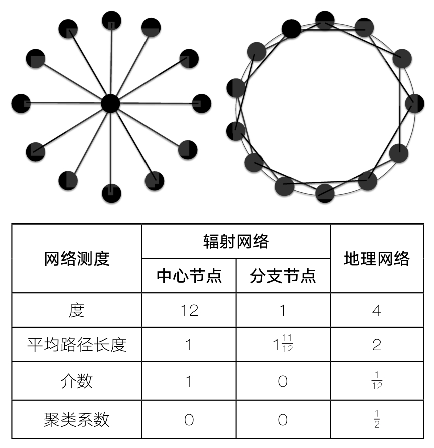
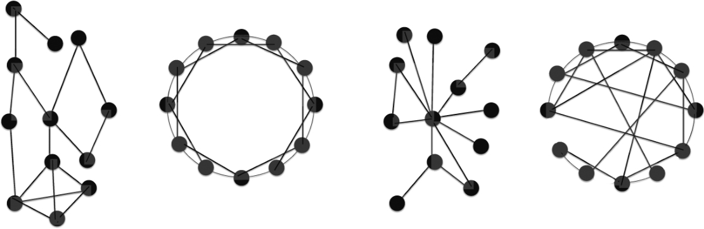
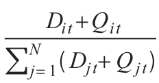
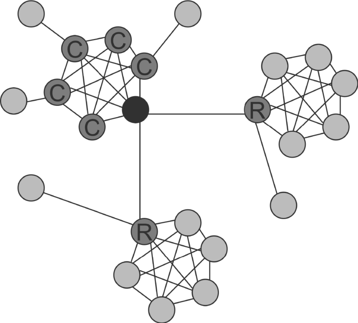
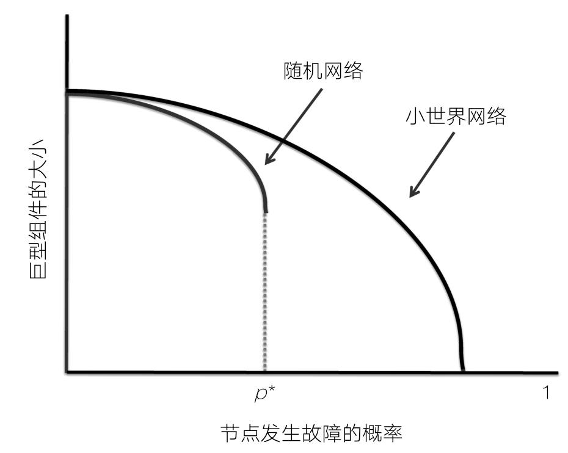
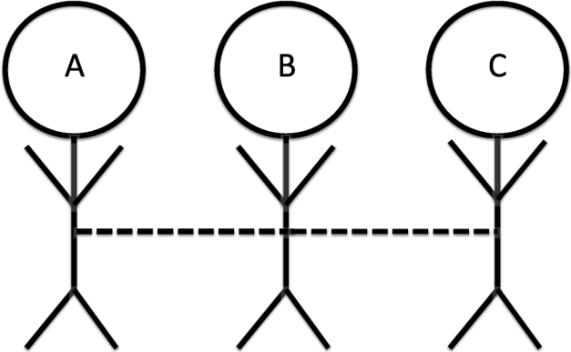

# 网络模型：无处不在的连接与建模基础

网络研究已经构成了科学的一个独立分支，可过去二三十年才真正进入大众视野。我们至今还没有把大学里的这些理论系统整理出来，然后自问：究竟该怎样搭建网络？网络该用来解决哪些问题？

安妮-玛丽·斯劳特

这一章要聊的就是网络模型。把网络研究做全套，得写成一整套书。这里的目标要温和得多：只求掌握网络的基本常识，能把网络的组成部件叫出名字，并说明它们对建模为何重要。结论很明确——网络几乎无处不在不可忽略。无论是市场模型、传染病扩散模型还是信息传播模型，一旦把参与者放进网络里，描述就会立刻变得更丰富。¹

网络遍布各处。人们常说的贸易网络、恐怖组织网络、志愿服务网络都是典型。不同物种以食物链的方式组织起来，那也是网络；企业以供应链的方式协作，也是网络。把金融体系看成一系列支付承诺的连结，同样贴切。网络对社会关系的理解至关重要。人类历史的大部分时间里，社交网络受地理限制而难以扩张。随着技术进步，越来越多的社会互动与经济交易转到虚拟网络上，并可以被模型化。

本章沿用先前讨论分布时的思路，遵循结构—机制—功能的三段式。先用一组统计量刻画网络结构：度、平均路径长度、聚类系数、社区结构等。再介绍几种常见网络形态：随机网络、星型网络、地理网络、小世界网络、幂律网络。随后探讨网络如何形成，用一些微观过程解释宏观结构。最后讨论功能，为什么网络结构本身就是一个关键问题。

本章重点落在网络结构的五大效应。先从友谊悖论讲起，深入分析后引出六度分隔与弱关系的价值。接着讨论网络在节点失效或攻击面前的韧性，以及网络上信息的汇聚问题。最后说明网络如何改变模型结果。

### 网络的结构

网络由节点和连接节点的边构成。被边直接连起来的节点互为邻居。若任意两节点沿边皆可到达，则称网络是连通的。网络可以画成图形，也可用邻接表或0-1矩阵表示，矩阵中第A行第B列的数字表示A与B间是否有边。图形更直观，列表和矩阵更适合计算。

边可以有方向。信息流网络里，有向边表示信息从一方流向另一方。生态网络里，从红尾鹰指向灰松鼠的箭头表示捕食关系。边也可以无方向，朋友关系就是典型的无向边。在无向网络中，节点的度等于与其相连的边数。

网络用一组统计量来描述，每个统计量都可求平均值和分布。以友谊网络为例，平均度告诉我们人均朋友数，度分布则显示是否存在少数高度连接的节点。社交网络的度分布相对平坦，而万维网、互联网和引文网络则呈现长尾。

路径长度是两节点间最短的边数，与度大致成反比。边越多，平均距离越短。在航空网络里，路径长度就是中转次数。价格相同的情况下，人们会偏好平均路径更短的航司。路径越长，信息扭曲风险越高。最短路径上的节点具有枢纽作用。若信息沿最短路径流动，必定经过这些节点。节点的介数等于经过该节点的最短路径占比，介数越高，信息掌控力与权力越大。

聚类系数衡量邻居间的紧密程度。某节点有10个朋友，共能构成45对。若其中15对彼此也是朋友，则聚类系数为1/3。若全部相连则为1。网络整体聚类系数是各节点系数的均值。

**网络统计量**

**度**：与节点相连的边数，即邻居数。

**路径长度**：节点间所需的最少边数。

**介数**：连接其他两节点的最短路径中有多少经过该节点。

**聚类系数**：节点的邻居对中互为邻居的比例。

图10-1展示了一个13节点的星型网络和一个13节点的地理网络。星型网络中中心节点度为12，其余12个节点度为1，均值小于2。中心到任何节点的距离为1，其余节点之间必须经中心，距离为2，均值也小于2。中心位于所有最短路径上，介数为1；外围节点介数为0。网络中任意两个邻居都不相连，聚类系数为0。

**图10-1 一个中心辐射型网络和一个地理网络**

地理网络里，每个节点与左右各两个邻居相连，平均度为4。每个节点有4个节点距离为1、2、3，均值正好是2。度和距离分布呈现简并，每个节点相同。每个节点的介数约为1/12。每个节点有4个邻居，可组成6对，其中3对相互连接，故聚类系数为1/2。

刻画聚集的另一种方式是社区划分。青少年友谊网络中，社区可能对应艺术、体育或科学兴趣，也可能按族群性别划分。政治联盟可按地区或意识形态分组。常见的检测方法是逐步移除介数最高的边，或在给定社区数的前提下优化目标函数，例如最小化跨社区边数、最大化社区内边比例。³

社区检测可揭示网络泡沫问题。人们是否生活在只从同类信源获取新闻的“信息茧房”里？互联网以前难以验证，如今数据抓取让新闻来源可被精准识别，结果显示一定程度的泡沫确实存在。模型提供正式定义，数据提供强度，判断力则帮助做出合理推断。

#### 常见的网络结构

网络形态极其多样，少数统计量无法唯一确定结构。拥有10个节点、平均度为2的网络就有数十亿种。常用做法是把待测网络的统计指标与同等规模的典型网络比较。例如司法引用网络图形上呈现明显聚类，可与同节点同边数的随机网络对比。

第一种典型是随机网络。节点间边以相同概率出现，聚类系数等于随机抽到一条边的概率，因为一个节点的两个邻居并无特殊亲近性。

**随机网络的蒙特·卡罗方法 ^((5))**

检验一个含*N*节点*E*边的网络是否随机，可生成大量同规模随机网络，计算其度、路径长度、聚类系数和介数的分布，再用标准统计检验判断实测值是否来自该模拟分布。⁴

第二种常见形态是规则地理网络，例如节点排成一圈并向两侧连接*k*个最近邻，或棋盘格上东西南北相连。这类网络度低、平均路径较长，介数与聚类系数相对稳定。

第三种是幂律网络，度分布遵循幂律，少数节点高度连接，大多数节点连接稀少。第四种是小世界网络，结合地理与随机特征。⁵ 从地理网络出发，以一定概率随机重连一条边：概率为零时保持地理特征，概率为1时变为随机，中间值则产生小世界——局部高聚类且存在跨群捷径。社交网络即典型的小世界，每人拥有熟人圈与少量弱连接的随机朋友。

**图10-2 随机网络、地理网络、幂律网络和小世界网络**

### 网络形成的逻辑

多数观察到的网络结构源于个体连接选择而非整体规划。友谊、万维网、电网都属自发涌现；供应链则多为计划产物。计划网络追求节点失效时的韧性，而自发网络为何也具备韧性，本身就是谜题。

随机网络和小世界网络可用简单规则生成：随机连边即可得随机网络；先建规则地理网络再部分重连即可得小世界。

电网受经济与工程双重约束。电力输送网络若高度聚类效率低下，但缺乏聚类会削弱韧性。长距离跳跃也不被鼓励，电力公司不会从芝加哥直连达拉斯。相比之下，人际与企业网络的长程跳跃很常见，这类跳跃提升了韧性。

幂律网络可通过优先连接类模型产生。先随机放置若干节点，再让新节点按度比例连接到旧节点。越早进入的节点度越高。但该模型忽略节点质量差异。质量与度耦合的形成模型修正了这一点并仍能产生长尾。

**质量和度的网络形成模型**

先创建*d*个孤立节点。每周期*t*新增一个质量*Q*[t]由分布*F*抽取的节点。该新节点按其他节点的度连接。用*D*[i t]表示*t*时刻*i*节点的度，则在*N*个节点中选中*i*的概率为：

若新节点质量均值与方差足够小，模型退化为标准优先连接。若质量分布有长尾，高质量新节点度可迅速扩张。⁶

### 网络的功能

友谊悖论在任意网络上都成立：平均而言，节点度低于其邻居度。以星型网络说明：12个外围节点各有1个朋友，中心有12个朋友。整体平均度不足2，但每个人朋友的平均度超过11。

该悖论普适于邮件、学术引用、银行、国际贸易等网络。论文平均引用次数高于被它引用的论文；一个国家的贸易伙伴平均拥有更多贸易伙伴；食物网中与单一物种相连的物种比该物种自身连接更多。在度分布更分散的网络中差异更明显。Facebook研究显示，人均约200个朋友，而朋友的朋友均值超过600。⁷

**友谊悖论**

只要网络存在度差异，节点的平均度就低于邻居的平均度。换句话说，平均而言，朋友比自己更受欢迎。⁸

逻辑可推广到任何与朋友数相关的属性。若活跃、快乐、聪明、富有、友善的人倾向拥有更多朋友，那么一个人的朋友平均在这些属性上都更高。举例：不快乐群体中90%有4个朋友、10%有10个朋友；快乐群体中比例相反。朋友群体被拥有10个朋友者不成比例地代表，而他们多为快乐者，因而多数人的朋友比自己更快乐。

六度分隔理论认为地球上任意两人最多通过6个中间人相连。友谊悖论普遍适用，六度分隔则依赖网络类型。该说法源于米尔格兰姆1960年代的实验：向内布拉斯加奥马哈和堪萨斯威奇托的296人寄出包裹，要求转交给更可能认识波士顿目标的人。64个包裹抵达，平均链长略小于6。

半个世纪后，邮件版实验在全球设18个终点，邀请2万多人参与。邮件链中间长度在5到7之间，取决于地理距离。虽然实验链长不等于最短路径，但证据显示大多数人不需要6度即可连通。¹⁰

为直观看待六度分隔，构建简化的小世界网络。假设每个人有100个彼此相识的圈内好友和20个圈外随机朋友。图10-3展示了某节点及其朋友的部分朋友圈。

**图10-3 一个节点的圈内好友C和随机朋友R**

随机朋友常为弱关系，它们把不同社区连起来，成为信息桥梁。社会学尤其强调弱关系的力量。¹²

在该结构下，可估算二度邻居数量：把随机朋友的所有朋友相加，圈内好友不再重复。类推可得三度邻居：把圈内好友的随机朋友的朋友计入，排除已计入的圈内关系。以100个圈内好友、20个随机朋友估算：

**六度分隔**

设每个节点有100个圈内好友C彼此互连，另有20个随机朋友R与节点无共同朋友。

**一度：** C+R=120

**二度：** CR+RC+RR=2 000+2 000+400=4 400

**三度：** CRC+CRR+RCR+RRC+RRR=328 000

**四度**¹³：17 360 000

**五度：** >10亿

**六度：** >200亿

模型假设随机朋友的朋友无重叠并隐含无限人口。现实网络随度增加会出现重叠，实际数值会偏低。但各度邻居的相对增长趋势不变：三度邻居远多于二度邻居。

三层人脉的价值往往被低估了。以我们手头的案例来算，绕过熟人再绕过熟人，触达的第三层联系人数量轻松突破二十五万。这一层关系和你的直接朋友完全不同：他们散落在不同的城市、不同的学校、不同的行业，信息来源因此极度多元化。与此同时距离又不至于遥远，朋友的朋友的朋友，很可能就是你室友母亲的同事，或是妹妹男友的姨妈。正是这种“远而不远”的特性，让三度人脉成为一种可操作的资产——他们带来的往往是新的资讯、新的工作机会，甚至是搬家、创业或商业合作的契机。

### 网络受冲击时的韧性

网络最核心的特质是抗打击能力，即当某个节点或连线掉线后，整体是否还能保持连通。我们可以用模型来估算在不同比例的节点被移除后网络仍连通的概率，也能观察平均路径长度的变化。比如航空网络，一旦某个枢纽因天气或电力中断，我们就可以预估会产生多少额外航班。

这里聚焦的是巨型连通分量的规模随随机故障怎样演化。随机网络与小世界网络的对比很说明问题。在纯随机网络里，巨型分量随故障线性萎缩；当边的出现概率跌到约等于1除以节点数这个阈值时，分量会骤降至原网络的任意小比例。小世界网络却没有这种断崖式崩塌。因为它的连接集中在地理或主题上的紧密簇里，每个簇能扛住多个内部节点失效，再叠加少量随机长连，整个系统就能避免一溃到底。

换句话说，稀疏且缺乏局部聚类的网络更容易脆弱。把这个结论套到电网上就能理解其风险：电网缺少小世界里那种长距离捷径和紧密簇，局部故障无法通过簇内替代路径或远跳绕行来化解，于是会级联放大到全局。¹⁴ 互联网则呈现鲜明对照。长尾度分布让绝大多数节点连接稀少，随机掉几个低度节点几乎不伤大局，网络保持连通的能力很强。

**图 10-4　巨型组件的大小作为节点故障的函数**

到目前为止我们讨论的都是随机故障。还有一种是精准打击。长尾分布的网络在随机冲击下很稳，却对战略性移除高度数节点极度敏感。辐射状网络的逻辑最直观：随机删节点时很难伤到中心，除非极低概率地直接命中核心；一旦有意拔掉中心，网络一步就被切断。

这类脆弱性对社会治理有直接启示。像恐怖主义、毒品交易这类我们希望斩断的网络，若结构偏稀疏或呈长尾分布，摘除关键枢纽就能让整体失联。对恐怖网络而言，就是要优先拿下链接最多的成员。若网络更像小世界，即便拔掉若干战略节点，它仍能靠随机重连把被切开的片段重新缝合，单纯封堵局部段落往往收效甚微。

### 小结

构建由人构成的网络模型，本质上是为了刻画社会影响：一个人的成功、行为、信息或信念如何外溢到朋友圈。行为与价值既受情境影响，也受个人特质驱动。有人会问，成功靠的是你知道什么，还是认识谁？

想一个实验室的科学家群体。他们共享想法、互相提点，某位学者的论文数、专利数或突破性成果，不仅取决于他个人的知识储备，也取决于他与同事的互动质量。评估贡献时必须把个人能力和环境嵌入一起看。

“靠人才”并非万能。不少投资机构高薪签下明星基金经理，却未必达标。经验显示顶级投资人的表现也高度依赖同事网络提供的特定信息。¹⁵ 把视野放宽，文献早已指出：你在组织里的位置会塑造你的成败。

能力当然重要。能让投资者赚进数百万的点子是好点子，能产出上百篇论文的学者也必然有扎实功力。但网络位置同样关键。介数等中心性指标能捕捉这一点。介数高的人往往正填上了社会学家罗纳德·伯特所说的结构洞，¹⁶ 能够桥接不同社群，汇聚差异化的信息与思想，从而获得权力和影响力。填洞并非跳下去那么简单，需要被各方信任、理解并熟悉彼此的知识体系。

同样的思路可以迁移到企业估值与国家权力。企业有账面内在价值，也有关供应链中的区位价值；国家有资源禀赋，也有联盟网络。内在属性与连通性总是一起作用。网络分析常把节点当单位，实则边也很重要，甚至整张网本身才是合适的分析单元。若教师网络能让课堂间的信息顺畅流动，教学改革就能落地。二年级老师对刚升三年级学生的了解，对三年级老师极有帮助；数学老师对概念掌握的洞察，能让科学老师更好地设计课程。优秀的学校往往拥有紧密的教师网络。¹⁷ 这只是其中一个例子，网络视角能刷新很多公共与私人领域的思考。

**迈尔森值和结构洞**

填结构洞的人因为连接不同社群而获得更大影响力。介数等统计量与结构洞相关，另一个衡量影响力的工具是迈尔森值，它建立在夏普利值之上。计算时在网络上构建合作博弈，只允许包含连通分量的联盟存在。

看三个排成一列的人，A在最左，C在最右，B居中。若只允许相邻的人结盟，A要和C合作必须拉上B。给所有可行联盟赋予收益后，为每个联盟计算夏普利值再求和，就得到迈尔森值。

**可能的次序：ABC，BAC，BCA，CBA 排除掉的次序：ACB，CAB**

举例，若任意两人联盟收益为10，三人全联盟收益为14，则迈尔森值为A 3、B 8、C 3。¹⁸ 中心性测度只看网络结构，迈尔森值则同时依赖价值函数。把两者一起使用，就能把一个人权力的位置依赖与功能依赖拆开。在这个简单例子里，迈尔森值3、8、3与介数0、1、0完全对应，但在更复杂的网络和价值函数下，二者未必一致。