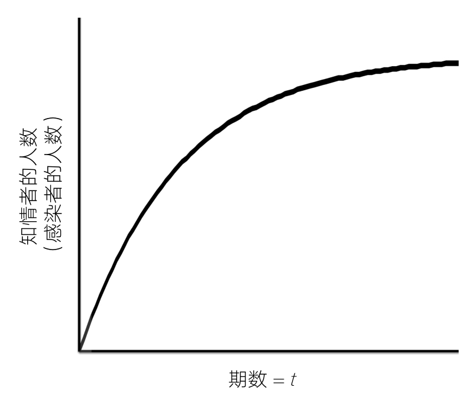
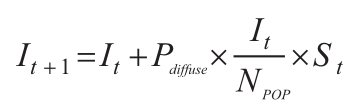
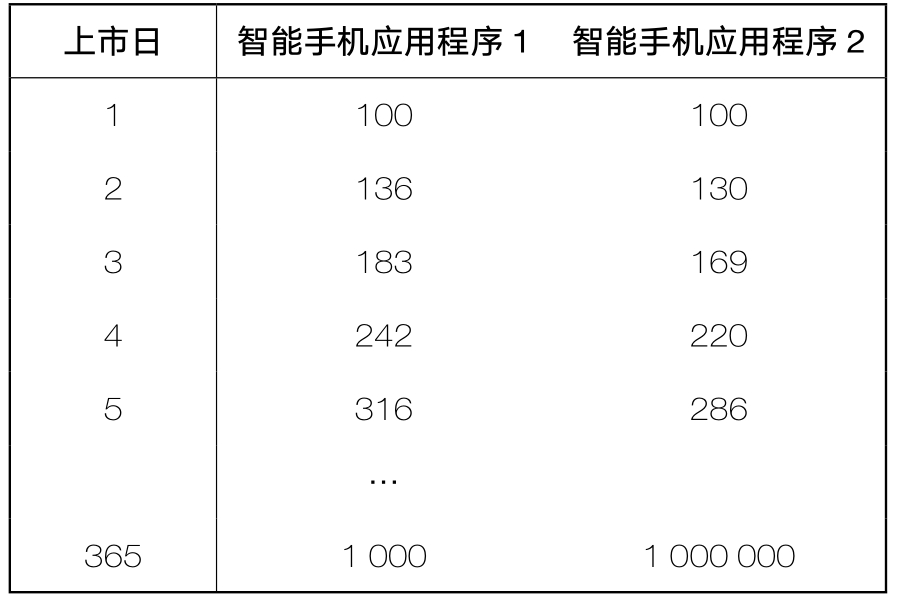
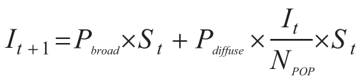
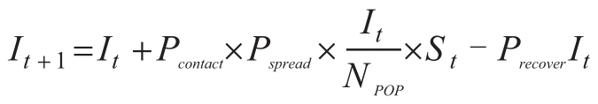
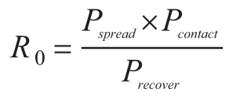
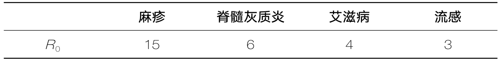
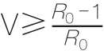
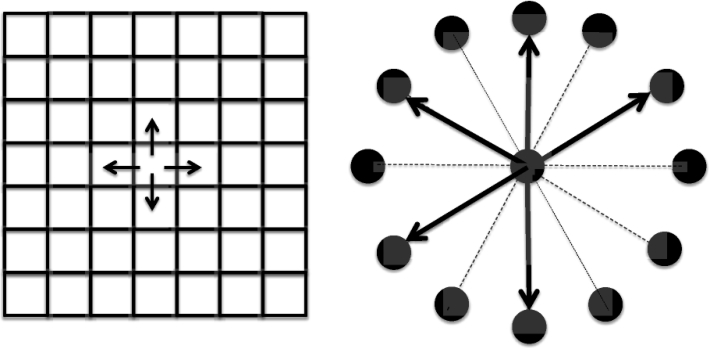
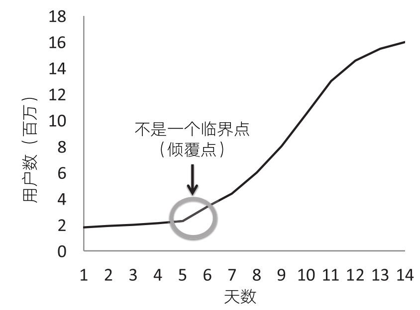

# 11　广播模型、扩散模型和传染模型

就像传染病的传染导致更多的传染病一样，信任的“传染”也可以促成更大的信任。

玛丽安·穆尔（Marianne Moore）

在本章中，我们运用广播模型、扩散模型和传染模型分析信息、技术、行为、信念和传染病在人群中的传播。这些模型在通信科学、市场营销学和流行病学的研究中发挥着核心作用。所有这三类模型都将整个人口划分为两个群组：知道或拥有某种东西的人与不知道或不拥有某种东西的人。随着时间的推移，个人会在这两个群组之间移动。有人会从易感者变为感染者，或者从不了解新产品新思想的人变成知情达意者。

串上某种传染病、购买了某种产品或掌握了某个信息的人的数量随时间推移而演变的曲线，也就是采用曲线的经验图形往往是凹的或 S 形的。人们如何获悉信息或怎样患上传染病——无论是通过广播传播还是扩散传播，决定了这种图形的形状。本章的主要内容就在于，将思想和传染病传播的微观过程与这些采用曲线的形状联系起来。为此，本章首先分析了广播模型。这种模型适用于人们从某个单一来源知悉思想或罹患传染病的情形。广播模型生成的图是 r 形的。然后，我们讨论扩散模型。在扩散模型中，传播始于接触，就像传染病在人与人之间传播时那样。扩散模型会产生 S 形曲线。

许多产品、应用程序、思想和信息都是通过广播传播和口碑传播的。我们可以同时允许广播和扩散来对这些情况建模，由此而得到的模型被称为巴斯模型（Bass Model），它在营销学中起着核心作用。巴斯模型会生成 r 形曲线还是 S 形曲线，则取决于广播过程和扩散过程之间的相对优势。

本章中讨论的最后一个模型来自流行病学的关于传染病传播的 SIR 模型（易感者、感染者和痊愈者模型）。这个模型包括了痊愈率，它能够刻画抵御传染病的免疫系统、突显性逐渐弱化的信息，以及被流行浪潮甩下的时尚行为等。SIR 模型会产生一个临界点，在临界点上，产品或传染病性质的微小变化，就意味着失败与成功之间巨大分野。病毒毒力的轻微减少，就可以使大规模传染变为轻微的发病；歌曲传唱概率的小幅变动，就可能把一只热门的新乐队送上天堂或打入地狱，区别之大，恰如披头士乐队与一支在利物浦某个地下酒吧卖唱的乐队之间的区别。

### 广播模型

本章中介绍的所有模型都要假设存在一个相关人群，用*N* * [POP] * 表示。相关人群包括那些可能患上传染病、了解信息或采取行动的人。相关人群所指的并不是一个城市或国家的全部人口。如果我们要为连续主动脉缝合法的扩散建模，那相关人群就是指心脏外科医生，而不是居住在费城的所有人。

在任何时候，总会有些人患上了某种传染病、了解特定信息或采取了一定行动。我们将这些人称为感染者或知情者（用*I* * [t] * 表示），相关人群中除了感染者或知情者之外的其余成员则是易感者（用*S* * [t] * 表示）。这些易感者可能会感染传染病、了解信息或采取行动。 ¹  相关人群的总人数等于感染者或知情者人数加上易感者人数的总和：*N* * [POP] * =*I* * [t] * +*S* * [t] * 。

**广播模型** 

*I* * [t] * [+1] =*I* * [t] * +*P* * [broad] * ×*S* * [t] * 

其中，*P* * [broad] * 表示广播概率，*I* * [t] * 和*S* * [t] * 分别等于时间*t* 上的感染者（知情者）和易感者的数字

初始状态为*I* [0] =0，且*S* [0] =*N* * [POP] * 。

广播模型刻画了思想、谣言、信息或技术通过电视、广播、互联网等媒体进行的传播。大多数时事新闻都是通过广播形式传播的。这个模型的目标是描述一个信息源传播信息的过程，可以是政府、企业或报纸。它也适用于通过供水系统传播污染的情况。但是，这个模型不适用于在人与人之间传播的传染病或思想。由于广播模型更适合描述思想和信息的传播（而不是传染病的传播），所以我们在这里说知情者的人数，而不说感染者的人数。

在给定时间段内，知情者人数等于前一期的知情者人数加上易感者听到信息的概率乘以易感者人数。按照惯例，初始人口全部由易感者组成。要计算未来某期的知情者人数，只需要将知情者人数和易感者人数代入上述方程即可。由此得到的将是一个 r 形采用曲线。

想象一下：某个拥有 100 万居民的城市的市长宣布了一项新的税收政策。在他宣布之前，没有人知道这项政策。假设某人在任何一天听到这个新闻的概率等于 30%（即，*P* * [broad] * =0.3），那么第一天会有 30 万人听到这个新闻。在第二天，剩下的 70 万人中有 30%的人，即 21 万人会听到这个新闻。在每一个时期，知情者的人数都会增加，并且以一个递减的速度增加，如图 11-1 所示。

**图 11-1　广播模型产生的 r 形采用曲线** 

在广播模型中，相关人群中的每一个人最终都会知悉信息。如果有适当的数据，就可以估计出相关人群的规模。假设一家企业为练习太极拳的人推出了新设计的运动鞋，并在第一个星期就收到了 20 000 双鞋的订单。如果在第二个星期收到了 16 000 双鞋的订单，那么我们可以大致估计出他们最终的总销售量，也就是相关人群的规模为 100 000。

**用广播模型拟合销售数据** 

第 1 期：*I* [1] =20 000=*P* * [broad] * ×*N* * [POP] * ；

第 2 期：*I* [2] =36 000=20 000+*P* * [broad] * ×（*N* * [POP] * -20 000）

于是，总销售量为 ²  ：*P* * [broad] * =0.2，*P* * [broad] * =100 000

当然，对于根据仅有的两个数据点估计出来的任何结果，我们都不应该抱以太大的信心。这个模型无疑遗漏了许多现实世界的特征。人们既可能通过传媒获悉相关消息，也可能通过口耳相传听到消息，而且有些人可能会购买不止一双鞋子，或者可能存在针对潜在消费者的广告，等等。如果把这些因素都包括进去，估计出来的结果肯定会有所不同。尽管必须牢记这个注意事项，但是这个模型确实提供了一个粗略的估计。这个企业不应该期望能够卖出 200 万双鞋，但是应该有信心可以卖出不止 100 000 双鞋。随着更多数据的出现，估计结果是可以得到改进的。如果第三个星期的销售额是 13 000 双（这等于模型预测的数量），那么这个企业对当初的预测可以寄予更大的信心。

### 扩散模型

大多数传染病，以及关于产品、思想和技术突破的信息，都是通过口口相传而传播开来的，扩散模型刻画了这些过程。扩散模型假设，当一个人采用了某种技术或患上了某种传染病时，这个人有可能将之传递或传染给与他接触的人。在传染传染病的情况下，个人的选择不会在其中发挥任何作用。一个人患上某种传染病的概率取决于诸如遗传、病毒（细菌），甚至环境温度等因素。在炎热潮湿的季节，疟疾的传播速度要比在寒冷干燥的季节快得多。

技术的传播则与采用者的选择有关，因此更有用的技术被采用的概率更高。但是在这里，我们并没有在模型中明确将这种情况选择考虑在内。这样一来，苹果智能手表的新潮性就发挥了与流感病毒同样的作用。

在这里，我们更看重的是信息的传播，因此我们将人们分为知情者或不知情的新人。如果新人与知情者相遇且信息在他们之间传播，那么新人就会变成知情者。这种事件的发生，因环境而异。生活在城市中的人，相遇的概率可能比生活在农村的人更高，同时也有更高的接触概率。非常吸引人眼球的新闻也比一般的新闻被分享的概率更高，例如，关于外星人降临登陆的新闻被分享的概率比关于 M&M 公司的椒盐卷饼重新上市的新闻更容易被分享。因此，我们可以将扩散概率（diffusion probability）定义为接触概率（contact probability）和分享概率（sharing probability）的乘积。我们可以根据扩散概率来构建模型，但是在估计或应用模型时，必须独立地跟踪接触概率和分享概率。

扩散模型假定随机混合（random mixing）。随机混合的含义是，相关群体中任何两个人接触的可能性都相同。对于这个假设，我们应该保持警惕。就描述幼儿园内传染病传播的扩散模型而言，这可能是一个准确的假设，因为幼儿园里儿童之间的相互接触是高频率的。但是，如果将它应用于城市人口则是有问题的。在城市中，人们并不是随机混合的。人们在一定的社区中生活，在一定的场所内工作，他们属于工作团队、家庭和社会团体，他们的互动主要发生在这些群体中。但是同时也不要忘记，一个假设要成为有用模型的一部分，其实不一定非得十分准确不可。因此，我们将继续使用这个假设，同时保持开放的心态，在需要改变的时候随时改变这个假设。

**扩散模型** 

其中，*P* * [diffuse] * =*P* * [spread] * ×*P* * [contact] * 。

在这个模型中，与在传播模型中一样，从长期来看，相关人群中的每个人都会掌握信息。不同的是，扩散模型的采用曲线是 S 形的。最初，几乎没有人知情，*I* [0] 很小。因此，能够与知情者接触的易感者人数也必定很小。随着知情者人数的增加，知情者与不知情者之间接触的机会增加，这又使知情者的人数更快地增多。当相关人群中几乎每个人都成了知情者时，新知情的人数会减少，从而形成了 S 形的顶部。技术的采用曲线通常也具有这种形状。例如，杂交种子的采用曲线虽然因州而异（艾奥瓦州采用杂交种子的速度比亚拉巴马州更快），但是所有州的采用曲线都是 S 形的。 ³  

在广播模型中，根据数据估算相关人群规模是一件相当简单的事情。采用者的初始数量与相关人群规模密切相关。与此相反，利用扩散模型的数据估计相关群体的规模可能会非常困难。产品销售量的增加，可能是由于一个很小的相关人群内部的高扩散概率，也可能是由于一个很大的相关人群中的低扩散概率。

图 11-2 显示了两个假想的智能手机应用程序的相关数据。在第一天，每个应用程序都有 100 人购买。在接下来的 5 天中，应用程序 1 拥有更高的总销量和更快的销量增长。如果没有模型，我们很可能会预测应用程序 1 拥有更大的市场。但是，用模型拟合这两组数据的结果表明，事实与我们猜想的恰恰相反。

**图 11-2　智能手机应用程序的两条采用曲线** 

应用程序 1 拟合的扩散概率为 40%，相关人群规模为 1 000 人；而应用程序 2 的扩散概率为 30%，相关人群规模为 100 万人。 ⁴  事实上，只要再过几天，我们就会观察到应用程序 2 的相关人群更大。但是，如果没有模型，如果不能根据前 5 天的数据来进行分析，我们就可能会对总销售额给出不正确的推断。

在使用扩散模型来指导行动的时候，我们必须将扩散概率分解为分享概率和接触概率的乘积。为了提高应用程序的销售速度，开发人员既可以设法提高人们相互接触的概率，也可以设法加大他们分享关于应用程序信息的概率。要想改变第一个概率是很困难的。为了增大第二个概率，开发人员可以为带来了新注册用户的老用户提供一些激励，事实上，许多开发人员都是这样做的，比如游戏开发者可能会给带来了新注册玩家的老玩家奖励游戏积分。虽然这样做能够增加扩散速度，但是并不会影响总销量，至少根据这个模型来看不会有影响。如上所述，总销量等于相关人群的规模，而与分享概率高低无关，提高销售速度不会带来长期的影响。

大多数消费品和信息都是通过广播和扩散传播的。而巴斯模型则将这两个过程组合在一起了。 ⁵  巴斯模型中的差分方程等于广播模型和扩散模型中的差分方程之和。在巴斯模型中，扩散概率越大，采用曲线的 S 形就越显著。电视、收音机、汽车、电子计算机、电话机和手机的采用曲线形状都是 r 形和 S 形的组合。

**巴斯模型** 

其中，*P* * [broad] * =广播概率，*P* * [diffuse] * =扩散概率。

### SIR 模型

到目前为止，在我们已经讨论过的模型中，一旦有人采用了一项技术，则永远不会放弃它。对于电力、洗碗机和电视等技术来说，确实如此：一旦采用之后，一般永远不会不采用。但这并不适用于所有通过扩散传播的事物，例如我们患上了某种传染病之后不久就会恢复健康，或者当我们采用了某种流行款式或参加了某项潮流运动之后（例如，某种时装或舞蹈），是可以放弃的。遵循惯例，我们将放弃所采用的某种事物的人称为痊愈者。由此产生的模型，即 SIR 模型（易感者、感染者、痊愈者），在流行病学中占据了中心位置。

由于这个模型起源于流行病研究领域，同时也因为考虑传染病的痊愈更为自然，因此我们以传染病的传播为例来描述 SIR 模型。为了避免过于复杂的数学计算，我们假设治愈传染病的人会重新进入易感人群，也就是说治愈传染病并不会产生未来对传染病的免疫力。

**SIR 模型** 

其中，*P* * [recover] * ，*P* * [spread] * ，和*P* * [recover] * 分别等于传染病的传播概率、接触概率和痊愈概率。

流行病学家对接触概率和传播概率会进行单独跟踪，我们也会这样做。接触概率取决于传染病如何从一个人传播到另一个人。艾滋病通过性接触传播；白喉通过唾液传播；流感病毒通过空气传播。因此，流感的接触概率高于白喉，白喉的接触概率又高于艾滋病。而且，在发生接触后，各种传染病的传播概率也会有所不同。白喉比 SARS 更容易传染给另一个人。

SIR 模型会产生一个临界点，就是所谓的基本再生数*R* [0] ，也就是接触概率乘以扩散概率与痊愈概率之比。某种传染病，如果*R* [0] 大于 1，那么这种传染病就可以传遍整个人群，而*R* [0] 小于 1 的传染病则趋于消失。在这个模型中，信息（或者，在这个例子中是传染病）并不一定会传播到整个相关人群。能不能做到这一点取决于*R* [0] 的值。因此，像疾病控制中心这样的政府机构必须依据对*R* [0] 的估计来指导政策制定。 ⁶  

**基本再生数** *R* [0] 

如表 11-1 所示，麻疹可以通过空气传播，因而它的再生数高于艾滋病，艾滋病只能通过性接触和共用针头传播。对*R* [0] 的估计假设人们不会为了应对传染病而改变行为。然而，当学校里虱子肆虐时，家长的反应可能是让孩子待在家中，以降低接触概率，还可能会剃光孩子的头发，减少接触发生时传播的可能性。这两种行为变化都会降低虱子传播的*R* [0] 。

**表 11-1　各传染病的基本再生数 R[0] ** 

在没有疫苗的情况下，检疫是一个选择，但是成本很高。 ⁷  如果存在疫苗，那么疫苗接种可以预防传染病传播。即便做不到每个人都接种疫苗，也可以预防传染病传播。必须接种疫苗的人的比例，即疫苗接种阈值（vaccination threshold），可以通过公式求出。我们可以从上述模型中推导出这个公式。 ⁸  

疫苗接种阈值随*R* [0] 的增加而提高。例如，脊髓灰质炎的*R* [0] 为 6，因此为了防止脊髓灰质炎的传播，疫苗必须覆盖 5/6 的人群。而麻疹的*R* [0] 为 15，为了阻止麻疹的传播，疫苗必须覆盖 14/15 的人口。疫苗接种阈值的数学推导也为决策者提供了指引，如果接种疫苗的人数太少，这种传染病就会传播开来，因此政府接种疫苗的次数会超过模型估计的阈值。对于麻疹和脊髓灰质炎等*R* [0] 非常高的传染病，政府将努力保证所有人都接种疫苗。

有些人担心疫苗有副作用，选择不参加疫苗接种计划。如果这些人只占人口的一小部分，那么其他人接种疫苗也可以防止这些人感染这种传染病，流行病学家将这种现象称为群体免疫力。选择不接种疫苗的人事实上是搭了其他接种疫苗的人的便车，对于搭便车的现象，我们将在本书后面的章节中详细研究。 ⁹  

**R[0] 、超级传播者，以及度的平方** 

假设随机混合 R[0] 的推导如下：在每一步，人群中的个体随机相遇。如前所述，随机混合假设可能与通过空气传播的传染病或通过接触传播的传染病有关，但对于通过性行为传播的传染病则不太合理。

如果将 SIR 模型嵌入到网络中，就会观察到度分布对传染病传播的重要性。在这里，我们比较一下矩形网格网络（棋盘格）与中心辐射型网络。在矩形网格网络中，每个节点都连接到东、南、西、北的节点；而在中心辐射型网络中，则由一个中心节点连接到所有其他节点。

假设传染病会随机发生在某个节点上。我们在网络中设定 p[contact] =1，以保证每个人都会与他所连接的每个人接触。在下一个时期，传染病可能以一个与传染病毒力相对应的给定概率，独立地扩散给每个邻居。

首先考虑矩形网格网络。在每个时期，传染病都可以扩散到东、南、西、北 4 个节点中的任何一个。我们预计，如果传染病传播的概率超过了 1/4，传染病就会蔓延。展望未来的一个时期就会看到，如果一个新节点患上了传染病，那么这个节点有 3 个可能患上传染病的邻居。如果原始节点的北部和东部的两个邻居患上了传染病，那么传染病可能传播的节点就会达到 6 个。因此，这种网络似乎对传染病传播的潜力发挥没有太大影响。

接下来，考虑中心辐射型网络。第一个患上传染病的节点可能是中心节点，也可能是外围节点。如果中心节点患上了某种传染病，那么它可以将传染病传播到任何一个其他节点。我们预计这种传染病会扩散，即便传播的概率很低也是如此。如果是一个外围节点患上了传染病，那么唯一可能被传染的节点就是中心节点。正如在前面讨论过的，如果中心节点患上了传染病，那么即使传播的可能性很小，传染病也会蔓延。

对于中心辐射型网络，R[0] 携带的信息量很有限，因为如果中心节点患上了传染病，传染病就会传播开来。流行病学家们将位置在度很高的中心节点上的人称为“超级传播者”（superspreaders）。超级传播者加速了艾滋病和 SARS 的早期传播。 ¹⁰  超级传播者不一定是社交明星或“人脉”特别广的人，可能从事某种特定的行业职业，比如收费站的收费员、银行柜员、牙科医生，这类职业使他会与属于不同社交网络的人接触。生活在 19 世纪与 20 世纪之交的“伤寒玛丽”（Typhoid Mary）只是纽约的一名上门服务的厨师。她从这一家再到另一家，将伤寒感染给每一个接触者。当她被确认为传染源之后，就被强制隔离了。

为了推导出高度数节点的影响，我们首先要注意到一个事实：高度数节点不但能够更快地传播传染病，而且会更快地患上传染病。如果一个人朋友的数量是另一人的三倍，那么他患上传染病的可能性也是后者的三倍，同时传播这种传染病的可能性也是后者的三倍。因此，他对传染病传播的总贡献将是另一个人的九倍。因此，节点对传染病（或思想）传播的贡献与节点的度的平方相关。如果节点 A 的度数是节点 B 的*K* 倍，那么节点 A 传播传染病的可能性是节点 B 的*K* 倍，同时传染病传播到节点 A 的概率也是节点 B 的*K* 倍。因此，节点 A 对传染病传播的总效应将是节点 B 的*K* ² 倍。这种现象被称为度的平方。

### 一对多

尽管 SIR 模型原本是用来分析传染病传播的，但是我们也可以将它应用于所有先通过扩散传播，然后趋于消失的社会现象，例如书的销售、歌曲的流行、舞步的风行，“热词”的传播、食谱和健身方法的流传等。在这些情形下，我们也可以估计接触概率、传播概率和“痊愈”概率，以及基本再生数*R* [0] 。这个模型意味着，这些概率只要发生了微小的变化，就可以使*R* [0] 移动到高于零的水平，从而造成成功与失败之间的天壤之别。

确实，成功可能取决于非常微小的差异，正如美国作家约翰·厄普代克（John Updike）在描述棒球明星特德·威廉姆斯（Ted Williams）最后一次击球时所说的：“一件事情做得很好与搞砸了之间，只有极其细微的差异。” ¹¹  假设你构思了一个新的笑话；只要让这个笑话更有趣一点点，就可能会把*R* [0] 推到高于 1 的水平，从而使这个笑话广泛传播开来。同样的逻辑也适用于想法的“黏性”。如果一个想法能够在人们的思维中再坚持一小段时间，那么他们摆脱它的“痊愈”率就会降低，从而提高了*R* [0] 。

当然，并不是所有情况都会位于阈值上。披头士乐队拥有巨大的才华，他们的*R* [0] 肯定超过了 1，尽管这只是一个猜想。对于现在的流行歌星，我们可以使用互联网下载量来估计他们的*R* [0] 。流行歌星贾斯汀·比伯（Justin Bieber）的*R* [0] 估计为 24，这就是说，他的传染“毒力”比麻疹更强。 ¹²  

在 SIR 模型中，我们推导出了两个关键阈值，即*R* [0] 和疫苗接种阈值。这两个阈值都是属于敏感依赖于环境的临界点，环境（情境）中的微小变化都会对结果产生很大的影响。这种临界点不同于直接临界点（direct tipping point）。在直接临界点，特定时刻的微小行动会永久性地改变系统的路径。直接临界点出现不稳定的点是，例如当球停在山顶上时。在任一方向上稍微推一下，都将会使球从山的这一侧或另一侧滚下去，这个小小推动是一个直接的倾覆。 ¹³  

而在依赖于环境的临界点上，参数的变化会改变系统的行为方式。在直接临界点上，未来的结果轨迹急转直下。折弯，例如由扩散模型产生的*S* 形采用曲线中的第一个弯曲，不满足这两种临界点的定义。采用曲线中的折弯对应于斜率增长率最大的点。在那一点上，扩散一发不可收拾，但是并没有发生倾覆。

图 11-3 显示了 Google+发布后前两个星期的用户数。 ¹⁴  从图中可以看出，在发布 6 天后，出现了一个折弯。在那一点上，扩散的过程正在顺利展开。从两个星期内就获得了超过 1 600 万用户这个结果来看，我们不能说 Google+很早就陷入了困境，更不能说它在第 6 天就出现了直接临界点。将倾覆与急剧上升（下降）混淆起来，导致临界点这个术语被过度滥用了。新闻媒体和互联论坛上所说那些临界点，几乎有很少符合正式定义的。

**图 11-3　Google+用户数量上的一个折弯点（不是一个倾覆点）** 

我们不妨将肥胖症视为一种流行病来考虑。尽管人们不会像患上感冒那样感染肥胖症，但是他们可能会受到某种社会影响而做出一些容易导致肥胖的行为。 ¹⁵  要想扭转肥胖这种流行病，我们必须降低它的*R* [0] 。而要降低*R* [0] ，则可以通过降低接触概率或者提高分享概率和痊愈概率来实现。当然，在很多方面，用 SIR 模型来研究肥胖症的传播、学校辍学率或犯罪率，并不比经济学模型或社会学模型更好。它只是一个不同的模型，因此会给出不同的解释和预测，它也可能指向不同的行动或政策。它扩大了我们的模型集合，帮助我们更好地理解世界，但它不是解决问题的灵丹妙药。

在将广播模型、扩散模型和传染模型应用于社会现象时，我们可能会发现某些假设是成立的，而其他一些假设则不能成立。例如，在某种传染病的传播中，每一次接触导致该传染病传播的概率是独立的。但是在社交领域，由于采用本身也是一种选择，因此传染有可能会因更多的接触（曝光）而变得更有可能。流感不是我们选择的，我们只是得了流感。但是我们会选择买紧身牛仔裤，随着越来越多的人穿上了紧身牛仔裤，我们所有人都更可能穿紧身牛仔裤。类似的逻辑也适用于分析社交运动的参与率、新技术的采用率，甚至分析文身的人有多少。在这些情况下，我们可能必须对基本模型进行修正，以允许每次接触的采用概率会随着接触次数的增多而增大。 ¹⁶  信仰或信任行为的“传染”也是如此。这种修正，在扩大模型的应用范围时通常是必不可少的。