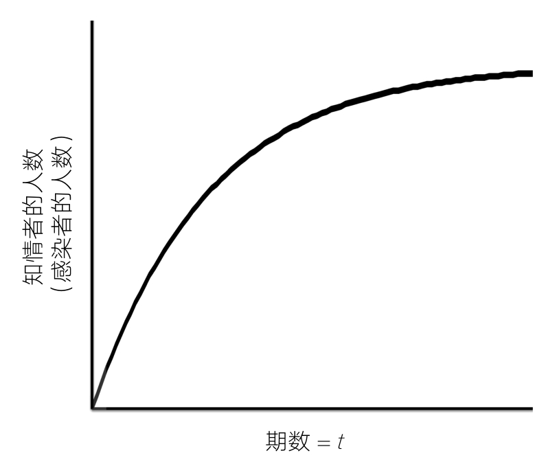
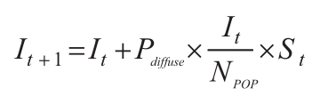
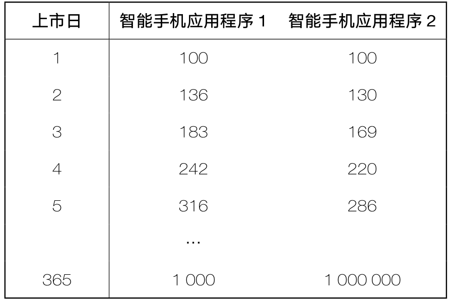
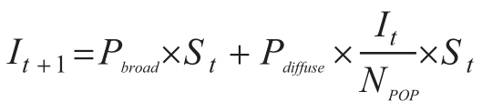
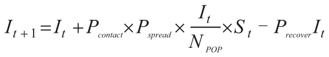
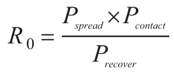
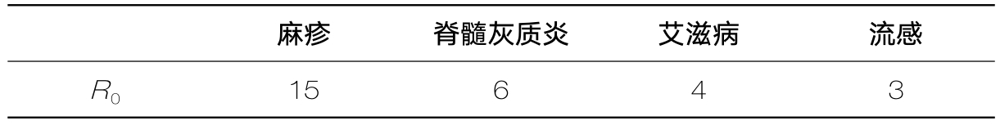
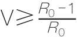
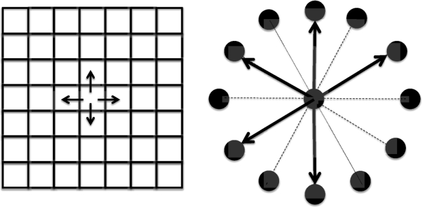
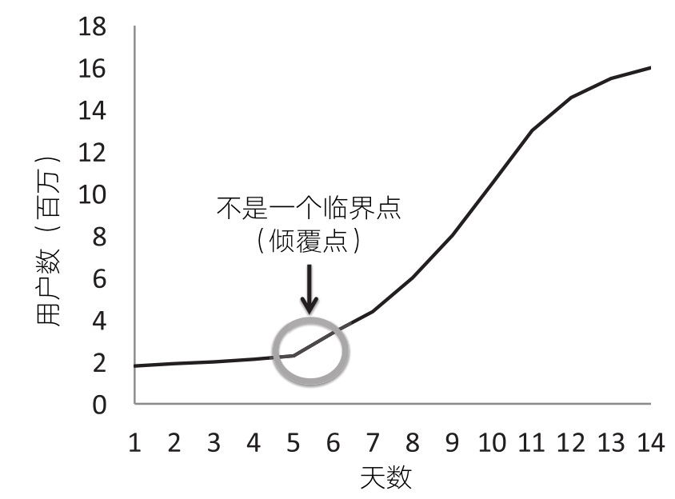

# 好点子为什么会“传染”？从广播、扩散到SIR，看懂人群中的传播曲线

有人说过，信任也会像传染病一样扩散：一个人先相信，往往能让更多人也跟着相信。这个比喻并不只是修辞。信息、技术、行为、信念乃至疾病，在人群中扩散时，确实有一些相似的底层规律。

本章讨论的三类模型——广播模型、扩散模型和传染模型——在通信科学、市场营销和流行病学里都很常用。它们有一个共同起点：把人群分成两拨，一拨已经知道或已经拥有某样东西，另一拨还不知道、还没有。随着时间推移，人会在这两个群体之间流动：从“易感”走向“感染”，或者从“没听说”变成“已知情”。

现实中，采用曲线往往呈现凹形或S形。曲线长什么样，取决于人们是通过一个中心声源获知，还是通过人与人接触被“传染”。本章要做的，正是把微观传播过程与宏观曲线形状对应起来：广播模型通常画出r形曲线，扩散模型更容易画出S形曲线；把两者叠加，就是营销学中重要的巴斯模型；再加入“痊愈”机制，就得到流行病学里的SIR模型。

## 一、广播模型：一个喇叭喊出去，曲线呈r形

先看广播模型。它适合描述这样一种情形：信息或疾病来自某个单一源头，然后向人群扩散。

这里要先界定“目标池”。它不等于一座城市或一个国家的全部人口，而是那些可能被影响的人。比如研究连续主动脉缝合法如何扩散，目标池应该是心脏外科医生，而不是费城所有居民。

在任何时刻，人群里总有一部分人已经知情或已经感染，另一部分人尚未知情、仍可能被影响。前者可称为知情者或感染者，后者是易感者。两者相加，就是目标池总人数。按照惯例，初始时刻所有人都是易感者。

广播模型的核心逻辑很直白：每一期新增的知情者，等于广播概率乘以尚未知情的人数。它描述的是电视、广播、互联网等媒体把同一信息传给许多人的过程。大多数时事新闻走的就是这条路；政府、企业或报纸发布消息，也适用这个框架；甚至供水系统传播污染，也可以用类似思路理解。不过，它不太适合解释人与人之间口口相传的传染病或思想，所以在这个模型里，我们更常说“知情者”，而不是“感染者”。

举个例子：一座百万人口的城市，市长突然宣布一项新税收政策，此前无人知晓。假设每天有30%的未知情者听到这个消息，那么第一天会有30万人知情；第二天，剩下70万人里又有30%——也就是21万人——听到消息。此后每期新增人数仍在上升，但增速逐步放缓，形成r形曲线。

广播模型有一个重要结论：长期看，目标池里的人最终都会知道。只要数据合适，还能粗略估计目标池规模。比如某企业推出太极练习鞋，第一周卖出2万双，第二周卖出1.6万双，就可以用模型反推最终总销量大致为10万双，并估出广播概率约为0.2。

当然，仅凭两个数据点不能太自信。现实里还有口碑传播、重复购买、广告投放等干扰因素，模型肯定会遗漏一些东西。但这个粗略估计仍有参考价值：企业不该幻想卖出200万双，却可以有信心最终超过10万双。若第三周销量为1.3万双，恰好接近模型预测，那么对当初判断就可以多一分把握。

## 二、扩散模型：靠接触和分享，曲线呈S形

大多数传染病，以及产品、思想和技术突破的消息，更常通过口口相传扩散。扩散模型的假设是：一个人采用某项技术或患上某种疾病后，有可能把它传给与自己接触的人。

疾病传播中，个人选择作用很小，感染概率更多取决于遗传、病毒或细菌、环境温度等因素。比如疟疾在炎热潮湿季节传得更快。技术传播则和采用者的选择有关，更有用的技术更容易被采纳；不过模型并没有把这种选择明确写进去。于是，苹果智能手表的新潮性，在模型里也能扮演类似“病毒”的角色。

如果更关注信息传播，可以把人分成知情者和不知情的新人。新人与知情者相遇，信息完成分享，新人就变成知情者。这个事件是否发生，与环境有关：城市里人和人相遇概率高，农村相对低；特别抓眼球的新闻也比普通消息更易被转发——外星人登陆的传闻，显然比M&M公司椒盐卷饼重新上市更容易被分享。

因此，扩散概率可以拆成两个部分：接触概率乘以分享概率。建模时可以围绕扩散概率展开，但真正估计和应用时，接触概率和分享概率要分别跟踪。

扩散模型还假定“随机混合”：目标群体中任何两个人接触的可能性相同。这个假设要谨慎使用。在幼儿园里描述疾病传播，随机混合可能还算贴近现实，因为孩子之间接触频繁；但套到城市人口就有问题。人们生活在社区、工作场所、团队、家庭和社会团体里，互动并不随机。不过，一个假设不必完美无缺，也可以成为有用模型的一部分。关键是保持开放，需要时再修正它。

扩散模型与广播模型一样，长期看目标池里的人最终都会知情；区别在于曲线形状。扩散模型画出的是S形曲线：最初知情者极少，能与知情者接触的未知情者也少；随着知情者增多，接触机会上升，新增知情者加速增加；当几乎人人都知道时，新增人数又降下来，形成S形的顶部。技术采用曲线常呈这种形状。杂交种子的推广因州而异，艾奥瓦州比亚拉巴马州更快，但各州曲线都是S形。

用扩散模型估计目标池规模，比广播模型难得多。销量上升，可能是因为人群很小但扩散概率很高，也可能是因为人群很大但扩散概率很低。假设两个手机应用第一天都卖出100份，接下来5天里应用1总销量更高、增长更快。没有模型时，我们很容易判断应用1市场更大；但拟合结果可能完全相反：应用1扩散概率为40%，目标池只有1000人；应用2扩散概率为30%，目标池却有100万人。只要再过几天，应用2的市场规模就会显现出来。

扩散模型还能指导行动。既然扩散概率等于接触概率乘以分享概率，想加快销售，就可以提高人们接触的机会，或提高他们分享的意愿。改变接触概率很难；提高分享概率则可以通过激励老用户带新用户，比如游戏里给邀请新玩家的老玩家奖励积分。不过要注意，这类做法主要加快扩散速度，并不改变总销量。按模型逻辑，总销量取决于目标池规模，与分享概率高低无关，速度提升不带来长期总量变化。

## 三、巴斯模型：广播加口碑，两条腿走路

多数消费品和信息，既靠广播，也靠扩散。巴斯模型把两个过程合在一起：它的差分方程，相当于广播模型与扩散模型差分方程之和。扩散概率越大，采用曲线的S形就越明显。电视、收音机、汽车、电子计算机、电话机和手机的普及曲线，往往是r形与S形的组合。

## 四、SIR模型：会痊愈，才会出现临界点

前面几个模型都默认：一旦采用某项技术，就永远不会放弃。对电力、洗碗机和电视来说，这大致成立。但并非所有扩散对象都如此。人患上传染病后会康复，流行款式和潮流运动也可能被抛弃。按惯例，放弃采用的人被称为“痊愈者”。于是就有了SIR模型：易感者、感染者、痊愈者。它在流行病学中占据中心位置。

为了便于理解，这里以疾病传播为例，并做一个简化假设：康复者会重新回到易感人群，也就是说，本次康复不带来未来免疫力。

疾病传播中，接触概率和传播概率要分开看。接触方式不同，概率差别很大：艾滋病通过性接触和共用针头传播，白喉通过唾液传播，流感通过空气传播。流感的接触概率高于白喉，白喉又高于艾滋病。发生接触之后，不同疾病的传播概率也不同，白喉比SARS更容易传给下一个人。

SIR模型会推出一个临界点，即基本再生数R0，它等于接触概率与扩散概率的乘积，再除以痊愈概率。R0大于1，疾病就可能传遍整个人群；R0小于1，传播就趋于消失。也就是说，信息或疾病并不必然覆盖所有目标人群，能不能铺开，要看R0。像疾病控制中心这样的机构，需要依据R0估计来制定政策。

不同疾病的R0差别很大，可参考表11-1。麻疹能通过空气传播，再生数高于主要靠性接触和共用针头传播的艾滋病。需要注意的是，R0估计假设人们不会因疾病改变行为。现实里，学校虱子肆虐时，家长可能让孩子待在家里，降低接触概率；也可能剃光孩子头发，减少接触后的传播可能。两种行为都会压低虱子传播的R0。

没有疫苗时，检疫是一种选择，但成本很高。有疫苗时，接种可以阻断传播，而且不必人人接种也可能有效。必须接种的人口比例叫疫苗接种阈值，可由公式求出。

这个阈值会随R0升高而提高。脊髓灰质炎的R0为6，要阻止传播，疫苗需覆盖5/6的人群；麻疹的R0为15，则需覆盖14/15的人口。数学推导也能给决策者提供指引：接种人数太少，疾病仍会传播，所以实际接种覆盖往往要高于模型算出的最低线。对麻疹、脊髓灰质炎这类R0很高的疾病，政府通常会努力保证尽可能多的人接种。

有些人担心疫苗副作用而不参加接种。如果这类人只占一小部分，其他人接种后也能间接保护他们，这就是“群体免疫力”。不接种者实际上搭了其他接种者的便车，搭便车问题在后续章节还会讨论。

## 五、网络、R0与超级传播者

R0的推导建立在随机混合假设上：每一步，人群中个体随机相遇。这个假设对空气传播或接触传播的疾病尚可讨论，对性行为传播的疾病就不太合理。

如果把SIR模型放进网络里，度分布的重要性就凸显出来。可以比较两种网络：矩形网格网络和中心辐射型网络。矩形网格里，每个节点连着东、南、西、北四个邻居；中心辐射型网络里，一个中心节点连接所有其他节点。

假设疾病随机出现在某个节点上，并设接触概率为1，也就是每个人都会与所连接的每个人接触。下一期，疾病按与毒力对应的概率，独立传给每个邻居。

先看矩形网格。每期疾病可传向东、南、西、北四个节点。直观判断，传播概率要超过1/4，疾病才比较容易蔓延。再往后看，一个新感染节点还有三个可能被感染的邻居；如果原节点的北部和东部邻居已经感染，可能被传播的节点会达到六个。总体看，这种网络对传播潜力的放大并不算夸张。

再看中心辐射型网络。第一个感染者可能是中心节点，也可能是外围节点。如果中心节点感染，它能把疾病传给任何其他节点，即使传播概率很低，疾病也容易扩散。如果先感染的是外围节点，唯一可能被传染的是中心节点；而中心节点一旦感染，低概率传播同样可能引发大面积扩散。对这类网络，R0携带的信息很有限，因为高度中心节点的位置本身就决定了传播命运。流行病学家把处在高度中心节点的人称为“超级传播者”。超级传播者曾加速艾滋病和SARS的早期传播。他们不一定是社交明星或“人脉王”，也可能是收费站收费员、银行柜员、牙科医生这类职业者，因为工作让他们接触不同社交网络的人。19世纪与20世纪之交的“伤寒玛丽”只是纽约的一名上门厨师，却从一家到另一家，把伤寒传给许多接触者；确认传染源后，她被强制隔离。

传播模型的价值，不只是画出一条曲线，而是把微观机制和宏观结果接起来。看懂广播、扩散、巴斯和SIR模型，我们才能判断：一个消息、一款产品、一种行为或一场疾病，究竟会悄然熄灭，还是形成浪潮；早期数据又该如何解读，才不至于被表面的快慢带偏。

## 为什么连接越多的个体越容易被影响，同时越能放大影响

网络里联系人众多的节点，既是易感端，也是放大器。社交圈扩大三倍，感染几率提升三倍，外向传递几率同样提升三倍，两者叠加导致整体贡献达到九倍。换言之，对疾病或观念扩散的推动力度，并非随连接数线性上升，而是随连接数的平方扩张。若A的度数是B的K倍，则A对外输出的概率是B的K倍，被外界输入的概率也是K倍，于是A的综合效应成为B的K的平方倍。学术上把此现象称为度的平方。

### SIR框架也能解释社会潮流

SIR框架原本用于疾病分析，同样适用于一切先扩散后消退的社会现象：畅销书售卖、歌曲走红、舞蹈模仿、热词刷屏、食谱与健身法流行，都能纳入此框架。接触概率、传递概率、恢复概率以及R0均可估算。该框架提示：上述概率只要发生微小变动，就可能把R0推过阈值，让成败出现天壤之别。

美国作家约翰·厄普代克描写棒球明星特德·威廉姆斯最后击球时强调：做好与搞砸之间仅隔极细差别。笑话若略微有趣些，就可能让R0跨过1而广泛传播。观念的黏性也是如此：若观念在思维中停留时间稍长，摆脱它的恢复率下降，R0随之上升。

并非所有案例都卡在阈值附近。披头士才华巨大，其R0显然超过1，尽管仅为推测。对现今流行歌手，可用网络下载数据估算R0。贾斯汀·比伯的R0曾被估算为24，其传染强度超过麻疹。

### 两种阈值不可混淆

SIR框架导出两类关键阈值：R0与疫苗接种阈值。这两类阈值都对环境极为敏感，情境微小变动即可导致结果大变。这与即时倾覆点不同。即时倾覆点类似球停于山顶，特定时刻轻轻一推，系统路径永久改变。环境敏感阈值则表现为参数变化改变系统运行方式；而即时倾覆点，未来轨迹会急转直下。

拐点并不属于上述两类。S型采纳曲线首个拐点对应斜率增长最快处。至此扩散已不可收拾，却未发生倾覆。

图 11-3 展示 Google+ 上线后最初两周用户数。上线后第6天出现拐点，扩散正顺利展开。两周内累计用户超过一千六百万，说明 Google+ 并未早期陷入困境，更非第6天出现即时倾覆点。将倾覆与急剧上升下降混为一谈，导致阈值一词被过度滥用。媒体与网络论坛所提到的阈值，几乎很少符合严格定义。

**图 11-3　Google+用户数量上的折弯点（非倾覆点）**

### 把肥胖当成流行病看

可把肥胖视为流行病。个体不会像感冒那样被感染，但社会影响会诱发导致肥胖的行为。要扭转此流行病，必须降低其R0。降低R0可经减少接触概率，或提高分享概率与恢复概率实现。诸多方面，用SIR框架研究肥胖扩散、学校辍学率或犯罪率，并不比经济学或社会学框架更优。它只是另一种解释工具，会给出不同预测，也可能指向不同行动或政策。它扩展了工具箱，帮助更好理解世界，却非包治百病的灵丹妙药。

### 社会扩散需要修正假设

将广播、扩散、感染框架用于社会现象时，部分假设成立，部分不成立。疾病传递中，每次接触导致传递的概率可视为独立；但在社交领域，采用本身是选择，更多接触与曝光反而提升传递可能性。流感不可选择，只能感染；紧身牛仔裤则可选择，随着穿着者增多，旁人跟随概率上升。类似逻辑适用于社交运动参与率、新技术采纳率、甚至文身人数。在这些场景，基本框架可能需修正，允许每次接触的采用概率随接触次数增加而上升。信仰或信任行为的感染亦然。此类修正往往是扩大应用范围时不可或缺的一步。