# 12　熵：对不确定性建模

信息是不确定性的解。

克劳德·香农（Claude Shannon）

在本章中，我们讨论熵。熵是对不确定性的一个正式测度。利用熵，我们可以证明不确定性、信息内容与惊喜之间的等价性。低熵对应于低不确定性，同时揭示的信息很少。如果某个结果发生在低熵系统中，例如太阳从东方升起，我们并不会感到惊讶。而在高熵系统中，比如在抽奖时抽中了某个数字，结果是不确定的，并且实现的结果能够揭示信息。在这个过程中，我们经历了惊喜。

利用熵，可以比较不同的现象。我们可以判断新西兰的选举结果是不是比联合国对谴责某个国家的方案的投票结果更不确定，还可以将股票价格的不确定性与体育赛事结果的不确定性进行比较，也可以利用熵的概念来区分四类结果：均衡、周期性、复杂性和随机性。我们可以将看似随机的复杂模式和真正的随机性区分开来，并且可以分辨出哪些现象看起来像是有一定模式的，但事实上是随机的。

我们还可以使用熵来表征分布。在没有控制或调节力量的情况下，一些群体可能会向最大熵漂移。给定特定的约束条件，例如不变的均值或方差，就可以解出最大熵分布。最大熵分布的结果还可以用来证明某些分布比其他分布更优，从而能够对我们在建模时的选择起到指导作用。

本章分为五个部分。在第一部分中，我们讨论对信息熵（information entropy）的直观认识，然后给出信息熵的正式定义。在第二部分中，我们描述了关于熵的公理基础。在第三部分中，我们讨论如何使用熵来区分均衡、周期性、随机性和复杂性。在第四部分中，我们研究了会在给定约束条件下产生最大熵的系统。最后，我们探讨了这样一个问题：为什么在有的时候，我们更喜欢复杂性而不是均衡。

### 信息熵

熵是用来度量与结果的概率分布相关的不确定性的。因此，它也可以衡量意外。熵与方差不同，方差度量一个数值集合或数值分布的离散程度。不确定性与离散程度有关，但是两者并不是一回事。在具有高不确定性的分布中，许多结果的概率都是有意义的，这些结果并不一定有数值，具有高离散度的分布则只是具有一些极端的数值。

通过比较具有最大熵的分布与具有最大方差的分布，可以将这种区别鲜明地呈现出来。给定取值范围为从 1 到 8 的整数的若干结果，能够使最大化熵的分布对每个结果赋予相同的权重。 ¹  而能够使方案最大化的分布则是以 1/2 的概率取值 1、以 1/2 的概率取值 8（图 12-1）。

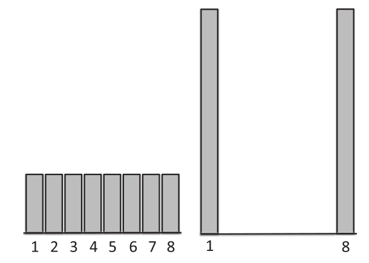

**图 12-1　最大熵与最大方差** 

熵是在概率分布上定义的。因此它可以应用于非数值数据分布，例如森林中鸟儿的种类或不同口味果酱的市场份额。熵在数学上等于概率与它们的对数之和的相反数。这个数学公式听起来似乎很复杂，但是事实并非如此。

我们先从信息熵这种特殊情况开始讨论。对于信息熵，可以把它理解为根据随机抛硬币的结果来衡量不确定性的一种方法。假设每个家庭都只有两个孩子，男孩和女孩的可能性相同。某个家庭的孩子们的性别列表（按出生顺序排列）相当于抛两次硬币。因此，结果分布的信息熵为 2，因为它对应于两个随机事件。其信息内容也等于 2，因为我们只要提出两个“是或否”问题要求他们回答，就可以掌握结果。

与此类似，在有三个孩子的家庭中，性别列表相当于抛 3 次硬币。要了解这样的家庭的孩子的性别，也只需要提出三个“是或否”问题。同样的逻辑适用于任何数量的儿童。在一般情况下，要了解*N* 个孩子的性别，只需要提出*N* 个“是或否”问题。

这里需要注意的是，这*N* 个问题区分出了 2* ^N * 种可能的出生顺序。这种数学关系是理解熵测度的关键所在：*N* 个二元随机事件会产生 2* ^N * 个可能的结果序列，并且，与之等价，我们可以通过提出*N* 个“是或否”问题知悉结果序列。这也意味着，信息熵将不确定性水平（和信息内容）*N* 分配给了 2* ^N * 个结果上的一个等可能分布。

于是，挑战变成了如何用数学公式刻画这种关系。每个结果序列的概率均为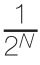。要将这个数值转换为*N* ，需要一个相当复杂的数学公式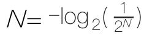。 ²  我们可以将这个公式推广到任意概率的情形下。如果某个结果序列出现的概率为*p* ，就分配一个不确定性 log[2] （*p* ），它近似于识别该序列所需要提出的“是或否”问题的数量。为了计算出一个分布的信息熵，我们只需求得所有结果（或者像在前面那个例子中那样的结果序列）需要提出的问题的期望数量的平均值。

**信息熵** 

给定一个概率分布（*p* [1] ，*p* [2] ，…*p* * [N] * ），信息熵，*H* [2] 等于：

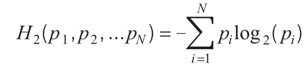

注：上面的下标 2 表示使用的是以 2 为底的对数。

乍一看，这个数学公式带来的混淆似乎比它所能澄清的还要多。通过举例说明，应该能够使这个公式更加直观。想象一下这种情况：第一胎是女孩的家庭不再生任何孩子，而第一胎是男孩的家庭则还要再生两个孩子。从而，所有家庭中将有一半家庭只有一个女孩。而另一半家庭则等可能地分别属于如下四个结果之一：三个男孩；两个男孩与一个女孩；一个男孩与两个女孩；一个男孩一个女孩与一个男孩。这四种结果中的每一种出现的概率均为 1/8。

信息熵等于我们想了解一个家庭的子女排列状况时必须提出的“是或否”问题的期望数量。我们首先会问，第一个孩子是不是女孩，回答“是”的概率为 1/2。如果是这个答案，那么就不需要继续问下去了。因此有一半的时间，我们只需问一个问题。我们可以把这写成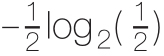。如果答案是否定的，那么我们还必须再提出两个问题，于是总共要问三个问题。这四种情况中的每一种都以 1/8 的概率出现，因此每种情况对信息熵的贡献为 1/8×3，我们对每种情况可以写出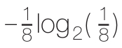。从而，信息熵等于 2，即上述五项的总和。 ³  虽然这里使用的对数和负号可能会让有些人觉得困扰，但是直观含义仍然是非常清楚的：信息熵就对应着“是或否”问题的期望数量。如果我们不得不提出很多问题，那么分布就是不确定的。而知道了结果，也就揭示了信息。

### 熵的公理基础

**公理基础：熵** 

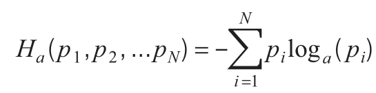，其中，*a* >0。

这种熵测度是唯一满足以下四个公理的测度：

对称性：对于任何转置概率，都有连续函数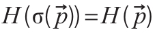。

最大化：对于所有*N* ，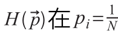处最大化。

零性：*H* （1，0，0，…0）=0。

可分解性：如果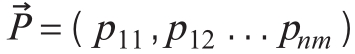

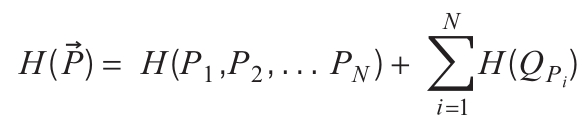

其中，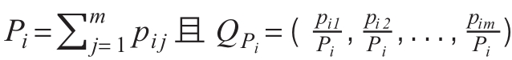。

为了得到熵的一般表达式，我们采用公理化的方法。数学家克劳德·香农对他给出的这种测度施加了四个条件。前三个条件很容易理解，它必定是连续的和对称的，而且在所有结果以相同的概率发生时最大化，同时在某些结果上等于零。第四个条件可分解性则要求在具有*m* 个子类别的*n* 个类别上定义的概率分布的熵，等于各类别上的分布的熵与每个子类别的熵的总和。香农证明，有一类熵测度是唯一满足这些公理的测度。虽然这里的分布的乘积是一个不那么直观的自然假设。例如，在结果是两个独立事件的乘积的情况下，这意味着联合事件的信息内容是每个事件单独发生时的信息内容的总和。

正如夏普利值的公理基础一样，这些公理对存在性的贡献大于它们本身的合理性。聪明的数学家总是可以构造出能唯一定义一个函数的公理。香农的前两个公理很难质疑。有的人可能吹毛求疵地指责，将已知分布的不确定性设置为零过于任意了，但这只是一个适当的基准，另一种可能性是将已知分布的不确定性指定为 1。 ⁴  可分解性虽然解释起来不是很容易，但是也很难去挑战它。两个组合随机事件的不确定性理应等于每个事件的不确定性之和。总的来说，这些公理不仅仅是可辩护的，事实上，它们是难以辩驳的。

### 利用熵区分结果类别

我们现在阐明，如何利用熵测度来对经验数据进行分类，并在计算机科学家、数学家斯蒂芬·沃尔弗拉姆（Stephen Wolfram）给出的四大类别的框架下建模：均衡、周期性、随机性和复杂性。 ⁵  在沃尔弗拉姆的这个分类中，放在桌子上的铅笔处于均衡状态，绕太阳运转的行星处于循环当中，抛硬币的结果序列是随机的，纽约证券交易所的股票价格也是近似随机的（我们在下一章中将会说明原因）。最后，一个人大脑中的神经元发放则是复杂的：它们既不会随意发放，也不会以某个固定的模式发放。图 12-2 以图形方式呈现了这四个类别。

平衡结果没有不确定性，因此其熵等于零。周期性过程具有不随时间变化的低熵。当然，完全随机过程具有最大的熵。复杂性具有中等程度的熵，因为复杂性位于有序性和随机性之间。虽然熵在两种极端情况下能够为我们给出明确的答案——均衡和随机性；但是这并不适用于周期性和复杂性的结果。在这些情况下，通常还必须善用我们的判断力。

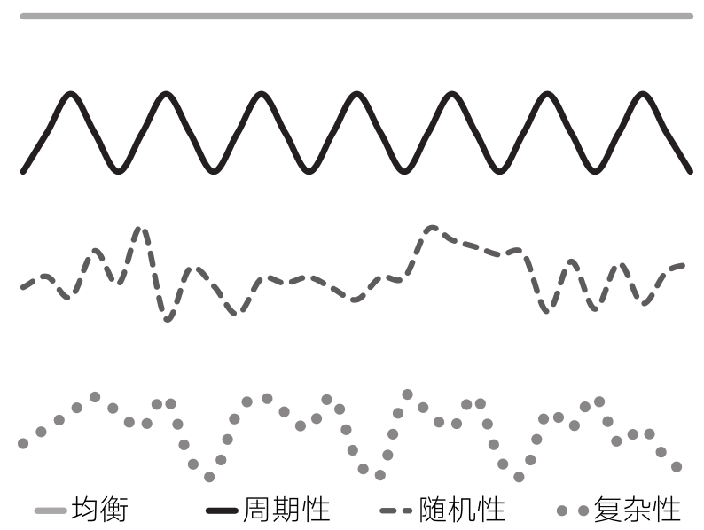

**图 12-2　沃尔弗拉姆的四种类别** 

为了对时间序列数据进行分类，我们需要先计算出不同长度的子序列中的信息熵。假设，有个人会把他每天戴的帽子的类型一一记录下来。假设他只在两种帽子之间进行选择，一种是贝雷帽，记为 B，另一种是浅顶软呢帽，记为 F。这样过了一年，他对帽子的选择生成了一个有 365 个事件的时间序列。我们先计算长度为 1 的子序列的熵，也就是说，先计算戴每种类型帽子的概率的熵。假设他喜欢这两种类型的帽子的程度相同，那么长度为 1 的子序列的熵等于 1。因此，我们可以先把均衡排除掉，因为他会改变他的选择，但是其他三种类别中的任何一种都是可能的。

为了确定类别，我们接下来计算长度为 2 到 6 的子序列的熵。如果所有都具有最大的熵，那么我们可以将简单的周期性排除掉。假设当我们考虑更长的序列时，熵会缓慢增加，直到达到最大值 8 为止。换句话说，无论子序列有多长，熵都不会超过 8。熵为 8 相当于 256 个结果的等可能分布，这不可能是一个简单的循环。熵为 8 更可能代表具有特定结构和模式的复杂过程序列。我们不能确定地说，这个时间序列是复杂的。一种可能的情况是，这个人试图做到随机化，但是却失败了。

### 最大熵和分布假设

在很多情况下，我们建模时都必须把不确定性包括进来；因而作为建模者，必须对有关的分布做出假设。这里的原则是，我们要尽量避免做出任意特殊假设（ad hoc assumption）。也许，我们对产生分布的过程已经有了一些了解。如果是这样，通常可以运用逻辑—结构—功能方法，推导出该过程产生的统计结构。

例如，假设我们想要对一个房地产拍卖中的所有拍卖对象的总价值的分布做出一个假设。总价值等于各个项目的价值总和。因此，我们可以根据中心极限定理假设这是一个正态分布。对于一栋房子的可能价值，我们也可以假设一个正态分布，因为房屋的价值取决于它的多个性质：卧室的数量、浴室的数量和占地大小等。

对于艺术珍品或稀有手稿的可能价值，正态分布却可能没有意义。在这些情况下，我们对决定它们价值的过程几乎一无所知。一种方法是假设一个具有最大不确定性的分布，即最大熵分布。

最大熵分布的形状取决于各种约束条件。正如我们已经看到的，如果假设了一个最小值和一个最大值，那么均匀分布会使熵最大化。教科书和学术期刊中的许多社会科学模型都假设均匀分布，我们可能会质疑这个假设，因为均匀分布在现实世界中确实很少出现。然而，无差别原则（principle of indifference）可以证明假设均匀分布的合理性。如果只知道范围或可能集，那么就应当予以无差别的对待。

在某些情况下，我们可能知道分布的均值，也知道所有值都必定是正数。给定这些约束条件，最大熵分布必定具有长尾，因为我们要将分布置于更多的值上，从而必须使少数高值结果与许多低值结果保持平衡。不难证明，熵最大化分布是一个指数分布。因此，如果我们正在构建一个模型，需要假设网站点击量或市场份额的分布形式，那么在没有可用数据的情况下，指数分布是一种自然的假设。

如果我们确定了均值和方差（并且允许出现负值），那么最大熵分布则是正态分布。这里的逻辑与前一种情况类似。为了创造更多的不确定性，我们创造了一些极端值，在这里，可以平衡正值和负值，而不用改变均值。但是，这样做会增大方差，因此我们必须在均值附近添加更多值，从而创造出钟形曲线。

我们可以在逻辑—结构—功能框架内解释这些最大熵分布。如果我们认为在给定的社会、生物或物理环境中，某个微观层面的过程能够最大化熵，那么我们应该期待上面这些分布中的某一个会出现。或者也可以假设一个微观过程，并能够证明熵在增加。如果是这样，上述分布中的某一个也会涌现出来。

**最大熵分布** 

**均匀分布：** 给定范围［*a* ，*b* ］，使熵最大化。

**指数分布：** 给定均值*μ* ，使熵最大化。

**正态分布：** 给定均值*μ* 和方差*σ* ² ，使熵最大化。

我们也可以将这些结果解释为探索性的。我们可能会遇到一些指数分布或正态分布的数据。虽然没有“义务”去追问某种潜在的行为是否会在一定约束条件下使熵增加，但这样做确实可以帮助我们获得一些新的洞见。在本书前面的章节中，我们利用中心极限定理解释了物种的高度、重量和长度为什么会服从正态分布。在这里，我们再给出一个不同的、基于模型的解释：如果一种突变能够最大化熵（以便探索最好的生态位），并且假设平均规模和总离散度是固定的，那么规模的分布将会是正态的。关键不在于这种最大熵方法是不是提供了一个更好的解释，而在于给定约束下最大化熵必定会导致正态分布。因此，当我们看到正态分布时，它可能是最大化熵的结果。

### 熵的实证含义和规范含义

前面我们已经讨论了，熵如何衡量不确定性、信息和惊喜，如何与测量离散度的方差不同，以及如何有助于我们对不同类别的结果进行分类和比较。在本书第十三章和第十四章中研究随机游走和路径依赖时，还会利用熵来识别随机性并测量路径依赖的程度。事实上，我们可以将熵测度用于任何实际应用，可以用它来衡量对金融市场的干预是增加了还是减少了不确定性，可以检验选举、体育赛事或博彩中的结果到底是不是随机的。

在这些应用中，熵都是作为一个实证的衡量标准来使用的。它告诉我们世界是什么样的，而不是世界应该是什么样。一个系统中的熵的本质，不能简单地说好，也不能简单地说不好。我们想要多少熵，取决于具体情况。在制定税法时，我们可能需要一种均衡行为模型，并不希望有随机性。在规划城市时，我们可能会希望看到复杂性，均衡或者周期性都会显得过于平淡。我们希望一个城市充满生机活力，为偶然的相遇和互动提供无限机会。在这种情况下，更多的熵会更好，但是又不能太多。我们不喜欢随机性，随机性会使计划变得非常困难，并可能导致我们的认知能力崩溃。最理想的情况是，世界会产生适度的复杂性，以保证我们生活在一个有趣的时代。

建筑师克里斯托弗·亚历山大（Christopher Alexander）证明，诸如强中心、厚边界和非独立这类的几何属性，能够生成复杂的生活建筑、社区和城市。 ⁶  亚历山大渴望城市和生活空间中的复杂性。中央银行的规划者可能不太喜欢复杂性，在金融市场中，他们可能更喜欢可预测的均衡结果。不过幸运的是，使用模型，我们既可以探索复杂性，也可以讨论均衡的可能性。