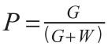
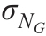
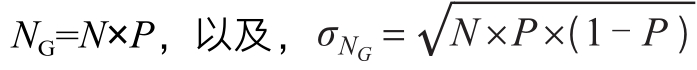
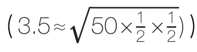
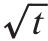
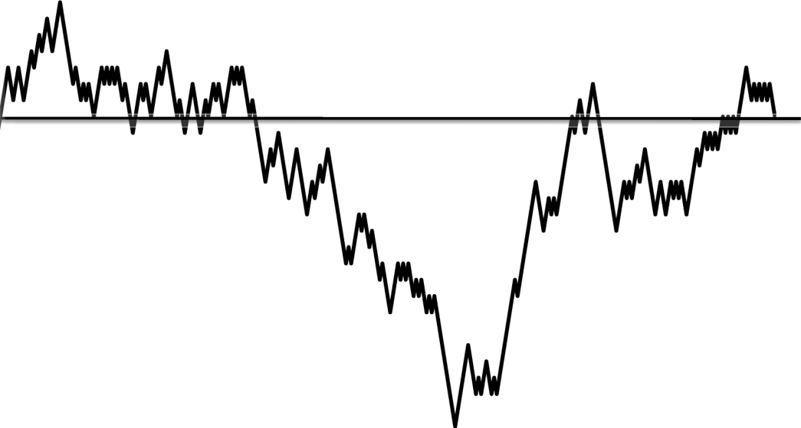
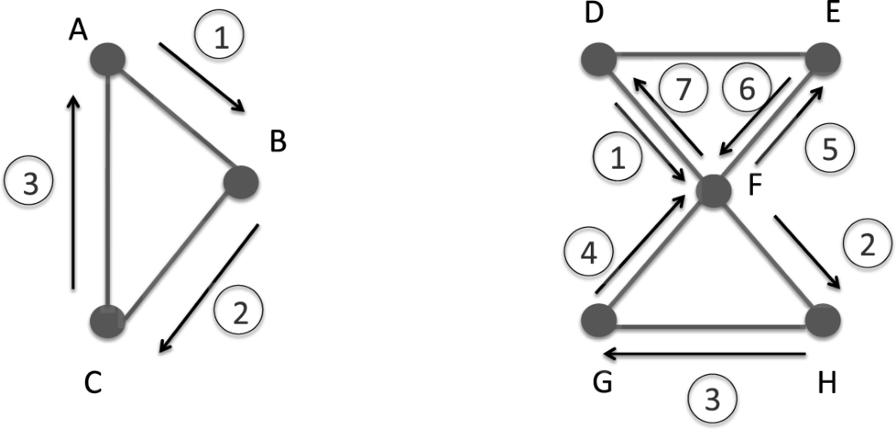
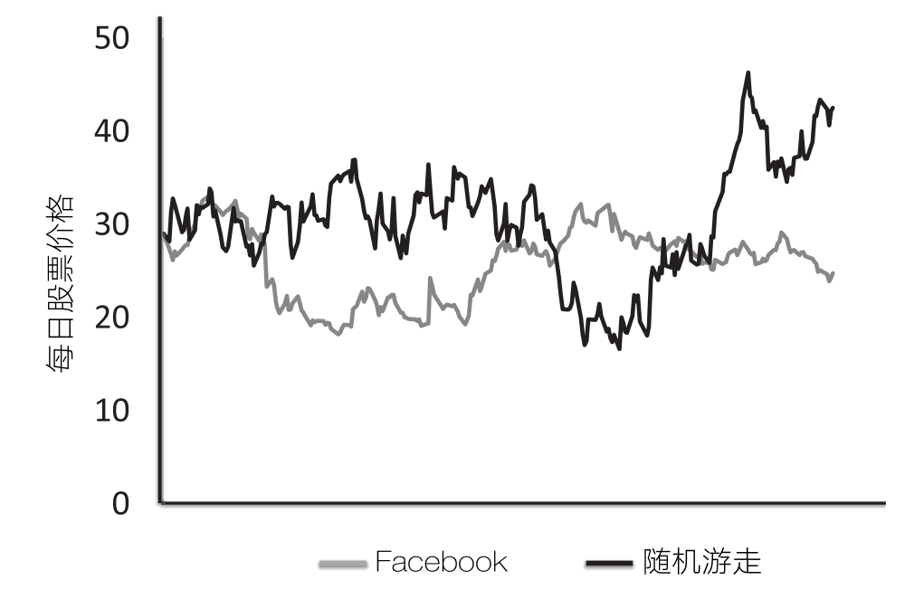

# 13　随机游走

醉鬼能找到回家的路，但是一只醉酒的小鸟可能永远回不了家。

角谷静夫（Shizuo Kakutani）

在本章中，我们讨论两个来自概率论和统计学的经典模型：伯努利瓮模型（Bernoulli urn model）和随机游走模型。 ¹  这两个模型都描述了随机过程，即使看上去它们似乎在生成某种复杂的结构。如果不收集数据，随机性是很难辨别的。我们经常想当然地以为能够在选举结果、股票价格和体育赛事得分中总结出一定的模式，但这只是一厢情愿。借用学者、风险分析师纳西姆·塔勒布（Nassim Taleb）的一句俏皮话来说，我们都被随机性所惑，不过是一些“随机漫步的傻瓜”！ ²  

伯努利瓮模型描述了产生离散结果的随机过程，例如抛硬币或掷骰子。这个模型在几个世纪以前出现时，是为了解释赢得赌注的概率，现在已经在概率论中占据中心位置。随机游走模型就是建立在伯努利瓮模型的基础上的，保持了正面和反面的总数。这个模型可以刻画液体和气体中粒子的运动，动物在物理空间中的活动，以及从出生到童年人体身高的增长，等等。 ³  

本章首先简要介绍伯努利瓮模型，并对条纹长度（length of streaks）进行了分析。然后描述随机游走模型，我们将会了解到，一维和二维随机游走会无限次地回到起点，而三维随机游走则可能完全不需要回到起点。我们还会了解到，对于一维随机游走，回到零点之间的时间间隔分布遵循幂律分布。对于这个发现，有人可能认为它除了满足人们的好奇心之外没有什么用，但事实上，它可以解释物种和企业的生命周期。我们还将使用随机游走模型评估有效市场假设，并用它来确定网络规模。

### 伯努利瓮模型

伯努利瓮模型由一个装了灰球和白球的瓮组成。从瓮中抽取的球代表随机事件的结果。每次抽取都与之前和之后的抽取无关，因此我们可以应用大数定律：从长远来看，抽出每种颜色的球的比例将会收敛到这个球在瓮中的比例。当然，这并不意味着从一个装了 7 个白球和 3 个灰球的瓮中抽取 1 000 次，将会恰好抽出 700 个白球，它的意思是抽取出来的白球比例会收敛到 70%。 ⁴  

**伯努利瓮模型** 

每一次，从一个装了*G* 个灰球和*W* 个白球的瓮中随机抽取一个球，结果等于抽取出来的球的颜色。在下一次抽取之前，球要先放回瓮中。令表示灰球的比例。在抽取*N* 次的情况下，可以计算出抽取出来的灰球的期望数量*N* * [G] * ，及其标准差：

伯努利瓮模型的结果产生了可预测长度的条纹。在灰球和白球数量相等的瓮中，抽取出白球的概率等于 1/2，连续抽取出两个白球的概率等于 1/2 乘以 1/2，以此类推。一般情况下，如果瓮中白球的比例为*P* ，那么连续抽取*N* 个白球的概率等于*P* * ^N * 。通过计算概率，我们可以评估某种条纹是不是有可能出现（尽管很令人吃惊），或是几乎完全不可能（因而基本上可以肯定“有诈”）。当一名篮球运动员连续 9 次投中了三分球时，只是有热手效应吗？或者，我们是否应该期待有一个这种长度的随机序列？数学计算表明，一个很优秀的三分投手在长达 10 年的职业生涯中，也几乎完全不可能连续 9 次投中三分球。 ⁵  

我们可以进行类似的计算以确定投资者是幸运、能力出众还是在欺诈。自 1965 年至 2014 年，由沃伦·巴菲特（Warren Buffett）经营的集团伯克希尔哈撒韦公司（Berkshire Hathaway），在 50 年中有 42 年的表现优于市场。1964 年伯克希尔哈撒韦公司的 1 美元在 2016 年的价值已经超过了 1 万美元，而投资标准普尔 500 指数的 1 美元价值大约为 23 美元。如果伯克希尔哈撒韦公司有 50%的机会击败市场，那么它在 50 年来的表现应该超过市场的 25 倍，标准差为 3.5 年。而事实上，伯克希尔哈撒韦公司击败市场的实际年数大约高于均值四个标准偏差，这是一个概率仅有百万分之一的事件，因此，我们可以排除这完全是运气的可能。由于伯克希尔哈撒韦公司定期公布它的投资，所以也可以排除欺诈的可能。与此相反，前纳斯达克主席、美国历史上最大的诈骗案制造者伯纳德·麦道夫（Bernard Madoff）从来不透露他的投资情况，如果客户要求投资透明度的话，麦道夫是不可能连续几十年取得“成功”，连续几十年得到正回报的。 ⁶  

### 随机游走模型

接下来讨论简单随机游走模型，它建立在伯努利瓮模型的基础上，并将过去结果的和保持下来。我们将初始值，也就是模型的初始状态设置为零。如果我们抽取出一个白球，就在总数上加 1；如果抽取出一个灰球，就从总数中减 1。模型在任何时候的状态都等于先前结果的总和，也就是抽取出来的白球总数减去抽取出来的灰球总数的值。

**简单随机游走模型** 

*V* * [t] * [+1] =*V* * [t] * +*R* （-1，1）

其中，*V* * [t] * 表示时间*t* 上的随机游走值，*V* [0] =0，*R* （-1，1）是一个可能等于-1 或 1 的随机变量。在任何时间段内，这个随机游走的期望值都等于零，且标准差为，其中的*t* 等于周期数。 ⁷  

图 13-1 给出了一个简单随机游走。这幅图看上去似乎有一个模式：先是一个长期下降的趋势，然后是一个上升趋势；在上升过程越过零线时出现了一个适度的崩溃。但这个模式只是偶然发生的。

**图 13-1　一个 300 周期的简单随机游走** 

简单随机游走既是周期性的（会无限次地返回零点），又是无界性的（会超过任何正的或负的阈值）。如果等待足够长的时间，随机游走会高于正的 1 万、低于负的 100 万，也会无限次地穿过零线。此外，返回零点所需的步数分布满足幂律。 ⁸  在大多数时候，返回零只需几步。所有游走中，有一半是两步返回的，然而有些游走需要很长时间才能返回。鉴于随机游走的无界性，这必定是真的。一个超过 100 万步阈值的游走，需要超过 200 万步才能到达那里并返回零点。

幂律分布结果还有一个意想不到的应用领域。如果我们将企业的销售水平或员工规模建模为随机游走，那么企业的生命周期就会成为一个幂律分布。更准确地说，当销售强劲时，企业会新招聘一名员工；当销售不佳时，会解雇一名员工；当不再拥有任何员工时，企业也就“寿终正寝”了。这样一来，返回次数的分布就等于企业生命周期的分布，而且是一个幂律分布。再者，就其第一近似而言，企业的生命周期是一个幂律。 ⁹  我们可以应用相同的逻辑来预测生物分类单元（界，门，经，纲，目，科，属和种）的寿命。如果某个分类单元的成员数量遵循随机游走，例如，如果某个属中的物种数量随机地上下变化，那么，这个分类单元的大小就应该满足幂律。这方面的数据支持了这个模型的预测。 ¹⁰  

对于随机游走模型，还可以做这样一个类比：将随机游走视为冰川沿着地面的移动。根据模型的预测，冰川湖泊的大小分布将满足幂律。每一次，当冰川落到了陆地表面以下又返回顶部时，就会形成一个直径等于返回时间的湖泊。在这里，相关数据再一次与模型基本对应。 ¹¹  

这个基本随机游走模型可以通过多种方式加以修正。我们可以创建一个正态随机游走（normal random walk）。在正态随机游走中，每一周期的值的变化都服从正态分布。正态随机游走不会完全回到零点，但它会无限次地穿过零点。

我们还可以令某一种结果比另一种结果更有可能发生，从而创建一个有偏差的随机游走。我们可以利用这种有偏差的随机游走模型来预测在博彩中获胜的概率。轮盘赌中，在红色结果上下注时赢的概率等于 9/12。 ¹²  我们可以将赌轮盘赌的总收益或总损失建模为这样一个随机游走：增加 1 的概率为 9/19（大约 47.4%），而减少 1 概率则为 10/19。那么在下注 100 次之后，预期损失为 5 美元，标准差为 10 美元。这也就是说，我们可以在 95%的置信水平上，认为损失不超过 25 美元、收益不超过 15 美元。在下注 1 万次之后，预期损失等于 526 美元，标准差为 100 美元。因此，在 95%的置信水平上，我们的损失介于 325 美元与 725 美元之间。 ¹³  同样，在下注 1 万次之后，我们还能赢是一个相当于超过均值 5 个标准偏差的事件，也就是说我们赢的可能性不到百万分之一。因此，要想在轮盘赌中赢，应该做的事情是下一个大赌注而不是下很多个小赌注。

一些体育比赛，例如篮球比赛，可以建模为两个有偏差的随机游走。在球场上，每支球队在每次攻守中都有可能得分。这个概率可以根据一支球队的进攻能力和对方球队的防守能力来估计。我们将球队在球场上的“行程”模拟为一个随机事件。每支球队的得分对应一个随机游走值，得分较高的球队更有可能获胜。来自 NBA 的数据分析表明，实际比赛结果与这个模型匹配得相当好。只有当一支球队获得了巨大的领先优势时，得分才会偏离随机性，在那种情况下领先优势继续扩大的可能性低于领先优势缩小的可能性。这种现象可以解释为领先的球队失去了继续得分的动力，同时落后的球队则必须至少让分数看上去不那么“丢脸”。 ¹⁴  

我们似乎会认为篮球比赛的结果肯定不是随机的。聪明、健壮且灵活的篮球运动员，拥有很多巧妙的进攻手段，并能在关键时刻实现扭转乾坤的得分。这当然也是事实，但是球员们的努力效果可能会被抵消。额外的进攻得分可能会因为额外的防守努力而被抵消。一个重要的抢断后的快速上篮，可能会被冲刺了大半个球场的对方球员破坏。这个模型还提出了一个策略：更强的那支球队应该加快比赛节奏，以创造更多的进攻回合。占有优势的球队应该更频繁地玩“轮盘赌”，因为随机“漂移”对他们有利。

简单随机游走模型只在一个维度上进行。我们还可以对高维随机游走建模。二维随机游走从平面中的原点（0，0）开始，然后在每个周期中随机走向东、南、西、北。二维随机游走类似于在一张纸上绘制出来的一条弯弯曲曲的线，同时也满足递归性（recurrence）和无界性，有点儿类似于在你的起居室中随机搜索一只丢失的耳环时的路线。这种递归性使随机觅食成了蚂蚁的一个觅食策略。 ¹⁵  如果二维随机游走不是递归性的，那么蚂蚁就需要更复杂的内部地图或更强的信息踪迹才能找到它们的巢穴。

但是在有三个维度的情况下，随机游走将不再满足递归性。在一个房间里到处飞的苍蝇和在空气中弹跳的分子都只会有限次地返回到它们的起点。 ¹⁶  （正因为如此，才会在本章开头引用角谷静夫的那段话。）

随机游走的无递归性为模型如何阐明我们的思考提供了一个很好的例子。直觉告诉我们，当添加维度时，返回起点的次数应该会减少，而逻辑则表明，这里会出现一个突然的变化。在一维和二维的情况下，随机游走会无限次地返回起点。而在三维的情况下，它将“永恒在外游荡”。要得到这种结果必须利用数学，只靠直觉是不够的。

### 使用随机游走估计网络规模

我们可以利用低维随机游走的递规性来估计某个网络的规模。方法很简单，随机选择一个节点，然后沿着网络的边开始随机游走，并跟踪它回到初始节点的频率。返回到初始节点所需的平均时间与网络的规模相关。例如，为了估计一个社交网络的大小，可以要求某人指定一个朋友，然后让那个朋友再说出一个朋友的名字，一直继续这个过程，看需要多久才会返回到同一个人。

图 13-2 显示了两个网络。左边的网络有 3 个节点，它们组成了一个三角形。右边的网络有 6 个节点，组成了两个三角形。在左边的网络上，我们不妨从 A 开始随机游走。假设它先移动到 B，然后再移动到 C，最后再返回到 A。这也就是说，随机游走只需 3 步就可以返回它的起点。而在右边的网络上，从 D 开始的随机游走可能需要 7 步（F—G—H—F—E—F—D）才能回到起点。如果将这样的实验重复多次，那么左边网络的平均返回时间显然会比右边网络要短。虽然对这些小型网络来说，要衡量它们的规模并不一定需要这种方法，但对于大型网络（如万维网或大型电子邮件网络）来说确实非常有用。

**图 13-2　网络上的随机游走** 

### 随机游走与有效市场

事实已经证明，股票价格接近正态随机游走，带有正漂移，以获得市场收益。许多个股的价格也接近随机。图 13-3 显示了 Facebook 在 2012 年 5 月 18 日首次公开发行后一年中的每日股票价格数据。Facebook 公开发行时的价格为每股 42 美元。截至 2012 年 6 月 1 日，股票价格已经下跌到了 28.89 美元。一年后，价格进一步下降至 24.63 美元。图 13-3 还显示了另一个已经校准为具有类似变差的随机游走。

**图 13-3　2012 年 6 月—2013 年 6 月，Facebook 每日股票价格 vs. 一个随机游走** 

我们可以对 Facebook 的股价序列进行统计检验，以确定它是不是真的满足正态随机游走的假设。首先，价格应该以相同的概率上下波动，在这个序列所涵盖的 249 个交易日内，Facebook 的股票价格在 127 天内是下跌的，占总交易日数的 51%。其次，在随机游走中，增加的概率应该与前一周期的增加无关，Facebook 的股票价格连续两天在同一方向上发生变化的时间只占总时间的 54%。最后，持续出现在同一方向上的最长波动应该是 8 天，在这一年时间里，Facebook 的股票价格曾连续 10 天上涨。因此，总的来说，我们不能否认 Facebook 的股票价格与正态随机游走一致的假设。

同样的分析也适用于所有股票的日交易价格。为了做到这一点，我们必须先去除股票价格中所包含的平均上涨趋势。研究表明，从 20 世纪 50 年代到 80 年代，每日股票价格略有正相关关系。在进行了去趋势处理之后，一天上涨之后再出现上涨的概率略超过 50%。20 世纪 80 年代之后，由于投资者开始变得更加精明，一天上涨之后再出现上涨的概率下降到了 50%，从而与随机游走完全一致。

股票价格可能遵循随机游走的原因是，聪明的投资者能够识别出并消除这种模式。例如，在 20 世纪 90 年代，分析师注意到，股票价格往往会在每年年初出现上涨，这种现象被称为“一月效应”（January effect）。聪明的投资者可以在 12 月以低价购买股票，并在来年 1 月卖出以获取利润。这个策略看起来好得让人难以置信，而事实是，如果投资者在 12 月购买股票，他们就会抬高价格，从而抵消“一月效应”。事实上，我们不应该对“一月效应”的消失感到惊奇。

经济学家将市场价格的可识别持久模式类比为人行道上的百元钞票。如果有人看到人行道上有张一百元的钞票，就会把它捡起来，然而只要这样做了，钞票就会消失。同样的逻辑适用于股票价格模式：如果它们存在，它们就会消失。因此，充满了聪明的投资者的市场几乎必定不会包含什么可预测的价格模式。既然价格不会呈现出任何模式，那也就只能是随机游走了（需要注意的是，必须先去除一般的上行趋势）。

经济学家保罗·萨缪尔森（Paul Samuelson）构建了一个能够生成随机游走的模型。他的模型并不要求投资者知晓未来所有期间的股票价值，而只要求他们知晓股票价值的分布。正如萨缪尔森所说：“人们不能过于迷信现有的定理，它不能说明实际的竞争性市场运作良好。” ¹⁷  但不是每个经济学家都能认同他的观点。

一些经济学家将这种随机游走思想进行了扩展，提出了有效市场假说（efficient market hypothesis）。这个假说指出，在任何时候，股票的价格都反映了所有的相关信息，未来的价格必定遵循随机游走。有效市场假说依赖于一个自相矛盾的逻辑。 ¹⁸  因为要确定准确的价格需要付出时间和精力，财务分析师必须收集数据并构建模型。如果价格真的是随机游走的，所有这类活动都将无法得到预期的回报。然而，如果真的没有任何人花费时间和精力去估计价格，那么价格就会变得不准确，也就意味着人行道上会铺满百元钞票。

简而言之，正如格罗斯曼和斯蒂格利茨悖论（Grossman and Stiglitz paradox）所强调的，如果投资者相信有效市场假说，他们就会停止分析，从而导致市场效率低下；而如果投资者认为市场效率低下，他们就会应用模型进行分析，从而提高市场效率。

事实上，股票市场上的价格变动与随机游走确实相当接近，尽管利用复杂的统计技术确实能够揭示某些短期模式。 ¹⁹  这也就是说，虽然人行道上可能没有铺满百元钞票，但是在草地上确实能够找到一些四叶草，只要足够努力。

有些批评有效市场假说的人还指出，许多投资者持续战胜市场的时间明显不能用偶然性来解释。 ²⁰  此外，股票价格之所以随机波动，也可能是由于一些其他原因，例如复杂的交易规则的总体影响。日常价格的波动性超过了流入市场的信息量，而且，在现实世界中似乎并没有发生什么重要的事情时，股票市场也会出现大幅飙升或跳水，这就表明市场上存在泡沫。给某个人带来很大不利的某个事件，对另一个人来说也许不过是“尽管有这些问题，但是……”。是的，波动性确实很高，但是很少的信息就可能会产生很大的影响。即便市场真的出现了大幅飙升或跳水，市场仍然可能是遵循长尾随机游走的。在长尾随机游走中，股票的日常波动源于长尾分布。

虽然，股票价格始终准确的说法似乎令人难以置信，但从长远来看，价格确实不会与真实价值相差太远。我们可以应用 72 法则来证明这一点。如果经济每年增长 3%，那么在半个世纪中，经济总量将增长 4 倍。如果回到 1967 年，当时美国的国内生产总值相当于今天的 4.2 万亿美元（按 2009 年美元计算），而到了 2017 年，美国的国内生产总值增长到了将近 17 万亿美元（按 2009 年美元计算），增长了 4 倍，这正是我们所预期的：每年增长 3%，半个世纪就可以增长 4 倍。在同一时期，标准普尔 500 指数股票的实际价值也增加了大约 4 倍。如果股票市场每年上涨 12%（以实际美元价值计算），那么股票价格就会增加 256 倍，这应该是不可能的。 ²¹  

从长远来看，有效市场假说或类似的假说是合理的。但是从短期来看，押注价格修正却可能存在不小的风险。在这方面，长期资本管理公司（LTCM）的成败经历很有启发性。这是一家对冲基金，其董事会成员中包括了两位诺贝尔经济学奖得主。在 1996 年和 1997 年，长期资本管理公司公布的年回报率都超过了 40%，原因是它发现了市场上的效率低下问题，并预测市场会做出修正。1998 年，他们（正确地）注意到了俄罗斯债券价格与美国国债价格之间的不一致性，于是他们下了一个很大的赌注。然而，俄罗斯的违约（自 1917 年以来的首次违约）在短期内进一步增大了这种不一致性。长期资本管理公司一下子亏损了 46 亿美元，几乎导致整个金融市场崩溃。在长期资本管理公司得到救助后不久，债券价格确实恢复了一致性，但是这个修正来得太慢了。长期资本管理公司给我们的教训是深刻的，也是显而易见的，那就是不要过分相信一个模型。

### 小结

在本章中，我们讨论了伯努利瓮模型和随机游走模型，然后将这些模型应用到了很多领域。我们看到，这些模型能够从连续得分现象中解析出随机性，还可以用来制订博彩策略、评估股票价格变化的时间序列，以及理解篮球比赛的结果。我们还懂得了如何应用随机游走返回时间的幂律分布来增进对企业生命周期和生物分类单元的理解。

从这些应用中，我们看到随机游走模型为评估时间序列提供了一个很有用的框架。我们不能被一两年的成功所愚弄，因为那并不意味着持续的卓越。在《从优秀到卓越》（*Good to Great* ）这本有史以来最畅销的商业书籍之一中，吉姆·柯林斯（Jim Collins）描述了那些能够持续取得成功的公司的特点，例如拥有谦逊的领导者、选择合适的人进入团队、保持严格的纪律。柯林斯以 6 次铁人三项世界冠军戴夫·斯科特（Dave Scott）的习惯为例，将之称为“冲洗你的奶酪”。戴维·斯科特会清洗奶酪以减少身体的脂肪含量。柯林斯在这本书中特意列出了 11 家坚持了他所说的那些原则的“伟大公司”。但是，在他的书出版后的 10 年中，只有一家公司实现了强劲增长。另外 10 家公司中，一家被其他企业收购了，一家由政府接管了，另外 8 家则只带来了零回报。

伟大的企业确实会拥有一些共同特征，但这个事实并不意味着这些特征就必定有助于成功。也许，很多表现糟糕的公司也拥有这些特征。挑选一些看上去很好的公司出来，列出它们的特征，这并不是模型思维。模型思维的要求是，推导出能够导致成功的那些特征，例如才华横溢的工人，然后再根据数据来检验相关结论。如果可能的话，最好寻找一些自然实验，也就是相关特征随机变化的实例。

其他模型，例如我们在第二十八章中将会介绍的舞动景观模型和崎岖景观模型，更是对吉姆·柯林斯的全部理论提出了根本性的质疑。如果经济是复杂的，那么今天证明成功的特征在未来并不一定同样有效。按“大石头优先”原则，当前的“伟大”在 10 年后甚至有可能连“不错”都算不上。在得出一般性的结论之前，必须应用多个模型，以避免“犯大错”的风险。也应该注意避免被某些“模式”所惑，看上去似乎是一个趋势，其实可能是随机。