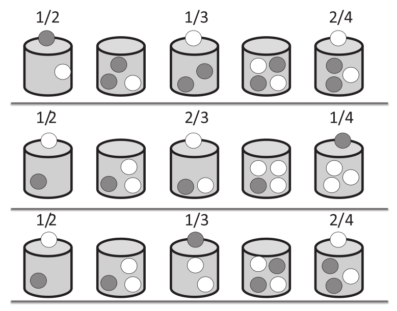
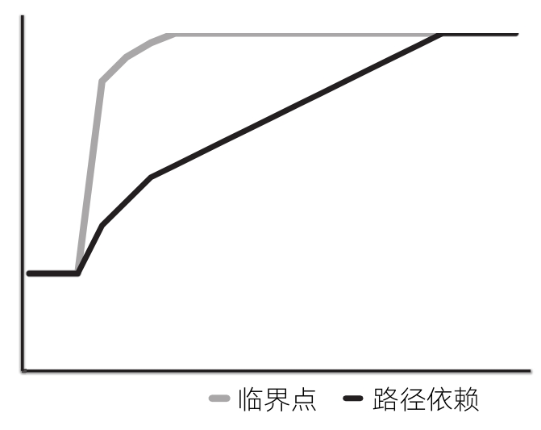
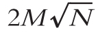

# 14　路径依赖模型

人不能两次踏进同一条河流，因为无论是这个人，还是这条河，都已经不同了。

赫拉克利特（Heraclitus）

本章将讨论路径依赖模型。在任何领域，人们的行为都建立在他人行为的基础上，无论是国际事务、艺术、音乐、体育、商业、宗教、技术还是政治，我们都应该会看到某种程度上的路径依赖。大学生选修的课程，导致他未来会倾向于选择某些职业而不会选择其他职业；对某个候选人的认可，可能会使他开启政治生涯；友谊可能会导致其他社会关系；我们穿的衣服、读的书、看的电影，以及任何需要我们付出时间的活动，都会表现出一定程度的路径依赖性。

路径依赖也存在于更大的尺度上。普通法裁决会确立并强化先例，从而影响未来的裁决。 ¹  早期的制度形式会影响后来的制度选择。美国政府制定的由私营公司提供健康保险的政策，导致了一个宏大的私营医疗保险行业以及一系列保健机构，还导致了公立医院和私立医院并存的结果。 ²  特定的制度还会引发特定的行为模式，如自私或合作的倾向；而这种倾向反过来又会影响未来制度的效力。 ³  

在本章中，我们构建了一系列动态瓮模型（dynamic urn model），该模型将生成表现出路径依赖性的结果序列。这种模型扩展了伯努利瓮模型，允许瓮内球的分布随过去的结果而变化。利用这些模型构建我们的思维，给出路径依赖的正式定义，并将路径依赖的结果与均衡区分开来。这些正式的定义还可以将路径依赖与临界点区分开来，而临界点是结果中更加突然的变化。

本章由四个部分组成。前两个部分分别讨论了波利亚过程（Polya process）和均衡过程（balancing process）。波利亚过程假设正反馈并产生路径依赖的结果和均衡。关于路径依赖的许多典型例子，包括“QWERTY”打字机的发展，都是基于正反馈的，这种情况也被称为收益递增。均衡过程则假设负反馈并产生路径依赖的结果，但不会产生路径依赖的均衡。第三部分定义了一个基于熵的路径依赖度量，最后一个部分则讨论了模型的进一步应用。

### 波利亚过程

波利亚过程利用伯努利瓮模型的扩展来刻画正反馈效应。在波利亚过程中，我们会往瓮中加入与抽取出来的球相匹配的球，这个过程会产生结果路径依赖（outcome path dependence）。结果路径依赖是指每一周期的结果都取决于先前的结果。说结果的长期分布，也就是均衡路径依赖（equilibrium path dependence）也取决于结果，也是对的。 ⁴  这两种类型的路径依赖之间的区别，是本章要讨论的一个核心内容。一个均衡路径依赖的过程，必定是结果路径依赖的。如果长期的结果取决于路径，那么这个路径“沿途”的结果也必定如此。不过，一个过程是结果路径依赖的，并不意味着它一定是均衡路径依赖的。现在发生的事情可能取决于过去，但是长期均衡却可能在一开始就确定下来了。

**波利亚过程** 

一只瓮里面装着一个白球和一个灰球。每一周期，都随机抽取出一个球并将这个球与和它颜色相同的另一个球一起放回到瓮中。抽取出来的球的颜色表示结果。

波利亚过程可以用来刻画多种多样的社会和经济现象。一个人选择学习打网球，还是打壁球，可能取决于其他人的选择。如果更多的朋友选择学习打网球，那么这个人就更有可能也选择学习打网球，因为这会增加他找到伙伴打比赛的机会。与此类似，一个人决定购买什么类型的软件、学习哪种语言或购买哪款智能手机，也可能取决于他的朋友以前做出的选择。类似的逻辑同样适用于企业对技术标准的选择，它们可能会根据其他企业的选择来做出选择。

这个模型通过改变球的分布来刻画这些社会影响。如果灰球代表选择学习打网球的人，白球代表选择学习打壁球的人，那么，当更多的人选择学习打网球时，瓮里面就包含了更多的灰球，从而导致后来的人更加有可能选择学习打网球。对更多人所选择的结果的这种不断增长的牵引力创造了路径依赖。

我们可以从波利亚过程中推导出两个令人意想不到的性质。首先，具有相同数量的白色结果的任何序列都会以相同的概率发生。其次，白球和灰球的每个分布都以相同的概率发生。第二个性质意味着极端的路径依赖。任何事情都可能发生，一切皆有可能。在 1 000 个周期之后，瓮中包含了 40%的白球的概率等于包含了 2%的白球的概率。

要理解为什么会这样，不妨考虑前三个周期内所有可能的结果序列。第一个周期的结果是灰色的概率为 1/2。如果这个结果发生了，那就要加入一个灰球，从而使第二个周期的结果为灰色的概率增加到 2/3。如果第二个周期的结果也是灰色，那就要加入第三个灰球，从而使第三个周期的结果为灰色的概率增加到 3/4。由此可以得出，三个灰球（或三个白球）的总概率等于 1/2 乘以 2/3 乘以 3/4，其乘积等于 1/4。

前三个结果由两个白球和一个灰球组成的结果序列如图 14-1 所示。在最上面一行中，结果的顺序是先灰色、再白色、然后又是白色。这个序列的概率是 1/12，其他两个序列的概率也是一样。因此，获得这三个序列之一的概率等于 1/4。根据对称性，选择两个灰球和一个白球的概率也必定等于 1/4。因此，每个可能的结果集——三个白色、三个灰色、两个白色以及一个灰色、两个灰色、一个白色，出现的概率都是 1/4。而且，产生两个白色和一个灰色的每一个序列都以相同的概率出现。对任意周期数，都可以得到类似的结果。 ⁵  

**图 14-1　由两个白球和一个灰球组成的各种结果** 

如果我们将波利亚过程加以扩展，也就是进一步加入其他颜色的球，这两个性质仍然成立。各种颜色的任何比例都会出现而且概率相同。这些结果为消费品生产商带来了一个难题：消费者对产品某些性质的长期偏好可能是随机的。无法预测结果的知识仍然可以用来指导行动。例如，福特公司不会希望出现这样的情况：生产出了 4 万辆黄色皮卡车，后来却发现在一个路径依赖的过程中，红色成了消费者最喜欢的颜色。不受欢迎的颜色的产品会大量积压在库存中，这种可能性指向两种可能的行动。生产企业可以考虑建立这样的供应链：把颜色的决定放在最后一个环节。例如，服装公司可以先不给毛衣染色，直到看清楚流行的颜色是什么为止。或者，生产企业也可以不给消费者选择的机会。亨利·福特只提供一种颜色的 T 型车，即黑色 T 型车。苹果公司在推出第一款 iPhone 时也做了同样的事情：你可以买一部黑色的 iPone，或者以同样的价格买另一部黑色的 iPone。

### 均衡过程

第二个模型是均衡过程，它的假设与波利亚过程恰恰相反。在抽取出某种颜色的球后，要加入一个相反颜色的球。如果在前两个周期都抽取出了白球，那么瓮中将包含三个灰球和一个白球，从而导致下一周期抽取出灰球的概率增大为 3/4。这个过程也会产生路径依赖的结果，因为任何一个周期结果的可能性取决于过去的结果的历史。但是，它不会产生依赖于路径的均衡。从长远来看，瓮收敛为每种颜色的球的比例都相同。 ⁶  

**均衡过程** 

一个瓮包含一个白球和一个灰球。每一周期都随机抽取出一个球，并将与抽取出来的球颜色相反的球与抽取出来的那个球一起放回到瓮中。球的颜色表示结果。

均衡过程可以用来刻画有趋向平等分配压力的决策或行动序列。有两个孩子的父母可能会尝试给每个孩子分配相同的时间。与一个孩子共度了一个下午之后，父母会产生与另一个孩子共度更多时光的愿望。

平衡过程甚至可以用来对努力实现公平的组织行为建模。国际奥委会希望世界各地都能举办奥运会。2013 年，国际奥委会宣布东京成为 2020 年夏季奥运会和残奥会的主办城市，与东京竞争的两个欧洲城市伊斯坦布尔和马德里败北。四年后，国际奥委会决定把 2024 年和 2028 年奥运会主办权分别授予欧洲城市巴黎和北美城市洛杉矶。东京之所以能够赢得 2020 年奥运会的主办权，部分原因当然是因为它很有竞争力，但是还有一部分原因则是因为自 1964 年以来夏季奥运会从未在日本举行过，在地域上保证公平这种考量似乎发挥了作用。欧洲、亚洲和大洋洲以及美洲在第二次世界大战后举办奥运会的次数大体上相同：欧洲 8 次、美洲 6 次、亚洲和大洋洲 7 次。

### 路径依赖还是临界点

路径依赖是对结果的逐渐影响，临界点则意味着结果的突然变化。微软公司的发展为路径依赖提供了一个很好的例子。微软公司于 1975 年成立后，为 BASIC 计算机语言开发了解释器。1979 年，微软与国际商用机器公司（IBM）达成协议，为 IBM 的个人电脑提供操作系统。这笔交易使微软走上了将一个只拥有 40 名员工的公司转变为世界上最有价值公司之一的道路。

IBM 的合同促进了微软的发展，但是并不能保证微软长期的成功。当时，个人电脑的市场还很小，互联网并不存在，也没有复杂的文字处理程序、商业软件或视频游戏。此外，个人计算机的成功还部分取决于微软开发的 DOS 操作系统。在个人计算机市场发展起来后，其他公司也开发出了很多与 DOS 兼容的软件，从而提供了更多的正反馈。DOS 的成功、个人计算机市场的发展以及与 DOS 兼容的软件的开发，都可以被视为从瓮中抽取出来的始终是同一种颜色的球。每个结果都使下一个结果更有可能。计算机时代的到来也许是不可避免的，但是微软的核心作用和个人计算机的发展则只代表了许多种可能的发展路径之一。

我们可以将微软公司成长的路径依赖与 1914 年 6 月 28 日弗朗茨·斐迪南大公（Archduke Franz Ferdinand）遇刺事件对比一下，许多人都认为，这个暗杀事件是导致第一次世界大战爆发的临界点。在暗杀发生 6 年前，奥匈帝国吞并了波斯尼亚和黑塞哥维那。很多塞尔维亚人都对这种情况心怀不满，于是加夫里洛·普林斯（Gavrilo Princip）枪杀了弗朗茨·斐迪南大公夫妇。奥匈帝国将这个事件归咎于塞尔维亚政府，这是一个几乎不可避免的反应。奥匈帝国准备向塞尔维亚宣战时，决定向德国靠拢，寻求德国皇帝威廉二世的支持。紧张局势迅速升级。塞尔维亚随后与俄罗斯结盟，而俄罗斯又与法国和英国结盟。到了 1914 年 8 月 2 日，德国就向法国宣战了。8 月 3 日，比利时拒绝让德国借道进入法国，世界大战全面爆发。这个过于简化的事件版本表明，考虑到世界各国的结盟状况，斐迪南大公的遇刺是世界开始向战争倾斜的临界点。

我们可以利用可能结果的概率变化来度量路径依赖和临界点。 ⁷  对于波利亚过程，初始概率在瓮中的所有分布上都是均匀的，这是一个最大熵分布。随着事件的展开，分布逐渐变窄，标志着路径依赖的形成：当结果出现后，可能发生的事情也会变化。这种熵的减少是渐进的。而对于临界点，概率分布是突然改变的，熵可能会迅速下降。图 14-2 显示了这两个过程的差异，每个过程都有两个可能的结果。事件发生后，也就是微软获得了 IBM 的合同或斐迪南大公遇刺后，每次的概率就变了，后续事件也会改变概率。具有临界点的过程出现大幅度的转折，而路径依赖的过程则变化缓慢。

**图 14-2　临界点与路径依赖** 

### 路径依赖模型的应用

在现实世界中，路径依赖可能不会像波利亚过程那样极端。然而，我们还是可以从模型中推断出当行为具有很大的社会性成分时，几乎任何事情都有可能发生。在一个大学里，大多数学生在冬季都可能穿黑色大衣，而在另一个大学里，学生们则可能穿孔雀蓝大衣。模型思维告诉我们，行为差异既可能是社会影响的结果，也可能是不同的内在偏好所致。在任何时候，只要人们在一组固定的备选项中进行选择，而且他们的选择依赖于其他人先前做出的选择时，就会出现这种情况。这样的例子包括在选举中投谁的票、要看哪一部电影，以及购买哪一种技术等。

模型还可以扩展到允许社会影响因所选方案的不同而变化。香草冰激凌可能会有一定程度的反馈。而具有异国情调的绿茶冰激凌则可能得到更具多样性的反馈：一个朋友可能不喜欢它并且劝你不要尝试，另一个朋友可能很喜欢它并鼓励你一定要试一试。这可以证明，反馈的变化越少，选择这种结果的可能性就越大。 ⁸  模型也可以改变，使人们对社会影响的敏感性不同，也就是说，人们对加入瓮中的球赋予不同的权度。

在模型的任何变体中，我们都可以测量（或估计）路径依赖的程度并将之与其他模型的变体进行比较。如果我们在构建一个关于新产品的引入模型时所做的假设表明结果取决于路径的早期部分，那么尽早进入、进行干预或补贴可能是一个不错的策略。这个模型为企业尽早将产品推向市场或提供大幅度的折扣以便尽可能多地吸引早期用户提供了逻辑支持。当然，其他假设则可能表明，拥有更好的产品可能比更早进入市场还重要，也就是说，更好的策略是关注质量。利用各种模型，我们可以识别出与特定情况相关的不同特征，比如个人偏好与社会影响的相对重要性及反馈的变化以及质量的相对差异，并利用这方面的知识去制订策略和指导数据收集。

最后，波利亚过程表明，正反馈是怎样生成结果路径依赖和均衡路径依赖。路径依赖现象会出现在各种各样的情况下。只要一个行动会与未来行动“相遇”或与未来行动相互作用，就会出现某种程度的路径依赖（如果不是均衡路径依赖，也会是结果路径依赖）。在做出关于大型公共项目的决策时也是如此。 ⁹  建造公园或高速公路的决定会对未来的规划决策构成约束。路径依赖程度通常取决于项目的规模。例如，纽约中央公园对纽约市的发展就产生了深远的影响。虽然波利亚过程揭示了交互导致路径依赖的这个核心思想，但是要利用这个洞见来指导行动，还需要更加真实的模型。

**风险价值与波动性** 

我们可以将时间序列数据中的标准差解释为波动性。对股票、房地产和私人股权的投资都会表现出波动性。风险价值（value at risk，VaR）衡量的是在某个特定时间段内损失特定金额的概率。一项风险价值为一年 5%的总额为 1 万美元的投资，在一年结束时损失超过 1 万美元的可能性为 5%。 ¹⁰  银行使用风险价值法来确定为了避免破产手头必须持有的资产数量。例如，为了保证一项风险价值为两周 40%的 1 万美元投资的安全，投资者可能被要求必须持有 10 万美元的现金。

如果投资遵循简单随机游走，且每一周期投资规模的增大量或减少量为 M，那么它的风险价值为 N 期 2.5%的。 ¹¹  因此，每天随机上涨或下跌 1 000 美元投资的风险价值为 9 天 2.5%的 6 000 美元，或者，一年 2.5%的 38 000 美元。考虑到风险价值在步骤大小上是线性增长的，但它会像周期数的平方根一样增长，我们可以使用风险价值来解释为什么美国联邦存款保险公司（Federal Deposit Insurance Corporation）只要求银行保留相当于资产总额的 2%隔夜现金，而银行则要求消费者支付房子总价的 20%。这种差异是由于贷款期限不同所致。隔夜贷款的期限是一天，住房贷款可能持续数十年。3 065 天的平方根约为 60。

这里，我们假设了一个正态随机游走，计算风险价值的分析师通常考虑过去的经验收益分布。如果经验分布有一个较长的尾部，也就是说，如果它包含更多的大事件，那么风险价值会随着大事件的发生而增加。

虽然风险价值起源于金融领域，但是它所包含的思想却是可以广泛应用的。一个由非营利组织运营并由志愿者提供服务的施粥处通常需要 25 名志愿者，该组织可能想了解缺乏足够志愿者的可能性。如果志愿者的数量是一个每个星期增加或减少一个人的简单随机游走，那么就可以利用上面的风险价值公式，并且将参数设定为 M=1 和 N=52，从而可以确定，风险价值为一年 2.5%的 15（在一年、2.5%的概率下，风险价值为 15），这意味着该非营利组织有 2.5%的概率会缺少一名志愿者。