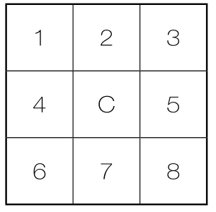
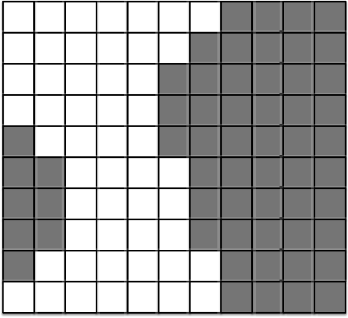
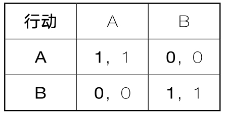
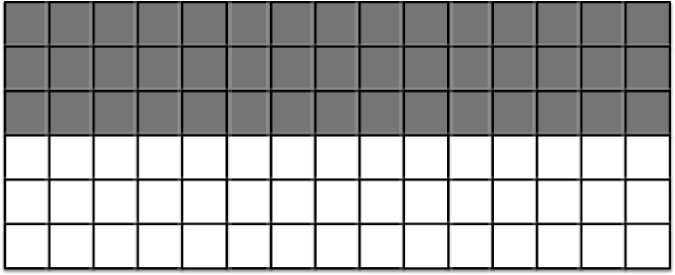
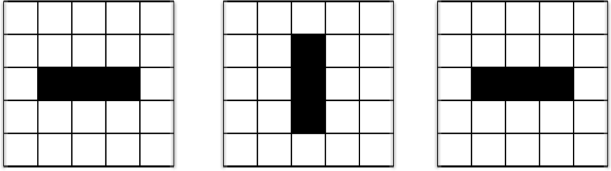
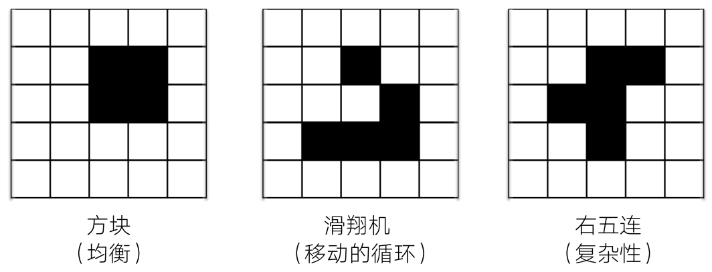

# 15　局部互动模型

每一代人都嘲笑旧时尚，同时又虔诚地追随新时尚。

亨利·戴维·梭罗（Henry David Thoreau）

在本章中，我们要研究两个局部互动模型（local interaction model），即局部多数模型（local majority model）和生命游戏。这两个模型都是建立在一个由单元格组成的棋盘上，棋盘由处于两种状态之一的元胞组成。表面上看，这两个模型似乎没有太大的不同，其实不然。在局部多数模型中，元胞通过与它的大多数邻居的状态相匹配来更新。而在生命游戏中，元胞的更新规则要更加复杂，它依赖于多个阈值。这两个模型的结果也不同。局部多数模型总是收敛到均衡，生命游戏则取决于其初始条件，可能会产生任何类型的结果：均衡、周期性、复杂性或随机性。

局部多数模型可以用于解释和预测社会系统和物理系统中的实际结果。它可以通过符合个体或者刻画像自旋玻璃这样的磁性粒子与自己的“邻居”对齐的物理系统来表示离散选择。相比之下，生命游戏则完全是探索性的。开发生命游戏的目的就在于探索简单的规则如何集结并产生各种复杂的现象。在生命游戏中，周期性模式、复杂序列和随机性都可能从相互作用中涌现出来。生命游戏突显了整体与部分的不同。这里，我们可以给出一个粗略的类比：在人类的大脑中，诸如情绪、认知和意识等涌现现象也会从更简单的部分涌现出来。

首先分析局部多数模型。我们将阐明，一个标准的协调博弈如何为模型所假设的行为规则提供微观基础。因此，我们既可以将模型中的参与者解释为遵循规则的行为者，也可以解释为应用某个最优反应策略的理性行为者。然后，我们分析了生命游戏，并说明它如何从简单的规则中产生复杂性。本章末尾的讨论强调了利用多个局部互动模型探索的价值。

### 局部多数模型

局部多数模型假设元胞是排列在棋盘上的。 ¹  每个元胞处于两种状态中的一种：开或关。初始时，我们随机地给元胞分配状态，此后，元胞的状态取决于它“邻居”的状态。邻居可以通过多种方式加以定义。我们将元胞 C 的邻居定义为位于它东、南、西、北的 4 个元胞以及 4 个对角上的相邻元胞，因此它的领域大小为 8。

**局部多数模型** 

二维方格上的每个单元都处于两种状态之一：开或关。每个单元有 8 个邻居。 ²  在每个周期中，随机选择一个元胞。 ³  当且仅当其中它的 5 个或更多邻居处于另一个状态时，这个元胞才会改变自己的状态。

局部多数模型中的局部互动包括正反馈：元胞要与其他元胞的状态相匹配。图 15-1 显示了局部多数模型的典型均衡配置。

**图 15-1　局部多数模型中的典型均衡配置** 

在均衡状态下，每个元胞的状态都与它的大多数邻居的状态相匹配。均衡配置类似于荷尔斯坦奶牛身上的黑白斑块。虽然均衡配置取决于各元胞的初始配置，但是该模型对初始条件没有表现出极高的敏感性。改变一个元胞的状态最多只会导致最终配置出现很小的变化。最终的模式还取决于元胞被激活的顺序。因此，这个模型也表现出了路径依赖。它的均衡数量非常巨大。模型产生的两个均衡之间的相似度，不会比同一块地里的两头荷尔斯坦奶牛身上的黑白斑块更高。

局部多数模型最初是为了用来刻画一类物理系统而开发的。在这类物理系统中，每个元胞的状态代表一个原子的自旋态，我们不妨将每个元胞想象为一个具有负电荷或正电荷的磁体。每个磁体都位于一个局部磁场中，物理力量会驱使这个磁体与它的邻居的自旋相匹配。同样的模型也可以用来表征玻璃体和水晶体。

在这里，我们利用这个模型来刻画人与人之间的局部协调或一致性。假设每一个元胞都代表一个人的行动。这里的行动可以是任何行为惯例，例如握手或鞠躬，打断或举手。任何一个人都想选择一个与邻居相匹配的行动。棋盘代表社交网络，在很多情况下，棋盘确实是代表社交网络的适当模型。例如，当房主决定维护自家的院子、植树造林或创建生态景观的时候，又或者礼堂内的人决定是否为表演者起立鼓掌时。 ⁴  虽然棋盘最多只能作为一个粗略的近似，但是我们利用它可以得出核心直觉结论。

如果在计算机上对这个模型进行模拟，就会发现它总是能实现斑块状的均衡配置。在第十六章中，我们将给出这种均衡出现的原因。在局部多数模型的物理解释中，斑块状均衡模式对应于受挫状态（frustrated state）。许多元胞在开的状态下有一些邻居，在关的状态下也有一些邻居。

如果我们通过社会视角解释模型，就可以把这种受挫状态理解为次优均衡（suboptimal equilibrium）。如果开对应于以握手的方式表示欢迎、关对应于以鞠躬的方式表示欢迎，那么位于“斑块”边界上的人在与他们的邻居互动时可能会碰到一些尴尬的情况：当其他人准备握手时他们却准备鞠躬，或者当其他人准备鞠躬时他们却准备握手。如果每个人都选择了相同的动作，也就是说，如果他们解决了协调博弈问题，那么从整体上看，所有人都会更加开心。

由于这种互动只作用于局部，因此出现了次优均衡，即受挫状态。相反，如果元胞是根据全局多数原则来匹配的，那么很快所有元胞都会处于相同的状态。这种观点意味着，创建共同行为可能需要影响更加广泛的网络。如果人们只在局部与自己的邻居协调，他们就会创造出各种各样的行为。因此矛盾的是，恰恰是协调导致了多样性。

**纯粹协调博弈** 

在纯粹协调博弈（pure coordination games）中，每个博弈参与者都要在两个行动 A 或 B 中选择一个。如果两个博弈参与者都选择了相同的行动，那么每个博弈参与者的收益为 1。如果两个人各自选择了不同的行动，那么每个人的收益都为零。

一个纯粹协调博弈有两个有效的均衡：两个博弈参与者选择 A 或者两个博弈参与者选择 B。它还有一个无效的均衡，也就是每个博弈参与者都在 A 和 B 之间进行随机选择。我们可以从纯粹协调博弈的角度重新解释局部多数模型：在这个博弈中，每个元胞都是一个博弈参与者，它必须选择一个共同行动来对抗它的 8 个邻居。如果博弈参与者只有在随机激活时才能改变行动，那么某个博弈参与者就可以通过选择与它的大多数邻居所选择的行动相匹配的行动来增加自己的收益。这种策略被称为短视最优响应（myopic best response），因为它没有考虑到邻居可能的未来行为。

一个博弈参与者有 5 个邻居选择了 B，那么这个博弈参与者可以通过从 A 切换到 B 来在短期内增加自己的收益，但是，如果这个博弈参与者和邻居是被其他选择 A 的博弈参与者的“海洋”所包围的一个孤岛，那么这个博弈参与者保持 A 不变反而可能获得更高的期望收益。最关键的一点是，局部多数模型中的行为规则虽然只是一个假设的规则，但却可以植根于博弈论模型中。

协调的悖论（paradox of coordination）将不同群体之间的差异解释为一种特异性的分歧。对于某些行为，比如你是将酱油或番茄酱存放在橱柜中还是冷藏在冰箱里，或者当别人走进你家里的时候，是会脱鞋进门还是直接穿着鞋进来，而与其他人协调一致是明智的选择。由此而产生的地区多样性使我们的生活更加丰富多彩。以咖啡为例，意大利的小杯力士烈特（ristretto）、法国的中杯浓缩，以及华沙的大杯咖啡加奶油（kawa ze smietanka）极大地增加了人们在欧洲旅行的乐趣。

但是，其他很多差异却可能是低效的。各种各样的电插头可能会令人抓狂——这里是两个插脚的，到那里却是三个插脚的。随着全球一体化程度的提高，技术协调失败的代价可能是非常高昂的。例如，瑞典政府决定将靠左行驶改为靠右行驶，以便与欧洲大陆其他地区保持一致。这件事非同小可，转为靠右行驶的那一天在瑞典被称为“H 日”（Dagen H）。1967 年 9 月 3 日凌晨 4 点 45 分，瑞典行驶在路上的所有车辆以及许多特意在凌晨时分上路参加这个活动的瑞典人都突然停下来，然后，在接下来的 15 分钟内，所有的汽车都从左侧行驶到右侧。凌晨 5 点，所有汽车开始在道路的另一侧再次启动，开始靠右行驶。尽管达成协调的动机相当强烈，但是许多时候人们却无法做到。例如，虽然英国已经通过隧道连接到了欧洲大陆，但是英国的车辆至今仍然靠道路的“错误”一侧行驶，而且英国的某些（尽管不是全部）前殖民地也是如此。

**协调的悖论** 

如果人们是在局部进行协调的，那么从全局的角度来看，整体配置将会是斑块状的、多样性的。

应用这个模型时，必须记住，许多帮助我们实现协调的文化习俗，例如人们如何哀悼死者的逝去、如何庆祝孩子的出生，并不是简单的“奇风异俗”，而是文化的重要组成部分，是一系列内在一致的行为规则、惯例的组合；它们定义了一个人到底是谁，给了人们生活的意义和归属感。 ⁵  

与任何模型一样，对于局部互动模型，我们也可以对各种参数进行模拟实验，看看改变它们会如何影响结果。在局部互动模型中，均衡时形成的斑块大小增加得比邻域的大小更快。如果我们使邻域，也就是影响网格上一个格子的格子数量增加到原来的两倍，那么斑块会变得比原来的两倍还大。因此，这个模型表明，当技术和城市化使人与人之间的联系更加紧密之后，协调的力量可以产生更大的同质性行为和信念。

模拟实验还表明，如果我们将整个配置变成一个狭长的矩形，那么模型一般来说会产生水平和垂直的条纹，如图 15-2 所示。 ⁶  斑马状的条纹是一个均衡，因为每个处于开（关）状态的元胞，都有 5 个处于开（关）状态的邻居。在正方形上，这种类型的模式也是一个均衡，但是很少会真的出现。尽管这种令人困惑的发现有可能导致我们误入歧途，陷入没有什么实证意义或理论价值的问题，但是它们也有可能引导我们得出一些深刻的洞见，从而带来更深层次的意外发现。

**图 15-2　局部多数模型中稳定的线条** 

在这个例子中，正方形网格会产生荷尔斯坦奶牛式斑块状模式，而狭长的矩形网格则会产生斑马状的模式这个结果，几乎就是在直接要求我们回答：是不是可以用这里的模型去解释不同动物皮毛上斑点和条纹的特有模式？大量科学研究文献告诉我们，确实可以。 ⁷  

### 生命游戏

接下来我们讨论下一个模型：生命游戏。这个模型也假设位于棋盘上的元胞处于两种状态中的某一种。生命游戏与局部多数模型的关键区别在于，在这里，元胞的更新规则有两个阈值，并且所有的元胞都同步更新自己的状态。因此，在生命游戏中，我们可以说初始配置如何如何，时间 1 的配置如何如何，时间 2 的配置如何如何，等等。还可以把同步更新视为一个“进行曲”动态机制（更新！更新！更新！）。 ⁸  

**生命游戏** 

方格上的每个元胞都或者是活的（开的）或者是死的（关的）。每个元胞的邻居由网格上的 8 个相邻元胞组成。元胞根据如下两个规则同步更新自己的状态：

**活的规则：** 对于一个死元胞，当恰好有三个活的邻居时，这个死元胞就会变活。

**死的规则：** 对一个活元胞，当活的邻居小于两个时或当有三个以上的活邻居死去时，这个活元胞就会死去。

我们从排在同一条水平线上的三个活的元胞开始讨论，如图 15-3 所示。在下一个时期，对每个元胞应用上述死活规则之后，我们会得到排在同一条垂直线上的三个元胞。中间的活元胞有两个活着的邻居，所以它还活着。两端的两个活元胞分别只有一个活的邻居，所以它们都死了。最后，中间的活元胞的上方和下方的元胞都变活了，因为这两个元胞分别各有三个活着的邻居。根据对称性，等再下一个时期更新后，又会回到三个元胞组成水平线的情形。如果继续迭代运用上述规则，模型就会在水平线与垂直线之间不断交替，这也就是说，它将会不断“闪烁”。

**图 15-3　生命游戏中的“闪光灯”** 

闪光灯是由元胞之间的互动产生的，而不能直接从假设中推导出来。复杂系统学者将这种宏观现象称为涌现。闪光灯是生命游戏产生的涌现结构中最常见的、最不能给人留下深刻印象的一种。图 15-4 显示了其他三种简单涌现结构：方块、滑翔机和右五连（R-pentomino）。这是一个均衡配置；每个活元胞都有三个活的邻居，每个死元胞最多有两个活的邻居，因此，既没有活元胞死亡，也没有死元胞复活。

**图 15-4　生命游戏中的三种涌现结构** 

图 15-4 中间的配置会产生一个大小为 4 的循环，该循环沿着对角线向下和向右滑动，成了滑翔机。与之相关的另一个更精致的配置被称为“滑翔机枪”，它能产生无穷无尽的滑翔机。第三种配置右五连能产生一系列复杂的模式。如果我们在大型网格上重复运行模型超过 1 000 次，这个右五连会生成许多滑翔机、闪光灯以及其他一些较小的稳定配置。生命游戏也可以产生随机性。 ⁹  因此，生命游戏可以根据初始状态产生任何类别的结果。

这种能力甚至引发了一些哲学问题。生命游戏由排列在网格上的、只有两种状态的元胞组成，并运用简单的规则进行更新。它可以生成精美的图案，通过适当的编码，还可以变成一台通用计算机。我们可以把初始模式视为输入，根据规则产生的结果则可以解释为计算。因此，我们可以在这个模型和人类的大脑之间进行一个粗略的类比，因为人类的大脑也是由依赖于基于阈值规则的、在空间上相互连通的简单组成部分构成的，尽管那些规则要复杂得多。

当然，这并不是说我们在生命游戏中观察到模式就可以解释意识了。现在还没有任何一本书名为《生命游戏：意识的解释》，尽管丹尼尔·丹尼特（Daniel C. Dennett） ^((6))  确实写过一本以《意识的解释》（*Consciousness Explained* ）为名的书，而且他也认为像生命游戏这样的简单模型可以提供关于意识如何演化的洞见。丹尼特这个思想得到了不少人的共鸣，物理学家斯蒂芬·霍金（Stephen Hawking）就这样写道：“我们完全可以想象，像生命游戏这样的东西，只有少数几个基本定律，就可以产生高度复杂的特征，甚至可能产生智能。” ¹⁰  

### 小结

在本章中，我们研究了两个关于排列在网格上的元胞之间的互动模型。第一个模型是局部多数模型，它总是可以达到某个均衡（尽管可能的均衡有许多种），我们可以将这个模型与多种物理过程和社会过程进行类比。第二个模型是生命游戏，它能够产生从均衡到随机的任何一种类型的结果。这个模型与现实世界之间不存在任何明确的联系。生命游戏给出了一个很好的例子，它说明，构建替代现实的模型是怎样帮助我们产生洞察力的，也就是从微观的规则中涌现出动态的宏观层面结构，这可以极大地加深我们对世界的理解。正如生命游戏所呈现的那样，整体可以执行远远超出其各个组成部分的功能。例如，如果我们把两个 3×3 的方格的角连接起来，画出一个斜 8 字图形，那么生命游戏就会产生一个长度为 8 的循环模式。它循环通过一系列模式，然后在恰好 8 个步骤内回到那个 8 字图形上。这个模式，从图形上看像 8 字，它的行为也“好像”知道它要数到 8。这确实是非常惊人的。

为什么生命游戏会产生复杂性，而局部多数模型则不可避免地走向均衡？为了理解个中原因，我们还需要更多的分析工具和框架。在第十六章中，我们介绍了李雅普诺夫函数（Lyapunov function），它运用差分方程对世界状态进行分类。细致地构建出一个李雅普诺夫函数之后，我们就可以解释为什么局部多数模型必定会达到平衡，而生命游戏则不一定。

最后要强调的是，正是在我们对模型进行探索的过程中，才使模型（以及现实世界）是否会产生均衡、周期性、复杂性或随机性这个问题突显了出来。确实，模型既能够回答问题，也能够提出问题。它们关上了一些门，同时又打开了更多的门。