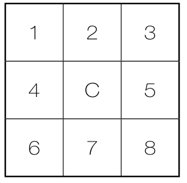
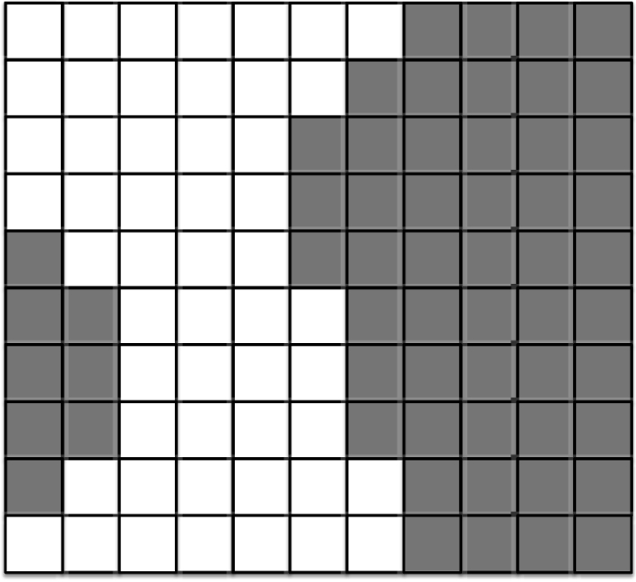
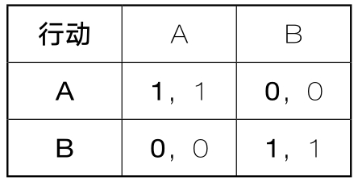
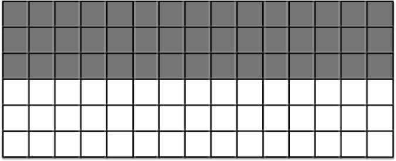
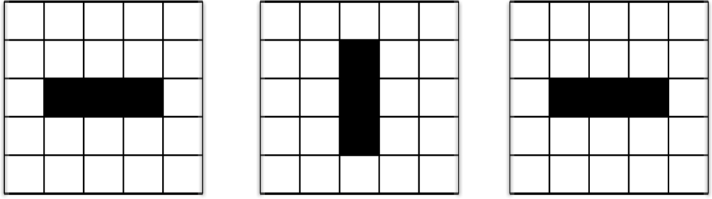
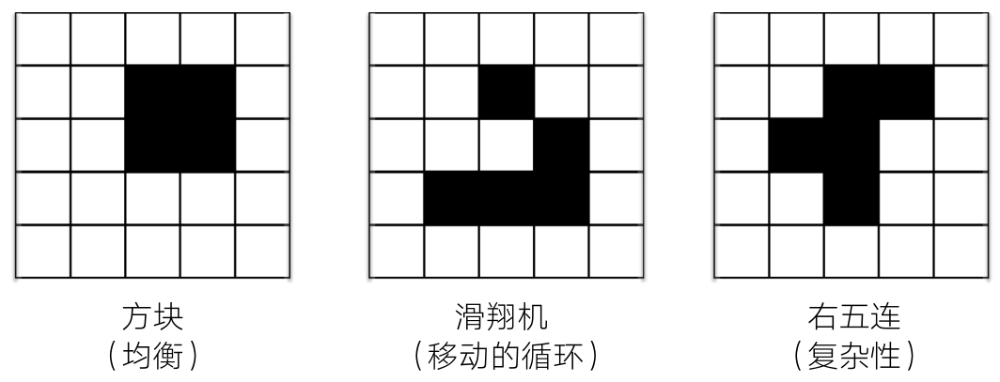

# 

梭罗有句俏皮话：人们总爱笑话上一代的风尚，却又一本正经地追赶下一代的风尚。第15章要谈的，是两种把个体放进格子里的“局部互动模型”——局部多数模型与生命游戏。它们表面都像棋盘上的元胞游戏，每个格子只有两种状态，但脾气完全不同：前者沿着“和多数邻居保持一致”的方向更新，最终几乎总会落到某种均衡；后者要同时看两个阈值，规则更绕，结果也野得多，初始局面不同，可能均衡，可能循环，可能复杂，也可能显得随机。

## 一、格子里的从众：局部多数模型

想象一张二维方格网，每个格子不是“开”就是“关”。所谓邻居，是它东、南、西、北四个格子，再加上四个对角格子，一共8个。每一轮随机挑一个元胞：只有当它的邻居里有5个或更多已经处在另一种状态时，它才翻转自己。这个设定带来一种正反馈——元胞倾向于和周围多数人站到同一队。材料中给出的典型均衡配置（图15-1），像荷尔斯坦奶牛身上的黑白斑块，一块一块地分布开来。

这种模型对初始条件不算特别敏感：只翻转一个格子的状态，终局通常也只是小幅调整。不过，最终模式会受元胞被激活顺序的影响，所以它带有路径依赖。均衡的数量还非常庞大，两个终局摆在一起，未必比同牧场两头奶牛的花纹更像。

这个模型出身于物理学：每个元胞可看成带正负电荷的小磁体，局部磁场会推动它和邻居的自旋方向对齐；类似自旋玻璃、玻璃体、水晶体这类对象也能用它来描述，离散选择同样可以纳入这个框架。换到社会场景，元胞可以代表一个人的行为惯例：握手还是鞠躬，打断还是举手；也可以表示房主是否维护院子、植树造林、营造生态景观，或者礼堂里的观众要不要为表演者起立鼓掌。棋盘当然只是社交网络的粗略近似，但能帮我们抓住核心直觉。

在模拟中，这个模型总会出现斑块状均衡。从物理角度看，这种斑块对应“受挫状态”：不少开状态的元胞身边有关状态的邻居，不少关状态的元胞身边也有开状态的邻居。从社会角度看，它是一种次优均衡。假设“开”是握手、“关”是鞠躬，那么站在斑块边界上的人就很容易遭遇尴尬：自己准备鞠躬，对面却伸出手；或者自己伸出手，对面却弯下腰。要是所有人都选同一种动作，也就是把协调博弈解掉，整体上大家都会更舒服。问题在于，互动只发生在局部，所以受挫和次优均衡难以避免。反过来说，如果元胞按全局多数原则匹配，很快所有格子都会同色；这也意味着，要创造共同行为，可能需要影响更广的网络。于是出现一个悖论：人们只在局部与邻居协调，反而制造出多种多样的行为——恰恰是协调带来了多样性。

## 二、协调博弈与“受挫”的微观基础

局部多数模型的行为规则并非凭空假设，它可以放进纯粹协调博弈里理解。设有A、B两个行动：两人都选A或都选B，各得1；一人选A一人选B，各得0。这个博弈有两个有效均衡（都选A、都选B），还有一个无效均衡，即每个人在A、B之间随机挑。把每个元胞看成一个参与者，它要和8个邻居选共同行动；只有被随机激活时才能改行动。此时，选择与多数邻居一致的行动，能提高自己的收益，这叫短视最优响应——只顾眼前，不盘算邻居之后会怎么动。比如某人有5个邻居选B，他立刻从A切到B，短期收益会上升；但若他和邻居只是A的“海洋”里一座孤岛，他坚持A反而可能拿到更高的期望收益。关键结论是：局部多数模型那条看似简单的行为规则，可以扎根在博弈论模型里。

由此可以谈“协调的悖论”：局部协调会在全局层面留下斑块状、多样化的配置。有些差别来自群体各自形成的特异偏好，比如酱油、番茄酱放橱柜还是冰箱，进别人家脱不脱鞋；这类协调往往明智，也让地区生活更有味道。咖啡就是一例：意大利的小杯力士烈特、法国的中杯浓缩、华沙的大杯咖啡加奶油，让欧洲旅行多了不少乐趣。但另一些差异可能低效得让人抓狂，比如电插头两个脚、三个脚各不相同。全球一体化程度越高，技术协调失败的代价可能越昂贵。瑞典把靠左行驶改成靠右行驶，就是为了与欧洲大陆一致；1967年9月3日凌晨4点45分，路上的车辆和不少特意上街参与的人先停住，接下来15分钟内汽车从左侧挪到右侧，凌晨5点再在另一边启动。协调动机如此强，很多地方仍难做到，英国通过隧道连接欧洲大陆后，车辆至今仍靠“错误”的一侧行驶，英国部分前殖民地也是如此。

还要记住：不少帮助人们协调的文化习俗——如何哀悼逝者、如何庆祝新生儿——不能轻飘飘归为猎奇风俗。它们是文化的重要部件，是一整套内在一致的行为规则与惯例，既定义一个人是谁，也给生活以意义和归属感。

## 三、邻域越大，斑块越大；长条格子会“长出”条纹

对局部互动模型做参数实验，会发现均衡时的斑块尺寸增长得比邻域扩张更快：如果把影响一个格子的邻居数量翻倍，斑块会变得比原来的两倍还大。这暗示，当技术和城市化把人与人联系得更紧，协调力量可能催生更大范围的一致行为和信念。

模拟还显示，如果把整个配置压成狭长矩形，模型常会生成水平和垂直的条纹，像斑马纹一样（图15-2）。这样的条纹也是均衡：每个开（或关）元胞都能找到5个同状态邻居。同样的模式放在正方形网格上也算均衡，只是很少真的出现。这个看似古怪的结果，几乎是在邀请我们去解释动物皮毛上的斑点与条纹——不少科学研究确实沿着这条路走；它也可能把人带偏，但同样可能逼出更深的洞见和意外发现。

## 四、生命游戏：简单规则里“长”出复杂世界

再看生命游戏。它同样把元胞放在方格上，每个元胞或活或死，邻居也是周围8个。关键差别在于：生命游戏的更新规则有两个阈值，而且所有元胞同步更新。于是我们可以说初始配置如何、第1期如何、第2期如何，像一支“更新！更新！更新！”的进行曲。

规则很简洁：对一个死元胞，若恰好有3个活邻居，它就变活；对一个活元胞，若活邻居少于2个，或多于3个，它就死去。拿三个排成水平线的活元胞做例子：下一期会变成三个竖排的活元胞；中间那个有两个活邻居，继续活；两端各只有一个活邻居，死掉；而中间元胞的上、下两个死邻居各恰好有三个活邻居，于是变活。再下一期，由于对称性，又回到水平三连。如此来回交替，形成“闪光灯”（图15-3）。

闪光灯并非规则里明写的结果，而是元胞互动之后冒出来的宏观花样，复杂系统学者称之为“涌现”。它只是生命游戏里最常见、也最不惊艳的涌现结构之一。另一些简单结构包括方块、滑翔机和右五连（图15-4）：方块是均衡配置，每个活元胞都有三个活邻居，每个死元胞最多两个活邻居，所以没有活元胞死亡，也没有死元胞复活。滑翔机会以大小为4的循环沿对角线向下、向右移动；更精致的“滑翔机枪”能不断制造滑翔机。右五连则会在大型网格上跑过1000多次后，生成许多滑翔机、闪光灯以及其他较小的稳定配置。生命游戏还能产生随机性。因此，初始状态不同，它可能给出均衡、周期、复杂序列或随机结果中的任何一种。

这种能力甚至带出哲学问题：生命游戏只有两种状态、规则也简单，却能生成精美图案，经过适当编码还能变成通用计算机。把初始模式当输入，按规则跑出的结果可以解释为计算。于是人们会拿它和大脑做粗略类比：大脑也是由空间上相互连接的简单部件构成，依靠基于阈值的规则运作，只不过那些规则复杂得多；情绪、认知、意识等涌现现象也可能从更简单的部分中浮现。当然，这不等同于说在生命游戏里看到图案就解释了意识。还没有一本叫《生命游戏：意识的解释》的书，但丹尼尔·丹尼特确实写过《意识的解释》，他也认为生命游戏这类简单模型能提供关于意识如何演化的洞见。霍金也设想过：仅靠少数基本法则，类似生命游戏的机制或许能生成高度复杂的特征，甚至智能。

## 五、结语：模型既关上门，也打开更多门

把两个模型放在一起看：局部多数模型总会达到某个均衡（虽然可能的均衡很多），可以类比多种物理过程和社会过程；生命游戏则可能产生从均衡到随机的任何结果，与现实世界没有明确对应关系。生命游戏从诞生起就带着实验和探索气质，它的价值在于展示“替代现实”的模型如何带来洞察：微观规则可以涌现出动态的宏观结构，整体所能完成的事情，可以远远超过零件功能的简单相加。比如把两个3×3方格的角连起来，画出一个斜8字图形，生命游戏会生成一个长度为8的循环模式，它依次经过一串模式，恰好在8步后回到那个8字图形；从图形看像8字，从行为看却“好像”知道自己要数到8，这确实惊人。

为什么生命游戏能复杂，局部多数模型却必然走向均衡？要回答这个问题，还需要更多分析工具和框架。第16章将介绍李雅普诺夫函数，用差分方程给世界状态分类；细致构造出李雅普诺夫函数后，就能解释局部多数模型为何必定达到平衡，而生命游戏则不一定。

最后要强调：正是在探索模型的过程中，“会不会出现均衡、周期性、复杂性或随机性”这个问题才被凸显出来。模型既能回答问题，也能提出问题；它关掉一些门，同时打开更多的门。