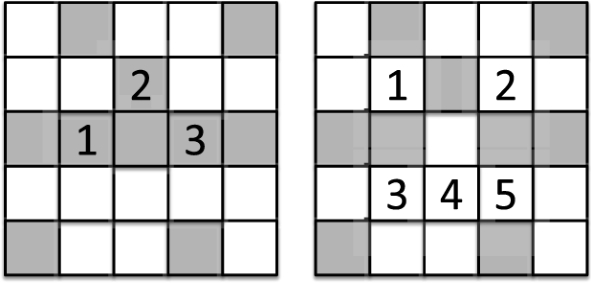

# 16　李雅普诺夫函数与均衡

数学之美，只会呈现给那些更有耐心的追求者。

玛丽安·米尔札哈尼（Maryam Mirzakhani）

在本章中，我们学习李雅普诺夫函数，它给出了模型能够实现均衡的条件。李雅普诺夫函数是在按时间索引的配置系统上定义的实值函数。在每个时间步骤中，李雅普诺夫函数都要给配置分配一个值。如果配置发生了变化，也就是说，如果模型不处于均衡状态，那么李雅普诺夫函数的值就会减小一个固定量。李雅普诺夫函数也具有最小值，这意味着到了某个时间点上，它的值最终必定会停止递减。当发生这种情况时，模型就达到均衡了。例如，我们可以使用李雅普诺夫函数来证明，为什么局部多数模型一定会收敛。

本章的核心结论是，如果能够为模型构建一个李雅普诺夫函数，那么模型必定会达到均衡。在这种情况下，我们不可能得出周期性、随机性或复杂性。更重要的是我们甚至可以确定模型收敛到均衡所需的时间，这一点在为局部多数模型构造李雅普诺夫函数中可以看得很清楚。

本章的内容分为 6 个部分。我们首先定义了李雅普诺夫函数，然后将李普雅诺夫函数应用于对逐底竞争博弈（Race to the Bottom Game）的分析。然后，我们分别为局部多数模型和自组织活动模型构建了李雅普诺夫函数。接着，我们证明了为什么可以为某些交易市场构建李雅普诺夫函数，却不能为另外一些交易市场构建李普雅诺夫函数，同时也分析了为什么生命游戏没有对应的李雅普诺夫函数。接着，我们讨论了一个看似令人烦恼的数学问题：在不能找到李雅普诺夫函数的情况下达到均衡。本章最后讨论了均衡是否可取的问题。

### 李雅普诺夫函数

一个离散动态系统（discrete dynamical system）由可能的配置空间，以及一个转移规则（transition rule）组成。我们可以把配置空间视为世界的多维状态，例如生命游戏中的活元胞和死元胞的初始集合，而转移规则则是将时间*t* 时的配置映射到时间*t* +1 时的配置上。

一个李雅普诺夫函数是从配置到实数的一个映射，它满足两个假设：第一，如果转移函数不处于均衡状态，则李雅普诺夫函数的值就会减少某个固定的数量（对此，稍后会给出更多的解释）；第二，李雅普诺夫函数具有最小值。如果这两个假设成立，那么该动态系统必定达到均衡。

**李雅普诺夫函数** 

给定一个离散时间动态系统，它的转移规则由*x* * [t] * [+1] =*G* （*x* * [t] * ）组成。对于实值函数*F* （*x* * [t] * ），如果对于所有的*x* * [t] * ，都有*F* （*x* * [t] * ）≥M，而且存在一个*A* >0，那么下式成立，这个实值函数*F* （*x* * [t] * ）是李雅普诺夫函数：

*F* （*x* * [t] * [+1] ）≤*F* （*x* * [t] * ）-*A* ，如果*G* （*x* * [t] * ）≠*x* * [t] * 

如果对于*G* ，*F* 是一个李雅普诺夫函数，那么从任何*x* [0] 开始，必定存在一个*t* \*，使 G（*x* * [t] * [\*] ）=*x* * [t] * [\*] ，即该系统会在有限时间内达到均衡。

首先为逐底竞争博弈构建一个李雅普诺夫函数。这个函数刻画了该博弈的博弈参与者的策略环境，以便每一个博弈者都更愿意提供恰好低于平均水平的水平。

**逐底竞争博弈** 

有*N* 个博弈参与者，每个博弈参与者在每个时期都要提出一个支持水平，其取值范围为{0，1，…，100}。提出了最接近平均支持水平 2/3 的博弈参与者可以获得那个期间的奖励。

这个博弈可以用来解释美国各州政府削减社会项目支出的行为，例如减少对贫困人口的援助。没有任何一个州的州长或州立法机关希望公众认为自己冷酷无情，但是，又没有人愿意提供慷慨的援助贫困人口的计划，因为那会把邻州的穷人吸引过来。于是每个州都会提供一些资金，但只愿意提供低于平均水平的资金。在通过环境保护法规或制定税率时，相互竞争的国家也会有类似的动机。各国宁愿采取只对环境施加较少限制的政策，并且为了吸引企业投资，税率低于平均水平。

逐底竞争博弈是否能达到均衡，取决于博弈参与者的行为规则。如果博弈参与者随机选择支持水平，那么结果就将会是随机的。然而，考虑到这个博弈的收益结构，随机选择支持水平并没有意义。在这里，我们假设如下行为规则，这种规则与实验研究的结果一致。 ¹  在第一个时期，我们假设每个博弈参与者会随机选择一个低于 50 的支持水平。在以后各期中，每个博弈参与者选择的水平至少等于 1 且低于上一期平均水平的 2/3。如果上一期的平均水平已经小于零，那么每个博弈参与者都会选择零。

很容易证明，来自任何博弈参与者的最大支持水平满足李雅普诺夫函数的条件，即最大支持水平的最小值为零。而且，在每个时期内，如果支持水平采用整数值，那么最大支持水平至少会下降 1。因此，到了某个时间点上，每个博弈参与者都会提议零支持水平。也就是说，博弈参与者在逐底竞争中都碰到了“底”。在这个例子中，模型产生了一个不好的结果。为了防止出现这种逐底竞争，必须改变博弈结构。例如，为了增加对贫困人口的扶持，法律可以规定由联邦政府来提供资金，或者对各州规定一个最低“扶贫”支出水平。 ²  

另外，假设我们允许博弈参与者在 0 至 100 的区间内选择任何实数值，而不是整数值。再假设在每一轮中，博弈参与者选择的支持水平等于上一轮平均水平的 2/3，那么平均支持水平将会随着时间的推移而逐渐降低，但是永远不会达到零的均衡。正如色诺悖论（Xeno's paradox）一样，这个过程会越来越接近于零，但是却永远不会达到零。因此，为了确保均衡的实现，还必须假设一个最小减量（*A* ）。

### 局部多数模型

现在，用李普雅诺夫函数分析一下局部多数模型。我们将局部多数模型中的李雅普诺夫函数定义为总体中的总不一致性（total disagreement），即与相反状态的元胞相邻的所有元胞数量的总和。为了证明这个模型必定会达到均衡，我们必须先证明，如果一个元胞改变了自己的状态，那么总不一致性至少会下降一个固定的数量。

这个证明的数学过程并不太复杂。首先，如果一个元胞改变了自己的状态，那么相对于它的邻居而言它必定是少数。由此我们知道，那时它至少有 5 个邻居处于相反状态，最多有 3 个邻居处于相同状态。因此，当这个元胞切换状态后，与这个元胞不一致的元胞数量至少减少了两个（图 16-1）。为了计算总不一致性的变化，还必须将与这个元胞相邻的元胞对总不一致性变化的贡献考虑进去。由此，那 5 个或更多的现在状态一致的元胞的不一致性减少了（每个元胞减少 1），同时之前状态一致的那 3 个或更少的元胞现在则具有更高的不一致性了（每个元胞增加 1）。因此，所有相邻元胞的总不一致性至少下降了 4。

**图 16-1　局部多数模型中总不一致性的减少** 

这样一来，我们就证明了，即使某些元胞可能带来更多的不一致性，总不一致性也满足李雅普诺夫函数的条件。因此，局部多数模型必定会收敛到均衡，不仅仅是有些时候或大部分时候，而是所有时间都是如此。我们还可以确定收敛的速度：无论什么时候一个元胞改变自身的状态，总不一致性至少会下降 4。由此可知，一个总一致性为 100 的配置，必定会在 25 个时期内达到均衡。换句话说，一个总一致性为 D 的配置，必定会在 D/4 个时期内达到均衡。正如我们在第十五章中已经指出过的，实现的均衡几乎总是一个低效率的斑块状模式，它包括了不少受挫的元胞。

### 自组织活动模型

接下来，讨论李雅普诺夫函数的下一个应用。这一次，我们要证明自组织活动模型中也存在均衡。这个模型中由一群人和每个人可以选择去做的活动的集合组成。这个模型的关键假设是，每个人都更偏好不那么拥挤的活动，例如，更少人参加同一项活动意味着在健身房不用等待、在面包店和咖啡店不用排队。

这个模型的灵感来自著名经济学家托马斯·谢林（Thomas Schelling）的著作《微观动机与宏观行为》（*Micromotives and Macrobehavior* ）。谢林在这本书中描述了城市中出现的各种令人叹为观止的自组织现象：在几乎完全不存在中央计划者的情况下，交通模式、行人流量、停留在公园和餐馆的人数，以及商店库存，到底是怎样自动达到各自的适当水平的？街头那家小店，是怎么每天都能进到 4 瓶来自密歇根州锡达维尔原产的纯枫糖浆的？巷尾那家面包房，又是怎么做到每天都在关门前大约 20 分钟卖完当天制作的黑麦面包的？尽管城市内有如此多样性的行动者——游客、店主、居民和送货人等，而且他们对整个城市的信息所知有限，但这种秩序也会涌现出来。

**自组织活动模型** 

一个城市里，有*A* 种活动可以参加，每一天都由*L* 个时间段组成。在人口规模为*M* 的城市中，每个人都要选定一个日程安排。在这里，日程安排是指这个人在*L* 个时间段内分配*L* 种活动（从一个更大的*K* 种可能性的集合中）。一个人要面对的拥挤水平则设定为等于同时选择同一种活动的其他人的数量。

为了证明这个模型是收敛的，我们要证明总拥挤度（total congestion），也就是整个人群拥挤水平的总和满足李雅普诺夫函数的条件。当一个人降低了他的拥挤水平时，就会降低自己对总拥挤度的贡献，并且会使他不再遇到的每个人的拥挤水平减少 1，同时使他新遇到的每一个人的拥挤水平增加 1。既然他降低了自己的拥挤水平，第一组人的数量会比第二组人更多。例如，假设一个人原本在早上 8 点去一个拥挤的健身房，在下午 4 点去一个拥挤的咖啡馆，如果她改为在上午 8 点去咖啡馆，并在下午 4 点去健身房，结果发现在上午 8 点那个时段咖啡馆几乎是全空的，健身房在下午 4 点时只是有一点点拥挤，那么她降低了自己以及之前遇到的所有人的拥挤水平。她确实使她现在遇到的少数人提高了拥挤水平，但是总拥挤度却下降了（而且至少减少了 1）。既然总拥挤度不可能低于零，系统必定会达到均衡。

虽然，一般来说，我们无法保证系统能够找到一个有效率的均衡，但是这种自组织活动模型几乎总能收敛到总拥挤度近乎最小的配置。而在效率低下的配置中，更多人选择在同一个时间段参加某一项活动（比如去健身房），而不是去参加另一项活动（比如去咖啡馆）。如果在这两项活动中拥挤程度的差异很大，那么一个人就可以通过切换自己去健身房和咖啡馆的时间来降低拥挤水平。如果咖啡馆和健身房在另一个时间段有相同数量的人前往，这种切换就可以减少总拥挤度。 ³  

这个模型可以解释当今世界的很多秩序，它可以让我们更加深刻地理解城市如何在没有中央计划者的情况下通过自组织实现近乎完全有效的配置。它还告诉我们，为什么许多游乐园，比如迪斯尼，却做不到这一点。迪斯尼每天都有新的入园参观者，他们没有时间去尝试新的路线。如果没有“中央计划者”的帮助，迪斯尼将会出现某些景点大排长龙，同时其他景点门可罗雀的情况。因此，为了减少这种低效率状况的出现，迪斯尼对于某些特定的景点，只允许游人提前预约在特定时间内进入，同时让员工引导人们参观不那么拥挤的其他景点。

### 纯交换经济

我们也可以使用李雅普诺夫函数来探索纯交换经济什么时候可以达到均衡、什么情况下可能无法实现均衡。纯交换经济由一个消费者集合组成，每个消费者都有自己的商品禀赋和偏好。对此，我们可以设想，一群人在市场或集市上与他人交易一些东西，比如茄子、奶酪或地毯。每笔交易都需要双方付出一定的时间和精力。为了让双方有动力完成交易，每一方都必须有所获益，得到超过此交易成本的某个金额。

不过在这里，我们要做的不是直接构建一个总是按固定数量减少并具有最小值的李雅普诺夫函数。恰恰相反，我们要先证明，总幸福感（total happiness）总是按固定数量增加并具有最大值。根据假设，任何时候，只要双方完成交易，他们的幸福水平至少会提升与交易成本相当的数量。此外，由于每个人都拥有固定的商品禀赋，因此总幸福感有一个最大值。李雅普诺夫函数的假设得到了满足，系统可以达到均衡。但是，在这种均衡下，配置不一定是有效的。当然，既然不是有效的，那么市场上的一些人应该能够识别出一些让他们自己更幸福的交易。

在构建这一论点时，我们假设只有参与交易的人才有可能获得幸福（或不幸福）。但是在其他交易形式中，情况可能并非如此。试想一下，假设伊拉克与巴基斯坦达成协议，用自己的石油去交换巴基斯坦的核武器，那么这两个国家的领导人可能会因此而觉得更加幸福，但是从全球的角度来衡量，总幸福感肯定会下降，世界上其他国家可能会对伊拉克建立核武器库深感不安。

其他国家的人所感受到的这种影响被称为负外部性（negative externality）。当市场上的交易包含了负外部性时，交易就不一定能提高总幸福感了。在前面给出的那个纯交换经济的例子中，当人们交易水果、蔬菜、地毯和工具时，几乎完全不存在外部性。外部性的存在意味着我们不能直接说系统是不是会达到均衡。上面说的那种石油换核武器的交易可能会引发其他交易。例如伊拉克不断增加核武器储备，很可能导致沙特阿拉伯要求自己的盟国提供更多的军事支持，而这反过来又可能导致该地区的其他国家采取行动。在这类交易过程中，全球总幸福感或全球总安全性可能会随着每一个行动而波动不休，甚至不能确定这类交易会不会在某一点上停止。

李雅普诺夫函数在交易环境中是否存在，取决于负外部性的大小。我以前教过的一个本科生告诉我的一个例子，可以很好地说明这一点。她所服务的公司要搬进新的办公场所，其中有一个很大的房间，配有开放式办公桌，供分析师使用。她的经理提议给所有分析师随机分配办公桌，随后让他们自由进行“办公桌交易”。经理认为这可以导致一个很好的结果，因为他认为自由交易能够带来效率的提高。

这个学生却意识到，即便任何两个相互交易的人都变得更幸福了，他们的前邻居和新邻居也不一定会有同样的感受。如果一个人决定搬到房间的另一侧，那么他当前的邻居，特别是当这个邻居是特意选择在他旁边的时候，可能会感觉受到了伤害。而且，这位前邻居也许不喜欢新邻居，因为新邻居可能会在讲电话时大喊大叫。因此，这位前邻居也可能会选择搬工位。这种搬来搬去可能会持续很长时间，每个人的士气都可能因此而受到打击。这个计划看起来相当危险。组织需要自己的员工彼此信任并相互尊重，但是在通过办公桌交易远离对方的两个人身上，是很难维持这种关系的。当经理理解了这个模型后，就放弃了他的计划。 ⁴  

然而，故事并没有就此结束。这位经理还购买了各种风格和颜色的办公椅，计划随机分配椅子，让人们进行交易。在这种情况下，我的学生再一次使用模型思维告诉他，进行椅子交易不会产生负外部性，而且可以给员工带来不少乐趣。椅子交易是一个纯交换市场。这两种情况，对我们如何运用模型指导行动很有启发。纯交换市场适用于椅子，但是却不适用于办公桌。

### 没有李雅普诺夫函数的模型

有的时候，我们尝试为模型构造李雅普诺夫函数，但却无法取得成功，尽管如此，我们仍然可以积累知识。通常，我们至少能够了解模型为什么不会产生均衡。在生命游戏中，某些配置会产生均衡，而其他配置则不能产生均衡。当某个配置确实产生了均衡时，就可以写出一个特定于该配置的李雅普诺夫函数。例如，在生命游戏中，采用对角线形式的任何初始配置，每个周期长度都会减少 2，因为位于对角线两端的那两个活元胞会死去，并且没有任何新的元胞会变活。这个配置以所有元胞都死光而结束。对于这样的配置，活元胞的数量就是一个李雅普诺夫函数。如果从另一个配置开始，例如，能够产生复杂配置序列的“右五连”，就无法构造出李雅普诺夫函数来，因为系统不会达到平衡。

我们无法构建李雅普诺夫函数，并不意味着模型或系统肯定不能达到均衡。一些系统在所有已知情况下都能够达到均衡，但是没有人能够构造出李雅普诺夫函数。一个著名的例子是所谓的“取一半或乘三加一法则”（HOTPO），它也被称为考拉兹猜想（Collatz conjecture），看似简单，其实不然。“取一半或乘三加一法则”以整数开始，如果是奇数，就乘以 3 并加上 1；如果是偶数，就除以 2；当得到的结果等于 1 时，这个过程就停止。假设从数字 5 开始，由于这是一个奇数，所以将它乘以 3 并加 1，得到 16，然后，将 16 除以 2 得到 8，8 再除以 2 得到 4，然后 4 再除以 2 得到 2，最后得到 1，达到了均衡。对于任何一个不到 2⁶⁴ 的数字，“取一半或乘三加一法则”都会止步于均衡。

然而，没有人能够证明“取一半或乘三加一法则”是不是最后总能达到均衡。坊间传闻，匈牙利数学家保罗·厄多斯（Paul Erdos）曾说：“对于这样的问题，数学还不够发达。” ⁵  数学家们无法确定“取一半或乘三加一法则”是否总能达到均衡，这说明了一个更普遍的真理：模型所能提供的，只是证明结果的可能性。我们无法保证肯定可以推导出它们，很多时候，我们提出了一个模型之后，最终却发现要证明结果非常困难（如果不是不可能的话）。

### 小结

在本章中，我们已经看到，李雅普诺夫函数不仅可以帮助我们证明一个系统或模型能不能达到均衡，还可以告诉我们达到均衡的速度有多快。即便构建李雅普诺夫函数的努力遭到了失败，这种尝试也是有意义的。它们可以提供一些关于复杂性成因的线索。具有外部性的纯交换经济以及所举的交易办公桌的例子都属于这种情况。在这种情况下，我们不能构建一个总是减少或总是增加的全局变量，因此，无法保证这些过程能够达到均衡。

回顾一下模型的 7 大用途——推理、解释、设计、沟通、行动、预测和探索，我们就会发现李雅普诺夫函数在每个用途上都有所帮助。如上所述，利用李雅普诺夫函数，我们可以推断出系统走向均衡的原因，还可以解释系统收敛到均衡的速度、设计信息系统（例如迪斯尼世界所采取的分时段游览的预约系统）、采取行动（例如对办公桌进行交易是不可取的）、沟通系统如何达到均衡的途径、预测系统达到平衡的时间以及进行探索。我们可以尝试提出假设和构建模型来解释一些令人惊讶的现象，例如自组织的城市。