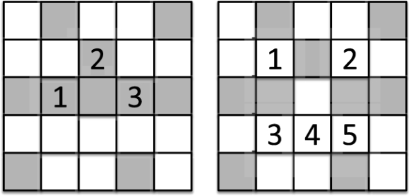

# 李雅普诺夫函数与均衡

数学之美，只会呈现给那些更有耐心的追求者。

玛丽安·米尔札哈尼

本章的主线是李雅普诺夫函数，它为判断一个模型是否必然沉淀到稳定状态提供了通用判据。李雅普诺夫函数本质上是给动态系统的每一种时点配置打分的一个实值标尺。只要系统还在变动，这个分数就必须以不小于某个正数 A 的幅度持续下滑，而且整个分数是有下界的。下降不可能无限进行下去，迟早会触底停住，那一刻就是均衡到来的时候。以局部多数模型为例，就是靠构造这样的单调递减量来确证它必然收敛。

如果一个模型可以配备起符合条件的李雅普诺夫函数，那么周期震荡、随机游走或持续复杂演化就不可能发生。更进一步，我们还能算出收敛大概需要多久，局部多数模型的构造里这一点体现得尤其清楚。

整章分六段展开。先给出李雅普诺夫函数的严格定义，再把它用在逐底竞争博弈的分析上，之后分别为局部多数模型与自组织活动模型搭建各自的李雅普诺夫函数。随后讨论为何某些交易市场可以找到这样的函数而另一些不行，并以生命游戏为例说明没有对应函数的情形。再谈在找不到李雅普诺夫函数时系统仍可能达到均衡的尴尬，最后反思均衡是否总是值得追求。

### 李雅普诺夫函数

离散动态系统由两部分构成：所有可能出现的配置集合，和把当前配置推进到下一时刻的转移规则 G。配置可以理解为生命游戏里活细胞和死细胞的整体分布，规则则是时间 t 到 t+1 的映射。

李雅普诺夫函数 F 是一个从配置到实数的映射，满足两条。第一，有下界 M，使得任一配置的得分都 ≥ M。第二，系统未处于不动点时，分数严格下降且下降幅度至少为正常数 A。形式化地说，对转移规则 x[t+1]=G(x[t])，若 F(x[t])≥M 且存在 A>0 使得当 G(x[t])≠x[t] 时有 F(x[t+1])≤F(x[t])-A，则 F 是 G 的李雅普诺夫函数。满足条件时，从任意初始点出发必存在有限时刻 t* 使 G(x[t*])=x[t*]，系统在有限步内稳定。

先看逐底竞争博弈。N 个参与者在每期选择 0 到 100 之间的支持水平，最接近平均值 2/3 的人获奖。这个设定可以用来解释为何各州倾向于削减社会支出：没人愿意显得冷血，但也不愿独自慷慨把邻州穷人吸引过来，于是大家都想略低于平均水平。

均衡是否出现取决于行为规则。假设首期随机选小于 50 的水平，此后每个人选择的水平至少为 1 且低于上一期均值的 2/3，若均值已小于零则选零。¹ 在整数情形下，所有参与者中的最大支持水平就是一个合格的李雅普诺夫函数，其下界为零，每期至少减 1，最终所有人都报零，所谓的“底”被触到。结果是糟糕的，若要避免，可由联邦统一拨款或设定最低支出底线。²

若放宽为实数区间且每个人都恰好选择上一期均值的 2/3，均值会单调递减却永远达不到零，类似芝诺悖论。要保证必然收敛，必须要求每次下降有最小阈值 A。

### 局部多数模型

对局部多数模型，取总不一致性作为李雅普诺夫函数，即所有与异类相邻的细胞数之和。需要证明单次翻转会让该总量至少减少一个固定值。

当一个细胞改变状态时，它在翻转前必定是少数派。因此它至少有 5 个异类邻居，最多 3 个同类邻居。翻转后自身的不一致性至少减少 2。邻居的贡献也要算：原本的 5 个及以上异类邻居各自的不一致性各降 1，而原本的 3 个及以下同类邻居各自的不一致性各增 1。综合来看，整个邻域的总不一致性至少下降 4。

**图 16-1 局部多数模型中总不一致性的减少**

由此可知总不一致性满足李雅普诺夫条件，局部多数模型无论从何种初始配置出发都必然收敛。收敛速度也可估算：每次翻转至少降 4，总不一致性为 100 的配置至多 25 步达到稳定，总量为 D 的配置至多 D/4 步结束。正如第十五章所说，最终的均衡往往是低效的斑块状结构，内部仍残留不少受挫细胞。

### 自组织活动模型

自组织活动模型由 A 种活动、L 个时段和 M 个人组成，每个人每天安排 L 个活动。拥挤度定义为同时选择同一项活动的人数。灵感来自谢林的《微观动机与宏观行为》，用来解释城市中为何在缺乏中央计划的情况下，交通、客流、公园停留、商店库存等会自发趋于合理。

证明收敛的关键是总拥挤度。它既有下界零，且当某人换到更不拥挤的时段时，他自身对总量的贡献下降，同时他离开的每个人的拥挤度减 1，他加入的每个人的拥挤度增 1。因为他是主动降低自身拥挤度，离开的人数一定多于加入的人数，总拥挤度至少下降 1。最终系统必定稳定。

一般情况下模型会收敛到接近最优拥挤配置。若两项活动的拥挤差异很大，通过调换时间即可降低总量。这解释了城市的自组织能力，也解释了迪士尼为何需要人工干预：游客没有时间试错，若无中央调度，部分景点会爆满而另一些门可罗雀。

### 纯交换经济

纯交换经济由具有禀赋和偏好的消费者集合构成。交易需要成本，双方收益必须超过成本才有动力。一条捷径是构造一个单调递增的量：总幸福感。每笔交易至少让双方幸福感提升不小于交易成本，而禀赋固定意味着总幸福感有上界。于是李雅普诺夫条件被满足，系统会达到均衡，只是未必有效率，仍存在帕累托改进的交易。

当交易产生负外部性时，论证失效。例如伊拉克用石油换巴基斯坦核武器，双方领导人自感更幸福，但全球安全感下降，其他国家不安。总幸福感不再单调，收敛就无保证。

办公桌与办公椅的交易提供了直观对照。随机分配后自由交易，若只看交易双方，他们会更满意，但前邻居和新邻居可能受损，负外部性导致士气反复波动，难以稳定。相比之下，椅子交易没有外部性，属于纯交换，自由交换既安全又愉快。

### 没有李雅普诺夫函数的模型

构造失败不等于系统永不稳定。生命游戏里有些配置可以找到专属的李雅普诺夫函数，如对角线初始态，每期活细胞数固定减少 2，最终全灭。另一些如“右五连”会产生复杂演化，无法找到全局单调函数。

更著名的例子是考拉兹猜想，即取一半或乘三加一法则。从小于 2^64 的所有数出发，过程都最终归于 1，但至今无人证明对所有自然数都成立。保罗·厄多斯曾说数学尚不足以处理这类问题。这提醒我们，模型只能提供可证明的结果，无法保证所有情形。

### 小结

李雅普诺夫函数既能证明均衡的存在性，也能给出收敛时间尺度。构造失败本身也有信息价值，它往往指向外部性或复杂性来源。回望模型的七大用途：推理、解释、设计、沟通、行动、预测、探索，李雅普诺夫函数在每一点上都发挥作用。它帮助我们理解为何系统会稳定、如何加速稳定、如何设计如迪士尼分时预约这类机制、为何办公桌交易不可取，以及城市自组织等令人惊讶现象背后的规律。