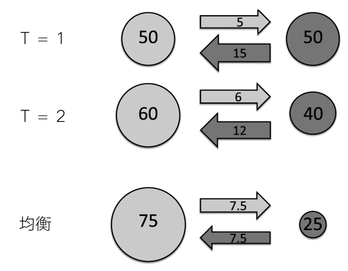
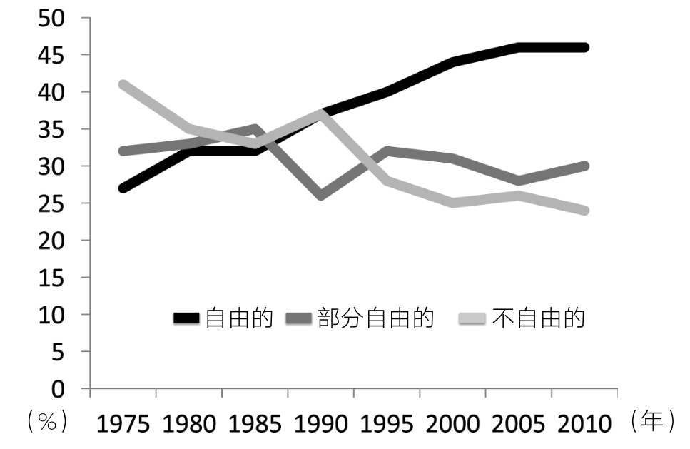
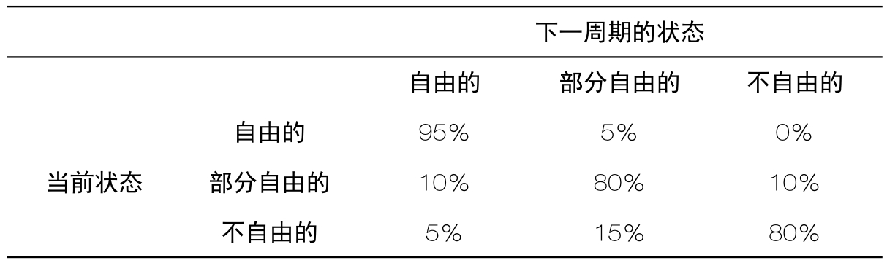
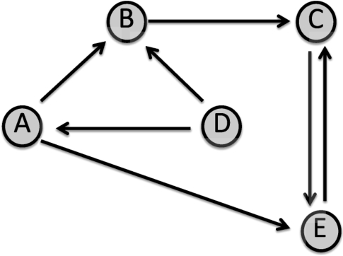
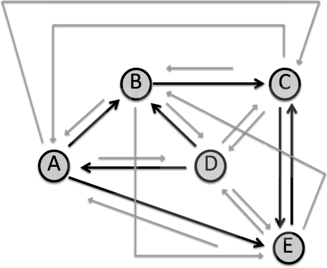
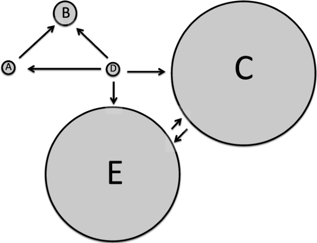
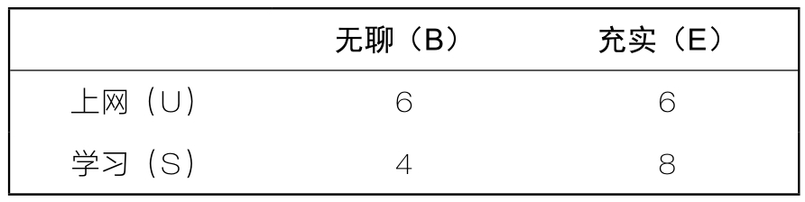
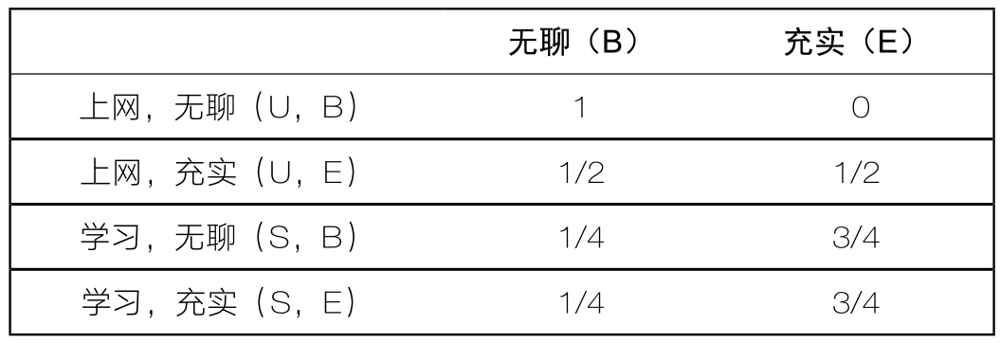

# 17　马尔可夫模型

历史是一部循环诗，由时间写在人的记忆上。

珀西·比希·雪莱（Percy Bysshe Shelley）

马尔可夫模型用来刻画以一定概率在一组有限的状态之间不断转换的系统。政治体系可能在民主制度与独裁制度之间转变，市场可能在不稳定与稳定之间变化，一个人也可能在快乐、沉思、焦虑和悲伤之间转换。在马尔可夫模型中，状态之间转移发生的概率是固定的。一个国家在某一年从专制转向民主的概率可能是 5%，一个人在一小时内从焦虑过渡到倦怠的概率可能是 20%。此外，如果系统可以通过一系列过渡从任何一个状态转换为任何其他状态，并且不存在简单的循环，那么马尔可夫模型就可以达到唯一的统计均衡（statistical equilibrium）。

在统计均衡中，单个实体可以继续在各种状态之间移动，但是各种状态之间的概率分布仍然是固定的。例如，一个关于意识形态的马尔可夫模型，统计均衡允许人们在持自由主义立场、保守主义立场和中立立场之间转换，但是秉持每种意识形态的人口比例将保持不变。在应用于单个实体时，统计均衡意味着实体处于每种状态的长期概率不会改变。例如，当一个人处于统计均衡状态时，他在 60%的时间内感到高兴，而在 40%的时间里感到悲伤。这个人的精神状态可能每小时都会发生变化，但是他在这些精神状态之间的长期分布却不会发生变化。

这种独特的统计均衡还意味着，结果的长期分布不可能取决于初始状态或事件的路径。换句话说，初始条件是无关紧要的，历史也是无关紧要的，会改变状态的干预措施也不重要。随着时间的推移，满足这些假设的过程就会“不可抗拒地”走向那一个独特的统计均衡，然后保持不变。在这里，模型再一次揭示了条件逻辑：如果世界符合马尔可夫模型的假设，那么从长远来看历史并不重要。当然，马尔可夫模型并没有说历史永远是不重要的。首先，马尔可夫模型允许结果是路径依赖的，接下来会发生的事情将取决于当前的状态。其次，马尔可夫模型还允许对历史记录进行长期建模，但对于这种情况，模型的某个假设必定会被违背。

马尔可夫模型可以应用于很多领域。我们可以用马尔可夫模型来解释动态现象，例如民主转型、战争升级和药物干预，还可以用于对网页、学术期刊和体育运动队进行排名，甚至可以用来辨别书籍和文章的作者身份。本章将介绍其中一些应用。我们将从两个简要的例子开始讨论，接着描述证明统计均衡存在性的一般定理。然后，我们转而讨论马尔可夫模型的应用。在本章末尾，会根据我们所掌握的关于马尔可夫模型的知识，重新阐述历史是如何及何时重要的问题。

### 马尔可夫模型的两个应用

马尔可夫模型由一组状态与这些状态之间的转移概率构成。在第一个例子中，我们将某个人在某一天的精神状态描述为“充实”或“无聊”。这两种精神状态就是模型的两种状态。转移概率表征在状态之间变动的概率。我们可以假设，当精神上“充实”时，一个人有 90%的机会继续停留在该状态上，同时有 10%的机会变得“无聊”；而当“无聊”时，这个人有 70%的机会继续觉得“无聊”，同时有 30%的概率变成一个精神上的“充实”的人。

假设上面这些转移概率适用于 100 名修读生物学课程的学生。在这些学生中，第一天有一半学生觉得这门课程令他们很“充实”，另一半学生则觉得很“无聊”，如图 17-1 所示。应用上述转移概率，可以预计第二天，会有 5 名原本觉得“充实”的学生（10%）会变得“无聊”，同时会有 15 名原本觉得“无聊”的学生（30%）会变得“充实”。这样就会有 60 名觉得“充实”的学生和 40 名觉得“无聊”的学生。到第三天，这 60 名原本觉得“充实”的学生中应该会有 6 名感到“无聊”，同时应该会有 12 名原本觉得“无聊”的学生变成觉得“充实”，从而导致 66 名学生觉得“充实”、34 名学生觉得“无聊”。继续运用这个转移规则，这个马尔可夫过程会收敛到 75 名学生觉得“充实”、25 名学生觉得“无聊”的统计均衡。在这个统计均衡中，学生们会继续在这两种状态之间转移，但是处于每一种状态的学生的总数将保持不变。

**图 17-1　一个马尔可夫过程** 

与此不同，假设这个过程开始时，初始状态是所有 100 名学生都觉得“充实”，那么到了第二天，将只有 90 名学生仍然觉得“充实”。到第三天，觉得充实的学生会下降到 84 名。继续迭代这个过程可以发现，从长远来看，最终仍然会收敛到 75 名学生觉得“充实”、25 名学生觉得“无聊”的统计均衡。这个模型得出了同样的统计均衡。

接下来讨论第二个例子。在这个例子中，我们将不同国家分为三个类别：自由的、部分自由的，以及不自由的。图 17-2 显示了当今世界上每个类别的国家的百分比，这个分类结果是根据美国自由之家（Freedom House）截止于 2010 年的数据（样本期间为 35 年）得出的。这幅图表示，民主化呈现出了明显的加速趋势。在过去的 35 年间，自由国家的比例上升了 20%。如果这种线性趋势一直持续下去，那么到 2040 年，所有国家中将会有 2/3 以上是自由的，而到 2080 年，将会有 8/9 的国家是自由的。

**图 17-2　对全世界国家的分类：自由的、部分自由的和不自由的国家的百分比** 

马尔可夫模型会导致不同的预测。为了进行预测，我们将每一个周期的长度设定为 5 年，并根据过去的数据粗略地校准了转移概率（表 17-1）。 ¹  

**表 17-1　民主化的马尔可夫模型转移概率** 

如果使用 1975 年时属于每个类别的国家的百分比来初始化模型，那么如我们所料，校准后的模型几乎完美地匹配了 2010 年的实际分布：48%的国家是自由的，31%的国家是部分自由的，21%的国家是不自由的（在 2010 年，这三个类别的国家的实际百分比分别为 46%、30%和 24%）。如果继续运行这个模型，那么它预测 2080 年时的情况将会是这样：62.5%的国家是自由的，25%的国家是部分自由的，12.5%的国家是不自由的。

这个马尔可夫模型的预测似乎并不乐观，原因在于这样一个事实：线性投影假设没有考虑到自由国家既可以转变为部分自由的国家，也可以转变为不自由的国家。随着越来越多的国家变成了自由的国家，从自由的国家转变为不自由的国家的数量也在增加。在现实世界中，出现这种情况的原因是多方面的。首先，实现民主要求国家财政权力机构和行政机构有很高的执行能力。借用政治学家托马斯·弗洛雷斯（Thomas Flores）和伊尔凡·努尔丁（Irfan Nooruddin）的话来说，在某些国家或地区，民主可能不容易扎下根来。 ²  在那些地方，我们有理由预期，会出现从自由国家转变为部分自由的国家的情况，马尔可夫模型也刻画了这种情况。

### 佩龙-弗罗宾尼斯定理

上面的这两个例子都会收敛到一个唯一的统计均衡，这并非偶然。任何一个马尔可夫模型，只要状态集是有限的、不同状态之间的转移概率是固定的、在一系列转移后能够从任何一个状态变换为任何其他状态，而且状态之间不存在固定的循环，就必定会收敛到唯一的统计均衡。

这个定理意味着，如果满足这四个假设，那么改变初始状态、历史和干预措施，都不能改变长期中的均衡。如果各个国家根据某个固定的概率在独裁统治和民主制度之间变换，那么对其中的某些国家强加民主制度，或对它们进行干预、鼓励民主化，从长期的角度来看不会产生什么影响。如果主流的政治意识形态的变动满足上述四个假设，那么历史也不能影响意识形态的长期分布。如果一个人的精神状态可以用马尔可夫模型来表征，那么鼓励和支持的话语都不会产生长期影响。

**佩龙-弗罗宾尼斯定理（Perron-Frobenius Theorem）** 

一个马尔可夫模型必定收敛于一个唯一的统计均衡，只要它满足如下四个条件：

**状态集有限：** *S* ={1，2，…，*K* }。

**固定转换规则：** 状态之间的转移概率是固定的，即在每个周期中，从状态 A 转换为状态 B 的概率总是等于*P* （A，B）。

**遍历性（状态可达性）：** 系统可以通过一系列转换从任何状态到达任何其他状态。

**非循环性：** 系统不会通过一系列状态产生确定的循环。

需要强调的是，从佩龙-弗罗宾尼斯定理中得出的结论不应该说明历史是不重要的，而应该是：如果历史确实是重要的，那么必定会违背模型的其中一个假设。有两个假设，即状态集有限和非循环性，几乎总是成立的。遍历性似乎有可能会被违背，就像当盟国发动战争并且不能转变为联盟时，会出现非遍历性。尽管确实有一些这样的例子，但是遍历性通常也能成立。

状态之间的转移概率是固定的这个限制是最有可能被违背的假设。因此，这个模型表明，如果历史确实是重要的，那么必定存在某种潜在的结构因素改变了转移概率（或者改变了状态集）。考虑一下帮助贫困家庭摆脱困境的扶贫政策。事实证明，导致社会不平等的那些因素通常不会受到政策干预的影响。 ³  同时，马尔可夫模型又表明，改变家庭状态的政策干预措施，例如旨在帮助成绩落后的学生的特殊帮扶计划，或者食物募捐活动，只能在短期内带来改善，不会改变长期均衡。相比之下，提供资源和培训，以提高人们保住工作的能力，进而减少从就业变为失业概率的干预政策则有可能会改变长期结果。无论如何，马尔可夫模型至少为我们提供了一些术语，使我们能够理解状态与转移概率之间的区别。它也告诉我们一个基本道理——与其改变当前状态，还不如改变结构因素，而后者更有价值。

**销量-耐久性悖论** 

销量-耐久性悖论（sales-durability paradox）说的是，产品或创意的流行程度与其说取决于它们的相对销量，不如说取决于它们的耐久性。只需要将拥有某种类型商品的人的比例设定为状态，就可以用马尔可夫模型来解释这个悖论。在这里我们考虑两种不同的地板，一种是瓷砖（耐用品），另一种是油毡（销量更大的商品）。当销量更大的商品（在这里这个例子中是油毡）不那么占主流时，就会产生这种悖论。

在我们的模型中，假设油毡的销量是瓷砖的 3 倍。为了刻画耐久性差异，假设每年有 1/10 的人必须更换他们的油毡地板，而需要更换瓷砖的人则只有 1/60。在由此而得到的马尔可夫模型的均衡中，有 2/3 的地板都是用瓷砖铺就的。 ⁴  

销量-耐久性悖论背后的逻辑，也可以用来解释市场份额与品牌忠诚度（某人改用其他品牌的产品的可能性）之间的正相关关系。在马尔可夫模型中，更低的品牌忠诚度在均衡状态时必然意味着更低的市场份额，因为忠诚度所起的作用就像耐久性一样。这种经验规律有时也被称为“祸不单行法则”（double jeopardy law）。如果一个企业的产品的品牌忠诚度较低，那么其销售量往往也较低。 ⁵  

### 一对多的马尔可夫模型

马尔可夫模型可以应用于各种各样的环境。我们可以用马尔可夫模型来对四种核酸之间的遗传漂变进行建模分析：腺嘌呤（A）、胞嘧啶（C）、胸腺嘧啶（T）和鸟嘌呤（G）。如果每种核酸都有很小且相等的概率成为其他三种类型之一的核酸，就可以写出一个刻画遗传漂变的转移矩阵。

我们也可以用马尔可夫模型对身体健康演变的轨迹进行建模，方法是将不同的健康类别（如优秀、中等和糟糕等）设定为不同状态。这样的模型可以用来评估药物治疗、行为改变和手术等健康干预措施如何转移概率和均衡分布。那些能够产生更好均衡的健康干预措施是值得追求的。 ⁶  

马尔可夫模型还可以用于识别国际危机的不同模式，并能够用于区分会导致战争的过渡与会带来和平的过渡。 ⁷  不过，在这个领域的应用要求我们估计两种不同的模型：一种模型中，危机导致了战争，另一种模型中，战争爆发前实现了和解。如果这两个模型中的转移概率有显著差异，那就可以对现有的各种模式进行比较，例如轰炸、劫持人质、不交换囚犯以及逐步升级的强硬姿态等，然后看哪个过程对数据的拟合更优。

这种通过马尔可夫模型将不同模式区分出来的方法，还可以用来辨别书籍或文章的作者。只要事先已经确定了某个作者的某些已知著作，就可以估计出一个词之后出现另一个词的概率。例如，在本书中，单词 the 跟在 for 后面的次数，相当于单词 example 跟在 for 后面次数的四倍。我们可以将这类信息表示为一个大转移概率矩阵。本书的矩阵看上去肯定与其他人的书的矩阵有所不同。如果为 Melville（梅尔维尔）和 Morrison（莫里森）分别构建单词转移矩阵，那么我们肯定会看到它们在单词对之间的转换是不同的。 ⁸  

运用这种方法，我们可以通过构建模型来确定《联邦党人文集》（*Federalist Papers* ）所收录各篇文章的作者。《联邦党人文集》共收录了 85 篇文章，分别由亚历山大·汉密尔顿（Alexander Hamilton）、约翰·杰伊（John Jay）和詹姆斯·麦迪逊（James Madison）在 1787 年和 1788 年写成，目的是说服当时的纽约州民众支持美国宪法。每篇文章的署名，都用了统一的笔名“Publius”。尽管大多数文章的真正作者都已经确定了，但仍有少数几篇文章一直存在争议。

一项利用马尔可夫模型来辨别作者的研究认为，所有有争议的文章都是詹姆斯·麦迪逊写的。 ⁹  即使汉密尔顿或杰伊写了这些文章，他们也是在模仿麦迪逊的风格。对哲学家阿琳·萨克森豪斯（Arlene Saxonhouse）发表的 4 篇论文和未发表的 12 篇短篇论文的分析结果表明，其中至少有 3 篇论文都有很高的概率可以归入霍布斯名下。 ¹⁰  当然，在这两个例子中，模型都不一定能给出准确的答案。但是，这些模型确实生成了知识。我们要依靠自己的智慧做出判断：对这个模型与其他模型或直觉结论，该如何进行权衡。

我们要讨论的最后一个应用，是谷歌公司如何运用马尔可夫模型构造谷歌最初的网页排名（PageRank）算法。网页排名是万维网的搜索方式。 ¹¹  万维网由链接连接起来的网站组成，为了估计出每个站点的相对重要性，可以计算一个站点连入和接出的链接数量。在图 17-3 所示的站点网络中，站点 B、C 和 E 各有两个链接，A 有一个链接，D 没有链接。这种方法提供了对重要性的粗略估计，但是它有很大的缺陷。站点 B、C 和 E 都有两个链接，但是站点 E 看上去似乎比站点 B 更加重要，这是由它在网络中的位置决定的。

**图 17-3　万维网上站点之间的链接** 

网页排名算法将每个站点都视为马尔可夫模型中的一个状态。如果两个站点共享一个链接，那么就在这两个站点之间分配一个正的转移概率。我们暂且为任何链接分配相等的概率，也就是说，假设在 A 上的搜索者有同样的可能性移动到 B 或 E 上。如果搜索者来到了 E 上，那么将永远交替出现在 C 和 E 之间。或者，如果搜索者选择了 B，那么他还是会去 C，然后再一次开始在 C 和 E 之间交替出现。实际上，从任何站点开始都会导致交替出现在 C 和 E 之间这个结果。我们发现 C 和 E 似乎是更加重要的站点。然而不幸的是，这个模型不满足佩龙-弗罗宾尼斯定理的两个假设。该系统无法从任何站点到达任何其他站点：无法从 C 到达 D，转移概率在 C 和 E 之间创建了一个循环。

为了解决这两个问题，谷歌公司的算法加入了一点：从任何站点都能够以一个很小的随机概率移动到任何其他站点，如图 17-4 所示。现在，这个模型就满足佩龙-弗罗宾尼斯定理的所有假设了，而且存在唯一的均衡。于是，所有站点都可以根据它们在那个均衡中的概率进行排序。一个从 A 开始的搜索者，最有可能在几次搜索后以到达 C 或 E 结束。一旦到达 C 或 E 之后，他将会在这两个站点之间反复来回，直到尝试前往一个随机站点为止。如果他到了 A 或者 D，那么回到 C 的路径很可能会经过 B 或者 E。因此，B 的排名应该高于 A 或 D。图 17-5 所示的唯一统计均衡表明，这个结论是正确的。A、B 和 D 都很少被访问，其中，B 的访问量最大。

**图 17-4　在站点之间添加随机移动** 

**图 17-5　网页排名模型的统计均衡** 

网页排名可以看作随机游走与马尔可夫模型的组合。如果将网页排名视为一种算法，就会发现可以用它来生成任何网络的排名。我们可以让节点代表棒球队或足球队，再用转移概率表示一支球队击败另一支球队的时间百分比。 ¹²  如果球队之间只打一场比赛，那么可以根据胜率来分配转移概率。由此而得出的排名虽然不是最终的，但却是对专家主观评估意见的有益补充。我们还可以利用食物链数据，通过网页排名算法来计算物种之间的相对重要性。 ¹³  

### 小结

马尔可夫模型描述了以固定的转移概率在不同状态之间转换的动态系统。如果再假设这个过程能够在任何两个状态之间转移，并且这个过程不会产生循环，那么马尔可夫模型就可以得到唯一的统计均衡。在均衡中，人或实体在各个状态之间移动，但是各个状态的概率分布不会发生改变。由此可见，当一个过程接近均衡时，概率的变化就会减弱。用曲线图表示，就表现为曲线的斜率走平。回想一下，我们在讨论线性模型时对美国加利福尼亚州人口增长的讨论。加利福尼亚州的人口增长已经放缓，因为随着人口的增长，离开加利福尼亚的人数也在增加。即便离开的人数所占的比例没有发生变化，这个结论也是成立的。

在应用马尔可夫模型解释现象或预测趋势时，建模者对状态的选择至关重要。状态的选择决定了这些状态之间的转移概率。一个简单的关于药物成瘾行为的马尔可夫模型，可能只需要呈现两种状态：或者是药物成瘾者，或者是正常的人。而更精细的模型则可以根据使用频率来区分药物成瘾者。无论对状态的选择如何，如果上面的四个假设都成立（并且在这种情况下，关键检验将变为转移概率是不是能够保持固定不变），那么系统将会存在一个唯一的统计均衡。系统状态的任何一次性变化都最多只能产生一些暂时性的影响，减少均衡中的药物依赖必须改变其转变概率。

按照同样的逻辑，我们可以推断，那些试图通过为期只有一两天的活动来激发学生学习兴趣的做法，可能不会产生什么有意义的影响。与此类似，进入社区“送温暖”、来到公园“捡垃圾”的志愿者也可能无法带来什么长期收益。任何一次性的资金涌入，无论其规模大小，影响都会消失，除非它改变了转移概率。2010 年，马克·扎克伯格（Mark Zuckerberg）向新泽西州纽瓦克市的公立学校捐赠了 1 亿美元，并吸引了不少跟风捐赠者。这种一次性捐赠，尽管摊到每个学生头上达到了大约每人 6 000 美元，但对考试成绩却几乎没有产生任何可衡量的影响。 ¹⁴  

马尔可夫模型是通过区分以下两类政策来指导行动的：一类政策能够改变转移概率，而改变转移概率可以产生长期影响；另一类政策只能改变状态，并且只能产生短期影响。如果转移概率无法改变，那么我们必须定期重置状态才能改变结果。沉溺于辛劳工作可能会产生导致好强、自私和压抑的心理状态转移概率，而每天锻炼、冥想或参加宗教活动则可能帮助人们以一个感恩的、富有同情心的、放松的心理状态迎接每一天。周末休息也有类似的功能，已婚夫妇不时过一过约会之夜也有很好的效果。这两者的共同作用是，能够暂时使一个人的状态远离均衡。

当然，并不是每个动态系统都满足马尔可夫模型的假设。在不满足马尔可夫模型假设的情况下，历史、干预政策和事件都可能会产生长期影响。例如，在波利亚过程中，结果改变了长期均衡。对系统的重大干预或冲击可能会改变转移概率甚至是整个状态集。蒸汽机、电力、电报或互联网等重大技术变革，改变了经济的可能状态集。重新界定权力架构或制定新政策的政治和社会运动，也会改变状态集。因此，我们也许更应该将历史视为一个马尔可夫模型序列，而不是视为一个向不可避免的均衡方向发展的过程。

**马尔可夫决策模型** 

马尔可夫决策模型（Markov decision model）是对马尔可夫模型的一种修正，方法是将行动包括进来，行动会带来回报，而回报则以状态为条件，还会影响状态之间的转移概率。考虑到行动对转移概率的影响，最优行动并不一定是能够最大化即时回报的那个行动。

例如，要在上网与学习这两个行动之间做出选择。上网总能带来相同的回报。而当学生选择学习时，则有两种可能，既可能觉得充实，也可能觉得无聊。如果觉得充实，学习就可以获得高回报，如果觉得无聊，学习就只能获得低回报。

为了加入行动对转移概率的影响，假设一个觉得学习无聊的学生转为在上网时，仍然会处于无聊状态；而一个觉得学习充实的学生转为在上网时，有一半的时间会变得无聊。假设一个学习的学生有 75%的机会在下一个时期处于觉得充实的精神状态，而无论他当前的状态如何。于是：

**行动：** 上网（U），学习（S） 

**状态：** 觉得无聊（B），觉得充实（E） 

**奖励结构** 

**转移映射** 

马尔可夫决策模型的解决方案由每个状态下采取的行动构成。之前讨论过的短视最优反应行为，在每个状态下都选择能够最大化奖励的行为。在现在这个例子中，这种选择对应于无聊时上网、精神充实时学习。

但是，这种短视的解决方案会导致学生陷入无聊状态。一旦发生了这种情况，他们就会选择上网，并在所有剩余时间内一直保持无聊状态。因此，他们的长期平均回报等于 6。而总是选择学习的解决方案则会在他们 75%的时间里处于充实状态，只在 25%的时间里处于无聊状态，从而得到的长期平均回报为 7。这个解决方案产生了更高的平均回报，因为他们更多地处于充实的精神状态。

正如这个例子所表明的，将一个决策问题表达为一个马尔可夫决策模型，可以告诉我们更好的行动是什么。通过考虑行动对状态的影响，我们会做出更明智的选择。晚睡与早起和锻炼相比，会产生一个更高的直接回报，购买昂贵的咖啡比自己动手制作咖啡产生更高的回报。然而，从长远来看，我们可能会更乐于坚持锻炼和节省咖啡钱。那么，我们需要一个模型吗？不一定。相反，我们也许只需要时时记起《圣经·箴言》21:17 就可以了：“爱宴乐的，必致穷乏；好酒爱膏油的，必不富足。”这可能是对的；但是我们同时可能记得《圣经·传道书》8:15 所说的：“我颂赞喜乐，因为世人在天日之下再好不过的，就是吃喝欢乐。”是的，我们总能找到一对相反的谚语。通过将我们的选择嵌入马尔可夫决策模型中，可以使用逻辑来确定在给定的情境下，哪些常识性的建议真的有用。