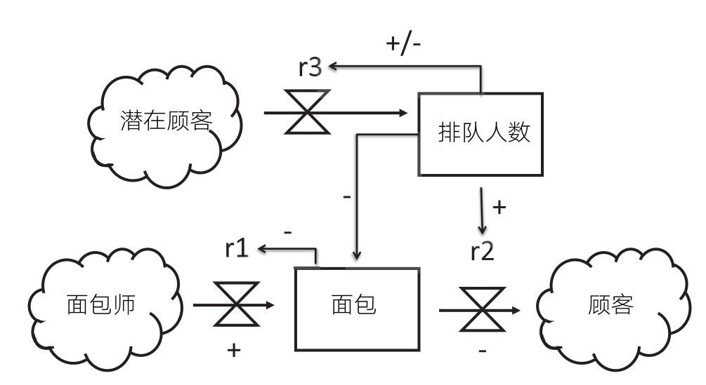
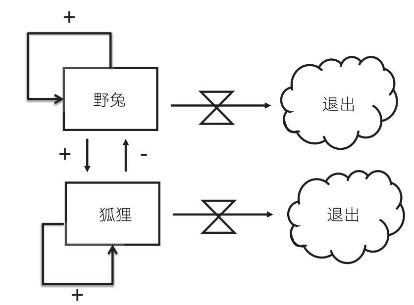
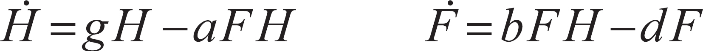
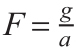
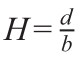
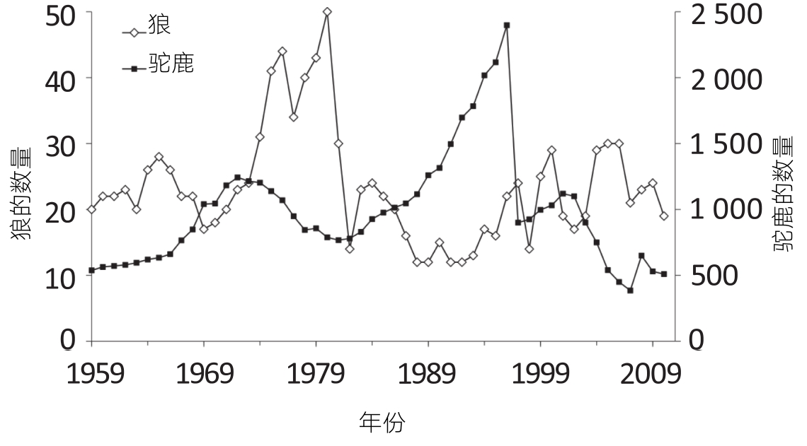
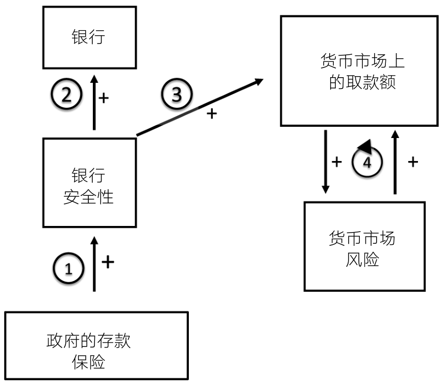

# 18　系统动力学模型

我们尚未充分理解支配系统行为的原理。

杰伊·赖特·福雷斯特（Jay Wright Forrester）

在本章中，我们将介绍一系列系统动力学模型。 ¹  这些模型可以分析那些有反馈和相互依赖性的系统，可以用于对生态和经济、供应链和生产过程建模。系统动力学模型提高了我们通过包含正反馈和负反馈的逻辑链进行思考的能力。系统动力学模型通常要包括源（source）、汇（sink）、存量（stock）、流量、速率和常数等组成部分。源产生对系统的输入，汇吸收输出，存量跟踪变量的水平，流量刻画各存量水平之间的反馈，速率和常数用于流量，流量可以是随时间变化的，也可以是固定不变的。

系统动力学模型可以同时包括正反馈和负反馈。当变量或属性的增加导致同一变量或属性的更大增加时，就会出现正反馈，第六章中讨论的马太效应就是如此，成功会带来更大的成功，畅销会带来更大的畅销。就学术论文和专利而言，引用会导致更多的引用。

负反馈会抑制趋势。我们必须小心，不要从“负”这个词的字面含义推出任何规范性的含义。负反馈往往能够带来理想的属性，防止泡沫和崩盘。当我们吃东西吃到饱时，大脑会收到停止进食的信号；当企业的利润超过了正常的经济回报时，竞争者就会进入，使在位者的利润减少并防止他们剥削消费者；当一个物种过度繁殖时，它的成员会为食物展开竞争，从而使增长率下降。在这些情况下，负反馈都有助于系统层面的鲁棒性。

使用系统动力学模型，我们通常可以确定复杂性的原因。当系统既包括正反馈又包括负反馈时，就会产生复杂性。在生命游戏中，活元胞会导致新元胞变活，但是过度拥挤又会导致元胞死亡。

这些模型可以将流量和存量水平表示为数学函数。我们可以校准这些定量模型，以便解释过去的存量值、预测未来值，同时估计干预措施的影响。然后，我们就可以利用这些模型解释、预测和指导行动。这些模型也可以是定性的，可以用加号或减号标记每个箭头以表明内在逻辑。 ²  

本章内容由五部分组成。在第一部分中，为了引入系统动力学的术语体系，我们先构建了一个定性的面包店模型。在第二部分中，我们构建了一个基于洛特卡-沃尔泰拉方程（Lotka-Volterra equation）的捕食者-猎物模型。我们这个版本假设了存在狐狸和野兔两个相互作用的种群，并同时嵌入了负反馈和正反馈。在第三部分中，我们阐述了如何利用系统动力学模型来预测恶性循环。在第四部分中，我们描述了 WORLD3 模型，它是一个关于全球经济的巨型模型。最后，在本章的结论部分，我们讨论了系统动力学模型为什么经常会产生违反直觉的结果，这些结果证明了人类直觉推理的局限性和模型作为逻辑辅助工具的价值。

### 系统动力学模型的各个组成部分

任何一个系统动力学模型都由源、汇、存量和流量组成。源产生存量；存量是某个变量的数量或水平；流量描述了存量水平的变化；汇能够捕获来自存量的流量输出；汇和源是不包含在模型中的过程的“占位符”；存量水平会根据源和流量随时间推移而变化。例如，在一个关于游乐园的系统动力学模型中，公园中的人（一个存量）的人数会随着人们的到来（一个源）而增加，而增加的速度可能又取决于其他参数，例如天气状况、广告投入和门票价格等。

系统动力学模型使用如图 18-1 所示的表征系统。源和汇用云表示，存量用方框表示，流量用箭头表示并附以加号或减号标识，可变流量用倒三角形表示，而不变流量则用被流量箭头对穿的圆圈表示。正箭头表示正反馈（更多会带来更多），负箭头表示从一个变量到另一个变量的负反馈。

**图 18-1　系统动力学模型的组成部分** 

为了让读者尽快熟悉这套符号，在这里先给出一个由面包师、面包和顾客组成的简单的面包店系统动力学模型：面包师制作面包，顾客购买面包。如果面包师生产面包的速度超过了顾客购买面包的速度，面包的库存量就会增加，面包店将会堆满面包。或者，如果卖出面包的速度超过了面包师生产面包的速度，面包店将永远处于卖光的状态。为了使模型更加真实，我们可以假设让面包师根据面包的存量来调整面包生产的速度，如图 18-2 所示。在这幅图中，包括了一个从面包库存量到面包师生产面包的速度的流量（一个箭头）。我们在这个箭头上放了一个负号，以表示随着面包库存量的增加，生产面包的速度会下降。如果适当地调整速度，模型将产生一个均衡，使面包生产速度收敛于顾客购买面包的速度。

**图 18-2　一个关于面包店的系统动力学模型** 

为了使模型更加真实，还可以加入第二个存量排队长度，它等于在面包店外等待的人数。然后再加入第二个源，即潜在顾客，它会增加排队的人数。排队长度较短或适当，可能会吸引更多顾客，而过长的排队长度则会让客户流失，导致他们调头而去。为了刻画排队长度对来自源到达速度的影响的这种可变性，我们在这个箭头上方标记了（+/-）的符号，还在从排除存量线条到顾客购买面包速度的箭头上方加了一个加号，表示排队的人越多，客户购买面包时做决策的速度越快，如图 18-3 所示。

**图 18-3　一个更加精细的关于面包店的系统动力学模型** 

这个模型可以根据数据进行校准。我们可以估计出人们根据排队长度加入排队队伍的速度。然后，面包师可以根据面包存量和排队长度确定烘焙的最佳速度。这个速率将提供一个起点，从中可以获得更好的速率。即使没有校准，编写模型的行为本身也增加了价值。面包师很清楚排队的长度对整体销售量的重要性。

### 捕食者-猎物模型

我们现在介绍捕食者-猎物模型，这是一个用来刻画野兔数量（猎物）与狐狸数量（捕食者）之间关系的生态模型。这个模型包括两个正反馈：野兔生下野兔、狐狸生下狐狸。它还包括一个负反馈：狐狸吃野兔。该模型假设野兔的存量水平很高，狐狸会产生更多的后代。图 18-4 定性地表示了这些假设，但没有量化关系。从图中可以看出，随着狐狸数量的增加，野兔数量的减少，从而又导致狐狸数量减少。而随着狐狸数量的下降，野兔数量应该增加，进而导致更多的狐狸。逻辑表明了循环的可能性，也可能是均衡，但我们无法确定。

**图 18-4　捕食者-猎物模型的系统动力与模型** 

为了更加深入地了解到底发生了什么，我们需要构建出这个模型的定量版本。假设流量是线性的，取决于存量水平。再假设在没有狐狸的情况下，野兔的数量以固定的速度增长，而在没有野兔的情况下，由于缺乏食物，狐狸的数量以固定的速度减少。再假设，在这个模型中，野兔和狐狸相遇的概率与狐狸数量乘以野兔数量的积成正比。为了捕捉发生这种相互作用时吃野兔的狐狸的行为，假设狐狸的数量以某个恒定的速度乘以上述乘积的速度生长，同时野兔的数量则以某个恒定的速度乘以上述乘积的速度减少。由此而得到的方程就是通常所称的洛特卡-沃尔泰拉方程。

**洛特卡-沃尔泰拉方程** 

假设一个生态系统由*H* 只野兔和*F* 只狐狸构成。野兔的数量以*g* 的速度增长，狐狸的数量则以*d* 的速度减少。当野兔和狐狸相遇时，野兔以*a* 的速度死亡，狐狸以*b* 的速度增长。根据这些假设，可以给出如下微分方程组： ³  

从这个微分方程组可以推导出两个均衡，一个是灭绝均衡，即*F* =*H* =0；一个是内点均衡，即和给出。

这两个微分方程分别描述了野兔和狐狸的数量随时间而发生的变化。当方程等于零时，野兔和狐狸的数量不再改变，系统处于均衡状态。第一个均衡，即灭绝均衡（extinction equilibrium），是说野兔和狐狸都不复存在。因此，这个模型预测，在一定条件下，捕食者-猎物这种关系会导致两个物种同时灭绝。当然，不是所有情况下都会发生这种事情，不然的话，地球上也就不会有任何物种存活了。

第二个均衡是内点均衡（interior equilibrium）。在内点均衡中，狐狸和野兔的数量均为正。在这种均衡状态下，狐狸的数量随野兔的增长速度而增加，但是如果狐狸和野兔之间的每次相遇都会导致野兔种群规模以更快的速度减少的话，狐狸的数量就会减少。这两个结果都很直观：如果野兔繁殖更快，那么这个生态系统可以养活更多的狐狸；如果每只狐狸都需要更多的野兔才能活下去，那么这个生态系统就只能养活更少的狐狸。两个结果都符合我们的直觉，我们想要的也正是这样的结果：模型应该能产生符合直觉的结论。

但模型也应该能够产生不那么直观的结论。幸运的是，这个模型也正是如此。它表明，狐狸的均衡数量完全不依赖于狐狸的死亡率。如果狐狸以更快的速度死亡，野兔的均衡数量就会增加，剩下的狐狸的食物就会更加丰富，而这就意味着狐狸的增长速度更快。狐狸的快速增长速度恰好抵消了狐狸更高的死亡率。

类似的逻辑同样适用于野兔种群。野兔的均衡数量不依赖于野兔的增长速度，也不依赖于野兔被狐狸吃掉的速度，相反，野兔的数量取决于狐狸的死亡速度和狐狸将野兔吃掉“转化为”更多狐狸的速度。对于这些结果，直觉“失败”了，因为我们无法直观地想清楚这里面的反馈机制。野兔增长速度提高的直接影响是会有更多的野兔，间接影响是会有更多的狐狸，而这又意味着更少的野兔，这两种效应会相互抵消。能够得出像这样的非直观结论，正是系统动力学模型的标志特征。直觉在这里“失败”了，因为我们只锁定了直接影响而未能思考整个逻辑链。即便增加（或减少）速度或流量的直接影响是增加（或减少）存量，系统以正反馈和负反馈的形式产生的影响也意味着，其他存量的值也会发生改变，因此速度或流量变化的净效应可能会减少、会被抵消，甚至可能会被逆转。

通过数学演算，我们可以证明洛特卡-沃尔泰拉方程存在这两个均衡，但是并不知道这两个均衡当中哪一个会实现。确实，如果模型在一开始就处于某个均衡状态，那么它将保持在那个均衡状态。但在运行模型之前，我们并不知道这个方程组是否将会产生均衡、周期性、随机性，抑或复杂性。我们所知道的只是，均衡的确存在。

对方程的模拟会产生滞后循环（lagged cycles）。首先，其中一个物种变得“人口众多”，然后，它的数量开始减少，另一个物种的数量开始增加。实证研究表明，这种循环确实很常见。图 18-5 显示了位于苏必利尔湖中的一个纵长 72 千米的名为罗亚尔岛（Isle Royale）的岛屿上，狼（捕食者）的数量与驼鹿（猎物）的数量 50 年来一直处在此消彼长的过程中。不难注意到，捕食者和猎物物种规模的波动，都呈现出了滞后循环的特征。由于模型省略了地理因素、其他物种的影响、天气的变化、物种内部的异质性等，因此其模式并不像我们预期的那么规则。

**图 18-5　罗亚尔岛上的狼和驼鹿** 

对洛特卡-沃尔泰拉方程的上述分析进一步支持了我们早先的观察结论，也就是不应该将均衡的存在与均衡的实现混为一谈。在图中所示的这种情况下，系统产生的是循环而不是均衡。不过，动态循环是围绕着均衡发生的。因此，均衡可以告诉我们，狐狸和野兔的数量平均来说是多少。由此可见，我们早先得到的违反直觉的结果，也就是提高狐狸（或野兔）的增长速度对狐狸（或野兔）的均衡规模没有影响，在总体层面上仍然是成立的。

### 系统动力学模型的应用

系统动力学模型既可以包括正反馈回路，也可以包括负反馈回路。正反馈回路会导致良性循环，例如，当两个国家之间的信任度提高，会导致贸易上升、军事对抗减少，从而进一步增进信任。但是，正反馈回路也可能导致恶性循环，例如，某个地区就业机会的减少，可能会削弱人们学习掌握技能的动力，而这反过来又可能导致企业由于缺乏合格的劳动力而迁离这个地区，进而进一步减少工人去努力获得技能的动力。

系统动力学模型可以帮助我们预测恶性循环。2008 年，许多国家的经济都面临着严重的金融压力。当资产价格下跌时，过度杠杆化的银行离破产只有一步之遥，投资者和储户开始担心他们投资的安全。有些国家，如美国，只在一定限度内对银行存款进行保险；而在其他一些国家，例如在澳大利亚，则根本不存在存款保险。

为了防止恐慌，澳大利亚决定引入存款保险制度。逻辑上看似乎是合理的：对存款保险可以防止银行挤兑。但是，这种想法其实只考虑到了系统的一部分。在引入存款保险制度的过程中，这种制度本身的一个缺陷会导致悲剧性的后果。如果把相关的系统动力学模型写出来，这一缺陷就会变得很明显。在关于金融系统的系统动力学模型中，每个银行（都是一个存量）都有一定的资产规模。储户将钱存入银行并获得一定回报，银行的借款人用这笔钱进行投资。存款保险制度保证存款人放在银行的资金的安全。

此外，人们还会将资金投入股票市场和货币市场基金。每种类型的投资都是存量。一旦我们开始在各种存量之间绘制箭头，即存量之间的流量，存款保险这种制度的缺陷就会变得很明显。存款保险制度的直接影响能够提高银行的安全性，从而使银行更具吸引力（图 18-6 中的箭头 1）。但是，它同时还会使其他类型的投资变得不那么有吸引力。想象一下，假设在那个动荡的金融危机时期，你自己是一个投资者，在银行和货币市场上都投入了一定资金。现在，你的银行存款已经投保了，但是你的货币市场基金则没有。因此，谨慎的行动是增加银行存款（箭头 2）并退出货币市场（箭头 3）。

**图 18-6　金融系统的系统动力学模型** 

随之而来的是一个恶性循环：货币市场投资的减少使它的风险增加，而风险增加又导致更多的资金从货币市场撤出，从而形成了一个正反馈回路（图 18-6 中的循环路径 4）。撤出资金提高了风险，而风险的上升又会导致更多的提款，从而导致更大的风险。这个政策似乎肯定会造成货币市场的崩溃，现实也确实如此。在决定为银行存款提供保险的短短四天之后，政府就不得不冻结了货币市场上的所有账户，不然整个行业都会彻底崩溃。显然，这个决定带来了灾难性的后果。数以百万计的退休人员，都需要从这些账户中提取资金去购买食品、交纳房租，支付其他基本必需品。 ⁴  

虽然从“事后诸葛亮”的角度来看，这种恶性循环似乎是显而易见的，但是我们其实无法保证，即使澳大利亚的决策者当时已经构建了一个系统动力学模型，他们明白采取这项政策会带来的恶劣后果。重要的是，写出这样一个模型，至少有可能会帮助他们看到，银行存在保险制度会在金融体系内产生更加广泛的影响。如果是这样，他们应该是有可能会注意到这个恶性循环的。这个例子还说明了数据的局限性。来自其他国家的数据表明，保险存款制度有助于稳定金融体系。但是，在这些国家，存款保险制度并不是在金融危机期间创立的，因此这种经验数据对澳大利亚当时的政策选择没有意义。

### WORLD3 模型

接下来，考虑一个更复杂的涵盖了全球经济的系统动力学模型，这个模型通常被称为 WORLD3 模型。WORLD3 模型最早出现于 20 世纪 70 年代，当时这个模型预测世界经济行将崩溃，除非各国政府改变自己的经济增长政策和环境政策。 ⁵  WORLD3 模型包括了在一个共同的框架内以不同速度增长的多个彼此互动的过程，因而利用它，决策者能够看到各种各样的相互依赖关系。 ⁶  但是，主流经济学家往往不看重 WORLD3 模型，因为在他们看来，这个模型一方面过于复杂，另一方面又没有考虑到经济行为主体的理性反应。

这个模型假设，人口和经济产出每年以某个不变的百分比增长，但是经济产出会造成污染。随着时间的推移，土地的生产力下降，人口规模将超过经济提供商品的能力限度，那时世界经济就会崩溃。这个预测不禁让我们联想到托马斯·马尔萨斯在差不多两个世纪前提出的那个可怕的警告。

这个模型包含了大约 150 个变量、300 个方程和 500 个参数，生育率、经济增长率和土地使用率等无不包括在内。要校准这个模型，必须根据数据估算出这些参数的增长率。WORLD3 模型还包括了变量之间的相互作用，这意味着多个参数的变化通常会产生非线性效应。因此，检验模型的鲁棒性需要不断尝试同时更改两个变量、三个变量的多种组合。500 个参数可以产生超过 12 000 个参数对和超过 2 000 万个参数三元组。对任何人来说，这无疑都太多了。

这个模型的预测是，到 2100 年，全世界人口将会减少到 40 亿。不过，约翰·米勒（John Miller）发现，只要调整两个参数——分配给消费的工业产出比例和女性的生育周期长度，就能够使模型预测的世界人口几乎增加一倍，即达到 74 亿。正反馈带来了巨大的增长。更长的生育周期意味着更多的孩子，他们又需要更多的食物。增大食物在产出中的份额可以让更多儿童生存，生存下来的女性有更长的生育周期，于是生下来的孩子更多。最终结果将是人口大规模增长。 ⁷  

参数的小小变化，就会导致人口增加一倍，这个结果会带来很多麻烦。不过，结果依赖于参数这个事实本身并不是一个弱点。相反，构建这个模型的目的就是为了指导行动、帮助识别有效的政策。例如，这个模型证明，降低生育率能够降低人口增长速度（事实证明确实如此）。再者，由于这个模型已经经过了校准，因此它还可以给出人口增长速度到底可以减少多少的估计值。因此，我们可以将这个模型包括在一个模型集合中，以便得到更加准确的预测。

随着时间的推移，这个模型最初的预测变得不那么准确了，部分原因是随着人口的增长，人口增长率已经放缓，它们不再符合模型的假设，这正是经济学家早就预料到的一种适应性反应。 ⁸  虽然 WORLD3 模型的倡导者接受了这种批评，但是他们也指出，这个模型的许多预测，包括与经济增长和世界总人口有关的预测都是非常准确的。至于生育率的降低，这个模型的倡导者认为，如果 WORLD3 模型的失效是它自己的原因所导致的——因为这个模型使人们认识到了人口过剩问题的严重性和环境的重要性，他们对这种错误的态度是乐见其成的。

### 小结

在构建系统动力学模型时，我们选择了关键的组成部分（存量），描述了这些部分之间的关系（流量）；然后我们用系统动力学模型进行模拟实验，以发现它的含义。这些模型与马尔可夫模型的不同之处在于，在这里速度是可以调整适应的（它起到了转移概率的作用）。因此，这种模型不一定会达到均衡。我们必须运行模型才能看清楚会发生什么。此外，因为不必求解结果，所以也不用担心假设的易处理性。

系统动力学模型可以包含许多变量，而且可以包括这些变量之间任何类型的反馈。我们当然也可以构建不存在这些东西的模型，但是一旦绘制出了定义存量的方框，建模者就几乎无法在它们之间绘制出一些箭头来。建模者觉得自己有义务追问：“还有哪些其他变量也可能会受到影响？这些变量的变化又如何反馈回当前的模型中？”这些问题会带来更加精细的模型。

当然，这种灵活性也可能是需要付出代价的：创建的存量和流量越多，模型就会变得越难以理解。构建一个有用的系统动力学模型的“艺术”体现在，既要包括足够多的细节来揭示我们的直觉哪里行不通，但是也不能包括过多的细节，以至于会创造一个像现实世界一样混乱的泥淖。最有用的系统动力学模型都位于那个边界上。这些模型可以揭示出意想不到的效应，并有助于更好地采取政策行动。正如在本章前面的内容中看到的，即使是意图极好的政策，例如澳大利亚政府推出的存款保险制度，也可能会产生不良后果。

系统动力学模型还阐明了负反馈回路会怎样限制干预政策的效果。强制要求汽车增加安全功能的法律，例如安装防抱死制动系统或安全气囊，可能会导致人们更加鲁莽地开车，进而导致更多人受到伤害。道路加宽可能会导致更多人搬到郊区，从而进一步加剧拥堵。减少香烟中的尼古丁含量则可能会导致吸烟者消费更多的香烟。为性传播疾病开发更好的治疗方法可能会使人们更容易做出不安全的性行为。这样的例子不胜枚举。 ⁹  从事后回顾的角度来看，这些负反馈中有许多似乎都是显而易见的，但是要想提前做出预测，可能就不是一件容易的事情了。写出一个定性的系统动力学模型能够使这些反馈回路变得清晰，从而帮助我们成为更好的思考者。

系统动力学模型会鼓励我们把反馈包含进模型中，这个事实恰恰是这种方法的优势所在。1696 年，英国国王威廉三世推出了一项宅基地税，规定每栋房子的基本税率为两先令，另外还根据窗户的数量收取额外的税收：窗户数量在 10 扇至 20 扇的房子要额外缴纳 4 先令的税，窗户数量超过了 20 扇的房子则要额外缴纳 8 先令的税。国王之所以要对窗户征税，是因为它们是可观察的（可以客观地加以测量），并与住房价值相关。如果国王依赖对房子不动产价值的评估，就会出现很多偏袒和贿赂现象。这种对窗口征税的方法是一个好主意。因此在接下来的一个世纪里，这个方法传播到了法国、西班牙和苏格兰。直到 1926 年，法国才最终废除了窗口税。

作为模型思考者，我们有理由预期有目的会适应的人们会对税收政策做出反应。当然，他们确实以各种各样的方法做出了反应。有些人把房屋上原有的窗户用砖头砌上了。聪明的建筑师很快就提出新的住房结构设计。在这种税收期间建造的许多中产阶级住宅，二楼卧室都没有窗户。在爱丁堡，有一大排房子的卧室完全没有窗户。 ¹⁰  于是税收收入随之下降了。在这里，坎贝尔定律再一次发挥了作用：政客们制定了一个制度，但是人们找到了“绕过它”的方法。更精细的系统动力学模型应该还会考虑到窗口减少带来的影响。它将包括从被称为“窗口”这种存量到其他性质的箭头，例如民众的健康——民众的健康会因缺乏新鲜空气和日照而受到损害。

系统动力学模型的巨大价值部分在于，它们能够帮助我们深入思考自己行动的影响。我们通常都能够考虑到政策的直接影响：对窗口征税能够增加收入；安装防抱死制动器能够挽救生命。但是我们并不一定随时都会考虑到间接影响，也就是各种正反馈和负反馈。这些模型恰恰能帮助我们更清晰、更深入地进行思考。