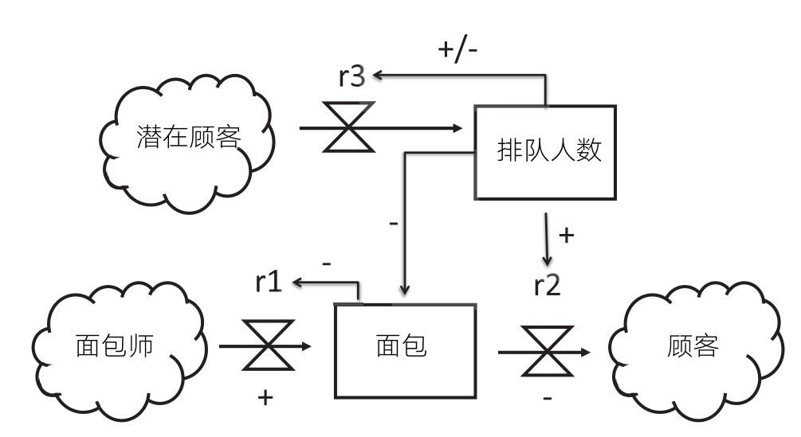
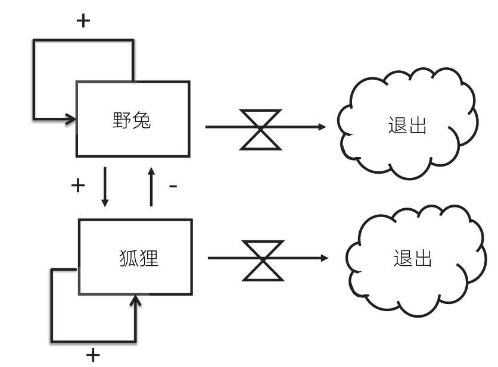
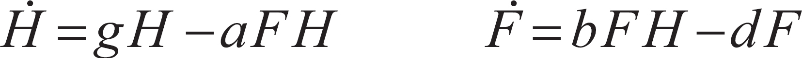
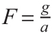
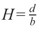
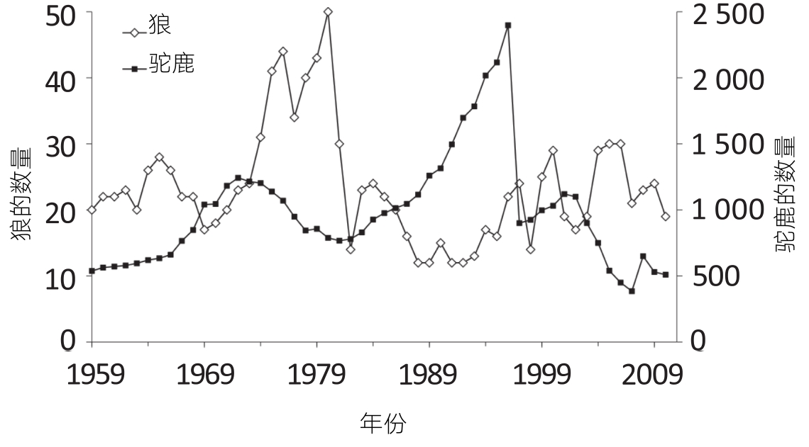
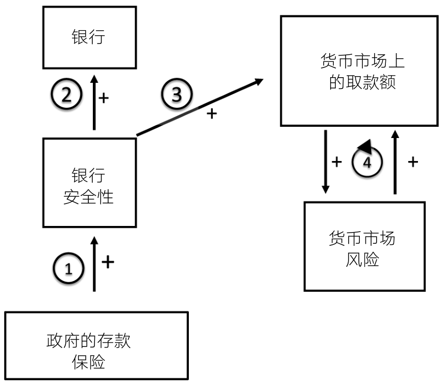

复杂世界的运行，很少是单一变量的独白，更多时候是一张由因果牵绊织成的网络。系统式建模正是为了穿透这张网络而存在的思维工具。它擅长捕捉相互作用、累积效果和延迟效应，因而能用于生态、经济、生产流程与社会现象的解释与推演。

这一类模型的第一块基石，是两种方向相反的回路。第一种可称为增强回路：事物一旦增加，会经由若干中介环节继续推动自身增加。成功带来更多资源，资源又滋养下一次成功；热销产品更容易获得曝光，曝光又制造更大热销。学界也不乏同样情形：高被引论文更容易继续获得引用。这种“赢家通吃”的循环，正是强者愈强逻辑的体现。第二种是调节回路：它抑制变化，防止系统脱缰。吃饱后的饱腹感会阻止继续进食，超额利润会引来新进入者，过度繁殖的种群会因资源竞争而放慢扩张。调节回路没有道德含义，却常常是系统保持稳健的关键。

当两类回路同时出现，复杂性便应运而生。细胞自动机里，一个活细胞会激活邻居，但拥挤也会导致细胞死亡。两股力量彼此拉扯，行为轨迹因此变得难以预测。

要搭建这类系统，先要熟悉零部件的名称。供给源向系统注入物质，吸收端承接向外流出的部分；存量代表某一时点上的数量或水平，流量描述存量之间的变化速度。流量可以随外部条件浮动，也可以固定不变。在图示中，源与汇常画作云状，存量是方框，箭头表示流量；正号标记增强，负号标记抑制，倒三角表示可变流量，圆圈加箭头表示固定流量。

图18-1　建模符号的基本说明

用一个烘焙坊的实例能快速理解这套符号。第一版只有烘焙师、面包和食客三种对象。当生产速度大于卖出速度，货架上的面包会越堆越多；反之，货架很快见底。若让烘焙师根据剩余面包数量调整节奏，便能在库存量与生产速度之间形成一条负向箭头：存货越充足，生产越放缓。经过适当调节，生产速度会逐渐贴近销售速度。

图18-2　烘焙坊库存与生产节奏

更真实的模型还要加入第二个存量：店外排队的顾客数；同时引入供给源“源源不断的路人”。队伍太短会增强吸引力，队伍太长又把顾客吓退。因此，从队伍长度到客流速度的箭头上标出(+/-)；队伍越长，已排队者的购买决策也越快，于是这条箭头用正号连接。

图18-3　加入排队长度后的烘焙坊模型

即使不进行数据校准，仅绘制这张图就能带来启发。店主会清楚意识到，门前队伍的长度并非无关紧要，它通过影响客流量而左右最终营业额。若数据充足，这些关系还能被校准成具体比例，用来解释过去、推演未来，甚至评估不同策略的后果。

同样方法换到生态领域，便能看到猎物与猎手之间的经典张力。假设一片草场上生活着兔子与赤狐。兔子繁衍和赤狐繁殖各是一条增强回路，赤狐捕食兔子则是一条调节回路。定性的因果图只能勾勒方向，无法判断结果。

图18-4　兔群与狐群之间的因果回路

为了看清结果，需要定量假设。一个常见设定是：兔狐相遇的频率与两者数量的乘积成正比；每次相遇都会让兔子减少，同时让赤狐获得能量而增加。由此得到 Lotka-Volterra 方程组：

这个方程组存在两个平衡点。一是无生命平衡：兔子与赤狐的数量都变为零；另一处为内点平衡：两物种的数量都保持为正，表达式为：

第一个平衡说明，捕食压力过强时，双方可能同归于尽。第二个平衡则包含着许多违背直觉的推论。赤狐数量的平衡值竟然不取决于赤狐自身的死亡速度快慢；兔子繁殖得越快，也不意味着兔子平衡数量越多。原因是反馈链条上的间接作用与直接作用相互抵消：兔子增加会支撑更多赤狐，赤狐增加又会反过来压低兔子。这种“只见树木不见森林”的误判，正是建模可以弥补的盲区。

对上述方程的数值推演还会产生带延迟的周期波动：兔子先大量繁衍，赤狐随之增多，兔子因捕食压力下滑，赤狐再因食物短缺而萎缩，随后兔子再次兴盛。苏必利尔湖中一座长约72公里的岛屿，其上狼、驼鹿两种动物的数量在半个多世纪里持续反向波动，就是这一模式的现实映照。

图18-5　某岛上狼与驼鹿数量的长期波动

模型进入社会议题后，同样能揭示政策带来的意外后果。2008年的金融海啸中，澳大利亚准备以存款保险来安抚人心。这项措施乍看合理：给存款加上保障，能避免储户恐慌挤提。但整个金融体系里，资金并非只流向银行，还分布在股票、现金类理财等不同的存量池。银行存款一旦获得保障，吸引力立刻提升，投资者会把资金从其他池子撤出，转入银行。于是，现金类理财面临大规模赎回，赎回越多，其内在风险越高，风险越高，又诱发更多赎回，一条自我强化的下行螺旋就此形成。政策公布四天后，政府不得不冻结这类理财账户，否则行业将整体崩塌。大量退休者依靠这些账户支付日常开支，突然被冻结等于断绝生活来源。

图18-6　存款保险在金融体系中的连锁反应

如果当时决策者把金融体系的存量与流向画成一张整体流向图，保险制度的溢出效应便可能无所遁形。模型不能保证悲剧必定避免，但它提供了一面窥见全局的镜子。

再来看尺度更大的 WORLD3 模型。这套全球模型在1970年代首次提出，目标是涵盖整个地球经济活动的相互依赖关系。它包含大约150个变量、300个方程和500个参数，涉及生育、经济增长、土地利用、污染等因子。模型最初给出的警告是：若继续沿用既有的增长方式和环保法规，世界经济可能走向崩溃。这与两百年前人口论者的悲观预言一脉相通。主流经济学界对其颇有保留，认为它既过于庞杂，又忽略了经济参与者的理性调整。但模型的支持者指出，它在经济总量和全球人口方面的许多长期推演相当准确；同时，生育水平的实际放缓，部分正得益于模型带来的警示。至于预测偏离现实，支持者甚至认为，如果这种偏差源于模型本身唤起的警觉，那反而是一种值得高兴的偏差。

更具启发性的细节是：约翰·米勒只调整了两个变量——总产出中用于民用的份额、女性生育间隔——全球人口预测值就从40亿跃升至74亿。这说明自我增强的回路会让微小扰动成倍放大，也提醒人们注意那些最值得操作的政策支点。模型的参数敏感性并不是缺陷，而是用来寻找干预杠杆的入口。

这也与马尔可夫模型不同：在马尔可夫模型中，转移概率通常相对固定；而在系统式建模里，流速是可调整的，回路的形态也随时可能改变，因此不能靠均衡假设偷懒，必须运行模型观察结果。系统式建模的真正价值，并非给出精确预言，而是迫使思考跨越单一节点。它要求人们追问：这个变量变化后还会引发什么？那些被引发的改变，是否又会流回原点？当一连串追问被织成闭环，复杂系统的脉络便开始显现。

**模型不是越细越好：真正好用的系统动力学，站在“刚刚好”的边界上**

灵活性从来不是免费的。模型里堆进去的变量和流量越多，理解起来就越费劲。真正好用的系统动力学模型，讲究的是一种“分寸感”：细节要足够多，多到能戳破我们直觉里的盲区；但又不能多到让模型变成现实世界那样一团乱麻。最有价值的模型，往往就卡在这个临界点上——它能把那些意想不到的连锁反应照出来，也能让政策行动更有把握。要知道，哪怕初衷再善良的政策，也可能跑出坏结果，澳大利亚政府当年推出存款保险制度，就是一个值得警惕的例子。

这类模型还特别擅长揭示一件事：负向反馈会怎样削弱干预政策的效果。比如，法规要求汽车加装防抱死系统、安全气囊，本意是保命，却可能让驾驶者更敢冒险，最后受伤的人反而更多；把路修宽，可能吸引更多人搬到远郊，拥堵不降反升；卷烟里的尼古丁降下来，烟民可能反而抽得更凶；性病疗法越有效，部分人可能越不把安全性行为当回事。类似的例子数不完。事后回头看，很多反馈好像明摆着，可要提前算准，真不容易。画出一张定性的系统动力学图，这些回路就不再藏匿，我们也能把思考练得更清醒。

把反馈写进模型，本身就是这类方法的长处。1696年，英格兰国王威廉三世开征宅基地税：每栋房子先交两先令基础税，再按窗户数量加码——10到20扇窗户加4先令，超过20扇加8先令。为什么盯上窗户？因为窗户数得清、量得准，还能反映住房价值；要是按房产估值征税，偏袒和行贿的空间就大了。这招在当时算得上聪明，此后百年间陆续传到法国、西班牙和苏格兰，法国直到1926年才把它彻底废除。

站在模型思考者的角度，完全可以预判：人会针对税制调整行为。事实也正是如此。有人把旧窗户用砖封上；聪明的建筑师很快设计出新户型；那时期不少中产住宅的二楼卧室干脆不设窗；爱丁堡还有成排房屋的卧室完全没窗。结果，税收收入跟着缩水。坎贝尔定律又应验了：政客搭好制度，人们总能找到绕行的办法。若模型再精细些，还该把窗户减少的连锁反应纳入进来——让“窗户”这个存量牵出通往健康等变量的箭头：新鲜空气和日照不足，居民健康会吃亏。

这类模型的一大价值，就是逼着我们把行动后果想透。直接效果往往一眼可见：征窗户税能充实国库，装防抱死系统能减少事故。但间接效果——正反馈与负反馈——未必总在脑子里。模型的作用，正是让思考更透亮、更有深度。所以，别把模型做成现实的泥潭；让它站在细节与简明的边界上，才能照见那些平时看不见的反馈。