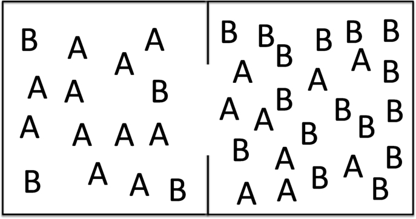
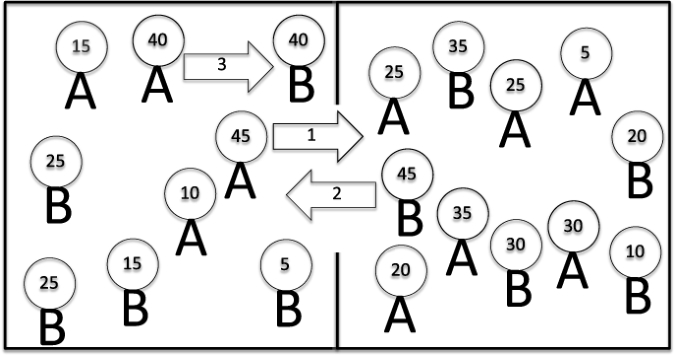
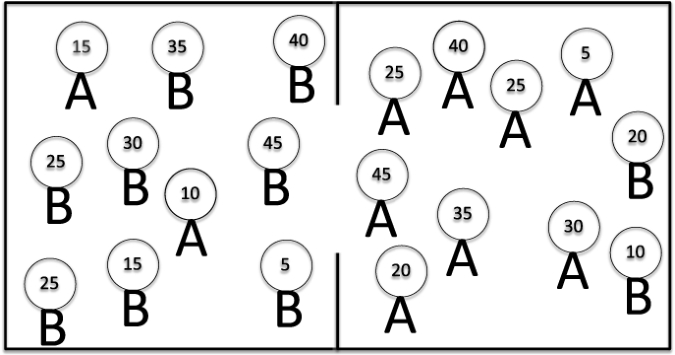
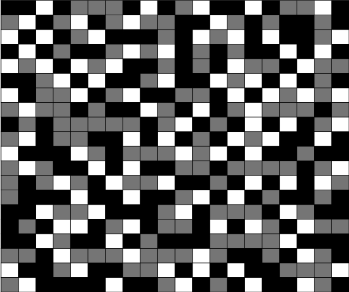
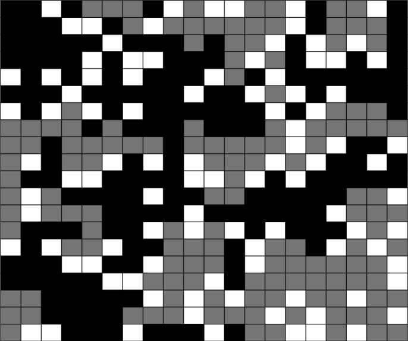
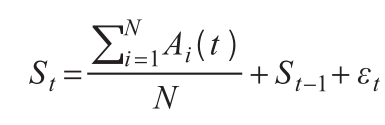
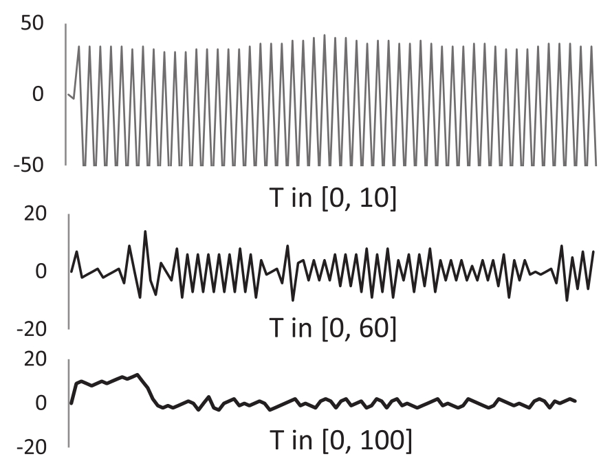

# 19　基于阈值的模型

种族、民族以及其他阶层的融合标志着显著的社会不平等，这是民主社会的至关重要的理想。

伊丽莎白·安德森（Elizabeth Anderson）

在本章中，我们将介绍基于阈值的模型。当外部变量超过或低于特定的阈值时，人们的行为所发生的变化，就是基于阈值的行为（变化）。例如，当一个人决定在价格低于 100 美元时购买一件外套，或者当某项社交活动的参与者人数达到 1 000 人就加入进去时，就会出现基于阈值的行为。基于阈值的行为很直观，也不难分析，但往往会产生违反直觉的结果，例如当宽容行为反而导致隔离时。基于阈值的模型也可以产生临界点。例如，当一个人加入社交活动的决定取决于已经参与了该项活动的人数时，随着越来越多的人参与该活动，参与者的总人数也超过了其他人的阈值，从而导致了更多的人加入。

本章中讨论的模型也可以归类为基于主体的模型。在计算机领域，基于主体的模型指可以单独为每个主体建模的计算机程序。基于主体的模型比系统动力学模型具有更细的粒度。系统动力学模型用单个存量变量表示整个群体，而基于主体的模型则做到了在空间中定位主体，并且可以包括行为多样性。由此增加的自由度当然可以带来一些优势，但是我们必须记住，过多的细节会与要建模的原因相冲突。例如，在构建一个用来讨论人们如何选择参加某项社交活动的模型时，就不应该对人们大脑中的每个神经元进行建模。最优粒度水平取决于模型的目的。

本章从格兰诺维特（Granovetter）的骚乱模型（riot model）开始讨论，接着引入这个模型的双重骚乱版本，用来对初创企业的成长过程进行建模。然后介绍两个隔离模型：第一个讨论参加聚会的一群人如何在不同房间之间移动，第二个讨论城市规模上的隔离。接下来，讨论乒乓球模型（ping pong model），它包括了负反馈，可以产生循环或均衡。在本章末尾部分的讨论中，我们将重新回到生命游戏，分析双重阈值规则如何导致了正反馈和负反馈的结合。正反馈会产生相关行为，而那正是负反馈所要抑制的。本章还会进一步讨论模型粒度问题。

### 格兰诺维特的骚乱模型

在基于阈值的模型中，个体根据某个总量变量是否超过阈值而决定采取两种行动中的哪一种。如果变量的值超过阈值，个体就采取一个行动，否则，就会采取另一个行动。我们要讨论的第一个阈值模型刻画的是骚乱和社会活动。在这个模型中，每个人都可以选择参加骚乱或者不参加，如何选择取决于参与骚乱的人数。模型没有预设任何规范立场，这里所说的骚乱或社会运动，既可以指对暴君的正义反抗，也可以指足球流氓毁坏财物的非法行为，模型对这两类情况都适用。

骚乱模型为每个人分配一个阈值。当参加骚乱的人数超过那个阈值时，这个人就会参加骚乱。 ¹  一开始，只有那些阈值为零的人才会参加骚乱。考虑到本书的研究目的，这里所说的“骚乱”是一般的社会活动而不是暴乱，因此在这种情况下，参加骚乱也无非是指参与聚会。假设第一天，有 200 个阈值为零的人发动了一场社会活动。第二天，这 200 人继续参加，于是参与阈值低于 200 的人也加入了他们的行列。假设第二天新加入的人有 500 人，那么第三天，阈值低于 700 的人也会加入。而这可能会涉及好几千人。

**骚乱模型** 

假设有*N* 个人（用*i* 来索引），每一个人都有一个“骚乱阈值”（riot threshold），不妨记为*T* （*i* ）∈{0，1，…，*N* }。在一开始，骚乱总产值为零，即*T* （*i* ）=0 的那些人都会参加骚乱。令*R* （*t* ）等于在时间*t* 参加骚乱的人的数量。在时间*t* 上，如果*T* （*i* ）<*R* （*t* -1），那么第*i* 个人就会参加骚乱。

#### 骚乱模型的三种情况

对骚乱模型的分析表明，阈值的多样性至少与平均阈值一样重要。原因可以通过比较如下三种情况来说明（它们都涉及 1 000 人）。在第一种情况下，每个人的阈值都为 10，因此不会发生社会运动。在第二种情况下，有 5 个人的阈值为零，10 个人的阈值为 1，其他人的阈值均为 20。那么在这种情况下，一开始会有 5 个人发起社会活动，第二天会有 10 个人加入，但此后就再没有其他人加入了。

在第三种情况下，这 1 000 人中每个人都有一个独特的阈值，范围为从 0 到 999。为了方便起见，我们可以根据这些人的阈值将他们编号为 0 至 999 号，第*i* 个人的阈值为*i* 。第一天，第 0 号人发起一场社会活动，第二天第 1 号加入，第三天第 2 号加入……如此类推，每天都有一个“新”人加入，直到所有 1 000 人都参加这场社会活动为止。

不难看出，第一种情况的平均阈值最低，但是不会发生社会活动，因为没有人的阈值为零。在第二种情况下，虽然有一些人的阈值为零，但是仍然不足以发动一场广泛参与的社会活动。只有在最后一种情况下，社会活动才会成功。

这个模型表明，阈值的总体分布是非常重要的，而不仅仅只有阈值的均值才重要。因此它也说明，要预测哪些社会活动将会成功有很大的困难。这个模型还可以指导行动，它可以告诉那些希望发动社会活动的人们：要取得成功，除了组织一个核心革命团体之外，还需要“发动群众”，也就是“创建”一个愿意加入他们的群体。

骚乱模型有各种各样的变体，可以用来分析人们什么时候会起立鼓掌、人们的观点会怎样变化（例如，会不会接受同性婚姻）、时尚潮流的改变（例如，愿不愿意佩戴蝶形领结），以及市场动态演变（例如，是否投身于股市泡沫或房地产泡沫）。在所有这些情况下，人们的行为都可以通过基于阈值的规则来近似，而且该阈值因人而异。在所有这些情况下，发生大事件的可能性——无论是大规模社会活动，还是厚边框眼镜的大范围流行，都可能在很大程度上取决于阈值的分布而不是阈值的均值。

#### 市场创造和双重骚乱

骚乱模型还可以扩展到用来分析互联网初创企业。这些初创企业能够创造出新的买家和卖家市场。要想创造一个新的市场，初创企业必须创造一群买家和一群卖家。例如，致力于将狗主人与狗保姆匹配起来的网站，就需要让狗保姆和狗主人到网站上注册，对于提供包裹配送、运输或清洁服务的网站来说也是这样。这些网站要想取得成功，必须先“创建”出这样两个群体，而且必须保证这两个群体以大致相同的速度增长，否则，卖家或买家将无法找到匹配的另一方。换句话说，初创企业必须同时制造出两场“骚乱”。

成功的初创公司爱彼迎（Airbnb）提供了一个关于双重骚乱的例子。爱彼迎很好地将试图出租房子的人与寻找短期住处的人匹配了起来。为此，爱彼迎需要创建两个人群：求租房子的人和出租房子的人。只有当爱彼迎的网站有足够多的可供出租的房子时，想租房子的人才会访问他们的网站。因此，需要让愿意出租房子的人到爱彼迎的网站上注册，并将他们的房子挂牌出租。爱彼迎的前两次发布都失败了，因为将房子在网站上挂牌出租需要房东付出不少时间，需要上传不少图片并填写其他一些信息。在爱彼迎拥有大量租房者之前，没有房东愿意将自己的房源放到他们的网站上挂牌出租。

因此，一方面，爱彼迎需要有足够多的挂牌房源在租房者当中造成一场“骚乱”，也就是让足够多的租房者来到他们的网站求租房子；另一方面，他们也需要足够的租房者，以便在那些想要出租房子的人当中制造一场“骚乱”。爱彼迎能否成功，取决于这两个人群的阈值。相比之下，难度更大的是怎样让房东将房源放到他们的网站上挂牌出租，因为这需要房东付出更多的努力。爱彼迎克服这个难题的方法是：挨家挨户地上门，帮助房东将他们拥有的房子在爱彼迎的网站挂牌出租。一旦完成了这个任务，租房“骚乱”就开始了，随后又出现了挂牌“骚乱”。 ²  爱彼迎之所以能够成功地创造出这个市场，是因为它的创始人能够培育出足够数量的初始租户，并以此触发双重骚乱。他们先创造出了一条狗尾巴，然后用狗尾巴拉出了一只狗。

### 谢林派对模型与谢林隔离模型

接下来要讨论的两个模型都是经济学家托马斯·谢林提出的，谢林用它们来分析种族隔离问题。人们在很多个尺度上按种族和民族隔离，先按不同的国家隔离，在国家内部又按地区隔离。在美国，城市内部还会出现社区层面的种族隔离。对于这些，有人说这是种族不宽容的证据。但是，这个结论与越来越多的跨种族、跨民族通婚的证据相矛盾。同一群人，既然决定不与不同种族的人住在同一个社会，甚至不愿意与不同种族的人在一张桌子上吃午餐，但是他们却选择与不同种族的人结婚，怎么会这样呢？

如果跨种族婚姻中的那些人，和不与不同种族的人共坐一张桌子上的那些人，分别属于不同的社会阶层，那么我们或许可以解释这些事实，但是事实并非如此。跨种族婚姻在所有收入水平上都有发生，同时在美国最顶尖的大学和学院里也可以发现“种族隔离”的午餐桌。幸运的是，谢林的模型可以同时解释这两组事实，它们说明了宽容的行为也会导致种族隔离。

#### 谢林派对模型

第一个是谢林派对模型（Schelling's party model）。在一定意义上，可以认为这个模型是随机游走和骚乱模型的“混搭”。谢林派对模型描述了一个在一幢有两个房间的房子里举行的派对。这个派对邀请的客人可以分为两个类型，这里的类型可以是男性和女性、黑人和白人、西班牙人和澳大利亚人、哥特人和印第安人……但这都不会影响结果。关键的假设是，每个人都能够区分其他人所属的类型。

**谢林派对模型** 

*N* 个人参加一个派对，每个人都有一个可观察的类型 A 或 B。每个人随机选择两个房间中的一个。在每个时刻，每个人都有*p* 的概率走到另一个房间去。第*i* 个人的宽容阈值为*T* * [i] * 。对于这个人，如果他所属的类型的人在当前房间内所有人当中所占的比例低于这个阈值，他就离开这个房间。

为了理解隔离是如何在这种存在“宽容”的情况下产生的，假设前来参加派对的是 20 名澳大利亚人（A）和 20 名巴西人（B）。每个人都是宽容的，只要同一个房间里有 25%的人与自己属于相同的种族，他们就会留在这个房间里。再假设一开始，有一个房间里待了 12 名澳大利亚人和 9 名巴西人，另一个房间则有 8 名澳大利亚人和 11 名巴西人。这样没有人觉得自己必须走到另一个房间去，但是两个房间之间会有随机移动，这种随机移动会改变每个房间内的“种族结构”。在图 19-1 中，一个房间里待了 11 名澳大利亚人和 4 名巴西人。这个配置处于一个临界点上：只要任何一名巴西人离开，巴西人所占的“人口比例”就会降低到 25%以下，从而导致其余 3 名巴西人也选择离开。如果发生了这种情况，就永远也不会有巴西人再进入那个房间。

**图 19-1　一个很容易导致隔离的配置** 

回忆一下随机游走，我们说过随机游走能够越过任何阈值。一个房间里的澳大利亚人的数量是一维随机游走。因此，如果派对持续时间足够长，那么隔离就是不可避免的。当然，即便是最好的聚会也不一定能持续得“足够久”，所以并不是所有派对都会以隔离而告终。我们也知道，派对规模越大，隔离结果越不可能出现，因为当参加派对的人更多时，随机游走就必须超过一个更高的阈值。例如，在一个有 1 000 人参加的派对中，不太可能出现某个房间里某个特定类型的人所占比例低于 25%的情况。因此，我们预测，在小型派对中出现隔离的可能性更大。

而且，当参加派对的人有不同的宽容阈值时，我们也应该会观察到更多的隔离现象。要理解个中缘由，不妨假设参加派对的是 10 名巴西人和 10 名澳大利亚人，并为每个人分配 5%至 45%的宽容阈值，使每种类型的人的平均宽容阈值为 25%，如图 19-2 所示。

**图 19-2　异质性阈值导致的“重新安置”** 

在图 19-2 中，左边的房间里有 5 名巴西人和 4 名澳大利亚人，因此澳大利亚人的比例低于 45%，这导致最不宽容的那名澳大利亚人离开这个房间，进入右边的房间（用箭头 1 表示）。这名澳大利亚人进入了右边那个房间后，就降低了巴西人在那个房间里的比例，导致最不宽容的巴西人换房间（用箭头 2 表示）。这两次移动使左边房间里澳大利亚人所占的百分比降低到了低于 40%的水平，从而导致第二名最不宽容的澳大利亚人也离开左边的房间，进入右边的房间（用箭头 3 表示）。就这样，一个级联式反应出现了。然而，如图 19-3 所示，结果不一定是完全隔离，因为最宽容的那些人在任何一个房间里都会觉得舒服自在。在这个模型中，多样化阈值产生了两种不同的影响：它们使隔离更容易发生，同时又使完全隔离的可能性降低，因为非常宽容的人在任何一个房间都不会觉得有问题。

**图 19-3　异质性阈值导致的“隔离”** 

这个模型可以用来解释不同职业之间的性别比例差异，例如为什么会有更多的女性担任护士，更多的男性担任推销员。这种差异也许是由于偏好不同所致，但是只要对这个谢林派对模型稍稍加以扩展，就会发现，如果人们更愿意与相同性别的人一起工作，那么这种不同职业之间的性别比例差异就可能会出现。对于这一点，我们还可以用旋转门模型（revolving-door model）来给出更加正式的解释。旋转门模型有两个基于经验基础的假设：退出某个职业的女性会选择女性更多的新职业；女性退出某个职业的速度略高于男性。 ³  例如在生命科学领域中，女性退出生物医学研究的速度比男性更快一些，并且会在雇用了更多女性的医疗保健等职业中谋职，这种行动就会提高这两个职业的性别隔离程度。

#### 谢林隔离模型

谢林隔离模型（Shelling's Segregation Model）将行为主体放在地理空间的不同位置上，就像是放在棋盘的不同格子上（图 19-4）。其他方面则都与谢林派对模型相同。这个模型同样假设有两种类型的人，对他们的行为假设也与谢林派对模型相同。

**图 19-4　谢林隔离模型的初始配置** 

**谢林隔离模型** 

有*N* 个人，每个人都属于类型 A 或类型 B，随机排列在一个*M* ×*M* 的棋盘上。棋盘上还有部分空间未被占用。第*i* 个人的宽容阈值为*T* * [i] * 。对于这个人，如果他所在方格的 8 个相邻方格中同一类型的人所占的百分比低于他的阈值，就会重新定位到一个随机的新方格上。

如果个体的平均阈值接近 50%，这个模型会产生地域性的隔离，如图 19-5 所示。出现这种隔离是因为个体只考虑自己所在的“社区”，这种社区最多只能有 8 个居住者。几乎任何随机的初始配置都包括了被相反类型的其他人包围的一些人。如果个体进入了具有更多相同类型的个体区域，就可能引起另一种类型的人的重新安置。随着重新安置的不断积累，最终发生了隔离。毫无疑问，阈值多样性会加剧这些影响，原因如前所述，这里不再重复。

**图 19-5　谢林隔离模型中“重新安置”后的配置** 

即使是宽容的人，也会产生隔离的居住模式，这就是托马斯·谢林的开创性名著《微观动机与宏观行为》一书最根本的洞见。

### 乒乓球模型

现在讨论乒乓球模型，它假设基于阈值的行为会产生负反馈。负反馈可以起到稳定系统的作用，还可以产生循环。乒乓球模型假设了有限数量的实体，它们可以是人，也可以是机械的、生物的或化学的装置。在每个时期，每个实体采取一个正（+1）的行动或一个负（-1）的行动。在第一个时期，每个主体随机选择一种行动，初始状态等于行动的总和。系统所有的后续状态，都等于前一个时期的状态加上所有动作的平均值和一个随机项。每个实体都有一个阈值（从特定的分布中抽取），如果状态绝对值超过了阈值，就选择能够减少状态绝对值的操作。简而言之，如果状态超过了实体的阈值（无论是负的，还是正的），这个实体就尽其所能减少状态的大小。

**乒乓球模型** 

规模为*N* 的种群中的每一个实体随机采取一个初始行动，或者为正（+1），或者为负（-1）。系统的初始状态*S* [0] 设置为零。系统的所有未来状态*S* * [t] * 则等于平均行动再加上一个随机变量，即：

每个实体*i* 都有一个响应阈值（response threshold）*T* * [i] * >0，它从［0，RANGE］中均匀抽取出来。如果状态的绝对值大小｜*S* * [t] * ｜小于它的阈值，该实体就采取与以前相同的行动，否则，就采取减少状态绝对值大小的行动。即：

如果｜*S* * [t] * ｜≤*T* * [i] * ，那么*A* * [i] * （*t* +1）=*A* * [i] * （*t* ），否则*A* * [i] * （*t* +1）=-sign*S* * [i] * （*t* ）

其中，*ε* * [t] * 是从{-1，+1}中随机抽取出来的。

乒乓球模型有多种应用。人们可能会将时间和资源分配给多个慈善项目。如果某个慈善项目得到了太多的关注或金钱，人们就会开始向其他项目捐钱以保证平衡。例如，一个国家需要维护两个联合国教科文组织世界遗产，人们会在两个遗产上都投入一些时间和资源，但是如果某个遗产受到的破坏更严重，人们就可能会重新分配资源。

正如“乒乓”这个名称所预示的那样，乒乓球模型可以生成围绕着均衡的循环行为。在一个时期内，太多的人选择了这个行为，而在接下来的那个时期，却有太多的人选择了另一个行为。当所有实体的阈值都为零时，在这一个时期内所有实体都会选择这个行为（+1），而在下一个时期内所有实体都会选择另一个行为（-1）。

为了探索阈值多样性如何影响人们的乒乓球式行为模式，还是会找到一个均衡，我们考虑如下三种情况（每一种情况都有 100 个人参与）。在第一种情况下，假设阈值均匀分布在 0 到 10 之间。如果第一个时期中的状态等于 6，那么它将超过大约 60 个人的阈值。这 60 人中大约有 30 人将采取行动 1，并将改变行动。这些行动总和现在将超过 50，因此系统的新状态（前两个时期的平均值）将超过 20。这个值超过了所有阈值，因而产生了图 19-6 所示的乒乓球效应。

在第二种情况下，如果我们增大阈值的多样性，使它们在 0 到 100 之间均匀分布，那么乒乓球效应几乎消失。如果再次假设状态在第一个时期等于 6，那么平均来说只有 6 个人的阈值将得到满足。如果这 6 个人中有 3 个改变行动，那么状态将趋向于零。这种对偏差的抑制可以从图 19-6 中看得很清楚（它对应于 0 到 100 之间的阈值）。

在第三种情况下，考虑一个适中的范围，让阈值均匀分布在 0 到 60 之间，我们将会观察到更温和的周期，如图 19-6 所示。因此，在具有负反馈的系统中，阈值多样性会导致稳定性，但是在具有正反馈的模型中则具有恰好相反的效果。

**图 19-6　三种阈值范围下乒乓球模型的时间序列** 

### 模型粒度

反馈的基本逻辑很简单：正反馈强化行动，负反馈抑制行动。只有正反馈的系统会爆炸或崩溃，只有负反馈的系统将稳定或循环，同时具有正反馈和负反馈的系统则可能会产生复杂性。

在系统动力学模型中，反馈作用于存量变量（例如，野兔的数量）和速度（例如，增加面包店的购买率）。基于主体的模型（例如本章中介绍的阈值模型）会产生作为个体行动的结果反馈。这类更精细的模型可能包含多个阈值，阈值多样性会加剧正反馈的影响并缓和负反馈的影响。分布尾部的多样性使骚扰更加容易发生，宽容阈值的多样性则促进了隔离。具有负反馈系统中响应的多样性阻止了同质性反馈可能导致的大幅波动。在企业之间的经济竞争模型中，生产成本的异质性也可以起到类似的作用。随着价格的上涨或下跌，由于各自成本的差异，企业做出的反应会各不相同。 ⁴  

这两种模型之间的差异引发了模型粒度的问题。是创建一个以“野兔”为名的变量（或方框）并描述野兔的数量如何随着其他变量而增加或减少？还是对每一只野兔单独建模？细分变量可以提高描述的准确性，但是模型不是以描述准确性为标准来评分的。请一定要记住统计学大师乔治·博克斯的格言：所有模型都是错的。至于博尔赫斯的地图，虽然与现实世界一样大，却全无用处。许多建模者，包括爱因斯坦，都认为，我们应该寻求适当的粒度水平。例如，如果要构建一个模型来解释人类的手臂能够施加的力，就不需要考虑 DNA。

而在研究社会系统的时候，则可能并不存在理想粒度水平。我们可能需要在多个粒度水平上分别进行探索。通过构建多个模型，每个模型都有不同的粒度水平，然后进行跨模型对话。假设我们试图了解瑞典与芬兰之间的贸易模式，可以这样入手：把两个国家的贸易总量作为变量，并确定宽泛的宏观模式。然后，将每个国家的进出口总额按行业分解，并进一步分解为各个行业内的企业。行业级数据将使我们能够更好地解释过去的模式，并对未来的模式做出更加精确的预测。对各个行业内的企业做进一步深入了解，包括成本结构和增长轨迹等信息，可以得到更好的结果，但是我们需要大量的信息才有可能构建出一个包含这么不断变动着的组成部分的、真正有用的模型。我们甚至还可以对这些企业的领导力进行建模。最后一个层次的拆解式研究，很可能不会带来多少有用的结果，但可能会使一些致力于扩张海外的企业领袖名扬四海。

总而言之，更精细的粒度不一定更好，有的模型可能过于注重细节。我们能够理解更细粒度的模型，也可以从相对粗糙的模型中获益。通过比较不同模型的预测、解释之间的差异，我们可以看清楚假设如何影响结果，也可以看清楚假设的条件性。许多模型不仅在各自包含的变量方面存在差异，而且在何种粒度上分解变量也理所当然地有所不同。

**算法骚乱** 

骚乱模型和乒乓球模型都可以用来解释股市崩盘及随后的价格反弹。我们在此考虑两个案例，它们很能说明一些问题。

第一个案例发生在 1987 年 10 月 19 日星期一，那一天，道琼斯工业平均指数下跌了超过 22%。第二天，这场股价崩溃在全球范围引发了连锁反应。这次崩溃的原因直到今天仍然是许多研究的主题。当时，美国经济扩张已经进入了第四个年头。那一年的前 8 个月，道琼斯工业平均指数的涨幅超过了 40%。也许就是因为股票市值的这种上涨，使许多人认为股票价格被高估了。在崩溃前的那个星期天，美国时任财政部部长詹姆斯·贝克（James Baker）威胁说，如果德国再不降低关税，美国就要采取削弱美元政策。这种说法在当天似乎没有引起什么反响。但是第二天，股票市场就崩盘了。14 个月后，股票市场又恢复到了崩盘之前的价位。

为了应用本章给出的这些模型，我们可以用一种金融资产来代表整个市场。假设，持有该资产的每个人都有一个“崩溃阈值”（crash threshold）。如果资产价格在某一天的下跌幅度超过了崩溃阈值，投资者就会出售资产，将资金从市场中撤走。这个规则可以捕获趋势交易者或噪声交易者的行为。在此基础上，我们可以构建一个骚乱模型。如果某些投资者在 10 月 19 日一早醒来就决定出售大量资产，他们的行为就会导致股票价格下跌。如果股票价格的下跌幅度超出了其他投资者的崩溃阈值，那么其他投资者也会出售，从而导致股票价格呈螺旋式下降。于是在这里就有了一个经典的正反馈循环：抛售导致价格下降，价格下降导致更多抛售。

现在加入乒乓球模型。如果价格下跌得太多，人们会应用第二条规则，换句话说，人们还有一个“便宜货阈值”（bargain threshold），如果价格低于这个阈值，人们就会买入这种金融资产。在这里，投资者是基于价值而非趋势行事。当价格急剧下跌时，便宜货阈值会产生负反馈。买家急于以便宜的价格买入，导致价格停止下跌。

当然，现实世界中的市场要比这个模型（卖家跌破阈值就卖，买家等着机会入货）复杂得多。股票市场包含了许多类型的交易者，包括大型机构、养老基金、各国政府、投机者、投资组合保险公司，以及散户投资者。 ⁵  正因为存在这种多样性，在价格下跌时几乎永远有人愿意买进，从而产生了稳定市场所需的负反馈。

对崩溃的早期分析强调了（计算机）程序交易盛行的影响，这些其实是用计算机程序编码并实施的基于阈值的规则。如果股票市场指数低于某个预先设定的值，就卖出所有股票。诸如此类的规则都是在无人监督的情况下自动执行的。大多数分析师现在认为，程序交易是促成 1987 年股市崩盘的一个原因，但并不是主要原因。

对 1987 年股市崩盘更细致的分析表明，大量投资组合保险公司作为必须保证投资者投资组合回报率的交易者，产生了强烈的正反馈，而且这些正反馈并未受到负反馈的抵消。在股票市场大幅下跌的情况下，这些投资组合保险公司会通过抛售股票来止损。随着股票的进一步下跌，这些投资组合保险公司抛售的股票越来越多。实际上，这些投资组合保险公司的行为就好像他们是具有不同阈值的个人组成的群体。有一家投资组合保险公司抛售了超过 10 亿美元的股票，而 10 月 19 日当天全天的成交量只有 200 亿美元。

第二次案例是一个发生在 2010 年 5 月 6 日下午的闪电崩盘。在三分钟内，道琼斯工业平均指数就下跌了 5%。这个闪电崩盘是算法交易的结果。由于现代金融市场的高度复杂性和交易的极高速度，没有人确切知道在闪电崩盘期间究竟发生了什么。但是我们确实知道，有一个庞大的共同基金发出了一个超级大卖单，将超过 40 亿美元的股票期货倾销到了市场上，而市场上则充斥着各种各样试图利用有利交易的高频交易算法。这种高频算法能够感知价格趋势并开始以极快的速度执行交易，对此，我们可以想象一个有极高速度的骚乱模型。

这就产生了一个“有毒”的市场，交易者担心大型机构投资者知道他们不知道的东西，因此他们退出了市场。 ⁶  鉴于市场行为异常，许多算法停止了交易；但是其他算法则继续销售，然后就发生了闪电崩盘，所有这一切都在几分钟内完成。20 分钟后，便宜货阈值规则开始发挥作用，正如乒乓球模型所预测的那样，价格回升到了（接近于）原先的水平上。