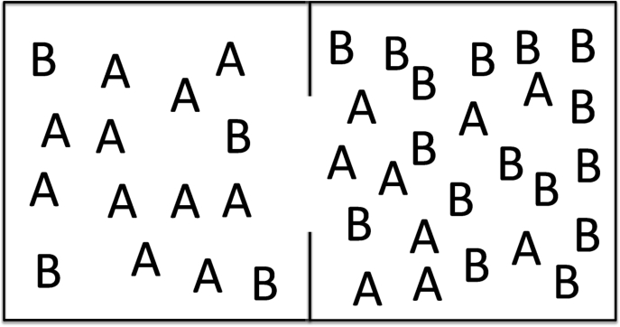
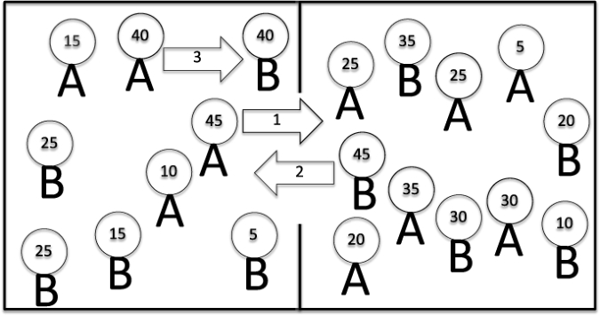
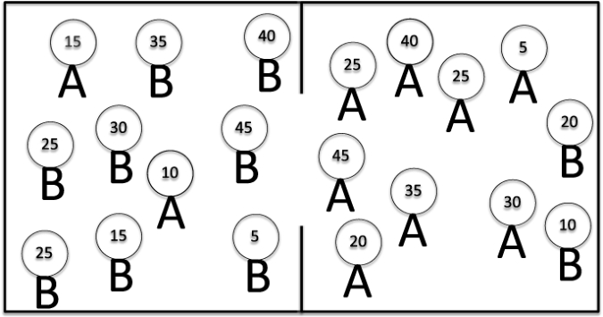
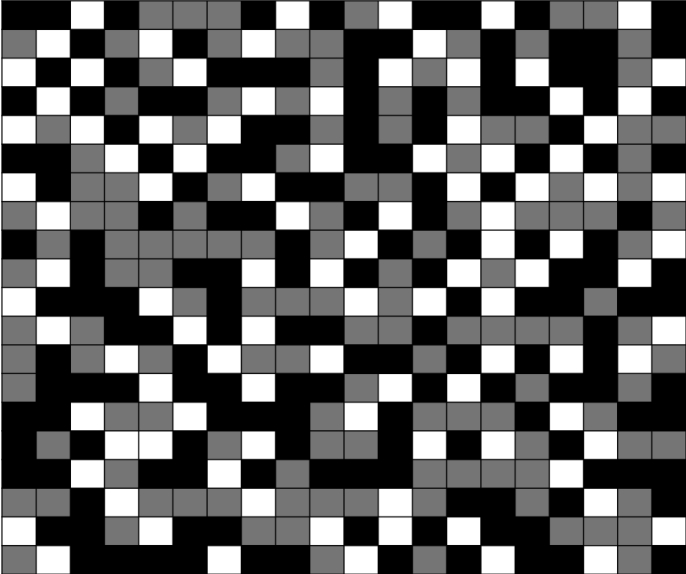
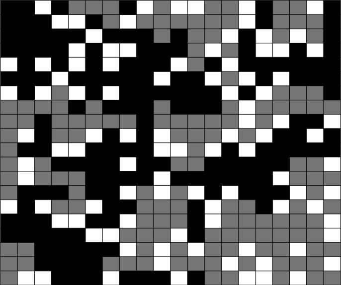
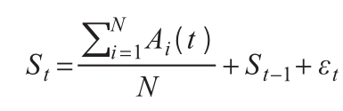
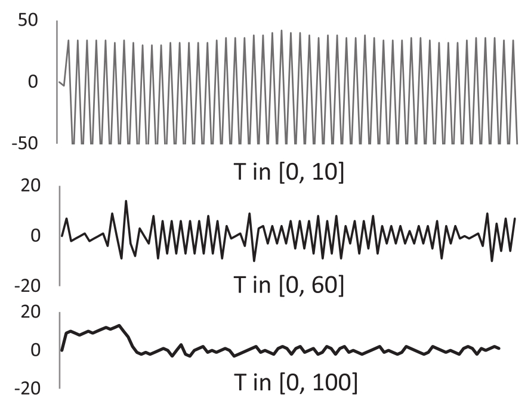

为什么一场小聚会会突然变成全员狂欢？为什么一座宽容的城市反而出现了种族隔离？答案，可能都藏在“阈值”里。

想象一下：你决定只要那件外套降到100美元以下就买下它；或者，某个派对已经有1000人报名，你才愿意加入。当外部某个数字越过你心里的那条线，你的行为就瞬间切换——这就是基于阈值的行为。这类行为很直觉，却常常带来反直觉的结果：比如，越是宽容的人凑在一起，反而可能制造出更深的隔阂；又比如，一个原本不起眼的小动静，可能因为“临界点”效应，像雪崩一样席卷所有人。

这类模型属于“基于主体”的建模思路。与把人群看作一个整体的系统动力学不同，它能给每个个体单独“画像”，放到具体位置，允许行为千差万别。但自由多了，也要小心：细节如果堆砌过头，反而掩盖了问题的本质。好比你想分析人们为什么参加聚会，没必要去模拟大脑里的每个神经元。模型该多细，取决于你想用它回答什么问题。

先看经典的“骚乱模型”——不过别紧张，这里的“骚乱”可以指任何社会活动，从抗议到一场派对都行。模型给每个人分配一个阈值：当参与人数超过这个值，他/她就会加入。最开始，只有阈值为零的“种子”在行动。假设第一天有200人发起活动，第二天这200人还在，于是阈值低于200的人也来了；新加入500人后，第三天阈值低于700的人又会加入……如此滚动，可能滚出成千上万人。

这个模型最有趣的地方，是它揭示了：阈值的分布形态，比平均阈值重要得多。同样是1000人，第一种情况：所有人的阈值都是10，那没有一个人会率先行动，活动根本不会发生。第二种情况：5个人阈值是0，10个人阈值是1，其余都是20——一开始会有15人，但之后便卡住了，成不了气候。第三种情况：1000个人的阈值分别是0到999，于是第0号出发，第1号跟进，第2号跟上……一天一个人，最终全员参与。显然，平均阈值最低的没成功，阈值分布最“有梯度”的却成功了。所以预测哪场社会活动会火，真的很难。这也给了想要“发动群众”的人一个启示：除了核心革命者，你还得“创造”出愿意跟随的人群。

这个逻辑还能用来理解市场是怎么诞生的。一个互联网初创公司要创造新市场，必须同时拉起两场“骚乱”：一边是买家，一边是卖家。两者还得同步增长，否则谁也找不到谁。爱彼迎早期就卡在这个死结上：没有房源，租客不来；没有租客，房东不愿挂房。房东挂牌又麻烦，要上传照片填一堆信息，于是前两次发布都失败了。怎么办？创始人干脆挨家挨户上门，帮房东把房子挂上网。先“造”出足够房源，租客这头就热闹起来；租客一多，房东那头也坐不住了——两场骚乱互相点燃。用作者的话说：先造出一条狗尾巴，再让狗尾巴拉出一只狗。

接着是谢林的两个模型，它们用来解释一个怪象：跨种族婚姻越来越普遍，但午餐桌和社区却依然按种族“自动隔离”。如果说不同种族的人连同桌吃饭都不愿，却愿意结婚，矛盾吗？除非……这些行为并不来自强烈敌意，而是来自一种微妙的“宽容阈值”。

第一个是“派对模型”。一栋房子两间房，两群人可以按任何类型划分：男女、黑白、澳洲人巴西人都行。关键设定是：每个人只要看到同类型的人在房间里达到一定比例，就觉得舒服，可以留下；低于这个比例，就换房间。注意，阈值可以很低，比如25%——也就是说，房间里哪怕只有四分之一是自己的同类，他也愿意待。看起来够宽容吧？可只要随机走动让某个房间的少数派比例跌破临界值，就会触发连锁反应：一个人走，比例再降，更多人跟着走，最后走廊空了，房间被“洗”成同质化。而且，派对越小，随机波动越容易越过阈值，隔离越容易发生；派对越大，反而越难。

更有意思的是，如果每个人都有不同的宽容阈值，比如从5%到45%不等，平均25%，隔离依然会出现，而且会更猛烈地级联。但结果不一定是完全隔离——因为最宽容的那些人，在哪儿都舒服。在一个房间里，恰恰是那个最不宽容的人先起身，接着是第二个、第三个……像多米诺骨牌一样，把每个人推向“更相似”的角落。这个模型甚至可以解释为什么护士大多是女性、推销员大多是男性：只要人们偏好和同性共事，职业性别隔离就会自动出现，哪怕每个人都没有恶意。

第二个是“隔离模型”，把个体放到棋盘格上，规则类似：如果邻居中同类比例低于自己的阈值，就搬到随机空位。哪怕平均阈值只有50%——相当于“只要别让我当绝对少数，我就留下”——最终也会形成一块块同质化的居住区。为什么？因为每个人只关心自己周围那8个格子，随机初始状态下总有人被异类包围，他们一搬走，又挤占了别处的空间，引发连环搬迁。谢林这本《微观动机与宏观行为》给出了一个扎心的洞见：即使人人宽容，也可能住出一个隔离的城市。

再来看看负反馈的情况。“乒乓球模型”里，每个实体要么+1，要么-1，系统状态是所有人行动的平均值再加点随机扰动。如果状态绝对值超过某个人的阈值，他就会做反向操作，把状态拉回来。这就像两个人打乒乓球：这头高了就往低打，那头低了又往高打。模型发现，阈值分布越“集中”，系统越容易震荡；阈值范围拉大，多样性增加，反而让系统更稳定——大家各管各的，小波动很快被抵消。但注意，在正反馈系统里，多样性会加剧不稳定；在负反馈系统里，多样性却带来稳定。方向不同，效果截然相反。

最后回到“模型粒度”。做模型像画地图，画得太粗看不见街道，画得太细又淹没了城市轮廓。最好的粒度，取决于你为什么要画这张图。骚乱模型不在乎每个人的性格波动，隔离模型也不必还原每栋楼的真实形状——它们用最少的细节，抓住了最核心的机制。这或许就是建模最迷人的地方：用一个简单的阈值，撬动整个世界的复杂行为。

**算法骚乱：阈值、反馈与模型粒度**

先看底层机制：正反馈会把行为推大，负反馈会把行为压小。系统若只剩放大回路，迟早不是炸开就是崩掉；若只剩抑制回路，往往停在稳定态或循环态；两类回路同时在场，复杂现象才有机会出现。

在系统动力学里，反馈接在存量（比如野兔只数）与速率（比如面包店购买率的抬升）上；主体模型则从个体行动汇成反馈，阈值模型就是例子。模型越细，可能设置多个阈值。阈值越参差，正反馈的威力越会被放大，负反馈的缓冲越会被削弱。分布尾端的多样性会提高骚扰出现的概率，宽容阈值的多样性则会助推隔离。负反馈系统内响应越参差，同质化反馈造成剧烈摇摆的可能性就越低。企业竞争模型里，生产成本不同也能起类似作用：价格上行或下行时，成本各异的企业会给出不同反应。

这就引出模型粒度问题：究竟用一个名为“野兔”的方框代表总量，看它如何随其他变量起落，还是给每只野兔单独建档？拆细变量能提高描述精度，但评价模型时，描述精度并不是计分尺。统计学大师乔治·博克斯那句“所有模型都是错的”要记住；博尔赫斯画过一张与真实世界等大的地图，却毫无用处。许多建模者，包括爱因斯坦，都认为该找适当粒度。比如解释人的手臂能施多大力，不必研究DNA。

社会系统里，理想粒度可能根本不存在。更稳妥的做法是在多个粒度上分别探索：建多个不同粒度的模型，再让它们跨模型对话。以瑞典和芬兰贸易为例，可以先把两国贸易总量当变量，确认宽泛宏观模式；再把各自进出口按行业拆开，进而拆到行业内企业。行业级数据能更好解释过去、更精确预测未来；再深入企业的成本结构与增长轨迹，结果可能更好，但要构建一个包含不断变动组成部分且真正有用的模型，需要海量信息。甚至可以给企业领导力建模。最后一层拆解式研究很可能没多少有用结果，却可能让一些致力海外扩张的企业领袖出名。

总之，更精细不必然更好，有的模型会过度抠细节。我们能理解更细粒度模型，也能从相对粗糙的模型获益。比较不同模型的预测与解释差异，能看清假设如何影响结果，也能看清假设的条件性。许多模型不仅在变量上不同，在变量分解粒度上也理所当然不同。

**算法骚乱**

骚乱模型和乒乓球模型都能解释股市崩盘及随后反弹，两个案例很说明问题。

第一个是1987年10月19日周一：道指单日跌幅超过22%，次日全球市场连锁下跌。诱因至今仍被反复研究。当时美国经济扩张已进入第四年，当年头八个月道指涨逾四成。市值快速抬升让不少人觉得股价虚高。崩盘前周日，时任财长詹姆斯·贝克放话：若德国不降关税，美国将采取削弱美元的政策。这话当天似乎没激起什么，隔天股市却塌了。14个月后，市场回到崩前价位。

套用模型，可用一种金融资产代表整个市场。假设每个持有者都有“崩溃阈值”：某日跌幅超过阈值，投资者就卖出、撤资。这条规则能捕捉趋势交易者或噪声交易者的行为。骚乱模型于是成立：若部分投资者19日一早决定大举抛售，价格下挫；跌幅越过其他人的阈值，更多人卖出，价格螺旋下行。经典正反馈出现：卖压压价，价跌又催出更多卖盘。

再加入乒乓球模型。价格跌得太狠，第二条规则启动——“便宜货阈值”：低于该阈值，人们买入。此时投资者按价值而非趋势行事。急跌中，便宜货阈值产生负反馈，买家抢便宜，价格止跌。

现实市场当然复杂得多。参与者包括大型机构、养老基金、各国政府、投机者、投资组合保险公司和散户。正因为多样，下跌时几乎总有人愿意承接，稳定市场所需的负反馈才得以出现。

早期分析强调程序交易盛行：计算机编码的阈值规则，指数跌破预设值就清仓，且无人监督自动执行。多数分析师现在认为，程序交易是1987年崩盘的促成因素之一，并非主因。更细致分析显示，大量投资组合保险公司为保证投资者组合回报率，产生了强烈正反馈，且未被负反馈抵消。大跌时它们抛股止损，越跌越抛，行为像一群阈值不同的个人。有一家抛售逾10亿美元股票，而10月19日全天成交量仅200亿美元。

第二个是2010年5月6日下午的闪电崩盘：三分钟内道指跌5%，是算法交易的结果。现代金融高度复杂、交易极快，没人确切知道那几分钟究竟发生了什么。但我们知道，一个庞大共同基金发出超级大卖单，把超过40亿美元股票期货倾销到市场；市场里满是试图利用有利交易的高频算法。这些算法能感知价格趋势并极快执行，可想象成一个极高速的骚乱模型。

这造出“有毒”市场：交易者担心大型机构知道他们不知道的东西，于是退出。市场行为异常，许多算法停止交易，另一些继续卖出，闪电崩盘就在几分钟内发生。20分钟后，便宜货阈值规则发挥作用，正如乒乓球模型所预测，价格回升到接近原先水平。

一句话收束：反馈回路决定系统会炸、会稳还是会复杂；模型粒度没有唯一答案；而市场崩盘与反弹，往往是阈值、正负反馈和参与者多样性共同写下的算法骚乱。