# 20　空间竞争模型与享受竞争模型

我们的理论是，如果你需要用户来告诉你，你正在销售的是什么，那么你其实不知道你正在销售的是什么，而且这不可能给客户留下好的体验。

玛丽莎·梅耶尔（Marissa Mayer）

在本章中，我们将介绍关于个人选择的模型，人们选择时所针对的备选项由其属性来代表。开发这些模型主要是为了刻画消费者的选择行为。买房子的人要考虑它的面积、卧室和浴室的数量以及建筑质量。这些模型也适用于招生的考官、选聘董事长的董事会，以及参加投票的选民，他们都要在申请人或候选人之间做出选择。招生考官要考虑申请人的 SAT 成绩、平均成绩和课外活动。选民要根据候选人在教育、基础设施、犯罪和税收方面的立场进行评估。除了帮助我们理解个人选择之外，这些模型还可以解释为什么会这样做出选择，例如，为什么我们有这么多种早餐谷物可供选择。

讨论这些模型时，我们会将某些属性描述为空间属性，而将其他属性描述为享受属性。空间属性，例如夹克的颜色或一片面包的厚度，没有最优值。每个人都喜欢特定“数量”的这类属性：一个购买猪排的消费者有自己喜欢的辣度，一个业余滑雪运动员在滑下斜坡时有自己喜欢的下降角度。产品的属性越接近理想水平，消费者对产品的评价就越高，而且理想水平因人而异：一个人可能比另一个人更喜欢辣一些的猪排。

与此不同，在享受属性上，更多（或者在某些情况下更少）总是意味着更好。人们喜欢智能手机的待机时间更长一些，房间的面积更大一些，皮鞋的鞋底更耐磨一些，自己的汽车更省油一些。不过，在现实世界中，大多数选择都是“混合型”的：人们既会考虑空间属性，也会考虑享受属性。

在本章中，我们假设人们总是会选择他们估价最高的备选项（备选方案）。之所以要这样做是出于第四章中已经提到过的一些原因：在对人类行为进行建模的时候，理性行为提供了一个基准，基于理性假设构建的模型不仅容易处理，能够给出符合唯一性要求的预测，并且这种预测在事情重复发生且利害关系很大时与经验相符。

空间（属性）竞争模型（spatial competition model）和享受（属性）竞争模型（hedonic competition model）在经济学和政治学中早就得到了广泛应用，部分原因在于它们便于用数据检验。 ¹  在本章中，我们可以体会到这种适用性。我们先从空间竞争模型入手分析。接着将这些模型应用于政治领域，并阐明如何使用这种模型来分析现状效应、议程权力和拥有否决权的人的影响力。然后，我们介绍享受竞争模型及其混合模型，以揭示对价格竞争的若干结论。在这个过程中，我们还将说明，如何在模型中应用数据，根据候选人和法官在相关法案和法律案件上的投票历史来推断出他们的立场。我们还介绍了如何推断出清洁空气或更少的通勤时间等没有明确价格属性的隐含价格。 ²  

### 空间竞争模型

空间竞争模型假设备选项可以用一组属性来定义，消费者则可以用一系列理想点来定义。最简单的空间竞争模型考虑的是只有单一属性的产品。在由数学家、统计学者哈罗德·霍特林（Harold Hotelling）提出的最早的空间竞争模型中，这个属性就是地理位置。 ³  

霍特林的模型假设一些消费者分散地分布在海滩上（如图 20-1 中的圆圈所示），海滩上有两个卖冰激凌的小贩（分别用 A 和 B 表示）。每个消费者都会从离自己更近的那个小贩手中购买一个冰激凌。图中的分割点位于这两个小贩之间的中点位置，它决定了哪些消费者会从哪个小贩手中购买冰激凌。分割点左侧的那 6 个消费者会从 A 小贩那里购买，而分割点右侧的那 7 个消费者则会从 B 小贩手中购买。

考虑到消费者更喜欢离自己更近的商品，我们可以对距离给出一种更加抽象的解释。例如，我们可以想象这两个冰激凌小贩位于同一个地点，但是分别出售乳脂含量不同的冰激凌。因此，同样的数字可以表示 B 小贩出售冰激凌的乳脂比 A 小贩出售的冰激凌更加浓稠。根据这种解释，消费者的位置就不再是他们在海滩上的物理位置了，而是他们所喜欢的乳脂含量。

我们还可以继续应用一对多的模型思维，用这个模型去分析政治竞争。唐斯模型（Downsian model）将霍特林模型中的地理空间重新定义为从左到右的意识形态连续系统。于是，我们可以对图 20-1 重新解释如下：A 小贩代表自由派的政治候选人，B 小贩代表保守派的政治候选人，圆圈则代表选民的意识形态理想点。然后进一步假设，选民更喜欢政治立场与自己更接近的候选人。

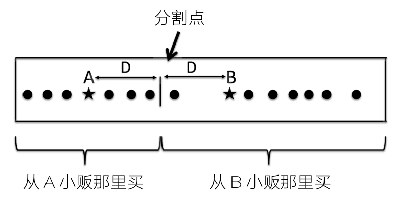

**图 20-1　海滩卖冰激凌的地理模型** 

从企业的地理位置和产品属性，转换为政治意识形态，意味着从诸如位置和乳脂含量等物理属性，转换为更抽象的思想观念。虽然我们对于物理属性已经有了明确的测量方法，但是要分配意识形态立场，则需要找到一种新的方法将候选人的行为转化为数字。如果候选人有投票记录，我们只要收集到候选人以往的选票数据，就可以对他们分配意识形态立场。

在这个过程中，我们应该忽视所有缺乏意识形态成分的选票，例如，当所有有权投票的人都一致同意设立全国牛奶日时，这样的投票数据就无须考虑。而对于所有其他投票，则可以依靠专家意见来确定自由派立场和保守派立场。候选人在意识形态区间上的空间位置可以设定为投票给保守派的时间百分比。 ⁴  永远采取保守派立场的候选人将被放置在最右边，一半时间投保守派的票、一半时间投自由派的票的候选人则位于最中间的位置上。

构建了这样一个模型之后，我们就可以通过实证检验来判定美国各政党的意识形态立场的差异是不是变得更大了。如图 20-2 所示，有一项研究表明，美国民主、共和两党的平均理想点出现了显著且不断加剧的极化趋势。虽然我们不能就此得出美国政党极化程度增加的结论，但是它确实提供了支持这种结论的证据。分析还表明，这种极化主要应归因于共和党的向右倾斜——变得更加保守。

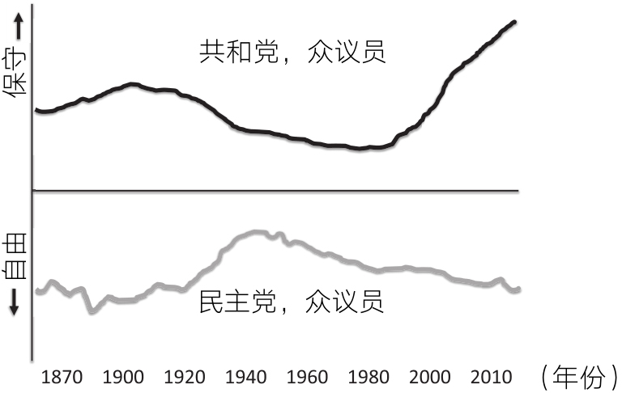

**图 20-2　美国国会众议院意识形态极化的加剧** 

#### 增加属性的数量

一般的空间竞争模型可以包括任意数量的属性。比如，沙发可以通过多个物理维度来描述：长度、宽度和深度，结构类型，以及室内装饰类型。消费者从产品中获得的价值（或效用）取决于产品在各个维度上与理想点的距离。我们可以将这种价值函数写为常数项减去备选项与消费者理想点之间的距离。 ⁵  

**空间竞争模型** 

备选项包括*N* 个空间属性：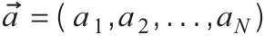。

做出选择的个体的理想点：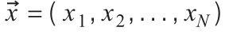。

个体选择了备选项后得到的收益（效用）等于：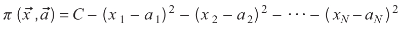，其中，*C* >0 是一个常数。

示例：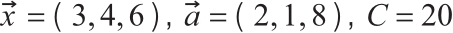

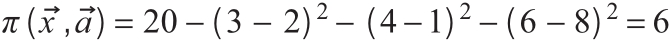

在这种一般的空间竞争模型中，对于两种巧克力棒，可以用可可含量的百分比以及含糖量来表示，如图 20-3 所示。分割线是连接这两个产品的直线的垂直平分线。理想点位于分割线左侧的消费者更喜欢 A，而理想点位于分割线右侧的消费者则更喜欢 B。 ⁶  

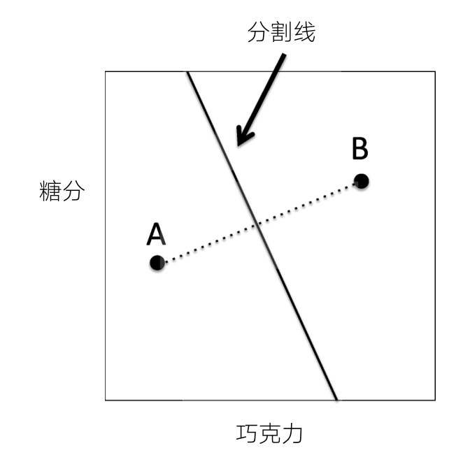

**图 20-3　两种巧克力棒的产品属性与分割线** 

这个模型还可以容纳任意数量的产品。要加入第三种巧克力棒，我们只需在属性空间中增加另一个点即可。为了确定消费者会选择购买哪种巧克力棒，可以再绘制一条分割线，如图 20-4 所示。这两条分割线可以将理想点的空间划分为三个区域，它们被称为沃罗诺伊邻域（Voronoi neighborhood），领域根据它们与产品的距离划分理想点空间。

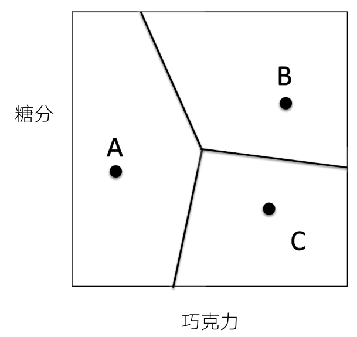

**图 20-4　有三种产品的空间模型（沃罗诺伊邻域）** 

### 唐斯空间竞争模型

接下来，我们应用空间竞争模型来分析政治候选人的意识形态立场“定位”。为了便于讨论，假设候选人都是追求投票最大化，也就是说，他们的首要目标是赢得选举。我们可以从一个简单的例子开始考虑，思考候选人的动机。图 20-5 显示有 13 名选民和两名候选人的两种不同情况。回想一下，前面我们讲过，选民更喜欢立场与自己更接近的候选人。在图 20-5 的上图中，L 表示的自由派候选人获得了 5 票，R 表示的保守派候选人获得了 8 票。在图 20-5 的下图中，自由派候选人向中间位置移动后，获得了 7 票，并赢得了选举。

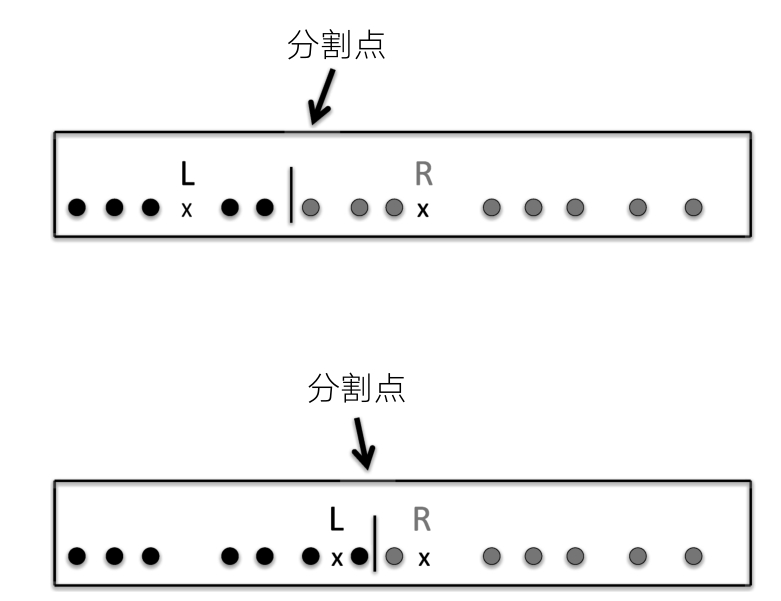

**图 20-5　向中间位置移动的自由派候选人赢得了选举** 

自由派候选人有动机向中间位置移动。同样的逻辑，保守派候选人也有这样的动机。也就是说，保守派候选人可以向左侧移动，同时保持在比自由派候选人更靠右的位置上，从而赢得选举。继续按这个逻辑推理下去，自由派候选人也可以选择更接近中间选民理想点的立场。如果继续应用这个逻辑，我们会看到两个候选人应该会趋同到同一点上。这个结果就是通常所称的中位投票者定理（median voter theorem），或称“中间选民定理”。

中间选民定理又可以分别解释强的形势和弱的形势。在强的形势下，中间选民定理意味着各候选人都来到了中间选民的理想点上，采取了相同的立场，但是这显然不符合经验事实。在弱的形势下，中间选民定理意味着候选人有动机采取较温和的立场，经验证据表明这种情况确实会发生。在选举过程中，候选人会趋向中间立场。当然，这种变化不会演变为一场“夺命狂奔”。意识形态信念坚定或受益于位于意识形态光谱极端位置的核心支持者的候选人，对重新定位会非常谨慎。

这个模型将每个候选人和每个选民都归结为意识形态光谱上的一个简单的点，这是一个强有力的假设。捷克作家和政治家瓦茨拉夫·哈维尔（Václav Havel）对这种基于单维意识形态的模型预测非常不以为然，他认为：

对于永恒徘徊的人类来说，它（意识形态）提供了一个立即可以安身的家园，所有人必须做的就是马上接受它。突然之间，一切都变得清晰了，生活呈现出了新的意义。所有的奥秘，所有悬而未解的问题，所有的焦虑和孤独感，全都消失了。当然，人们必定要为这个“廉租房”付出沉重的代价。这代价就是放弃自己的理性、良心和责任，因为这种意识形态最重要的一个方面就是向更高权威拱手献出自己的理性和良心。 ⁷  

哈维尔没有说错。我们不应该为了意识形态而放弃理性。模型为我们提供了更好的推理工具，这种特殊的模型有助于我们理解为什么政治家会做出那种行为。利用数据，我们可以确定每个政治家在意识形态的左右区间上的位置的可信度。一个总是采取温和立场的政治家，可以充满信心地站在这个区间中间。

顺便说一句。哈维尔否认人可以简化为一点，即可以用数据进行检验的程度。但是，即便他的批评成立，即便不能根据投票记录来确定一个候选人的意识形态立场，我们也并不一定要放弃这个模型。我们可以通过赋予他一个区间（而不是一个点）来代表哈维尔所说的意识形态的不确定性。或者，可以为候选人构建一个意识形态时间序列，看他是否保持前后一致。一项对最高法院大法官意识形态立场的研究表明，对有些法官来说，担任法官的时间长了，立场会变得更加自由。 ⁸  

我们还可以增加模型的维度。一个二维模型可以区分社会政策和财政政策。我们可以用这样的模型刻画在社会政策上采取自由主义立场，同时在财政政策上采取保守主义立场的政客。对于美国国会来说，一个维度的模型可以解释大约 83%的选票变化，加入第二个维度后，解释力只能增加 4%。 ⁹  

除了能够更准确地预测行为之外，增加维度也可能会改变我们的理论结论。我们可以从一个二维模型入手来探讨这个问题。根据对一维模型的分析，我们知道如果第一个候选人在两个议题的立场都不位于中位数上，那么另一个候选人可以通过在第一个议题上采取与第一个候选人完全一样的立场（从而使该议题变得无关紧要），并在第二个议题上采取中位数立场来赢得选举。同样，如果第一个候选人在第一个问题上取中位数立场但是在第二个问题上却没有，那么另一个候选人可以在两个议题上都取中位数立场来赢得选举。由此可以得出这样一个结论，唯一无法被打败的位置是二维中位数。但是，图 20-6 却表明，图中用圆圈表示的二维中位数立场是可以被击败的。如果用方形表示的另一个候选人在第一个问题上取偏左的立场，在第二个问题上取偏右的立场，那么就会产生一条分割线，在这条分割线上，他以三票的优势胜出。

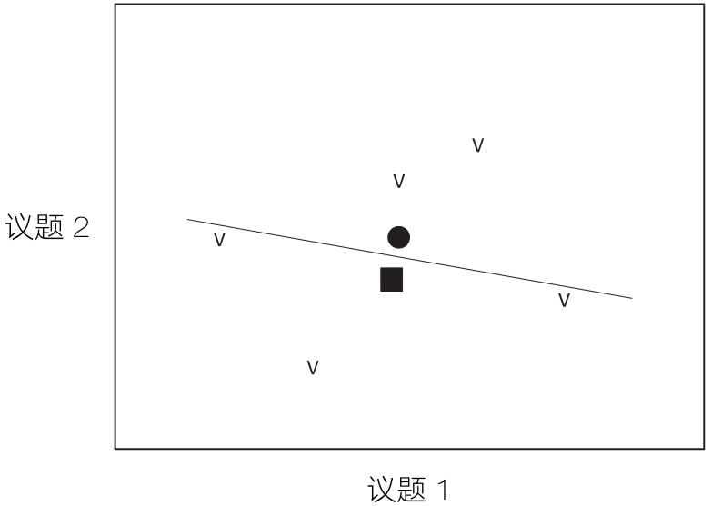

**图 20-6　二维情况下，中位数候选人会输给挑战者** 

从这个例子中，我们还可以直观地看出，当且仅当选民理想点的排列，在从中位数出发的每个方向上都不到一半时，二维中位数才可能是不可击败的，这种情况称为径向对称（radial symmetry）。如果选民的理想点在圆形或正方形上均匀分布时，就满足径向对称，这无疑是一个非常强大的假设。任何位置都是有可能被击败的这个结果，被称为普洛特无赢家结果（Plott's no-winner result），它在两维或多维的情况下都成立。 ¹⁰  

结果的差异非常明显。一维模型意味着候选人要位于中位数立场，高维模型则意味着他们不应该这么做。我们应该相信哪种模型呢？正确的做法是不应该完全相信任何一种模型，而是从这两种模型中都汲取一些洞见。一维模型揭示了追求选票最大的候选人有趋向温和政策的强大动机，高维模型则证明了这些动机的局限性。没有哪个位置可以保证获胜，所以不应该预期会出现均衡。我们应该期待的是复杂性，观察到各路政客时而联盟，时而拆台，纵横捭阖，翻手为云，无休止地为选票竞争。 ¹¹  

我们也可以应用唐斯模型解释美国国会及其各委员会等立法机关和总统制度通过的各种法案的意识形态维度。这里关键是将各个法案映射到与委员会成员相同的单一意识形态维度上。在这里，我们主要考虑三个策略性因素：当前政策的影响（现状效应）、控制议程的权力，以及加入拥有否决权的立法成员的影响。

我们通过一个例子来说明问题。一个由三个人组成的委员会，三位委员的理想点分别为 40、60 和 80，政策提案由理想点为 40 的委员提出，必须得到多数人同意才能通过。图 20-7 表明了现状对最终政策的影响。如果现状是 80，那么这个提案人就需要中间投票人，也就是理想点为 60 的那个委员认为该项提案不比现状差。在这种情况下，中间投票人将接受提案人提出的理想点为 40 的提案，因为它与现状一样好。 ¹²  如果我们将现状移至 70，那么这个中间投票人将会拒绝理想点为 40 的提案，提案者必须提供理想点为 50 的政策。最后，如果现状位于中间选民的理想点 60 上，提案者就没有任何权力。因此，我们可以得出以下推论：当现状具有极端值时，提案者拥有最大的权力。

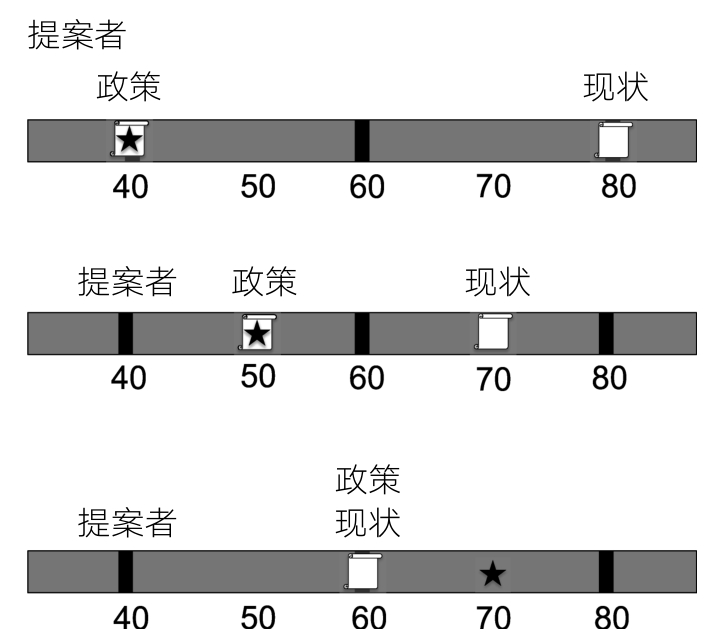

**图 20-7　现状对最终政策的影响** 

这个结果适用于需要人们投票做出决策且意见可以映射到一个维度的任何情况下。假设，一个非营利组织的负责人向董事会提出了一个增加用于资助穷人租用经济适用住房的支出建议，如果当前的支出水平与董事会里面的中位数成员的意愿相符，这个负责人的议程权力就非常有限。如果现行政策与董事会成员的理想点不一致，那么他就可以拥有相当可观的权力。

为了说明提出方案的人所拥有的权力，考虑现状为 70 的情况（如图 20-8 所示）。在图 20-8 中，最上面的图显示的是前面说的那种情况，其中提议者的理想点为 40，并提出了一个理想点为 50 的政策。中间的图显示了中位数投票者能够提议自己的理想点 60，并且能够获得理想点位于 40 的委员会成员的支持票的情况。最下面的图则显示了提议者理想点为 80 的情况。此时，他不能提出他自己和中间选民都更喜欢（甚于现状）的政策，因此只能接受现状。

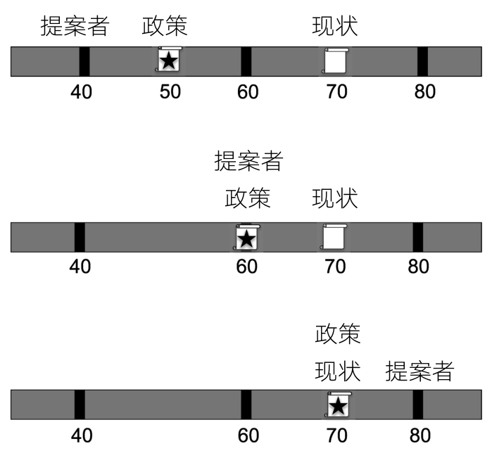

**图 20-8　提案者对最终政策的影响** 

这个假想的例子说明了提案者权力的限度。法案可能会朝着拥有权力的人的理想点的方向靠拢，但是正如在上面已经看到的，对于这种权力会不会过大的担忧，只要考虑一下现状的代表性就可以得到缓解。 ¹³  

最后，我们还可以使用这个模型来讨论多层级政府和更多人拥有否决权的情况。在这里，我们将委员会成员解释为众议院、参议院和总统，并假设要想通过一项法案，必须得到全部这三个投票者的批准。在这种情况下，每一个投票者都拥有否决权。再次参见图 20-8 中现状为 70 的情形。如果所有这三个投票者都必须批准才能做出任何改变，那么任何提案都无法击败现状。任何位于 70 左侧的政策都会被位于 80 处的投票者否决。另一方面，任何位于 80 右侧的政策都会被其他两个投票者否决。 ¹⁴  如果所有这三个投票者都可以否决立法，那么没有任何立法能够通过，除非现状处于 40 到 80 之间，也就是说，如果当前现状位于任何人的理想点的左侧或右侧。这个模型揭示了拥有否决权的投票者的数量和意识形态多样性与出现政治僵局的可能性之间的紧密联系。这是一个具有普遍意义的深刻洞见。拥有多样性否决权的组织很可能无法采取任何行动。

### 享受竞争模型

在享受竞争模型中，各备选项（通常是各种产品）也是用属性来表示的。但是，在这种模型中，属性包括了质量、效率或价格，而且更多或者更少总是更受欢迎的。为了刻画异质性，享受竞争模型允许个体给不同维度赋予不同的权重。

利用线性回归方法，我们可以运用享受竞争模型推断商品属性的隐含价值。具体程序很简单。这种模型假设收益是商品属性和个人赋予权重的线性函数。如果我们获得了数千幢房子的售价以及关于这些房子属性的数据（面积、卧室和浴室的数量，当地学校的质量，院子的大小和建筑质量等），就可以通过产生回归估计出购买房屋的人赋予每个属性的平均权重（以美元计）。这种回归方法通常称为享受回归。

**享受竞争模型** 

备选项包括*N* 个效价属性（valence attribute）：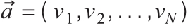。

个体用各个属性上的权重来表示：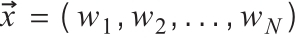。

该个体得自该备选项的收益（效用）为：

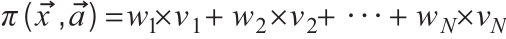

示例：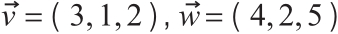

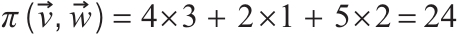

其中有些属性，如一个游泳池或新厨房，则是有市场价格的。作为对模型的一种检验方法，我们可以将估计出来的价格与市场成本比较一下。如果回归结果表明，游泳池使房子的价格增加了 15 万美元，同时建造游泳池的成本却只有 15 000 美元，我们就知道这个模型遗漏了某些属性。如果回归结果表明增加的价值仅为 8 000 美元，那么这可能意味着无法收回加建游泳池的全部成本。

其他属性，例如从房屋到市中心的通勤时间，是没有市场价格的。在这种情况下，回归所能得到的是该属性的隐含价格。需要注意的是，隐含价格也可能包括大量信息。表 20-1 显示了六栋假想房屋的假想价格数据。

**表 20-1　六栋假想房屋的假想价格** 

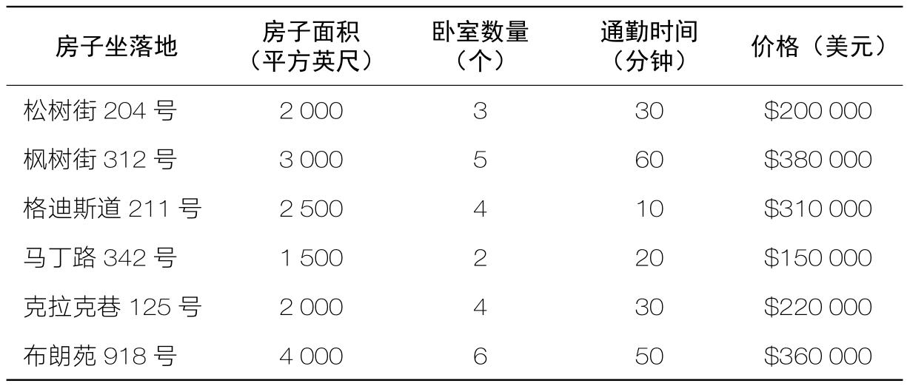

如果假设房子的所有其他属性都完全相同，那么可以运行享受回归。假设得到的回归方程如下：

价格（美元）=100（平方英尺数）+20 000（卧室个数）-2 000（通勤时间）

这就是说，这个回归方程估计，每增加 1 平方英尺的价值为 100 美元，每间卧室的价格为 20 000 美元；另外，通勤时间每增加 1 分钟影响房子价值 2 000 美元。假设一个人买下房子后，要住上 20 年，在 20 年间，上班的总天数为 4 000 天至 5 000 天。如果取较低的那个数字，那么假设用于通勤的时间每天都能省 1 分钟，就能省下 4 000 分钟（或 60 多个小时）的通勤时间。因此，2 000 美元这个估计值相当于每小时 30 美元左右。换句话说，人们为了住在更接近上班地点的房子里而付出的代价，就“好像”是他们为了免受 1 小时交通堵塞之苦而付出了 30 美元一样。 ¹⁵  

### 产品竞争的混合模型

空间竞争模型和享受竞争模型在如何表示对各种属性的偏好这一点上有所不同。在空间竞争模型中，每个人对每种属性都有一个更偏好的水平，而且某个备选项在哪些维度上与他的理想点接近，对他来说价值就越大。而在享受竞争模型中，每个属性越多（或越少），人们就越喜欢。

消费品和服务、理想的生活伴侣、公共政策、宗教，以及求职者，全都既包括空间属性，也包括享受属性。每个人也许都有各自喜欢的薯条脆度，但是所有人都希望每份食品的价格更低。脆度是空间属性，价格则是享受属性。不同的雇主在寻找潜在的雇员时，喜欢的人格特征一般会有所不同。有些企业更喜欢外向的人，也有一些企业可能更喜欢内向的人，但是所有企业都更喜欢诚实和正直的人。个性类型是空间属性，而诚实正直则是享受属性。

因此，我们可以创建一个混合模型，让备选项同时包含空间属性和享受属性。这种混合模型可以用来分析市场进入、产品差异化竞争，以及价格竞争的激烈程度。在此，不妨再分析一下前面讨论过的巧克力棒的例子。在确定新产品的属性之前，打算进入巧克力棒市场的企业可能会先将这三种现有产品放在属性空间中分析，然后给消费者发放问卷，以了解他们理想点的分布状况。这个拟进入者可以估计出自己想推出的产品的沃罗诺伊邻域，如果那个邻域的消费者数量很少，就不应期待产品会热销。

任何考虑进入某个市场的企业家都可以采用这种方法。一个靴子设计师可以绘制出现在所有绝缘靴的设计图（那很可能有数十种），然后他可能会发现没有一种设计是用闪亮漆皮的。设计一个用于制作待办事项列表的智能手机应用程序的开发者，可以列出现有类似应用程序的功能，估计市场总需求并预测可能的销售额。

我们可以将空间竞争模型中的降价行为视为分割线的移动。回顾一下前面的图 20-3，图中显示了两种巧克力棒的情形。分割线对应于那些在 A 巧克力棒与 B 巧克力棒之间无差异的消费者的理想点。如果生产 B 巧克力棒的企业进行了降价促销，并且如果消费者更愿意付出更少的钱来得到同样多的糖果，那么这种降价会把分割线推向 A 并使 B 的市场份额增大。我们不需要模型就知道 B 的降价会增大其市场份额，但是我们确实需要这个模型来估计这种影响的大小。关键在于要将拥挤的市场（crowed market）与稀疏的市场（sparse market）区分开来。前者指在一个低维的属性空间挤进了大量的产品，后者则指市场中只有很少的竞争对手。在拥挤的市场中，每种产品都只有一个小小的沃罗诺伊邻域，而在稀疏的市场中，沃罗诺伊邻域是很大的。

价格变化在这两种不同类型的市场中会产生不同的影响。图 20-9 显示了 B 巧克力降低 10%（假设价格从每根 2 美元下降为 1.8 美元）的影响。左图显示的是一个稀疏的市场中的情形。降低 B 巧克力棒的价格会改变 A 与 B 之间的分割线，并将 B 的市场份额从 50%提高到 54%（B 的市场份额增加了 8%）。价格下降了 10%，但是销量只增长了 8%，综合起来使销售收入减少了 3%。因此，在这种情形下，降低价格不是一个好主意。右图显示的是一个拥挤的市场中的情形，市场中有 7 种不同的巧克力棒。在这里，价格下降对 B 的绝对市场份额影响也不算太大，只是从 15%增加到了 20%，但这 5%的增幅却代表着 B 的市场份额有相当大的增长比例（达到了 33%）。总体影响是使销售收入增加了 20%。 ¹⁶  

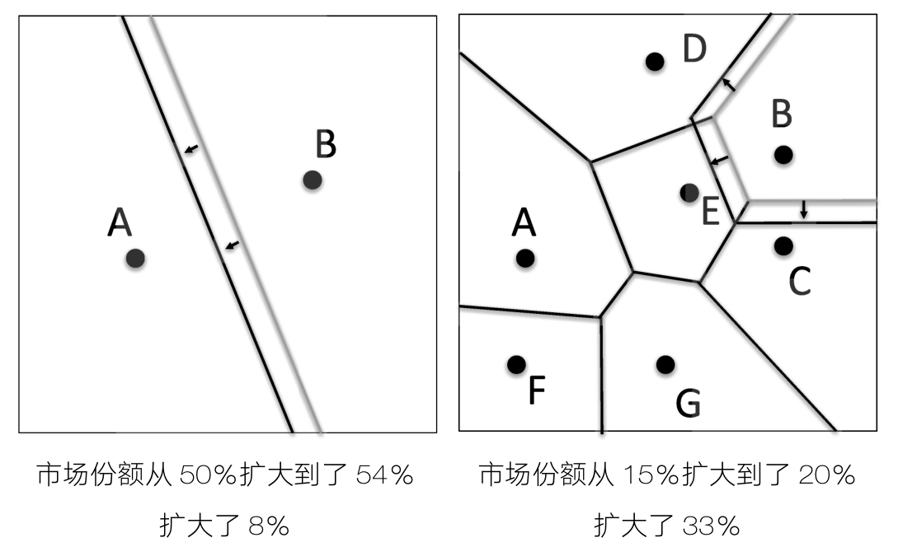

**图 20-9　稀疏的市场与拥挤的市场中的价格竞争** 

因此，这个模型的预测是，拥挤的市场中的价格竞争比稀疏的市场中的价格竞争影响更大；同时，大宗商品 ^((7))  市场上的价格竞争则可以称得上是“极端的竞争”，其影响最大。这个模型还预测，高端时尚商品的价格竞争将很少出现，因为产品的高维性能够创造出一个稀疏的市场，设计师可以维持大幅度的价格加成。

属性数量与价格竞争激烈程度之间的这种关系表明，增加新属性不失为一个好策略。这将使市场更加稀疏，从而降低价格竞争烈度，并带来更高的利润。然而，即便这种推断本身是正确的，要实现这个策略也并不容易。无论如何，人们必定会给新的属性较高的估值。事实上，每一个成功的新属性的出现（例如无绳立体声扬声器），背后都隐藏着多次失败尝试的历史（例如比克公司命运多舛的一次性产品）。

### 小结

空间竞争模型、享受竞争模型，以及两者的混合模型提供了一个很好的框架，在这个框架内，我们可以表征不同的产品、政治候选人，甚至是求职者。这些模型可以测量意识形态“位置”、隐含价格属性，并评估潜在的市场进入者。它们提供了很多深刻的洞见，有助于我们理解市场竞争如何产生差异化的激励、政治竞争如何产生建立联盟的激励，以及只具有较少属性的产品的价格竞争为什么会更加激烈。

这些模型都做出了相当强的、从经验上看相当可疑的假设。例如，在前面讨论的模型中，我们假设人们的偏好是不会改变的，他们不会屈服于社会压力。如果真的是这样的话，为什么企业和政客会花费大量金钱和资源去改变消费者和选民的偏好呢？对于这种批评，我们可以再次援引博克斯的格言来辩解：所有的模型都是错的。

还有一种更精细的回应方法可以对基本偏好与工具偏好加以区分。前者指人们的欲望（想得到什么），后者指人们对能够产生根本性结果的属性的偏好。学生的基本偏好可能会在成为一个受欢迎的人、身体健康和取得学术成就之间维持平衡。为此，一个学生可能会通过提早起床、喝果汁、尽快完成自己的家庭作业（以保证晚上有时间参加社交活动），来实现这些根本性的目标。而这个学生对水果奶昔的选择则是工具性的，水果奶昔有助于实现他对健康的基本偏好。如果哪一天，他看到一篇科学论文说水果奶昔的糖分很高，不利于身体健康，他就可能会改喝饮用水。如果是这样，他的工具偏好就会发生改变，但是他的基本偏好并没有变化。在这里，我们再一次看到，模型本身并不是目的，只是提供了一个框架来构建我们的思维。

**多个价值模型** 

在市场经济中，我们可以通过一个愿意支付的价格来衡量一件商品对这个人的价值。一个人可能会认为一个五香熏牛肉三明治值 7 美元、戈雅（Goya） ^((8))  的一幅画值 300 万美元、佛罗里达州奥卡拉市的一块土地值 75 000 美元。但是，许多经济模型都忽略了这些估值的来源。美国经济学家乔治·施蒂格勒（George Stigler）引用了大文豪陀思妥耶夫斯基（Dostoyevsky）的《卡拉马佐夫兄弟》（The *Brothers Karamazov* ）一书中那个著名的情感主义者米蒂亚（Mitya）说的一句话。他说：“De gustibus non est disputandum。”（口味各异，难言好坏）我们这里所讨论的模型确实比较少讨论口味本身，而更多讨论口味如何转化为人们赋予商品的货币价值。

**享受模型** ：这个模型根据商品的内在属性解释商品的价值。估值的差异取决于对商品属性的不同潜在偏好。这些属性可能是商品的物理组成部分。例如，一个五香熏牛肉三明治中包括了黑麦面包、五香熏牛肉、瑞士奶酪、芥末、泡菜和洋葱。然后，我们可以将它的价值写成这些组成部分的价值的加权线性组合。更精细的享受模型还可以包括交互项。例如，如果与烤黑麦面包一起售卖，那么五香熏牛肉可能会更有价值。 

**协调模型** ：这种模型将价格解释为社会建构的。戈雅画作的价值取决于其他人相信它真的有那么高的价值。在最初，人们对戈雅画作的价值有自己的看法。然后，他们与社会网络中的其他人互动并更新自己的看法。两个人都可以将他们的价值设定为等于两人估价的平均值，一个人可以改变他的估价以匹配另一个人给出的价值，或者每个人都可以根据其他人的估价来调整自己的估价。给定这三种假设中的任何一种，估价都可以实现局部收敛。这样，相互之间有联系的人将会具有类似的估值。分配给商品的最终价值将取决于价值的初始分布、社会网络以及配对发生的顺序。 

**预测模型** ：这类模型将价格解释为对未来价值的预测。根据这种模型，佛罗里达州奥卡拉市的土地价值、比特币或股票价值，都取决于人们将来愿意为它们付出多少钱。这些估值取决于预测模型，而预测模型又取决于属性和类别。我们可能会将奥卡拉市归类为气候温暖的、税率很低的非沿海城市。人们的估值的变化源于不同的预测模型。投资者会使用多种预测模型。这些模型可能依赖于属性，或者，就像对比特币进行估价一样，也会对协调做出假设。