# 从“卖点”到“选票”：用属性空间看懂选择与竞争

玛丽莎·梅耶尔有句提醒：如果连自己卖的是什么，都要靠用户来告诉你，那说明产品定义还没真正想清楚，客户体验也很难好。这个判断背后，其实藏着一个更普遍的问题：我们到底如何理解“选择”？

这一章把个人选择放进“属性空间”里看。买房子看面积、卧室数、浴室数和建筑质量；招生考官看SAT成绩、平均成绩和课外活动；董事会挑董事长、选民挑候选人，也都是在不同维度上做比较。甚至早餐谷物为什么会有那么多品种，也能从这类模型里找到解释。

先分清两类属性。空间型属性没有统一的最优值，每个人心里的理想点不同：夹克颜色、面包厚度、猪排辣度、滑雪下坡角度，都是越接近自己的偏好越让人满意。享受型属性则带有单调性：手机待机越长越好，房间越大越好，鞋底越耐磨越好，汽车越省油越好。现实中的选择大多是混合型，既看空间属性，也看享受属性。模型假设人会选自己估价最高的备选项；以理性行为作基准，好处是容易处理、能给出唯一预测，而且在重复发生、利害关系大的场景里与经验更贴合。空间竞争模型和享受竞争模型在经济学、政治学中应用已久，一个重要原因就是便于用数据检验。

## 一、空间竞争模型：位置、距离与理想点

空间竞争模型假设备选项由一组属性定义，消费者由一组理想点定义。最简单的版本只考虑单一属性，霍特林最早用的就是地理位置。海滩上散落着消费者，两个冰激凌小贩A和B各占一处，每个人都去离自己更近的摊位买。两人之间的中点形成分割点：左侧6个消费者找A，右侧7个消费者找B。这个“位置”还可以抽象化：把两个小贩想成在同一地点卖乳脂含量不同的冰激凌，消费者站的位置就不再是海滩坐标，而是他偏好的乳脂浓度。

唐斯模型进一步把地理空间换成从左到右的意识形态连续轴：A代表自由派候选人，B代表保守派候选人，圆圈代表选民的意识形态理想点，选民更支持立场与自己接近的人。

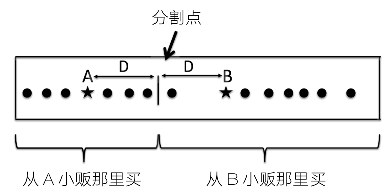

**图20-1　海滩卖冰激凌的地理模型**

从物理位置转向政治立场，难点在于如何把候选人“数字化”。办法之一是看投票记录：先剔除没有意识形态含义的投票，比如所有人都同意设立全国牛奶日这类事项；其余投票由专家判断自由派或保守派倾向，再用候选人投保守派票的时间百分比来定位。始终投保守派的人放在最右端，自由派和保守派各投一半的人放在中间。

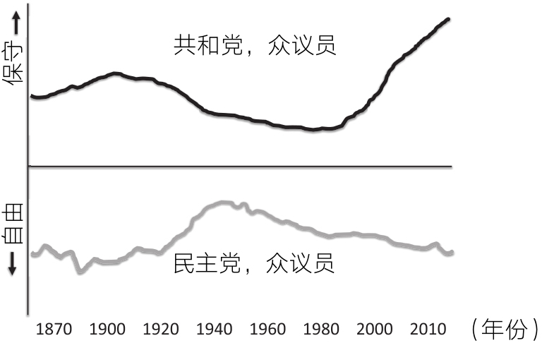

**图20-2　美国国会众议院意识形态极化的加剧**

有研究用这种办法发现，美国民主、共和两党的平均理想点出现了明显且不断加剧的极化，而且主要来自共和党向右转、变得更保守。这里要谨慎：它提供了支持极化加剧的证据，但并不能单凭这一点就下结论说美国政党极化程度必然增加。

## 二、属性一多，选择空间就变了

一般化的空间竞争模型可以容纳任意数量的属性。沙发可以用长度、宽度、深度、结构类型和室内装饰类型来描述；消费者从产品中获得的价值，取决于产品在各维度上离自己的理想点有多远，可以写成常数项减去距离。

**空间竞争模型**

备选项包括*N*个空间属性：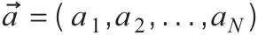。

做出选择的个体的理想点：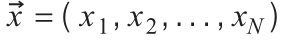。

个体选择了备选项后得到的收益（效用）等于：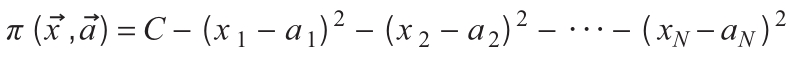，其中，*C*>0是一个常数。

示例：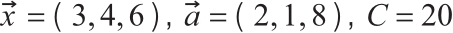

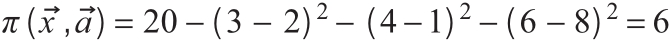

两种巧克力棒可以用可可含量百分比和含糖量来表示。连接两个产品的直线，其垂直平分线就是分割线：理想点在左侧的消费者更偏好A，在右侧的更偏好B。

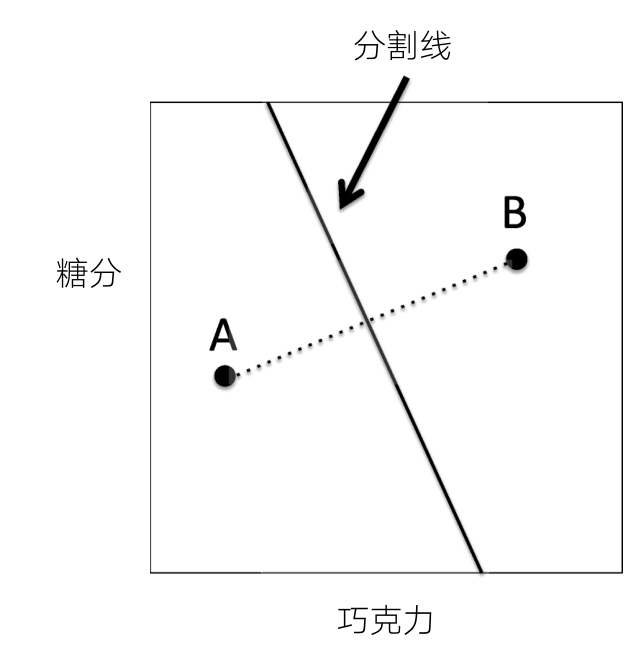

**图20-3　两种巧克力棒的产品属性与分割线**

再加入第三种巧克力棒，无非是在属性空间里多放一个点，再画一条分割线。多条分割线会把理想点空间切成若干区域，这些区域就是沃罗诺伊邻域，按离哪个产品更近来划分消费者的归属。

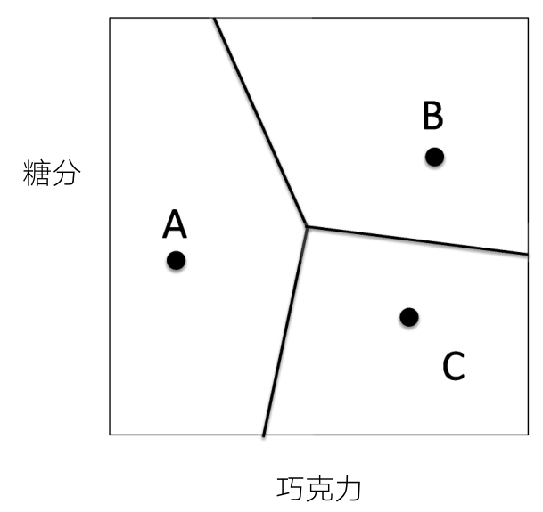

**图20-4　有三种产品的空间模型（沃罗诺伊邻域）**

## 三、唐斯模型：候选人为什么会往中间走

把空间竞争模型用于政治“定位”，可以先假设候选人追求票数最大化，首要目标是赢。图20-5里有13名选民和两名候选人：上图中自由派候选人L拿5票，保守派候选人R拿8票；下图中L向中间移动，拿到7票并赢下选举。

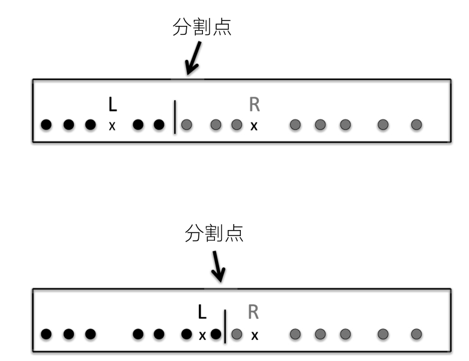

**图20-5　向中间位置移动的自由派候选人赢得了选举**

L有向中间靠的动机，R同样有：R可以向左移，只要仍比L更靠右，也可能赢。继续推下去，两人会趋同到同一点，这就是中位投票者定理，也叫中间选民定理。它有强、弱两种解读：强版本说两人会站到中间选民的理想点上、立场完全相同，这显然不太符合现实；弱版本说候选人有动机采取更温和的立场，经验证据支持这一点。但候选人也不会一路“夺命狂奔”，意识形态信念坚定、或依赖光谱两端核心支持者的人， reposition 时会很谨慎。

哈维尔曾批评这种单维意识形态模型，把人压成一个点；在他看来，意识形态像一个可以立刻安身的廉价住所，代价是交出理性、良心和责任。这个批评有道理，但不必因此丢掉模型。模型只是推理工具：可以把候选人的立场表示成一个区间，而不是一个点；也可以构造意识形态时间序列，观察其是否前后一致。有研究就发现，一些最高法院大法官任职越久，立场会变得越自由。

还可以增加维度。二维模型能区分社会政策和财政政策，刻画出“社会议题偏自由、财政议题偏保守”的政客。对美国国会来说，一维模型大约能解释83%的选票变化，加入第二维只多解释4%。但维度一多，理论结论也会变：二维中位数并非稳赢。图20-6中，圆形是二维中位数，方形挑战者在第一个议题上偏左、第二个议题上偏右，就能画出一条分割线，以三票优势胜出。

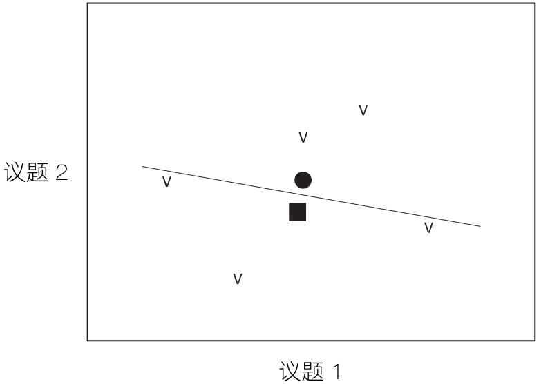

**图20-6　二维情况下，中位数候选人会输给挑战者**

二维中位数要想不可击败，需要选民理想点从中位数出发的每个方向上都不到一半，这叫径向对称；选民理想点均匀分布在圆形或正方形上时才满足，条件很强。更一般地，任何位置都可能被击败，这就是普洛特无赢家结果，在两维或多维中都成立。所以，一维模型和高维模型不该二选一：一维揭示了候选人追求选票时趋向温和的强大动机，高维则说明这种动机有边界。没有哪个位置能保证获胜，也不该期待稳定均衡；更该期待的是复杂局面——联盟、拆台、纵横捭阖、无休止的选票竞争。

## 四、立法与议程：现状、提案权与否决权

唐斯模型还能用于国会、委员会和总统制度：把法案映射到与委员会成员相同的意识形态维度上。这里要看三个策略因素：现状效应、议程控制权、拥有否决权的成员。

设想三人委员会，理想点分别是40、60、80，提案者理想点为40，提案须多数通过。现状为80时，中间投票人60会比较提案40与现状80：两者离他的理想点一样远，因此可以接受。现状移到70，中间投票人会觉得提案40不如现状70，提案者就得拿出50。现状正好在60时，提案者几乎没有议程权力。结论是：现状越极端，提案者的权力越大。

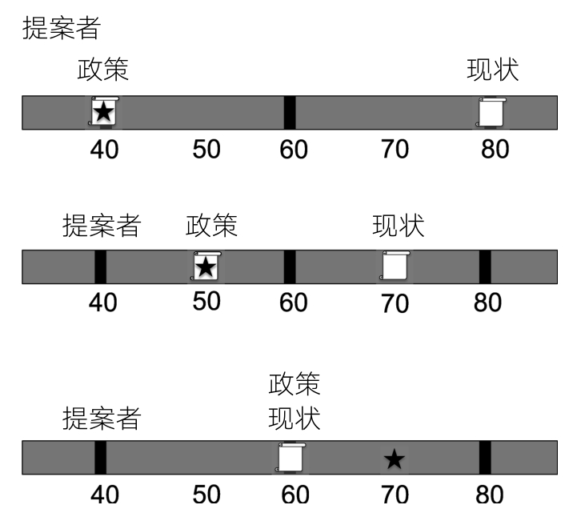

**图20-7　现状对最终政策的影响**

这个逻辑适用于任何“投票决策、意见可映射到一维”的场景。非营利组织负责人向董事会提议增加穷人租住经济适用房的支出：如果现行支出水平正好接近董事会中位成员的意愿，他的议程权很有限；如果现行政策与中位成员理想点差得远，他的操作空间就相当可观。

图20-8展示了提案者的影响：现状为70时，上图里理想点40的提案者提出50；中图里中位投票者可以提自己的理想点60，并得到40成员的支持；下图里提案者理想点为80，他提不出让自己和中间选民都比现状更满意的政策，只能接受现状。

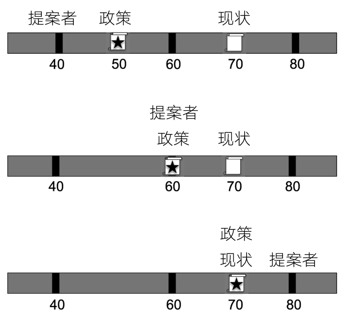

**图20-8　提案者对最终政策的影响**

这说明提案者权力有边界。法案可能向有权力者的理想点靠拢，但担心这种权力过大时，看看现状的代表性，往往能缓解焦虑。

再往上看多层级政府和多重否决权：把委员会成员解释成众议院、参议院和总统，法案必须三者全部批准。每个投票者都有否决权。以现状70为例，任何向左移动都会被理想点80的投票者否掉，任何向右移动又会被另外两位否掉。否决者越多、意识形态越分散，政治僵局越容易出现；一个拥有多样性否决权的组织，很可能什么行动都推不动。这是模型给出的普遍洞见。

## 五、享受竞争模型：越多越好，但权重因人而异

享受竞争模型里，备选项同样用属性表示，不过属性通常是质量、效率或价格，而且更多或更少总是更受欢迎。为了刻画异质性，模型允许不同个体给不同维度分配不同权重。

用线性回归可以估计商品属性的隐含价值，做法叫享受回归。比如拿到数千套房子的售价和属性数据——面积、卧室和浴室数量、当地学校质量、院子大小、建筑质量等——就能估计买房人平均愿意为每个属性支付多少美元。

**享受竞争模型**

备选项包括*N*个效价属性：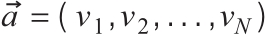。

个体用各个属性上的权重来表示：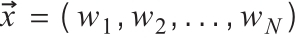。

该个体得自该备选项的收益（效用）为：

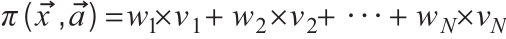

示例：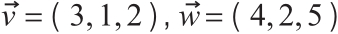

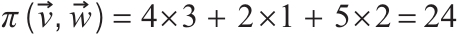

有些属性有市场价格，比如游泳池或新厨房，可以用估计值对照成本来检验模型。如果回归显示游泳池让房价增加15万美元，而建造成本只有1.5万美元，说明模型漏掉了某些属性；如果只增加8000美元，则可能意味着加建泳池的成本收不回来。另一些属性没有明确市场价格，比如到市中心的通勤时间，回归得到的是隐含价格，而隐含价格本身也可能包含大量信息。表20-1给出了六栋假想房屋的假想价格。

**表20-1　六栋假想房屋的假想价格**

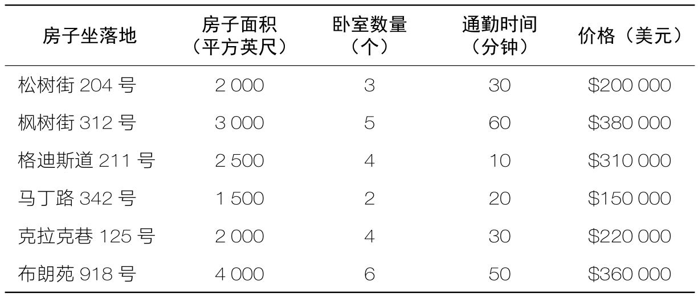

若假设其他属性都相同，就可以运行享受回归。假设得到的回归方程如下：

# 从房价公式看通勤的时间成本，以及市场拥挤度如何放大价格战

价格（美元）=100（英尺平方数）+20 000（卧室数）-2 000（通勤分钟数）

这组回归估计给出了三个方向：面积每增1英尺平方，估价约增100美元；卧室每多1间，估价约增2万美元；通勤每多1分钟，估价约减2000美元。把居住期设为20年，年均上班日约200天左右，20年累计约4000~5000个工作日。取保守端4000天，若每日通勤缩短1分钟，20年累计可节省4000分钟，约合60多个小时。于是2000美元这一系数相当于每小时约30美元。换言之，消费者愿意为更近的居所支付的溢价，相当于为规避一小时拥堵支付30美元。¹⁵

## 空间偏好与享用偏好，拼出混合框架

空间竞争框架与享用竞争框架对偏好表达方式不同。前者假设每个人对每个属性都有一个偏好的点位，选项离该点越近越受青睐；后者则认为属性越多或越少，偏好越强。

现实生活中，消费品、理想伴侣、公共政策、宗教信仰、招聘筛选，都同时包含空间型属性与享用型属性。以薯片为例，脆度偏好因人而异，属于空间型；价格越低越受欢迎，属于享用型。再看招聘，外向或内向属于空间型差异，诚实正直则是所有企业都追求的享用型特质。

把两类属性结合，就得到混合框架。它可用于剖析市场进入、产品差异化以及价格较量强度。以巧克力棒为例，想进入这块市场的企业会先把现有几款产品映射到属性空间，通过问卷把握消费者理想点分布，进而估算新品可覆盖的沃罗诺伊区域。若该区域内潜在买家稀少，则热销预期要打折扣。

该方法可迁移。鞋履设计师可把市场上现有的绝缘靴款式全部摊开，或许会发现几十种款式里缺少亮面漆皮；开发待办清单类手机App的团队，可盘点竞品功能，估算整体需求并推演可能的销售额。

## 降价即分割线移动，稀疏与拥挤反应迥异

在双产品情形下，分割线对应无差异消费者的理想点。若B款降价且消费者对价格敏感，分割线会朝A移动，B份额扩大。降价提升份额是直觉，但提升幅度需模型量化。关键区分在于市场拥挤度：低维属性空间里挤入大量产品属于拥挤，竞争者屈指可数的属于稀疏。拥挤时每款产品的沃罗诺伊邻域很小，稀疏时邻域很大。

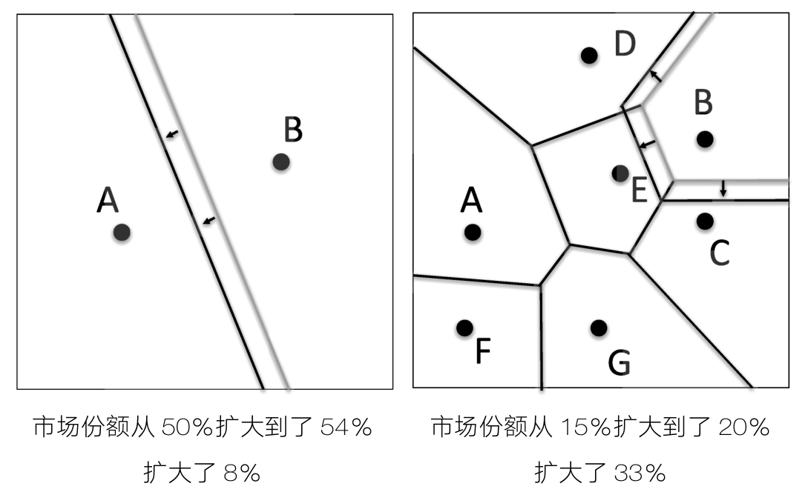

**图20-9 稀疏市场与拥挤市场中的价格竞争**

图20-9刻画了B巧克力降价10%的情形，价格由2美元降至1.8美元。左侧为稀疏：分割线移动后B份额从50%升至54%，相对增幅约8%。价格降10%，销量仅增8%，收入反而减少约3%，降价得不偿失。右侧为拥挤，市场共7种巧克力棒：B份额从15%升至20%，绝对增幅5个点，相对增幅约33%，收入增约20%。

由此可得结论：拥挤市场里价格战的传导更强；大宗商品市场可视为极端拥挤，价格较量最激烈。模型也预测，高端时尚品价格战较少，因其高维度属性创造出相对稀疏的结构，设计师能维持较高加成。

属性维度与价格较量激烈程度呈负相关，增加新维度能使市场显得更稀疏，削弱价格战，抬高利润。但操作难度大，消费者必须真实地赋予新维度价值。成功的新维度如无绳立体声背后，往往有多次失败尝试，比如比克公司的一次性产品尝试。

## 模型的启示与局限

空间模型、享用模型及其混合提供了表征产品、政治人物、求职者的通用语言，可度量意识形态位置、隐含属性价格、评估进入可行性。它揭示市场对弈的差异化激励、政治对弈的结盟激励，以及属性越少价格较量越激烈的规律。

这些框架假设偏好稳定且不受社会压力影响，这在经验上存疑。若偏好真不变，企业和政客为何投入资源去塑造偏好？可援引Box的格言：所有模型皆错，但有用。

更精细的区分是基本偏好与工具偏好。前者是欲望本身，后者是对能达成欲望的属性的偏好。学生可能在受欢迎、健康、学业间寻求平衡。为达成这些目标，他会早起、喝果汁、早做作业以腾出社交时间。对水果奶昔的选择是工具性的，因其服务健康这一基本偏好。若研究显示奶昔糖分高，他可能改喝白水。工具偏好变了，基本偏好未必变。模型只是思维脚手架，而非答案。

## 价值的三种解释视角

市场经济里，价值常通过支付意愿衡量。有人愿为五香牛肉夹饼付7美元，为戈雅的画作付300万USD，为佛罗里达奥卡拉的土地付75000美元。许多模型忽略估值来源。施蒂格勒引用陀思妥耶夫斯基《卡拉马佐夫兄弟》中米蒂亚的话：口味各异，难以评判。我们讨论的模型较少讨论口味本身，更关注口味如何转化为货币支付。

**享用模型**：从商品内在属性解释价值。估值差异源于对属性的差异化偏好。属性可视为物理组成，如牛肉夹饼含黑麦面包、腌牛肉、瑞士奶酪、芥末、泡菜、洋葱，价值可写成各组成价值的加权线性组合。更精细版本可加入交互项，例如与烤面包搭配时牛肉的价值会提升。

**协调模型**：把价格视为社会建构。戈雅画作的价值依赖他人是否相信其高价值。起初每个人有自己的看法，随后在社群网络中互动更新。两人可取平均估价，一人可向另一人对齐，或各自根据他人调整。任一机制都可能带来局部收敛，联系紧密的人估值趋同。最终价格取决于初始分布、网络结构与配对顺序。

**预测模型**：把价格视为对未来价值的预期。奥卡拉土地、比特币、股票的价值取决于未来愿意支付的金额。估值依赖预测框架，而框架依赖属性与分类。我们可能把奥卡拉归类为温暖、低税、非沿海城市。估值变化源于预测框架的差异。投资者使用多种框架，有的依赖属性，有的如比特币估值那样对协调做假设。

总体而言，这些视角不是提供标准答案，而是提供观察工具：通勤如何被定价，产品如何借助属性差异避开价格战，价值如何在个人偏好、社会互动与未来预期间被塑造。