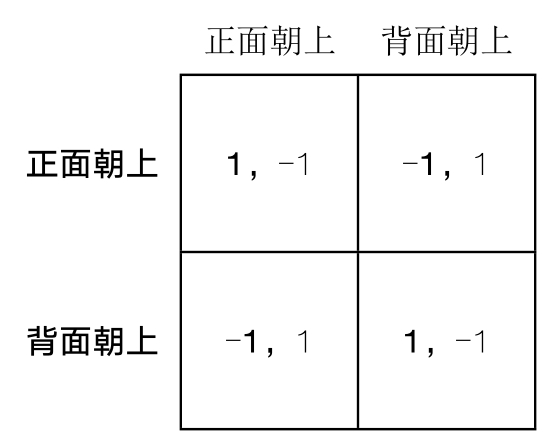
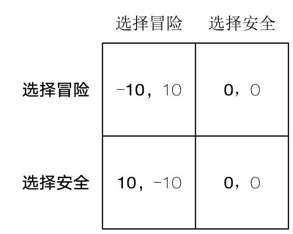
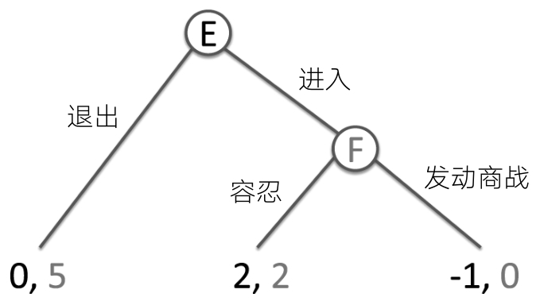
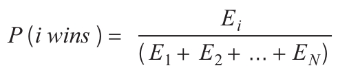
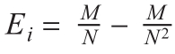

# 21　博弈论模型

演绎推理是从最抽象到最不抽象的推理。它从一套公理开始，运用逻辑定律和数学规律来操纵，形成对世界的预测。

雷切尔·克罗松（Rachel Croson）

本章以及随后各章中讨论的许多模型，包括合作模型、信号模型、与机制设计有关的模型和与集体行动有关的模型都要涉及博弈。我们不会在这里非常深入地探讨博弈本身，因为实际上整本书都是讨论这个主题的。本章的目标是提供一个适当的入门介绍，为此，我们给出了三种主要类型的博弈的一些例子：标准式博弈，博弈参与者在一组离散的行动（通常为两种）中做出选择；序贯博弈（sequentail game），博弈参与者按顺序选择行动；连续行动博弈，博弈参与者可以选择任意尺度或效果的行动。我们通过这些例子介绍了博弈的主要概念，有助于理解后面章节中给出的模型。当然，它们本身也有讨论的价值。

在本章的其余部分，我们首先讨论 2×2 标准式零和博弈。在零和博弈中，两个博弈参与者中的每一个都要在两个行动中做出选择，无论某个博弈参与者选择什么行动，一个博弈参与者得到的收益，都会被另一个博弈参与者遭受的损失所抵消。我们利用零和博弈的例子来定义博弈论的基本术语，区分策略和行动，并引入迭代消除被占优策略的概念。然后，研究市场进入博弈（market entry game），市场进入博弈是序贯博弈的一种。我们将在重复市场进入博弈的框架下讨论所谓的连锁店悖论（chain store paradox）。接着，考虑一个“努力博弈”，这是一种连续行动博弈。在这个博弈中，个体选择努力水平以赢得固定金额的奖励，付出努力越大，博弈参与者赢得奖励的机会越高。本章最后简要讨论了博弈论模型的一般价值。

### 标准式零和博弈

在本节中，我们分析两个双人标准式零和博弈（two-player normal-form zero-sum games）。在这种博弈中，每个博弈参与者选择一个行动，并根据博弈参与者自己的行动和另一个博弈参与者的行动获得一定收益。此外，博弈参与者双方的收益总和为零。

在图 21-1 所示的第一个硬币配对博弈中，每个博弈参与者都要在两个行动中做出选择：猜硬币正面朝上还是背面朝上。行博弈参与者希望自己的选择与另一个博弈参与者的选择匹配，而列博弈参与者则不希望匹配。收益如矩阵所示：

**图 21-1　硬币配对博弈** 

博弈的策略是如何进行博弈的规则，它可以是对单个动作的选择、在不同行动之间的随机化，或者，正如在下一节中将会看到的，也可以是一个行动序列。博弈的纳什均衡（Nash equilibrium）是指这样一种策略，它们能够使每个博弈参与者的策略在给定其他博弈参与者策略的情况下是最优的。在硬币配对博弈中，存在一个唯一的均衡策略，那就是，两个博弈参与者都以相同的概率在两个行动之间进行随机化。为了证明随机化是一种均衡，只需要证明，如果某个博弈参与者随机化，那么另一个博弈参与者选择任何行动都不可能比随机化更好。

要证明这一点很简单。如果行博弈参与者（在图 21-1 中，行博弈参与者的行动以黑体显示）以 1/2 的概率选择正面朝上、1/2 的概率选择背面朝上，无论他的选择到底是什么，列博弈参与者的收益都为零。正因为如此，随机化是列博弈参与者的最优策略。根据对称性，随机化也是行博弈参与者的最佳选择。

随机化策略的最优性，对策略互动环境中的行为有很大的意义。体育运动也是零和博弈：一方获胜，另一方就要落败。在点球大战中，一名前锋希望在瞄准球门左侧与球门右侧之间进行随机选择；在网球比赛中，发球方要随机将球发到内角或外角；在足球比赛中，进攻方希望在跑动与传球之间随机选择。而且，在所有这些比赛中，另一方也会随机化他们的反应。任何非随机性都可能会被对手利用，扑克等纸牌游戏也是如此。一个优秀的扑克玩家会随机地虚张声势。如果他一直虚张声势，对手就会了解这种策略，他就会落败。当然，对手的最优策略也是随机地虚张声势，这样就同样有可能赢或输。

现在讨论最小化风险博弈（minimize risk game）。在图 21-2 所示的这个博弈中，每一个博弈参与者都可以选择采取冒险的行动或安全的行动，这是一个非对称的零和博弈。博弈参与者的收益不仅取决于自己的行动，还取决于哪一个博弈参与者采取了哪一个行动。在这个博弈中，行博弈参与者有一个占优策略，即采取安全的行动。无论列博弈参与者选择哪一个种动作，对于行博弈参与者来说，选择安全的行动总是更好的。但是对于列博弈参与者来说，情况却并非如此。如果行博弈参与者选择冒风险，那么列博弈参与者也应该选择冒风险；如果行博弈参与者选择了安全的行动，那么列博弈参与者也应该选择安全的行动。

**图 21-2　最小化风险博弈** 

通过考虑对行博弈参与者激励的情况下，列博弈参与者可以推断出行博弈参与者总是会选择安全的行动，那么他也会选择安全的行动。这种一方为另一方排除最优策略被称为迭代消除被占优策略。因此，两个博弈参与者都选择安全的行为是这个博弈的纳什均衡。

### 序贯博弈

在序贯博弈中，博弈参与者按照某个特定的顺序采取行动。由此，可以用一棵博弈树（game tree）来表示一个序贯博弈。博弈树由节点和边组成，每个节点对应于博弈参与者必须采取行动的时刻，该节点的每条边分别表示可以采取的某个行动。在博弈树最末尾的分支上，我们写下相应行动路径的收益。图 21-3 所示的博弈树显示了市场进入博弈。

在市场进入博弈中，有两个博弈参与者：拟进入者和现有企业。如果拟进入者选择不进入市场（博弈树的左侧分支），那么它的收益为零，现有企业的收益为 5。如果拟进入者决定进入市场，那么现有企业必须做出选择：是接受新进入者，同时自己的收益从 5 下降为 2，还是发动与新进入者的商战，但这会导致自己的收益变为零，同时令新进入者的收益为负。之所以假设这种情况下新进入者的收益为负，因为它必须为进入市场付出一定的成本。

**图 21-3　市场进入博弈** 

在序贯博弈中，策略对应于每个节点处的行动选择。假设现有企业在发现有新企业进入时决定发动商战。那么，如果拟进入者知道这一点，就不会选择进入，因为这种情况下进入会产生负收益。这个行动序列——拟进入者选择不进入、现有企业在拟进入者进入时就会发动商战，是一个纳什均衡。然而，这并不是唯一的纳什均衡，也不是最有可能出现的结果。拟进入者选择进入市场，现有企业决定接受（不发动商战），这是第二个均衡。

那么，应该如何在这两个均衡之间做出选择呢？我们可以利用细化准则。在序贯博弈中，一种常见的细化准则是选择子博弈完美均衡（subgame perfect equilibrium）。可以运用逆向归纳法（backward induction）来求解子博弈均衡：从最末端的节点开始，并在每个节点处选择最优行动。然后沿着博弈树逆向倒推，假设每个博弈参与者会在给定另一个博弈参与者在后续节点上的行动时选择最优行动。例如，在市场进入博弈中，我们从现有企业的末端节点开始推导。它有一个最优行动，即接受对方进入。然后移动到博弈树上面的节点，不难发现拟进入者的最优策略是进入。

这个博弈在重复进行时会变得更加有趣。试想一下，现有企业也可能存在于许多个市场中。也许它是一家连锁企业，在几十个城市都有门店。再假设存在一系列的拟进入者。那么，这个企业将陆续地进行一系列市场进入博弈。

如果现有企业从最后一个市场开始使用逆向归纳法进行推理，那么它将接受最后一个市场中的进入者。根据同样的逻辑继续推导，现有企业将接受倒数第二个市场中的进入者，以此类推，它将接受所有市场中的进入者。在序贯博弈唯一的子博弈完美均衡中，所有潜在的进入者都选择进入，现有公司接受所有。

虽然每个市场的进入和接受都是唯一的子博弈完美均衡，但实际上，这可能不会发生。假设我们是现有公司董事会的成员，我们面对的是第一个进入者曾经学过博弈论并已经进入市场。我们可能想要竞争，试图阻止其进入其他市场。如果竞争是可信的，那这将是一个明智的策略，也就是说，如果能够建立一个愿意竞争的声誉。我们希望创造的结果不同于子博弈完全均衡。

博弈理论家将这种情况称为连锁店悖论。这是一个例子，博弈论认为的最优行为可能不是一个老练的行为者在利害关系很大时所选择的行为。这个例子并没有反驳博弈论或破坏理性选择假设，而是揭示了为什么我们总是必须挑战假设。

### 连续行动博弈

我们现在研究另一种博弈。在这种博弈中，博弈参与者可以在连续的可能行动集中进行选择。在连续行动博弈中，行动对应于努力水平。通过选择更大的努力，博弈参与者能够增大自己赢得奖励的概率。这个博弈还允许考虑任意大数量的博弈参与者。

**努力博弈** 

*N* 个博弈参与者中的每一个人都要选择以货币形式表达努力水平，以赢得价值为*M* 的奖励。一个博弈参与者赢得奖励的概率等于他的努力水平除以所有博弈参与者的总努力水平。如果令*E* * [i] * 表示博弈参与者*i* 的努力水平，那么他的获胜概率由以下方程式表示： ¹  

均衡努力水平为：

均衡努力水平的表达式揭示了很多重要的含义，正如我们所预料的那样，个人的努力水平会随着奖金的增多而增大。同样，在均衡状态下，总努力水平将会小于奖金的价值。在假设博弈参与者会进行最优化的情况下也会得到这些结果。博弈参与者应该付出一定努力以赢得奖励，但是不应该付出不合理的努力水平。

通过增加博弈参与者的数量，可以看到其对个人和总体努力的影响。根据模型，即便每个人的努力水平都下降了，总努力水平也会增加。这个结果说明，那种吸引了大量“参赛者”的研究课题竞标、建筑设计竞赛和征文比赛，反而可能会产生水平不那么优异的赢家（与“参赛者”较小的竞赛相比），因为在这种“参赛者”众多的竞赛中，个体参与者付出的努力水平会较低。

### 小结

本章一开始，我们先讨论了零和博弈，这类博弈不包括互利的行动组合。任何对一个博弈参与者有益的行动都必定会损害另一个博弈参与者。在零和博弈中，任何行为对一方的“益”，在数量上都等于对另一方的“损”。从一个人那里拿钱给另一个人，就是一种零和行动。许多个人行动和政策选择至少在一个方面是零和的，我们每天只有这么多的时间可用，这么多钱可花，这么多资源可分配。也就是说，在这个维度上的零和行动，在另一个维度上可能不是零和的。例如，重新安排预算，在货币的数量这个维度上是零和的，但是就人的幸福感或满足程度这个维度而言，却可能是正和的或负和的。

我们应该始终探究提议的政策变化是否会导致零和博弈。许多人都对家长的择校行为颇有微词（这里所说的择校问题，主要是父母将孩子送进什么样的学校学习的能力），因为它加剧了竞争。但是迫于竞争的压力，学校的教学质量将会得到提高，至少从逻辑上看是这样。

然而，只有在产能过剩的情况下，学校才有动力提高质量，否则，择校会在学生中造成零和博弈。假设一个城市有 1 万名学生和 10 所学校，每个学校可以接受 1 000 名学生。如果所有学生都以相同的方式对学校进行排名，那么最好的学校的名额将只能通过抽签来分配，中签的学生将去更好的学校，未中的学生将去更差的学校。学生们玩的是一场零和博弈。如果新的学校开放或现有学校改善，就将不再是零和博弈，每个人都可以赢。

市场进入博弈与零和博弈都提供了有益的洞见。市场模型揭示了学校改进质量的动力。零和博弈则表明有些学生将受益、有些学生将受损。每个人所承受损害或获得的收益的大小，则取决于具体情况：学生和家长对学校的质量的了解程度如何，学校还有存在多少剩余名额，学校是否真的知道如何提高教学质量，会创办新的学校吗？

这两个博弈都没有给我们一个正确的答案，但是都产生了有用的见解。择校会带来竞争。它还产生了一个具有零和博弈特征的大规模排序问题。竞争的积极方面是否会超过消极的排序成本取决于环境。我们必须把模型排列在一系列事实的基础上，才能做出正确的政策选择。

**识别问题** 

关于人们行为的数据经常揭示出人类行为的“聚类倾向”。优秀的学生更有可能与其他优秀的学生成为朋友，而不怎么可能与学习困难的学生成为朋友。有过犯罪前科的人比从未犯过罪的人更有可能与犯罪的人交往。在社交网络中，各种各样的“社会善”和“社会恶”——吸烟嗜好、健美的人、肥胖者，甚至幸福也都会“聚类”。人们还会根据信仰或意识形态聚在一起。

有两个模型可以解释这种聚类：同伴效应模型（peer effect model）和分类模型（sorting model）。同伴效应模型用博弈论来解释聚类现象，即一个人与他的朋友一起进行协调博弈。而在分类模型中，人们会“迁移”到与他们相似的其他人附近。一群优秀的学生之所以聚在一起，可能是因他们要协调完成某个共同行动（同伴效应），或者也可能是因为优秀的学生就喜欢找优秀的学生一起玩（分类效应）。如果只有数据快照（snapshot of data），那么这两者是无法区分的。

**数据** ：学生既有可能获得高分 H，也有可能获得中等分数 M，两者是等可能的（概率相同）。假设每一个学生都会加入某个人数为 4 的“小团体”，则有如下分布： *p* （{H，H，H，H}）=P（{M，M，M，M}）=5/16， *p* （{H，H，H，M}）= *P* （{M，M，M，H}）=3/16， *p* （{H，H，M，M}）=0。 

**同伴效应模型** ：学生最初先会形成一些人数为 4 的随机小组： *p* （{H，H，H，H}）=P（{M，M，M，M}）=1/16， *p* （{H，H，H，M}）= *P* （{M，M，M，H}）=1/4，并且 *p* （{H，H，M， M}）=6/16。属于仅包含一种类型的小组的人数保持不变。与小组内所有其他人类型都相反的人会切换类型，因此，{H，H，H，M}这样的小组会变为{H，H，H，H}。在每种类型的人数相同数量的小组中，会有一个成员切换类型，也就是说，{H，H，M，M}这样的小组有同样的概率会成为{H，H，H，M}或{M，M，M，H}。 

**分类模型** ：学生最初先会形成一些人数为 4 的随机小组。在具有两种类型的任何一个小组中，与至少两个其他人的类型相反的人，会与相反类型的某个人交换小组。也就是说，{H，H，H，M}会变为{H，H，H，H}，而且{M，M，M，H}会变为{M，M，M，M}；并且，任何{H，H，M，M}这种形式的小组有同样的概率成为{H，H，H，M}或{M，M，M，H}。 

两个模型都与数据一致，从而导致了识别问题。只有数据快照，我们无法确定吸烟、看漫画书或喜欢滑板到底因为同伴效应导致的，还是因为分类效应导致的。在某些情况下，我们可以推断出使用哪种模型更好。例如，美国中西部地区的人们喜欢说“pop”（泡泡）、沿海地区的人们喜欢说“soda”（苏打），对于这种倾向，我们可以有把握地认为这是由同伴效应驱动的，因为很少从外地移居波士顿的人，会将可口可乐称为“苏打水”。但是，对于某些利害关系更大的行为，例如学业成绩、滥用药物、肥胖和幸福，就需要用更多的时间序列数据来识别哪种模型才适用了。利用时间序列数据，我们就可以分辨出人们到底是在改变自己的行为（同伴效应），还是在更换他们的朋友（分类效应）。在许多情况下，这两个因素都有。 ² 