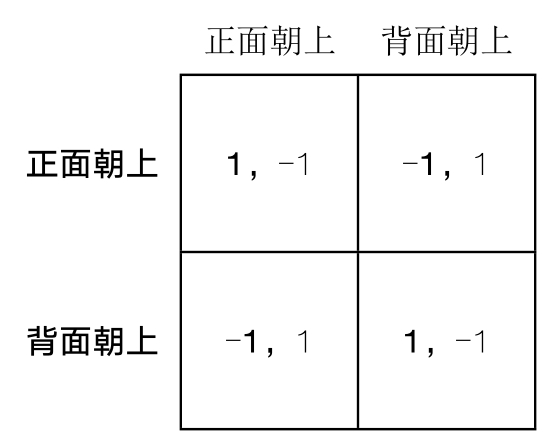
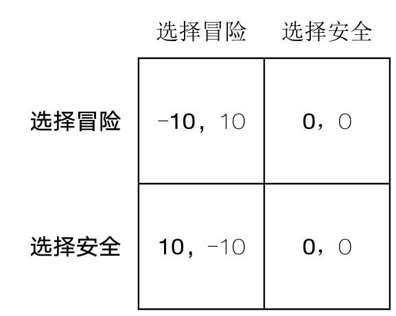
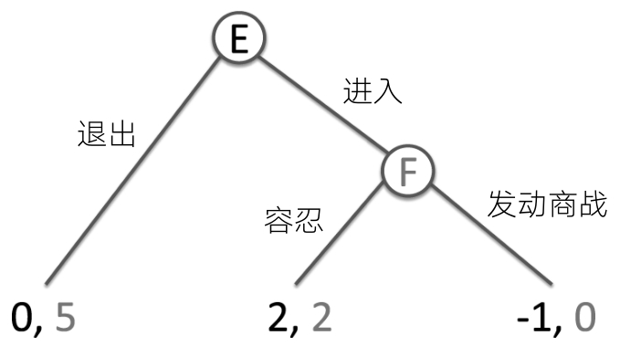
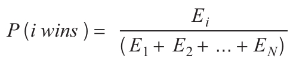
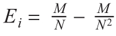

# 博弈论模型

演绎推理是从抽象到具体的一种推演方式。它以一组公理为起点，借助逻辑法则和数学规则进行操作，从而对世界做出预测。

雷切尔·克罗松 Rachel Croson

本章及后续章节里会反复出现的合作模型、信号模型、机制设计有关的模型以及集体行动有关的模型，都离不开博弈的框架。我们在这里不会对博弈本身做系统性深挖，因为整本书的脉络就是博弈。本章的任务是提供一个可用的入门导览，为此我们给出三种典型博弈形态的实例：标准式博弈，玩家在若干离散行动通常是两种中挑选；序贯博弈，玩家按先后顺序出招；连续行动博弈，玩家可以从一个连续的行动区间中任意选择。我们借助这些例子把博弈的核心概念带出来，便于理解后面章节的具体模型。它们本身也具备独立的讨论价值。

本章剩余部分先从 2×2 的标准式零和博弈谈起。零和博弈里，两个玩家各选两种行动中的一种，某一方得到的收益恰好抵消另一方所受的损失。我们用零和博弈来界定博弈论的基本术语，区分策略与行动，并引入迭代剔除劣势策略的思想。随后研究市场进入博弈，这是一种典型的序贯博弈，并在重复的市场进入情境下讨论连锁店悖论。接着看一个努力博弈，属于连续行动博弈。参与者投入努力以争取一笔固定奖金，努力越大中奖概率越高。最后简要评议博弈论模型整体的价值。

### 标准式零和博弈

这里分析两类双人标准式零和博弈。每个玩家做出行动选择，收益取决于自己的选择与对手的选择之组合，且双方收益之和恒为零。

第一个例子是硬币配对。双方各猜正面或反面。行玩家希望自己的猜测与列玩家一致，列玩家则希望不一致。收益矩阵如图所示：

**图 21-1　硬币配对博弈** 

博弈的策略是指玩法规则，它可以是单一行动的选择，也可以是在不同行动之间的随机化，或如后文所示的一个行动序列。纳什均衡是指这样一组策略，使得在给定对手策略的情况下，每个玩家的策略都是最优的。硬币配对博弈存在唯一的均衡：双方都以相同概率在两个行动上随机化。要证明随机化最优，只需说明对手随机化时，自己任意确定行动都不会比随机化更好。

证明很直观。若行玩家以 1/2 的概率选正面、1/2 的概率选反面，那么无论列玩家怎么选，其期望收益都是零。因此随机化对列玩家是最优的。由对称性可知，随机化对行玩家也是最优的。

随机化最优的含义在策略互动中很关键。体育竞技本质上也是零和：一方赢，另一方输。点球大战中，前锋在左、右之间随机选择；网球发球在内角、外角之间随机；足球进攻在带球、传球之间随机。另一方也会相应随机化。任何可预测的模式都会被对手利用，纸牌游戏如扑克亦然。优秀的扑克玩家会随机诈唬。若他总是诈唬，对手就会识破并反击。同样，对手的最佳应对也是随机诈唬，让胜负保持不确定。

再看最小化风险博弈。图 21-2 中，每位玩家都能选择冒险或保守，这是一个非对称的零和结构。收益不仅取决于自身行动，还取决于谁采取了何种行动。行玩家存在占优策略，即选择保守。无论列玩家怎样，行玩家选保守总是更好。而列玩家没有占优策略：若行玩家冒险，列玩家也该冒险；若行玩家保守，列玩家也该保守。

**图 21-2　最小化风险博弈** 

列玩家可以先推断行玩家的激励，推断行玩家必然选择保守，从而自己也选保守。这种由一方推导出的另一方最优策略的剔除过程，就是迭代消除被占优策略。最终双方都选择保守，这构成了纳什均衡。

### 序贯博弈

序贯博弈中玩家按特定顺序行动，可用博弈树表示。树由节点和边构成，每个节点对应一次决策时刻，每条边对应一种可行行动。叶节点写下该路径的收益。图 21-3 是市场进入博弈的树。

市场进入博弈有潜在进入者与现存企业两个角色。若潜在进入者不进入，双方收益分别为零和 5。若进入，现存企业可选择接受，进入者得利而自己收益从 5 降到 2；也可发动商战，使自己收益归零且进入者收益为负，因进入需成本。

**图 21-3　市场进入博弈** 

序贯博弈中，策略对应于在每个节点上的行动规则。假设现存企业一旦被进入就发动商战，那么潜在进入者知晓后不会进入，因收益为负。这个序列——不进入、进入时商战——是纳什均衡。但这不是唯一均衡。进入、接受也是另一个均衡。

如何抉择？用精炼标准。在序贯博弈中常用子博弈完美均衡，可用逆向归纳法求解：从最末节点起逐层选择最优行动，然后向上回推，假定每个玩家在后续节点上都会最优。例如市场进入博弈中，现存企业的最优行动是接受，于是潜在进入者的最优是进入。

重复进行时现象更复杂。设想现存企业在多市场经营，比如连锁店，面对一系列潜在进入者。从最后一个市场逆向推理，企业会接受进入；同理倒数第二个、再往前，都会接受。唯一的子博弈完美均衡是所有进入者都进入，企业全部接受。

现实中可能并非如此。若你是董事会成员，看到第一个学过博弈论的进入者真的进入了，你可能想竞争，以阻止后续进入。若这种竞争是可信的，建立起愿意对抗的声誉，就是明智策略。博弈学家称之为连锁店悖论。它显示博弈论所说的最优行为在高利害情境下未必是老练决策者会采取的行为。这并非否定理性选择假设，而是提醒我们必须不断检视假设。

### 连续行动博弈

接下来看连续行动博弈，玩家从连续的行动集合中选择。这里的行动对应努力水平，选择更大努力可提高赢得奖金的概率。模型也允许任意数量的参与者。

**努力博弈** 

*N* 个参与者各自以货币形式选择努力水平，争夺价值为 *M* 的奖金。某人获奖的概率等于其努力除以全部努力之和。若记参与者 *i* 的努力为 *E*[i]，其获胜概率为：

均衡努力水平为：

表达式说明很多。如预期，奖金越大，个人均衡努力越高；均衡下总努力会小于奖金价值。即使在最优化假设下也成立。参与者应投入努力争取奖金，但不应过度投入。

增加参与者数量会改变个人与整体努力。根据模型，人均努力会下降，但总努力会上升。这解释了为何参与者众多的科研投标、设计竞赛、征文比赛，往往产生不如小规模竞赛出彩的赢家：人多时个体投入减少。

### 小结

本章始于零和博弈，这类博弈不存在互利组合。任何对一方的利都是对另一方的损。零和行为在数量上利等于损。把钱从一人转移给另一人就是零和。许多个人行为和政策选择在某一维度上是零和的，我们的时间、金钱、资源有限。在该维度上零和，在另一维度上可能正和或负和。比如重新分配预算在金钱总量上是零和，但在幸福感维度上可能是正和或负和。

我们应始终检验政策变化是否构成零和。家长择校常被批评加剧竞争，但竞争压力也可能提升教学质量。唯有产能过剩时学校才有动力提质，否则择校在学生间形成零和。假设城市有 1 万名学生、10 所校每校 1 千名。若所有学生排名一致，最好的名额只能靠抽签，中签者上好校，未中者上差校。这就是零和。若新建学校或现有学校改善，零和局面被打破，人人可赢。

市场进入博弈与零和博弈都提供有用洞见。市场模型揭示学校改进的动力，零和博弈揭示部分学生受益部分受损。损害或收益的大小取决于具体情境：学生家长对质量的认知、剩余名额、学校提质能力、新学校是否出现等。

这两个博弈都不给出标准答案，但提供了有价值的见解。择校带来竞争，也制造大范围的排序零和。竞争的积极面能否抵消排序成本，取决于环境。我们必须把模型置于一系列事实之上，才能做出合理的政策选择。

**识别问题** 

关于行为的数据常显示人类行为的聚集倾向。好学生更可能与好学生为友，劣生也如此。有犯罪前科者更易与罪犯交往。社交网络中吸烟、健美、肥胖乃至幸福感都呈现聚集。人们也按信仰或意识形态抱团。

有两个模型可解释聚集：同伴效应模型与分类模型。同伴效应用博弈论解释聚集，即个人与朋友进行协调博弈。分类模型中，人们迁移到与自己相似者附近。一群好学生聚在一起，可能是为了协调行动，也可能是因为好学生偏爱与好学生交往。若只有数据快照，两者无法区分。

**数据** ：学生要么得高分 H，要么中等 M，概率各半。假设每人加入一个 4 人小团体，分布如下： *p* （{H，H，H，H}）=P（{M，M，M，M}）=5/16， *p* （{H，H，H，M}）= *P* （{M，M，M，H}）=3/16， *p* （{H，H，M，M}）=0。 

**同伴效应模型** ：学生先随机组成 4 人小组： *p* （{H，H，H，H}）=P（{M，M，M，M}）=1/16， *p* （{H，H，H，M}）= *P* （{M，M，M，H}）=1/4，并且 *p* （{H，H，M， M}）=6/16。纯类型小组保持不变。与小组内其他人类型相反的成员会切换类型，于是{H，H，H，M}变为{H，H，H，H}。在两种类型各半的小组中，成员随机切换类型，即{H，H，M，M}有相同概率变为{H，H，H，M}或{M，M，M，H}。 

**分类模型** ：学生先随机组成 4 人小组。在混合类型的小组中，与至少另外两位类型相反的成员会与相反类型者交换小组。即{H，H，H，M}变为{H，H，H，H}，{M，M，M，H}变为{M，M，M，M}；任何{H，H，M，M}形式的小组有相同概率变成{H，H，H，M}或{M，M，M，H}。 

两个模型都能拟合数据，导致识别难题。仅靠快照无法判断吸烟、看漫画或喜欢滑板的聚集是同伴效应还是分类效应。某些情况下可推断模型，如美国中西部说“pop”、沿海说“soda”，这显然是同伴效应，因为从外地迁入波士顿者不会把可乐叫苏打。对学业成绩、药物滥用、肥胖、幸福感等高利害行为，则需时间序列数据来识别。时间序列能区分人们是改变行为还是更换朋友，现实中两者常同时存在。²