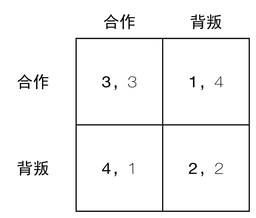
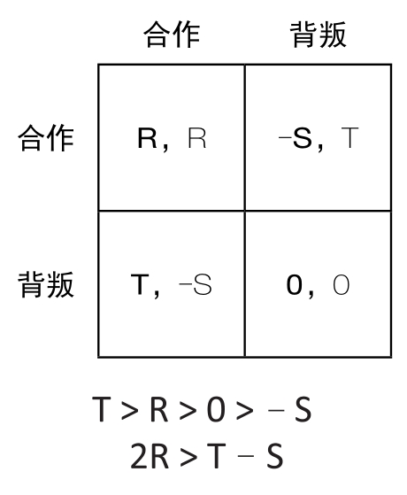
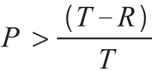
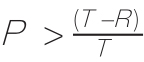
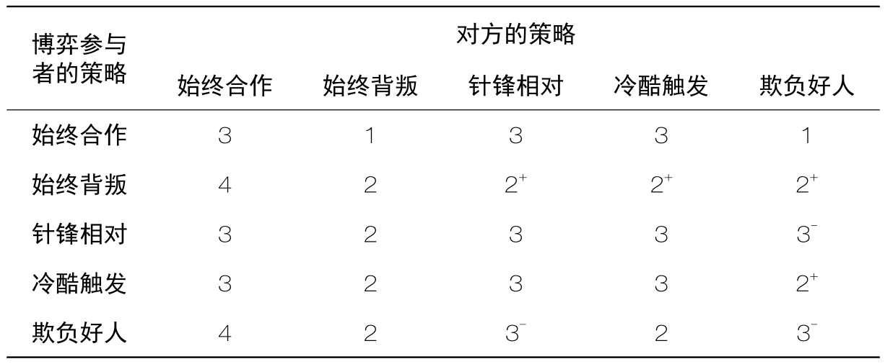
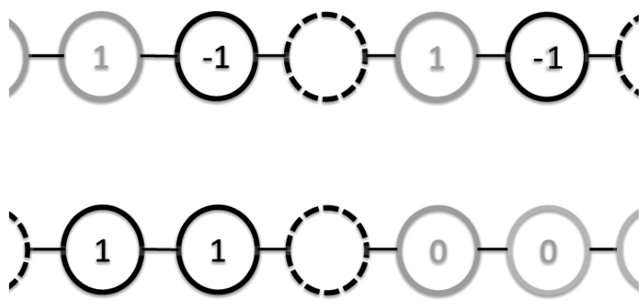
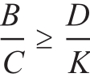

# 22　合作模型

从来没有人因施舍而变得贫穷。

安妮·弗兰克（Anne Frank）

经常会有人要求科学家列出他们心目中最重要的问题，各个领域的专家给出的最重要的问题往往各不相同，例如，宇宙是如何形成的？意识是怎样出现的？我们能否找到根治癌症的方法？等等。在这些问题当中，有一个是社会科学家和生物科学家都认为是重要的问题，那就是，合作是怎么产生的？ ¹  合作要求合作者采取不符合自身利益的行动，而这就意味着我们不会经常观察到合作现象。但是在现实世界中，我们却看到合作出现在无数领域中，而且达到了非常大的规模。合作在细胞层面上就存在：细胞通过黏附作用实现了合作，一个细胞会产生细胞外物质，供其他细胞黏附之用。我们观察到，蚂蚁、蜜蜂、人类、人类组织之间，甚至国家之间都存在着广泛合作，不同国家会在制定条约和国际法方面进行合作。

在本章中，我们运用模型来讨论合作如何产生、如何维持以及怎样做才能创造更多的合作。当然，本章给出的这些模型无法完美地解释世界上广泛存在的各种合作，比如，为什么乌鸦会告诉其他乌鸦所发现的腐肉地点，为什么裸鼹鼠会共同防御以它们为猎物的天敌，为什么攀爬藤蔓种植在“亲属”旁边时根系较不发达，为什么白蚁和蜜蜂会建造出精致复杂的巢穴，为什么蚂蚁能用身体和附肢搭起运送食物的桥梁，等等。但是，这些模型确实能够告诉我们很多重要的结论。 ²  

尽管我们看到，物种内部和物种之间广泛存在着合作的例子，但是我们同时还应该看到合作失败的情况。合作的程度取决于具体环境。联盟既能吸引人们加入，也会失去原有成员；英国是欧盟的创始成员国之一，但是后来却要退出欧盟。一个积极为学校筹款活动服务的人，却可能在超市排队时插队或者偷税漏税。一头狮子，既可能加入围猎水牛的团体，也可能自己偷偷地去猎杀野猪。并不是每个物种都合作。黑胡桃树的根须将一种名为胡桃醌（juglone）的物质释放到土壤中，以抑制附近植物的生长。

细胞、树根、乌鸦、人、企业和国家等合作型实体行为特征的多样性，要求采取多模型方法。也许，我们最好将细胞和植物建模为遵循固定规则的，将乌鸦、蚂蚁和狮子建模为运用更多依赖于环境或过去结果规则的，将人、企业和国家建模为有前瞻能力并会进行成本收益计算的。

本章的第一个要点是：合作可以通过多种机制、在多种环境下涌现出来并维持下去。我们讨论了四种促进合作的机制：重复、声誉、局部聚类和群体选择。这些机制都能在没有外部干预或管理的情况下进行合作。它们可以适用于合作的鼹鼠、蜜蜂和人类，人类还有更正式的促进和保持合作的方式。在本章最后的讨论中，我们描述了其他制度性的解决方案，包括付钱让人们进行合作，如果不这样做就惩罚，或者制定法律强制人们的合作行为。

本章的第二个要点是，这些机制中任何一个的“效力”都取决于那些正在合作的实体所拥有的“行为曲目”（behavioral repertoires）。一些机制，特别是通过重复实现合作这个机制，几乎适用于任何行为。声誉和规范这两个机制则需要前瞻性行为和信息共享，对于那些更“老练”的行为者来说更加有效。

局部聚类对合作的效果取决于具体模型。由演化力量选择支持或反对的行为者之间的合作，最常出现在稀疏的网络上，而通过规范进行合作则需要密集的网络。群体选择的有效性则取决于行动者的前瞻能力和适应速度的细微差别。行为者所拥有的更强的前瞻能力，能够增强群体选择的力量，而允许行为者更快地适应则可能会阻碍群体选择发挥作用。为了探索这些问题并分析清楚行为假设与合作结果之间的相互关系，要利用我们熟悉的囚徒困境博弈模型和合作行动模型。合作行为模型允许我们刻画有利于多个参与者的行动，并对网络上的合作行为进行建模。

本章安排如下。我们首先描述了囚徒困境博弈，同时说明理性行为者之间的合作是怎样得以维持的。接着，我们阐述了重复行动是如何促进基于规则的行动者之间的合作的，以及为什么不断发展合作比单纯维持合作更加困难。然后，我们考虑不太复杂的生物学意义上的行为者之间的合作，并阐明了亲缘选择和局部聚类如何促进了合作。最后两部分讨论了群体选择以及我们如何综合这些模型实现更高程度上的合作的问题。

### 囚徒困境博弈

囚徒困境博弈的名称源于如下故事。有两个人，被控共同犯下了某种罪行。有关当局只掌握了间接证据，因此给他们每个人都提供了认罪减刑的机会。两人因此面临着两难选择：如果两人都不认罪，那么每个人都会（根据现有证据）受到轻微的惩罚；如果只有一人认罪，那么认罪的这个人不会受到惩罚，而另一个人则会受到很严厉的惩罚；如果两人都认罪，那么两人都会受到较严厉的惩罚，但是不会像只有一个人认罪时那么严厉。

图 22-1 将这个故事表述为一个双人博弈。每个博弈参与者可以选择合作或背叛。图中的灰色数字表示列博弈参与者的收益，黑色数字表示行博弈参与者的收益。对每个博弈参与者来说，背叛都是占优策略，无论其他博弈参与者采取什么行动，背叛都能带来更高的收益。但是，如果两个博弈参与者都背叛，每个博弈参与者的收益都会低于双方合作时的收益。因此，追求自身利益的行为导致了集体利益的恶化。

**图 22-1　囚徒困境博弈的例子** 

囚徒困境博弈紧紧抓住了现实世界中许多情况下的核心激励，它可以用来建模一些国家之间的军备竞赛：背叛对应于将资源用于开发武器，合作对应于发展经济。还可以用来建模竞选活动中的广告战：背叛对应于投放负面广告，合作对应于投放正面广告。它甚至可以用来解释为什么雄孔雀会有如此之长的尾巴，每只孔雀都有很强的动力使自己看上去比其他孔雀更强壮、更健美。

很多囚徒困境博弈都是在事后才认识到的。许多新技术的最早一批采用者，例如，最早使用 ATM 机的银行，发现自己的利润因此大为增加。但是，当其他银行也跟进时，利润就因竞争加剧而下降了。事后证明，可以把选择使用 ATM 机类视为一种“背叛”。 ³  

如图 22-2 所示，一般形式的囚徒困境博弈假设如果两个参与者都选择背叛，那么基线收益为零。这样一来，我们就可以用三个变量来表示这个博弈：来自合作行为的奖励*R* ，背叛的诱惑*T* ，以及被损害的一方的收益*S* （参见图 22-2 中的收益矩阵）。收益矩阵下面的不等式确保了选择背叛是一个占优策略，而选择合作则能够产生有效率的结果。

**图 22-2　一般形式的囚徒困境博弈** 

#### 通过重复和声誉机制实现合作

我们首先阐明，博弈的重复进行和声誉的建立为什么能够维持理性行为者之间的合作。能够维持合作这个事实，并不能保证合作真的能够实现，它只是说明，如果合作“不知怎么”出现时，理性的博弈参与者能够维持它。为了证明重复行动能够维持合作，我们构建了一个重复博弈模型。在这个重复博弈中，每次博弈结束之后，都以概率*P* 再一次进行。从理论上说，这种博弈可以永远持续下去。

博弈参与者在重复博弈中，要根据以往的博弈历史选择行动。在这里，我们考虑一个被称为冷酷触发（grim Trigger）的重复博弈策略。具体来说，这个策略是，在第一次博弈中选择合作，并且，只要另一个博弈参与者不背叛，那么就在未来的所有博弈中一直选择合作；但是，一旦另一个博弈参与者背叛了，那么就永远选择背叛。冷酷触发策略是“永不饶恕”的。如果两个博弈参与者都采用冷酷触发策略，那么双方将会永远合作。

要想证明冷酷触发策略能够在重复博弈中维持合作，我们只需要证明，如果一个博弈参与者选择了冷酷触发策略，那么另一个博弈参与者也可以通过采用冷酷触发策略获得最高的收益。由于第二个博弈参与者的任何一个偏离合作的行为都会导致第一个博弈参与者无休止的背叛，所以第二个博弈参与者只需要对一直合作的预期收益，与一次背叛再加上两个博弈参与者此后都一直背叛的预期收益加以比较就行了。 ⁴  而冷酷触发策略能否带来更高的收益，则取决于诱惑的大小、合作回报的多少以及重复博弈的概率。

**重复博弈维持合作** 

在重复囚徒困境博弈中，如果继续进行下一次博弈的概率*P* 超过了诱惑收益*T* 减去奖励收益*R* 的差与诱惑支付的比，那么采用冷酷触发策略就能维持合作，即： ⁵  

这个结果告诉我们，如果诱惑收益超过了奖励收益的三倍，即*T* >3*R* ，那么博弈必须以超过 2/3 的概率重复。这个不等式还告诉我们，如果合作的奖励增大了、博弈重复进行的可能性增加了，或者背叛的诱惑减少了，合作就会变得更加容易维持。这些含义中的每一个，都意味着一条直观的促进合作的途径：增加合作奖励，让重复进行博弈的可能性更大，以及减少背叛的诱惑。虽然这些都只是非常简单的推论，但是在写出这个模型之前，它们可能并不是一目了然的。

通过思考合作的必要条件，我们还可以推断出一些不那么直接的结论。上面这个不等式还意味着，如果博弈参与者认为博弈重复进行的概率在未来会下降到低于阈值，那么理性的博弈参与者将会在这种概率变化发生之前就停止合作，而不会等到变化发生时再停止合作。 ⁶  

而且，重复博弈能不能维持理性的博弈参与者之间的合作，还取决于这个模型的一个特别假设：博弈会以一定概率不断重复进行下去。相反，如果转而假设博弈只会重复一定次数，比如只会重复进行 3 次，那么理性的博弈参与者将不会选择合作。

我们可以利用逆向归纳法来证明这一点。假设博弈只重复进行 3 次并且第一个博弈参与者将采用冷酷触发策略。再假设*T* =3、*R* =2、*S* =1。给定这样的收益矩阵，如果第二个博弈参与者在所有三轮博弈中都选择合作，那么他的总收益为 6。接下来需要确定是不是所有其他策略都不能带来更高的收益。如果第二个博弈参与者在第一轮博弈中就背叛，那么他所能得到的收益仅为 3，因为在他背叛之后，第一个博弈参与者将在后面两轮博弈中都选择背叛。如果第二个博弈参与者在第二轮博弈时再背叛，那么他可以得到的收益为 5。但是这两个策略都是不理性的。如果在第三轮博弈中才背叛，那么他可以得到的收益为 7（前两轮博弈中各得到 2，最后一轮博弈中得到 3）。因此，理性的博弈参与者会在最后一轮博弈背叛。

但是，第一个博弈参与者（他宣布自己会采取冷酷触发策略）应该会意识到第二个博弈参与者会在第三轮博弈中背叛，因而他也会在第三轮背叛。第二个博弈参与者也会意识到两个博弈参与者都会在第三轮博弈中背叛，因此他在第二轮博弈中就会背叛。根据同样的逻辑，第一个博弈参与者也会在第二轮博弈中就背叛，这种推理也适用于第一轮博弈。事实上，只要博弈只重复有限次数（无论多少次），上述结果就都适用。在最后一轮博弈中，理性的博弈参与者会背叛。结果，两个博弈参与者都有动力在倒数第二轮博弈中背叛，以此类推，他们会在所有轮次的博弈中都背叛。从而，唯一符合理性的策略就是永远背叛。

目前为止，我们一直是在一个孤立的环境中考虑两人博弈的，并没有考虑一个人的背叛行为可能会影响其他人对待背叛者的态度。这样做，其实是将这种两人博弈圈进了一个封闭世界中。我们可以扩展这个模型，让博弈在一个社区的成员之间进行，并让这些人有机会监督其他参与博弈的人的行为。

现在假设，每一天，先让这些人随机两两配对，然后进行囚徒困境博弈。在这种情况下，我们假设这个社区的所有成员相信博弈将会永远重复进行下去，因此未来继续博弈的概率等于 1。在这些假设条件下，每一个人都不太可能在第二天仍然与前一天博弈过的那个人博弈，所以他们背叛的动机会更加强大。但是，由于我们假设同一社区的人可能会认出谁是背叛者，所以那些背叛过的人很可能会留下不好的名声，根据假设，这个社区中的任何人将来都不会与声誉不好的人合作。

如果我们用*P* * [D] * 表示一个人背叛且被发现、从而留下了一个背叛者的坏名声并在未来的所有博弈中受到惩罚的概率，那么，通过声誉机制维持合作的条件，也就与重复博弈条件下维持合作的条件一样了。这个条件可以写为，用一个背叛被发现的概率取代博弈重复进行下去的概率*P* 。

在声誉模型中，合作是通过社区来实施的。背叛并被发现的人，在未来将会遭到所有博弈参与者的背叛。在这里，个体还是会计算背叛的收益和成本。他们还必须相信其他人会坚持惩罚到底，而这也就意味着其他所有人都会背叛那些背叛的人。要做到这一点，所有个体必须要么彼此认识，要么有某种方法来识别或标记过去的背叛者。因此，在其他条件相同的情况下，规模较小的社区的成员应该能够更好地通过这种机制来实施合作。在美国北方的小城镇，人们在冬季会将车停在商店停车场里。他们不用担心汽车会不会被人偷走（“背叛”），因为他们认识城里的每个人。任何偷车的人，即便是恶作剧，都会导致自己的声誉下降。

实物标签可以使声誉变成一个公共信息，从而有利于能够维持合作。在纳撒尼尔·霍桑（Nathaniel Hawthorne）的小说《红字》（*The Scarlet Letter* ）中，海丝特·白兰（Hester Prynne）被迫穿着一件上面有一个猩红色的“A”的衣服，以表示她犯下了通奸的过错。在有些社会中，小偷被定罪后，手会被砍掉，这无疑是一个代价极其高昂的标签。

背叛者会被打上标记，这种情况甚至也发生在了人类之外的其他物种中。在大海中，医生鱼——裂唇鱼（labroides dimidiatus），既可以选择清除作为它的“邻居”的其他鱼类身上的寄生虫（合作），也可以吃某种更美味的其他食物（背叛）。如果裂唇鱼合作，那么它的“邻居”就可以少受寄生虫的困扰。其他鱼也可观察到寄生虫有没有减少。于是，裂唇鱼“邻居”的清洁程度就成了一个标签，一个代表声誉的具体形象。 ⁷  

**连通性与声誉** 

通过声誉机制维持合作有一个条件：个体必须能够知悉自己邻居的行为偏离合作的可能性。为了评估关于这种行为偏差的信息传播出去的可能性，我们可以应用在向传染病模型中加入网络时学到的三个结果。首先，网络的度越大，关于偏离合作行为的信息传播出去的可能性就越大。其次，度分布的变化，特别是超级传播者的存在，也会增加信息传播出去的可能性。再次，如果一个人所背叛的那个受害者，与这个人的其他邻居没有任何联系，那么这个人的邻居就不会知道这个人背叛了他人。因此，要保证声誉扩散，网络必须具有很高的聚类系数，而聚类系数又是社会资本的一个衡量指标。

### 规则行为者之间的合作

现在，我们放松关于理性的假设，转而假设博弈参与者只会遵循诸如冷酷触发策略之类的规则行事。我们将利用这个更一般的模型探析合作是否可能出现以及如何出现。在这个模型中，假设一群人重复进行囚徒困境博弈，并假设博弈将以如上所述的概率进行下去。我们将证明，如果博弈继续重复进行下去的概率足够高，那么理性的博弈参与者会在这种情况下合作。

与前面那个模型不同，在这里我们假设博弈参与者直接应用特定的行为规则。有些博弈参与者可能会采用冷酷触发策略，有些博弈参与者可能始终合作，而另一些博弈参与者则可能始终背叛。这些策略的某些变体甚至可以在人类之外的其他物种身上看到。雄鸣鸟（Warbler）可能会采取“爱自己的敌人”策略，它们不会大声唱歌，也不会以牺牲邻居为代价来扩大领地。我们可以将这种行为视为一种合作行为。 ⁸  

为了便于解释，我们假设每个个体都与其他人一起博弈。在完成了自己所有的博弈之后，每个人都要公布自己的“成绩”，也就是在博弈中的平均收益。之所以要使用每一场博弈的平均收益而不是所有博弈的总收益来考量，是因为给定博弈以一定概率继续进行，有些博弈参与者（出于偶然）参加的博弈可能会比其他博弈参与者多一些。在这个模型设定中，策略的效能取决于策略的分布。因此，胜出的策略也可能取决于初始分布。如果合作策略在一开始的时候表现是最好的，那么种群中的合作者数量就可能会增加。

在这个例子中，我们随机地向每个博弈参与者分配如下五种遵循行为规则的策略中的一种：始终合作（C）、始终背叛（D）、冷酷触发（GRIM）、针锋相对（TFT）、欺负好人（TROLL）。冷酷触发策略是一开始选择合作，后面也一直继续合作，直到另一个博弈参与者背叛为止，然后就一直背叛。始终合作和始终背叛这两种策略与名字的含义一样：盲目地选择合作或背叛，无论其他博弈参与者的行为如何。针锋相对（或一报还一报）是指在第一次合作，然后每一次都复制另一个博弈参与者在前一次中的行为，两个人都使用针锋相对策略的博弈参与者将永远合作。欺负好人策略则剥削始终合作的博弈参与者，更具体地说，这种策略是，在前两次选择背叛，如果另一个博弈参与者在这两次都没有背叛过，那么就选择永远背叛；而如果另一个博弈参与者在前两次已经背叛过了，那么就先转而在接下来的两次选择合作，然后一直采用冷酷触发策略。

我们首先根据如图 22-1 所示的囚徒困境博弈的收益矩阵，将每种行为规则策略面对其他每一种策略时的收益计算出来。我们先计算始终背叛这个策略在面对各种策略时的收益。如果面对的是始终合作这个策略，那么它在每一轮博弈中都可以得到的收益为 4。与此对应，在这些博弈中，始终合作所能得到的平均收益则为 1。如果始终背叛策略“对阵”的是针锋相对策略或冷酷触发策略，那么它在第一轮博弈中获得的收益为 4，之后每一轮博弈中都获得 2 的收益。

如果我们假设博弈会重复多次，那么所有轮次博弈的平均收益将只能略超过 2，我们将它记为 2^+ 。而如果始终背叛策略与欺负好人策略相遇，前两轮博弈双方都背叛，然后欺负好人策略在第三轮和第四轮博弈中合作，但是此后一直背叛。因而始终背叛策略还是可以获得 2^+ 的平均收益；同时欺负好人策略的平均收益则略低于 2，我们将它记为 2^(\-) 。

与此类似，我们可以计算出每一对策略的预期收益。 ⁹  表 22-1 显示了每一个策略对所有其他策略的收益。

**表 22-1　行策略对列策略的平均收益** 

表 22-1 显示了相互合作、相互背叛和利用其他策略中的缺陷策略的各种情况。仔细研究这张表可以发现，这五种策略中其实有四种是在与自己合作的，因此我们可以将这些策略视为潜在的合作策略。只有针锋相对这一种策略是所有这四种潜在的合作策略都能合作的策略。因此，如果这四种策略的任何一个组合在人口中占了大部分，那么针锋相对策略就能够表现得非常好，尽管不一定总是最好的。 ¹⁰  

研究者以人为被试，进行了数千次实验，结果充分揭示了人们所选择的策略的巨大异质性。我们将使用表 22-1 中的收益来考虑给定不同分布时的结果。基于这些策略的不同组合的收益多样性，最优策略将取决于人口的构成。在主要由总是选择合作策略的人组成的人群中，始终背叛这个策略的表现最佳。如果个人选择采用这个最优策略，或者自然选择的作用发挥得非常快，那么人们可能永远无法合作。如果学习或选择以适中的速度发生，那么博弈参与者也会逐渐远离始终合作策略。然而，一旦人口中只包含了很少的采用始终合作策略的人，那么始终背叛策略的表现将不如冷酷触发策略、欺负好人策略和针锋相对策略。这时，这三种策略中的某一种策略将会在人群中扎下根来。无论是在以人类为被试的实验中，还是在计算机仿真实验中，都会发现这种模式的广泛存在：一开始背叛策略的表现很好，但是不久之后，合作也能扎下根来。我们可以把这些情况下发生的这种事情，称为合作的涌现和合作的演化。

我们不难想象出这五种策略或任何其他策略集上的某种分布，再计算出该分布的平均收益，然后思考通过学习或自然选择接下来可能会发生什么事情。在本书后面的章节中，我们构建了一些关于学习和（自然）选择的正式模型。在这里，我们只是非正式地提出这样的观点，因为我们的目的只是指出合作是否能够出现、取决于种群中的初始战略分布以及人们如何学习或发展新策略。

合作出现或发展的一个必要条件是，合作带来的收益超过了背叛者能够获得的收益。否则，选择和学习都会导致整个种群趋向背叛。为了简化分析，不妨想象如下这个由采取冷酷触发策略、始终合作策略和针锋相对等合作策略的人，以及采取始终背叛策略的人所组成的种群。然后，我们可以计算出，要想让合作策略平均来说表现得更好，必须具备什么条件。这个计算表明，不断发展的合作比简单地维持合作更加困难，而且合作是无法自我引导的，少数合作者无法促成合作的出现。 ¹¹  

合作的维持、合作的出现和合作的不断发展，以及合作的自我引导之间的区别值得再三审视。如果当所有参与者都合作时，合作的表现是最好的，那么合作是自我维持的。合作的维持所对应的情况是，通过冷酷触发策略实现的合作是重复博弈的纳什均衡。如果在种群中配对时，合作策略的平均表现优于那些不合作的策略，合作就能够出现或发展起来。

正如刚才已经指出过的，合作出现的条件要比维持合作的条件更难满足。事实上，数学推理告诉我们，以自我引导的方式让合作出现几乎不可能。如果合作者的比例接近于零，合作者的收益就会低于背叛者。这样说并不意味着合作的自我引导永远不会发生，而只是在这个模型中不会发生。为了实现合作，我们需要一部分人从一开始就是合作的。这种情况有可能发生在那些会反思博弈结构的人身上，但是似乎不太可能发生在蜜蜂和树根“身上”。要想理解这种自我引导怎样才能发生，我们需要一些更加精细的模型，以允许局部学习、进化和群体选择。下面就来讨论这些模型。

### 合作行动模型

为了研究合作怎样才能实现自我引导，在这里引入一个合作行动模型（cooperative action model）。在这个模型中，人们可以采取合作行动，也可以不采取合作行动。 ¹²  合作行动要求个人承担一定成本，会给他人带来收益。在这个模型中，聚类和群体选择都可以产生合作。

合作行动模型与重复囚徒困境博弈之间存在着一些差异。首先，在合作行动模型中，个人并不是两两配对重复进行博弈并在博弈中使用策略、获得收益的，相反，个人要么是合作者，要么不是合作者。其次，合作行动模型不假设理性行为者，也不假设个体会采用更复杂的规则。再次，这个模型中的个体属于一个交互网络。他们的合作行动只会影响与他们有联系的人，也就是他们的邻居。最后，因为个体有固定的类型，所以他们会对所有邻居都采取相同的行动。例如，一个有五个邻居的合作类型的个体，要付出五次合作的成本，并且为另外五个人带来收益。

**合作行动模型** 

一个种群由*N* 个人组成，他们或者是合作者，或者是背叛者，连接于一个网络中。在每一次互动中，合作者都要承担合作成本*C* ，而其他人则可以获得合作收益*B* 。背叛则不会产生任何成本和收益。合作优势比率*B* /*C* 刻画了合作的潜在收益。

在这个模型中，网络发挥了关键的作用。网络的存在，使合作得以出现，甚至可以实现合作的自我引导。一个主要在内部成员之间进行互动的合作者团体或合作者群组会有很好的表现，能够使合作在种群中扩展开来。在生态系统中，后代通常位于父母附近。如果合作者的后代更有可能成为合作者，那么合作的自我引导将会变得更加容易。

为了证明聚类可以导致合作的自我引导，我们从一个只有一部分已经被“充满”的网络开始。这个网络上的每个节点都是一个人可以“居住的住处”。在生物学背景下，这种“住处”就是生物的可行栖息地。然后，我们让合作者或背叛者“住进”网络的一部分。例如，可以先绘制出一个平均度数为 10 的随机网络，然后在每个节点上掷骰子，如果掷骰子掷出了“6”，就在那个节点上放一个人进去。如果没有掷出“6”，就将这个节点留空。如果我们已经决定要在一个节点上放一个人，那就再掷一次骰子。如果掷出了“5”，就在那个节点上放一个合作者，否则，就放一个背叛者。这个过程结束后，网络中 1/6 的节点将会被人占有，而且在这些被占有的节点中，只有 1/6 是被合作者占有的。

鉴于这个网络结构，每个人的邻居数量将会有所不同，有些人没有邻居，有些人会有四五个邻居。为了在这个网络上实现合作的增长或消亡，我们通过迭代地填充与被占用节点相邻节点的方法来填充网络的其余部分。假设填充空节点的人的类型将与这个节点的邻居中表现最好的那种类型相同（合作者或叛逃者）。图 22-3 给出了一个线性网络的两个片段，合作者用黑色线条表示，背叛者用灰色线条表示，黑色虚线则表示空节点。每个片段都在中心处包含了一个空节点，它有两个邻居、一个背叛者和一个合作者。在这图 22-3 中，合作创造的收益为 2，而发生的成本则为 1。

**图 22-3　两个线性网络中的一个空节点的邻居的收益** 

在图 22-3 的上图中，空节点右边的背叛者有一个合作者的邻居，因此可以获得 1 的收益。空节点左边的合作者有一个背叛者的邻居，因此可以获得-1 的收益。根据规则，由于空节点的邻居中，背叛者获得的收益更高，所以这个空节点将由一个背叛者占据。在图 22-3 的下图中，空节点的背叛者的邻居的邻居也是背叛者，同时，空节点的合作者的邻居则连接到了另一个合作者。在这种情况下，空节点的邻居中以合作者的表现更好，因此空节点将成为合作者。

这个例子表明，一个单独的合作者不能产生一个额外的合作者，但是两个相邻的合作者可以。这就是说，一个小小的合作聚类就可以将合作扩展到空单元上。因此，合作区域可以从少数几个合作者中产生。

我们可以根据相邻的合作者和背叛者的比例以及合作优势比例，写出决定空单元是会成为合作者还是会成为背叛者的更一般的条件。因此，在度数更低的网络中，合作的自我引导更加容易实现。这个发现与我们在分析声誉机制如何维持合作时所得到的结果相反，在那种情况下，更多的连接网络会增加背叛行为破坏某人声誉的可能性，因此更多的连接有助于合作的维持。这也是多模型思维能够产生依赖于特定条件的知识的又一个很好的例子。连通性高的网络能够产生更大的合作还是更少的合作，这个问题没有单一的答案。如果合作有赖于运用声誉机制的老练的行为者维持，那么连接更多的网络将更有利于合作。如果合作是在不成熟的行为者（如树木或蚂蚁）中自我引导或演化的，那么连接较少的网络应该更能促进合作。

**聚类自我引导合作** 

如果一个空节点的邻居包括了一个合作者（其度数为*D* 且有*K* 个作为合作者的邻居），同时这个空节点的所有非合作者邻居都没有合作者的邻居，那么这个空节点会成为一个合作者，当且仅当合作优势比例高于与合作者数量之间的比例时，即： ¹³  

### 群体选择

我们要讨论的最后一个自我引导、发展和维持合作的机制是群体选择。这个机制依赖于群体之间的竞争或选择。 ¹⁴  为了构建群体选择模型，我们将种群进一步划分为若干个群体。在每个群体内，个人的行动满足某种形式的合作行动模型——每个人或者选择合作或者背叛。与以前一样，我们可以认为每个人都有各自的表现。我们还为每个群体分配一个表现，它等于该群体成员的平均表现。群体选择模型假设选择是在群体与群体之间进行的，表现最佳的群体的复制体（副本）将替换表现较低的群体。这种选择有利于合作者组成的群体，它们的表现将会更好。

然而，合作者组成的群体在群体选择时会占优势，这个直觉结论无法回避这样一问题：在任何一个群体内部，背叛者都比合作者有优势。作为例子，不妨考虑两个规模均为 10 人的群体：第一个群体包含了两名合作者和 8 名背叛者，第二个群体包含了两名背叛者和 8 名合作者。如上所述，假设收益等于 2 且成本等于 1。在第一个群体中，每个背叛者的绩效等于 4，因为他可以从每名合作者那里获得 2 的好处；每名合作者的成本为 9，并且只获得 2 的收益，因此其绩效等于-7。第一个群体所有成员的平均绩效等于 1.8。在第二个群体中，每个背叛者从 8 名合作者中的每一个中获得 2 名，因此其绩效等于 16，每名合作者的绩效等于 5，因为他从其他 7 名合作者那里得到 14，但是支付 9 的成本。第二个群体的平均绩效等于 7.2。

这些计算结果揭示了一个矛盾：在每个群体内部，背叛者对合作者有优势，但是表现更好的群体却必须包含更多的合作者。这里的张力是非常明显的：个体选择有利于背叛，但是群体选择却有利于合作。这种张力在各种各样的生态、社会、政治和经济环境下都会出现。例如，让自己的根系与其他树木合作的树木，个体生存条件可能会变得更加糟糕，但是这种合作有助于形成一个更加强大的生态系统，并使之更快速、更有效地扩散到更大的土地上。在一个社区内，合作的个人可以获得的收益少于背叛者，但是合作的社区规模将会扩大。支持自己所属政党的政治家可能比那些只专注于个人支持率的政客更加不容易再次当选，但是凝聚力更强的政党将更有可能发展壮大。在某家企业就职的人如果只专注于学习掌握与本企业有关的知识和技能，对自己可能不利，但是他所属的企业则可能胜过其他企业。

合作行动模型能够帮助我们识别和量化这种张力。为了确定群体选择能否引导、发展或维持合作，还需要往模型中加入更多的细节。为此，特劳森（Traulson）和诺瓦克（Nowak）构建了一个精致的模型。在他们的模型中，种群的人口会增长，而且新出现的成员会复制表现最好的成员的类型。这个模型内置了个体选择和群体选择。选择发生在个体层面，同时表现更好的人更有可能来自合作的群体。当一个群体变得足够大时，它会一分为二，创建出一个新的群体。为了防止种群人口过多，新群体的形成会随机地导致现有的某个群体消失。这最后一个特征引入了一种较弱形式的群体选择。 ¹⁵  

这些模型证明，群体选择能够增进合作，条件是合作行动的利益相对较大，同时最大群体的规模相对于群体的数量来说比较小。群体选择的效力部分取决于最大群体的规模与群体数量之间的比，这个结果揭示了竞争的必要性。有更多的群体，意味着全部由合作者组成的群体更有可能出现，它也隐含地假设了更多的竞争。最意想不到的一个结果是，最大群体的规模越小，导致的合作更多。较小的最大群体规模可以防止合作者组成的群体被背叛者所支配，也就是说，这限制了个人选择的影响。回想一下在前面举的有 8 名合作者和两名背叛者的群体的例子中，背叛者的表现更好。如果允许群体的规模扩大为 80，那么在群体“分裂”出新的群体之前，它就会包含更大比例的背叛者。如果这个群体在有 12 名成员时就拆分为两个群体，那么在最坏的情况下，这个群体在拆分时也会包括 2/3 的合作者。

群体选择拥有增进合作的潜力，这个结论还可以应用到组织内部。大多数组织主要根据个人绩效来分配薪酬。将员工分成若干相互竞争的团队，并根据团队绩效分配奖金和机会，能够诱导合作行为的出现。如果资源流向团队，个人就有动力在这些团队中努力工作，即相互合作。 ¹⁶  如果合作带来的好处很大，并且团队规模相对于团队数量来说很小，那么这种激励措施应该能够增进团队内部的合作。

但在评估群体选择的潜力时，我们必须仔细考虑个体行动者的复杂情况。树木的适应速度非常缓慢，因此不必要求群体选择很快发挥作用。但是，人类的适应是非常迅速的，因此如果个人背叛的动机很高，那么相应地，群体选择就必须以很高的速度进行。而且，人们也可能会认识到群体选择效果，他们可能会考虑群体之间的竞争，并理解创建一个强大的群体需要符合个体的自身利益。这种认识会使合作更有可能实现。所有这些都表明，我们应该很小心，不要对特定模型中证明的能够促进合作的特定条件过于自信。恰恰相反，我们应该坚持多模型思维，善用判断力，追问定性结论是否仍然成立。

### 小结

合作如何出现、发展和维持，是来自众多学科领域成千上万的学者一直致力研究的一个难题。模型对这种研究很有帮助，其中最突出的模型是囚徒困境博弈模型。如果我们采用重复博弈框架，并假设行为者是理性的，这个合作难题会暂时消失。模型表明，可以利用进行惩罚的威胁来维持合作。惩罚可以通过重复博弈机制直接实施，也可以通过声誉机制间接实施。这些机制或许可以解释，在利害关系很大且博弈参与者是成熟老练的个体时，合作是怎样产生的；但是它们无法解释为什么蚂蚁、蜜蜂、树木和裸鼹鼠也会合作，而且合作程度是如此之高。当我们考虑了遵循规则的博弈参与者之间的合作时，我们发现要让合作不断发展并不那么容易。理性行为者可以在遵循规则的行为者无法发展合作的环境中维持合作。

我们还发现，像针锋相对这样的简单规则虽然不是最优的，但是可以实现相互合作而且不会被“剥削”。后续研究还表明，如果博弈中会出现随机误差，那么针锋相对策略的表现就不是很好。如果允许出现误差，那么每个使用针锋相对策略的博弈参与者都会在另一个博弈参与者出现误差之后产生一个背叛行动和合作行动组成的循环。如果两名博弈参与者都因误差意外采取了背叛行动，那么针锋相对策略将导致双方一直背叛，直到另一个误差出现为止。

在现实世界的囚徒困境博弈中，这种误差确实会发生。1983 年 9 月 1 日，韩国航空公司 007 航班从阿拉斯加安克雷奇起飞，前往韩国首尔，途中偏离航线进入了苏联领空。一架苏联 SU-15 战斗机击落了这架民航客机，机上 269 人全部不幸遇难。美国人认为这是苏联人的“背叛”行径，而苏联人则认为这架飞机在执行间谍任务，认为这是美国人的“背叛”行径。

其他的策略，例如“赢则坚持，输则改之”（Win Stay，Lose Shift）策略，在这样的情况下可以做得更好。在“赢则坚持，输则改之”策略下，相互合作时的收益和诱惑收益都编码为“赢”，另外两种收益则编码“失”。“赢则坚持，输则改之”策略从合作开始，此后，如果赢了，就坚持上一轮所做的一切；如果输了，就转变为另一种行动。只要考察一些例子，你就可以观察到“赢则坚持，输则改之”策略会回归到合作行为上。 ¹⁷  

我们还描述了另外两种机制。聚类使合作能够实现自我引导。这种机制依赖于合作者之间的互动并通过选择来发展合作。群体选择发挥作用的原理也类似。合作者组成的群体表现得更好并取代了背叛者组成的群体。在正式的模型中，我们发现通过聚类和群体选择实现合作的条件要比通过重复博弈或声誉机制维持的合作更加严格。

我们还了解到，这些机制的成功与否，取决于我们如何对个人进行建模。我们不应期望这些机制对人类、蚂蚁和树木发挥作用的方式完全相同。更精明老练的行为者可能因为他们拥有前瞻能力而能够更好地维持合作，但是，当周围都是合作者时，他们也更有可能发现背叛的好处。

我们的大多数讨论都假设合作是有益的。但是，有些组织也可能通过合作来剥削他人。企业组成卡特尔（cartel） ^((9))  ，人为地压低价格；各产油国结成联盟，限制石油产量，以扩张自己的利益，而不管人类的利益是否受到了损害。癌细胞会合作抵抗我们的免疫系统。 ¹⁸  因此，当我们研究合作的时候，还应该记住，合作不一定是为了共同利益，例如野生水牛并不会受益于狮子之间的合作。