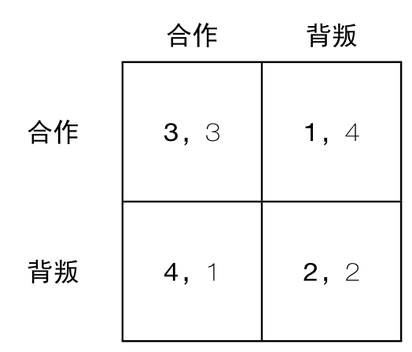
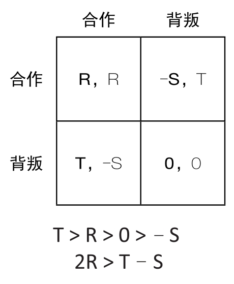
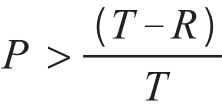
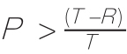
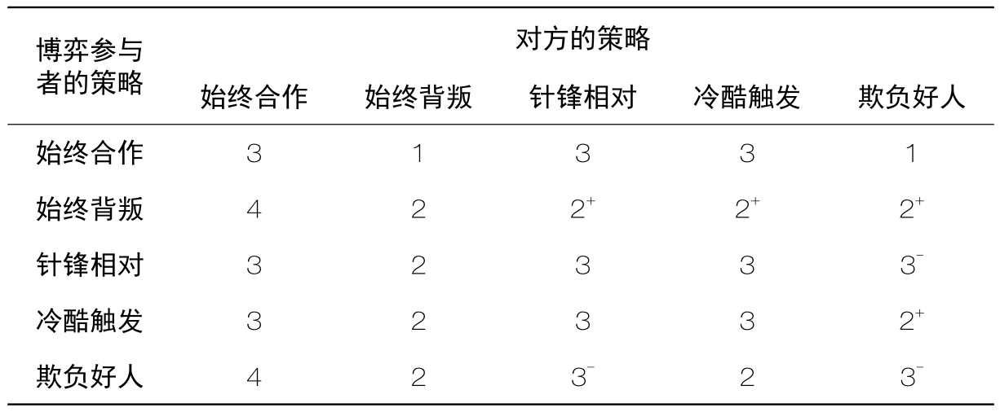
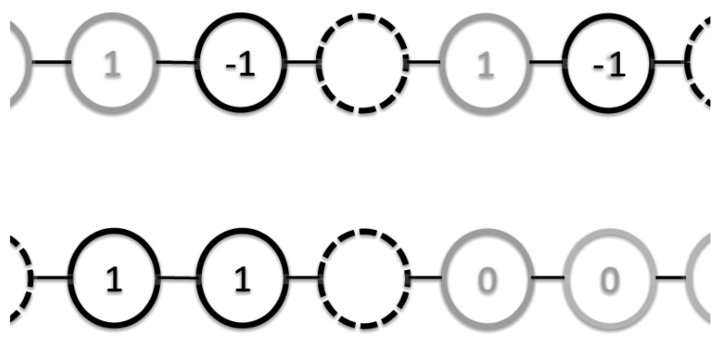
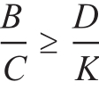

# 合作不是道德题，而是机制题

安妮·弗兰克留下一句话，大意是：施舍并不会让人变穷。把这句话放在“合作”前面，很有意思——合作常常意味着先让渡一点私利，看起来并不划算，所以它本不该频繁出现。可现实恰恰相反：从细胞到国家，合作遍地开花。

物理学家会追问宇宙起源，神经科学家会追问意识从何而来，医学家会追问癌症能否根治；而社会科学家和生物学家却会共同盯住另一个问题：合作到底是怎么产生的？

合作要求参与者做出未必符合自身利益的选择。正因如此，它才显得珍贵，也才需要解释。细胞会分泌细胞外物质，供其他细胞黏附，这是细胞层面的合作；蚂蚁、蜜蜂、人类、人类组织，乃至国家之间，也都在合作，国家还会通过条约和国际法来协调行动。可合作并不总是成功：联盟能吸引成员，也会流失成员，英国曾是欧盟创始成员国，后来却选择退出；一个热心学校筹款的人，也可能在超市插队或偷税漏税；狮子有时加入围猎水牛的团队，有时又独自去猎野猪。甚至不是每个物种都合作——黑胡桃树的根会向土壤释放胡桃醌，抑制附近植物生长。

这说明，合作多寡随情境而变，解释它不能只靠一把锤子。细胞和植物可以按固定规则来建模；乌鸦、蚂蚁、狮子更适合用依赖环境或过去结果的规则来理解；人、企业和国家则有前瞻能力，会算成本收益。多模型并用，才更接近现实。

本章有两条主线。第一，合作能在不同环境中冒出来，也能靠不同机制延续。重复、声誉、局部聚类和群体选择，这四种机制都能在没有外部干预和管理的情况下促成合作；人类还发展出更正式的办法，比如付钱让人合作、对不合作者惩罚，或者用法律强制合作。第二，任何机制的“效力”都取决于参与者的“行为曲目”。重复几乎适用于任何行为；声誉和规范则依赖前瞻行为与信息共享，对更老练的行为者更有效。局部聚类的效果要看具体模型：演化力量支持或反对的行为者之间的合作，常出现在稀疏网络上，而靠规范合作则需要密集网络。群体选择则受前瞻能力和适应速度影响：前瞻能力更强，群体选择的力量可能增强；适应速度更快，反而可能阻碍它发挥作用。囚徒困境博弈和合作行动模型，正好帮我们刻画这些关系。

### 先看囚徒困境

故事很经典：两个人被控共同犯罪，检方手里只有间接证据，于是分别给他们认罪减刑的机会。都不认罪，各受轻微惩罚；只有一人认罪，认罪者免罚，另一人重罚；两人都认罪，都受较严厉惩罚，但比“一人认罪、另一人重罚”中的重罚轻一些。

把选择简化为“合作”与“背叛”，就得到一个双人博弈。对每个参与者来说，背叛都是占优策略：不管对方怎么做，背叛带来的收益都更高。可如果双方都背叛，各自收益又低于双方合作时的收益。于是，追求自身利益反而让集体利益变差。这个收益矩阵如下：

囚徒困境抓住了现实中的许多核心激励：军备竞赛里，背叛像把资源投向武器开发，合作像发展经济；广告战里，背叛像投放负面广告，合作像投放正面广告；它甚至能解释雄孔雀为什么长出那么长的尾巴——每只孔雀都有动力让自己显得更强壮。很多局面是事后才被认作囚徒困境的。最早使用ATM机的银行曾因此利润大增，可其他银行跟进后，竞争加剧，利润又降下来；事后看，采用ATM机类似乎一种“背叛”。

把双方都背叛的基准收益设为零，一般形式可用三个量表示：合作奖励R、背叛诱惑T、被损害一方的收益S。相应矩阵如下：

矩阵下方的不等式保证了两件事：背叛是占优策略，而双方合作能产生有效率的结果。

### 重复与声誉：让“以后还要见”变成约束

先假设参与者理性。每轮博弈结束后，以概率P继续下一轮。所谓“冷酷触发”策略是：第一轮合作；只要对方不背叛，就一直合作；对方一旦背叛，此后永远背叛。它不饶恕。若双方都采用冷酷触发，合作就能一直延续。

要维持合作，只需比较两种选择：一直合作，还是先背叛、再遭到永久报复。若延续概率P超过由T和R共同决定的临界值，冷酷触发就能稳住合作：

这个条件带来几条直观推论：合作奖励越大、未来越可能继续、背叛诱惑越小，合作越容易维持。若参与者预期未来延续概率将跌破阈值，理性者会提前停止合作，而不是等到变化发生。更极端的是，如果博弈只重复有限次，逆向归纳会让合作崩塌：最后一轮背叛最划算，双方都预见到这一点，倒数第二轮也会背叛，如此倒推，每一轮都背叛。可见，维持已有合作是一回事，让合作不断扩展又是另一回事，后者更难。

再把两人博弈放进社区。假设每天随机两两配对，大家都相信博弈会永远重复，因此未来继续的概率等于1；可第二天未必再遇到同一个人，背叛的动机反而更强。不过，社区能认出谁是背叛者。一个人一旦背叛并被发现，就会留下坏名声，以后没人愿意跟他合作。设P_D为背叛被识破并受罚的概率，合作条件就与重复博弈同构，只是把P换成P_D：

声誉机制依靠社区执行：背叛者未来会遭到所有人背叛。参与者不仅要算收益，还得相信别人会坚持惩罚到底；而要做到这一点，大家必须彼此认识，或者有办法识别、标记过去的背叛者。小社区往往更有效。美国北方小城镇冬天把车停在商店停车场，人们不太担心车被偷，因为城里的人彼此认识，偷车会毁掉名声。实物标签也能让声誉变成公共信息：霍桑小说《红字》里，海丝特·白兰被迫佩戴猩红“A”；有些社会给小偷定罪后砍手，这是代价极高的标签；医生鱼裂唇鱼既可能替邻居清除寄生虫，也可能去吃更美味的食物，邻居身上的清洁程度就成了它的声誉标签。

声誉要扩散，还依赖网络结构。信息传播有三个要点：网络度数越大，关于背叛的信息越容易传开；度分布变化，尤其是超级传播者的存在，也会增加传播可能；如果被背叛者与背叛者的其他邻居没有联系，那些邻居就不知道发生了什么。因此，声誉要起作用，网络需要较高的聚类系数；聚类系数本身也是社会资本的一种衡量。

### 规则行为者：策略生态里的合作

现在放松“完全理性”的假设，只假设参与者按规则行动。可以让一群人反复进行囚徒困境博弈，并给每个人分配五种策略之一：始终合作C、始终背叛D、冷酷触发GRIM、针锋相对TFT、欺负好人TROLL。冷酷触发先合作，直到对方背叛，然后永远背叛；始终合作和始终背叛顾名思义；针锋相对先合作，之后复制对方上一轮行为；欺负好人则先背叛两轮，若对方前两轮都没背叛，就永远背叛，若对方已经背叛过，就先合作两轮，再转入冷酷触发。雄鸣鸟的“爱邻”行为——不大声唱歌、不牺牲邻居来扩大领地——也可视为一种合作。

每个人与多人对局，结束后公布平均收益；用平均而非总和，是因为参与对局数量可能因偶然不同。策略表现取决于策略分布，胜出者也可能取决于初始分布。若合作策略一开始表现最好，种群中的合作者数量就可能增加。

按经典收益矩阵计算：始终背叛碰到始终合作，每轮可得4，而始终合作平均只得1；始终背叛碰到针锋相对或冷酷触发，首轮得4，之后每轮得2，均值略高于2，记为2^+；碰到欺负好人，前两轮双方背叛，欺负好人第三、四轮合作、此后背叛，始终背叛仍得2^+，欺负好人均值略低于2，记为2^-。把两两对局的均值列成表：

表里能看到相互合作、相互背叛和利用缺陷策略的各种情形。五种策略中有四种会与自己合作，可视为潜在合作策略；针锋相对是唯一能与这四种潜在合作策略都合作的策略。因此，只要这四种策略中的任意组合在人群中占多数，针锋相对通常表现很好，虽然未必总是第一。

模型并不包打天下。乌鸦为什么告诉同伴腐肉地点，裸鼹鼠为什么共同防御天敌，藤蔓在“亲属”旁边为什么根系不发达，白蚁和蜜蜂为什么造出精致巢穴，蚂蚁为什么用身体搭桥运食，这些还需要更具体的解释。但模型已经给出重要提醒：合作没有单一药方。重复、声誉、局部聚类、群体选择各有适用条件，机制效力要与参与者的行为曲目、网络结构和计算能力匹配。人类还可以付费、惩罚、立法，用制度补上机制短板。说到底，合作不能只靠感动，更要把条件设计对。

一项以人类为对象的大规模实验，反复验证了一个引人注目的现象：人们在博弈中的策略选择极其多样，几乎没有什么“统一套路”。借助表22-1中的收益值，我们可以推演不同策略分布下的结局。由于不同策略组合所带来的收益千差万别，最终哪种策略能占据上风，完全取决于初始人群的构成。假如一个群体里大多是“无条件合作者”，那么“无条件背叛”反而会成为最划算的选择。如果大家都纷纷采纳这一“最优策略”，或者自然选择的筛选速度极快，合作恐怕根本没有出头之日。而当学习或调整的速度适中时，博弈者们也会渐渐放弃一味合作的路线。可一旦人群中只剩下极少数坚持合作的人，无条件的背叛就不再吃香了——此时，冷酷触发、欺负好人和针锋相对这三类策略的表现都能压过背叛。接下来，其中某一种策略就会在群体中站稳脚跟。无论真实的人类实验，还是计算机模拟，都反复出现了同样的轨迹：起初背叛策略风光无限，但用不了多久，合作也能生根发芽。这种现象，就是所谓的“合作的涌现”与“合作的演化”。

我们可以设想在任意五种或更多策略上存在某种分布，计算出各策略的平均收益，进而推测学习或自然选择会带来怎样的变化。本书后面的章节会给出正式的学习与选择模型；在这里，我们只需先建立一个非正式的印象：合作能否出现，既取决于初始策略分布，也取决于人们如何学习、如何发展新策略。

想让合作真正萌发，一个基本前提是：合作者的收益必须高于背叛者能拿到的收益。否则，无论选择还是学习，都会把整个种群推向全面背叛。为简化分析，不妨假设一个混合群体，既包含冷酷触发、无条件合作、针锋相对等合作型策略，也包含无条件背叛策略。通过计算可以得出，若要让合作策略在平均意义上表现更好，必须满足某些条件。而计算结果表明：让合作“持续演化”比“简单维持”困难得多；合作并非自我引导的机制，少数合作者并不能单凭自身力量催生合作。¹¹

这里的关键区别，值得反复咀嚼：合作能否自我维持、能否出现、能否持续发展、能否自我引导。如果所有人都选择合作时合作表现最佳，那么合作就是自我维持的；在重复博弈中，冷酷触发策略若构成纳什均衡，合作便能得以维持。而只有当合作策略在随机配对中的平均表现优于不合作策略时，合作才算出现或者发展起来了。

正如前面所说，合作出现的门槛比维持合作要高得多。数学推导甚至揭示，想让合作以“自我引导”的方式凭空出现，几乎是不可能的。当合作者的比例趋近于零时，合作者的收益一定低于背叛者。当然，这并不等于说自我引导永不可能——只是在这个特定模型里做不到。要让合作出现，就需要有一部分人从一开始就选择合作。这或许是那些能深刻反思博弈结构的人能做到的，但很难想象蜜蜂或树木也会这样做。要理解自我引导究竟如何发生，必须引入更精细的模型——比如允许局部学习、进化和群体选择的模型。这正是接下来要讨论的内容。

### 合作行动模型

为了探索合作能否自我引导，我们引入一种“合作行动模型”。在这个模型里，个体可以采取合作行动，也可以不采取；合作行动需要承担一定成本，但能为他人带来收益。聚类和群体选择，都可能催生合作。

这个模型与重复囚徒困境博弈有几个明显差异。第一，个体不是两两配对反复博弈并运用策略；相反，每个人要么是合作者，要么不是。第二，模型不假设人是理性的，也不假设个体会遵循复杂规则。第三，个体处在一个交互网络中，其合作行动只影响与自己相连的“邻居”。第四，由于个体类型是固定的，他们对所有邻居都采取同样的行动。例如，一个拥有五个邻居的合作者，就要支付五次合作成本，同时给那五个人各带来一份收益。

**合作行动模型**

一个由N个人组成的种群，每个人要么是合作者，要么是背叛者，彼此连接在一个网络中。每次互动中，合作者支付成本C，而其他人获得收益B。背叛者既不支付成本，也不带来收益。合作优势比率B/C，用来刻画合作的潜在利润。

这个模型中，网络是个决定性因素。正是因为网络的存在，合作才有可能出现，甚至实现自我引导。一个合作者团体，如果主要在内部互动，就会表现优异，进而推动合作向整个种群扩散。在生态系统中，后代往往就生长在父母附近；假如合作者的后代更可能成为合作者，那么合作的自我引导就会更加容易。

为了验证聚类能否导致自我引导，我们可以从一个“部分被占据”的网络开始。每个节点相当于一个可供个体居住的“位置”；在生物语境里，这对应着可行的栖息地。接下来，让合作者或背叛者住进网络的一部分。比如先画一个平均度数为10的随机网络，在每个节点上掷骰子，如果掷出“6”就放一个人，否则留空。如果决定要放人，再掷一次骰子：掷出“5”放合作者，否则放背叛者。这样，网络中大约1/6的节点会有人入住，而其中只有1/6是合作者。

由于网络结构的关系，每个人的邻居数量不尽相同：有人没有邻居，有人则有四五个邻居。为了让合作在网络中增长或消亡，我们采用如下规则：不断迭代地填充那些与被占用节点相邻的空节点，而新入住者的类型，将模仿该空节点邻居中表现最好的那种类型（合作者或背叛者）。图22-3展示了两个线性网络的片段——黑色表示合作者，灰色表示背叛者，黑色虚线表示空节点。每个片段中央有一个空节点，它的两个邻居分别是一个背叛者和一个合作者。在图22-3中，合作创造的收益为2，而成本为1。

**图22-3　线性网络中，空节点两侧邻居的收益对比**

在图22-3的上方片段里，空节点右边的背叛者因为有一个合作者邻居，收益为1；空节点左边的合作者因为邻居是背叛者，收益为-1。规则要求模仿收益更高的邻居，所以这个空节点会被背叛者占据。而在下方片段，空节点右边的背叛者的邻居仍然是背叛者，空节点左边的合作者则连着另一个合作者。此时，空节点邻居中合作者表现更好，因此空节点将变成合作者。

这个例子说明：单独一个合作者无法催生另一个合作者，但两个相邻的合作者却可以。换句话说，一个小小的合作聚类，就能把合作扩展到空位上去——合作区域就这样从少数几个合作者中逐渐生长出来。

更一般地，我们可以根据相邻合作者与背叛者的比例、合作优势比例，写出空节点变成合作者或背叛者的具体条件。结果显示：网络的度数越低，合作的自我引导就越容易实现。这一点与声誉机制维持合作时得到的结论正好相反——在声誉机制下，连接越多的网络越容易让背叛者“臭名远扬”，从而有利于维持合作。这也是多模型思维的一个绝妙例证：同一个问题，在不同条件下可能得出截然不同的答案。连通性高的网络究竟是带来更多合作还是更少合作，没有唯一答案。如果合作依赖精于声誉算计的成熟行为者，网络连接越多越有利；如果合作是在树木、蚂蚁这类“不成熟”的个体中自我引导或演化，连接较少的网络反而更有效。

**聚类自我引导合作的条件**

如果某个空节点的邻居中，有一位合作者（该合作者的度数为D，且有K个邻居也是合作者），同时，这个空节点的所有非合作者邻居都没有合作者邻居，那么这个空节点会变成合作者，当且仅当合作优势比例满足如下条件：¹³

### 群体选择

我们要讨论的最后一种自我引导、发展并维持合作的机制，是群体选择。这种机制依赖群体与群体之间的竞争或筛选。为了构建模型，我们把大种群划分为若干小群体。在每个群体内部，个体的行动遵循合作行动模型——每个人选择合作或背叛。和以往一样，每位个体都有自己的表现值；我们还为每个群体赋予一个表现值，等于该群体成员的平均表现。群体选择假设，选择发生在群体层面：表现最好的群体可以繁殖自己的“副本”，用来替代表现较差的群体。这样一来，由合作者组成的群体因为整体表现更好，自然更容易胜出。

不过，合作型群体在群体选择中占优势这一直觉，始终绕不开一个问题：在任何群体内部，背叛者都享有对合作者的优势。举个例子：假设有两个10人群体。第一个群体有2名合作者、8名背叛者；第二个群体有2名背叛者、8名合作者。收益为2，成本为1。第一个群体里，每个背叛者都能从2名合作者身上各拿2，绩效为4；每名合作者付出9的成本，只得到2的收益，绩效为-7；于是群体平均绩效为1.8。第二个群体中，每名背叛者从8名合作者身上各拿2，绩效为16；每名合作者从其余7名合作者那里得到14，扣掉9的成本，绩效为5；群体平均绩效为7.2。

这些计算揭示了一个尖锐的矛盾：群体内部，背叛者总是压过合作者；但群体之间，合作者更多的群体往往表现更优。张力无处不在：个体选择偏爱背叛，群体选择却偏爱合作。这种拉锯几乎遍布生态、社会、政治与经济领域。比如，树木如果让自己的根系与其他树木“合作”，自身处境也许会更差，但这种合作却能让整个森林生态系统更强大，更快地扩展到大片土地。同一个社区里，合作的个体赚得可能不如背叛者多，但合作型社区的整体规模会不断扩大。为所属政党尽心助选的政治家，或许不如只经营个人票仓的政客容易连任，但更有凝聚力的政党更容易发展壮大。在公司里，只专注于掌握本公司所需知识与技能的人，个人发展未必最优，但他所在的企业却可能因此击败竞争对手。

合作行动模型能够帮助我们识别并量化这种张力。而要判断群体选择究竟能否引导、发展或维持合作，还需要在模型中加入更多细节。为此，特劳森和诺瓦克设计了一个精致的模型。在那个模型中，种群人口会增长，新成员会复制表现最佳成员的类型。模型同时纳入了个体选择和群体选择：选择发生在个体层面，而表现更好的人更可能出自合作型群体。当一个群体扩张到足够大时，它会一分为二，产生新群体；为了防止人口无限膨胀，每次形成新群体时，会随机让某个现有群体消失。这一设计引入了弱形式的群体选择。¹⁵

这些模型证明了：只要合作行动的收益相对较大，同时最大群体的规模与群体数量之比足够小，群体选择就能促进合作。群体选择的效力，部分取决于最大群体规模对群体数量的比值，这一结果凸显了竞争的必要性——群体数量越多，出现“全员合作者”群体的概率越高，也就意味着竞争更充分。一个最出人意料的发现是：最大群体规模越小，反而促进合作。较小的最大群体规模能防止合作者群体被背叛者蚕食，也就是限制了个人选择的负面影响。回想前面那个8名合作者、2名背叛者的群体，背叛者个体的确表现更好。但如果允许群体规模扩大到80人，那么在群体“分裂”之前，背叛者的比例可能会大大上升；要是群体在12人时就拆分为两个，最坏情况下，拆分时群体里仍会有2/3的合作者。

“群体选择能够增进合作”这一结论，也可以应用到组织内部。大多数组织主要按个人绩效分配薪酬；但如果把员工分成相互竞争的团队，并根据团队绩效来分配奖金和机会，就能诱导合作行为。当资源流向团队时，个体便有动力在团队内努力工作、相互配合。¹⁶ 只要合作收益足够大，且团队规模相对于团队数量足够小，这种激励机制就有望增进团队合作。

但评估群体选择的现实潜力时，我们还得谨慎考虑个体行动者的差异。树木适应速度极慢，所以不要求群体选择立刻生效；人类适应很快，如果个体背叛的动机极强，群体选择就必须以极快的速度响应。此外，人类还可能意识到群体选择的存在——他们会主动考虑群体间的竞争，并理解“打造强大群体”符合自身利益。这种认知会让合作更可能发生。这些思考提醒我们：不要对某一特定模型所证明的“特定条件下合作可促进”过度自信。相反，我们应该坚持多模型思维，依靠判断力，反复追问：那些定性结论，在真实世界中是否依然成立？

### 小结

合作如何出现、发展和维持，这个问题吸引着成千上万来自不同学科的学者。模型在其中扮演了重要角色，而最经典、最突出的模型当属囚徒困境博弈。如果采用重复博弈框架并假设行为者理性，合作难题似乎暂时得到解决——模型表明，可以利用惩罚威胁来维持合作。惩罚既可以通过重复博弈机制直接实施，也可以通过声誉机制间接发挥作用。这些机制或许能解释，为什么在利害攸关且参与者足够老练的场合会出现合作；但它们解释不了，为何蚂蚁、蜜蜂、树木和裸鼹鼠也能达到如此之高的合作水平。当我们转而观察那些遵循简单规则而非精于算计的参与者时，就会发现合作的发展并不容易。理性行为者可以在简单规则的行为者无法发展合作的环境里维持合作。

我们还看到，像针锋相对这样的简单规则，虽然不是最优的，却能够实现相互合作，同时避免被“剥削”。后续研究进一步发现，一旦博弈中可能出现随机误差，针锋相对策略的表现就会大打折扣。如果允许误差存在，那么使用针锋相对的两个参与者，会在对手出错之后陷入“背叛—合作”的循环；而如果双方都因为误差意外选择了背叛，针锋相对就会导致互相背叛的局面一直持续，直到下一次误差出现。

现实世界的囚徒困境里，误差的确会出现。1983年9月1日，韩国航空公司007航班从美国阿拉斯加的安克雷奇起飞，原定飞往韩国首尔，途中却偏离航线，闯入苏联领空。一架苏联苏-15战斗机发射导弹，击落了这架民航客机，机上269人全部遇难。在美国人看来，这是苏联人的“背叛”；苏联人则怀疑这架飞机是在执行间谍任务，认为这是美国人的“背叛”。

有些策略在这样的情境下表现更好，比如“赢则坚持，输则改之”（Win Stay，Lose Shift）。这个策略把相互合作时的收益和充当“诱惑者”的收益都视为“赢”，把另外两种收益视为“输”。它从合作起步，此后若结果为“赢”，就继续重复上一轮的行动；若为“输”，就切换成另一种行动。只要你试着模拟几个回合，就会发现“赢则坚持，输则改之”能够迅速回归合作。¹⁷

我们还讨论了另外两种机制。聚类能够实现合作的自我引导——它依赖合作者之间的互动，通过选择的力量让合作不断发展。群体选择也遵循类似逻辑：合作者组成的群体整体上表现更好，并取代那些背叛者为主的群体。在正式模型中可以看到，通过聚类和群体选择实现合作的条件，比通过重复博弈或声誉机制维持合作的条件更加苛刻。

这些机制能否奏效，还取决于我们如何刻画个体。不要指望它们对人类、蚂蚁和树木发挥完全相同的作用。更精明的行为者或许能凭借远见更好地维持合作；但同时，当身边全是合作者时，他们也更容易察觉背叛的诱惑。

我们的大多数讨论都预设合作是好事。但现实中，某些组织也可能借合作之名行剥削之实：企业组成卡特尔联手压低价格；产油国结成联盟限制产量，为自己谋利，而不管人类整体利益是否受损；癌细胞甚至会合作抵抗我们的免疫系统。¹⁸ 所以，当我们研究合作时，还应当记住：合作并不必然为了共同利益——比如野生水牛从来不会从狮子的合作中获得任何好处。