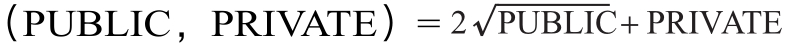
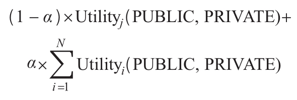
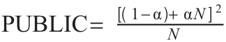
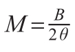
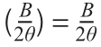
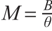
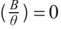
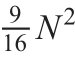
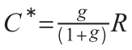
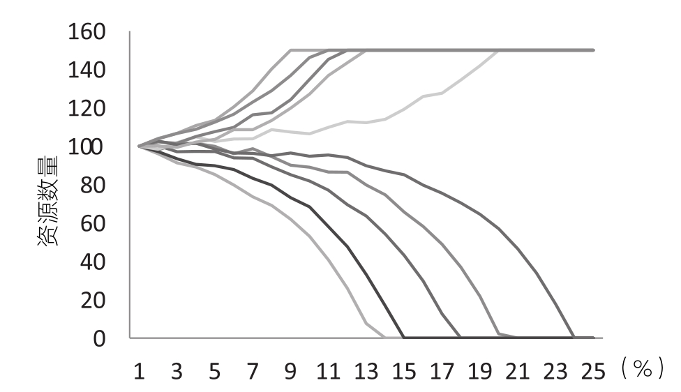

# 23　与集体行动有关的问题

自从大约 5 万年前智人发展出了现代创造力、高效和狩猎技能以来，如何可持续地管理环境资源一直是一个非常困难的问题。

贾雷德·戴蒙德（Jared Diamond）

在本章中，我们讨论集体行动问题，也就是那些自身利益与集体利益出现了不一致的情况。集体行动问题在各种情况下都会出现。在机场，乘客可能通过尽可能地挤到行李传送带旁边而获益，因为可以更快地拿到自己的行李，但是如果所有乘客都站到离行李传送带几步以外的地方，那么每一个人都会感觉更好。在美国，人们几乎没有任何动力去成为一个了解有关信息的选民，因为仅凭自己的一票改变选举结果的可能性非常低，尽管如果选民了解有关议题的话，国家的整体绩效将会更好。我们可以把集体行动问题视为一个多人囚徒困境博弈：每个人都有动机去背叛，但是从集体的角度来说，每个人都能够通过合作使自己的境遇得到改善。

学者们经常在历史案例的背景下研究集体行动，例如苏格兰公地的管理或纽芬兰和缅因州沿海龙虾栖息地的演变。 ¹  其中最著名的案例是贾雷德·戴蒙德讲述的复活节岛上的波利尼西亚人的衰落。 ²  复活节岛位于智利以西 3 000 多千米的南太平洋，方圆 1 000 多千米内没有其他可以供人居住的岛屿。这个特殊的地理位置决定了，复活节岛上的居民必须自己管理自己。据估计，到 17 世纪初，复活节岛上的人口已经超过了 1.5 万人。从 16 世纪开始，复活节岛上的居民积累了足够多的资源，调集了富余劳动力去建造一种名为莫埃（maoi）的巨型石头人像，它们往往重达 80 吨以上。

但是，复活节岛上的居民在忙于建造莫埃的同时，却没能共同合作管理好他们的森林。到了 1722 年，当欧洲探险家第一次登上复活节岛时，岛上的食物已经相当匮乏了，人口也减少到了 2 000 人左右。岛上已经基本看不到超过 3 米高的树木了，许多鸟类和动物都已经灭绝。用戴蒙德的话来说，岛上的文明已经崩溃了。当欧洲人带来的病毒害死了岛上几乎所有剩余的原住民时，这个崩溃过程就最终完结了。

根据戴蒙德的解释，复活节岛上文明的崩溃，以及中美洲的玛雅人、美国西南部的阿纳萨齐人（Anasazi）和格陵兰岛的温兰人（Vinlander）的没落和崩溃，都是由于自然资源的过度开发和气候变化共同造成的，而资源的耗竭，又是因为制度和文化的失败所致。温兰人不但在极地边缘地带放养动物，而且还从原本就非常脆弱的草地上揭起草皮来建造房屋。结果在很短的时期内，他们的土地就因过度使用而变得极度贫瘠了，于是温兰人开始挨饿。与复活节岛上的居民一样，温兰人也未能管理好公共资源。他们砍掉了太多的树木、毁坏了太多的草皮，文明崩溃了。

虽然这些例子都很引人注目，也促人深思，但是由于它们都发生在“遥远”的历史时期，所以许多人可能据此认为，集体行动问题只是在久远的过去才是重要的问题。这是一种相当不幸的框架效应。事实上，由于世界已经变得更加复杂，各个部分之间的相互联系也更加紧密了，集体行动问题其实比以往更加重要。在人类社会的所有方面几乎都面临着集体行动问题。公共教育、身体和精神的健康保障、基础设施、公共安全、司法系统和国防支出，核心都是集体行动问题；管理全球渔业、应对气候变化，特别是减少对大气层的碳排放量，与集体行动问题就更加息息相关了。

此外，由于几乎所有工作都变得更加依赖于团队合作，也必然会产生集体行动问题。员工有很强的动机去“搭便车”——自己偷懒卸责，让别人去努力工作，他们也会对共享工作空间提出过度需求，以确保自己的团队有足够的工作空间。

本章的结构如下。首先定义一个一般的集体行动问题，然后具体分析三类重要的集体行动问题。我们的讨论是从公共物品的供应问题入手的，在这类问题中，个体要为道路、学校和社会服务提供资金，或者为清理公园或水源而付出时间和精力。然后，我们研究了拥挤问题，即个人对诸如道路系统、海滩或公园之类的公共资源的使用必须受到限制。最后，我们分析了可再生资源的开采利用问题——个人需要消费这些可以再生的资源，例如鱼，龙虾和树木。拥挤问题每天都会发生。如果太多的汽车塞满了城市的街道，那么该市或许可以通过向进入城市的汽车征收拥堵费来解决这个问题，因此以往的过度使用不会产生长期影响。然而，森林被过度采伐了、渔场被过度捕捞了，却至少需要数十年时间才能恢复元气。这就是说，我们不得不承担过去合作失败的恶果。

个体激励与集体目标之间不一致的性质各不相同，因此问题的解决方案也不同。我们可以通过征税来解决公共产品供应问题，在某些情况下，也可以通过分类来解决这个问题。拥挤问题则可以通过收费或实施使用限制来解决，解决可再生资源问题则需要监督、制裁，还需要建立健全解决冲突的机制。

说到底，我们在这里给出的解决方案只是一些最基本的见解，它们必须因地制宜地应用于各种具体情况。任何真实情况都包括了模型无法完全覆盖的复杂层面。巴厘岛的水神庙能够解决水资源分配问题。水资源的分配是一个序列拥挤问题：上游的人可以先利用水资源，然后是中游的人，最后才是下游的人。国际捕鱼权制度通过限制进入的方法解决了可再生资源的公地悲剧问题，不然的话，挪威限制本国渔民近海捕捞的努力，可能因瑞典、俄罗斯和丹麦等国渔民在近海的过度捕捞而无效。 ³  在现实世界中，任何一个解决方案的有效性，都部分依赖于我们在第二十二章中讨论过的关于如何在囚徒困境博弈中实现合作的机制：重复行动、声誉、网络结构和群体选择等。群体选择是间接发挥作用的：成功解决了这些问题的社区和国家将繁荣发展，它们的成功会被其他人所复制。

### 集体行动问题

在集体行动问题中，每个人都可以在做贡献与免费搭便车之间进行选择。搭便车符合个人利益最大化动机，因为这能为个人带来更高的收益。然而，当每个人都做出贡献时，整个群体能够获得更大的收益。

**集体行动问题** 

在集体行动问题中，*N* 个人中的每个人都要选择是搭便车（*f* ）还是为集体行动做贡献（*c* ）。个人的收益取决于自己的行动和合作者的总数。个人可以通过搭便车获得更高的收益，即，收益（*f* ，*C* ）>收益（*c* ，*C* +1），但是当每个人都做出贡献时，所有人的收益总和实现最大化。

我们可以把集体行动问题视为一个多人囚徒困境博弈。因此，我们可以参考第二十二章中提出的解决方案，来解决如何形成合作和维持合作的问题。然而，那些方法是不完整的，原因如下：第一，集体行动问题涉及群体和社区，而不仅仅涉及配对博弈的个体；第二，许多集体行动问题都有特定的形式，因此其解决方案必须量身定制。

### 集体行动问题一：公共物品供应问题

我们要讨论的第一个具体的集体行动问题与公共物品的供应有关。公共物品满足非竞争性（non-rivalry），也就是一个人对公共物品的使用不会影响任何其他人的使用，以及非排他性（non-excludability），也就是无法禁止个人使用公共物品。公共物品包括清洁的空气、国防、龙卷风到来之前的警报信号和知识。美国宪法列举了政府有建立司法体系、确保国内安全、防御外国侵略的责任，这些也属于公共产品。

私人物品，比如自行车、燕麦饼干和量角器，既不是非竞争性的，也不是非排他性的。但知识既是非竞争性的，也是非排他性的。比较一下燕麦饼干和三角函数知识，就可以将这种差异突显出来。老师可能会说：“梅丽莎，我很抱歉，卡拉已经把最后一块燕麦饼干吃掉啦。”但他永远不可能说：“梅丽莎，我很抱歉，卡拉已经用过了毕达哥拉斯定理，现在它永远消失啦。”

公共物品的非排他性和非竞争性导致了集体行动问题。这个问题的出现，不是因为人们不想做出贡献，而是在于人们低估了贡献的价值。每个人贡献出来的每一美元，都可以增加每个人的效用。我们在这里将给出一个正式的模型：每个人都要将自己的收入在一种公共物品和一种代表性的私人物品之间进行分配，可以把私人物品想象成可以花在任何其他东西上的钱。我们可以将这个模型扩展到为包括多种公共物品和多种私人物品的情形，但那只会使分析复杂化，并没有特别大的意义。

**公共物品供应问题** 

有*N* 个人，每人要将自己的收入*I* （*I* >*N* ）配置到一种公共物品（PUBLIC）和一种私人物品（PRIVATE）上，每个单位的成本为 1 美元。每个人都有以下形式的效用函数：

效用

**社会最优配置：** PUBLIC=*N* （如果*N* =100，那么每个人捐献 100 美元）。

**均衡配置** ：PUBLIC=1/*N* （如果*N* =100，每个人捐献 0.01 美元）。 ⁴  

在这里，我们把效用模型描述为公共物品的凹函数和私人物品的线性函数。对于这样的假设，我们必须说明其理由。凹性对应于收益递减：一个人对某种东西估价随着对它消费的增多而减少。效用对公共物品数量的凹性，意味着公共物品的边际收益递减。这是一个标准假设。人们因高速公路新增的第三条车道而获得的好处，大于因新增第四条车道而获得的好处。污染严重的空气变得清洁对人们的好处要比将清洁的空气中最后一点微尘彻底清理干净更大。

之所以假设私人物品的效用是线性的，是因为它其实代表着所有私人物品的组合。虽然实用函数对任何一种私人物品可能都是凹性的，无论是巧克力、电视机还是牛仔夹克，但是它对于所有商品来说则更可能接近于线性。这个假设还有一个额外的优势，那就是，会使模型更加容易分析。

先求解社会最优配置问题。我们把社会最优配置定义为能够最大化整个种群效用总和的配制，也就是大多数人的最大幸福。 ⁵  社会最优配置要求，每个人都得为种群中的每个人捐献一美元用于提供公共物品。这里需要注意的是，每个人对公共物品的贡献随着种群规模的增大而增加。这个结果不依赖于我们选择的效用函数的形式，因为种群规模越大，能够因非竞争性的公共物品而受益的人越多。这也就是说，享受清洁空气或国防安全的人越多，应该提供的公共物品就越多。

均衡贡献等于 1 除以种群总人数。随着人口的增多，人们有更大的动机去搭其他人贡献的便车。为了说明个中缘由，我们可以看看让人口规模增大 1（加入一个人）时会发生什么。这个“新”人从公共物品中获得的效用，与之前的其他人一样。如果其他人的贡献保持不变，那么这个“新”人为公共物品捐献的动力就会比其他人在以往贡献时更弱。因此，他的贡献会比他们更少。另一方面，当他真的有所贡献时，他将使公共物品的数量有所增加，从而又增强了其他人贡献更少的动机。

因此，这个模型表明，随着人口规模的扩大，公共物品供给（不足）问题也会加剧。公共物品的最优水平提高了，但是人们贡献的动力却下降了。从模型中推导出来的最优贡献水平和均衡贡献水平确实依赖于对效用函数形式的假设，但是公共物品供给不足的现象确实是非常普遍的。

这种分析假设是人都是自私自利的，这也是经济模型中的常见假设。不过，来自问卷调查、实验，以及日常观察的证据表明，人们还有涉他偏好（other-regarding preferences），会考虑他人的利益。人们希望他人也能够与自己一样，上好的学校、利用完善的道路网络。我们可以在模型中加入一个利他主义参数来模拟这种行为，该参数取零值时就对应于经济学家所假设的自利理性行为者，取值 1 则对应于每个人为他人考虑的程度与为自己考虑的程度完全一样。纯粹的利他主义者，也就是对每个人都一样关心的人，做出的贡献达到了社会最优水平。只要达不到纯粹的利他主义，就会导致供应不足。

计算表明，在规模很大的种群中，人们的贡献水平与最优配置水平之间的比例，近似地等于利他主义参数的平方。虽然公共物品供给不足的程度取决于效用函数的形式，但是这个例子说明了利他主义的局限性。关心他人的程度相当于关心自己的程度一半的那些人，贡献水平只相当于最优水平的 1/4。关心他人的程度相当于关心自己的程度一半的那些人，贡献水平则只占最优水平的 1/9。

**利他主义者提供的公共物品** 

*N* 人有利他主义偏好，其对总效用的权重为*α* ：

**均衡纯粹的利他主义者** （*α* =1）：PUBLIC=*N* 

**均衡一般解：**  ⁶  

**实例：** *α* =1/2：PUBLIC≈*N* /4

考虑到我们并不生活在一个由纯粹的利他主义者组成的世界中，我们必须寻找其他机制来解决公共物品供给不足的问题，例如税收。政府征税以支付国防、公共道路、教育和刑事司法体系的支出，并提供其他公共物品。不过，确定税额需要包括个人收入和偏好异质性的更精细的模型。人们可以就税额和税率进行投票。空间投票模型预测税率等于中间选民所偏好的公共物品的水平。但是，如果人们有异质性的收入和偏好，这个水平就可能不是社会最优的。

许多公共物品，如学校、道路网络和资源回收系统，可以认为是属于“本地”的。本地社区可以将本社区之外的人排除在这些公共物品的使用者之外；但是在社区内部，这些公共物品仍然是非竞争性的和非排他性的。对于这种本地公共产品，人们可以根据自己的偏好将它们归入不同的社区。这就是所谓的蒂布特模型（Tiebout model），它为公共物品的供应问题提供了一个可能的解决方案。想要更好的学校、公园、游泳池和公共安全的人，可以投票支持征收更高的税收，以支付提供这些公共物品的费用。而那些不想要这些本地公共产品的人，则可以住进另一个社区，并只需要支付较低的税。

当然，蒂布特模型也不是万能的，它也不可避免地带来了一些成本，其中之一就是社会凝聚力会因此下降。此外，如果高收入人群以这种方式将自己与社会其他群体隔离开来，就会导致较贫困社区的公共物品供应进一步下降，并减少可以传递信息和知识的网络互动。 ⁷  

### 集体行动问题二：拥塞模型

第二个集体行动问题是拥塞模型，它刻画了道路、海滩、供排水系统等公共物品对个人的价值随着用户数量的增加而减少的现象。任何一个受过交通堵塞之苦的人，都明白这里所说的含义。道路通畅比严重堵塞能够带给我们更多的乐趣和效用。有人估计，美国每年的交通延误成本已经达到了 1 000 亿美元以上，尤其是洛杉矶和华盛顿特区，人们每年堵在路上的时间超过了 60 小时。

拥塞模型假设，资源的总量是固定不变的。每一天，每个人都可以选择使用这种资源或不使用。使用资源的个人收益随着其他用户数量的增加而线性地减少。 ⁸  模型中的斜率，即拥塞参数，描述了这种拥塞效应的严重程度。

**拥塞模型** 

在*N* 人中，*M* 人选择使用一种资源。其效用可以写成如下形式：

效用（*M* ）=*B* -*θ* ×*M* 

*B* 表示最大收益，*θ* 是拥塞参数。其余（*N* -*M* ）人不使用这种资源，并且效用为零。 ⁹  

**社会最优解：** ，且效用

**纳什均衡解：** ，且效用

在社会最优解中，使用这种资源的人的数量等于最大可能收益除以拥塞参数的两倍。这些发现与我们的直觉相符，使用一种资源的人的数量应该随着最大可能收益的提高而增加、随着拥塞效应的加剧而减少。在纳什均衡解中，使用这种资源的人的数量恰好是社会最优解下使用这种资源的人的数量的两倍。这时，拥塞变得如此严重，以至于没有人能够获得任何收益。这个结果依赖于不使用这种资源的效用为零的假设。这个发现有一个违反直觉的含义：建一个美丽的公园可能并不能为社区居民带来太大的效用。在均衡状态下，公园将会变得非常拥挤，以至于在公园休憩并不会比待在家里更好。

当一个模型产生的结果与常识相反时，就需要对结果细加思量。人们肯定更希望拥有一个公园，因此这个模型必定是错的。首先，它之所以出错，是因为我们假设所有人都有相同的偏好。如果不同的人对公园的“享受”程度各不相同，那么在有些人无法因公园而获益的情况下，另一些人仍然可能会获得正效用。其次，这个模型假设公园总是会拥挤不堪，但那不可能是事实。再次，人们的替代选择可能是去海滩，而不是待在家里。因此，新公园的出现，可能会使海滩变得不那么拥挤。最后，人们能够从各种体验中获得效用。如果一个城市里有滑板公园、宠物公园和水上公园，那么人们可以在一定时间内从多种不同的体验中获益。

尽管存在这样一些问题，但是这个简单的拥塞模型的主要结果仍然具有一定的说服力。在繁忙时期，拥塞确实会上升到公园所产生的好处不会比任何其他活动更多的程度。拥塞是不可避免的，尽管不会像只有一个公园时那么严重。更何况，即便建成多个公园也不能保证人们能够在多个公园之间实现最优配置。在下面的例子中，有太多的人都挤到了一个更大的那个公园中。

除了创建更多的公园，社区还可以尝试其他解决方案，例如采取配给制或轮换进入制、进行抽签、收取入场费和扩大容量等。配给制的核心是给每个人或每个家庭分配一定数量的资源。这种解决方案适用于像水这样可分割的资源，但不太适用于公共道路。轮换是按时间分割资源的使用权。例如，为了减少空气污染，城市可以限定在某些日子里只允许车牌号为偶数或奇数的汽车上路行驶。但是很多资源，如受欢迎的公立学校，是不能配给或轮换的，在这种情况下，则可以通过抽签来配置资源。

**存在多个拥塞性公共物品的情况** 

*M* 个人去公园 1，（*N* -*M* ）个人去公园 2。相对而言，公园 2 更大更好，为了体现这一点，假设如下形式的效用函数： ¹⁰  

公园 1：效用（*M* ）=*N* -*M* 

公园 2：效用（*N* -*M* ）=3*N* -3×（*N* -*M* ）

**社会最优解：** *M* =*N* /2，创造出的总效用为*N* ^(2；) 

**纳什均衡解：** *M* =*N* /4，创造出的总效为

对于道路系统，收取通行费是一种普遍的解决方案。伦敦市会收取车辆进入中心城区的费用，世界各地的收费公路也是如此。收费其实是将资源配置给那些愿意为使用资源付出更多钱的那些人，但是这些人也许不是能够从资源中得到最高效用的人。新加坡同时使用了收费和限制进入的方法。每一年，新加坡都会拍卖固定数量的机动车许可证，许可证的有效期为 10 年，一份许可证的售价往往超过了一辆普通汽车的价格。为了减少高峰期的交通堵塞，新加坡和伦敦一样，还向进入中央商务区的车辆收费。在同等规模的城市中，新加坡的交通状况算得上相当不错，而且新加坡政府还通过上述方法筹集了大量资金，可以用它们进一步发展公共交通。

扩大道路通行能力，能不能结束拥堵？并不一定。当一个城市通过增加高速公路的车道来缓解交通问题时，会使高速公路附近的房子升值，从而形成一种正反馈回路：房子的数量会随之增加，从而使交通量进一步上升，进而需要更宽的道路。这种正反馈回路，与第十八章所描述的系统动力学模型中的正反馈回路类似。

### 集体行动问题三：可再生资源开采模型

第三个集体行动问题是可再生资源开采模型。在这种模型中，个人所利用的资源是能够再生的。这种模型适用于森林、河流、草原和渔业资源。在这些情况下，未来可用资源的数量取决于现在使用的数量。如果使用得太多，资源就可能无法足够快地再生。资源可能无法快速再生这个事实使可再生资源利用问题比公共物品问题或拥塞问题更加脆弱。如果一个城市在某一年内资金不足，无法提供足够的公共照明，那么它还可以在下一年想办法加以改进，并且不会因为这种错误产生长期不良影响。但是，如果人们过度捕捞或过度砍伐森林，就会付出持久的代价，因为要生产鱼就必须先有鱼，但并不需要用路灯来制作路灯。此外，可再生资源可能是必需品：食物、饮用水和保暖用的燃料。人们需要开采可再生资源才能生存下去。

**可再生资源开采模型** 

令*R* （*t* ）表示第*t* 期开始时的可再生资源数量，再令*C* （*t* ）表示第*t* 期内耗用的资源的总量，*g* 表示资源的增长率。那么，第*t* +1 期的资源数量量由以下差分方程给出： ¹¹  

*R* （*t* ）=（1+*g* ）［*R* （*t* ）-*C* （*t* ）］

均衡消费水平：

可再生资源开采模型表明，资源的耗用水平有一个临界点。任何高于均衡开采率的资源开采率都会导致崩溃，这一点在上面的正式模型中可以看得很清楚。我们可以将资源总量视为一个“饼”，开采资源相当于从这个饼中咬掉了一口。由于资源是可再生的，它会产生与剩余资源数量成比例的一定资源。如果资源开采水平较低，资源将会增加；如果开采水平过高，就无法通过再生来弥补了。在这两者之间，存在着一个均衡：开采的资源与再生的资源恰恰相等。

如果开采水平超过了均衡水平，那么模型预测，资源总量将加速下降，最终导致非常突然的崩溃。缓慢的下降之后是急剧的下降，这是对那些管理难以准确测量的资源（例如鱼类资源）的人发出的一个严重警告。年度渔获量提供了关于鱼类资源总量的一丝线索，但是它们并不准确。因此，我们不应该感到惊讶：正如贾雷德·戴蒙德在他的关于社会崩溃的书中所描述的那样，北大西洋的鳕鱼捕捞业在现代也出现了崩溃，就像温兰人在历史上所遭遇过的一样。鳕鱼捕捞业在北大西洋已经有 500 多年的历史了。最早来到加拿大海岸的英国探险家们讲述了一些关于鳕鱼的“神话”：把一个篮子抛进海，就可以提上一篮子鳕鱼上来；浅滩上聚集了大量鳕鱼，连小船都划不过去！然而到了 1992 年，加拿大政府不得不严令暂停鳕鱼捕捞。 ¹²  

可再生资源开采模型假设，它们会以不变的速度增加。有了这种假设，我们就可以求出均衡开采水平。但是在现实世界中，可再生资源的增长率每年都在变化。对于牧场来说，增长率取决于温度和降水量；对于鱼类种群来说，增长率取决于可用食物的数量，而食物的数量又取决于气温变化或气候变化。

在另外两个模型中，这种变化不会产生长期后果。在有些年份，我们可能有比较充裕的公共物品，拥塞情况不会太严重；而在有些年份，公共物品供给不足，拥塞情况就会非常严重。这些变化确实会影响效用，但是影响不会比天气等不可避免的变化更长。但是在可再生资源开采的问题上，情况就完全不同了。如果行为不变，细微的变化就可能导致崩溃与丰裕之间的天壤之别。在图 23-1 中，我们假设平均再生率为 25%、资源的数量为 100 个单位。给定这些假设，均衡开采水平等于每年 20 个单位。这幅图给出了介于 20%至 30%之间的随机抽取的多个增长率下的长期结果。这个模型还假定，资源的最高水平为 150 个单位。

**图 23-1　资源增长率可变的 10 种可能路径** 

在大约一半的路径中，资源水平崩溃了。在另一半路径中，资源的水平增大到最大可能水平。这些变化是不能相互抵消的，恰恰相反，增长率下降或提高的影响会随着时间的推移而累积。 ¹³  从这个模拟实验的结果中，我们可以看出，最优开采政策要求，当某一年出现了资源增长乏力的情况后，下一年必须减少开采，以防止崩溃。

由于可再生资源增长率的变化要求开采率跟随资源增长情况而变化，我们知道管理可再生资源必须做到随时调整开采水平。用来实现这种调整的方法或机制取决于资源的特征。俗话说得好，“世上没有灵丹妙药”。 ¹⁴  不存在适用于任何情况下的解决方案。到底怎么解决这类问题，取决于资源和管理当地本身的特征。

例如，鱼与牛就不同。管理着一块共享公共草地的多个牛群的社群，可以监督每个牛群的放牧者的行为和资源的水平，即草的数量。过度放牧问题可以通过分配给每个牛群一定时间或一小块草地，或通过轮换放牧等方法来解决。而且，配给或轮换的具体形式，都可以根据牧草的情况随时加以调整。但是，对于一个捕鱼的社群来说，管理资源就需要更精细的机制来精确地监控个人的行为，因为海中鱼的数量是不可能准确计算的，只能根据捕获量来估算。因此渔业资源开采问题比养牛的不确定性程度更高。管理共同的水生资源，需要更严格的保护和更严密的监测。

### 集体行动问题的发生

在集体行动问题中，自利行为导致的结果与个人的目标是不一致的。如上所述，这类问题在各种各样的情况下都会发生：在为使用非竞争性和非排他性的公共物品付费时，在决定什么时候将车子开上高速公路时，等等。甚至在我们决定如何在高速公路上驾驶汽车时，也会出现这类问题。在繁忙的高速公路上，如果发生了事故，有些驾驶员会自顾自地打电话、设路障，而全然不考虑他们这种行为对后面所有车辆造成的困扰。

这类问题也会发生在各个层面上。它们会出现在家庭内部：打扫房屋、做晚餐、购物，以及为外出度假存钱，所有这些都可能使个人动机与集体福利不一致。它们还会发生在社区、地区和国家等层面上，只要涉及公共产品的供给以及有限资源的使用和管理就会发生。它们还会发生在全球层面上，例如碳排放问题。大多数国家都希望全球排放水平更低，但是自己又想生产更多能源，也就是排放更多的碳，这时个体的理性行动与共同利益不一致。

集体行动问题在自然界也会发生。在森林里，树木会争夺光线和水分。如果某种树木演化出更高的树冠或更深的根系，那么它将增大自身的生存机会，但是会对其他的树种造成伤害。树木不可能“通过立法”去防止树冠长得过高或根系伸展太深，它们无法实现“社会”最优解决方案。 ¹⁵  

当涉及的个人或参与者所属的群体越小、越同质化、信息越透明（采取行动更容易、系统状态可容易监测）时，集体行动问题往往更容易解决。家庭通常能顺利解决集体行动问题，但是国际组织却发现全球合作极其困难。要减少碳排放，需要大量不同的行动者之间的能力合作，而且它们所使用的监测机制是不精确的。解决这样的问题需要协调和执行机制。

历史告诉我们，过度捕捞或过度放牧，会导致可再生资源的崩溃。我们可以将同样的逻辑应用于今天面临的集体行动问题。美国著名政治经济学家埃莉诺·奥斯特罗姆（Elinor Ostrom）花了数十年时间研究现实世界中解决集体行动问题的各种机制。她发现，除了严密监督各种偏离行为之外，能够有效解决集体行动问题的那些社群有如下共同特点：能够就某些明确的界限达成一致、同意明确界定的规则、授权实施渐进式制裁、拥有解决纠纷的机制。 ¹⁶ 