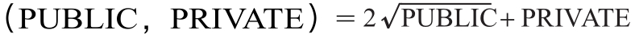
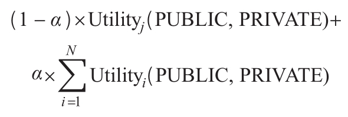
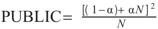
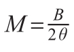
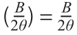
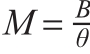
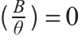
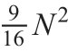
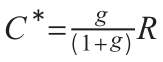
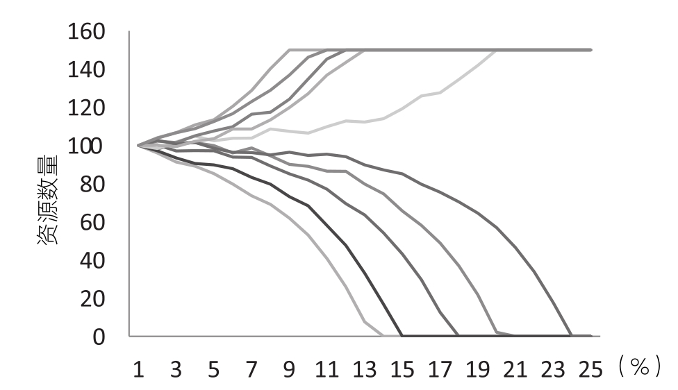

# 为什么人一多，好事反而更难办？

先做三个小测试：机场取行李，你是不是也想往前挤？投票日，你会不会觉得“我这一票根本改变不了结果”？堵在路上，你会不会暗暗希望别人都别开车？这些场景看似无关，背后却是同一个难题：个人算盘和集体利益打架。学者把它叫作**集体行动问题**——单个人“背叛”最划算，可如果大家合作，每个人的处境反而都能更好。它像一场多人版囚徒困境：人人有动机搭便车，集体却因此受损。

戴蒙德有句提醒很值得玩味：大约五万年前，智人已经拥有现代创造力、高效狩猎本领，但如何可持续地管理环境资源，始终是道难题。学者常拿历史案例研究这类困局，比如苏格兰公地、纽芬兰和缅因州沿海龙虾栖息地的演变。最出名的，是复活节岛波利尼西亚人的衰落。

复活节岛孤悬南太平洋，在智利以西三千多公里，方圆一千多公里内没有别的可居住岛屿。这种位置意味着，岛上居民只能自己管自己。到17世纪初，岛上人口估计超过1.5万。从16世纪起，他们甚至能调集富余劳动力，建造重达80吨以上的巨型石像“莫埃”。可与此同时，森林却没有被共同管好。1722年欧洲探险家首次登岛时，食物已相当匮乏，人口只剩约2000；超过3米高的树木基本消失，许多鸟类和动物已经灭绝。戴蒙德说，这里的文明崩溃了。后来欧洲人带来的病毒又夺走几乎所有剩余原住民，崩溃过程才最终收尾。

类似故事还有温兰人：他们在极地边缘放牧，又从本就脆弱的草地上揭草皮盖房，土地很快贫瘠，人开始挨饿。戴蒙德把复活节岛、玛雅、美国西南部阿纳萨齐人和格陵兰温兰人的没落放在一条逻辑里：自然资源被过度开发，气候变化又雪上加霜，而资源耗竭背后，是制度与文化的失灵。别以为这些只是“遥远古代的事”。世界越复杂、联系越紧密，集体行动问题反而越重要：公共教育、身体和精神健康保障、基础设施、公共安全、司法系统、国防支出，核心都是它；管理全球渔业、应对气候变化、减少大气层碳排放，更是绕不开它。团队合作也一样，员工有动机偷懒卸责，让同事多干；还会对共享办公空间提出过度需求，先保证自己团队够用。

要解题，先分型。集体行动问题大致可分三类：公共物品供应、拥塞、可再生资源开采。它们的激励错位不同，药方也不能一锅端。

## 一、公共品：人人受益，为何人人少出钱？

公共物品有两个标签：**非竞争性**，你使用不影响别人使用；**非排他性**，没法把某些人挡在外面。清洁空气、国防、龙卷风来临前的警报、知识，都是典型。美国宪法把建立司法体系、确保国内安全、防御外国侵略列为政府责任，也属于公共产品。私人物品则相反，自行车、燕麦饼干、量角器既会被人占用，也能被排除。知识很特别：燕麦饼干被吃掉就没了，毕达哥拉斯定理被用过却不会消失。

公共品的这两个特性会诱发搭便车。问题往往不是人们完全不想贡献，而是低估了自己那份贡献的价值：每个人每出一美元，都会让每个人效用增加一点。设N个人，每人收入I（I>N），要在公共品PUBLIC和私人品PRIVATE间分配，单价均为1美元，效用函数写作 效用。社会最优是PUBLIC=N；若N=100，相当于每人捐献100美元。均衡却是PUBLIC=1/N；N=100时，每人只出0.01美元。

为什么？人口越多，社会最优的公共品水平越高，因为非竞争性意味着受益者更多；但个人搭便车的动机也越强。新增一人从公共品中获益，与老成员一样；若别人贡献不变，他出钱动力更弱，贡献会更少。可他一旦出钱，公共品增加，又会削弱其他人出钱的动力。于是人口扩大，供给不足反而加剧。这个结论不依赖具体效用函数形式，供给不足相当普遍。

模型假设人是自利的，但问卷、实验和日常观察都表明，人还有涉他偏好，会顾及他人利益，希望别人也能上好学校、走好路。设利他权重为α：。纯利他者α=1时，PUBLIC=N，正好达到社会最优；一般均衡为；α=1/2时，PUBLIC≈N/4。若利他更弱，贡献比例还会掉到约1/9。大群体中，贡献与最优之比大致接近α的平方。可见好心有用，但光靠好心不够。

于是需要税收来支付国防、道路、教育、刑事司法等公共品。不过定税要处理收入与偏好差异，得用更精细的模型；人们可以就税额和税率投票，空间投票模型预测公共品水平等于中间选民的偏好，但收入偏好异质时，这未必是社会最优。本地公共品还可“用脚投票”：蒂布特模型认为，想要好学校、公园、游泳池和公共安全的人，可以投票支持更高税收；不想要的人则住进低税社区。但它不是万能药，代价之一是社会凝聚力下降；高收入者若因此隔离，贫困社区的公共品会更差，传递信息与知识的网络互动也会减少。

## 二、拥塞：路越修越堵，公园越建越挤？

第二类是拥塞。道路、海滩、供排水系统等资源，对个人的价值会随用户增多而下降。堵过车的人都懂：畅通比堵死更让人愉快。有人估算，美国每年交通延误成本超过1000亿美元，洛杉矶和华盛顿特区每年堵在路上的时间超过60小时。

拥塞模型假设资源总量固定，每人每天选择用或不用；用者收益随人数线性下降。效用(M)=B-θ×M，B是最大收益，θ是拥塞参数，不用者效用为0。社会最优解为，效用；纳什均衡解为，效用。均衡使用人数恰好是社会最优的两倍，拥塞严重到没人能获得收益——这个结果依赖“不用资源效用为零”的假设。它有个反直觉推论：建个漂亮公园，未必给社区居民带来多大效用；均衡时公园太挤，去公园未必比待在家好。

模型与常识冲突，就得细看。它假设所有人偏好相同，但有人就是更爱公园；它假设公园总拥挤，事实未必；人们还可以去海滩，而不是只能待家，新公园反而可能让海滩不那么挤；城市若有滑板公园、宠物公园、水上公园，人们还能从多种体验中获得效用。尽管如此，简单模型仍有说服力：繁忙时段，拥塞确实能把公园好处压到不高于别的活动；拥塞不可避免，只是不会像独此一个公园时那么惨；多建公园也未必自动实现最优配置。比如M人去公园1，N-M人去更大更好的公园2：公园1效用(M)=N-M，公园2效用(N-M)=3N-3(N-M)。社会最优是M=N/2，总效用N^2；纳什均衡却是M=N/4，总效用——太多人挤进了大公园。

怎么办？可以配给，按人或家庭分配一定资源，适合水这类可分资源，不太适合公共道路；可以轮换，按时间分割使用权，比如为减污染实行单双号限行；可以抽签，适用于受欢迎却不能配给轮换的公立学校；也可以收入场费、扩大容量。道路系统常收通行费：伦敦对进入中心城区的车辆收费，各地收费公路也如此。收费把资源给到愿付更多钱的人，但这些人未必是能获得最高效用的人。新加坡同时用收费和限制进入：每年拍卖固定数量、有效期10年的机动车许可证，价格常超过普通汽车；还对进入中央商务区的车辆收费。同等规模城市里，新加坡交通算相当不错，政府还筹到大量资金发展公共交通。

扩容能终结拥堵吗？不一定。增加车道会抬升附近房价，形成正反馈：房子增多，交通量上升，又需要更宽的路，像系统动力学里的正反馈回路。拥塞每天发生，拥堵费可抑制过度使用，且不会留下长期影响；但森林过伐、渔场过捕，恢复至少要以十年计，过去的合作失败，后果得由后来者承担。

## 三、可再生资源：鱼和树等不起

第三类是可再生资源开采，比如鱼、龙虾和树木。治理不能只靠自觉，需要监督、制裁，还要有健全的冲突解决机制。巴厘岛的水神庙能协调水资源分配，那就是个序列拥塞问题：上游先用，中游再用，最后到下游。国际捕鱼权制度则通过限制进入来避免公地悲剧；否则，挪威限制本国渔民近海捕捞的努力，可能被瑞典、俄罗斯、丹麦等国渔民的过度捕捞抵消。

现实中没有万能药。任何方案的有效性，都部分取决于重复互动、声誉、网络结构和群体选择等合作机制。群体选择是间接起作用的：成功解决集体行动问题的社区和国家会繁荣，它们的做法会被别人复制。

说到底，模型给的只是基本见解，必须因地制宜。真实世界总有模型覆盖不了的复杂层面。关键不是幻想人人无私，而是设计机制，让个人激励与集体目标尽量对齐——这比单纯呼吁“自觉一点”可靠得多。

# 会再生的资源，也可能被“咬”到崩盘

集体行动难题并不只出现在公共物品和道路拥塞里。第三类典型场景，是可再生资源开采模型。森林、河流、草原和渔业资源，都属于这个框架：今天取用多少，直接决定明天还能剩下多少。拿得过头，再生速度就追不上消耗。

这也是它比公共物品问题或拥塞问题更经不起失误的原因。某一年城市资金不足，公共照明没补齐，下一年还能想办法改进，错误通常不会留下长期疤痕；但过度捕捞或过度砍伐会付出持久代价。鱼群要先有鱼才能繁衍，路灯却不需要由路灯来制造。更关键的是，可再生资源还可能是生存刚需：食物、饮用水、取暖燃料，人都得靠开采才能活下去。

## 临界点：采掉多少，刚好等于长回多少

设R(t)为第t期开始时资源量，C(t)为该期消耗总量，g为增长率，原模型给出的差分关系是：

R(t)=(1+g)[R(t)-C(t)]

均衡消费水平：

这个模型揭示了一个临界开采率：任何高于均衡开采率的开采率，都会把系统推向崩溃。可以把资源总存量想成一块蛋糕，开采就是咬下一口；可再生部分会按剩余存量的比例长回来。采得少，存量会增加；采得太多，再生就补不上。中间存在一个平衡点：采掉的数量恰好等于长回来的数量。

一旦越线，模型预测存量会加速下降，最终以非常突然的方式崩掉。先缓慢下滑、再急剧塌陷，这对管理鱼类这类难以准确计量的资源的人是严厉警示。年渔获量只能透露鱼群存量的一点点线索，而且并不精确。贾雷德·戴蒙德在讨论社会崩溃的著作中描述过，北大西洋鳕鱼渔业在现代重演了崩溃，和温兰人的历史遭遇相似。这片渔场有五百多年捕捞史；早期到加拿大海岸的英国探险者留下近乎神话的说法：篮子扔进海里就能提上一篮鳕鱼，浅滩鱼群密到小船都划不动。可到1992年，加拿大政府只能下令全面禁捕鳕鱼。

## 增长率一变，结局可能天差地别

模型先假定资源按固定速率增长，才能求出均衡开采水平。现实中，增长率年年变化：牧场取决于温度和降水；鱼群取决于可用食物量，而食物量又受气温变化或气候变化影响。

在公共物品和拥塞模型里，这种波动不会留下长期后果。有些年份公共物品较充裕、拥塞不严重；有些年份供给不足、拥塞严重。这些变化会影响效用，但不会比天气等不可避免的变化持续更久。可再生资源却完全不同：如果行为不变，细微变化就可能造成崩溃与丰裕之间的天壤之别。

图23-1的模拟假定平均再生率25%、资源量100单位，于是均衡开采为每年20单位；在20%至30%之间随机抽取多个增长率，观察长期结果，并把资源上限设为150单位。图23-1展示增长率变化下的十种可能走向：

十条路径里，约半数资源水平崩溃，另半数升至最大可能水平。这些波动不会互相抵消，反而会随时间累积。模拟给出的政策含义很明确：某一年资源增长乏力，下一年就必须减少开采，防止崩盘。增长率会变，开采率就得跟着资源增长情况调整，管理必须随时校准。

## 没有万能药：鱼和牛不是一回事

调节手段取决于资源特征和当地治理条件。俗话说“世上没有灵丹妙药”，不存在放之四海而皆准的方案。

多户共牧一片草地的社群，能盯着每个放牧者的举动，也能看草场剩多少草。过牧问题可以通过给每群牛分配使用时段或小块草地、实行轮牧来缓解；配额和轮换安排还可随草情调整。捕鱼社群则需要更细的监控机制，精确追踪每个人的行为；海里鱼量无法直接算清，只能从渔获量反推。因此渔业比养牛更不确定，共享水域的管理要更严的保护和更密的监测。

## 自利选择，为何常偏离共同目标

集体行动问题的共性在于：自利行为导致的结果，与个人目标并不一致。为公共物品付费、决定何时把车开上高速，甚至高速上的驾驶方式，都可能触发这类困境。繁忙高速出事故时，有人只顾自己打电话、摆路障，不理会后方车辆因此受困。

它也会出现在家庭内部：谁打扫、谁做晚饭、谁采购、为度假存钱，个人动机都可能与集体福利不一致。社区、地区、国家层面，只要涉及公共品供给或有限资源使用管理，都可能出现。全球层面如碳排放：多数国家盼全球排放下降，自己却想多产能源、多排碳，个体理性与共同利益便不一致。

自然界也有集体行动难题。森林中树木争阳光和水分；某树种若演化出更高树冠或更深根系，自身存活机会增加，却会伤及其他树种。树木没法靠立法限制冠高根深，也无法达成“社会最优”。

当参与者群体更小、更同质、信息更透明时，行动更易协调、系统状态也更易观察，问题通常更好解决。家庭往往能较好处理这类问题，国际组织却常陷入全球合作困境。减少碳排放需要大量不同行动者协作，监测又不精确，因而离不开协调与执行机制。

历史一再说明，过度捕捞、过度放牧会让可再生资源崩塌；同一套逻辑也适用于今天的集体行动难题。美国政治经济学家埃莉诺·奥斯特罗姆（Elinor Ostrom）用数十年考察现实中的治理机制。她发现，有效社群除了严密监督违规行为，还通常具备这些共同点：能就清晰边界达成共识、认可明文规则、允许对违规行为逐步加码惩罚、拥有争端解决机制。