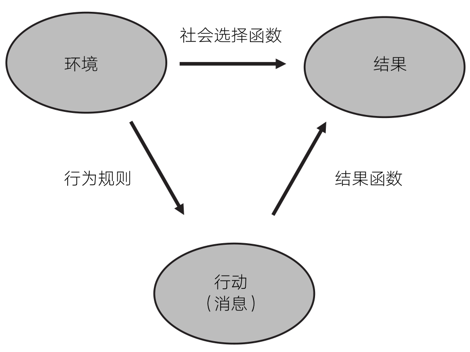
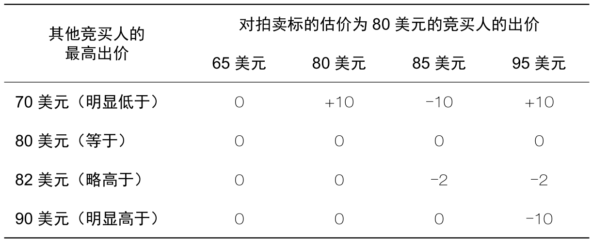
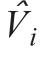
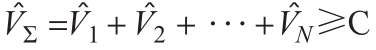
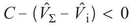
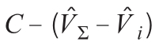
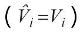

# 24　与机制设计有关的模型

制度的目的在于改变人类行为。为了保证制度不会随着时间流逝而归于无效，制度必须适应制度所要规范的环境或社会的变化。

珍娜·贝德纳

在本章中，我们讨论如何运用模型去设计政治制度和经济制度。任何一个制度都要包括两个因素：一是人们用来交流信息的渠道，二是人们用来根据所揭示的信息做出决策、重新配置资源或安排生产的程序。在市场中，个人和企业通过价格进行沟通以执行交易并做出生产决策。在层级机构中，人们通过书面语言进行交流以组织工作并推进计划。在民主国家，人们通过投票进行沟通。投票规则决定政策。良好的制度可以促进沟通和行动，从而产生理想的结果，效率低下的制度则相反。

在本章中，我们给出了一个通常称为机制设计（mechanism design）的对制度进行建模的框架。这个框架强调了真实制度的如下四个方面：信息，指参与者知道些什么及应该向他们揭示什么；激励，即采取特定行动的利益和成本；集结，个人行为如何转化为集体结果；计算量，这是对参与者认知能力的要求。

机制设计思想起源于分析资源配置的一般问题，即中央计划体制和市场机制究竟哪一个才能实现资源的最优配置。在早期的模型中，建模者会先给出若干行为规则，例如在市场中充当价格接受者，或者如实投票；然后再研究这些行为的含义，也就是看这些微观行为是怎样集结为集体结果的。后来，这种方法被放弃了，取而代之的是假设人们采取最优化行为的方法。这种假设使这些问题很适合运用博弈论的工具来分析。这就是机制设计的思路。在构建了博弈模型后，机制设计专家求解出纳什均衡，然后在共同的行为假设的基础上进行制度比较。

事实证明，这个分析框架是很有用的。它可以用于搜索现有规则和程序中的缺陷、解释制度成功或失败的原因，可以用来预测结果，还可以用来设计各种各样的制度，包括第二章中描述的频谱拍卖，以及在线交易体系、政府投票系统，甚至还可以用来设计为航天飞机上的研究项目分配空间的程序。 ¹  

本章讨论的内容包括六个部分。在第一部分中，我们首先使用芒特-赖特尔图（Mount-Reiter diagram）描述了机制设计的框架。在第二部分中，我们研究了三个人在两个备选项之间进行选择的问题。在第三部分中，我们分析了三种拍卖机制，发现所有这些机制都产生相同的结果。在第四部分中，我们证明上述结果不是一个巧合，并描述了一个基本结果，即收入等价定理（revenue equivalence theorem）。收入等价定理的含义是，只要满足某些假设条件，任何拍卖机制都会产生相同的结果。在第五部分中，我们对多数投票平均分担机制（majority-vote equal sharing mechanism）与枢轴机制（pivot mechanism）进行了比较，它们都是决定是否进行某个公共项目建设的方法。最后，我们沿着在对纳什均衡进行批评时引入的思路，进一步扩展了对机制设计问题的分析。

### 芒特-赖特尔图

一种机制由六个部分组成：一个环境（世界的相关特征）、一个结果集、一个行动集（也称为消息空间），一个行为规则（人们根据这个规则来做出行动）、将行动映射到结果的结果函数，以及将环境映射到一组希望得到的结果的社会选择对应（social choice correspondence）。社会选择对应通常包括能够最大化参与者效用的结果或帕累托有效（pareto efficiency）配置的集合，当且仅当不存在每个人都喜欢的其他结果，某个结果是帕累托有效的。帕累托效率是下限标准。

**帕累托有效** 

在一个结果集中，对于某个结果，如果存在每个人都喜欢的另一个备选方案，就说这个结果是帕累托占优的。相对应，所有其他结果都是帕累托有效的。 ²  

芒特-赖特尔图以图形方式描述了一个机制的上述基本组成部分（见图 24-1）。需要注意的是，芒特-赖特尔图将我们想要的东西和已有的东西并列在一起。图的顶部是社会选择对应，它描述了我们希望得到的规范的结果。在图的底部，则列出了我们在现实世界中能做的事情——人们应用他们的行为规则来发送消息或采取行动。结果函数将这些行动映射到结果中去。在理想情况下，下部这个更加复杂的路径会产生与上部路径相同的结果，即人们期望得到的结果。

**图 24-1　芒特-赖特尔图** 

当然，并不是所有机制都能取得成功。例如，如果环境是由对某种公共物品有偏好的人组成的，那么社会选择对应会将他们的偏好映射到这种公共物品的最优水平上。然而，正如我们在第二十三章中已经看到的那样，自愿捐献机制，也就是人们按照自己的意愿支付公共物品费用的机制会导致每个人只提供 1/*N* 单位公共物品而不是最优的*N* 单位公共物品。当一种机制产生的结果与目标不一致时，就说这种机制未能实现社会选择对应。

我们希望机制满足哪些性质？答案必须“因地制宜”。我们在这里只描述其中五个性质。第一，我们会希望这种机制的均衡结果与社会选择对应一致（帕累托有效）。第二，在理想情况下，参与者将会采用占优策略，即他们的最优行动不依赖于他人的行动。如果是这样，就说有效的结果是占优策略可实施的。第三，我们不想强迫人们参与这种机制（自愿参与）。第四，如果这种机制涉及资源的转移或支付，我们不希望增加额外成本或破坏资源（预算平衡）。在本章的后面，当我们分析决定某个公共项目的机制时，会发现这个性质往往很难满足。第五，在许多情况下，我们希望参与者讲真话。我们希望人们发送的消息能够揭示他们的真实信息或真实类型。博弈理论家把这个性质称为激励相容（incentive compatibility）。在大多数有趣的情况下，通常没有任何一个机制可以满足所有这些要求。因此，机制设计理论的一个重要贡献就在于证明什么是可能的、什么是不可能的。

### 多数规则和拥王者机制

我们要考虑的第一种情况是，人们如何通过投票决定是否采取联合行动或通过某项法案。假设，乌玛、维拉和威尔三个人想要一起去看电影，在出门前必须决定到底是看动作片、剧情片，还是喜剧片。类似的问题也会出现在军事决策中，比如三位高级军官，要决定到底是主动出击敌军、守卫阵地，还是割让土地。在这两个决策问题中，环境都由三个人组成，其偏好定义在三个备选项上。我们使用排序来表示他们偏好。排序动作片＞喜剧片＞剧情片，对应于最喜欢的是动作片，其次是喜剧片，然后是剧情片。我们假设以下的偏好排序：

乌玛：动作片＞喜剧片＞剧情片

维拉：喜剧片＞剧情片＞动作片

威尔：喜剧片＞剧情片＞动作片

在这个例子中，我们将社会选择对应设定为帕累托有效的选择集合。按照上面给出的偏好，喜剧片和动作片是帕累托有效的，而剧情片则被喜剧片占优。

我们首先评估作为一种机制的多数规则。在出现平局的情况下，我们假设选择是随机的。如果人们如实投票，那么喜剧片将会获得两票。然而，假设维拉和威尔都认为另外两个人将会在剧情片与动作片之间出现分歧，而且每个人都会投票给剧情片。再假设投票是连续的，维拉率先投票并选择了剧情片。威尔第二个投票，并同样选择了剧情片。这里，乌玛投什么票其实已经无关紧要了，但是为了避免冲突，她也选择了剧情片。这三张选票构成了一个纳什均衡，也就是说任何一个人都没有动力改变自己的投票。在这种情况下，多数规则并不总是能实现帕累托有效结果。

接下来考虑一下拥王者机制（kingmaker mechanism）。 ³  在这个机制中，先在群体中随机地选择一个人当“拥王者”。然后，由“国王”选择一个“国王”来决定这个群体的选择。如果威尔成了“拥王者”，那么他必须在乌玛和维拉之间选出一个“国王”来。他选择的任何人都将成为“国王”并决定大家一起去看什么电影。

如果是一个理性行为者，那个被选为“拥王者”的人会选择自己最喜欢的电影，由此得到的结果将是帕累托有效的。因此，拥王者机制能够实现帕累托有效的结果。这个机制还有一个额外的优点，那就是，如果任何两个人最喜欢的电影是相同的，那么这个机制肯定会选择这个结果。逻辑如下。假设威尔是“拥王者”。如果乌玛和维拉最喜欢的电影类型相同，那么无论威尔选择谁当“国王”，都会选出这种电影来。另一方面，如果是威尔和乌玛最喜欢的电影类型相同，那么威尔应该选择乌玛当“国王”。

### 三种拍卖机制

现在我们已经对机制有了最基本的印象了。接下来，我们转向对拍卖的研究。由于像 eBay 这样的在线拍卖市场的普遍存在，大多数人对拍卖已经有一定的了解。当然，拍卖也广泛用于其他环境，包括政府采购、二手车市场和大多数网络广告。我们在这里将注意力限定在卖家只有一个而竞买人有很多个的情形。拍卖标的可以是房屋、汽车、足球比赛门票或艺术品。再假设每个竞买人赋予拍卖的价值都是唯一的，目的是排除出现平局的可能性。帕累托有效结果是指拍卖标的转移到了对它（们）估价最高的竞买人手中这种结果。任何其他结果，都是帕雷托占优的结果。接下来，我们比较三种类型的拍卖：出价递增拍卖（ascending-bid）、第一价格拍卖和第二价格拍卖。

在出价递增拍卖中，拍卖师喊出一个价格，任何愿意支付这个价格的竞买人都会举手。然后拍卖师不断提高价格，直到只剩下一个竞买人为止。拍卖成交后，最后这个竞买人要支付的是出价第二高的竞买人的价格。在出价递增拍卖中，理性的竞买人会一直参与拍卖，直到价格达到他心目中的价值为止，而他会在那一点上退出拍卖。一方面，在价格达到竞买人的价值之前退出，就有可能无法以该价值的价格买下拍卖标的；另一方面，在价格超过竞买人的价值之后，仍然继续参与拍卖则会带来风险，这意味着竞买人或许可以买下该标的，但是支付的价格却超过了价值，从而导致净损失。

如果所有竞买人都理性行事，那么具有最高价值的竞买人赢得拍卖标的并支付相当于价值第二高的竞买人的价格。这一点可以通过下面的例子来说明。假设有三个竞买人，拍卖标的对他们的价值分别为 30 美元、60 美元和 80 美元。当拍卖师喊出的价格超过了 30 美元时，第一个竞买人就会退出。当价格达到了 60 美元时，第二个竞买人没有理由继续提高出价。因此，第三个竞买人在这个拍卖中胜出，并付出 60 美元，或者也可能再多一点点。为了简化分析，我们假设第三个竞买人要付出 60 美元。 ⁴  

在第二价格拍卖中，每个竞买人都以密封的方式提交出价，其他所有竞买人都不知道这个竞买人的出价金额。拍卖标的由出价最高的竞买人获得，但是竞买人只需支付相当于第二高出价的金额。第二价格拍卖这种机制设计能够保证说实话是最优行动。想象如下这个拍卖的例子。一个对拍卖标的估价 80 美元的竞买人要决定在第二价格拍卖中如何出价。不妨假设其他竞买人已经提交了出价，那么这个竞买人必须考虑三种可能的情况：其他竞买人的最高出价可能低于 80 美元、可能等于 80 美元，也可能超过 80 美元。不管在哪一种情况下，竞买人如实出价都是最优行动。

通过一个数值实例，上述逻辑会变得更加清晰。我们先假设拍卖标的对这个竞买人的价值为 80 美元，再考虑其他竞买人提交的如下四种最高出价：70 美元（明显低于其价值）、80 美元（等于其价值）、85 美元（略高于其价值），或 90 美元（明显高于其价值）。然后进一步假设这个竞买人考虑了四种出价方案，从 65 美元到 95 美元不等，如表 24-1 所示。

**表 24-1　当标的对竞买人的价格为 80 美元时，作为出价函数的净收益** 

从表 24-1 中可以看出，出价 80 美元总能带来与任何其他出价一样高的收益。这就是说，按拍卖标的对自己的真正价值如实出价，始终是最优行动（占优策略）。同样的逻辑也适用于所有竞买人，因此所有人都应该按他们的真实价值出价，所以这种机制是激励相容的。因此，在第二价格拍卖中，具有最高价值的竞买人会在拍卖中胜出，并且支付的金额等于价值第二高的竞买人的价值。

在第一价格拍卖中，每个参与拍卖的竞买人都提交一个出价，最高出价者胜出，并且付出的金额就等于该出价。与第二价格拍卖一样，所有参与拍卖的竞买人都同时提交出价，因此没有人知道其他人的出价。参与拍卖的某个竞买人在第一价格拍卖中的最优出价策略，则取决于该竞买人对于其他竞买人的价值以及可能的出价的信念。我们一般假设，竞买人无法知悉其他竞买人的准确价值，但是他们确实拥有关于这些价值分布的正确信念。我们假设竞买人的价值均匀分布在 0 美元至 100 美元之间，并且所有竞买人都知道这种分布。竞买人也知道拍卖标的对他们自己的价值。

通过简单的微积分计算，我们可以证明，如果竞买人的出价是均匀分布的，并且如果所有竞买人都以最优方式出价，那么在只有两个竞买人的情况下，每人的出价都应该是自己真实价值的一半；在有*N* 个竞买人的情况下，每个竞买人的出价应该是自己价值的*N* -1/*N* 。这也就是说，与其他 19 个人一起参加拍卖的竞买人应该按自己真实价值的 95%出价。根据这个出价规则，具有最高价值的竞买人肯定能够买下拍卖标的。我们还可以证明，这个竞买人付出的金额等于价值第二高的竞买人的预期价值。因此，第一价格拍卖也能够产生帕累托有效的结果，且拍卖成交价格与对拍卖标估值第二高的竞买人的预期价值相对应。 ⁵  

在写下这个模型之前，我们许多人就已经知道，参与拍卖的竞买人越多，任何一个竞买人的出价就应该越高。但是，不利用模型进行推导，我们就不能得出均衡出价规则。这里第一价格拍卖模型为我们提供了一个精确的公式。这个公式告诉我们，出价会随拍卖标的对竞买人价值的增加而提高，而这就意味着具有最高价值的竞买人将赢得拍卖，就像在其他两种拍卖中一样。

### 收入等价定理

在三种拍卖机制的任何一种中，都是具有最高价值的竞买人在拍卖中获胜。因此，所有这三种拍卖机制都产生了有效的结果。此外，中标的竞买人付出的预期金额等于第二高出价者的价值。换句话说，所有这三种拍卖都导致相同的预期收入并将拍卖标的分配给了同一个竞买人。这一点非常引人注目。而且，更加值得注意的是，我们还可以证明，在竞买人采取最优行动、且最高出价者在拍卖中胜出，同时价值为零的竞买人不会得到任何收益的任何拍卖中，胜出者和预期收入都是相同的。换句话说，所有拍卖机制都会产生相同的预期结果，这个结论就是通常所称的收入等价定理。 ⁶  

**收入等价定理** 

在任何拍卖中，如果竞买人从已知的共同分布中抽取独立私人价值，那么只要满足如下条件，拍卖就必定会给卖方带来同样的收入、给买方产生同样的预期收益：每个竞买人的出价都是为了最大化自己的预期收益、最高出价的竞买人总能赢得拍卖标的，同时价值为零的竞买人的预期收益为零。

收入等价定理还意味着全支付拍卖（all-pay auction），在这种拍卖中，每一个竞买人，即便是未成功的竞买人，都要按自己的出价付款，这也会产生与第二价格拍卖相同的结果。 ⁷  即便像第三价格拍卖这样“几近疯狂”的拍卖设计（最高出价者胜出并支付相当于第三高出价的金额），也会产生相同的胜出者和相同的收入。

当然，收入等价定理并不意味着拍卖规则是无关紧要的。在拍卖中，竞买人可能不一定使用最优策略。或者，在第一次价格拍卖中，他们可能会对其他竞买人的价值分布有不同的信念。只要出现了任何一种情况——竞买人不进行最优化或存在不同的信念，那么各种拍卖的收入就可能会有所不同。经验证据和实验确实表明，理论与现实之间存在着一些差异。

但是，正如我们前面在讨论什么情况下可以预期行为者理性行事时所指出的，利害关系越大，竞买人越精明老练，他们理性行事的可能性就越高。在消费品的在线拍卖中，我们会预期一些人可能会遵循经验法则或者受认知偏差影响做出不理智的行动（例如每次以 10 美元增价竞拍）。但是，在价值千百万美元的石油租赁拍卖中，竞买人肯定会事先做好准备，了解全部可以掌握的信息，并学会必要的技能。

此外，拍卖形式本身也可能会影响竞买人的数量。在木材拍卖中，第一价格拍卖所能吸引的竞买人数量要比出价递增拍卖更多，因为如果大竞买人（大公司）提交的出价较低，小竞买人也有机会胜出。但是，在出价递增拍卖中，小竞买人是没有机会胜出的，因为大竞买人可以观察到小竞买人的出价并给出更高的出价。 ⁸  

不同的拍卖形式对参与者认知能力的要求也不同。在某些拍卖形式中，最优行为是很容易学习的。例如，在出价递增拍卖中，竞买人应该一直参与拍卖，直到价格达到自己的价值为止。其他未遵循最优策略的竞买人可能会导致采取最优策略的竞买人获得更高或更低的预期收益，但是他们还是不会改变最优策略：只要价格低于自己的价值，竞买人就应该继续参与拍卖。与此类似，在第二价格拍卖中，竞买人应该始终遵循同样的策略，按自己的真实价值出价。但是，要真正理解按自己的真实价值出价是最优策略，需要多个逻辑步骤。

请回想一下占优策略的定义：无论其他人采取什么策略，占优策略都是最优的。出价递增拍卖和第二价格拍卖中都存在占优策略。但是，第一价格拍卖则不存在占优策略。在第一价格拍卖中，一个竞买人出价策略的变化可以改变另一个竞买人的最优策略。如果一个竞买人的出价总是为 0 或 50，那么另一个竞买人就应该总是出价 1 或 51，后者没有理由出价 60 或 70。考虑到那个竞买人的出价行为，出价 60 肯定能够赢得拍卖标的，但是 51 的出价也已经足够了。

而且，即便某个拍卖中存在占优策略，也并不是所有的占优策略都同样容易推断。在出价递增拍卖中，只要价格低于竞买人的价值就一直继续参加拍卖，这个最优策略并不是一目了然的，而是至少需要通过一步推理才能得知的：如果价格低于你的价值，请以这个价格买下。在第二价格拍卖中，竞买人必须考虑过多种可能发生的情况才能看清楚按自己的真实价值出价是最优策略。当然，如果一个人参加过好几次第二价格拍卖，那么他应该能够学会在未来的拍卖中采取这种策略。

关于各种形式的拍卖，要考虑的最后一个问题是，拍卖是不是会鼓励非最优行为。在第一价格拍卖和第二价格拍卖中，竞买人要在不知道其他竞买人出价的情况下提交自己的出价。而在出价递增拍卖中，竞买人可以直接观察到价格一路上行并知道哪些对手仍然在参与拍卖。这可能会导致竞买人赋予“在拍卖中胜出”这个结果某些附加价值，或者甚至赋予“出价压过别人一头”这种行为某些附加价值。主持慈善拍卖的拍卖师试图通过诉诸情感来调动竞买人提高出价，例如展示儿童在用拍卖所得购买的新游乐设备上快乐嬉戏的视频。

不同的策略能否成功，还取决于竞买人的精明程度。我们无法想象，在木材拍卖会中，竞买人会被人引诱报出严重高于自己预测估值的出价。但是，在慈善拍卖会上出价过高却不算非常罕见。有人说，也许竞买人在投标过程中会改变自己对拍卖标的的估值，但这只是一个猜想，我们只需要承认它确实可能会发生。在第一价格拍卖和第二价格拍卖中，竞买人只有一个出价机会，因而无法在拍卖期间通过感情因素来影响他们的决定。

最后，在第一价格拍卖和出价递增拍卖中，价格等于最高的出价。而第二价格拍卖中，价格等于第二高的出价。这就给人留下了这样的一个印象：在第二价格拍卖中，卖方本来应该可以获得更高的价格，并在一定程度上解释了为什么政府不愿意使用第二价格拍卖。想象这样一个例子，在美国政府组织的油田开采权的拍卖中，政府收到了三个投标，第一个是 600 万美元，第二个是 800 万美元，第三个是 1 200 万美元，如果采用第二价格拍卖，那么第二天报纸上的新闻标题就可能是：“政府得到 1 200 万美元的出价，但是却以 800 万美元的价格售出了油田。”那无疑是一场公关灾难。事实上，任何了解拍卖理论的人都知道，如果政府进行的是第一价格拍卖或出价递增拍卖，那么最高出价是不可能达到 1 200 万美元的，而只能达到 800 万美元。

正如我们在本书中一直反复强调的，正式的模型可以揭示特定结果成立所需的条件。等价定理并不意味着所有拍卖机制都会产生相同的结果。它只说明，在满足如下条件时，所有拍卖都是等价的：竞买人采取最优出价策略、最高出价者赢得拍卖标的，同时对拍卖标的估价为零的竞买人的预期收益为零。卖方可以通过放宽这三个假设中的任何一个来筹集更多资金。卖方很难让人们违背自身利益行事，而且也可能无法从认为拍卖标的完全没有价值的人那里榨取到钱财。

因此唯一剩下的可能性是，不将拍卖标的出售给出价最高者。而要做到这一点，最直接的一个方法根本不出售拍卖标的。如果卖方知道竞买人的价值分布，那么就可以设定一个保留价格或底价，即最低出价。在某些情况下，这可以增加卖方的预期收入。例如，假设卖方确定，某个拍卖标的对三个竞买人的价值分别为 5 美元、10 美元和 60 美元。在上述三种拍卖形式中的任何一种中，胜出者的出价都是 60 美元，而且都只需支付 10 美元。在这种情况下，卖方可以规定，保留价格为 60 美元，然后再进行一个第一价格拍卖，从而获得更高的收入。

### 公共项目决策问题

接下来，我们比较一下用来决定启动建设一个公共项目的两种机制，如新学校、新高速公路或新体育场。我们假设，新项目会给每个人带来一定价值，同时也要每个人付出一定成本。

**公共项目决策问题** 

*V* [1] ，*V* [2] ，…，*V* * [N] * 表示*N* 个人赋予一个公共项目的货币价值，并假设该公共项目的成本为*C* 。那么当且仅当*C* <*V* [1] +*V* [2] +…+*V* * [N] * 时，这个项目才会启动。

我们首先考虑多数投票平均分担机制（majority-vote equal sharing mechanism）。在这个机制中，个人投票决定是否启动某个公共项目。如果多数人投了赞成票，那么项目启动，而且成本由所有人平均分摊。

**多数投票平均分担机制** 

个人投票表示赞成或反对启动某个公共项目。如果多数人投票支持该项目，那么该项目启动，并且每个人都承担*C* /*N* 的成本。如下面的例子所表明的，这种机制可能会违背效率条件和自愿参与原则。

从空间投票模型中可以看出，项目是否启动取决于中间选民的偏好。在我们现在讨论的这种情况下，中间选民就是指公共项目对他的价值位于中位数的人。根据定义，这个机制满足预算平衡条件和激励相容要求。但是，这个机制不一定能够满足效率条件和自愿参与原则。

假设有三个人的价值分别是 0 美元、120 美元和 150 美元，而公共项目的成本是 300 美元。有效的结果是不应启动该项目，因为 300 美元的费用超过了个人价值的总和。然而，考虑到成本将平分，每个人将投票决定是否以每人 100 美元的成本进行该项目。因此，这三个人中有两个将投票支持这个项目，而且这个项目将会启动，这是一个低效的结果。此外，价值为 0 美元的个人获得-100 美元的回报，因此这个例子也违反了自愿参与原则。

接下来讨论公共项目决定的第二种机制，枢轴机制。在这种机制下，每个人都提交自己对公共项目的估值，如果估值总和超过了项目成本，就启动该公共项目，否则就不启动。同时，对某个人征税的金额等于项目成本减去所有其他个人估值的总和。如果其他个人的估值已经超过项目成本，这个人就不用支付任何费用。

**枢轴机制** 

个人*i* 对一个成本为*C* 的项目提交自己的估值。如果所有个人的值的总和超过了成本，那么就启动这个公共项目，即：

如果，那么个人*i* 不用交税；如若不然，个人*i* 就要缴纳数额为的税收。这个机制是激励相容的、有效率的，而且个人行为也是符合理性。它还实现了占优策略的有效结果。但是，正如下面的例子所表明的，这个机制可能会违背预算平衡条件。

实例：（*V* [1] ，*V* [2] ，*V* [3] ）=（60，120，150），*C* =300。

这个公共项目本应启动，因为 300<60+120+150。个体 1 要缴纳的税收为 30，即总成本减去其他人估值之和的结果（300-270）；个体 2 要缴纳的税款为 90；个体 3 要缴纳的税款为 120。由此得到的总税收为 240，低于项目的成本。

这个机制满足激励兼容条件，原理与第二价格拍卖类似。现再举例说明。假设一个公共项目的成本为 300 美元，而且某个人对这个公共项目的价值估计为 80 美元。有三种情况需要考虑。如果其他人的估值的总和低于 220 美元，那么这个人没有动机提交超过 80 美元的估价，因为到时必须由他来支付该金额。如果在另一个极端上，其他人的估值总和超过了 300 美元，那么这个人什么都不用付出，他可以给出任何估价。但是，如果其他人的估值总和介于 220 美元到 300 美元之间，且这个人提交了 80 美元的估价，那么他要承担的成本将等于 300 美元减去那个总和的差，并且这个项目将启动（这是一个有效率的结果）。他将不会提交 70 美元的估值，因为其他人的估值总和可能是 225 美元，那么他提交的这个低估值将使这个公共项目无法启动。而如果他提交的估值为 80 美元，那么他所要承担的成本仅为 75 美元。

由于枢轴机制满足激励兼容性，因此它也满足有效性。只有在估值总和超过了成本的情况下，才能实施公共项目。需要注意的是，因为报告一个人的真实价值是一个占优策略，所以有效结果也是占优策略可实施的结果。此外，由于每个人最多支付项目对自己的价值，这个机制也满足自愿参与原则。但是，这个机制不一定会得到预算平衡的结果，事实上，这个机制只是在极少数情况下才能做到这一点。

对于决定公共项目的决策问题，任何机制都无法满足我们可能想要达到的所有标准。事实上，当用模型证明了这一点之后，就可以省下很多时间，不会再无谓地去尝试一些不可能实现的事情。正如工程师不会浪费时间去建造永动机一样，机制设计专家也不会去尝试为公共项目决策问题寻找一个满足激励相容、个体理性、有效率且预算平衡的机制。事实上根本不存在这样的机制。

枢轴机制已经相当不错了，但是它不能满足预算平衡条件。而且，这个缺陷无法通过提高人们为项目缴纳的税额来解决，因为那样做会使这个机制不再是激励兼容的或个体理性的。那样的话，个体会有动机去撒谎，有些人可能会被要求为项目贡献出超过其价值的东西。一种可能的解决方法是通过其他途径来增加税收，以便为项目提供资金池。当然，那种途径本身也会产生激励问题，但那不是直接的。

更好的解决方法是同时拥有其他更多的资金来源。例如，一所大学，如果有规模很大的校级基金，同时组成大学的各个学院又各自都有独立的基金，就可以用这种机制来决定是否建立一个新的学生会。大学每个学院的院长都有动机真实地揭示学生会对自己学院的价值，同时大学校长则可以用校级基金来弥补可能资金的不足。由拥有预算权限的分支机构组成的企业也可以考虑这样做。例如，当这样的企业在决定要不要切换到一个基于云的系统时，就可以采用枢轴机制来决策，而且更高的管理层可以解决任何可能出现的缺陷。

### 小结

作为一个框架，机制设计理论使我们能够依据各种标准对不同的机制进行比较。机制设计能不能产生有效率的结果？人们会说实话吗？人们会自愿参加吗？某个机制是会产生盈余、还是会导致损失？利用机制设计框架，我们还可以推导出可能的结果。当然，一般来说，我们无法在同一个机制下满足所有想要达到的标准。在进行机制设计的时候，建模者摇身一变，成了工程师。我们使用模型来尝试构建可行的解决方案。

随着技术的进步和变化，机制也会发生变化。以谷歌等互联网搜索网站所使用的广告拍卖算法为例。最初，谷歌是按固定价格收费的，每千次点击收取多少费用。随着信息技术的发展，谷歌能够同时进行数百万次拍卖，在这种情况下，固定收费就不再是一种最优机制了。通过引入拍卖方法，谷歌不仅增加了收入，并且更有效地分配了广告空间。谷歌现在使用的是一种广义的第二价格拍卖。每个竞买人都会提交自己对每次点击的出价，目的是通过特定的关键词进行推广，例如，治疗一种因接触石棉而导致的癌症的药物，最高出价者得到第一个广告位，第二高出价者得到第二个广告位，第三高出价者得到第三个广告位……以此类推。这些竞买人付出的价格则通过第二价格拍卖来确定。

假设前四个最高出价分别是每次点击 10 美元、7 美元、6 美元和 3 美元。那么，第三高出价者获得第三个广告位，同时支付的价格等于第四高出价者的出价，即 3 美元；第二高出价者支付的价格则等于第三高出价者的出价，即 6 美元；最高出价者则要付出 7 美元的价格。 ⁹  在了解到了广告商的估值后，谷歌还可以设定保留价格（底价）并收取更高的费用。但是，如果竞买人也知悉了谷歌的这些计划，这个结果就不一定是有效的。认为自己有可能成为高出价者的竞买人不希望谷歌知道他的估值。同时设定底价也会损害谷歌的声誉，而且，底价也会被视为一种非合作行为，因为谷歌无法证明自己有权对网页上的位置拥有保留价值。除非卖出去了，否则关键字搜索上的顶级广告位对谷歌本身来说几乎没有任何价值。而对于销售古董家具或二手车的人来说，情况却并非如此。这些物品对卖家是有价值的，因此设定一个底价是合理的。而且，谷歌是一个重视声誉的企业，设定底价可能会激怒广告客户。

总而言之，机制设计框架可以帮助我们设计制度，也能够指导我们在不同的制度之间进行选择。有了这个框架，就可以推断出什么是可行的、什么是不可能实现的。也许，我们很难设计出这样一种机制：既能够产生有效率的结果，又能够引导人说真话，同时还满足预算平衡条件。如果确实是这样，我们就不应该浪费时间和精力去设计这样的机制，而应该将更大的时间精力投入到如何实现（例如）效率和平衡预算之间的权衡上。

我们还可以利用机制设计框架来探索一些更宏大的问题，例如，我们在什么情况下应该利用市场、在什么条件下应该投票、在什么时候应该依靠等级体系，在什么环境中应该转而采用自愿的集体行动来分配资源或采取行动。 ¹⁰  市场、民主、等级制度和集体行动这四个机制中的每一个，都只在某些环境下运行良好，而在另外一些环境下则表现不佳。例如，我们不会用投票来决定人们购买什么商品，也不想让市场去决定谁来当美国总统。

在社会和组织内部，我们都观察到了这些制度形式。以大学为例。大学要面对一个教职市场，同时又要通过民主程序来雇用教师；要通过等级体系分配课程作业，并运用集体原则制定战略、计划。非营利机构、以获取利润为目标的企业，以及政府机构，也都需要混合运用各种不同的制度形式。利用机制设计工具箱，我们可以比较每种制度的运行方式，然后再把各种任务更好地适配各种制度。