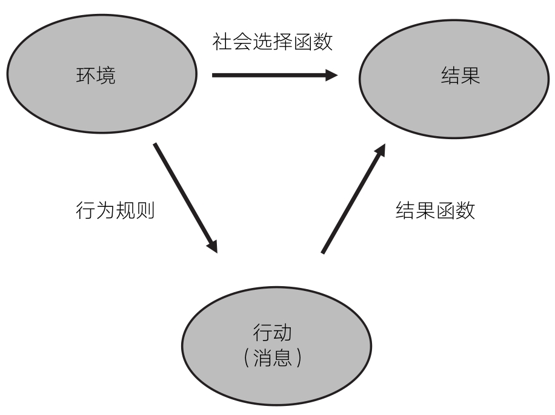
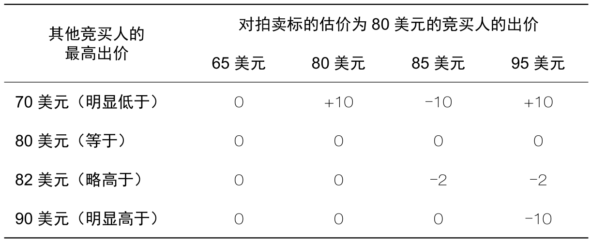
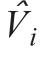
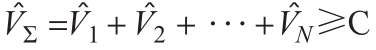
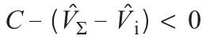
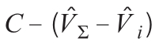
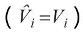

# 与机制设计有关的模型

制度存在的意义就是去改变人的行为。要想让制度不随时间失效，就必须让它跟随被规范的社会环境一起演化。

珍娜·贝德纳

本章讲的是如何用模型来搭建政治与经济制度。任何制度都由两件事构成：一套让参与者传递信息的渠道，和一套把这些信息转化成决策、资源再分配或生产安排的程序。市场里靠价格对话，层级组织里靠文件往来，民主国家里靠投票表决。规则决定政策走向，好制度放大沟通效率并逼近理想结果，差制度则适得其反。

这里引入机制设计这一套建模思路。它把真实制度拆成四个看点：信息——参与者知道什么、该透露什么；激励——特定行动的收益与成本；集结——个体行为如何聚合成集体后果；计算负担——参与者认知上要付出多少努力。

这一思想最初用来讨论资源配置的根本问题：计划与市场的优劣。早期做法先预设行为规范，比如市场里做价格接受者、投票时说实话，再看这些微观行为汇总成什么宏观结果。后来转向优化假设，用博弈论工具分析人们在理性前提下的选择，这就成了机制设计的常态。搭建博弈模型后求纳什均衡，再在同一行为假设下比较不同制度。这一框架很实用，能帮我们找规则漏洞、解释成败、做预测，也能被用来设计频谱拍卖、线上交易、政府表决甚至航天舱位分配等程序。¹

本章分六块展开。先用芒特-赖特尔图描绘机制设计的骨架；再用三人选片的例子看多数规则与拥王者机制；然后比较三种拍卖；随后给出收入等价定理的普适结论；接着对比多数投票平均分担机制与枢轴机制在公共项目决策上的表现；最后在对纳什均衡的反思基础上延伸讨论。

### 芒特-赖特尔图

一个机制包含六个要素：环境即世界的有关特征；结果集合；行动集合也称信息空间；行为规则说明大家按什么来行动；结果函数把行动映射到结果；社会选择对应把环境映射到期望结果的集合。社会选择对应通常指向能提升参与者效用或满足帕累托有效性的配置。帕累托有效是底线标准。

**帕累托有效** 

在某个结果集合里，若一个结果存在另一个人人都更偏好的备选，就称前者被帕累托占优。与之相对，剩下的结果都可称为帕累托有效。²

芒特-赖特尔图把理想与现实并置。图的上部是社会选择对应，描述我们想要的规范结果；图の下部是现实可操作的部分——人们依据行为规则发出信息或行动。结果函数把下部的行动连向结果。理想状态下，下部的复杂路径会复现上部的期望。

**图 24-1　芒特-赖特尔图** 

并非所有机制都能成功。比如当环境是大家对公共物品有偏好的群体时，社会选择对应会指向最优供给水平。可正如第二十三章所见，自愿捐献机制会让每个人只提供 1/N 而非最优的 N 单位供给。当产出偏离目标，就说机制未能实现社会选择对应。

我们希望机制具备哪些品质？要因地制宜，这里列五条。第一，均衡结果与社会选择对应一致，且帕累托有效。第二，最好存在占优策略，最优行动不依赖他人选择，结果可占优策略实现。第三，自愿参与，不强迫加入。第四，预算平衡，涉及转移支付时不额外制造成本或破坏资源。第五，激励相容，人们愿意报真信息、说真话。大多数有趣的问题里，五条无法同时满足，机制设计的重要贡献正在于划清可能与不可能的边界。

### 多数规则与拥王者机制

先看三人如何投票决定联合行动。乌玛、维拉、威尔要一起看电影，需在动作片、剧情片、喜剧片中抉择。类似情境也出现在军事决策中。环境由三人的偏好构成，用排序表示。

乌玛：动作片＞喜剧片＞剧情片
维拉：喜剧片＞剧情片＞动作片
威尔：喜剧片＞剧情片＞动作片

社会选择对应取作帕累托有效集合。按上述偏好，喜剧片与动作片有效，剧情片被喜剧片占优。

先评估多数规则，平局随机处理。若都说实话，喜剧片得两票。但设想维拉与威尔认为另外两人会在剧情片与动作片间僵持，各自投剧情片。投票依次进行，维拉先投剧情片，威尔后投剧情片。此刻乌玛的票已无关紧要，她也投剧情片。三张票构成纳什均衡，任何一人都无动机单方面改投。多数规则在此未必能得到帕累托有效结果。

再看拥王者机制。³ 先随机挑一人当拥王者，再由他挑选另一人当国王，由国王决定最终选择。若威尔是拥王者，他要在乌玛与维拉间选国王。理性拥王者会把国王指向自己最爱的电影，于是结果必然帕累托有效。该机制还有一个性质：若两人最爱相同，结果一定是该选择。逻辑是，若乌玛与维拉最爱相同，无论威尔挑谁，最后都一样；若威尔与乌玛最爱相同，威尔会挑乌玛做国王。

### 三种拍卖机制

有了基本印象后转向拍卖。在线市场让大多数人熟悉拍卖，它也用于政府采购、二手车、网络广告。这里只考虑单件标的、多竞买人的情形，假设每人估值各不相同以避开平局。帕累托有效指标的流向估值最高者。比较出价递增拍卖、第一价格拍卖、第二价格拍卖。

出价递增拍卖中拍卖师不断抬价，直到只剩一人。成交价通常为第二高出价者的水平。理性人会参与到价格触及自身估值为止，过早退出可能错失按估值成交的机会，过晚退出则可能为高于估值的标的买单。于是最高估值者最终胜出并支付第二高估值的价格。举例估值 30、60、80 美元，三人会在 30 后一人退出，60 后第二人退出，最终 80 美元者以 60 美元左右成交。⁴

第二价格拍卖采用密封出价，最高者得标但只付第二高出价。说实话是占优策略。设某人估值 80 美元，若他人最高出价低于 80、等于 80、略高于 80 或明显高于 80，他如实报 80 总是不会吃亏。表 24-1 的数值演示显示，出价 80 美元的净收益不低于任何其他出价。因此所有人如实报价，最高估值者胜出并支付第二高估值。

**表 24-1　当标的对竞买人的价格为 80 美元时，作为出价函数的净收益** 

第一价格拍卖也密封出价，最高者得标并按自己出价付款。最优出价依赖对他人估值的信念。假设估值均匀分布在 0 至 100 美元，竞买人知道分布。经计算，在两人时最优出价约为自身估值的二分之一，N 人时约为 (N-1)/N 倍估值。也就是说与 19 人同场时大约按真实估值的 95%出价。最高估值者仍能胜出，成交价相当于第二高估值的期望值。机制仍具帕累托有效性。模型给出了精确公式：出价随自身估值上升，最高估值者必然胜出。

### 收入等价定理

在三种拍卖里，胜出者都是估值最高的人，且预期支付都等于第二高估值的水平。于是预期收入与分配结果一致。更一般地，只要竞买人从共同分布中独立抽取私人估值，且满足三点——出价以最大化自身预期收益、最高出价者必胜、零估值者预期收益为零——任何拍卖的胜出者与预期收入都相同。这就是收入等价定理。⁶

**收入等价定理** 
在任何拍卖中，若竞买人的估值服从已知的共同分布且相互独立，只要每个竞买人出价最大化预期收益、最高出价者总是获胜、零估值者的预期收益为零，卖方收入与买方预期收益就必然相同。

该定理也适用于全支付拍卖——即便落标者也要付费——以及看似离谱的第三价格拍卖——最高者胜出但付第三高出价——胜出者与收入预期仍一致。⁷

当然定理不等于规则无关紧要。若参与者不理性或对分布判断不同，收入就会分化。经验与实验也显示现实偏离理论。但利害越大、参与者越专业，理性行为越可能出现。在千万美元级的石油租赁拍卖中，准备充分是常态，而消费品的线上拍卖则易受经验法则与认知偏差影响。

拍卖形式还会影响参与人数。木材拍卖中第一价格拍卖能吸引更多竞买人，因为大买家出价偏低时小买家仍有机会；而出价递增拍卖里小买家几乎无胜算，大买家可见对手出价并可一路压制。⁸

认知要求也不同。出价递增拍卖的最优策略是价格未达估值时一直跟，相对直观；第二价格拍卖的最优策略是如实报价，看似简单却需多步推理；第一价格拍卖没有占优策略，出价变化会改变他人最优反应。若有人总出 0 或 50，另一个人最优的就是 1 或 51，无需出 60、70。存在占优策略的机制学习成本更低，但策略间仍有易难之别。

最后是情感诱导。第一、二价格拍卖一次密封出价，难以在过程中被煽情影响；出价递增拍卖中竞买人可看见价格上行与对手存续，容易产生胜出的附加价值或压过对手的快感。慈善拍卖常借助视频等手段推高出价，这在密封拍卖中难以实现。

拍卖里谁付多少钱，看起来差别很大，实务上的反响却完全不一样。

在一次出价拍卖和不断抬价的拍卖里，最终成交价就是排在最前面的那个报价。而在二次出价拍卖里，成交价被钉在第二高的报价上。这个差别很容易让人产生一种错觉：二次出价拍卖让卖家白白把钱拱手让人，所以政府才不爱用。举个常见的说法，美国政府拍卖油田开采权，收到了 600 万、800 万、1 200 万三份投标。若按二次出价规则，第二天报纸的标题可能就是“政府收到 1 200 万的报价，却只以 800 万卖掉油田”。这在舆论上无疑是灾难性的。实际上熟知拍卖理论的人会指出，如果用一次出价或抬价拍卖，最高报价绝不可能停留在 1 200 万，最多也就是 800 万左右。

书里一再强调，正式模型的作用就是把结论成立的前提讲清楚。拍卖等价定理并不是说所有拍卖都会得到一样的结果。它只是在三个条件同时满足时才成立：参与者都采取了最优报价策略、标的最终会落在出价最高的人手里、估值接近零的参与者预期收益为零。只要放松这三条中的任何一条，卖方就能多拿到钱。让别人违背自身利益去行动很难，也很难从一个认为标的毫无价值的人身上榨出钱来。

于是只剩下一种路子：不把标的交给出价最高的人。最直接的做法就是干脆不卖。如果卖方对参与者的价值分布有把握，就可以设一个保留价或底价，也就是最低可接受报价。在某些情形下这会显著提升预期收入。比如卖方判断三个买家的真实价值是 5 美元、10 美元和 60 美元。不论采用一次出价、二次出价还是抬价，赢家都是价值 60 美元的人，但他只需要付 10 美元。此时把保留价定在 60 美元，再跑一次出价拍卖，收入就会提高。

### 公共项目怎么决定

我们来对比两种决定是否上马公共项目的方式，比如新学校、新公路或新体育场。假设项目会给每个人带来价值，同时也让每个人付出成本。

公共项目决策问题

记 *V*[1]、*V*[2]……*V*[N] 为 N 个人的货币化价值，项目成本为 *C*。项目只有在 *C* < *V*[1]+*V*[2]+…+*V*[N] 时才值得启动。

先看多数投票均摊机制。个人对启动项目投赞成或反对，若多数赞成则启动，成本由全体平均分摊，即每人承担 *C*/*N*。

多数投票平均分担机制

个人投票表示赞成或反对启动某个公共项目。如果多数人投票支持该项目，那么该项目启动，并且每个人都承担*C* /*N* 的成本。如下面的例子所表明的，这种机制可能会违背效率条件和自愿参与原则。

从空间投票的视角，拍板的关键是中间选民，也就是价值处于中位数的人。该机制能做到预算平衡和激励相容，但不一定能兼顾效率和自愿参与。

举例：三个人价值分别是 0 美元、120 美元和 150 美元，项目成本 300 美元。效率上项目不该上，因为总价值 270 美元小于成本。但均摊后每人只要 100 美元，120 美元和 150 美元的两人会投赞成，项目被启动，这是低效的。而且价值为 0 的人要倒贴 100 美元，自愿参与原则也被破坏了。

再看枢轴机制。每个人上报自己对项目的估值，若总和超过成本就启动；个人 *i* 的缴税额等于项目成本减去除他之外所有人上报估值之和。若其他人总和已超过成本，他一分钱不用交。

**枢轴机制** 

个人*i* 对一个成本为*C* 的项目提交自己的估值。如果所有个人的值的总和超过了成本，那么就启动这个公共项目，即：

如果，那么个人*i* 不用交税；如若不然，个人*i* 就要缴纳数额为的税收。这个机制是激励相容的、有效率的，而且个人行为也是符合理性。

它具有激励相容、有效率且个体理性，而且能实现占优策略下的有效结果。代价是可能破坏预算平衡。

实例：（*V*[1]，*V*[2]，*V*[3]）=（60，120，150），*C*=300。

项目本该启动，因为 330>300。个人 1 缴 30，即 300-270；个人 2 缴 90；个人 3 缴 120。总税收 240，小于项目成本。

为什么会说真话？因为像二次出价拍卖一样，说实话占优。设项目成本 300 美元，某人真实价值 80 美元。若别人总和低于 220 美元，他报高也必须自己掏这个差额，没动机撒谎；若别人总和已超过 300 美元，他无论报多少都不用付钱；若别人总和在 220 到 300 美元之间，报 80 美元会让项目启动，自己只需支付 300 减去别人总和的差额。若他报 70 美元，而别人总和是 225 美元，项目就会流产。真实申报最大化收益。

因为激励相容，机制也是有效率的：只要总和超过成本就执行。真实申报是占优策略，有效结果也是占优可实施的。而且每个人支付额不超过自身价值，满足自愿参与。但预算平衡通常不成立，只有极少数情况能刚好平衡。

公共项目的决策里，找不到一个机制能同时满足激励相容、个体理性、有效率和预算平衡。模型一旦证明了这一点，就不用再去浪费时间找不可能的东西。就像工程师不会造永动机，机制设计者也不会去寻找同时满足四项标准的公共项目机制。这个组合根本不存在。

枢轴机制已经很接近了，唯一短板是预算不平衡。靠提高税额来补上也不行，那会破坏激励相容或个体理性，人们就会撒谎，甚至有人要为项目支付超出自身价值的钱。一种思路是另辟财源，用外部资金池来填补缺口。这条外部渠道本身也有激励问题，但至少不直接扭曲申报。

更好的做法是同时拥有多重资金来源。比如大学有庞大的校级基金，各学院又有自己的基金，就可以用枢轴机制决定是否建新学生会。院长们有动机如实揭露价值，校长再用校级基金填平缺口。拥有预算授权的分支企业的决策类似，决定是否迁移到云系统时可以用枢轴机制决策，高层负责消化可能的赤字。

### 小结

机制设计提供了一个比较框架：能不能有效率？人会不会说真话？会不会自愿参与？盈余还是赤字？在此框架下我们能推导出可行的边界。通常同一个机制不可能同时满足所有理想标准。建模时我们就像工程师，用模型去搭建可行的方案。

技术在变，机制也在变。以谷歌等搜索网站的广告拍卖为例。早期是固定千次展示收费。随着信息技术能同时运行数百万次拍卖，固定收费不再最优。引入拍卖后，收入提升且广告空间分配更有效。现在谷歌用的是广义二次价格拍卖。每个广告主对每次点击出价，出价最高者拿第一位，第二高拿第二位……依次类推。实际支付价按二次价格规则确定。

假设前四名出价分别是每次点击 10 美元、7 美元、6 美元和 3 美元。第三名拿到第三位，支付 3 美元；第二名支付 6 美元；第一名支付 7 美元。 ⁹了解广告主估值后，谷歌可以设定保留价来多收一点。但如果广告主知道这个套路，结果就未必有效。可能成为高价者的广告主不希望平台知道自己的真实估值。保留价还会伤声誉，被视作非合作，因为谷歌很难证明网页位置本身有保留价值。除非卖出，否则顶级广告位对谷歌几乎没有价值。而卖古董家具或二手车的人，物品对自己有价值，设底价是合理的。谷歌看重声誉，设底价容易激怒客户。

总的来说，机制设计框架既能帮助我们设计制度，也能指导在不同制度间取舍。它能告诉我们什么可行、什么不可能。也许我们永远设计不出一个既有效率、又让人说真话、还预算平衡的机制。承认这个限制后，我们更该把精力放在效率与预算平衡之间的权衡上。

机制设计框架还能用来思考更宏观的问题：在什么情况下该用市场、何时该投票、何时该靠等级、什么情境该用自愿集体行动。市场、民主、等级、集体行动每种机制都有擅长的场景，也有失效的场景。我们不会用投票决定买什么商品，也不会让市场选美国总统。

在组织内部这些制度并存。大学里用市场招教职、用民主程序聘任、用等级分配课程、用集体原则制定战略。非营利机构、企业和政府机构也都是混合使用多种制度。用机制设计工具箱，我们可以比较每种制度的运行逻辑，再把任务更精准地匹配到合适的制度上。