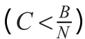
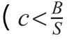
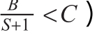
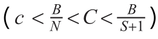
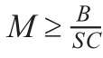

# 25　信号模型

诚实的人不会隐瞒自己的所作所为。

艾米莉·勃朗特（Emily Brontë）

在本章中，我们研究信号模型（signaling model）。这类模型确定了人们发送“昂贵”的信号以揭示信息或类型的条件。一个人可以通过购买昂贵的艺术品表明自己的财力，通过攀登很高的山峰来展现自己的体力，或者通过在社交媒体上发声支持受难者来表达自己的同情心。利用发送信号来揭示自己的身份一直都是人性的一个部分。

早在 19 世纪，经济学家托尔斯坦·凡勃仑（Thorstein Veblen）就提出了“炫耀性消费”的概念，大大增进了我们对信号的理解。凡勃仑观察到，人们经常选择通过炫耀性消费来表明他们的社会地位，而不仅仅会购买那些能够带来直接享受或效用的商品。如果活到今天，当凡勃仑看到现代人的炫耀性消费行为，他肯定将会心一笑：例如迈巴赫敞篷车，每辆售价将近 150 万美元；10 年陈酿的克丽丝特尔酒（Cristal），每瓶售价超过 1 500 美元；徕卡相机，每台售价数万美元……

炫耀性消费由来已久，部分原因在于人类很在意别人对自己的看法。这种消费行为之所以经久不衰，还因为消费可以起到信号的作用。 ¹  我们不能完全看清某个人，所以我们依赖于他们穿的衣服、开的汽车、喝的酒来推断他们的“隐藏属性”。如果我们看到一个人开着昂贵的汽车，那么大体上可以推断出他拥有一定财富。一个人向慈善组织大笔捐款，表明他是一个慷慨大方的人，因为没有自私的人会做出这样的行为。一个人在社交媒体上宣布自己获得了理论生物学博士学位，那是传达关于他的智力水平和所从事职业的信号。几乎所有行动都在一定程度上传递了某种信号。当政客们投票决定是对某个国家宣战、还是实施制裁时，他们就发出了关于自己意识形态立场的信号。某些有长期目标的政客（例如打算日后竞选总统）可能会试图通过投票发出最有利于自己未来政治前途的信号，因而不一定会给最有利的政策投赞成票。

在本章中，我们首先研究离散信号模型。在这种模型中，个体可以选择发送信号或不发送信号；同时，不同的个体发送信号的成本也不相同。要让信号发挥作用，它们就必须是昂贵的（有成本的）或可验证的。这将是本章的一个重点内容。例如，一个雇主打算从新入职员工中选一些人夏天到西班牙巴塞罗那出一趟“美差”。所有申请的员工都在简历中声称自己会西班牙语。但是，简单地说自己会说西班牙语只是一个没有成本的信号。为此，雇主可以启动一个“西班牙语争章活动”，要获得一枚徽章，需要用西班牙语完成一个小时的演示。对于真的熟练掌握了西班牙语的员工，发出这个信号，也就是用西班牙语完成演示的成本较低。但是对于那些不懂西班牙语的员工来说，准备长达一个小时的西班牙语演示的成本却高得令人望而却步。用信号模型的术语来说，这个徽章就将熟练西班牙语的人与不懂西班牙语的人区分开来了。

接下来，我们简单地介绍一个连续的信号模型。在这个模型中，信号的大小是可变的。一个夏令营的皮划艇队一般只能有一个领划的皮划艇运动员，人们希望在这个位置上的是一个耐力非常好的人，那么，怎样才能挑选出这样一个人来呢？营地主管可能会要求两个提出申请的选手连续划皮划艇 10 个小时，以便将皮划艇划到尽可能远的距离上。那两个皮划艇运动员中耐力更强的那个选手可以划到另一个实力较弱的选手无法企及的距离上，从而让自己脱颖而出。

离散信号模型和连续信号模型都能为我们提供信号什么时候分离、什么时候不能分离的条件。因此，它们给我们提供了比文字描述更加准确深入的见解。文字描述能够告诉我们，人、动物、政客和政府发出了什么信号和为什么要发出信号，但是却不能向我们明确表征信号发出的时间和信号的强弱。这些模型还可以非常清晰地解释，为什么学生会如此努力地试图证明自己对学院的价值。在本章的结论中，我们讨论了信号模型的理论贡献及其政策含义，还将讨论生态学、人类学下的信号模型，以及商业活动中的信号模型应用。

### 离散信号模型

我们从离散信号模型开始讨论。在这种模型中，人们要决定是否采取某种行动。你可以买一块昂贵的手表来证明你拥有大量财富，可以通过主修物理学来证明你智力超群，可以通过横渡英吉利海峡来证明自己身体健康。但是你不能半途而废：要么发送信号，要么不发送。这个模型假设，存在两种类型的人，强者和弱者。这两种类型在现实世界中，可以对应于身体健康有资格进入海军陆战队的年轻人和身体孱弱的人，也可以对应于会两种以上外语的员工和只会本国语言的员工，等等。

发送信号的成本取决于个体的类型。这里所说的信号，可能是为有可能成为海军陆战队员的申请人提供的为期一个月的魔鬼训练计划，也可能是求职者用西班牙语完成的长达一个小时的演示。强健的准海军陆战队员会发现完成训练计划的成本更低。在模型中，我们假设发送信号的每个人可以平等地分享总收益。对于这个假设，可以从两个角度加以解释。在某些情况下，某种资源可能会在发送信号的所有人之间分配。例如，向学校捐赠了 1 000 美元的每个人（捐赠是慷慨的信号）的名字都会被刻在一面墙上。在另外一些情况下，例如对于准海军陆战队员和求职者，则可以从发送信号的人的集合中随机挑选一些出来作为“中奖者”。

这个模型支持三种不同的结果：混同（pooling），所有人都发送相同的信号；分离（separating），每种类型的人各自发送一个独特的信号；部分混同，其中一些类型区分开来了，其他类型则没有区分开来。

**离散信号模型** 

一个规模为*N* 的种群由*S* 个强者类型的个体和*W* 个弱者类型的个体组成；这两种类型的个体发送信号的成本分别为*c* 和*C* ，且*c* <*C* 。种群中所有发送信号的成员平均分配*B* 的收益（*B* >0）。这个模型有三种可能的结果：

**混同** ：两种类型的个体都发送信号。

**分离** ，且：只有“强者”类型的个体发送信号。

**部分混同** ：“强者”类型的所有个体和“弱者”类型的部分个体发送信号。

在这个模型中，我们假设个体在给定其他个体行动的情况下做出最优选择。也就是说，我们将它视为一个博弈，并求解它的均衡。在混同均衡中，每个人都发出信号，如果收益很高并且弱者类型的人发送信号的成本较低，就会存在这种均衡，确切的条件是收益除以人数的商必须超过弱者类型的人的成本。例如，假设一位捐助者捐赠了 100 万美元设立了一个奖学金，用于奖励某所高中所有 100 名毕业生。假设有 50 名学生属于强者类型，只需每周学习两小时就能够从高中毕业，而另外 50 名学生则属于弱者类型，每周必须花费 10 小时学习才能完成高中学业。对于强者类型的学生，我们可以将学习成本估计为 2 000 美元，而对于弱者类型的学生，学习成本则为 5 000 美元。如果所有 100 名学生都顺利毕业，那么每人都可以获得 10 000 美元的奖学金。因此这两种类型的学生都有很强的动机去学习。

但是，如果假设我们将奖学金总额减少到了 20 万美元。现在，如果所有 100 名学生都顺利毕业，那么每人都只能获得 2 000 美元的奖学金。这样，学习就不再符合弱者类型学生的自身利益了。而对于强者类型的学生来说，现在每人可以得到 4 000 美元奖学金了，因此学习仍然是有意义的。但是，这个数额仍然不足以诱导弱者类型的学生毕业，哪怕只有一个都不可能。在这种情况下，奖学金的设置导致了分离均衡。

最后，假设奖学金的总额为 40 万美元。再一次，如果所有 100 名学生都毕业，那么弱者类型的每个学生的所能得到的奖学金为 4 000 美元，低于 5 000 美元。因此，他们不会全都选择学习。但是，如果弱者类型的学生都不学习，那么强者类型的学生每人将会获得 8 000 美元的奖学金，这个数额对弱者类型的学生来说也很有吸引力。因此在均衡中，最终将会有 30 名弱者类型的学生与所有 50 名强者类型的优秀学生一起毕业。结果是总共有 80 名学生毕业，每人得到 5 000 美元的奖学金，这也正是弱者类型的学生的学习成本。我们将这种结果称为部分混同，因为有部分弱者类型的学生与强者类型的学生混同在了一起。

部分混同均衡比其他两个均衡更加复杂，因为它需要弱者类型的学生实现彼此之间的某种协调。我们可以假设存在某个过程，弱者类型的学生会与其他人沟通，告诉别人自己计划采取能够确保毕业的行动。或者也可以假设弱者类型的学生的努力恰恰达到了这样一个水平：他们能不能毕业完全是随机的，并且该努力水平会导致 30 名弱者类型的学生毕业的期望。第二种情况似乎不那么合理。一般而言，我们应该将部分混同均衡解释为一个基准，即如果人们试图最优化，会发生什么。是否能达到部分汇集均衡，可能取决于具体情况，尤其取决于人们是否可以交流各自预期中的行动。

### 连续信号模型

在离散信号模型的部分混同均衡中，强者类型的人在有些时候可能会觉得沮丧。如果他们能够发出足够强烈的信号，就可以完全与弱者类型的人区分开来，并且获得更高的收益。为了在模型中包含这种可能性，我们可以改变假设并允许强者类型的人自行选择它们要发送的信号大小。这只需要对模型稍做修改即可。为此，我们将离散信号的发送成本重新解释为连续信号的每单位发送成本。此外，我们假设，对于任何固定数量的信号，强者类型的人每单位成本更低一些。

为了在这个新模型中实现分离均衡，强者类型的人必须愿意选择一个对于弱者类型的人来说成本极高的信号，当然条件是在考虑了收益和成本之后，这个信号仍然是值得发送出去的。通过模型推导，我们发现至少有一些强者类型是可以分离的，但不一定是全部。

令人惊讶的是，随着强者类型的群体规模的增大，信号的量级反而会变小。这种情况之所以会发生，是因为强者类型的人发送信号的好处减少了。成为规模更大的群体的一部分，能够得到的好处反而会更少。完全分离这个条件意味着，当强者类型的人数很少，或者强者类型的人发送信号成本要比弱者类型的人低很多时，分离均衡更有可能实现。

**连续信号模型** 

一个规模为*N* 的种群由*S* 个强者类型的个体和*W* 个弱者类型的个体组成，两种类型的个体发送信号的单位成本分别为*c* 和*C* （*C* >c）。发送最大信号的所有个体分享利益*B* 。任何大小为的信号都能够将强者类型分离开来。如果*CW* ≥*cN* ，那么所有强者类型都会分离开来。如若不然，就存在部分混同均衡，其中一部分弱者类型的个体也会发送信号。 ²  

这个模型可以解释，为什么昂贵的手表和珠宝能够作为财富的信号。一个人的房子或汽车也标志着其拥有的财富，但是人们无法随时随身携带房屋和汽车。衣服也可以发出财富信号，但是却可能无法创造分离。只要花上几百美元，任何一个人可以穿得像一个拥有大量财富的人。但由于成本很高，手表和珠宝作为财富信号会更加有效。一个穷人或中产阶级人士买不起售价一万美元的手表。戴这样的手表，足以证明自己拥有可观的财富。通过发送这样的信号能够获得的好处可能是，人们会更尊重他，假设人们认为财富在某种程度上与一个人的重要性相关的话（尽管有人可能会质疑这种推断）。

### 信号的用途和价值

信号能够把隐藏的属性突显出来。我们的行动标志着我们的健康、财富、智慧和慷慨。我们的一些行动产生了作为副产品的信号。一个纯粹是因为对长跑有兴趣而参加马拉松比赛的人，可能会传递出身体健康和做事专注投入的信号，尽管这可能这不是他的本意。信号模型为解释几乎任何行动提供了另一种视角。但是，一个人选择参加某种活动、学习掌握某种技能、购买某个商品，到底是完全出于个人兴趣，还是在发出某种信号呢？我们也许无法分辨。

例如，信号模型为大学文凭的价值提供了另一种解释。关于收入的大量数据表明，大学毕业生的工资显著高于没有接受过大学教育的人。我们可以推断，较高的工资源于大学期间获得的技能和知识。同时，相关数据还表明，数学和科学专业的大学毕业生工资更高。由此可以推断，在这些专业中学到的技能具有更大的经济价值。然而，如果认真观察一下人们所实际从事的工作，我们可能会发现很少有人在工作中需要使用微积分。而且，求职者在接受面试时，几乎从来没有人被问到过余弦函数的导数怎么求、玻意耳定律怎么解释。有鉴于此，我们可以推断大学学位，特别是科学和数学学位，代表了一个人获取知识能力的信号。毕业生获得的较高薪酬完全取决于学位的信号价值，而不是毕业生在大学期间所学到的知识。 ³  

可以考虑一下成为一名医生所必须发送出去的信号。医学专业的学生必须通过物理、有机化学和微积分等课程的考试。但是，医生看病是否使用微积分？医生在为你诊疗耳朵和鼻子的时候，会先在他的记事本上写出一个微积分方程吗？当然不是这样。在很大程度上，微积分知识与医生执业可能完全无关，但是它可能是医生掌握知识体系能力的良好信号。如果真的是这样，那么即便与从事的职业几乎没有任何直接相关性，通过微积分考试也会成为医生的一个有用的信号。

只要有可能，任何人在构建信号的时候，都更愿意在生成信号的同时也能掌握有用的技能。例如，事实证明，要成为一名成功的医生，记忆能力是很重要的。为了传递能够证明记忆能力的信号，面试者可能会要求申请人背出每个国家的首都和货币。成功地通过这项考核，能够证明申请人确实有很强的记忆能力，但是所记忆的这些内容对成为一名好医生并无意义。当你觉得自己的肠胃非常不舒服，匆忙赶到急诊室时，你并不会在乎给你看病的医生是否知道布拉迪斯拉发是斯洛伐克的首都，你只是希望那个医生对消化系统的各个部分都了如指掌。出于这个原因，医疗委员会要求医生通过解剖学考试。通过解剖学考试能够证明一个人的记忆能力，而且记住身体的各个部位也确实是有用的。因此，通过解剖学考试是一个功能性信号（functional signal）。

### 小结

信号模型的应用范围非常广泛。如前所述，雄孔雀的美丽尾羽是它“身体健康”的信号。众所周知，雄孔雀装饰性极强的扇形尾羽几乎没有任何功能性价值，事实上，这种夸张的尾羽不但无用，而且可能还会给它们带来糟糕的结果。雄孔雀如果选择发展更强壮的爪子，有用性要高得多。但是，强壮的爪子很难让雌孔雀在很远的地方就注意到，这一点比尾羽差得太多了，因此尾羽在演化过程中胜出了。 ⁴  雄性果蝇的彩色尾部也具有与雄孔雀的尾羽类似的功能，蚱蜢和鸟类的鸣叫声也是如此。啁啾需要付出可观的能量，只有吃饱了的蚱蜢才可以花时间啁啾而不用去忙着寻找食物。因此，啁啾声可以起到信号的作用。

在人类社会中，不同的文化会通过不同的行动来表明健康状况。人类学家区分出了三种形式的昂贵信号：无条件的慷慨（unconditional generosity），浪费性的维生方式（wasteful subsistence behavior）、精美的传统手工艺制品。 ⁵  “夸富宴”是居住在太平洋西北地区的印第安土著居民举行的一种仪式，这可能是发送这种慷慨信号的最为突出的一个例子。为了庆祝一个事件，比如一个成员出生或去世时，酋长会送出大量的财富，甚至直接毁坏财富，并对其他酋长提出挑战，要求他们也做出同样的行为。其他酋长如果做不到，就会失去声望。将自己的财物赠予他人，还可以说是有利于社会，但是将它们毁坏无疑是极大的浪费。

事实上，当人们（通常是男性）在预期收益比采集种子或浆果更低时，仍然坚持远行狩猎时，就已经采取了浪费性的维生方式了。男人这样做是因为他们能够希望获得额外的尊重。狩猎成功，猎人就发出了说明他力量和勇气的信号，这在其他环境中也可能很有用。作为一名成功的浆果采集者，能够发送自己拥有良好的视力和耐心的信号，这些当然也是有用的个人特点，这一点毫无疑问，但是在很多方面的预测性能不如狩猎技能好。对生活在澳大利亚北部一个群岛上的梅里亚姆人（Meriam）的一项研究表明，平均来说，作为海龟猎手的男性居民，在 50 岁时存活的后代人数是其他同龄男性居民的两倍多。 ⁶  

复杂精美的传统工艺品制作需要付出非常多的时间和资源。当然，这种活动也可能生产出有用的物品，如地毯。但是，大多数传统工艺品都是没有太大实用价值的礼仪性物品。一些人类学家将这类传统工艺品的制作解释为信号的发送。创作生产这些物品的意义，不依赖于它们能够实现的功能，因这它们具有重要的文化意义。

很多广告也可以解释为昂贵的信号。例如，购买昂贵的超级碗总决赛的商业广告位，可以说是在发送关于自己产品的“合法性”信号。因为这意味着企业相信消费者会非常喜欢自己的产品，从而可以赚回足以覆盖广告成本的利润。想象一下，假设现在有两家企业分别推出了一款新咖啡机。第一家企业知道自己开发了一个“伟大”的产品。而第二家企业则知道，尽管自己的工程师付出了最大的努力，但是这个产品仍然可能会故障频出导致消费者大量投诉。第二家企业预计将会出现 20%的退货率。

每一年，都会有数百万人购买咖啡机。如果不做广告，那么这两家企业可能会平分市场。假设生产出了更好产品的企业决定投入 200 万美元来宣传自己产品的质量。这家企业预计，在广告攻势下，早期购买者都会购买自己的产品，并且从长远来看，这又会导致更大的销量。这家企业的决策者的脑袋中，可能有一个波利亚瓮模型。相比之下，生产质量较差产品的另一家企业则不会花钱做这样的广告，因为它预计自己的产品应该不会非常畅销。花大钱来表明产品的质量，这种行为有时被称为“烧钱”（burning money）。就像雄孔雀用尾羽吸引到了潜在的配偶一样，企业通过“烧钱”吸引了消费者。

在所有这些情况下，发送信号都要付出成本。那些发出信号的人会发现，信号的成本，会导致他们更大的财富、能力以及慷慨个性被他人识别所能带来的好处而有所减少。此外，发送信号所耗费的时间和精力也可以被认为是一种机会成本：如果把这些资源用在其他用途上，可能会产生更大的社会盈余。例如，一个年轻人可能会花费数小时去决定穿什么衣服，以便表明自己的“社会意识”；或者，一个高中生可能会将大量时间和精力投入到某种“非生产性的”活动中去，因为他相信这样能够提高他被精英大学录取的机会。

为了减少发送信号的社会成本，我们应努力使信号尽可能有效地发挥作用。例如，最好是让年轻人通过参加团体性的运动来证明自己身体健康和勇敢，通过这种运动，他们能够学会体育精神和尊重集体利益，而不要让他们冒着生命危险从飞驰的摩托车上跳下以证明自己的勇敢。最好是要求医生记住人体解剖图谱，而不是考他们记得多少句《魔戒》的精灵语。

尽可能地多尝试吧。浪费性的信号肯定会继续存在。我们的挑战是利用模型，特别是机制设计工具，来构建制度和协议，以保证发送出去的信号确实携带了充分的信息。