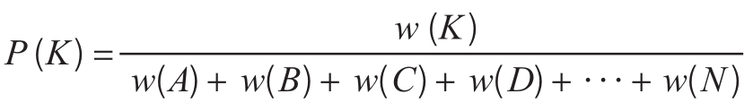
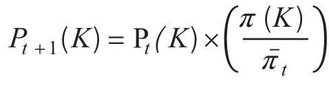
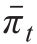
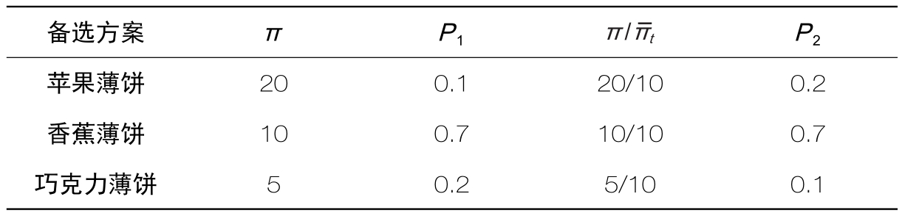
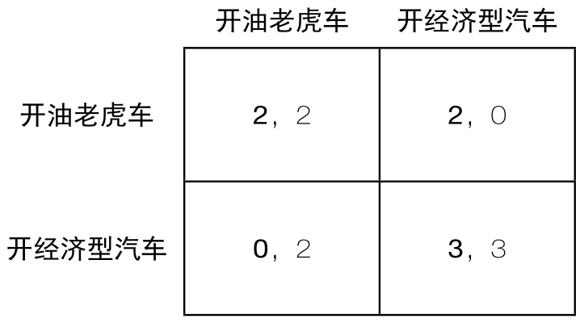
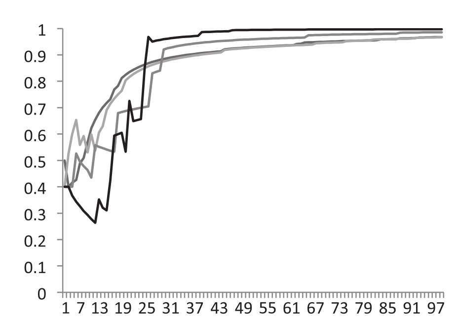
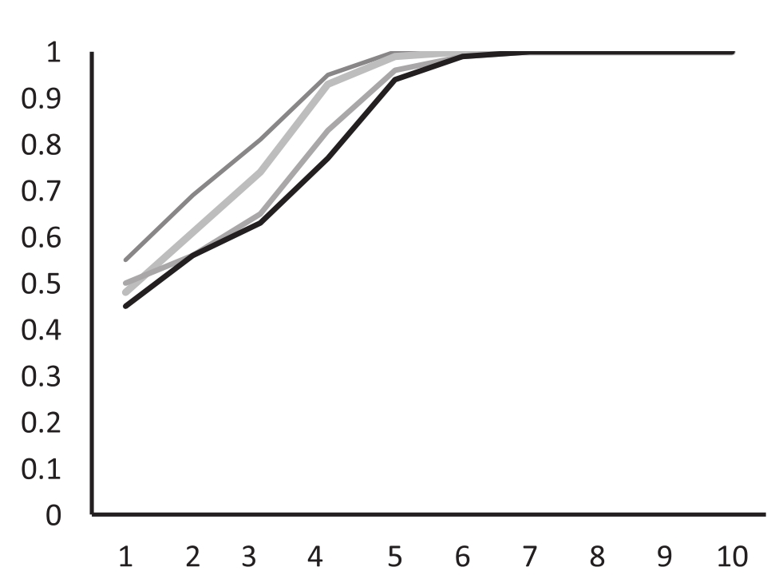
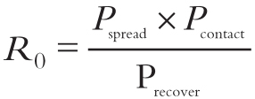
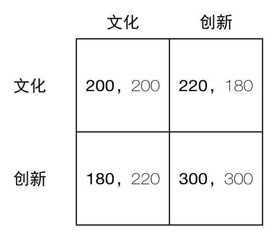

# 26　学习模型

一个人可以养成的最重要的习惯就是对继续学习的渴望。

约翰·杜威（John Dewey）

本章研究个体学习模型和社会学习模型，我们会在两种情况下应用它们。第一种情况，如何学会在一个备选方案集合上做出最优选择。在这种情况下，个体学习和社会学习将会汇聚到最优选择上，而学习规则的不同只能影响收敛速度。第二种情况，如何在博弈中应用学习规则来采取适当的行动。在博弈中，某个行动的收益取决于本人和其他博弈参与者的行动。在这两种情况下，学习规则都更有利于规避风险的均衡结果而非有效率的均衡结果。我们还发现，个体学习并不一定会产生与社会学习相同的结果，而且任何一种学习都不可能在所有环境下都比另一种学习表现得更好。

这些发现为我们的主张——采用多模型方法来表征行为，提供了有力的支持。学习模型介于理性选择模型与基于规则的模型之间。理性选择模型假设人们会审慎考虑所处的环境和要完成的博弈，然后采取最优行动；基于规则的模型则直接根据规则来指定行动。学习模型假设人们会遵循规则，但是，正是这些规则使行为能够发生改变。在某些情况下，行为会趋向最优行为。在这些情况下，学习模型可以用来证明假设人们会采取最优行动的合理性。但是，学习模型也不一定会收敛到均衡，它们也可能生成循环或复杂的动态。而且，如果学习模型确实收敛了，它们可能会有比其他模型更多的均衡可以选择。

本章的内容安排如下。我们首先描述强化学习模型，并将这种模型应用于如何选择最优备选方案的问题。强化学习模型通过更高的奖励来强化行动。随着时间的推移，学习者会学会只采取最优行动。这是一个基准模型，非常适合研究学习模型。它与实验数据也拟合得相当好，而且不仅仅适用于人类。海蛞蝓、鸽子和老鼠，都会强化成功的行动。相比之下，强化学习模型也许更适用于海蛞蝓，它只有不到 2 万个神经元，而不那么适用于拥有超过 850 亿个神经元的人类。如此巨大的脑容量使人类能够在学习时考虑反事实，而这种现象是强化学习模型无法考虑的。

然后，我们介绍社会学习模型。在社会学习模型中，个体能够从自己的选择和他人的选择中学习。个体会复制最流行的或表现高于平均水平的行动或策略。社会学习假设行为者能够观察或沟通。有些物种是通过所谓的共识主动性（stigmergy）来实现社会学习的：成功的行动会留下其他个体可以追随的痕迹或残留物。例如，当山羊在群山间走动时，会留下被踩踏的草，从而强化了通往水或食物的路径。

接着，我们将这两种类型的学习模型应用于博弈分析。如前所述，博弈给出了一个更加复杂的学习环境。同样的行动，可能会在这一个时期内带来高收益，在下一个时期内却产生低回报。正如人们通常可以预料到的那样，我们发现社会学习模型和个体学习模型都不一定会收敛到有效的均衡，而且它们也可能会产生不同的结果。最后，我们讨论了一些更加复杂的学习规则。 ¹  

### 个体学习模型：强化学习模型

在强化学习中，个体要根据各个行动的不同权重来选择行动。权重较大的行动比权重较小的行动更经常被选中。分配给某个行动的权重取决于这个个体在过去采取这个行动时所获得的奖励（收益）。这种高回报收益的强化可以导致个体选择更好的行动。在这里，我们要探讨的问题是，强化学习是不是会收敛为只选择具有最高奖励（收益）的那个备选方案。

乍一看，只选择最有价值的那个备选方案似乎是一个非常容易完成的微不足道的任务。如果奖励是完全以数值形式来表示的，例如金钱的数额或时间的长短，那么我们有理由相信人们会选择最好的那个备选方案。在第四章中，我们就是用这种思路来说明一个在洛杉矶工作的人在选择通勤路线时会选择最短的路线。

但是，如果奖励没有采用数值形式（通常情况下都是如此），人们就必须依赖自己的记忆。我们在一家韩国餐厅吃过一次午餐，发现那里的泡菜很美味，所以我们更有可能再次光顾那家餐厅。星期一，我们在跑步前一小时吃了燕麦饼干，结果发现我们连续跑上 10 千米都不觉得累。如果星期三，我们又在跑步前吃了燕麦饼干并且步履如飞，我们就会加大这个行动（跑步前吃点燕麦饼干）的权重，因为我们已经知道燕麦饼干可以改善跑步成绩。

除了人类之外，其他物种也会这样做。早期研究学习的心理学家爱德华·桑代克（Edward Thorndike）设计了一个经典实验。在这个实验中，一只通过拉动杠杆逃离了箱子的猫得到了奖励。在回到箱子中之后，这只猫在几秒钟内就再次拉动了杠杆。桑代克得到的数据表明，猫会持续进行尝试。他发现猫（以及人）在奖励增大时学习得更快。他将这个规律称为效果律（law of effect）。 ²  桑代克的这个发现是有神经解剖学基础的。重复一个行动会构建出一个神经通路，而这个神经通路在未来会引发相同的行为。桑代克还发现，更出人意料的奖励，也就是远远超出过去奖励水平或预期奖励水平的奖励，会使人们学习得更快，他把这个规律称为惊奇律（law of surprise）。 ³  

在强化学习模型中，分配给一个所选备选方案的权重，是根据该备选方案在何种程度上超过了预期，即“渴望水平”（aspiration level）来进行调整的。这样的模型，既考虑了效果律，也就是会采取那些能够更经常地产生更高回报的行动，也考虑了惊奇律，也就是对某个备选方案赋予的权重取决于它所带来的奖励超过了渴望水平的程度。 ⁴  

**强化学习模型** 

假设一个由*N* 个备选方案组成的集合{*A* ，*B* ，*C* ，*D* ，…，*N* }、与各备选方案对应的奖励的集合{*π* （*A* ），*π* （*B* ），*π* （*C* ），*π* （*D* ），…，*π* （*N* ）}，以及一个严格为正的权重的集合{*w* （*A* ），*w* （*B* ），*w* （*C* ），*w* （*D* ），…，*w* （*N* ）}。那么，选择备选方案*K* 的概率如下：

在选中了备选方案*K* 之后，*w* （*K* ）会增大*γ* ×*P* （*K* ）×（*π* （*K* ）-*A* ），其中*γ* >0 等于调整速率（rate of adjustment），*A* <max* [K] * *π* （*K* ）等于渴望水平。 ⁵  

这里需要注意的是，渴望水平必须设定为低于至少一个备选方案的奖励水平。否则，被选中的任何一个备选方案在未来再次被选中的可能性会很低，而且所有备选方案的权重都会收敛到零。不难证明，如果渴望水平低于至少一个备选方案的奖励水平，那么最终几乎所有权重都会被赋予在最优备选方案上。之所以会发生这种情况，是因为每选择一次最优备选方案，权重的增加幅度都会最大，从而给这个备选方案创造了更强的强化。

即便我们将渴望水平设定为低于任何一个备选方案的奖励水平，这种情况也必定会发生。在将渴望水平设定为低于任何一个备选方案的奖励水平时，每种备选方案被选中时权重都会有所增加；因此，这个模型可以用来刻画习惯形成：之所以更频繁地做某件事情，只是因为我们在过去已经做过这件事情。而且，即便将渴望水平设定得很低，会带来最高水平奖励的那个备选方案也会以最快的速度增加权重，因此从长远来看，最优备选方案将会胜出。但是，要收敛到最优备选方案上，所需的时间可能会很长。另外，当我们增加了更多的备选方案时，收敛时间也会变长。

为了避免这些问题，我们可以构造内在愿望（endogenous aspiration）。为此，我们修改上面的模型，将渴望水平设置为平均奖励，从而让它随时间推移而不断调整。想象一下，假设父母试图确定自己的孩子到底是更喜欢苹果薄饼还是香蕉薄饼。设定选择苹果薄饼的奖励为 20，选择香蕉薄饼的奖励为 10，并将两个备选方案的初始权重都设置为 50，将调整速率设定为 1，并将渴望水平设定为 5。假设父母在第一天准备的是香蕉薄饼，这样香蕉薄饼的权重将增加到 55。假设父母在第二天也准备了香蕉薄饼，那么 10 的奖励等于新的渴望水平，香蕉薄饼的权重不会改变。

假设父母在第三天准备了苹果薄饼。这会带来 20 的奖励，超出了渴望水平。这会使苹果薄饼的权重增加到 60，从而使苹果薄饼变成了更可能被选中的备选方案。更高的奖励也提高了平均收益，因而也使渴望水平上升到了 10 以上。因此，如果父母再一次准备香蕉薄饼，香蕉薄饼的权重就会减少，因为香蕉薄饼的奖励水平已经低于新的渴望水平了。也就是说，强化学习将收敛为只会选择苹果薄饼。

我们很容易就可以证明，强化学习将趋向于以概率 1 选择最优备选方案。这个结论意味着，与所有其他备选方案的权重相比，最优备选方案的权重将会变得任意大。

**强化学习的效果** 

在学会选择最优备选方案模型的框架中，当渴望水平被设定为等于平均获得的奖励时，强化学习（最终）几乎总是会选择最优备选方案。

### 社会学习模型：复制者动态

强化学习假设个体是孤立采取行动的。但是，人们也会通过观察他人来学习。社会学习模型假设个体能够观察到他人的行动和奖励，这可以加快学习速度。现在学界研究得最充分的社会学习模型是复制者动态（replicator dynamics），它假设采取某个行动的概率取决于该行动的奖励和它的受欢迎程度。我们可以将前者称为奖励效应（reward effect），把后者称为从众效应（conformity effect）。 ⁶  在大多数情况下，复制者动态模型都要假定一个无限种群。在这个假设的基础上，我们可以将所采取的行动描述为各种备选方案之间的概率分布。在标准的复制者动态模型中，时间是不连续的，所以我们可以通过概率分布的变化来刻画学习。

**复制者动态** 

假设一个由*N* 个备选方案组成的集合{*A* ，*B* ，*C* ，*D* ，…，*N* }、与各备选方案对应的奖励的集合{*π* （*A* ），*π* （*B* ），*π* （*C* ），*π* （*D* ），…，*π* （*N* ）}。在时间*t* ，一个种群的行动可以用这*N* 个备选方案上的概率分布来描述：（*P* * [t] * （*A* ），*P* * [t] * （*B* ），…，*P* * [t] * （*N* ））。且这个概率分布随如下复制者动态方程而变化：

其中，等于第*t* 期中的平均奖励。

考虑这样一个例子，父母可以选择准备苹果薄饼、香蕉薄饼和巧克力薄饼。假设所有的孩子都有同样的偏好，再假设这三种薄饼分别能产生 20、10 和 5 的奖励。如果最初有 10%的父母制作苹果薄饼、70%的父母制作香蕉薄饼、20%的父母制作巧克力薄饼，那么平均奖励等于 10。应用复制者动态方程，在第 2 期中选择三个备选方案中的每一个的概率如表 26-1 所示：

**表 26-1　备选方案概率** 

复制者动态方程告诉我们，在接下来一段时间里，制作苹果薄饼的父母的比例将会增大到原来的两倍。这是因为苹果薄饼的奖励等于平均奖励的两倍。而制作巧克力薄饼的父母将会减少，因为巧克力薄饼的奖励只相当平均水平的一半。最后，制作香蕉薄饼的父母的比例则不会改变，因为香蕉薄饼的奖励恰恰等于平均奖励。结合所有这些变化，我们发现平均奖励增大到了 11.5。

如前所述，复制者动态同时包括了从众效应（更受欢迎的备选方案更有可能被复制）以及奖励效应。从长期来看，奖励效应占主导地位，因为高奖励的备选方案总是会与奖励水平成比例增长。在复制者动态中，平均奖励发挥的作用，与强化学习中当渴望水平随着平均奖励水平而调整时、渴望水平所发挥的作用类似。两者之间唯一的区别是，在复制者动态中，我们要计算整个种群的平均奖励，而在强化学习中，渴望水平等于个体的平均奖励。只要种群是一个相当大的样本，这种区别就是很重要的。因此，复制者动态产生的路径依赖要远小于强化学习。

在构建复制者动态时，我们需要假设每个备选方案都已经存在于初始种群中。由于最高奖励的备选方案总是具有高于平均奖励水平的奖励，而且它的比例在每个时期都会增加，因而复制者动态（最终）会收敛到整个种群都选择最优备选方案的结果。 ⁷  因此，在这种学会选择最优的环境中，个体学习和社会学习都会收敛到拥有最高奖励水平的那个备选方案上。但是在博弈中则不一定会这样。

**复制者动态能够学会最优行动** 

在学会从一个有限的备选方案集中选择最好的备选方案的过程，无限种群复制者动态几乎总是收敛到整个种群都选择最优备选方案。

### 博弈中的学习

现在，我们将两种学习模型应用于博弈。 ⁸  请先回想一下，在博弈中，博弈参与者的收益不仅取决于他自己的行动，同时也取决于其他博弈参与者的行动。某个特定行动的收益，例如在囚徒困境中的合作，可能会在一个时期内很高而在下一个时期却很低，这取决于另一个博弈参与者的行动。

我们先从油老虎车博弈（Guzzler Game）开始讨论。这是一个双人博弈，每个博弈参与者都必须选择是驾驶一辆经济型汽车还是一辆高油耗但很坚固的车。选择高油耗的车总能带来 2 的收益。当一个博弈参与者选择经济型汽车，另一个博弈参与者也选择经济型汽车时，双方都可以得到 3 的收益，因为两个司机都会有更好的视野，汽车耗费燃油也更少，而且都不必担心被巨大的耗油量压垮。但是，如果另一位博弈参与者选择了油老虎车，那么驾驶经济型汽车的博弈参与者必须非常注意那个人的行为。为了刻画这种影响，我们假设在这种情况下，驾驶经济型汽车的博弈参与者的收益会降低为零。图 26-1 中给出了这个收益矩阵。

**图 26-1　油老虎车博弈** 

这个油老虎博弈有两个纯策略均衡：两个博弈参与者同时选择经济型汽车，或者两个博弈参与者同时选择油老虎车。 ⁹  双方都选择经济型汽车的这个均衡会带来更高的收益，这是这个博弈中的有效均衡。

我们先假设，这两个博弈参与者都会进行强化学习。图 26-2 给出了 4 个数值实验的结果，其参数为：每个行动集的初始权重都等于 5、渴望水平为零、学习速度（γ）为 1/3。在这所有 4 个数值实验中，两个博弈参与者都学会了选择油老虎车，即低效率的纯策略均衡。为什么会这样？为了分析这种情况发生的原因，只需要看一看收益矩阵即可。选择油老虎车的博弈参与者总能得到 2 的收益；而选择经济型汽车的博弈参与者则有时会得到 3 的收益，有时则什么也得不到（收益为零）。根据假设，两个行动在初始人口中出现的概率是相等的。因此，选择经济型汽车的平均收益仅为 1.5，而选择油老虎车的平均收益则为 2。于是就会有更多的博弈参与者选择油老虎车，而这又使选择经济型汽车的收益进一步下降。

**图 26-2　油老虎博弈中的强化学习：选择油老虎车的概率** 

接下来，我们将复制者动态应用到这个博弈中来。我们假设初始人口由相同比例的选择油老虎车和经济型汽车的人组成。然后进一步假设每个博弈参与者与每个其他博弈参与者博弈。选择油老虎车的人会获得更高的收益，因为最初选择每种行动的人的数量相等，所以在第二期会有更多的人选择油老虎车。 ¹⁰  如果再次应用复制者动态方程，那么选择油老虎车的博弈参与者的数量将会进一步上升。持续不断地应用复制者动态方程，最终将导致所有的人都选择油老虎车。图 26-3 显示的是对一个有 100 名博弈参与者的油老虎车博弈，运用离散复制者动态进行 4 个数值实验的结果。

**图 26-3　油老虎博弈中的复制者动态（100 名博弈参与者）：选择油老虎车的概率** 

由于假设了有限种群，所以要引入少量随机性，这样采用每个行动的比例可能不完全等于复制者动态方程所给出的比例。在这 4 个数值实验中，所有博弈参与者全都只在过了 7 期之后就都选择了油老虎车。收敛之所以如此迅速地发生，原因在于从众效应和奖励效应促使人们在第一期后尽快选择油老虎车。例如，当 90%的人选择了油老虎车时，选择经济型汽车的人的收益将低于选择油老虎车的人的收益的 1/6。从众效应极大地放大了奖励效应，使社会学习比个体学习更快。在个体学习中，平均来说要花费 100 多期才能达到 99%的人都选择油老虎车的情况。

在这个博弈中，两个学习规则都收敛到了选择油老虎车上，这是因为当两个行动的可能性相同时，选择油老虎车有更高的收益。这种行动被称为风险主导。两种学习规则都更“青睐”风险主导均衡而不是有效均衡。接下来，我们还要再构造一个博弈模型，在那里，这两个学习规则将收敛于不同的均衡。

#### 慷慨／妒忌博弈

我们要讨论的下一个博弈，慷慨／妒忌博弈（the generous/spiteful game），建立在一个备受关注的人类行为倾向的基础上：我们更加关心的是绝对收益，还是相对收益？假设一个人在以下两个奖金分配方案中选择前者，那么他就是更关心绝对收益：（1）所有同事都能获得 15 000 美元的奖金，而他自己只能得到 10 000 美元；（2）所有同事都只能得到 5 000 美元的奖金，而他自己却能够得到 8 000 美元。相反，宁愿得到更少奖金（在上面两个奖金分配方案中选择后者）的人则更关心相对收益。这种更关心相对收益的偏好，在“居心险恶的人与魔法灯”的寓言故事中得到了很好的体现。

**居心险恶的人与魔法灯** 

在一次考古探险中，一个居心险恶的人发现了一盏青铜灯。他擦了一下灯，结果召唤出了一个精灵。精灵说：“我会赐予你一个愿望，因为我是一个仁慈的精灵。我可以给你想要的任何东西！不但如此，对于你认识的每一个人，我都将给予他们给你的两倍。”这个居心险恶的男人仔细想了一会，然后抓起了一根棍子，递给那个精灵，说：“好吧。现在请你抠出我的一只眼睛吧。”

这个居心险恶的人所采取的这个行动，在带给他一个很低的绝对收益的同时，又给了他一个高的相对收益。 ¹¹  在外交事务中也会出现类似的紧张局势。新自由主义者认为，每个国家都希望最大化自己的绝对利益，这可以用军事力量、经济繁荣和国内稳定来衡量。但是另外一些人，他们通常被称为新现实主义者，却认为各国更重视的是相对利益，即一个国家宁可只能获得较低的绝对利益，但是一定要比自己的敌人更强。在冷战高潮期间，新现实主义者肯尼思·华尔兹（Kenneth Waltz）这样写道：“各国首先关心的不是最大化自己的力量，而是要维持他们在国际体系中的地位。” ¹²  

我们可以将绝对收益与相对收益之间的这种潜在冲突嵌入到一个*N* 人博弈中。在这个博弈中，存在两类行为，一种行为是“慷慨大度”的，它在增加行为者自己绝对收益的同时，也会增加其他人的收益；另一种行为则是“妒忌狭隘”的，它只会增加行为者自己的收益。这个博弈不同于集体行动博弈。在集体行动博弈中，慷慨大度是要付出成本的。 ¹³  在这个模型中，慷慨的行动是占优策略：无论其他博弈参与者采取的行动是什么，选择慷慨行动的博弈参与者都能获得更高的收益。然而，选择妒忌行动的博弈参与者得到的收益却比选择慷慨行动的博弈参与者更高。

这些陈述，乍一看似乎是自相矛盾的，其实不然。通过选择慷慨的行动，这个博弈参与者能够将自己的绝对收益提高 3，而且同时也会将所有其他博弈参与者的收益提高 2。而选择妒忌行动的博弈参与者则只能使自己的收益提高 2，而且不能提高其他博弈参与者的收益。因此，每个博弈参与者都能通过选择慷慨的行动来提高自己的收益。相反，当一个博弈参与者选择妒忌的行动时，他反而会降低自己本来可以得到的收益，而且（这是关键假设）会使其他人的收益下降得更多。

**慷慨／妒忌博弈** 

在这个博弈中，有*N* 个博弈参与者，每一个博弈参与者都要选择：是慷慨（G），还是妒忌（S）。

收益（G，*N* [G] ）=1+2×*N* [G] 

收益（S，*N* [G] ）=2+2×*N* [G] 

如果我们在慷慨／妒忌博弈中应用强化学习规则，那么博弈参与者们都会学会做一个慷慨的人。为什么会这样？要理解这一点，不妨假设博弈参与者处于几乎已经收敛到均衡的状态了，*N* [G] 个博弈参与者都选择了慷慨的行动。这时，如果有一个妒忌的博弈参与者，那么他可以获得 2+2×*N* [G] 的收益。这将成为他的渴望水平。如果他选择的是 G（哪怕发生概率很小），那么他的收益为 1+2×（*N* [G] +1）=3+2×*N* [G] ，这比他的渴望水平还要高。因此，他将更有可能变成慷慨的。不断应用这种逻辑，我们就会发现所有的博弈参与者都将学会慷慨。

但是，如果我们在慷慨／妒忌博弈中应用复制者动态，人们就会学会做一个妒忌的人。只要仔细观察一下复制者动态方程，就可以得出这个结论。在每一期，选择妒忌行动的那些博弈参与者所获得的收益都要高于选择慷慨行动的博弈参与者。因此，在每一期，选择妒忌行动的博弈参与者的比例都会上升。

这些结果突显了个体学习与社会学习之间的关键差异。个体学习会引导人们选择更好的行动，因此人们会学会采取占优行动（如果占优行动存在的话）。而社会学习则引导人们选择相对于其他行为来说表现更好的行动。在大多数情况下，这些行动通常也会产生更高的收益。但是，在慷慨／妒忌博弈中却并不是这样。在这种模型中，妒忌行动的平均收益更高，但是占优的却是慷慨行动。特别需要注意的是，我们的分析得出了一个悖论性质的结果：如果人们进行的是个体学习，那么他们就能够学会做一个慷慨的人——比通过社会学习能够学会的更加慷慨。之所以会出现这种情况，是因为在社会学习中，博弈参与者会复制表现相对较好的博弈参与者的行动。

现在考虑一下之前的观点：我们可以将复制者动态视为一种适应性规则，或者视为发生在若干固定规则之间的选择。如果假设了后者，那么我们的模型就意味着选择可能有利于妒忌这种类型。（自然）选择不一定会导致合作。这个结果与我们在研究重复囚徒困境博弈时发现的结果背道而驰——在那里，重复导致了合作。我们在那里考虑的是重复博弈，并允许更复杂的策略。

### 将不同的学习模型组合起来

我们已经看到了个体学习模型和社会学习模型都能在一组固定的备选方案中找到最优解决方案，但当把它们应用于博弈时，也可能产生不同的结果。缺乏协议也可以是一种力量。不妨想象一个由所有可能的博弈组成的巨大集合。再想象一个由所有学习模型组成的巨大集合。我们可以将第二个集合中的每个学习模型应用于第一个集合中的每个博弈，并评估它们的表现。然后我们可以将这个包括了所有博弈的集合划分为两个集合：学习规则产生了有效结果的博弈的集合，以及不能得到有效结果的博弈的集合。我们还可以考察实验数据并评估每个学习规则在作为对实际行为的预测器时表现如何。毫无疑问，这种研究将会揭示一些我们未曾预料过的东西。每个学习规则都会在某些博弈中带来有效的结果，但是对其他一些博弈则不能。同时，每个学习规则本身在准确描述了行动的不同情况下也会有所不同。因此，我们提倡多模型思维。

在本章中，我们介绍了两个标准的学习模型。每一个模型都只包括了少数几个会变化的组成部分。我们的目标是对这些令人兴奋的文献给出一个适中的介绍。只要往这两个标准模型中加入更多细节，就能够更好地拟合实验数据和经验数据。请读者回想一下，在强化学习模型中，个体会根据一个已采用过的行动或备选方案的奖励（或收益）是否超过了渴望水平来加大或减少该行动或备选方案的权重。个体不会增加从未采取过的行动的权重：在强化学习模型中，我们不会因为假想采取了某个行动会带来很高的收益，而提高采取这种行动的概率。

在所有情况下，这种假设都没有意义。假设一个员工决定在休假时不带手机。当他去度假时，他的老板打电话要他解决一个重要问题，这个员工没有接到这个电话，并因此错过了一个升职机会。在强化学习模型中，员工不会给“度假时带手机”这个行动赋予更大的权重。有鉴于此，人们对标准模型进行了修正，提出了罗斯-伊雷夫学习模型（Roth-Erev learning model），让未被选择过的备选方案也可以根据其假想的收益来获得权重。在这个例子中，这个员工将会给“度假时带手机”赋予更大的权重。

这个修正导致了基于信念的学习规则。未被选择过的备选方案权重的增加量可以通过一个实验参数来确定。实验参数越高，人们对其他人行为的影响的考虑就越多，对那些行为赋予的权重也增加得越多。经济学家埃尔文·罗斯（Alvin Roth）和伊多·伊雷夫（Ido Erev）还考虑到，其他博弈参与者也在学习，他们的策略也可能在发生变化，因此还对过去进行了贴现处理。 ¹⁴  

这些额外的假设具有其直观意义，并且都得到了经验证据的支持，但是它们并不适合于所有情况。如果回到前面举过的制作薄饼的例子，那么第一个假设意味着在父母制作好了香蕉薄饼之后，还要赋予制作苹果薄饼的备选方案额外的权重，而且该权重要与苹果薄饼的收益成比例。只有当父母知道苹果薄饼的收益时，这样的假设才是有意义的。但是，只有当人们能够观察到或凭直觉感知未被选择行动的收益时，才会出现这样的情况。

第二个修正模型来自行为经济学家科林·凯莫勒（Colin Camerer）和何（Ho）。他们构建了一个通用的函数形式，把强化学习和基于信念的学习都作为特殊情况包括了进去。这个函数的关键是一个可以用数据拟合的、确定每种类型学习规则相对强度的参数。 ¹⁵  将多个模型组合在一起，正是我们学习掌握许多模型的一个重要动机。也就是说，由于参数的增加，组合模型必定能够导致更好的拟合。即便考虑到了参数增多这个因数，凯莫勒和何的模型也能给出更好的预测和更深刻的解释。

对学习建模带来了一些挑战。在一个模型设置中运行良好的学习规则可能完全无法适用其他情况。此外，人们学习的东西可能取决于他们最初的信念，因此两个人可能在同一个环境中以不同方式学习，同一个人也可能在不同的环境中以不同的方式学习。即便我们真的构建出了一个准确的学习模型，也会遇到可利用性原则（exploitability principle）带来的难题：如果一个模型解释了人们如何学习，那么其他模型就可以应用这个模型来预测相关知识，并在某些情况下利用该知识。这样一来，人们就可能会学会如何不会被利用，从而使我们原来的学习模型不再准确。在本书前面的章节中，当我们讨论卢卡斯批判和对有效市场假设的分析时，我们就已经遇到过这种现象了。我们不一定能得出结论说那是因为人们会了解到他们在最优化，然而，学习毕竟倾向于淘汰不良行为、从而有利于更好的行为。

**文化能否压倒战略** 

我们现在将传染模型和学习模型结合起来，以便剖析组织理论中由来已久的一个理论观点：文化压倒战略。 ¹⁶  简而言之，这个观点声称，改变行为的战略激励终将归于失败。理论组织家强调，文化——即现有的既定规则和信念的力量实在太强大了。经济学家的观点则相反：推动行为的，只能是激励。

为了将这些相对立的谚语式诊断转变成条件逻辑判断，我们首先必须应用网络传染模型的一个变体。在这个模型中，经理，或者也可能是 CEO，宣布了一个新战略，并给出了推动变革所能带来的好处的多项证据。这位经理或 CEO 甚至可能会对组织的核心原则加以重新界定，以便反映这种新行为的要求。然后，组织中的其他个体决定是否采取这种行为，这取决于经理或 CEO 对其战略的说服力有多大。一开始，只有一部分人执行这个计划。当他们在工作网络中与他人互动时，就会热情洋溢地传播新战略。当然新战略也会面临挑战，会有一种反向的力量拉动人们不去采用新战略。有三个特征决定了新策略能否顺利展开：接触率（P[contact] ）、扩散率（P[spread] ）和放弃率（P[recover] ），它们很自然地映射到了基本再生数中的参数 R[0] 上，即：

如果再加入存在超级传播者的可能性，就可以得出这样的结论：只要如下三个条件中任何一个条件成立，文化就会压倒战略，否则，战略就能压倒文化。这三个条件分别是：如果人们不相信新战略，如果人们很快就放弃了新战略，如果新战略的拥护者相互之间的连通性不够好。

我们的第二个模型是，将复制者动态方程应用于这个用来表征员工之间互动的文化战略博弈。我们可以将员工的不同选择用博弈论的语言分别表示为文化行动（做他们目前所做的事情）和创新的战略行动。我们还假设，经理或 CEO 已经确定了收益结构，如果两个博弈参与者都选择创新的话，他们都能获得更高的收益；但是，如果只有一个博弈参与者选择创新，那么他的收益将会减少。

**文化／战略博弈** 

这个博弈有两个严格的纯策略纳什均衡：一个是两个博弈参与者都创新（战略胜过了文化），另一个是两个博弈参与者都不创新（文化胜过了战略）。乍一看，经理或 CEO 似乎已经给出了足够大的激励，能够保证员工会选择创新的行动。但是通过分析，我们发现，经理或 CEO 必须动员起足够多的初始支持者才能使创新成为现实。如果一开始就支持新战略的人的比例没有超过 20%，那么文化就会胜过战略。如果要增加创新战略的收益，那初始支持者的比例可能会更低，但仍然会产生有效的结果。 ¹⁷  

这两个模型表明，字面上相反的两个谚语“文化压倒战略”和“人们会对激励做出反应”都是正确的。根据第一种模型，具有很高人格魅力的 CEO 可以制订能够胜过文化的新战略。根据第二种模型，文化能胜过“弱激励”，但是不能胜过“强激励”。