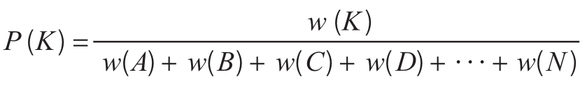
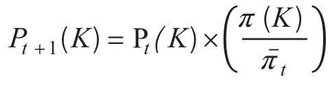
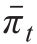
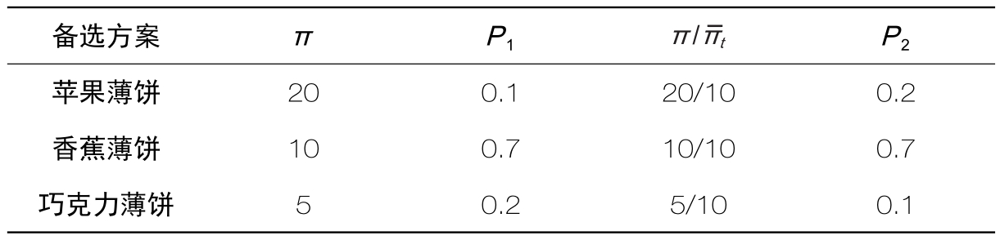
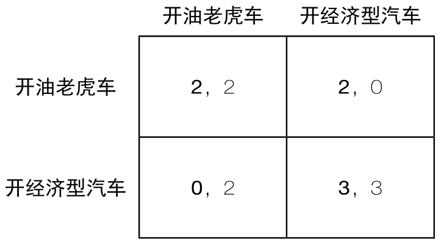
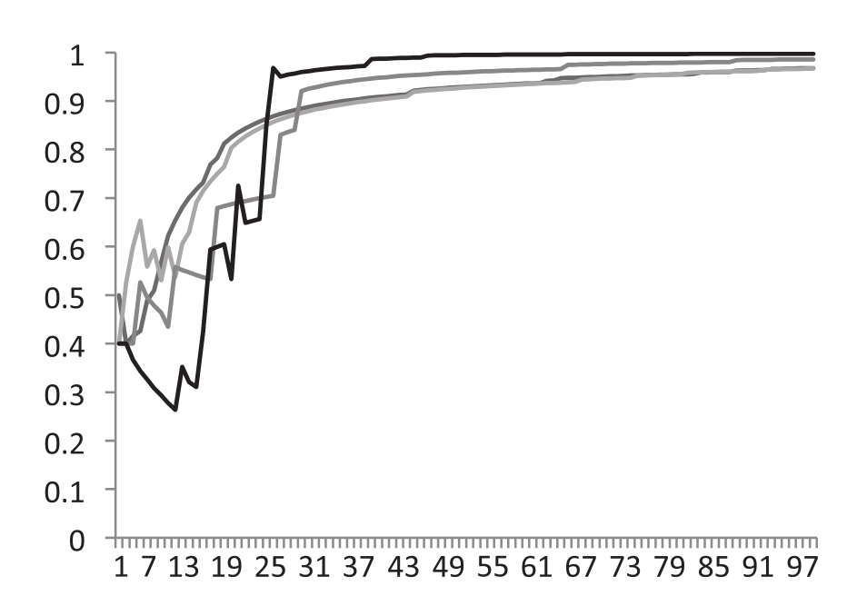
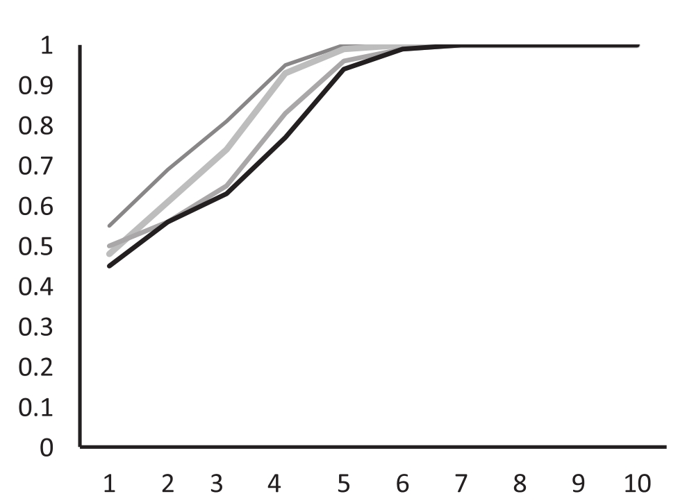
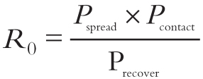
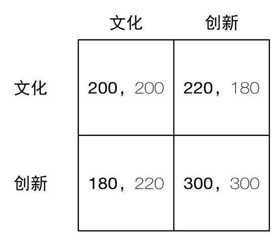

# 持续学习的力量：我们如何通过试错与模仿做出选择

“人能培养的最关键的习惯，就是保有继续学习的渴望。” 约翰·杜威（John Dewey）

本篇聚焦个体学习与社会学习的两种运行方式，并把它们放进两个典型场景去检验。第一种是单独挑选最优备选方案的问题。在这种单一决策环境里，无论是靠自己试探还是靠别人示范，最终都可能指向同一个最优选项，差别只在于收敛快慢。第二种是博弈情境，行动的回报会同时受自己和对手的影响。在这两种情境里，学习规则往往更倾向于导向风险更低的均衡，而不是效率更高的均衡。更重要的是，个体学习与社会学习未必会给出一致的结果，且没有一种学习方式能在所有情境下都优于另一种。

这正是多模型表征行为的价值所在。学习模型卡在理性选择模型和规则驱动模型之间。理性选择模型设想人会在充分审视环境和博弈后选出最优行动；规则驱动模型则直接把行动写死。学习模型承认人们遵循某种规则，但正因为规则的存在，行为才有可能随经验而演变。有时它会趋向最优，有时可以用来为“人们会选最优”这一假设提供合理性论证。但学习模型也未必收敛，可能出现循环或复杂波动；即使收敛，也可能出现比其他模型更多的均衡点。

### 个体试探：强化学习的基本图景

强化学习的核心是给每个行动配一个权重，选择概率与权重挂钩。权重的高低取决于过去执行该行动所获得的回报。回报越高，权重越被抬高，未来被选中的机会也越大。下面要回答的问题是：这种机制是否最终会锁定回报最高的选项。

乍看之下很简单，只要奖励可以用数值衡量，比如金钱或时间，人自然会挑最好的。第四章里用洛杉矶通勤者的路线选择做了类似说明。但现实中奖励往往没有明确数字，需要靠记忆来估算。吃过一次味道很好的韩国泡菜，下次再去的可能性就会上升；跑步前吃燕麦饼干后状态变好，这个关联会被大脑加权。

动物也遵循同样原理。桑代克的经典猫笼实验显示，猫靠拉杠杆逃脱后会更快重复该行为。他总结出效果律：奖励越强，学习越快。这个发现有神经解剖学基础，重复行为会形成通路。桑代克还提出惊奇律：出乎意料的奖励比预期奖励更能加速学习。

在形式化模型里，某个备选方案的权重会根据它带来的回报是否超过个人“渴望水平”而调整。这样既体现了效果律，也体现了惊奇律，即权重增幅取决于回报超出渴望水平的程度。

**强化学习模型** 

假设备选集合{A ，B ，C ，D ，…，N }、对应回报{π(A)，π(B)，π(C)，π(D)，…，π(N)}、以及严格为正的权重{w(A)，w(B)，w(C)，w(D)，…，w(N)}。那么，选择备选K 的概率如下：

在选中了备选方案K 之后，w(K)会增大γ ×P(K)×(π(K)-A)，其中γ >0 等于调整速率（rate of adjustment），A <max [K] π(K)等于渴望水平。

渴望水平必须低于至少一个备选的回报，否则被选中的行动未来被再次选中的概率会下降，所有权重最终趋向于零。可以证明，只要渴望水平低于某个回报，最终几乎所有权重都会集中到最优备选上，因为每次选中最优，增幅最大。

即便把渴望水平设得很低，每种备选在被选中时权重都会增长，这可以解释习惯养成：只因过去做过就更常去做。回报最高的选项权重增长最快，长期来看会胜出，但收敛可能很慢，且备选越多越慢。

为避免这个问题，可以引入内生渴望水平，把渴望水平设为平均回报并随时间调整。比如父母想判断孩子更爱苹果薄饼还是香蕉薄饼。设苹果回报20，香蕉10，初始权重均为50，调整速率1，渴望水平5。第一天做香蕉，权重升至55。第二天再做香蕉，回报等于当前渴望水平，权重不变。第三天换成苹果，回报20超出渴望，苹果权重升至60，更易被选中；同时平均回报上升，渴望水平也随之抬高。若再次做香蕉，其回报已低于新渴望水平，权重反而下降。最终强化学习会只选择苹果。

**强化学习的效果** 

在学会选择最优备选方案的模型中，当渴望水平被设定为等于平均获得的奖励时，强化学习最终几乎总是会选择最优备选方案。

海蛞蝓、鸽子、老鼠都会强化成功行为，这正是强化学习的基准价值，也与实验数据吻合。但对只有两万个神经元的海蛞蝓更适用，对拥有850亿个神经元的人类则不完全适用，人类能在学习时考虑反事实，这是强化模型难以涵盖的。

### 社会学习：复制者动态的运作

强化学习假设个体孤立行动，而现实中我们会观察他人。社会学习模型认为个体可以从自己的选择和他人的选择中学习。人们倾向复制流行或表现高于平均水平的策略。社会学习需要可观察或可沟通的行为。某些物种通过痕迹学习：成功的行动留下可被追随的信息，例如山羊踩出的草径会强化通往水源的路径，这就是共识主动性。

学界最成熟的社会学习模型是复制者动态，它把行动概率与奖励效应和从众效应结合。前者指高回报策略更易被模仿，后者指更受欢迎的策略更易被复制。通常假设一个无限种群，用策略分布来刻画学习，时间是离散的。

**复制者动态** 

假设备选集合{A ，B ，C ，D ，…，N }、对应回报{π(A)，π(B)，π(C)，π(D)，…，π(N)}。在时间t ，种群的行动可用概率分布(P[t](A)，P[t](B)，…，P[t](N))描述，且这个概率分布随如下复制者动态方程而变化：

其中，等于第t 期中的平均奖励。

举例：父母可在苹果、香蕉、巧克力薄饼中选择，孩子偏好相同，回报分别为20、10、5。若初始比例为10%、70%、20%，平均回报为10。应用复制者动态，下一期的各选项概率如表 26-1 所示：

**表 26-1　备选方案概率** 

方程显示制作苹果薄饼的比例将翻倍，因为其回报是平均的两倍；巧克力薄饼比例下降，其回报仅为平均的一半；香蕉薄饼比例不变，回报恰好等于平均。总体平均回报升至11.5。

复制者动态同时包含从众与奖励两股力量。长期看奖励效应占优，高回报策略按比例增长。其作用类似强化学习中渴望水平随平均回报调整时的作用，区别在于复制者动态使用种群平均回报，而强化学习使用个体平均回报。在大样本下差异明显，复制者动态的路径依赖远小于强化学习。

在构建复制者动态时，需假设每个备选在初始种群中都已存在。由于最优备选回报始终高于平均且份额逐期增加，最终整个种群会收敛到选择最优备选。

**复制者动态能够学会最优行动** 

在从有限备选集中挑选最优的过程，无限种群复制者动态几乎总是收敛到整个种群都选择最优备选。

### 博弈中的学习差异

在博弈里，参与者的收益同时取决于自己和他人的行动。某个行动在一个周期回报很高，下一个周期可能很低，例如囚徒困境中的合作。

先看油老虎车博弈。两人各选经济型汽车或高油耗坚固车。选油老虎车恒得2。两人同选经济型则各得3，因为视野好、油耗低且无压力。若对手选油老虎而自己选经济，必须高度戒备，收益降为零。收益矩阵如下：

**图 26-1　油老虎车博弈** 

该博弈有两个纯策略均衡：同选经济型或同选油老虎车。后者效率更低，前者是有效均衡。

假设双方都用强化学习，初始权重同为5，渴望水平为零，学习速度1/3。四个数值实验结果如图 26-2 所示，双方最终都学会选择油老虎车，即低效均衡。原因在于油老虎车回报稳定为2，而经济型时而得3时而得零，初始概率相等时经济型的平均回报仅1.5，低于油老虎车的2，于是选择油老虎车的比例上升，进一步压低了经济型的预期收益。

**图 26-2　油老虎博弈中的强化学习：选择油老虎车的概率** 

若改用复制者动态，假设初始种群两类行动比例相同，每个人与每个人博弈。油老虎车获得更高回报，第二期选择它的人会增加，持续应用方程最终全员转向油老虎车。对100人种群的四个数值实验显示，七期后基本全员选择油老虎车。

**图 26-3　油老虎博弈中的复制者动态（100 名博弈参与者）：选择油老虎车的概率** 

有限种群引入少量随机性，但收敛仍很快。原因是从众效应放大了奖励效应，社会学习比个体学习更快，个体学习通常需上百期才能达到99%一致。

在这个博弈里，两种学习规则都指向风险主导的油老虎车而非有效均衡。接下来慷慨／妒忌博弈将展示两种学习规则可能收敛到不同均衡。

#### 慷慨与妒忌的张力

慷慨／妒忌博弈源于一个行为倾向：我们更在意绝对收益还是相对收益。若宁愿所有同事得15000自己得10000，也不想同事得5000自己得8000，则偏好绝对收益；反之则偏好相对收益。魔法灯故事里的居心险恶者宁愿自损只为让他人更惨，正是相对收益的体现。

在外交层面，新自由主义者认为国家追求绝对利益，新现实主义者认为国家更在意相对地位。冷战时期肯尼思·华尔兹就写道：“各国首要关注的不是最大化自身力量，而是维持在国际体系中的地位。”

这种冲突可嵌入一个N人博弈。存在两类行为：慷慨行为会同时提升自己和他人的绝对收益；妒忌行为只提升自己。不同于集体行动博弈，这里慷慨是占优策略，无论他人如何选择，慷慨者收益更高。但选择妒忌者得到的收益却高于选择慷慨者。

你有没有想过，同样一个博弈，为什么有人越学越慷慨，有人却越学越自私？答案可能不在行动本身，而在“怎么学”。

设想一个“慷慨-嫉妒博弈”：每个人都要在慷慨（G）与嫉妒（S）之间做选择。如果当前除你之外有 N[G] 个人选了慷慨，那么你选择嫉妒的收益是 2+2×N[G]；如果你反过来选择慷慨，总慷慨人数会变成 N[G]+1，你的收益就是 1+2×(N[G]+1)=3+2×N[G]。也就是说，单看别人怎么做，嫉妒者的收益似乎更高；但如果你个人从嫉妒转向慷慨，你的收益不仅会增加，还会让所有人的收益一起水涨船高。反过来，嫉妒不仅让自己少拿，还让整个群体集体受损。

那么，人们最终会学会哪种行为？这取决于学习机制。

如果采用个体强化学习，博弈者会依据“实际体验”调整行为。设想博弈接近稳定时，除自己外已有 N[G] 个人选择慷慨，一个嫉妒者的收益是 2+2×N[G]，这成为他的渴望水平。哪怕他只有很小的概率尝试一次慷慨，他会发现自己的收益变成 3+2×N[G]，超过了渴望水平。于是，他开始增加对慷慨的偏好。这个过程不断重复，最终所有人都学会慷慨。

但如果换成社会学习，也就是复制者动态，情况就反过来了。复制者动态的本质是模仿那些表现更好的行动——而在每一期，嫉妒者的平均收益都高于慷慨者。于是，嫉妒的比例会逐期上升，最终整个群体都变得爱嫉妒。

这背后是个体学习与社会学习的深刻差异：个体学习追求“对个人更好”，社会学习追求“比别人更好”。在多数情况下，两者一致；但在慷慨-嫉妒博弈里，平均收益更高的嫉妒并不是占优行动，反而慷慨才是。于是出现了悖论式的结果：个体学习能让人更慷慨，社会学习却让人更吝啬。更严重的是，如果把复制者动态看作一种自然选择机制，那么选择可能偏好嫉妒者——自然选择并不必然带来合作。这与重复囚徒困境中“重复促进合作”的结论正好相反。

不同模型给出的答案可能南辕北辙，这并不一定是坏事——缺乏一致有时也是一种力量。单一模型总有盲区，所以我们需要多模型思维。以强化学习为例，它有一个明显缺陷：没有尝试过的行动，永远不会获得权重。想象一位员工外出度假时没带手机，结果错过了老板的紧急电话，错失晋升。在纯强化学习模型中，他不会因此给“度假带手机”增加权重。为此，罗斯-伊雷夫模型做了修正：未选择的行动也能根据“假设收益”获得权重。这个修正引出了基于信念的学习，实验参数越高，人们越会考虑他人行为的影响，对过去也会进行贴现，因为其他人同样在学习和变化。凯莫勒和何则走得更远，他们构造了一个通用函数，把强化学习和基于信念的学习都作为特例，用一个可拟合的参数来刻画两种学习的相对强弱。即使把参数增加的因素考虑进去，这个组合模型依然能带来更好的预测和更深刻的解释。

当然，学习建模充满挑战。在一个环境下有效的学习规则，换一个场景可能完全失灵；人们会受初始信念影响，所以同一个人在不同情境下也可能用不同的方式学习。更棘手的是可利用性问题：一旦一个模型能准确描述人们如何学习，别人就可以利用这个模型预测你的行为，甚至反过来调整策略，让你原来的学习模型失效。这就像卢卡斯批判和有效市场假说早已提醒我们的：学习会淘汰不良行为，但也让模型本身不断被改写。

最后，我们把传染模型和学习模型叠加在一起，看看“文化压倒战略”这句老话是否靠谱。

假设经理或CEO宣布一项新战略，并说服大家。起初只有少数人采纳，他们通过工作网络不断扩散，同时也有反方向的力量让人放弃。新战略能否成功，取决于三个参数：接触率 P[contact]、扩散率 P[spread]、放弃率 P[recover]。它们共同映射到基本再生数 R[0]：

如果还存在超级传播者，结论就变得很清晰：只要出现下列任一情况——人们不相信新战略、很快就放弃新战略、新战略的拥护者彼此连通不畅——文化就会压倒战略；反之，战略就能胜出。

再来看看第二个模型：文化-战略博弈。员工可以选择维持现状的文化行动，也可以选择创新的战略行动。收益结构设计成：两人都创新时双方收益最高；但若只有一人创新，创新者会吃亏。这个收益矩阵就是：

博弈有两个严格的纯策略纳什均衡：都创新（战略压过文化），或都不创新（文化压过战略）。表面看，CEO已经给了足够激励，员工应该会选择创新。但分析发现，CEO必须动员足够多的初始支持者。如果一开始支持新战略的人不足20%，文化就会占上风；而如果创新收益足够大，这个门槛可以降低，战略也可能获胜。

所以，“文化压倒战略”和“人们会对激励做出反应”这两句谚语，其实都对。有魅力的CEO可以设计出新战略压过文化；文化也能挡住弱激励，却挡不住强激励。关键在于，你要学会用多个模型去判断，而不是只信一句口号。