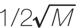
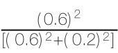
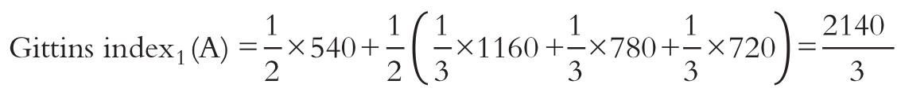
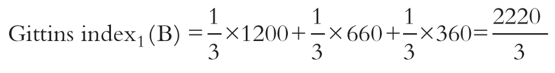

# 27　多臂老虎机问题

有一件事我确实特别擅长，那就是将网球击过网，打在界内。在这件事情上，我是最棒的。

塞雷娜·威廉姆斯（Serena Williams）

在本章中，我们在如何学会选择最优备选方案的学习模型中加入不确定性，从而生成了一类被称为“多臂老虎机问题”（multi-armed bandit problems）的模型。在一个多臂老虎机问题中，不同备选方案的奖励源于一个分布，而不是固定的金额。多臂老虎机问题模型适用于各种各样的现实环境。在收益不确定的行动之间进行的任何选择，无论是药物试验，还是对树立广告牌位置的选择、技术路线的选择，抑或是要不要允许在教室中使用笔记本电脑的决定，都可以建模为多臂老虎机问题。当然，如何选择一个可以出人头地的职业，也可以用多臂老虎机问题模型来建模。 ¹  

在面对一个多臂老虎机问题时，人们必须对各个备选方案多加尝试，以便通过这种学习过程来了解收益的分布。多臂老虎机问题的这个特征，也导致我们必须在探索（寻找最佳备选方案）和利用（选择迄今为止表现最佳的备选方案）之间善加权衡。在探索与利用权衡中找到最优平衡点，需要非常精妙复杂的规则和行为。 ²  

本章的主体内容分为两个部分，最后对模型的应用价值进行了讨论。在本章的第一部分，我们描述了一类特殊的伯努利多臂老虎机问题，其中每个备选方案都是一个伯诺利瓮（瓮中灰球和白色球的比例是未知的）。我们描述并比较多种启发式求解方法，然后说明这些解是如何有助于改进药物疗效的比较检验、广告计划和教学策略的。在第二部分中，我们描述了一个更一般的模型，其中收益分布可以采取任何形式，并且决策者对其类型有一个先验分布。我们还阐明了如何求解确定最优选择的吉廷斯指数（Gittins index）。

### 伯努利多臂老虎机问题

我们从一类特殊的多臂老虎机问题开始讨论。在这类多臂老虎机问题中，每个备选方案都能以固定的概率产生成功的结果。因此，这类多臂老虎机问题相当于在一系列伯努利瓮之间进行选择，且每个瓮都包含着不同比例的灰球和白球。因此，我们将这类多臂老虎机问题称为伯努利多臂老虎机问题，也经常被称为频率问题，因为决策者对分布一无所知。不过，当决策者对各个备选方案进行了多次实验（探索）之后，他会对这些分布有所了解。

**伯努利多臂老虎机问题** 

一个备选方案集{*A* ，*B* ，*C* ，*D* ，…，*N* }中的每一个备选方案都能够产生一个成功的结果，但是各自的概率{*P* * [A] * ，*P* * [B] * ，*P* * [C] * ，*P* * [D] * ，…，*P* * [N] * }都是未知的。在每一个时期，决策者选择一个备选方案*K* ，并以概率*P* * [K] * 得到一个成功的结果。

假设一家烟囱清洁公司获得了一批最近购买了房子的人的电话号码，然后打算向他们推销烟囱清洁服务。这家公司测试了三种推销策略。第一种策略是“笃定预约式”（“你好，我打电话来是为安排你家每年一度的烟囱清洁。”）；第二种策略是“关心提问式”（“你好，你知道烟囱堵塞是火灾的最大风险因素吗？”）；第三种策略是“人性感动式”（“你好，我的名字是希尔迪，我已经和我父亲一起打理这家烟囱清扫公司整整 14 个年头了。”）。

每一种推销策略都有可能成功，但是成功概率在事前是未知的。假设该公司首先尝试的推销策略是“笃定预约式”，但是失败了。然后又尝试了“关心提问式”，结果成功地获得了一个客户；而且，这种策略紧接着又成功了一次。但是，在接下来的 3 次尝试中，这种策略都失败了。于是，该公司尝试了第三种策略。第三种策略的第一次尝试是成功的，但是接下来却连续失败了 4 次。这样，在总共进行了 11 次尝试之后，第二种推销策略的成功率是最高的，但是第一种策略只尝试了一次。于是，决策者面临着在利用（选择最有效的备选方案）或探索（回过头去继续尝试其他两种推销策略以获得更多信息）之间的权衡。医院在不同的外科手术方案之间的选择，制药公司对药物检验的不同方案的权衡，也都会碰到同样的问题。每一种“协议”都有未知的成功概率。

为了进一步深入理解这种探索-利用权衡，我们比较了两种启发式。第一种启发式是取样并择优启发式（sample-then-greedy），即先对每个备选方案都尝试固定的次数*M* ，然后选择具有最高平均收益的备选方案。而在确定尝试次数*M* 大小的时候，我们可以参考伯努利瓮模型和平方根规则。平均比例的标准差有一个上界。如果每种备选方案都进行了 100 次的测试，那么平均比例的标准差将等于 5%。如果应用两个标准差规则来识别显著差异，当两个比例相差大约 10%时，我们就能够自信地将它们区分开来了。例如，如果一个备选方案在 70%的时间内都取得了成功的结果，而另一种方法则只在 50%的时间内取得了成功，那么就有 95%以上的置信水平相信我们能够选中正确的备选方案。

第二种启发式称为自适应探测率启发式（adaptive exploration rate heuristic）。它的程序是，第一阶段，先让每种备选方案各完成 10 次试验。第二阶段，再进行总共 20 次试验，但是试验次数根据各备选方案在第一阶段的成功率按比例分配。例如，如果第一阶段的 10 次试验中，有一个备选方案成功了 6 次而另一个只成功了 2 次，那么第一个备选方案将获得接下来的 20 次试验中的 3/4。到第三个阶段，可以根据成功率的平方确定本阶段要进行的 20 次试验的分配比例。如果那两个备选方案的成功率仍然与前面一样，那么更好的备选方案在第三阶段的 20 次试验中将分配到或 90%。

以此类推。对于每一个阶段的 20 次试验，计算分配比例时所用的成功概率的指数可以以某种速率递增。随着时间的推移，通过提高利用率，第二种算法相比第一种算法有所改进。如果一个备选方案的成功概率比另一个备选方案高得多，比如 80%对 10%，那么第二种算法就不会在第二个备选方案上“浪费”100 次试验。另一方面，如果两个备选方案的成功概率非常接近，就要继续进行试验。 ³  

对于第一种启发式，取样并择优启发式，如果在使用时过分执着，那么不仅效率低下，而且可能是不道德的。当美国著名外科医生罗伯特·巴特莱特（Robert Bartlett）在测试人工肺时，发现它的成功率远远超过了其他备选方案。既然人工肺的表现已经如此优异了，那么继续测试其他备选方案就会导致不必要的死亡。于是巴特莱特停止测试其他备选方案，让每个患者都使用上了人工肺。事实上，可以证明这是一个最优规则：如果某个备选方案总能取得成功，那么就继续选择这个备选方案。增加实验可能没有任何价值，因为没有其他备选方案能够表现得更好。

### 贝叶斯多臂老虎机问题

在贝叶斯多臂老虎机问题中，决策者对各备选方案的收益分布有先验信念。考虑到这些先验信念，我们可以对探索与利用之间的上述权衡进行定量分析，并（至少在理论上可以）在每个时期都做出最优决策。然而，即便是对于最简单的多臂老虎机问题，要确定最优行动也需要进行大量的计算。在真实世界的实际应用中，要精确计算出结果是不可行的。因此决策者通常都会利用近似方法。

**贝叶斯多臂老虎机问题** 

给定备选方案集{*A* ，*B* ，*C* ，*D* ，…，*N* }，以及对应的收益分布{*f* （*A* ），*f* （*B* ），*f* （*C* ），*f* （*D* ），…，*f* （*N* ）}。决策者对每个分布都有先验信念。在每一期，决策者选择一个备选方案，并获得收益，并根据收益计算出新的信念。

要确定最优行动，需要经过如下四个步骤。首先，要计算出每个备选方案的即时期望收益。其次，对于每个备选方案，都要更新关于收益分布的信念。再次，在得到的关于收益分布的新信念的基础上，根据我们所掌握的信息确定所有后续时期的最优行动。最后，我们将下一期行动的期望收益与未来的最优行动的期望收益相加。最后得到的这个结果就是通常所称的吉廷斯指数。在每一个时期，最优行动的吉廷斯指数都是最大的。

这里需要注意的是，计算指数的过程同时也量化了探索的价值。而且，如果我们尝试某个备选方案，那么吉廷斯指数也不会等于期望收益。相反，吉廷斯指数等于假设根据所掌握的知识采取最优行动时，所有未来收益的总和。但是，计算吉廷斯指数非常困难。下面举一个相对简单的例子。假设备选方案有两个，一个是肯定能带来 500 美元的安全的备选方案，另一个是有 10%概率可以带来 1 000 美元的有风险的备选方案，在其余 90%的时间里，有风险的这个备选方案不会带来任何收益。

为了计算出这个有风险的备选方案的吉廷斯指数，我们首先要问清楚会发生什么：它要么总是收益 1 000 美元，要么总是没有任何收益。然后再思考每个结果将会怎样影响我们的信念。如果我们知道这个有风险的备选方案会让我们收益 1 000 美元，那么我们总是会选择它。如果我们知道这个有风险的备选方案没有任何收益，那么我们在未来将总是选择安全的那个备选方案。

由此可见，有风险的这个“臂”的吉廷斯指数对应于每个时期获得 1 000 美元奖励的概率为 10%，以及除了第一期之外的每个时期获得 500 美元的概率为 90%。平均来说，要对备选方案进行多次选择的情况下，这相当于每一期大约 550 美元。因此，这个有风险的备选方案才是更好的选择。 ⁴  

**吉廷斯指数** 

为了说明如何计算吉廷斯指数，考虑下面这个只有两个备选方案的例子。备选方案 A 产生的收益抽取自{0，80}，且 0 和 80 出现的概率相等。备选方案 B 在{0，60，120}当中产生一定的收益，而且这三个收益的概率也是相等的。我们假设，决策者试图最大化 10 个时期内的总奖励。

**备选方案 A：** 收益等于零的概率为 1/2，在出现了这种结果之后，在剩下的全部 9 期内都会选择备选方案 B（备选方案 B 的期望收益 60），这样就得到了 540 的期望收益（9 乘以 60）。收益等于 80 的概率也为 1/2，即便出现了这个结果，在第二期的最优选择仍然是选择备选方案 B。于是有 1/3 的概率，备选方案 B 产生了 120 的收益，因此总收益等于 1 160（80 加上 9 乘以 120）。同样，有 1/3 的概率，备选方案 B 产生了 60 的收益，在这种情况下，备选方案 A 是剩下的所有 8 期的最优选择，这样产生的总收益等于 780（60 加上 9 乘以 80）。最后，还有 1/3 的概率，备选方案 B 产生了零的收益，在这种情况下，备选方案 A 是剩下的所有 8 期的最优选择，这样产生的总收益等于 720（9 乘以 80）。 

把上面这些可能性全都考虑进去，可以得出，在第一期，备选方案 A 的吉廷斯指数如下：

**备选方案** B：有 1/3 的概率，收益等于 120。如果发生了这种情况，那么所有未来时期的最优选择也仍然是备选方案 B。因而 10 个时期的总收益将等于 1 200。如果收益等于零（概率为 1/3），那么所有未来时期的最优选择都将是备选方案 A（备选方案 A 的期望收益为 40），因而，期望总收益将等于 360（9 乘以 40）。如果收益等于 60，那么决策者在所有未来时期都应该选择替代方案 B，总回报为 600；但是，如果在第二个时期选择了备选方案 A，那么有一半时间备选方案 A 总是产生 80 的收益，此时总回报为 780（60 加上 9 乘以 80）；另一半时间它产生零收益，并且所有后续时期的最优选择都将是备选方案 B（会产生 60 的收益），于是得到的总收益为 540（9 乘 60）。由此可知，在第二期中选择备选方案 A 才是最优选择，这种选择产生的期望收益等于 660×（1/2×780+1/2×540）。 

把所有可能性都考虑进去，不难推出，备选方案 B 在第一期中的吉廷斯指数如下：

根据这些计算结果，备选方案 B 是第一期的最优选择。最优长期选择则取决于第一期内学习的结果。如果备选方案 B 产生了 120 的结果，那么我们将永远坚持选择备选方案 B。

上述的分析表明，在采取行动时，我们更关心的是备选方案能够成为最优选择的概率而不是它的期望收益。此外，如果某个备选方案会产生非常高的收益，我们应该更有可能在将来选择它。相反，如果它只能产生平均收益，那么即便收益水平高于另一种备选方案的期望收益，我们一直坚持这个备选方案的可能性也不会太高。在尝试的早期阶段尤其如此，因为我们希望找到更高收益的备选方案。这些结果在我们讨论的诸多应用中都是成立的。如果采取行动没有风险，也不需要付出高额成本，那么这个模型告诉我们，即使高收益行动的概率很低，我们也要努力去探索它们。

### 小结

本书一再强调的一个核心要点是，通过学习模型，我们可以做出更好的决策。在对人们在多臂老虎机问题中“应该”做些什么与人们“实际”做了些什么进行一番比较之后，我们可以对这一点有更深刻的理解。绝大多数人在遇到多臂老虎机问题时，都不会去试图计算一个吉廷斯指数。之所以没能这样做，部分原因是他们没有将必要的数据保存下来。例如，直到最近，医生才开始记录各种手术方法的效果，比如不同类型的人工关节的功效，或者不同类型的心脏支架的优缺点，等等。没有这些数据，医生就无法确定哪一种手术方法会带来最高的期望收益。

其实是所有人，都需要足够的数据，这样才能把模型教给我们的东西应用起来。因此，如果你真的想了解晚餐前散步还是晚餐后散步对你的睡眠更有利，你就需要跟踪记录你的睡眠状况，并运用一些相当复杂的启发式去了解哪种散步模式效果更好。初看上去，这可能会显得小题大做，而且要付出的时间精力相当可观，的确如此，但是现在已经好很多了。新技术的不断涌现，使我们能够非常方便地收集有关睡眠模式、脉搏率、体重，甚至情绪好坏的大量数据。

我们每个人都要做出很多与自己的身体健康息息相关的决策，比如什么时候去锻炼，但是绝大多数人都没有去收集必要的数据并计算出吉廷斯指数。但这其实非常重要，关键在于我们是否能够做到这一点，而且如果做到了，我们的睡眠模式、身体健康状态就会得到改善。心理学家塞思·罗伯茨（Seth Roberts）探索了整整 12 年，结果发现自己每天至少站立 8 小时才可以改善自己的睡眠状态（尽管他还是睡得更少）。他还发现，迎着早晨的阳光站立，可以减轻他上呼吸道的感染症状。 ⁵  当然，我们一般人可能很难具备他这种用自己身体来做实验的奉献精神。但是，由于不保存数据，也不对相关结果进行比较，我们可能会更容易放任自己不吃早餐或暴饮暴食——尽管我们有更好的选择，比如吃西柚。

在利害关系很大的商业决策、政策制定和医疗决策中，数据更容易收集，应用多臂老虎机问题模型也早就成了一种常见的做法。企业、决策者和非营利组织，都会先对各种备选方案进行探索，然后利用那些表现最好的备选方案。而且在实践中，备选方案往往不会保持固定不变。例如，鼓励参加农业补贴计划的政府邮件可能每一年都会改变，比如将上一年的强健男子的照片换为性感美女的照片，等等。 ⁶  这种类型的连续实验可以通过将在下一章中讨论的模型来刻画，那就是：崎岖景观模型。

**用不同模型分析美国总统选举** 

我们可以应用至少三种模型来分析美国总统选举：空间竞争模型、分类模型和多臂老虎机问题的模型。

**空间竞争模型：** 民主、共和两党的总统候选人在意识形态空间中互相竞争以吸引选民。我们有理由预计，各候选人倾向于温和的中间立场、选情会比较胶着，不同政党候选人获胜的顺序是随机的。除了少数例外情况外，总统选举不会以某一方压倒多数获胜结束。为了检验美国总统大选获胜者的顺序是不是随机的，我们构建了从 1868 年到 2016 年 38 次总统大选的获胜政党的时间序列。该序列如下（字母 R、D 分别表示共和党、民主党）： 

RRRRDRDRRRRDDRRRDDDDDRRDDRRDRRRDDRRDDR

然后我们可以计算出不同长度的子序列（块）的熵。长度为 1 的子序列的熵为 0.98。长度为 4 的子序列的熵为 3.61。统计检验表明，我们不能否认这个序列是随机的。作为比较，在长度为 38 的随机序列中，长度为 1 的子序列的熵为 1.0，长度为 4 的子序列的熵为 3.58。

**分类模型：** 如果我们将每个州视为一个类别，同时假设不同州之间存在着异质性，那么空间竞争模型意味着一旦候选人选定了初始位置，某些州就不再具有竞争力了。这个模型的预测是，在少数几个立场温和的州，选举竞争将特别激烈。2012 年，奥巴马和罗姆尼都在 10 个州花掉了自己电视广告预算的 96%以上。他们每个人都将广告预算的一半多用于 3 个温和的州：佛罗里达州、弗吉 尼亚州和俄亥俄州。2016 年，希拉里 ·克林顿和特朗普也将一半以上的电视广告预算花在了 3 个温和的州：佛罗里达州、俄亥俄州和北卡罗来纳州。   ⁷   

**多臂老虎机问题的模型（回溯性投票）：** 选民将更有可能将选票再一次投给有良好执政业绩的那个政党。给绩效好的政党投票，相当于拉一个会带来高收益的杠杆。经济繁荣通常会使竞选连任者受益。有证据表明，当经济表现良好时，选民更有可能投票给执政党的候选人。而且，在执政党内部，现任候选人的影响也大于非现任候选人。   ⁸ 