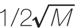
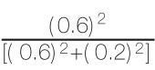
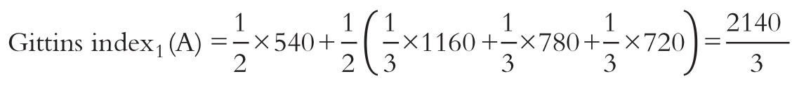
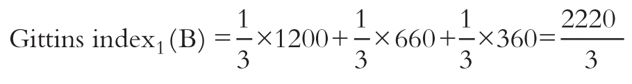

# 先别急着做决定：你面对的也许不是选择题，而是一排老虎机

生活里很多选择，并不像翻开菜单那样明码标价。你试一个方向，得到的回报往往带点随机性：有时惊喜，有时扑空。选职业、试药、挑广告牌位置、定技术路线，甚至决定教室里该不该用笔记本电脑，都可能属于同一类难题——**多臂老虎机问题**。

这个模型的核心，是在“学会选择最优备选方案”的过程中加入不确定性：每个选项的奖励不是固定金额，而是来自某种分布。你每选一次，就像拉下一只老虎机的拉杆，既拿到一次结果，也在积累一点关于它的信息。

## 探索还是利用，这是第一道题

面对这类问题，人不能只凭第一印象押注。你得反复尝试各个备选方案，借学习过程摸清收益分布。可这样一来，新的矛盾就出现了：是继续**探索**，寻找可能更好的选项；还是转向**利用**，选择目前表现最好的那个？

在探索与利用之间找到最优平衡点，需要相当精细的规则。素材里的烟囱清洁公司就是个好例子。它手里有三种推销话术：一种直接“笃定预约”，一种用“关心提问”提醒火灾风险，还有一种走“人性感动”路线，讲自己和父亲经营清扫公司十四年的故事。

假设公司先试“笃定预约式”，失败；再试“关心提问式”，连续成功两次，随后三次失败；接着试“人性感动式”，第一次成功，之后却连败四次。十一轮下来，第二种话术成功率最高，但第一种只试过一次。此时公司就站在岔路口：是继续用当前最有效的方案，还是回头多试另外两种，换取更多信息？医院比较不同手术方案、制药公司权衡药物检验协议，也会遇到同样的处境——每种“协议”的成功概率，事前都未知。

针对这种权衡，素材比较了两类启发式。

第一类是**取样并择优**：先让每个备选方案各试固定的 *M* 次，再挑平均收益最高的那个。*M* 该多大，可参考伯努利瓮模型和平方根规则。平均比例的标准差有一个上界 。若每个方案测试 100 次，平均比例的标准差约为 5%。用两个标准差规则识别显著差异时，两个比例相差约 10%，我们就有把握把它们区分开。比如一个方案成功率 70%，另一个 50%，那么有 95% 以上的置信水平能选中正确方案。

第二类是**自适应探测率**。第一阶段，每个方案先各做 10 次试验；第二阶段共做 20 次，但分配名额时参照第一阶段的成功率。比如两个方案分别成功 6 次和 2 次，前者就能拿到第二阶段 20 次中的 3/4。到了第三阶段，再按成功率的平方来分配这 20 次试验；如果两个方案的成功率仍与之前一样，表现更好的那个在第三阶段将分到 ，也就是 90%。后续阶段照此推进，计算分配比例时所用成功概率的指数可以逐步递增。这样随着时间的推移，算法会越来越偏向利用，第二种启发式也因此优于第一种。若两个方案是 80% 对 10%，它不会傻傻地在差方案上“浪费”100 次；若两者非常接近，它又会继续试验。

不过，取样并择优若用得过于死板，不只效率低，还可能触碰伦理底线。著名外科医生罗伯特·巴特莱特测试人工肺时，发现它的成功率远超其他备选方案。既然人工肺已经明显更优，继续测试其他方案就会造成不必要的死亡。于是他停止其他测试，让每位患者都用上人工肺。事实上，这可以证明是最优规则：如果某个方案总能成功，就继续选它；此时增加实验没有价值，因为没有别的方案能做得更好。

## 贝叶斯版本：把信念也算进选择里

**贝叶斯多臂老虎机问题**则更进一步：决策者对各个备选方案的收益分布已有先验信念。有了这些先验，理论上可以定量分析探索与利用的权衡，并在每个时期做出最优决策。但即便最简单的多臂老虎机问题，精确求最优行动也要大量计算；现实应用中通常做不到，只能借助近似方法。

要确定最优行动，大致分四步：先算每个方案的即时期望收益；再根据拿到的收益更新对分布的信念；然后基于新信念，确定后续时期的最优行动；最后把下一期的期望收益与未来最优行动的期望收益相加。这个结果就是**吉廷斯指数**。每个时期，吉廷斯指数最大的方案就是最优行动。

计算指数的过程，其实也在量化探索的价值。它并不等于某个方案的期望收益，而是假设我们依据已有知识采取最优行动时，未来所有收益的总和。指数算起来很困难，但一个小例子能说明问题：一个方案稳拿 500 美元；另一个方案有 10% 概率得 1000 美元，其余 90% 概率颗粒无收。对风险方案而言，如果我们知道它会带来 1000 美元，以后当然一直选它；如果知道它没有收益，未来就转向安全方案。于是，这个“臂”的吉廷斯指数大致对应：每期有 10% 概率拿 1000 美元，除第一期外每期有 90% 概率拿 500 美元，平均下来约每期 550 美元。因此，风险方案反而是更好的选择。

再看一个更完整的例子：备选方案 A 的收益从 {0，80} 中等概率抽取；方案 B 的收益从 {0，60，120} 中等概率产生；决策者要在 10 期内让总奖励最大。方案 A 在第一期的吉廷斯指数为：

方案 B 在第一期的吉廷斯指数为：

算下来，第一期应选 B。至于长期最优选择，要看第一期学习到了什么：如果 B 第一期就产生 120，那以后一直坚持 B 就好。

这些分析透露出一个反直觉的结论：行动时，我们更在意的往往是某个方案“未来成为最优”的概率，而不是它眼前的期望收益。一个方案若能带来特别高的收益，我们就更可能在将来继续选它；若它只给出平均回报，哪怕暂时高于另一方案的期望值，我们长期坚持它的可能性也不高，早期尤其如此。因为早期探索的目的，正是寻找更高收益的可能。放到各类应用中都成立：如果行动没有风险、成本也不高，那么即便高收益选项出现的概率很低，也值得努力去试。

## 模型之外：数据才是让选择变聪明的燃料

全书反复强调的一点是：学习模型能帮我们做出更好的决策。把人们在多臂老虎机问题中“应该怎么做”与“实际怎么做”放在一起看，会更有感触。绝大多数人遇到这类问题，并不会真的去算吉廷斯指数。原因之一，是必要的数据根本没被保存下来。比如医生直到最近才开始系统记录不同手术方法的效果，像不同类型人工关节的功效、不同心脏支架的优缺点。没有这些数据，就难以判断哪种方法能带来最高期望收益。

其实所有人都需要足够的数据，才能把模型教的东西用起来。你若想知道晚餐前散步和晚餐后散步哪个对睡眠更有利，就得跟踪自己的睡眠状况，再用一些相当复杂的启发式去比较两种模式。初看有点小题大做，投入的时间精力也确实可观，但如今情况好多了：新技术让我们能很方便地收集睡眠模式、脉搏率、体重乃至情绪好坏的大量数据。

每个人都得做很多与身体健康相关的决定，比如什么时候锻炼，但多数人没有收集必要数据，更没有计算吉廷斯指数。可这件事很重要：一旦做到，睡眠和身体状态都可能改善。心理学家塞思·罗伯茨探索了整整 12 年，发现自己每天至少站立 8 小时才能改善睡眠，尽管他睡得更少；他还发现，迎着早晨的阳光站立，可以减轻上呼吸道感染症状。一般人很难有这种拿自己身体做实验的奉献精神，但如果不保存数据、不比较结果，我们反而更容易放任自己不吃早餐或暴饮暴食——尽管明明有更好的选择，比如吃西柚。

在利害关系大的商业决策、政策制定和医疗决策中，数据更容易收集，多臂老虎机模型也早已是常见做法。企业、决策者和非营利组织通常会先探索各种备选方案，再利用表现最好的那些。实践中，备选方案还往往不是固定的。比如鼓励参加农业补贴计划的政府邮件，可能每年都换花样：上一年用强健男子的照片，下一年换成性感美女的照片。这种连续实验，可以用下一章要讨论的崎岖景观模型来刻画。

## 同一个总统选举，三种模型看法

素材还展示了如何用至少三种模型分析美国总统选举：空间竞争模型、分类模型和多臂老虎机模型。

**空间竞争模型**里，民主、共和两党候选人在意识形态空间中争夺选民。可以预期，候选人会向温和的中间立场靠拢，选情比较胶着，不同政党候选人获胜的顺序趋于随机。除少数例外，总统选举很少出现一方压倒多数。为检验获胜政党顺序是否随机，素材构建了 1868 年到 2016 年共 38 次总统大选的获胜政党序列（R 为共和党，D 为民主党）：

RRRRDRDRRRRDDRRRDDDDDRRDDRRDRRRDDRRDDR

计算不同长度子序列的熵：长度为 1 时熵为 0.98，长度为 4 时熵为 3.61。统计检验表明，不能否认这个序列是随机的。作为对照，长度 38 的随机序列中，长度 1 的子序列熵为 1.0，长度 4 的子序列熵为 3.58。

**分类模型**把每个州视为一个类别，并假设州与州之间存在异质性。按空间竞争模型的逻辑，候选人一旦选定初始位置，某些州就不再具有竞争力。该模型预测，竞争会集中在少数立场温和的州。2012 年，奥巴马和罗姆尼都在 10 个州花掉了电视广告预算的 96%以上，其中一半多投向佛罗里达、弗吉尼亚和俄亥俄这三个温和州。2016 年，希拉里·克林顿和特朗普也把一半以上的电视广告预算花在佛罗里达、俄亥俄和北卡罗来纳这三个温和州。

**多臂老虎机模型**在这里体现为回溯性投票：选民更可能把票再次投给执政业绩良好的政党。给绩效好的政党投票，就像拉一个会带来高收益的杠杆。经济繁荣通常有利于竞选连任者；有证据表明，经济表现好时，选民更可能支持执政党候选人。而且在执政党内部，现任候选人的影响也大于非现任候选人。

所以，面对不确定的选择，别急着一次押上全部。先试、记录、更新判断，在探索与利用之间找到自己的节奏。真正的优势，不是每次都押中，而是让数据教你越来越会选。