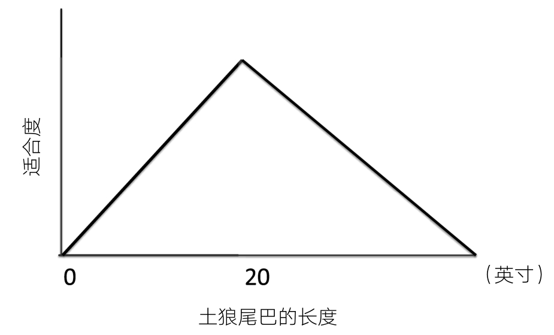
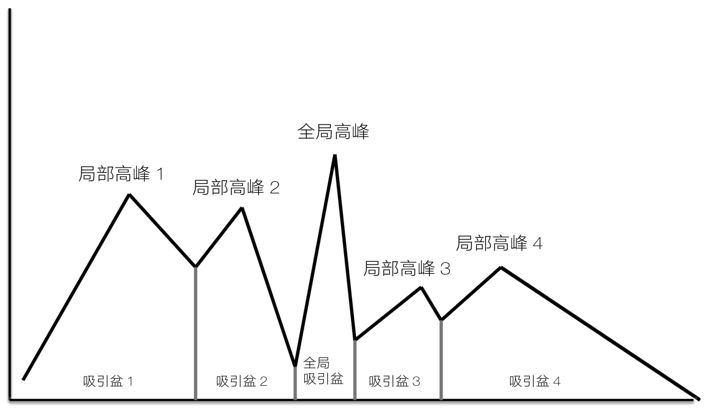
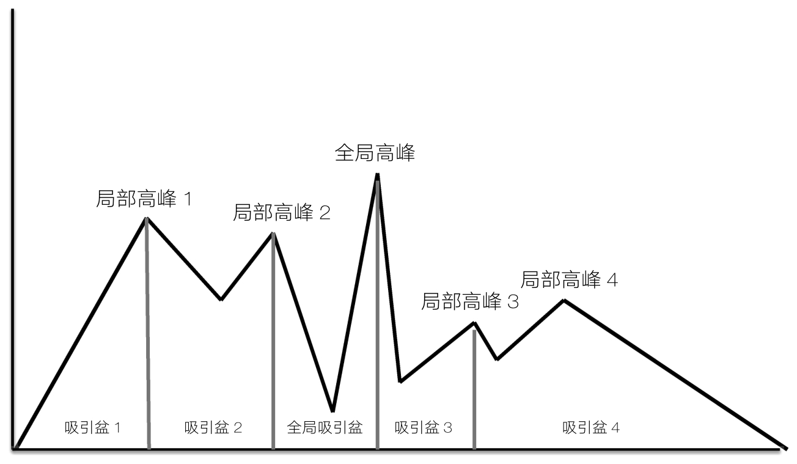

# 28　崎岖景观模型

当你费心去寻找时，就会发现令人惊奇的事情。

传为萨卡加维亚（Sacagawea）所说

在本章中，我们研究崎岖景观模型。与空间竞争模型和享受竞争模型一样，崎岖景观模型也将一个实体定义为属性的集合。每个属性的集合都映射到一个价值上。崎岖景观模型的目标是修改属性，以构造出一个具有最高价值的实体。这类模型起源于生态学中对演化的研究。现在，崎岖景观模型已经广泛用于探索各种问题的求解方法、研究企业之间的竞争和创新，以及其他领域，这也是我们在本书中要研究的重点。在本章中，我们将应用崎岖景观模型揭示，属性影响的相互依赖性如何使创新变得困难、导致所找到的解决方案呈现出路径依赖性、并且还造成了解决方案本身的多样化。同时，我们也会阐明，许多更困难的问题是怎样通过更加多样化的问题求解方法而得以解决的。

本章由三个部分组成，然后，我们讨论了如何扩展模型以刻画竞争。在第一部分中，我们先描述了一个适合度景观模型（fitness landscape model），然后阐明了怎样将它重新解释为一个关于问题求解和创新的模型。在第二部分中，我们讨论了一维模型中崎岖度的含义。在第三部分中，我们提出了崎岖景观的 NK 模型，它将一维模型扩展到了任意数量的二元维数。

### 适合度景观模型

适合度景观模型假设物种拥有能够促进其适合度的特征或性状，我们可以不那么严格地将之定义为繁殖潜力，同时种群中不同成员所拥有的特定性状的数量或程度可能不同。如果用横轴表示性状，用纵轴表示物种的适合度，就可以绘出一张适合度景观的图，其中高海拔点对应高适合度。

举例来说，为了绘制出一张对应于土狼尾巴长度性状的适合度景观的图，我们应该令土狼的所有其他性状都保持不变，而只改变尾巴的长度，并测量尾巴长度的变化对适合度的影响。这就是说，要绘制出这张图，我们必须先了解土狼尾巴为什么有助于提高它的适合度。

假设一只土狼的尾巴有助于土狼在跳跃时保持平衡，而且土狼可以将它作为表示幸福、恐惧或即将发动攻击的信号。我们从横轴的最左侧开始，在那里，尾巴长度为零，这种情况下它不能执行任何一种功能，因此它的适合度为零。随着尾巴长度的增加，维持平衡和传递信号的功能也随之提高。因此，适合度先是随尾巴长度的增加而上升的。

但是，到了某一点上，比如当尾巴长到 18 英寸时，可能就是有助于土狼保持平衡的最理想长度。如果尾巴变得更长，土狼运动的敏捷度将会下降。不过，更长的尾巴可能还会继续提高它传递信号的价值，因此，长度为 20 英寸的尾巴可能会产生最大的整体适合度。一旦尾巴的长度超过了 20 英寸，适合度就会开始下降。结果如图 28-1 所示，它具有一个单峰。

**图 28-1　富士山景观** 

这种单峰景观被称为富士山景观。在现实世界中，这样的景观是经常出现的。有富士山景观的问题通常是比较容易解决的问题。我们可以指望演化或学习在遇到这类问题时找到这个山峰。不妨想象一下，假设有一个由尾巴长度各不相同的土狼组成的种群，那么自然选择的压力最终会导致土狼的尾巴长到大约 20 英寸。拥有这个长度的尾巴的土狼，能够同时将维持身体平衡和传递信号这两个任务完成得最好。因此，这样的土狼的适合度最高，能够留下最多的后代，从而导致更多的土狼拥有 20 英寸长的尾巴。如果我们认为这是一个优化问题，那么任何一个爬山算法都能找到这个山峰。

我们也可以应用一对多的思维方法，将这个问题重新解释为一个产品设计问题，比如设计一把煤铲。假设我们已经决定了煤铲的长度和形状，只剩下煤铲的大小有待决定。于是，煤铲的面积就是要反映在横轴上的特征。而在纵轴上，我们给出的是一个工人在给定煤铲大小的前提下，一个小时内能够铲煤的数量。

与之前的例子一样，我们仍然从最左侧开始，那一点对应于面积为零的煤铲。面积为零的煤铲其实只是一根棍子。当然，用一根棍子去铲煤是完全无效率的，其价值为零。我们逐渐增大煤铲的面积，先是一茶匙大，接着是一汤匙大，然后是像玩具铲那么大……煤铲就变得越来越有效。在这个过程中，煤铲的适合度图形是向上倾斜的。然后，到了某个点上，当煤铲的面积变得太大之后，要用它去铲煤就变成了一件苦差事。一个小时内可以铲煤的数量就会随煤铲的面积进一步增大而减少。最后，当煤铲面积变得足够大时，将没有任何人能够抬起这把煤铲，因而它的适合度又一次变为零。我们又看到了富士山景观。我们有理由期待肯定能够找到山峰，也就是要设计的煤铲的理想面积。

事实上，将铲子的效率作为铲子面积的函数，以此来确定最优铲子大小的思想，正是著名经济学家、管理学家弗雷德里克·泰勒（Frederick Taylor）提出的。在 19 世纪 90 年代，泰勒和其他一些人开创了科学管理的新纪元。在泰勒生活的那个时代，制造业决策，比如流水装配线的移动速度有多快，焊接强度要多高，工人的休息时间是多少，等等，都被建模为崎岖景观问题。进入 20 世纪后，许多伟大的实业家，例如福特汽车公司创始人亨利·福特（Henry Ford）、“石油大王”约翰·D. 洛克菲勒（John D. Rockefeller）和“钢铁大王”安德鲁·卡内基（Andrew Carnegie）都为这个现在用泰勒主义一词来概括的运动做出了卓越的贡献。

从制造个性化的、“只此一家别无分店”产品的工匠生产，转为大规模制造，是一个重大的变革。在大规模生产中，制造流程要分解为多个部分，每个部分都要经过优化，然后变成常规操作。这样一来，效率得到了大幅提高。但是在许多人看来，这个过程也是劳动的非人化过程。这种分歧就是一个提示：我们需要多个模型。任何单一模型都是对世界的过分简化，只能突出其中的某些维度。科学管理模型侧重于流程效率。这种偏向导致了批评。以产出效率为准则做出的决策，会导致其他目标遭到忽视，例如工人的快乐和福祉。

从表面上看，景观模型似乎只是一个相当浅显的想法：将适合度、效率或价值作为特征或性状的函数绘制在图上，然后爬上山顶，找到那个特征或性状的最优值。而且，把解决问题想象为“爬山”，似乎也不过是一个简单的比喻。这当然都是有效的批评。但是，如果构建了正式的景观模型，我们将能够得到一些非凡的结论。

### 崎岖景观

当我们同时考虑多个属性并且允许一个属性的贡献与其他属性的贡献相互作用时，就会得到一个崎岖景观，也就是具有多个山峰的景观。考虑一个设计沙发的问题，我们必须决定坐垫的厚度和扶手的宽度。我们用沙发在市场上的预期销售额来代表设计的价值，而沙发的销售额与设计的美感相关。如果沙发有厚厚的垫子，那么较宽阔的扶手可能会使沙发更具美感。如果沙发的垫子很薄，那么扶手窄一点会更好。作为扶手宽度和坐垫厚度的函数，预期销售的二维图将具有两个山峰。一个山峰对应于窄扶手、薄垫子的沙发设计；另一个山峰则对应于宽扶手、厚垫子的沙发设计。

变量之间的相互依赖效应，使得景观出现了崎岖的特点。这种崎岖性有好几个重要含义。首先，在崎岖景观中寻找到最高点时所用的不同方法，可能会以找到不同的山峰而告终。如果从不同的起点出发，也可能会找到不同的山峰。因此，崎岖性导致了对初始条件的敏感性和路径依赖的可能性。而这些都意味着，景观的崎岖性有助于结果的多样性。崎岖性也意味着出现次优结果的可能性，在崎岖景观中，次优结果表现为局部高峰。

图 28-2 显示了一个有 5 个山峰的崎岖景观。在这些山峰中，有 4 个是局部高峰，它们只是比与它们相邻的点的值高一些，只有一个是全局高峰，即具有最高值的点。要理解搜索是怎样止步于依赖初始搜索点的局部高峰的，可以想象从一个点开始往山峰爬的过程。这种过程被称为梯度启发式（gradient heuristic）或爬山算法（hill-climbing algorithm）。在崎岖景观中，梯度启发式技术会“卡”在局部高峰上。

**图 28-2　一个有 5 个山峰的崎岖景观** 

如果起点位于最左侧，那么梯度启发式将定位于局部高峰 1 上，但它不是最优的。如果梯度启发式从图 28-2 中标识为“吸引盆 2”的区域开始，那么它将定位于局部高峰 2 上。其他每个山峰，包括全局高峰，都有这样一个区域：如果梯度启发式从那个区域开始，就会找到那个局部高峰。这些区域被称为吸引盆（basin of attraction），如图 28-2 所示。从图中可以看出，全局高峰吸引盆的面积是最小的。如果我们随机选择一个起点并应用梯度启发式，那么全局高峰恰恰是最不容易被找到的那一个山峰。

吸引盆取决于启发式。如果我们使用了不同的启发式，就可能得到不同的吸引盆。例如，我们也可以不用梯度启发式，转而使用一个名为“一直向右走”的启发式。这个启发式一直向右侧搜索，直到找到一个局部高峰为止。对于这个例子，这两种启发式具有相同的局部高峰但却会产生不同的吸引盆，只要比较一下图 28-3 和图 28-2，就可以看出这一点。

**图 28-3　由“一直向右走”启发式产生的吸引盆** 

要在崎岖景观中找到最优或接近最佳的高峰，需要多样性和复杂性的方法。多样性的价值是不言而喻的，如果不同的启发式能够找到不同的峰值，那么对一个问题应用多个不同的启发式就能够产生多个不同的局部峰值，然后就可以从这些局部峰值中选择一个最优的。 ¹  或者换一个思路，如果从不同的起点应用同一个启发式，那么也可以得到相同的结果：先找到若干个不同的局部最优点，然后选择其中最优的。

另外还应该注意到，景观的崎岖度（以山峰的数量来衡量）与问题的难度相关。当然，有的问题很难解决，但却不一定有崎岖的景观。在一大块玉米地里找一枚金币这个问题可以用一个平坦的景观来表示，只是在硬币的位置有一个单峰。它的景观不是崎岖的，但是要找到硬币确实很难。

### NK 模型

现在描述 NK 模型。利用这个模型，我们可以对属性的相互作用与崎岖性之间的联系加以形式化。 ²  这个模型将对象，或我们这里所称的备选方案，表示为一个长度为*N* 的二进制字符串，这就是 NK 模型中“*N* ”的含义。至于“*K* ”，则指与该字符串的每一位交互以确定这一位的值的其他位的数量。如果*K* 等于零，那么价值函数就是线性的。如果*K* 等于*N* -1，则所有的位都相互交互，每个字符串的值都是随机的。因此，我们可以考虑增大*K* ，将景观的崎岖度调整到富士山景观与随机景观之间的某个适当位置。

**NK 模型** 

一个对象由*N* 位二进制符号组成，*s* ∈{0，1}* ^N * 。

这个对象的价值表示为*V* （*s* ）=*V* * [k] * [1] （*s* [1] ，{*s* [1] * [k] * }）+*V* * [k] * [2] （*s* [2] ，{*s* [2] *k* }）+…+*V* * [k] * [1] （*s* [1] ，{*s* [2] * [k] * }），其中，{*s* * [ik] * }等于一个从原字符串中除了第*i* 位之外随机选择出来的有*k* 位的子字符串的集合，而且*V* * [k] * [1] （*s* [1] ，{*s* [1] * [k] * }）是从区间［0，1］中抽取出来的一个随机数。

*K* =0：得到的是一个关于位的线性函数。

*K* =*N* -1：任何位的变化都使每个位产生新的随机贡献。

NK 模型作为一个框架，为探索想法和提出问题创造了一个非常好的空间。我们想要问，局部最优值的数量是怎样取决于交互项的数量的。我们还可以问，全局最优值的大小又是如何取决于交互项的数量的。不过眼下，还不是回答这两个问题的适当时机，因为还没有定义好怎样去搜索可能性空间，这就是我们正在使用的启发式，局部最优集及其吸引盆的集合取决于搜索时所用的启发式。

在下文中，我们主要依赖单翻转算法（single flip algorithm）来进行搜索。这个算法按顺序选择每一个属性并切换该属性的状态。如果改变那个属性会产生一个更高的价值，就保留这个切换。否则，那个属性就退回到它原来的状态。之所以选择这个算法，有两方面的动机。首先，我们可以把它解释为描述基因突变的一个粗略模型，让好的基因变异逐步接管整个种群，并让坏的基因变异消失。其次，它也是在我们这个空间中表征爬山算法最自然的一个形式。

作为例子，我们先来求解*N* =20 且*K* =0 时的 NK 模型。当*K* =0 时，每个属性对总价值的贡献独立于其他属性，这时单翻转算法可以识别出每个属性更好的状态和全局最优值。因此，*K* =0 意味着不存在相互作用，这种情况对应于富士山景观。每个状态的值均匀分布在区间［0，1］中。不难证明，从区间［0，1］上的均匀分布中随机抽取出来的两个值中较高的那一个期望值为 2/3。只要我们对这 20 个属性的贡献求平均值，就不难推出全局最优值的期望值也是 2/3。

而在另一个极端，当*N* =*K* -1 时，每一个属性都与其他每个属性相互作用。在这种情况下，切换任何一个属性的状态，其他每个属性的贡献都会改变。那将是从区间［0，1］中均匀抽取出来的一个新随机数。同时对象的值则将是这 20 个新随机数的总和（每个属性一个）。这就意味着，属性的每一次翻转，都会导致整个对象产生一个新值，而且它与之前的值不相关。因此，景观将会非常崎岖，每一点都可能隆起、每一点都可能下陷。

在上面这两个结果的基础上，我们可以推导出局部峰值的期望数量。如果我们从任何一个备选方案开始，单翻转算法将会对该备选方案与*N* 个备选方案中的每一个进行比较。例如，假设我们从所有位都取零值的备选方案开始，那么单翻转算法将评估*N* 个备选方案，每一个备选方案都恰好有一位的取值为 1。

初始备选方案：00000000000000000000

属性 1 切换后的备选方案：10000000000000000000

属性 2 切换后的备选方案：01000000000000000000

……

属性 20 切换后的备选方案：00000000000000000001

要成为一个局部高峰，其值必须高于这*N* 个备选值中的每一个。原来的备选方案拥有最高值的概率等于 1/*N* 。因此，局部峰值的数量近似等于可能的替代方案数量 2* ^N * 除以*N* 的商。很容易计算，对于*N* =20，大约有 5 万个局部峰值。由于具有如此之多的局部最优，只靠单翻转算法很难准确定位全局峰值。

因此，在这里重要的不是局部最优值的数量，而是它们的值有多大。因此还需要将这些最优值的期望均值与全局最优值的期望值进行比较。通过这种比较，我们可以确定单翻转算法的性能如何。而在计算这些值的时候，我们可以利用中心极限定理。在这个例子中，很容易证明局部最优值的期望值大约等于 0.6，而全局最优值的期望值则略大于 0.75。 ³  将这些值与*K* =0 时的全局最优值比较一下，就可以发现崎岖景观的局部峰值低于富士山景观的峰值，但是崎岖景观的全局峰值则比富士山景观的峰值更高。

由此自然而然地引出了这样一个问题：在这两个极端之间，也就是当我们将交互作用的属性数量*K* 从零增加到*N* -1 的过程中，发生了什么事情？答案是，我们可以观察两种效果。交互作用的属性数量的增加，在产生了更高的全局峰值的同时，也产生了更多的（更低的）局部峰值。假设我们在搜索时使用了单翻转算法，那么对这个模型的计算表明，对于比较小的*K* 值，互动的好处（得到了更高的全局峰值）超过了互动的坏处（出现了更多的局部峰值）。因此，在开始阶段，局部峰值的期望值会随着*K* 的增加而提高。同时，局部峰值数量的增加则意味着它们的平均值将减小。因此，如果决定使用单翻转算法，人们一般更喜欢用相对较小的*K* 值，比如 3 或 4。但是，我们为什么要把自己局限在这种只切换单个属性的简单启发式上呢？经由变异而完成的进化也许适用这个启发式，但是我们却不必受它所限。我们可以切换两个属性甚至三个属性的状态。更复杂的算法将会减少局部最优值的数量。

### 崎岖性与舞动的景观

NK 模型的一个重要含义是，我们需要适度的相互依赖性，因为这种互动能够产生更高的峰值。多模型思维则要求我们跳出模型的特定假设，并仔细思考是什么原理驱动了这些结果。我们不难发现，背后的逻辑由两部分组成。第一个组成部分源于组合学：两个元素的组合数会随对数的平方而增加，而三个元素的组合数则会随三元组数量的立方而增加。因此，这种相互依赖效应有可能会创造出更多有益的互动。

第二个组成部分则源于我们只需要保持更好的组合这个事实。想象一下，假设我们准备利用 4 种食材来制作一份食物。有 4 种食材意味着：如果选用其中的两种，那么有 6 种可能的组合。假设我们所用的是以下 4 种食材：泡菜，香蕉，鸡肉，焦糖。由此产生的 6 种配对是：香蕉和泡菜、泡菜和鸡肉、焦糖和泡菜、香蕉和鸡肉、焦糖和香蕉，以及焦糖和鸡肉。你可能会觉得只有一种搭配对你有吸引力，那么你就会选择那种搭配。假设我们喜欢的是焦糖和香蕉，就会忽略其余配对。 ⁴  

类似的逻辑也适用于进化系统。能够产生正面相互作用的表型组合，例如坚硬的外壳与强健的短腿，会在种群中保存下来。适者生存法则与产生负面相互作用的组合相反。因此，我们现在看不到有如下这种组合的动物：跑得很慢的脚+味道鲜美的皮肉+外表鲜艳的外表。它们也许曾经存在过，但是早就被捕获并被吃光了。

我们在搜索模型中也会遇到类似的情况。当拥有非常多的可能性时，我们更喜欢变化。同样的逻辑在这里也是适用的：组合（两个元素、三个元素）会产生丰富的可能性。而且我们还希望，这些可能性的价值有很大的变化范围。然后，我们更有可能发现其中一个具有非常高的价值。由于相互作用效应会增加变异，因此总体上说，它们是有利的，但只在一定程度上有利。正如我们在上面已经阐述过的，太多的变化会使景观随机化。在理想情况下，我们会有适度的互动。有的学者认为，如果相互作用的数量和大小可以演化或适应，那么系统应该会自然而然地演变为具有高峰值的崎岖景观。如果真的是那样，那就表明系统倾向于向复杂性而不是均衡或随机性演化。 ⁵  当然，什么时候能够达到这个结果、是不是真能达到这个结果，本身也是一个可以通过模型来探索的有趣问题。

最后要强调的一点是，我们一直将景观视为固定的。但是在生态和社会系统中，物种或企业要面对的景观还取决于他人的行为和属性。任何一个物种的适应，或任何一个企业策略的改变，都会改变和重组它们的竞争对手的适合度景观。

现在，我们可以将空间竞争模型和享受竞争模型重新解释为舞动的景观上的运动模型。这种运动可能会导致均衡，每个博弈参与者都站在局部或全局山峰上。或者，在舞动的景观上的竞争，也可能导致复杂的行动模式和结果。只要粗略地观察一下生态系统、政治领域和经济社会，就会明白后一种情况更容易出现。

我们之所以会观察到如此多的复杂性，一个很重要的原因可能是，我们这个世界在很大程度上是由自适应的、有目的的行为者组成的，它们有能力操纵舞动的景观。为了理解这种复杂性，我们需要多模型思维。

**我们可以对知识授予专利权吗** 

我们今天的幸福源于数百年来的知识积累。知识体现在所有方面：物理定律、内燃机、复式记账法、传染性细菌致病论、X 射线和 HTML 等。知识通常是一种公共物品，永远是非竞争性的，不过知识既可能是、也可能不是排他性的。要想排他，必须有方法验证，当知识已经呈现为特定形式的人工制品时，要验证是比较容易的。例如，要想验证某个人是不是使用了某种算法或技术来解决了某个问题，那往往是不可能的；但是，要想验证某人是不是在软件程序中嵌入了某种算法，就是可以做到的。

当知识的排他性可以保证时，我们就会面临一个选择。我们可以像对待道路和国防那样去对待知识，并通过向民众征税来生产知识。政府可以向那些思考者支付报酬或者直接补贴他们，或者通过支持大学、研究机构来间接地加以支持。政府还允许人们获得专利权。专利制度之所以能够鼓励知识生产，关键就在于它为专利所有权人创造了一定期限的使用知识的独占权、并允许他们向其他使用专利的人收费。在美国和欧洲，专利权的期限为自申请提交之日起 20 年。 ⁶  专利倡导者认为，如果任何人都可以免费使用别人发明的东西，那么私人（个人或机构）就不会有什么动力去开发更好的捕鼠器、计算机算法或音响系统了。他们强调，专利制度能够克服知识生产中固有的激励问题。

但是，经济学家米歇尔·博尔德林（Michele Boldrin）和戴维·莱文利用多模型思维，提出了一个有力的反对专利制度的理由。 ⁷  在他们给出的允许思想（创意）组合的模型中，引入专利权会限制不同思想的组合，从而阻碍创新。如果一家公司获得了触摸屏技术专利，那么就很可能会减少其他企业设计采用这种技术的新产品的动力。如果没有专利保护，就会有更多的产品采用这种技术。也就是说，创新将会增加。

专利制度的支持者则反过来指出，就算专利制度真的会阻碍创新（那将很糟糕），但是如果没有专利保护，那么投资的减少幅度将会大得多。博尔德林和莱文基于我们在本书中讨论过的扩散模型反驳了这种说法。利用新知识设计生产的有用产品会迅速通过消费者传播开来。收音机、电视和谷歌搜索引擎都是如此。这会创造出一种先发优势，创新者仍然会受益，尽管获利程度与专利保护下有所不同。

博尔德林和莱文还对某项发明应该在多大程度上归功于发明者提出了疑问。如果重大突破都是某个孤独的天才在密室中做出的，而且如果没有动力，大多数新思想都不会出现，那么专利制度就是有理由的。但是，崎岖景观模型表明，大多数困难的问题都有很多种可行的解决方案。新发明，特别是那些结合了现有思想和技术的发明，例如汽车、电话和在线拍卖，也许是本来就会发生的“自然事件”，而不是某个天才人物行为的结果。如果各种想法和创意都能够在思考者的群体中自由流动，那么很多人可能早就实现了这些创新。从历史上看，许多重大发明（发现）都有一种引人注目的同时性，例如，微积分是由艾萨克·牛顿和戈特弗里德·莱布尼茨发明的、电话是由亚历山大·格雷厄姆·贝尔和伊莱莎·格雷发明的，以及进化的自然选择理论是由查尔斯·达尔文和阿尔弗雷德·拉塞尔·华莱士发现的。

总而言之，多模型思维能够呈现专利制度的优点和缺点。这些模型提供的更深入、更周详的结论支持一种更加灵活的专利制度。也许，对于其中一些想法，那些许多人都能够发现的想法，以及可以与许多其他想法重新组合的想法，我们应该采取与今天的专利制度不同的专利制度，例如授予更短的保护期限、更宽松的使用条件。甚至，有些想法根本不应该被授予专利。