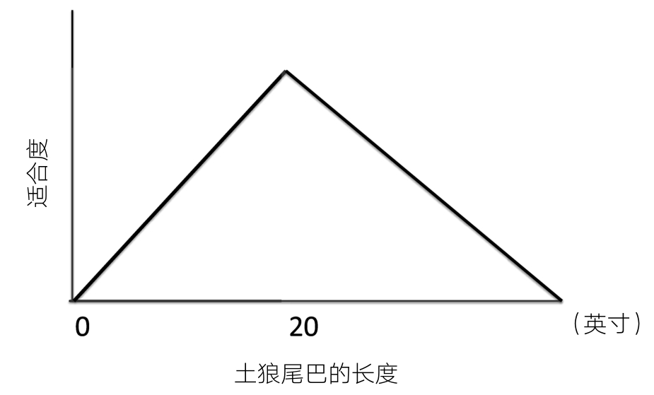
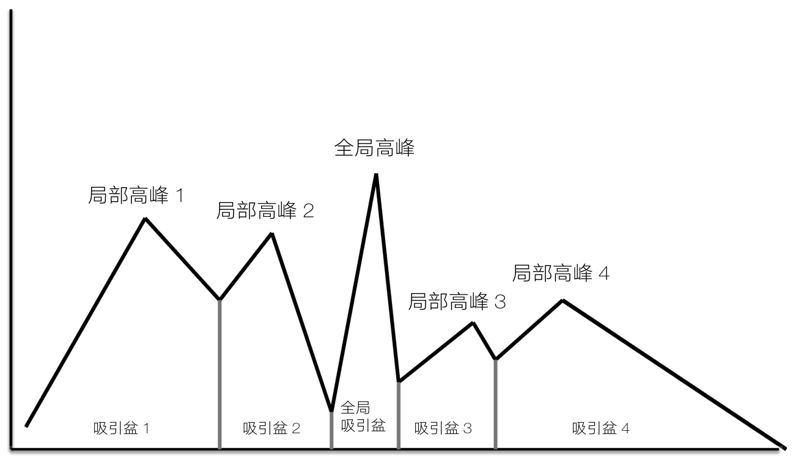
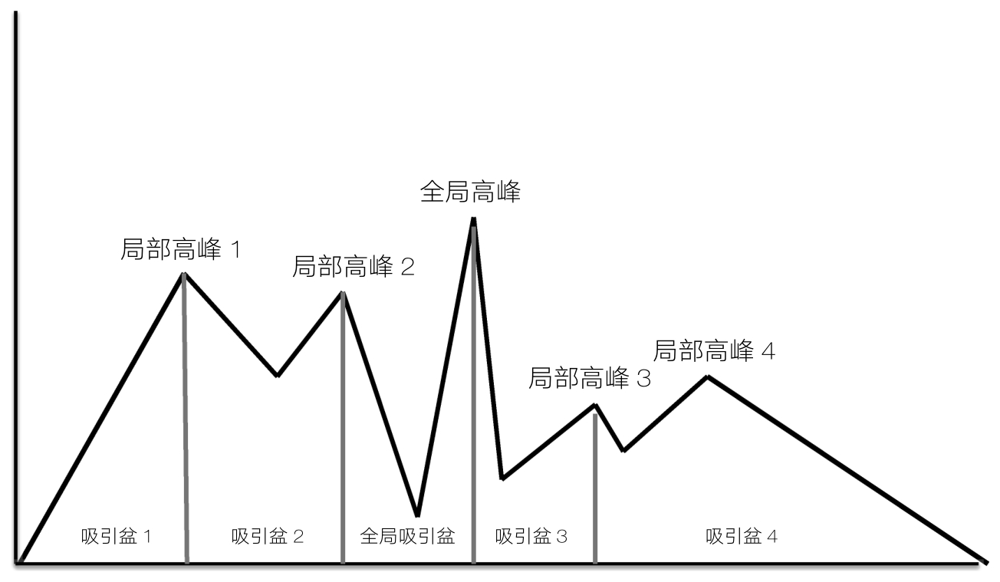

# 崎岖景观模型

当你刻意去寻找的时候，总能碰到意想不到的发现。

这句话流传为萨卡加维亚所言。

本章聚焦于崎岖景观模型。它与空间竞争模型、享受竞争模型一样，都是把一个主体拆解成若干属性的组合，并把属性组合映射到一个价值分值上。模型的任务就是调整属性，拼出价值最高的个体。这一思路最早源于生态学对进化的研究。如今它被广泛用来思考求解路径、剖析企业间的竞争与创新等议题，这正是本书要深入的地方。本章会揭示，属性间的相互依赖如何让创新变难、如何让结果产生路径依赖、又如何让解本身呈现多样性。同时也会说明，为什么更棘手的问题往往需要更丰富的求解策略。

全章可分为三块。先介绍适合度景观模型，并把该模型重新解读为问题求解与创新的框架；再谈一维情形下崎岖度的含义；最后给出可推广到任意维二元情形的 NK 模型。

### 适合度景观模型

适合度景观模型的前提是，物种具备能够提升繁殖潜力的性状，而种群内个体在这类性状上的量或程度各不相同。用横轴标性状，纵轴标适合度，就能画出一幅山峦图，高点即高适合度。

以土狼尾巴长度为例。假设其余性状全部固定，只改变尾长并测量对适合度的影响。土狼的尾巴既能助其跳跃时保持平衡，也能作为情绪或攻击意图的信号。尾长为零时两种功能都失效，适合度为零。随着尾巴变长，平衡与通讯能力同步提升，适合度随之上升。约到 18 英寸时，平衡性达到最佳；再长则灵活性下降。不过信号价值仍在累积，所以 20 英寸时整体适合度达到峰值。超过此点适合度开始回落。结果呈现一个单峰，像图 28-1 那样。

**图 28-1 富士山景观**

这种单峰形态常被称作富士山景观。现实中这类地形很常见，问题也相对好解。可以期待进化或学习最终爬到顶峰。设想一个尾长各异的土狼种群，自然选择会把尾长推向约 20 英寸。这一长度最平衡地兼顾了稳定与信号，因而适合度最高，后代更多，最终种群尾长趋同。若把此看作优化问题，任何爬山程序都能找到山顶。

用一对多的视角再看，就能把该问题转译为产品设计。比如设计一把煤铲，长度与形状已定，只剩大小可调。把面积放在横轴，纵轴放一个小时内能铲多少煤。与先前类似，面积为零时铲子只是根棍子，效率为零。面积逐渐增大到茶匙、汤匙、玩具铲大小，效率不断提升。某点之后，铲子太大使用费力，单位时间的煤量开始下降；再大到无法抬起时，效率又回到零。再次出现富士山景观，理想面积是可以预期的。

把铲子效率视作面积的函数来寻找最优尺寸，正是弗雷德里克·泰勒等人在 19 世纪 90 年代提出科学管理的核心思想。当时流水线速度、焊接强度、休息时长等制造决策都被当作这类景观问题来处理。进入 20 世纪，亨利·福特、约翰·D. 洛克菲勒、安德鲁·卡内基等工业巨头都推动了这一泰勒主义运动。

从手工定制转向大规模生产是重大变革。流程被拆解、分别优化并固化操作，效率大幅提升。但这也被视为劳动的非人化。分歧提示我们需要多模型。任何单一模型都是对现实的过度简化。科学管理强调流程效率，这一偏向招致批评：以产出效率为准的决策会让工人的愉悦与福祉等目标被忽视。

表面看，景观模型只是把价值绘成特征的函数再爬顶，解决问题被比喻为爬山，批评看起来合理。但一旦形式化，它会导出非常非平凡的结论。

### 崎岖景观

当同时考虑多个属性并允许属性间相互作用时，景观会出现多个峰顶，即崎岖景观。设计沙发时需决定坐垫厚度和扶手宽。市场预期销售额可用作价值代理，且与美感相关。厚垫子配宽扶手可能更美观，薄垫子则窄扶手更合适。以扶手宽和坐垫厚为坐标，预期销售额的二维图会出现两个高峰。一个对应窄扶手薄垫，另一个对应宽扶手厚垫。

变量间的依赖让地形崎岖化，这带来几重含义。不同搜索方法可能停在不同山顶；不同起点也可能导向不同山顶。于是出现对初始条件的敏感和路径依赖，也带来结果的多样性。同时崎岖性意味着次优解的存在，也就是局部高峰。

图 28-2 展示了一个有 5 个峰顶的崎岖地形，其中 4 个是局部高峰，仅比邻近点高一点，只有 1 个是全局高峰。要理解为何搜索会卡在局部高峰，可以想象从某点开始的梯度攀登，即爬山算法。在崎岖地形中，梯度方法会停在局部高峰上。

**图 28-2 一个有 5 个山峰的崎岖景观**

若起点在最左侧，梯度法会落到局部高峰 1，这并非最优。若从标记为“吸引盆 2”的区域出发，则会落到局部高峰 2。每个峰顶都有自己的吸引区域，起点落在其内就会被导向该峰。从图中可见，全局高峰的吸引盆面积最小。随机选起点并用梯度法，最难找到的就是全局高峰。

吸引盆取决于所用启发式。换一种启发式，盆的形状也会改变。比如“一直向右走”启发式：自起点向右搜索直到遇到局部高峰为止。对本例而言，两种启发式的局部高峰相同，但吸引盆不同，对比图 28-2 与图 28-3 可见。

**图 28-3 由“一直向右走”启发式产生的吸引盆**

在崎岖地形上寻找最优或接近最优的高峰，需要多样性和复杂性策略。多样性的价值很直观：不同启发式可能找到不同峰，多个启发式并用可产生多个局部解，再从中挑选最优。同样，从不同起点用同一启发式也能获得类似效果：先收集若干局部最优，再择优。

景观的崎岖度可用峰顶数量衡量，它与问题难度相关。但难度不一定等于崎岖。例如在一大片玉米地里找一枚金币，可以用一个平坦景观表示，仅在硬币处有一个单峰。景观不崎岖，但寻找依然困难。

### NK 模型

NK 模型让属性间的相互作用与崎岖度之间的关系形式化。该模型把一个对象表示为长度为 N 的二进制串，“N”即由此而来。“K”指决定该位贡献的、与之交互的其他位数。若 K 为零，价值函数是线性的；若 K 等于 N-1，所有位互相作用，每个串的价值近似随机。增大 K 可把地形调至富士山与随机景观之间。

**NK 模型**

一个对象由 N 位二进制符号组成，s ∈{0，1}^N。

该对象的价值表示为 V(s)=V_[k][1](s[1],{s[1k]})+V_[k][2](s[2],{s[2k]})+…+V_[k][1](s[1],{s[2k]})，其中 {s_[ik]} 等于从原串中除第 i 位外随机挑选的 k 位子串集合，且 V_[k][1](s[1],{s[1k]}) 从区间［0，1］中抽取的随机数。

K=0：得到关于位的线性函数。
K=N-1：任何位的变化都会使每个位的贡献产生新的随机值。

NK 提供了一个很好的探索空间。我们可以问局部最优数量如何随交互项数变化，全局最优大小如何随之变化。但要回答这些，还需先定义搜索方式，局部最优集及其吸引盆取决于启发式。

下面主要用单翻转算法搜索。该算法按序遍历每个属性并翻转其状态，若翻转提升价值则保留，否则回退。选择它的动机有二：一是可粗略描述基因突变，让有利变异逐步扩散；二是它最自然地体现了爬山算法。

先看 N=20 且 K=0。此时每个属性对总价值的贡献相互独立，单翻转可识别出每个属性的更好状态并找到全局最优。K=0 对应无相互作用的富士山景观。每个状态的值在［0，1］上均匀分布。两个均匀随机数中较大的期望为 2/3，对 20 个属性求平均，全局最优期望也是 2/3。

在另一极端 K=N-1，每一属性都与其他所有属性交互。翻转任一位会让其它每个位的贡献都改变，相当于从［0，1］重新抽样。新对象的值是 20 个新随机数的总和。于是每次翻转都会让对象获得一个与之前不相关的全新值，地形极度崎岖，每一点都可能突起或下沉。

基于这两个极端可推导出局部峰的期望数量。从任一备选方案出发，单翻转会将其与 N 个单一位不同的邻居比较。例如从全零串开始，会评估 100000...、010000... 等 N 个邻居。要成为局部高峰，其值需高于这 N 个邻居，概率约为 1/N。因此局部峰数量约等于可能方案数 2^N 除以 N。对 N=20，约为 5 万个局部峰，仅靠单翻转很难精准定位全局峰。

关键不在于数量，而在于这些最优值的大小。将局部最优的期望均值与全局最优的期望值比较，可评估单翻转的效能。利用中心极限定理可得，局部最优期望约 0.6，全局最优期望略高于 0.75。可见崎岖景观的局部峰比富士山峰低，但其全局峰却更高。

这就引出一个问题：当 K 从 0 增加到 N-1 时发生了什么？答案是双重效应。交互数增加的同时，既抬高了全局峰，也制造了更多、更低的局部峰。设搜索仍用单翻转，计算显示对较小的 K，交互带来的好处即更高全局峰，超过了坏处即更多局部峰。因此初期局部峰期望会随 K 上升。同时局部峰数量的增加会拉低平均值。若坚持单翻转，人们往往偏好较小 K，如 3 或 4。但我们不必局限于只翻单一位的简单启发式。进化可能受此限制，但我们不必。允许翻两项甚至三项的状态，复杂算法会减少局部最优的数量。

### 崎岖性与舞动的景观

NK 的一个重要启示是需要适度的相互依赖，互动能产生更高峰。多模型思维要求我们跳出特定假设，思考驱动结果的机理。逻辑包含两部分。首先是组合学：两元素组合随对数平方增长，三元素组合随立方增长。相互依赖因此可能创造更多有益协同。其次是我们只需保留更好的组合。设想用 4 种食材做菜：泡菜、香蕉、鸡肉、焦糖。两两搭配有 6 种。若偏好焦糖与香蕉，就会保留这一种搭配，其余被舍弃。

进化系统遵循相似逻辑。能产生正向相互作用的表型组合，如坚硬外壳配强健短腿，会在种群中保留。适者生存淘汰负向组合。因此我们不会看到慢腿+鲜美肉质+艳丽外表的动物，它们或许出现过却已被淘汰。

在搜索模型里也一样。当可能性极多时我们更倾向于变化。组合提供丰富可能性，而相互作用放大变异，使价值范围更广，更容易出现极高值。总体上相互作用有利，但只在适度范围内有利。过度变化会让景观随机化。理想状态是适度互动。一些研究认为若互动的数量与强度可演化，系统会自然走向高峰的崎岖景观，表明系统倾向演化到复杂性而非均衡或随机。当然何时达到、能否达到本身也是可探索的问题。

最后要强调，我们一直把景观视为静止。但在生态与社会系统中，个体面对的地形取决于他人的行为与属性。一个物种的适应或一家企业的策略改变，会重塑竞争对手的适合度景观。

由此，空间竞争模型与享受竞争模型可被重新解读为舞动景观上的运动。运动可能收敛到均衡，每位参与者站在局部或全局峰顶。也可能在舞动的景观中产生复杂的行动模式与结果。粗略观察生态、政治与经济社会，后一种情形更常见。

我们观察到如此多的复杂性，一个重要原因是这个世界很大程度上由自适应、有目的的行为体组成，它们能够操纵舞动的景观。要理解这种复杂性，需要多模型思维。

**我们可以对知识授予专利权吗**

**专利之争：给创新加油，还是给创意上锁？**

今天习以为常的便利生活，背后是几百年知识层层堆叠的结果。物理定律、内燃机、复式记账法、细菌致病说、X射线、HTML……这些看似分散的成果，共同托起了现代社会的幸福底座。

知识有个耐人寻味的属性：它大多像公共品，一个人用了，并不会让另一个人少用，也就是具备非竞争性。但它未必天然排斥他人使用，能否设门槛，取决于能否验证。若知识固化在具体人工制品里，验证就相对容易；若只是判断某人是否用某种算法解决了问题，往往无从查证，而检查软件程序里有没有嵌入某种算法，则做得到。

一旦排他性能够被保障，社会就要做选择：是像修路、建国防那样，靠税收来生产知识，还是另设制度？政府可以直接酬劳思考者、发放补贴，也可以间接扶持大学和研究机构；同时，还允许人们申请专利。专利之所以能刺激知识生产，关键在于赋予权利人在一定期限内独占使用某项知识的资格，并允许其向其他使用者收费。在美国和欧洲，这一期限是自提交申请之日起20年。

专利拥护者的逻辑很直接：若任何人都能免费使用别人的发明，个人或机构开发更好的捕鼠器、计算机算法、音响系统的动力就会不足。专利制度正是用来化解知识生产中的激励难题。

但经济学家米歇尔·博尔德林和戴维·莱文借助多模型思维，给出了有力的反对理由。在他们允许思想组合的模型中，专利权会限制不同创意的拼接，反而拖慢创新。比如某公司拿到触摸屏技术专利，其他企业设计采用该技术的新产品时，动力就可能被削弱；若无专利保护，采用该技术的产品会更多，创新也会增加。

专利支持者则回击：就算专利真的妨碍创新，可一旦没有保护，投资下滑的幅度会大得多。博尔德林和莱文用扩散模型反驳：设计精良的新产品会迅速在消费者中传播，收音机、电视、谷歌搜索引擎都是例证。这会形成先发优势，创新者仍能获益，只是获利程度与专利保护下不同。

他们进一步追问：一项发明究竟该在多大程度上归功于发明者？如果重大突破都来自孤独天才的密室苦思，且缺少动力就难有新思想，专利制度自然有理。但崎岖景观模型显示，大多数难题都存在多种可行解。新发明，尤其是结合现有思想和技术的成果，如汽车、电话、在线拍卖，也许本就是迟早会发生的“自然事件”，而非某个天才行为的产物。若创意能在思考者群体中自由流动，很多人可能早已完成这些创新。历史上，重大发现常呈现引人注目的同时性：微积分由牛顿和莱布尼茨分别创立，电话由贝尔和格雷分别发明，自然选择理论由达尔文和华莱士分别提出。

归根结底，多模型思维让我们同时看见专利制度的长处与短板。更深入、更周详的结论，指向一种更灵活的专利体系。对那些许多人都有可能发现、又能与大量其他想法重新组合的创意，也许该采用不同于现行专利制度的安排：期限缩短一些，使用条件放宽一些；个别创意，压根不该进入专利授权范围。