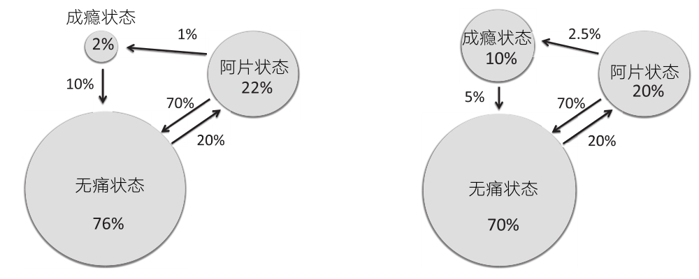
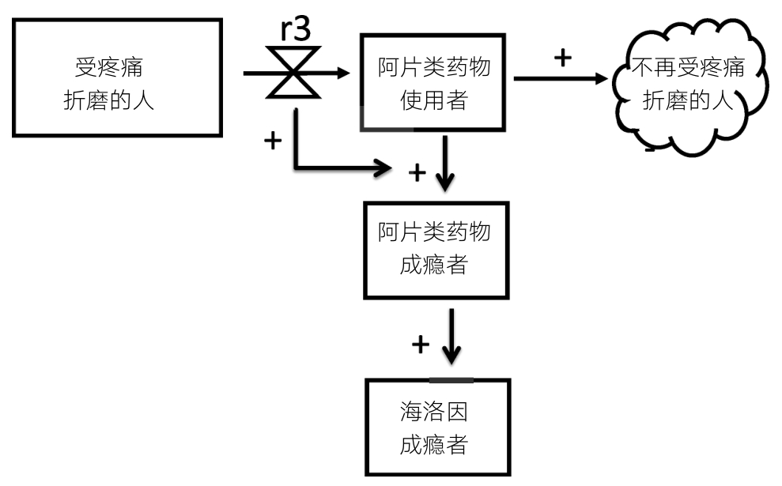
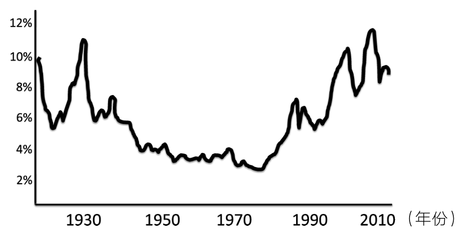
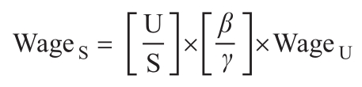
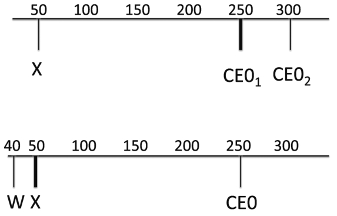
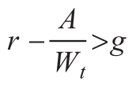
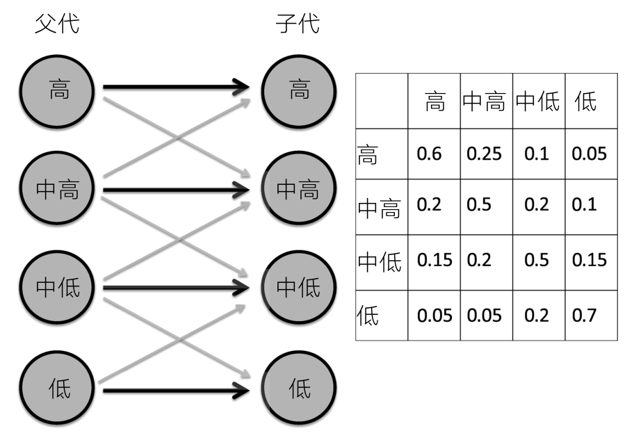

# 别只用一把锤子走进森林

华莱士·史蒂文斯写过：若事物不复杂，生活、诗歌乃至一切都会变成负担。这本书的末段，正是用复合视角去碰两件硬核难题：阿片滥用，以及分配差异。把不同解释并排放，不只让难题更清晰，也让人明白为何它们如此难解。特别在阿片危机上，复合视角能说明专家在全面爆发前捕捉到预警。当然这不等于框架能包办避灾，那太夸张。阿片那段分析并不深入，只是给政策设计与执行抛一个粗线条的思路：没有做数据采集，也未做参数校准，只是定性借用框架得到直觉。相对而言，分配差异那段更扎实，与学界文献贴得更紧，代表复合视角的另一端——对每套解释往深处钻。无论阿片还是分配，叠加视角都会让认知更饱满；但复杂系统本就难预判，犯错在所难免，关键是能从失误里学习。

## 阿片风暴：四块拼图拼出警示

美国阿片滥用严重到何种程度？2016 年医生开具阿片处方超过两亿张，几乎人均一张。同年因阿片过量死亡超十万人；有滥用困扰者超千万，其中两百多万被归为使用障碍。医生开药的首要动机不神秘：药物止痛有效，数千万民众需要缓解疼痛，需求庞大。但没人料到滥用会走到这一步。借助复合视角，可得到四条直觉线索。

首要疑问是药物为何获批。上市前药企须做临床试验，证明疗效显著且副作用可控。把试验视作多臂老虎机：一条臂是新药，另一条臂是安慰剂或旧药。受试者随机分入阿片组或安慰剂组，试验终点归为成功或失败。髋关节置换、牙科手术、癌症治疗等试验均显示阿片组疼痛减轻在统计意义上优于安慰剂。问题在于审批只盯成瘾比例极低才放行，却未算进医生可能开出超长时间处方的情形：有时一次开具就够服用整月。服用时长越长，成瘾风险越高；数据显示服药期偏长者成瘾率会超过百分之二点五。随后用马尔可夫框架演示，成瘾率从百分之一升到百分之二点五，稳态下成瘾人数可放大数倍。

**成瘾框架——马尔可夫**：设定三类人群——无痛者、使用阿片者、成瘾者。左图假设使用人群中百分之一成瘾，百分之十成瘾者恢复无痛，百分之二十无痛者转为使用者；稳态下成瘾者占百分之二点二。计入超量开具后，假设百分之二点五使用者成瘾，仅百分之五成瘾者恢复无痛，百分之二十无痛者转入使用；稳态下成瘾者升至百分之十。转移概率仅作不严格校准，目的在于呈现直觉：看似微小的成瘾概率足以推高总体规模。数值实验还表明，只要略微压低戒断成功率、抬高无痛向使用转化的概率，成瘾比例会急升；例如把恢复无痛概率降至百分之一，成瘾比例可冲到百分之三十五。含义很直接，现实里已有医疗机构开始限制医生可开具阿片的量。

第三套解释是系统动力学视角。与马尔可夫类似，它也区分受痛折磨者、阿片使用者、无痛者，但不直接写转移概率，而是想象一条流动：疼痛人群向使用者流动，再向无痛状态流动。更细版本还能纳入其他药品供给，并允许阿片使用者与海洛因使用者互动，甚至加入焦虑抑郁者更容易成瘾的事实。框架刻画疼痛人群如何滋生阿片使用者与海洛因成瘾者：使用者可能转向无痛，也可能成瘾；成瘾者还可能进一步转向海洛因。原因之一是他们已无法继续使用处方阿片。于是阿片流越大，海洛因使用者越多。

**海洛因路径——系统动力学**：受痛人群会衍生出阿片使用者与海洛因成瘾者；使用者可转回无痛或进入成瘾，成瘾者又可能发展为海洛因使用者；阿片流量加大，海洛因使用者随之攀升。

最后一种是社会网络视角，此处不给出形式化表达。它借助网络解释人均使用地图为何在农村出现聚类。按平方根法则，人口规模越小波动越大；回想先前例子，表现最好和最差的学校往往都是小校。农村使用更高，也可能因病人距药店远，医生倾向开具更长疗程的处方。除此之外，阿片使用呈现聚类而非随机分布。若阿片经贩卖渠道扩散，聚类就可能出现。二手家具靠广告销售，阿片却常经个人关系流转。于是网络视角会从家庭、朋友圈出发，假设人们只向亲密熟人转售；若成立，滥用者便会局部聚集。

## 分配议题：纠缠原因需要叠加视角

谈分配差异有三点理由。其一它是本时代的核心政策命题；收益与财富关乎社会繁荣与未来。高收益群体健康更好、寿命更长、满意度更高；位于分布底部的群体谋杀、离婚、精神疾病发生率更高，也更焦虑。但必须区分相关与因果：很大一部分相关可由更健康快乐者赚得更多解释。不过几乎所有研究都显示收益与幸福存在联系——没人喜欢贫穷。其二解释来源多元：经济、社会、政治乃至物理、生物学都有尝试。其三收入与财富的数据丰富，既有当下也有可追溯数百年的时间序列。

先看经验规律。任何时代任何地方，收益分布都拖着长尾：大量低收益者与少量高收益者并存。历史上分布常被校准为对数正态或帕累托；近期高颗粒度数据表明尾部比对数正态更长，却未完全符合幂律。财富分布同样偏斜。

多数发达经济体近几十年，收益与财富差异无论用何指标都在扩大；美国目前已接近镀金时代。由于内部变化难辨，惯例看上尾份额。图 29-1 显示最顶层千分之一家庭的收益份额在二十世纪五十年后稳步回落，到八十年前后稳定在不足百分之四；如今已升至约百分之十。

**图 29-1　最顶层 0.1% 的收益份额，1916—2010 年。**
**资料来源：Piketty，2011。**

与此同时全球极端贫穷人口急剧下降。看似矛盾的趋势并无逻辑冲突：贫困国家收益快速增长显著缩小了跨国差距，却未抵消国内差异的加剧。群体选择模型也有类似效果：利他社区数量增长，压过了社区内部自私者上升的趋势。

差异成因众多且交织：经济力量、社会趋势、政治因素、发展历史都在作用。经济学家史蒂文·杜鲁夫因此提醒，不应指望一个方程解释全部水平或趋势，也不该把全部政策押在单一框架上。需想得更细：让财富和收益向顶层百分之一或千分之一集中的机制，可能与把底层百分之二十困在贫穷陷阱的机制无关。深入收益分化，必须叠加视角。

收益来源包括工资、营业收入、资本收益与资本利得；相对权重随收益水平而变。低收益者资本相关收益很少，最高收益者则能从每个来源获得可观份额。首个框架扩展了柯布-道格拉斯生产函数：劳动分为受教育者提供的劳动与未受教育者提供的劳动，某类劳动的报酬取决于该类劳动的相对供给与技术。由此可解释近期由供需推动的差异扩大。二十世纪五十年代制造业扩张提升了对低技能工人的需求；同时大学入学因退伍军人法案等大幅上升，提升了高技能供给。至八十年代上大学动力减缓毕业生增长，低技能移民流入又增加低技能供给；与此同时自动化与数字化转型提升了高技能劳动的相对价值，其报酬上涨正反映价值变化。按教育划分的平均收益序列与框架拟合相当好，诸多经济学家据此主张扩大教育机会，以抑制高技能报酬上涨、缓解差异。但该框架能解释整体趋势，却解释不了每个收益阶层内部离散度的扩大。

**技术与人力资本框架——增长**：产出取决于实物资本 K、受教育劳动 S 与未受教育劳动 U，生产函数为 产出 = A K^α S^β U^γ；参数 A、α、β、γ 刻画技术与三种投入的相对价值。高低技能工人的相对市场报酬由框架参数决定。

差异由何而来：利好受教育工人的技术变革会使 β 增大、γ 减小；叠加低技能供给增加，差异就会上升。

正反馈框架则能解释分布尾部，尤其是企业家群体。2011 年企业家占美国四百名最富者七成。框架假设技术——尤其是互联网与智能手机——使人与人联系更紧密，也使选择更受他人影响。想买无线立体声扬声器的人，可在线读评从多个选项挑“最好”；过去或许只能在本地店买唯一型号。膝盖扭伤的人，如今可在网上查到最喜爱的运动医生。这种连通性产生正反馈并放大差异。为给受网络影响的经济选择建模，可修改优先连接框架，把正反馈与才能联系起来。虽然它与强调技术增长的序列拟合不如后者，但数值实验能揭示反馈如何制造差异。回想第六章音乐下载实验：大学生随机分两组在不同情境下下载音乐。第一组看不到他人下载，类似互联网出现前；第二组能看到每首歌的下载数。不能观察社交信息时，没有一首歌下载超两百次，只有一首少于三十次；能看到下载数时，有一首歌超三百次，同时一半以上歌曲少于三十次。信息与社会影响放大了马太效应：富者更富，贫者相对更贫。

**对才能的正反馈——优先连接**：存在 N 个生产者，起初销量均为零。第一个消费者随机选中一个零销量生产者并购买，使其销量为正。之后每个消费者以概率 p 从零销量生产者处购买，以概率 1-p 从已有正销量者处购买；从正销量者中购买时，选到某生产者的概率与其当前销量成正比。差异由何而来：更多联系增加社会影响，创造正反馈。

同样的逻辑可移入经济分析。社交网络正反馈导致差异的可能性，部分取决于所购物品性质。无重量商品——可下载电影、音乐、网络应用及某些技术——易于传播；一点图标复制不出拖拉机、汽车与洗衣机。因此新智能手机应用的销量几乎无需资本支出就能扩大，汽车却不行，哪怕最畅销车型也不行。例子是 2015 年 5 月沃尔沃宣布在南卡罗来纳州生产 S60 轿车；新厂 2015 年 9 月破土，首批汽车要到 2018 年末才下线。

下一个框架来自空间投票模型，用来解释高管如 CEO 报酬上升，且不靠网络因素。2012 年财富五百强 CEO 平均收入超一千万美元，约当年工人平均工资的三百倍；1966 年 CEO 工资仅约工人平均工资的二十五倍。其他国家 CEO 收入少得多：日本约普通员工的十倍，加拿大和整个欧洲约普通工人的二十倍。多数公司里 CEO 报酬由董事会薪酬委员会决定，通常包括工资、奖金与股票期权；决定报酬的人往往也是其他 CEO，他们有强动机抬高彼此报酬。用空间模型表示委员会偏好：报酬会被设定在中间选民偏好的位置。CEO 报酬的跨国差异可由董事会与薪酬委员会构成解释。在德国董事会包含工人成员，他们更倾向压低 CEO 薪酬。

**CEO 报酬——空间投票**：CEO 报酬由薪酬委员会投票决定。美国委员会通常由现任与前任 CEO 以及薪酬专家 X 组成；其他国家委员会中还有工人 W，于是中间选民更偏好较低报酬。

差异由何而来：CEO 通过相互俘获确定报酬；任何一位 CEO 报酬增加，都会让所有 CEO 更偏好更高报酬。该框架从报酬适当性角度解释 CEO 报酬上升。顺着这条线，也能回看价值的多框架方法：委员会成员的理想价值可能基于数据，也可能受社会影响，或来自对未来价值的预测。

再下一个框架来自托马斯·皮凯蒂的《二十一世纪资本论》。与其说它是正式框架，不如说是一个观察：资本回报率总会超过经济增长率。只要关系成立，高收益者来自资本回报的份额就会随时间不断增加。若在增长框架上构建更精致版本，应不难证明资本回报率始终高于整个经济体的增长率。长远看经济增长率可能不足二到三成，资本回报率却可能高出一倍以上。由此可推出：在一个由挣工资的工人与靠租金收入的资本家组成的经济体中，资本家的收入份额会上升。更正式地说，资本增加速度取决于三个比率：消费率、税率与资本回报率。消费又取决于资本存量水平：没什么资本的人不得不把收入很大一部分用于消费，拥有大量资本的人消费只占收入很小一部分。如下面专栏所示，若把消费率写成常数除以资本水平，消费量便不依赖资本水平；较富者以较低速度消费，其净资本更可能增加。

**资本租金框架——72 法则**：经济由工人与资本家组成。工人工资增长率为 g，即经济增长率；资本家在时间 t 拥有财富 W[t]。资本回报率为 r，税后净额，资本家消费为不变常数 A。资本家收入增长快于工人当且仅当：

差异由何而来：在市场经济中，资本回报率必定超过经济总增长率，即 r>g。拥有大量财富的资本家只把资本收入的一小部分用于消费，因此其在总收入中的份额会随时间不断提高。

## 结语：多重视角不是万能，但能让人更清醒

阿片危机与分配议题都在提醒我们：复杂系统没有单一口径答案。复合视角并不承诺预测一切，更不承诺消除灾难；它承诺的是让人多几副镜片、少一点盲区。框架会错，人也会错，但把多个框架并排放对照，能让人更懂政策为何难、问题为何缠。像芒格那样智慧地思考，不是把世界简化成一个公式，而是在复杂面前保持谦逊，同时保持多角度求知的勇气。

你有没有想过，为什么富人越富，穷人越难翻身？一个叫“72法则”的小工具，能帮你直观看到这件事有多夸张。

假设一开始工人和资本家收入一样多。工资每年涨2%，资本每年滚6%。36年后，工资翻了一倍，可资本收入已经变成原来的8倍。再等36年，也就是72年之后，资本家的收入将达到工人收入的60倍。差距不是一点半点，而是越拉越大。

这就是经济学家皮凯蒂用来解释长期不平等的核心逻辑。他用英法两国过去三百年的数据去验证，模型和现实贴合得非常好。两次世界大战摧毁了欧洲的资本存量，反而让收入和财富分配变得相对平均，这个模型也能解释。但模型能这么好用，其实是因为它有两个相互抵消的简化：它把企业家排除在外，所以低估了不平等；同时它假设资本家的后代都会聪明地投资——虽然事实并非如此——结果又高估了不平等。一边创造了新的富人阶层，一边抹去了旧的富人阶层，两个偏差正好对冲，所以模型反而显得更准。

这个模型的潜台词是：只要资本在增长，资本家的份额就会越来越大。继续用72法则算下去，工人的收入在资本面前根本不值一提。那怎么办？最简单粗暴的办法是向富人征财富税。不想征税，那就等着战争和革命来暴力洗牌，或者盼着某个技术突破，催生一批新的资本家。

接下来要看的模型，重点转向了社会力量。首先是“选择性婚配”——说白了就是门当户对。家庭收入是夫妻俩收入加在一起。低收入配高收入，能拉平差距；高收入配高收入，差距就越来越大。虽然结婚时没人知道对方一辈子能赚多少，但学历、健康状况、有没有野心，这些信号是看得见的。研究也证明，学历越高、收入越高的人，越倾向于找同样高学历的伴侣。

于是不平等被三股力量推着走：大学学历的女性越来越多；学历越高，相对收入越高；高学历的人更愿意互相结合。结果就是，双高收入家庭越来越多，家庭之间的收入差距自然越来越大。逻辑听起来没毛病，唯一的问题是这个效应到底有多大。

社会学家通常把教育水平分成五档：辍学、高中毕业、上过大学、有大学学位、研究生。算出每档的平均收入，再结合各档之间的婚姻数量，就能粗略估计出选择性婚配的影响。

如果婚姻是随机匹配的，而不是非要门当户对，收入不平等会轻很多。有研究估算，婚姻若随机化，按基尼系数衡量的收入不平等会减少25%。

另一个模型用马尔可夫链来分析收入流动性。把所有人按收入分成四等份：高、中高、中低、低。选定一个时间段，比如一年、十年或一代人，然后算出人们在不同收入等级之间流动的概率。转移概率越平均，说明社会流动性越大。

不同收入等级之间的转移概率，直接揭示了代际流动性的强弱。如果代际完全没黏性，高收入家庭的孩子落在四个收入阶层的概率各占四分之一；如果完全没有流动性，所有概率都集中在对角线上。现实数据表明，真实情况在两者之间。

举个仿真例子：如果高收入者的孩子有60%的概率继续当高收入者，只有5%的概率掉到低收入，那么到了孙辈这一代，成为高收入的可能性会降到43%以下，沦为低收入的可能性却会超过10%。说明财富的“记忆”能延续，但也会逐渐衰减。

那么怎么衡量代际流动性？传统上需要父母和子女两代人的收入数据，可过去几十年我们才开始有比较完整的个人收入数据。经济史学家格雷戈里·克拉克想了个巧办法：用姓氏。他对比了1888年所有姓“撒切尔”的人的平均收入，和1917年所有姓“撒切尔”的人的平均收入——30年正好是一代人的工作年限。结果发现姓氏的平均收入有显著相关性。这说明收入缺乏流动性。

这个模型还能看到种族差异。非洲裔美国人中，富裕家庭的孩子不太容易继续富有，也就是财富持久性较低；但贫穷家庭的孩子却更容易一直穷下去。换句话说，顶端掉得快，底端爬不动。

最后一个模型来自杜鲁夫的持续不平等理论，关注的是“邻域效应”。人们习惯按收入水平分社区居住——富人跟富人住一起，穷人在穷人扎堆的地方生活。这种空间上的隔离，会产生经济、社会和心理层面的外部性，进一步降低流动性。在这个模型里，个人未来的收入取决于三样东西：自身能力、教育支出和“溢出效应”。

教育支出很大程度来自公共教育投入，而公共教育投入又和社区平均收入相关。高收入社区的教育支出更多，孩子未来收入也更高。溢出效应则可以被理解为社会传播：住在高收入社区，更容易接触到掌握关键信息的人，也就是“弱关系有大力量”的现实版。溢出还可以是行为示范——低收入社区的人发现，花时间自我提升似乎带来不了什么回报，这种观察其实没错。甚至还包括心理层面的传染：积极还是消极、有没有安全感、相不相信自己。

杜鲁夫模型里有个核心概念叫“贫困陷阱”：低收入社区的孩子，既缺少教育资源，也享受不到有效的溢出效应，再怎么有天赋，也很难爬出来。这个模型也能解释种族收入差距——非洲裔美国人住在贫困社区的比例过高，于是更容易锁死在低收入的人生轨道上。

这些模型从不同角度解释了不平等。对于收入金字塔顶端，经验证据最支持的是“技术变革”类模型。美国国税局追踪了收入最高的400人，长达20多年，发现他们的财富主要来自新技术、大众零售和金融业。这仨行业有个共同点：都能快速扩张。搜索引擎、社交网站这类赢者通吃的市场，更是催生了超高回报。但技术模型解释不了底层的情况，也谈不了收入流动性，还无法回答为什么美国CEO的薪酬能碾压其他国家。

要补上这些盲区，就得把收入流动性模型、杜鲁夫模型、空间投票模型都请出来。只有把多种模型放在一起，我们才能对不平等的复杂性有更立体的认识。你会发现，各种机制彼此重叠、互相强化。明白了这一点，再听到有人说“我能快速解决不平等”，就该多留个心眼了。减少不平等，需要的是多方向同步发力。

这也引出整件事更大的方法论：用多模型思维应对复杂世界。不光是收入不平等，从阿片类药物滥用到肥胖趋势，从教学成绩到气候变暖，再到水资源管理和国际关系，都可以拆解成问题、维度、模型，然后组合使用。

举个例子，预测金融崩溃。美联储过去依赖传统经济模型，用的是通胀、失业、存货这些国家核算数据。但这些数据有滞后性，一周、一季度、一年才发布一次，而且靠的是抽样调查。复杂性学者多恩·法默提出，应该从网络实时数据里再建一类模型。这类新模型用更细颗粒度的实时信息，假设不同，预测也不同。关键在于，它不一定比旧模型更准，但只要精度别差太多，结合现有模型就能提升整体预测的准确性——这就是“多样性预测定理”的妙处。法默说，政策制定者会因此更有“集体意识”。

做商业决策也一样。高管决定产品属性、发布时机、薪酬方案、供应链和销售预测，都身处复杂系统，任何单一模型都是错的。多模型组合，能带来更好的行动。

说到底，面对选择、预测和设计难题，多模型方法比拍脑袋强得多。但我们也别指望它能保证成功。就算模型再多，关键因果链可能依然看不清；有些领域复杂到用几十个模型也只能解释一小部分变差。有时候我们甚至找不到合适的模型抽象，模型因为简单反而失效。这时候，我们必须保持谦卑，也要保持好奇。

继续构造新模型、改进旧模型。如果某个模型漏掉了社会影响、正反馈、认知偏差这些关键特征，那就再建一个包含这些假设的模型。所有模型都是错的——这没什么好沮丧，反而正是我们拥抱多模型的理由。

而且别忘了，建模本身是有乐趣的。设定假设、推导规则、运用逻辑，当你把一套模型推演明白，你会发现自己变聪明了。我们最终要做的，是把这份智慧带入真实世界，用它去理解复杂性，去做更好的判断，去一点点改变世界。哪怕路途遥远，至少我们不再只用一种眼光看问题。