# 注释

### 01　做一个多模型思考者

1 . 例如：凯西·欧奈尔（Cathy O'Neil）在 2016 年阐述了基于数据的简单模型如何忽略人口的某些部分以及本书第四章提到的自适应。

2 . 请参见帕阿斯克和希勒分析森林工业的论文（Paarsch &Shearer, 1999）。在他们的模型中，木材加工厂主和林场主要向工人支付按树计件工资。关于植树造林的原始数据显示，计件工资越高，工人种植的树木越少；向某个种植树木的人支付的报酬越多，这个人种植的树木就越少。直接得出的推论与标准经济学原理背道而驰——经济学理论告诉我们，如果每种植一棵树都可以得到更多的报酬，那么种植树木的工人就应该更加努力地工作才是。

不过，如果我们构建一个包含了小时工资率的市场模型，假设每小时的体力劳动报酬为 20 美元，那么数据和我们的直觉就都可以证明是正确的。从这个假设可以得出这样一个等式：

20 美元=每小时种植的树木数量×种一棵树的美元报酬

这个模型意味着，如果树木很难种植，那么工资将会很高。如果一个人可以在一小时内种植 10 棵树，那么种每棵树的工资就等于 2 美元。如果树很容易种植，那么工资就会很低。如果一个人可以在一小时内种植 20 棵树，那么种每棵树的工资将为 1 美元。因此，这个模型预测，计件工资率与种植的树木数量之间呈负相关关系。这样一来，数据中看似矛盾的东西通过这个模型的镜头来看，在逻辑上是解释得通的。这个模型通过种植条件的变化来解释相关性。事实上，这个模型预测的不仅仅是这种相关性，它还给出了一种特定的数学关系：计件工资率乘以种植的树木数量应该等于一个常数。我们可以对这个结果进行检验。

3 . 关于模型胜过了人的证明，请参见：Dawes, 1979；Tetlock, 2005；Silver, 2012；Cohen, 2013。关于认知偏差，请参见：Kahneman, 2011。

4 . Slaughter, 2017 & Ramo, 2016.

5 . 研究表明，最具影响力的科学发现和专利是不成比例地从多个学科中汲取灵感的。有一项研究在分析 3 500 万篇论文后指出，从长远来看，跨学科论文的影响更大（Van Noorden, 2015）。思想的组合不一定会表现为模型的组合，但在许多情况下确实是如此；请参见：Jones、Uzzi&Wuchty, 2008; Wuchty、Jones&Uzzi, 2007。如果我们将专利解释为创新的证据，那么有两个独立的研究思路都可以将思想的多样性与成功联系起来。Shi、Adamic、Tseng、Clarkson（2009）的研究表明，跨类别的专利被引用得更多。Youn、Strumsky、Bettencourt、Lobo（2015）则证明，大多数专利都包括了多个子类别。跨学科研究也稳步发展到了这样一个临界点：平均而言，社会科学家引用其他学科的论文，多于他们所属学科的论文。

6 . Box &Draper, 1987.

7 . Page, 2010a.

8 . 我这样说并不意味着可以将知识与模型等同起来。我的意思是，模型可以表示知识并提供一个清晰的形式来交流对有关知识的理解。“知识”一词的含义非常广泛，它还包括了嵌入在身体中的、隐性的技能，例如怎么打网球、说法语或讨价还价。我在本书中使用的是更狭义的知识定义。关于更宽泛的知识概念，请参见：Adler, 1970。

9 . 只要注意到，从高空往下掉落的跳伞者在终点时速度可以达到 320 千米／小时，就可以得出这个近似结果。终端速度与质量的倒数成比例。假设跳伞者的质量比毛绒玩具猎豹大 400 倍。400 的平方根等于 20，因此，毛绒玩具猎豹的终端速度大体上等于 320 千米／小时除以 20，即大约 16 千米／小时。

10 . 他没有说错。弗雷斯诺市比冰岛还要大 30%。埃里克·鲍尔和约瑟夫·李普曼（Joseph LiPuma）（2012）讨论过怎样把学术研究得出的教训应用到商业世界中。

11 . Lo, 2012.

12 . 这个故事的不同版本在美国哲学家与心理学家威廉·詹姆斯（William James）、斯蒂芬·霍金和法学家安东宁·斯卡利亚（Antonin Scalia）的著作中都可以找到。

### 02　模型的 7 大用途

1 . 关于对构建模型原因的更细致的分类剖析，请参见：Epstein, 2008。查尔斯·拉夫和詹姆斯·马奇（1975）描述了模型的 3 个用途：解释经验现象、预测其他现象和新的现象，以及建造和设计系统。他们也都提倡利用模型进行探索。

2 . 请参见：Harte, 1988。这种方法也借鉴了一篇阐述的关于模型在社会科学中的各种用途的观点的论文（Johnson, 2014）。这两种方法通常也称为伽利略和极简主义的理想化。请参见：Weisberg, 2007。关于类比的作用更进一步的讨论，请参见：Pollack, 2014；Hofstadter&Sander, 2013。侯世达在《表象与本质》一书中将类比称为思考之源和思维之火。另外也请参见：Schelling，1978、1987；他也详细地说明了模型的各种类别。丹尼尔·利特尔（Daniel Little）的博客“理解社会”（understanding society）也提供了相当不错的社会科学本体论的入门知识。

3 . 请参见：Arrow, 1963。如果我们对可能的个人排序施加限制，那么进行集体排序就是有可能的。比如，如果令每个人都保持相同的排序，那么集体的排序也会如此。但是一般而言，我们无法将个人排序映射为一致的集体排序。

4 . 与我同一时代的杰出人士一定已经注意到了，我从《嚎叫》（*Howl* ）中借用了“这是真的发生过的事情”的手法。请参见：Bickel、Hammel&O'Connell, 1975。

下图是一个添加一个节点会减少总边长的诸多可能例子之一。左侧的网络有 4 个点（分别作为正方形的一个角）。右侧的网络则多了位于中心的第 5 个节点。如果将正方形的边的长度假设为 1，那么左侧图中各边的总长度为 3，右侧图中各边的总长度则等于 4×0.71，小于 3。

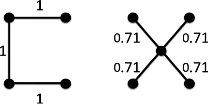

当向录取率更高的院系提出入学申请的男性多于女性时，辛普森悖论就会出现。例如一所拥有医学院和兽医学院的大学。假设有 900 名男生申请入读医学院，其中 480 名（53%）被录取；同时有 300 名女生申请医学院，180 名（60%）被录取。并假设有 100 名男生申请兽医学院，20 名（20%）被录取；同时有 300 名女性申请兽医学院，90 人（30%）被录取。在每一个学院，女生的录取率都比较高，但是就整个学校总体而言，男生的录取率达到了 50%（1000 人申请，500 人被录取）；女生的录取却只有 45%（600 人提出申请，270 人被录取）。

作为“帕隆多悖论”的一个例子，假设有这样两个赌局：在第一个赌局中，一个人总是会输 1 美元；在第二个赌局中，如果轮数不能被 3 整除，那么输 2 美元，如果能够被 3 整除，就赢 3 美元。每一次投注都会形成一个期望损失，但是如果你只在赢的轮次上参加第二个赌局，而在其他轮次上则参加第一个赌局，那么你每三轮就肯定能够赢得 1 美元。

5 . Kooti、Hodas&Lerman, 2014.

6 . 假设每个人都可以赚得相同的收入，并以固定税率*t* 缴纳税收。令*c* 表示百分比减量、*r* 表示收入的增量。当前的政府收入等于*I* ×*t* 。减税政策实施后，政府的收入等于*I* （1+*r* ）× *t* （1-*c* ）。只有当*I* ×*t* <*I* （1+*r* ）*t* （1-*c* ）时，政府收入才会增加。重新排列各项，我们有*r* > *c* （1+*r* ）。

7 . 基于市场的机制如何能为多维有效载荷问题提供一个更好的解，请参见：Ledyard、Porter&Wessen, 2000。

8 . 物理学家尤金·维格纳在他的论文（Eugene Wigner, 1960）中使用过的一个形容词“好得不合情理”。他说，物理科学中使用数学模型的有效性“好得不合情理”。

9 . Ziliak&McCloskey, 2008.他们讨论了社会科学模型解释变差的能力。

10 . Porter&Smith, 2007.

11 . Squicciarini&Voigtländer, 2015.Mokyr, 2002.

12 . 请参见美国财政部网站。

13 . 例如，在 20 世纪 90 年代中期，在美国俄亥俄州哥伦布市新开业的餐馆中，大约有 60%后来都关门了。没有任何一家得到过政府的救助，当然政府也不应该救助它们。健康的市场经济本身必定包含了破产。请参见：Parsa et al., 2005。

14 . 摘自国际货币基金组织的《2009 年全球金融稳定报告》。连接的强度基于投资组合价值的相关性。但是这种相关性又是基于极端事件的，也就是这些机构表现得特别好或特别糟糕的日子。这个指标可以刻画一家金融机构的破产扩散到另一家的可能性。事实上，业绩表现的相关性可能源于投资组合的相似性以及一家银行对另一家银行资产的持有。

15 . Geithner, 2014.

16 . 要了解旧金山湾的物理模型及其在政策中的用途，请参见：Weisberg, 2012。

17 . Stone et al., 2014.

18 . Dunne, 1999&Raby, 2001.

### 03　多模型思维

1 . Levins, 1966.

2 . Page, 2007、2017.

3 . 关于群体的智慧，请参见：Suroweicki, 2006；关于狐狸是如何胜过刺猬的，请参见：Tetlock, 2005；关于计算机科学的集成方法，请参见：Patel et al., 2011。

4 . 卢红和佩奇（2009）证明，独立的模型需要一个唯一的分类集。这也就是说，在二元分类模型中只存在一种创建一组独立预测的方法。

5 . 关于多样性预测定理的详细阐述，请参见我以前出版的几本书：《多样性红利》《多样性与复杂性》等。关于经济预测所用的数据，请参见：Mannes、Soll&Larrick, 2014。

6 . 考虑下图中用 A、B、C 和 D 表示的四幢平房及其市场价值。根据这些平房是否包含了一个录音室由“门”上方的圆圈符号表示），创建两个类别。平房 A 和 B 不包含录音室，因此它们属于同一个类别；而平房 C 和 D 则包含了一个工作室，因此它们属于第二类。

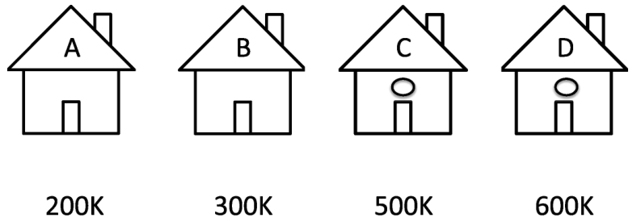

**四幢平房及其市场价值** 

首先计算出这些平房价格的总变差，即每幢房子的价值与均值之差的平方和。这四幢平房的均值等于 400 000 美元，因此总变差等于 100 000：总变差=（200-400）² +（300-400）² +（500-400）² +（600-400）² 。

为了计算分类误差，假设我们知道每个类别内的真实均值：第一个类别为 250 000 美元，第二个类别为 550 000 美元（平房已转变为录音工作室）。但是这种分类将不同价值的房子混同在了一起。剩余的变差等于分类误差：分类误差 A 和 B=（200-250）² +（300-350）² =5 000、分类误差 C 和 D=（500-550）² +（600-550）² =5 000。总分类误差等于这两个数字的总和，即 10 000。

为了计算出估值误差，假设模型预测平房 A 和 B 的价值均为 300 000 美元、同时预测平房 C 和 D 的价值均为 600 000 美元。估值误差等于每个类别的预测值与真实均值之间的差的平方和。估值误差 A 和 B=（300-250）² +（300-250）² =5 000，估值误差 C 和 D=（600-550）² +（600-550）² =5 000。于是总估值误差等于 10 000。

总模型误差等于预测值与实际值之间的差的平方和：模型误差=（200-300）² +（300-300）² +（500-600）² +（600-600）² =20 000。因此不难注意到，模型误差等于分类误差和估值误差之和。

7 . 读者如果想了解二维社会互动的旋转玻璃模型，请参见：Brock&Durlauf, 2001。爱德华·格莱泽（Edward Glaeser）等人则给出了一个关于犯罪的一维模型。另外，德鲁·弗登伯格（Drew Fudenberg）和戴维·莱文（David Levine）也构建了一个关于大脑的经济模型。

8 . 斯塔夫罗斯·尼阿科斯并不是第一个试图利用货船超大空间的人。1858 年，因设计建造大西部铁路的传奇英国工程师伊桑巴德·金德姆·布鲁内尔（Isambard Kingdom Brunel）建成了一艘近 220 米长的大船，并命名为“大东方号”（SS Great Eastern）。事实证明，作为一艘货轮，大东方号是失败的。由于缺乏适当的水动力模型，导致大东方号整体设计不佳。这艘船只有在最慢的速度下才能够航行。幸运的是，它最终还是派上了用场——被用于铺设跨越大西洋的海底电缆。关于多模型思维在设计船舶时的作用，请参见：West, 2017。

9 . 以磅和英寸为单位时，。

10 . 勒布朗·詹姆斯（LeBron James）身高 6 英尺 8 英寸，体重大约 250 磅，身体质量指数为 27.5。凯文·杜兰特（Devin Durant）身高 6 英尺 9 英寸，体重 235 磅，身体质量指数为 25.2。2012 年和 2016 年奥运会十项全能金牌得主阿什顿·伊顿（Aston Eaton）身高 6 英尺 1 英寸，体重 185 磅，身体质量指数为 24.4。另一位著名运动员，2008 年奥运会十项全能金牌得主布莱恩·克莱（Brian Clay）的身体质量指数则为 25.8。

11 . Flegal et al., 2012.

12 . 假设这只小鼠 3 英寸长、1 英寸高、1 英寸宽，同时假设这只大象 10 英尺高、10 英尺长、5 英尺宽。大象的表面积为 400 平方英尺，也就是 57 600 平方英寸。大象的体积为 500 立方英尺，相当于 864 000 立方英寸。

13 . 杰弗里·韦斯特（Geoffrey West, 2017）和他的同事们已经构建了一个更精细和更准确的模型，它预测新陈代谢的规模与质量的四分之三次幂成比例。而且在 80 多年之前，科学家就已经在数据中找到了与之相近的定律，即克雷伯定律（Kleiber's law）。

14 . 发送的简历内容完全相同，但是申请人的名字改变了的实验表明，女性获得的报酬低于男性，得到的评价也低于男性；请参见：Moss-Racusina et al., 2012。

15 . 一个男性员工成为 CEO 的概率等于他连续获得 15 次晋升的概率。概率比，也就是男性成为 CEO 的概率与女性成为 CEO 的概率之间的比值。按照我们的假设，男性每次升职的概率为 50%，女性每次升职的概率为 40%，于是概率为（1.25）¹⁵ =28.4。

16 . Dyson, 2004.

17 . Breiman, 1996.

### 04　对人类行为者建模

1 . Haidt, 2006; Simler&Hanson, 2018.

2 . 要证明这个结果，需要利用一些微积分知识。假设一个人的收入为*M* ，一单位食品的价格为 1 美元，一个单位的住房服务的价格等于*P* * [H] * 。那么我们可以将他的预算约束写成*M* =*F* +*P* * [H] * ×*H* 。而这当然就意味着*F* =*M* -*P* * [H] * ×H。可以将其效用函数写成

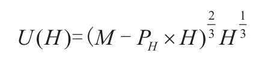

为了求这个函数的最大值，我们对*H* 求导数并令它等于零：即

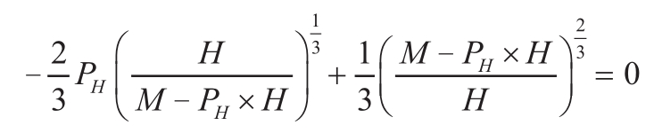

把第一项移到等式的右侧，交叉相乘，可以得到：2*P* * [H] * ×*H* =*M* -*P* * [H] * ×*H* 。在预算约束的条件下，用 2*P* * [H] * ×*H* 替换*M* -*P* * [H] * ×*H* ，可以得到*M* =2*P* * [H] * ×*H* +*P* * [H] * ×*H* ，或者*M* =3*P* * [H] * ×*H* 。因此，他将收入的 1/3 用于住房。

3 . 在美国，这是一个不错的近似值。

4 . 这个定理的正式表达如下：*X* ={A，B，C，…，*N* }表示一个结果的有限集，并设定一个抽奖，令它成为这个结果集上的一个概率分布，即*L* =（*pA* ，*pB* ，…，*pN* ）。如果对彩票的偏好（>）满足完备性、传递性、独立性和连续性，那么这个偏好可以表示为一个连续的有实数值的效用函数，可以给每个彩票赋予一个效用。完备性是指，任何两个彩票，*L* 和*M* ，都可以进行比较；传递性是指，如果*L* >*M* ，并且*M* >*N* ，那么*L* >*N* ）；独立性是指，如果*L* >*M* ，那么给定任意一个彩票*N* 和任意一个概率*p* >0，都有*pL* +（1-*p* ）*N* >*pM* +（1-*p* ）*N* ；连续性：如果*L* >*M* 且*M* >*N* ，那么存在概率*p* 使得*pL* +（1-*p* ）*N* ～*M* 。这个定理的正式证明有点繁杂，下面只给出证明的简要思路。假设存在最优结果 B 和最差结果 W，并且假设 B 的效用等于 1、W 的效用等于零。给定任何其他结果 A，根据连续性公理，存在概率*p* ，使得人们在肯定能够得到 A，与以*p* 的概率得到 B 并以（1-*p* ）的概率得到 W，两者之间无差异。利用上面的符号，我们把它写成 A～*p* B+（1-*p* ）W。然后，我们再将 A 的效用指定为*p* 。按此思路推导（这需要一点点数学知识），可以证明，一个人越喜欢某个结果（或彩票），*p* 就越大。这样一来，我们也就魔术般地将排序转变成了数字。对于这个定理的完整的证明，请参见：Von Neumann&Morgenstern, 1953。

5 . Rust, 1987.

6 . Camerer, 2003.

7 . Harstad&Selten, 2013.

8 . 关于以理性选择模型为基准的理由，请参见：Myerson, 1999。

9 . 对于这个领域的一个早期的综述，请参见：Camerer、Loewenstein&Prelec, 2005。

10 . Kahneman, 2011.

11 . 开放科学协作组织的原始论文（2015），导致了更多的复制结果的研究，它们得出相似的百分比。

12 . 要想了解关于被试多样性的重要性，请参见：Medin、Bennis&Chandler, 2010。

13 . Berg&Gigerenzer, 2010.他们充分表达了这种批评意见，认为它破坏了基于数学的心理模型。

14 . Kahneman&Tversky, 1979.

15 . 例如，治疗方案 A*——* 肯定能够拯救 40%的患者，治疗方案 B*——* 有 50%的机会拯救所有人。损失框架：治疗方案 A’——肯定会有 60%的患者死亡，治疗方案 B’——有 50%的机会没有任何人死亡，有 50%的机会所有人都死亡。根据前景理论，大多数医生在收益框架下都会选择治疗方案 A，而在损失框架下都会选择 B’。

16 . 关于双曲贴现的含义的早期研究，请参见：Thaler, 1981；Laibson, 1997。

17 . 双曲贴现的公式可以写成如下更一般的形式：

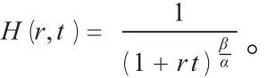

18 . Gigerenzer&Selten, 2002.

19 . Gode&Sunder, 1993.

20 . Gigerenzer&Selten, 2002.

21 . 在弗农·史密斯（Vernon Smith）的诺贝尔奖获奖演说中，他指出：“生态理性，要使用推理，也就是用理性的重建来考察个人的行为，但根据的是他们的经验和常识。人们遵循规则但不一定能清楚地将它们表达出来。但是，它们是可以被发现的。”请参见：Smith, 2002。

22 . Arthur, 1994.

23 . Lucas, 1976; Campbell, 1976.

24 . 关于模型如何阐明可能发生的事情的进一步讨论，请参见：de Marchi, 2005。关于基于方程和规则的模型（行为者在类似的博弈中做出类似的行为），请参见：Gilboa&Schmiedler, 1995；Bednar&Page, 2007、2018。

### 05　正态分布

1 . 给定一个数据集{*x* * [i] * ，…，*x* * [N] * }，方差等于数据与均值之间距离的平方的平均值，可以写为：

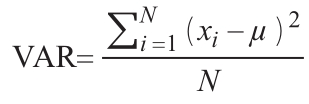

标准差则等于数据与均值之间距离的平方的平均值的平方根，即：

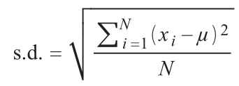

2 . 这里有好几个条件，而且只要满足其中任何一个条件就足够了。林德伯格条件（Lindeberg condition）是比较常见的一种，它要求，随着变量的数量的无限增加，来自任何一个变量的总变差的比例将收敛为零。

3 . Lango et al., 2010.

4 . 对于一般情况，假设独立性，我们可以得到如下表达式：

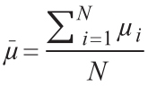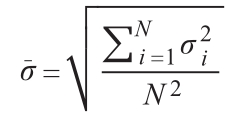

用*σ* 代替*σi* ，就可以得到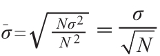。

5 . Wainer, 2009.

6 . 两个标准差的阈值（5%显著性）是一个惯例。尽管经常受到批评，但它仍然是社会科学家最常使用的。当然，6%显著性水平的大相关系数，可能比 4.9%显著性水平的小相关系数更值得注意。进一步的讨论，请参见：Ziliak&McCloskey, 2008。

7 . Gawande, 2009.

8 . 随机变量的乘积分布之所以称为对数正态分布，是因为分布的对数将会是正态分布的。个中的原理，我们可以简述如下。首先，我们写出一些数字的乘积，*y* =*x* [1] ×*x* [2] ×*x* [3] ……*x* * [n] * ，并将它写为如下以 10 为底的幂的乘积的形式：

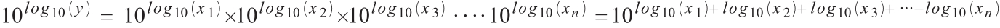

然后，我们对两边同时取以 10 为底的对数，得到以下的等式：

*log* [10] （*y* ）=*log* [10] （*x* [1] ）+*log* [10] （*x* [2] ）+*log* [10] （*x* [3] ）+…+*log* [10] （*x* * [n] * ）

因此，变量*y* 的对数可以写为随机变量的对数之和。这些随机变量的对数也是随机变量，只要它们的方差满足中心极限定理的条件，它们的和 l*og* [10] （*y* ）就是正态分布的。

9 . Limpert、Stahel&Abbt, 2001.

10 . 这个思想最早可以追溯到罗伯特·吉布拉特（Robert Gibrat）1931 年的研究。

### 06　幂律分布

1 . 关于这场大洪水的影响和文化意义，请参见：Parrish, 2017。

2 . 在这个例子中，指数假设为 2。这个例子借用自：Clauset、Young&Gleditsch, 2007。

3 . 关于本章所述模型的技术性细节以及其他关于幂律的例子，请参见：Newman, 2005。

4 . Newman, 2005; Piantadosi, 2014.

5 . 常数*C* 使所有结果的总概率等于 1。根据这个定义，幂律分布满足标度不变性（scale invariance），如果改变了用来衡量结果的单位，那么分布的形状仍然不会发生变化。

6 . 在计算这些概率的时候，可以先求出事件在一年内未发生的概率。例如，如果事件的概率为 1/2，那么这个事件在一年内不发生的概率等于（0.999）³⁶⁵ =0.69。因此，该事件发生的概率等于 31%。一个概率为一百万分之一的事件在一个世纪内不发生的概率也可以用类似的方法计算。

7 . Cederman, 2003; Clauset、Young&Gleditsch, 2007; Roberts&Turcotte, 1998.恐怖袭击导致*x* 人死亡的概率大体上可以写为一个常数项：0.06 除以*x* 的平方。对于*x* 只取整数值的离散分布，幂律分布则可以写为*p* （*x* ）= 0.608*x* ^(\-2) 。之所以选择系数 0.608，是为了使概率总和等于 1。因为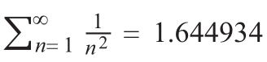；0.608 与 1.644934 的乘积等于 1。

8 . 对于幂律，我们对两边同时取对数，并将*y* =*Cx* ^(\-a) 变换为 log（*y* ）=log（*C* ）-*a* log（*x* ），这是一个 log（*y* ）关于 log（*x* ）的线性方程。当我们绘制出 log（*y* ）随 log（*x* ）而变的图形时，将会得到一条直线。对于指数分布，*y* =C×*A* ^(\-x) 。如果取两边的对数，就可以得到 log（*y* ）=log（*C* ）-*x* log（*A* ），这意味着 log（*y* ）对于*x* 是线性的。换句话说，log（*y* ）将随 log（*x* ）而快速减少，从而形成凹的图形。

9 . 如果我们取对数正态分布的对数，就会得到以下形式的方程：log（*y* ）=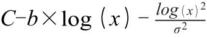，其中，*σ* 是这个对数正态分布的标准偏差的自然对数，作为该分布方差的一个代理变量。对于很大的*σ* ，log（*x* ）² 的贡献将很小，直到 log（*x* ）的值变得足够大，可以引起图形出现下降为止。

10 . 关于对数正态分布和幂律分布的正式区别，请参见：Broido&Clauset, 2018。研究认为，许多曾经被认为具有幂律分布特点的网络，实际上并不是幂律分布的。

11 . 要了解齐普夫的单词频率定律和其他可选模型，请参见：Piantadosi, 2014。如果事件的大小分布满足幂律，那么排名也符合这个定律。在开放区间［1，∞）上，指数为*a* 的幂律分布具有形式*p* [a] （*x* ）=*ax* ^(\-a) 。假设有 100 个事件。令*S* * [R] * 表示第*R* 大的事件的预期大小。那么某个事件大于*S* * [R] * 的概率必定等于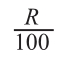。例如，如果*R* =3，那么一个事件大于*S* [3] 的概率必定等于 3%。因此：

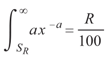

从中可以解得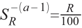，而它又可以改写为：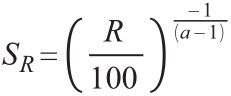。

在*a* =2 的特殊情况下，上述表达式就变成了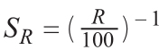。

12 . Bak, 1996.这个模型的适用范围很广，至今仍然没有看到它的边界。学者们已经利用这个模型来解释经济波动、战争中的死伤、恐怖主义行为、进化中的间断均衡以及交通拥塞等理论和现实问题了。请参见：Paczuski&Nagel, 1996；Sneppen et al., 1995。

13 . Salganik、Dodd&Watts, 2006; Ormerod, 2012.幂律分布还意味着，构成概率分布的很大一部分是非常多的小事件。这些小事件合到一起，也足以产生与大事件同等规模的经济价值。请参见：Anderson, 2008b。互联网的出现，使零售商能够出售大量的书籍、电影和音乐，尽管有些东西只能吸引少数人。一个只卖一本畅销书、卖出了 500 万的零售商，获得的利润可能与另一个销售 1 万种书、每种书只卖出 500 本的零售商差不多。

14 . 有一个模型说明了这种情况是怎样出现的，请参见：Denrell&Liu, 2012。

15 . 地质学家使用里氏标准来表示地震震级。震级等于地震强度的对数。因此，里氏 6 级地震的强度是里氏 5 级地震的 10 倍。地震的强烈可以用齐普夫定律来预测（但不是地震的时间），请参见：Merriam&Davis, 2009。

16 . Eliot、Golub&Jackson, 2014.他们给出了增大连通性如何使失败的可能性降低的明确模型。

17 . Mayt、Levin&Sugihara, 2008.

18 . Stock&Watson, 2003.

19 . Carvalho&Gabaix, 2003.

20 . Claridat、Galí&Gertler, 2000.

21 . 我要感谢塞思·劳埃德（Seth Lloyd），是他提醒我注意到了这个例子。

22 . 我们让工资分布等于随机变量*x* 的 100 000 倍，其中，*p* （*x* ）=2*x* ^(\-3) 从 1 到∞。变量*x* 的均值等于 2，因此工资分布的均值为 200 000 美元。

23 . Weitzman, 1979.他给出的模型在更一般的情况下证明了这个结果。

24 . Bell et al., 2018.

### 07　线性模型

1 . 有价值的葡萄酒，如波尔多葡萄酒，都要由专家加以排名。这些葡萄酒同时也在市场上定价。价格和排名都可以作为质量的代理变量。奥利·阿申费尔特（Orley Ashenfelter）根据冬季降雨量、收获季降雨量和 9 月份的平均温度，拟合出了关于波尔多葡萄酒的质量的（对数）线性模型。请参见：Ashenfelter, 2010。线性模型将因变量的对数表示为自变量的对数的线性和，例如：

log（*y* ）=*b* [0] +*b* [1] log（*x* [1] ）+*b* [2] log（*x* [2] ）

这个表达式意味着，因变量也可以写成自变量的乘积。只需对上式的两边同时取以*e* 为底的指数，就可以做到这一点。于是，我们得到：

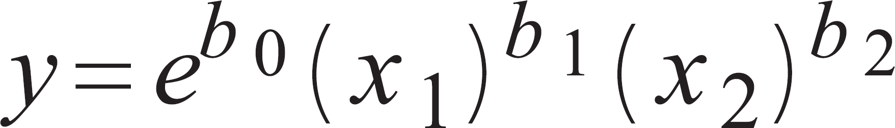

通过取对数，乘式就可以变加式，然后就可以应用线性回归的工具了。以年份葡萄酒的价格为因变量，阿申费尔特的模型的拟合度指标（*R* ² ，即，得到了解释变差的百分比）达到了 83%左右。有证据表明，它比葡萄酒专家的判断更加准确地预测了葡萄酒的价格。阿申费尔特的模型甚至可以预测专家的估值的变化。罗伯特·帕克（Robert Parker），一位著名的葡萄酒评酒专家，最初将 Pomerol 和 St. Emilion 于 1975 年出品的葡萄酒评为 95 分（满分为 100 分）。但是，在阿申费尔特的模型的预测中，对这些酒的质量排名则较低。后来，到了 1983 年，罗伯特·帕克将他对这些酒的排名降低到了低于平均水平，一如阿申费尔特的模型的预测。请参见：Storchmann, 2011。

2 . Xie, 2007.

3 . Ryall&Bramson, 2013.

4 . Mauboussin, 2012.他讨论了如何利用这个方程式指导合理的管理决策。

5 . Bertrand&Mullainathan, 2001.

6 . Shapiro、Meschede&Osoro, 2013.他们并没有把相关性和因果关系混为一谈。如果两个变量不相关，就不应该期待它们之间存在因果关系。

7 . 为了找到最优的那条线，我们使用的是支持向量机（SVM），这是一种类似于回归的方法。两者之间关键区别在于，支持向量机将所有数据分成正的组或负的组，然后找到最大化到每组中最近点的直线。如果不存在这样的直线，就会对偏离行为进行处罚。回归则考虑到所有点的距离。

### 08　非线性模型

1 . Arthur, 1994.

2 . 30 次倍增为 2³⁰ ，超过 10 亿。

3 . Karlsson, 2016.

4 . Ebbinghaus, 1885.

5 . 关注大脑反应的研究者发现，即便是享用巧克力，消费了一定数量后，人们也会开始觉得厌恶，请参见：Small et al., 2001。

6 . 与本书中的许多例子一样，这个例子我也是从拉夫和马奇出版于 1975 年的那本书中借用来的。

7 . 假设你每年投资 3 000 美元。如果股票的价格维持在每股 15 美元的水平不变，那么你每年可以买 200 股。如果价格在 20 美元到 10 美元之间变动，那么在价格最高的年份你只能购买 150 股，而在价格较低的年份你可以购买 300 股。平均而言，你可以购买 225 股，这比你在价格不变的情况下购买的数量更多。

8 . 关键假设是，在柯布-道格拉斯模型中的指数*a* 和（1-*a* ）的总和为 1。这个假设意味着如果我们将工人数量和资本数量加倍，总产出也会增加一倍，即：

产出=常数×（2×工人）* ^a * （2×资本）^(（1-) * ^a * ^） 

展开各项并重新排列，就可以得到输出加倍的方程式：

产出=常数×（2×工人）* ^a * （2×资本）^(（1-) * ^a * ^） 

9 . 在第二年，每天产出等于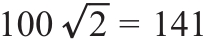。在第三年，产出则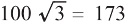。增长率等于每年的产出增长百分比。

10 . 计算过程如下。第 2 年，机器：290；产出：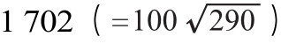。投资=（0.2）×1 702=340，因此消费=1 362。折旧=（0.1）×290=29。第 3 年，机器：601，产出：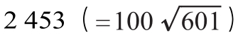。投资=（0.2）×2 453=491，因此消费=1 962。折旧=（0.1）×601=60。

11 . 长期均衡可以通过求解*M* \*求出，即，使得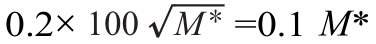。*M* \*=40 000。

12 . 在完整的索洛增长模型中，会用一个参数*a* 替换掉这里的平方根函数，像在柯布-道格拉斯模型中一样，还包括劳动市场。

13 . 为了求出均衡，我们设定投资等于折旧：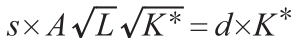。因此，均衡机器数量*K* \*要满足等式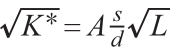。将之代回产出函数，可以求得产出等于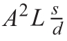。

14 . 经济学家罗伯特·戈登（Robert Gordon, 2016）则采取了一种悲观的看法，认为即将出现的新技术将使得*A* 出现大幅增长。更高级的增长模型将技术视为其他变量的函数。例如，保罗·罗默（Paul Romer, 1986）的模型假设增长源于商品种类的增加：随着经济的增长，产品种类也在增长。经济学家马丁·魏茨曼（Martin Weitzman, 1998）则对思想的产生和组合给出了明确的模型。

15 . 关于技术变革中的滞后，请参见：Arthur, 2011。

16 . 例如，以前从来没有通过固定电话的乡村地区，可以直接建造无线基部并提供手机服务。亚历山大·格申克伦（Alexander Gerschenkron, 1952）将这种现象称为“后发优势”。

17 . 皮凯蒂（2014）揭示，从 1700 年到 2012 年，世界 GDP 的年平均增长率仅为 1.6%，而且这种增长中的一半是来自人口增长。将 72 法则应用于这 0.8%的年增长率，我们可以发现，在 300 年的时间内，平均生活水平提高了大约 10 倍。

### 09　与价值和权力有关的模型

1 . 这个值是这样计算出来的：将桨手能够增加价值的概率 1/6 乘以桨手能够增加的价值的期望值（后者等于 4/5×10 再加 1/5×2）。同时注意到，夏普利值的总和为 10，也就是这个博弈的总价值。

2 . 正式的计算过程如下：在阿伦的 6 个想法中，只有两个是他独有的，一个是贝蒂也提出来的，3 个是每个人都提出来的。如果他是最先进入的那个人（这个事件发生的概率为 1/3），那么增加的价值为 6。如果他是第二个进入的，那么能够增加两个独有的想法，这两个想法都是其他人所不知道的；而且，在贝蒂和卡洛斯进入之前，他还有 1/2 的机会再增加一个想法。所以，他总共增加了 2.5 个想法。如果他是第三个进入的，那么他可以增加两个他独有的想法。因此，他的夏普利值等于 3.5。贝蒂提出了 4 个与另外一个人共同的想法、3 个与所有人共同的想法。因此，她的夏普利值等于 3。最后，卡洛斯提出了 3 个与另一个人共同的想法以及 3 个与所有人共同的想法，所以他的夏普利值等于 2.5。需要特别注意的是，夏普利值的总和为 9，即所有想法的总数。

3 . 衡量投票权力的另一种方法是，班茨哈夫-彭罗斯指数（Banzhaf-Penrose index）。它的计算方法是，根据所有可能的获胜联盟确定所有可能成为“关键投票者”的政党的数量，而赋予一个政党的值就等于它发挥关键作用的次数的值除以这个数字。请参见：Banzhaf, 1965。

4 . Groseclose&Snyder, 1996.

### 10　网络模型

1 . 对网络模型的全面讨论，请参见：Newman, 2010；想要了解网络模型在社会科学领域的应用，请参见：Jackson, 2008；Tassier, 2013。

2 . 给定任何一个节点，它的最小路径长度可以为 1 到 4 个节点，也可以为 2 到 4 个节点，还可以为 3 到 4 个节点，由此，从每个节点开始的最小路径共有 12 个节点。平均而言，节点的最小路径是访问另一个节点。由此可以得出，每个节点的平均介数等于 1/12。根据对称性，所有节点必定都具有相同的介数。

3 . 关于社区探寻算法的更多细节，请参见：Newman, 2010。由于可能性的数量不同，用这些算法构造出来的分区可能有所不同。具有 100 个节点的网络可以用超过 1.9 亿个不同的方法进行分区。删除边的次序的随机性，相同的算法通常也会产生不同的分区。通过应用多个算法并多次应用每个算法，就可以增强推理的鲁棒性。

4 . 根据中心极限定理，我们知道度是正态分布的，并且其均值为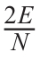，因为每个边连接两个节点。

5 . Watts&Strogatz, 1998.

6 . 关于网络形成的正式分析，请参见：Newman, 2010。

7 . Ugander et al., 2011。

8 . 给定一个具有*N* 个人的网络，令*d* * [i] * 表示节点*i* 的邻居的数量，即度。平均度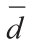可以表示为如下形式：

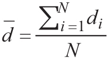

平均度等于这个节点的期望邻居数。而在计算邻居的邻居的平均数量时，度为*d* * [i] * 的节点会被“数上”*d* * [i] * 次，即，每个邻居一次。因此，节点的邻居的邻居的总数*N* [2] 可以表示如下：

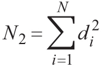

因此，为了求得一个节点的邻居的平均度，我们必须用这个数除以邻居的总数，得出的结果为*N* 。因此，只要证明下式就足够了：

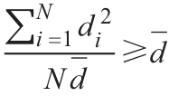

而它可以重写为

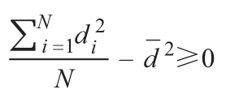

左边的项等于度分布的方差。如果任意两个节点具有不同的度数，那么度分布就具有正的方差，因此，节点的邻居的平均度，超过节点的平均度。

9 . Eom&Jo, 2014.

10 . Dodds、Muhamad&Watts, 2003.

11 . Newman, 2010; Jackson, 2008.

12 . Granovetter, 1973.

13 . 四度朋友的数量是通过对如下 8 组节点求和来计算的：CRCR=4 000 000，CRRC=4 000 000，RCRC=4 000 000，CRRR=800 000，RCRR=800 000，RRCR=800 000，RRRC=800 000，RRRR=160 000。

14 . Albert、Albert&Nakarado, 2004.

15 . Groysberg, 2012．条纹模型可以解释它们为何无法成功回归均值。

16 . 关于填补结构洞的人的价值，请参见：Burt, 1995。

17 . 关于对教师网络的影响，请参见：Frank et al., 2018。

18 . 具有非零价值的联盟是{A，B}、{B，C}和{A，B，C}。在前两个联盟中，每个联盟的价值都等于 10。第三个联盟的附加价值等于-6。第三个联盟的独立价值等于 14，但是这个联盟是由两个联盟组成的，每个联盟的价值都是 10。因此，联盟的价值等于 14 减去 20：-6=（14-10-10）。然后，我们可以为每个联盟中的每个博弈参与者分配如下夏普利值：联盟{1，2}：博弈参与者 1 为 5，博弈参与者 2 为 5；联盟{2，3}：博弈参与者 2 为 5，博弈参与者 3 为 5；联盟{1，2，3}：博弈参与者 1 为-2，博弈参与者 2 为-2，博弈参与者 3 为-2。对这些值求和，就可以得到迈尔森值。

### 11　广播模型、扩散模型和传染模型

1 . 这些模型都假设了离散的时间（步长），例如，天或周，并使用差分方程来描述“明天”被感染（或变得知情）的人的数量与“今天”被感染（或变得知情）的人的数量之间关系。连续时间模型则需要运用微分方程和微积分。但是，如果改用连续时间模型，那么结果从定性的角度来看不会有所不同。

2 . 将第一个方程式插入第二个方程式，可以得出：36 000=20 000+20 000-*P* [broad] ×20 000，进一步化简为 4 000=*P* [broad] ×20 000，所以我们有：*P* [broad] =0.2，以及*N* [POP] =100 000。

3 . Griliches, 1988.

4 . 假设，每个应用程序的初始销售量（*I* ）等于 100。一开始，设定*P* [diffuse] =0.4，同时 POP=1 000。第三期的新销售量等于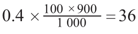。与此类似，我们可以计算出未来各期的销售数据。对于第二组数据，令*P* [diffuse] =0.3，POP=100 000。第二期的新销售量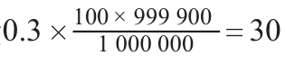。用同样的方法，可以求得后续各期的销售量。

5 . 巴斯把率先采用某种技术或购买某种产品的人称为“创新者”，而把跟着这样做的人称为“模仿者”（Bass, 1969）。

6 . 对*R* [0] 的正式推导始于这样一个观察结果：当感染者的人数很小的时候，易感者的数量大体上相当于相关人群的数量。因此，为了减少变量的数量，我们可以用相关人群的数量代替易感者的数量。然后，我们可以将感染者人数的变化写成最初感染者人数的线性函数的形式（见正文中的专栏）。对*R* [0] 的正式推导过程如下。当出现了一种新的传染病时，它最初只会感染少数人。我们用*I* [0] 表示这个很小的感染者的数量。将之代入 SIR 模型，第一期中感染者的数量等于：

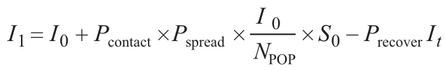

以*N* [POP] 为*S* [0] 的近似，上面这个式子就变为*I* 1=*I* 0+*P* [contact] ×*P* [spread] ×*I* 1−*P* [recover] *I* 1。由此我们可以推出，感染者的人数将上升，当且仅当*P* [contact] ×*P* [spread] >*P* [recover] ，而这又等价于下式：

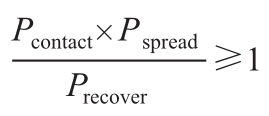

7 . 强制隔离会使接触的概率降低到接近零的水平，从而有效降低基本再生数，但是成本很高。在 20 世纪初，结核病（*R* [0] ≈3）在美国每年都会导致超过 10 万人死亡，各州都不得不加征财产税，以建立强制性的疗养院以收容隔离病人，因为手术治疗如摘除肺叶和整个肺，甚至往肺部空洞处塞入乒乓球，但最终全都被证明是无效的。请参见：Dubos, 1987。

8 . 为了求疫苗接种阈值，我们需要对 SIR 模型进行一些修正，以便容纳接种了疫苗的人群。一种传染病要得到传播，感染者必须与未接种疫苗的人（概率为（1-*V* ））接触（接触概率为*P* [contact] ），并且传染病必须是会扩散的（*P* [spread] ）。第一期的差分方程可以写为如下形式：

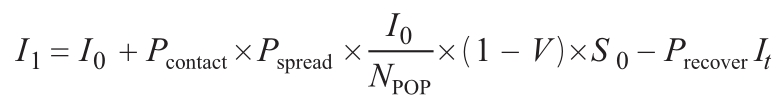

运用近似值*S* [0] =*N* [POP] （就像在推导*R* [0] 时一样），上式就可以改写为：

*I* [1] =*I* [0] +*P* [contact] ×*P* [spread] ×*I* [0] ×（1-*V* ）-*P* [recover] *I* [t] 

当且仅当*P* [contact] ×*P* [spread] ×（1-*V* ）>*P* [recover] *I* [t] 时，感染者的人数才会增加。这个不等式可以重写为*R* [0] （1-V）≤1。展开并重新排列各项，我们有*R* [0] -1<*V* ×*R* [0] 。只要两边同时除以*R* [0] 就可以得到我们想要的结果。

9 . 关于从社会科学角度对 SIR 模型和群体免疫力的更详尽的分析，请参见：Tassier, 2013。

10 . Stein, 2011.

11 . Updike, 1960.

12 . Tweedle&Smith, 2012.

13 . Lamberson&Page, 2012b.

14 . 数据源自网络。

15 . Christakis&Fowler, 2009.

16 . 对此，达蒙·森托拉（Damon Centola）和迈克尔·梅西（Michael Macy）（2007）称之为复杂的传染病（complex contagion）。

### 12　熵：对不确定性建模

1 . Smaldino, 2013.

2 . 数字*x* 的以 2 为底的对数必定等于使 2 产生*x* 的幂，因此 log[2] （4）=2，且 log[2] （2* ^N * ）=*N* 。在一般情况下，log* [a] * （*x* ）等于使*a* 产生*x* 的幂。因此，如果*a* * ^y * =*x* ，则 log* [a] * （*x* ）=log* [a] * （*a* * ^y * ）=*y* 。

3 . 我们可以将信息熵写成如下的长形式：

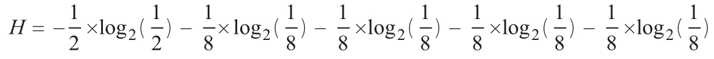

这个式子可以化简为：

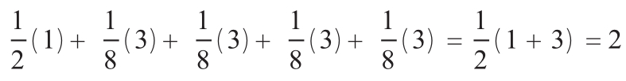

4 . 多样性指数，即，概率的平方和的倒数，可以满足前两个公理以及乘法公理。以多样性指数来衡量，已知结果的多样性等于 1。请参见：Page, 2007、2010a。

5 . Wolfram, 2001; Page, 2010a.

6 . 亚历山大总共列出了 15 个这样的属性。他将自己的想法，再加上很多精英的照片集结成册，自行出版了 4 本精美的书：《秩序的本质，第 1 册：生命现象》（*The Nature of Order, Book 1: The Phenomenon of Life* ）（2002）、《秩序的本质，第 2 册：创造生命的过程》（*The Nature of Order, Book 2: The Process of Creating Life* ）（2002）、《秩序的本质，第 3 册：生活世界的愿景》（*The Nature of Order, Book 3: A Vision of a Living World* ）（2005），以及《秩序的本质，第 4 册：流光溢彩的大地》（*The Nature of Order, Book 4: The Luminous Ground* ）（2004）。这 4 本书中，第 2 册与我们这里讨论的主题的关系最密切。

### 13　随机游走

1 . 欲了解更多关于随机游走的知识，请参见：Mlodinow, 2009。

2 . Taleb, 2001.

3 . Turchin, 1998; Suki&Frey, 2017.

4 . 需要注意的是，大数定律说明平均比例是收敛的，而中心极限定理则告诉我们白球比例的分布是正态的。

5 . 一位三分球命中率为 46%的篮球运动员连续投中 9 个三分球的概率大约为 1/1 000（0.46⁹ ）。如果这个篮球运动员一直继续投三分，那么在 10 年的 NBA 生涯中（总共参加大约 800 场比赛），一次都做不到三分球 9 投 9 中的概率大约为 47%（0.999⁸⁰⁰ ）。

30 多年来，统计学家一直在争辩，篮球运动员和其他职业运动员是不是真的会出现“热手效应”，或者换句话说，任何一次投篮或罚球命中的概率是否与前一次的成功相关。请参见：Chance, 2009。他分析了乔·迪马吉奥（Joe DiMaggio）的 56 场比赛连胜纪录。在考虑“热手效应”的证据时，我们必须考虑到行为。如果一名篮球运动员认为自己的手感很好，那么可能会尝试更加困难的投篮。此外，如果防守方觉得对方哪个运动员手感太好，他们就会收紧对他的防守。这些行为反应在模型中可以通过加大难度来体现。特沃斯基等人没有发现可以证明“热手效应”的证据。乔舒亚·米勒（Joshua Miller）和亚当·圣胡尔霍（Adam Sanjurjo）（2015）则在以往的研究中的条件概率计算中发现了一个推理错误，进而证明以前那些声称没有发现“热手效应”的研究实际上支持了“热手效应”假说。以前研究的这种误差源于采样技术中的缺陷。这些研究收集了多名（例如）篮球运动员投篮命中和不中的序列；然后再计算随机选择的多次投篮后某次投篮命中的概率。这种采样程序会引入一种微妙的统计偏差。

为了说明这种偏差，不妨考虑如下这种情况：多名篮球运动员每人只投篮 4 次，而且每次投篮都有相同的命中概率，这样就有 16 种可能的投篮命中和未命中的序列。我们用 B 代表投篮命中，用 M 代表投篮不中。在这 16 个序列中，有 6 个是连续两次命中后再接着投篮一次产生的，它们是：BBBB，BBBM，MBBB，BBMB，BBMM 和 MBBM。这些都是连续两次投篮命中后再投第三次篮的情形。如果抽到了 BBBB，那么无论选择哪一个由两个 B 组成的序列，那么接下来再投篮命中的概率都等于 100%。如果选择了 MBBB，那么 B 跟着 BB 出现的概率也等于 100%。但是，如果选择了 BBBM，那么 BB 之后出现 M 的概率等于 50%。最后，如果选择的是 MBBM、BBMB 或 BBMM，那么 M 必定会在 BB 之后出现。求这 6 种情况的平均值：

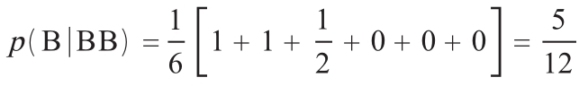

之所以会产生偏差，是因为在序列 BBBB 中，有两个 BB 可以选择，但是在其他序列中，则只有一个（例如，BBMB）。前述采样程序使得 BBBB 的这两个子序列中的每一个被选中的概率都仅为 BBMB 中的那一个子序列的一半。这种偏差的含义是，如果不存在“热手效应”，那么这种采样程序就已经证明投篮命中后再投篮时更有可能不中。当然事实并非如此，而这就意味着投篮命中之后再投篮实际上更有可能命中。

6 . 麦道夫几十年来一直宣称自己的客户每月的回报率为 1.5%。他声称，无论市场大环境（“大盘”）如何变化，他的投资每个月都在升值。在经济衰退期间维持正收益，要比表现优于市场更加困难。当市场下跌时，一个人即使战胜了市场也仍然可能会出现负收益。整体市场下跌了 80 多个月，但是麦道夫却一直声称自己实现了正收益。如果我们愿意冒风险做出一个“英勇”的假设：即使在大盘下跌的时间超过 3/4 的情况下，麦道夫也能以某种神奇的方法取得正收益，那么他连续 80 期成功的概率大约为十亿分之一（0.75⁸⁰ ）。

7 . 只要了解到，一个随机游走的值是相同的、独立的随机变量的总和，我们就可以求解标准差。每个随机变量的均值都为零，而且取值为+1 或-1。因此，每个都具有 1 的标准差。设置*σ* =1 并且对所得到的总和应用西格玛平方根公式，就可以得出结果。

8 . Newman, 2005.

9 . Levinthal, 1991; Axtell, 2001.

10 . Newman, 2005; Sneppen et al., 1995.

11 . 湖泊是按面积计算的。我们的模型产生幂律直径。面积等于直径平方的常数倍，因此面积也将是幂律分布的。具体数据请参见：Downing et al., 2006。

12 . 在平衡的轮盘赌轮上，所有间隔都应有相同的可能性。如果桌子有任何倾斜，那么球在上坡时更可能从外缘掉落。关于多恩·法默、诺曼·帕卡德（Norman Packard）和他们的朋友通过“可穿戴计算机”，利用这个现象并击败轮盘赌的故事，请参见网络。

13 . *N* 次投注后，这随机游走的期望值等于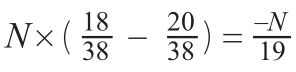。由于获胜的概率大约为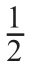，我们可以将这个值的标准偏差近似为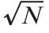。确切的值则等于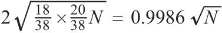。

14 . L.皮尔（L. Peel）和 A.克劳塞特（A. Clauset）（2015）将每个博弈模型化为一个单个序列，并发现得分序列表现出了反持续性：上次得过分的队伍不太可能接下来马上得分。鉴于球队交替发动进攻，这个结果应该是预料之中的。

15 . Baxter, 2009.

16 . 这个结果的证明需要先计算在*N* 个步骤内返回起点的概率，然后把所有可能的*N* 的结果都加总起来。

17 . Samuelson, 1965.

18 . Grossman&Stiglitz, 1980.

19 . Lo&MacKinlay, 2007.席勒（2005）证明，市盈率相对较低的股票的表现优于市场。

20 . Mauboussin, 2012.

21 . 从 1967 年到 2017 年的这个窗口期恰好正逢标准普尔 500 指数上涨周期。在大多数窗口期，股票价格增长速度高于经济整体的增长速度。

### 14　路径依赖模型

1 . Hathaway, 2001.

2 . Pierson, 2004.

3 . Bednar&Page, 2007、2018.

4 . Page, 2006.

5 . 这里是我在 2006 年给出的一个证明概要。显然，只要证明在前*N* 期抽取出*K* 个白球的概率等于 1/（*N* +1）即可。存在（*N* +1）种可能性，因为*K* 最小可以取零值，最大则可以等于*N* 。*N* 个周期中抽取出给定*K* 个白球序列的概率可以写为*N* 个分数的乘积。这些分数的分母分别是数字 2 到*N* +1。分子分别为数字 1 到*K* （白球）和 1 到（*N* -*K* ）（灰球）。分子的乘积等于*K* ！乘以（*N* -*K* ）！而分母的乘积则等于（*N* +1）！。通过这个计算，就可以给出*K* 个白球的特定序列的概率。在*N* 个期内排列*K* 个球的可能方式的数量等于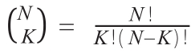。因此，正好抽取出*K* 个白球的总概率等于

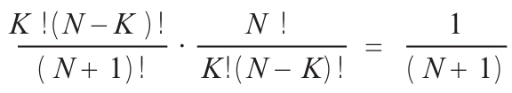

6 . 我们用反证法来证明，假设结果不成立。从长期看，60%的结果是白色的，因此，瓮中 60%的球将是灰色的。但是，这又意味着 60%的结果将是灰色的。于是，出现矛盾，原命题得证。

7 . 要想了解更多依赖用熵来度量不确定性的模型，请参见：Lamberson&Page, 2012b。

8 . Lamberson&Pag, 2012b.

9 . Page, 1997.

10 . 风险价值也可以用年内任何时候损失超过 10 000 美元的概率来计算。

11 . 这些计算依据的是以下事实：长度为*N* 的随机游走的值的标准差等于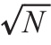。2.5%对应于两个标准差。

### 15　局部互动模型

1 . 在物理学中，局部多数模型通常称为伊辛模型（Ising model）。局部多数模型是投票者模型的一个变体。投票者模型假设了随机选择各种规模的邻居。请参见：Castellano、Fortunato&Loreto, 2009。

2 . 对于沿 4 条边的元胞，我们将顶部的边连接到底部的边，创建出一个圆柱体，然后将左侧的边连接到右侧的边，创建出一个圆环。

3 . 在局部多数模型的另一个版本中，元胞可以被同时激活，或者根据更新的动机来激活，其中处于相反状态的最大多数邻居元胞最先移动。如果元胞同时更新，局部多数模型可以生成循环。

4 . 关于起立鼓掌的模型，请参见：Miller&Page, 2004。

5 . 关于包括了跨域行动一致性的文化模型，请参见：Bednar et al., 2010。

6 . 在这里，也是先将顶部连接到底部创建出一个圆柱体，然后连接两端以形成一个“瘦小”的圆环。

7 . 有一类称为扩散反应的模型也会在较窄的形状上产生条纹，并在较宽的形状上产生斑点。使用这些模型，科学家可以预测哪些动物会有条纹，哪些动物会有斑点，哪些动物会是纯色。答案取决于在发育阶段的哺乳动物胚胎的大小，即在模式形成时的大小，而不是成年动物的大小。否则，大象就会有斑点。请参见：Murray, 1988。

8 . 我要感谢伯纳多·休伯曼（Bernardo Huberman）提供给我这个比喻。

9 . 要证明这一点，需要编写一个计算机程序。这个程序能够生成随机数字序列或随机模式，并证明生命游戏模仿了计算机程序。正式的证明需要说明生命游戏在元胞自动机的集合中是通用的。请参见：Berlekamp、Conway&Guy, 1982。

10 . Dennett, 1991; Hawking&Mlodinow, 2011.

### 16　李雅普诺夫函数与均衡

1 . Nagel, 1995.

2 . 我要感谢珍娜·贝德纳，她提供了关于逐底竞争的几个例子，除此之外，她还提供了本书的很多个例子。

3 . Page, 2001.

4 . 外部性（即便是负外部性）的存在，不能排除构建李雅普诺夫函数的需要。局部多数模型和路径选择模型都包含了负外部性。在局部多数模型中，当一个元胞改变了自己状态时，它会对处于相反状态的邻居施加负外部性。然而，它与现在匹配的邻居产生的正外部性更大。

5 . Guy, 1983.如果你够大胆，那么就从 27 开始试一试。

### 17　马尔可夫模型

1 . 正式的研究论文需要利用统计技术更准确地估计转移概率并计算出误差范围。它还要检验转移概率在那个时间段内是不是保持不变的。如果转移概率取决于人均收入，那么就不会。请参见：Przeworski et al., 2000。

2 . Flores&Nooruddin, 2016.

3 . Tilly, 1998.

4 . 采用瓷砖的人的均衡百分比等于从油毡转移到瓷砖的概率除以从油毡转移到瓷砖的概率与从瓷砖转移到油毡的概率的总和。这就等于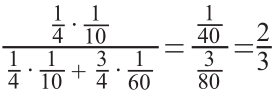。我们还可以写出如下更一般的模型。令 D 表示拥有昂贵的耐用品的人的百分比，C 表示拥有更便宜的商品的人的百分比。再令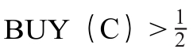表示有人购买更便宜的商品的概率。令 REPLACE（C）和 REPLACE（D）表示更换两种产品的概率。如果以下不等式成立：

REPLACE（C）×1-BUY（C）>REPLACE（D）×BUY（C）

那么会有更多的人买更便宜的商品，但是同时更多的人拥有耐用品。根据假设，命题的第一部分显然成立。为了证明第二部分，我们要先解出转移概率。某个人从 D 移动到 C 的概率是*P* （D，C）=REPLACE（D）×BUY（C）。与此类似，某个人从 C 移动到 D 的概率是*P* （C，D）=REPLACE（C）×1-BUY（C）。在均衡状态下，D-D×P（D，C）+C*P* （C，D）=D。设定 C=（1-D），我们得到。如果*P* （C，D）>*P* （D，C），那么上式大于 0.5。这个不等式与 REPLACE（C）×1-BUY（C）>REPLACE（D）×BUY（C）是等价的。

5 . McPhee, 1963; Ehrenberg, 1969.他们给出了一些证明双重危险的经验证据。为了证明这个结果，我们只需要证明消费者在转换品牌时会以同样的概率购买任何一种产品。

6 . Briggs&Sculpher, 1998.

7 . Schrodt, 1998.

8 . Khmelev&Tweedie, 2001.

9 . Khmelev&Tweedie, 2001.

10 . Reynolds&Saxonhouse, 1995.

11 . 请参见网络。

12 . 巧妙构建此类模型的关键在于，定义有用的状态并分配准确的转移概率。请参见：Langville&Meyer, 2012。

13 . 在食物链中，一个物种与它所消费的物种相连。请参见：Allesina&Pascual, 2009。

14 . Russakoff, 2015.

### 18　系统动力学模型

1 . Sterman, 2000.

2 . 关于定性系统动力学模型的价值分析，请参见：Wellman, 1990。

3 . 这个模型假设所有野兔都是因被狐狸吃掉而死亡的。为野兔的其他死亡方式增加变量，只会使模型复杂化，但不会改变其结果，因为这样做其实只降低了现在这个模型中野兔增长率的取值范围。这里的符号表示每单位时间内*H* 的变化率，换一种写法是。当野兔和狐狸数量的变化率都等于零时，即时，均衡就实现了。为了求解均衡，取方程*gH* -*aFH* =0，然后两边同时除以*H* ，可以得到*g* -*aF* =0。解出*F* 就可以得到结果。接下来，再取方程*bFH* -*dF* =0，然后两边同时除以*F* ，可以得到*bH* -*d* -0。求解*H* 就可以得到结果。

4 . 我要感谢多伦多大学的迈克尔·赖亚尔（Michael Ryall），他提供了这个例子。

5 . 对于这个模型的相关结果的总结，请参见：Meadows et al., 1972。

6 . 这套模型就是通常人们所称的“罗马俱乐部”模型。戴维·洛克菲勒（David Rockefeller）于 1968 年创立的罗马俱乐部，资助了围绕这些模型的研究，并推广了这些模型的发现。

7 . 通过对变量在更小范围内进行操纵，约翰·米勒还可以将模型的预测推向近 300 亿。请参见：Miller, 1998。

8 . Hecht, 2008；MacKenzie, 2012.

9 . Sterman, 2006.

10 . Glantz, 2008.

### 19　基于阈值的模型

1 . Granovetter, 1978.

2 . 爱彼迎创始人采取的方法是，在 2008 年美国总统大选期间，开发出了奥巴马奥氏（ObamaO's）和船长麦凯恩氏（Cap'n McCain's）谷物早餐，然后挨家挨户上门推销。

3 . 关于旋转门模型，请参见：Jacobs, 1989。实证研究表明，在几乎不需要接受传统“正规”教育的职业中（例如调酒行业和园艺行业），当某个工作场中女性员工的比例占到了 15%时，男性就会选择离开（或选择不进入），请参见：Pan, 2015。

4 . Syverson, 2007.

5 . Gammill&Marsh, 1988.

6 . Easley et al., 2012.

### 20　空间竞争模型与享受竞争模型

1 . Clark、Golder&Golder, 2008.

2 . 关于对法律立场的分析，请参见：Martin&Quinn, 2002。

3 . 霍特林（1929）研究了地理区位决策。凯尔文·兰开斯特（Kelvin Lancaster）（1966）扩展了霍特林的模型，用来研究经济选择之间的享受竞争；唐斯（1957）则将这个模型应用于政治学研究。

4 . 提名分数模型提供了一种更复杂的方法来分配意识形态立场，但是所依据的基本思想是一样的，请参见：Poole&Rosenthal, 1985。

5 . 选择常数项（表达式中的*C* ）时，要让所有收益均为正。为了实现这一点，可以将它设定为任何理想点和可选点之间的最大可能距离。

6 . 在以这种方式构建分割线时，我们假设消费者赋予这两个属性的权重是相同的，也可以将权重不同的情况包括进来。如果人们认为含糖量比可可含量更重要，那么我们会以逆时针的角度倾斜这条分割线。而在极端情况下，如果（例如）人们只重视含糖量一个属性，那么分割线将是水平的，并且会在垂直轴上均匀地划分 A 和 B。空间模型提供了一个清晰的例子，说明我们应该怎样将直觉——在这里直觉是我们更喜欢且更接近我们的理想的东西，转换为正式的模型。一旦将备选方案（巧克力棒）和消费者的理想点在空间上画出来，并根据它们与理想点之间的距离来定义偏好排序（将备选方案从最优到最差排列好），我们事实上就已经根据这些备选方案给出了一个效用函数了。一种产品的效用等于它与理想点之间的距离的倒数。

7 . Havel, 1978.

8 . Martin&Quinn, 2002.

9 . McCarty, 2011.这些百分比可能会随着对党派忠诚度的变化或者提交投票的法案类型的变化而改变。

10 . 从形式上说，如果我们假设选民的人数为奇数并且在二维中位数上存在一个选民理想点，那么这个条件就要求通过二维中位数的任何一条线都会将剩下的选民理想点划分为两个大小相等的集合。请参见：Plott, 1967。

11 . 理查德·麦凯尔维（Richard McKelvey, 1979）证明，连续进行一系列投票，会导致具有两个维度或多个维度的任何一个政策都有可能会被选中，从而导致“混乱结果”的发生。不过，麦凯尔维谨慎地声明，他这个结论只针对给定偏好下可能产生的结果序列，而不是对系列投票会发生什么事情的预测。也请参见：Kollman、Miller&Page, 1997；他们给出了多维空间模型的一个计算版本，在那个版本中，候选人在各种行为假设下会移动到中心位置。

12 . 提议者可能不得不提议 41。

13 . McCarty&Meirowitz, 2014.他们对这个模型以及应用于政治学领域的其他博弈论模型进行了更加深入的分析。

14 . 关于拥有否决权的投票者的影响的进一步的分析，请参见：Tsebelis, 2002。

15 . 有一项关于洛杉矶房价的研究估计，通勤成本大约为每小时 28 美元；请参见：Bajari&Kahn, 2008。

16 . 这里的计算过程如下。初始收入等于价格乘以数量，我们可以将它写成*p* ×*q* 。在稀疏的市场中，价格下跌后，收入下降 10%，销售额增加 8%，因此收入等于 0.9*p* ×1.08*q* =0.972*p* ×*q* 。而对于拥挤的市场，价格下跌后的收入等于 0.9*p* ×1.33*q* =1.197*p* ×*q* 。

### 21　博弈论模型

1 . 正式模型以及相关证明如下。令*E* * [i] * 表示博弈参与者*i* 的努力水平。如果胜出，那么博弈参与者*i* 获得的收益等于*M* -*E* * [i] * ，否则为-*E* * [i] * 。假设博弈参与者胜出的概率等于他在总努力水平中所占的比例，即：

为了求解这个模型的唯一的（对称）纳什均衡，我们考虑这个问题：假设所有其他博弈参与者都选择相同的努力水平*E\** ，博弈参与者*i* 的努力水平是什么。博弈参与者*i* 的收益等于：

这个函数的一阶导数等于：

为了求出最大值，我们令一阶导数等于零，于是可以得出。在对称均衡中，*E* * [i] * =*E* \*。代入上式就可以得出结果。而为了证明一阶导数确实给出了最大值，我们只需检验收益函数的二阶导数是不是为负即可。

2 . 欲了解如何梳理网络效应、以及为什么使用快照数据很难得出关于网络效应的结论，请参见：Shalizi&Thomas, 2011。关于聚类行为和属性的实例，请参见：Christakis&Fowler, 2009。

### 22　合作模型

1 . 请参见 2005 年出版的《科学》杂志创刊 125 周年纪念特刊。

2 . Martin et al., 2008; Biernaskie, 2011。

3 . Zaretsky, 1998.在银行的例子中，如果银行能够赚取大量的地理租金，ATM 会降低它们利润吗？地理租金指，银行可以利用客户无法承担长途跋涉到另外一个城镇的银行办理业务的成本而获得的额外利润。我要感谢西蒙·威尔基（Simon Wilkie）以及其他一些朋友，他们与我一起讨论了这个例子。

4 . 从技术上讲，我们这样说其实是在证明冷酷触发策略是概率性重复囚徒困境博弈中的均衡策略。其他策略，例如针锋相对策略，在与冷酷触发策略配对时，也可以成为均衡策略。

5 . 当另一方博弈参与者采取冷酷触发策略时，选择背叛的博弈参与者在第一个时期内可以获得收益*T* ，但是在未来的任何一次博弈中都只能获得最多为零的收益。如果博弈参与者在每个时间段使用冷酷触发策略，那么在博弈进行的第一期都能获得*R* 的收益。博弈进行两期的概率为*P* ，进行三期的概率为*P* ² ，进行*N* 期的概率为*p* * ^N * ^(\-1) 。因此，期望收益等于：

对的证明如下。假设结果为真，然后对等式的两边同时乘以（1-*P* ），于是右侧等于 1，左侧等于（1+*P* +*P* ² +*P* ³ +…）-（*P* +*P* ² +*P* ³ +…），它也等于 1。

6 . 我们只需要把保持合作时的那个计算过程重做一遍，并使*P* 下降到即可。如果不支持合作，那么，继续以概率为*P* 的博弈进行几期后，再以的继续概率进行博弈，也不能支持合作。

7 . 诺瓦克和卡尔·西格蒙德（Karl Sigmund）（1998）称之为图像评分。另外也请参见：Bshary&Grutter, 2006。

8 . 如果假设它们能够增大鸣鸟的领地，那么这两种形式的攻击都可以映射为背叛。请参见：Godard, 1993。不过，将某些行动映射为具有收益的博弈形式，需要广泛的实地观察。

9 . 其中有四对值得重点阐述。当针锋相对策略与冷酷触发策略配对时，两者会永远合作下去，而且每个博弈参与者的平均收益均为 3。当欺负好人策略与欺负好人策略配对时，前两轮双方都会背叛，然后永远合作，其平均收益略小于 2。当冷酷触发策略与欺负好人策略配对时，冷酷触发策略在第一轮合作、欺负好人策略在第一轮就背叛；在第二轮，双方都背叛；在第三轮和第四轮中，冷酷触发策略背叛和欺负好人策略合作；此后，两者都一直背叛。冷酷触发策略的收益序列可以写成 1，2，4，4，然后一直是 2，因此平均收益为 2^+ 。欺负好人策略的收益序列可以写成 4，3，1，1，然后一直是 2，平均收益正好为 2。当针锋相对策略与欺负好人策略配对时，针锋相对策略在第一轮合作，而欺负好人策略在第一轮就背叛。第二轮双方都背叛。在第三轮中，欺负好人策略合作，但是针锋相对策略继续背叛。在第四轮中，欺负好人策略第二次合作，针锋相对策略恢复合作。此后，双方都永远合作。双方的收益均为一个 1、一个 4、一个 2，以及一直为 3，因此双方的平均收益均为略小于 3。

10 . 事实上，始终合作策略和冷酷触发策略都是被针锋相对策略占优的。无论针对什么策略，针锋相对策略至少与始终合作策略或冷酷触发策略一样好（或更好）。针锋相对策略之所以占优永远合作策略，是因为针锋相对策略不会被始终背叛策略和欺负好人策略所“剥削”。针锋相对策略之所以占优冷酷触发策略，是因为它能够与欺负好人策略合作，因为针锋相对策略能够原谅欺负好人策略的背叛，但是冷酷触发策略却不能。

在一个后来成为经典的著名实验中，罗伯特·阿克塞尔罗德要求各个领域的学者参加一项“锦标赛”——提交用于有一定概率继续进行下去的重复囚徒困境博弈中的不同策略。在学者们提交的 14 个策略中，针锋相对策略表现最佳。然后他又组织了一场，要求大家提交新的策略。这一次有 62 个人提交了各种策略。针锋相对策略再一次胜出。阿克塞尔罗德将针锋相对策略的成功归结为该策略的如下性质：它会合作，又会惩罚，同时它也是宽容的。冷酷触发策略不宽容，因此冷酷触发策略无法重启与欺负好人策略的合作。请参见：Axelrod，1984。表 22-1 没有给出针对所有策略的平均收益，因为那将意味着假设每个策略具有相同的可能性。一个种群可能大多数人都采取针锋相对策略；另一个种群可能包括了很大比例的采取欺负好人策略的人；而第三个种群则可能有很多人采取始终合作策略和始终背叛策略。

11 . 假设，诱惑收益等于奖励收益的 4 倍，即，*T* =4*S* ，而且种群中 5%的人会合作。这样一来，*P* 必定超过。要维持合作，只需要*P* 超过即可。在*T* =4 且*R* =3 的情况下，合作的出现要求，而维持合作则要求。接下来给出一般性的证明。假设在种群中，有*θ* 比例的人采取针锋相对策略（或，冷酷触发策略），比例（1-*θ* ）的人采取始终背叛策略。再假设每个人都要与整个种群中的所有其他人博弈。与针锋相对策略配对的针锋相对策略（或冷酷触发策略）在每一期都能获得*R* 的收益，因而其期望收益为。与始终背叛策略配对的针锋相对策略只能获得-*S* 的回报。而始终背叛策略与始终背叛策略相配对时，双方都只能获得零收益。而且，始终背叛策略与针锋相对策略配对时，始终背叛策略能够获得*T* 的收益。因此，针锋相对策略的平均收益等于，同时始终背叛策略的平均收益则为*θ* ×*T* 。这样一来，当且仅当时，针锋相对策略胜过始终背叛策略。因此，当且仅当下式成立时，针锋相对策略获得更高的收益：

如果*θ* 很小，那么将变得非常大，上述条件很难成立。关于合作的出现比合作的维持更加困难的进一步分析，请参见：Boyd, 2006。

12 . 这个模型，以及对于它的分析，是我们从诺瓦克的论文中借用的（Nowak, 2006）。诺瓦克证明，重复博弈、声誉和亲属选择也能支持合作。

13 . 边缘上的节点会复制表现最好的邻居的行动。根据假设，所有相邻的背叛者获得的收益都等于零。而合作的邻居则可以获得*K* ×*B* -*D* ×*C* 的收益——当且仅当时，这一收益大于零。

14 . 关于群体选择理论的基本概念，请参见：Wilson, 1975。

15 . 对于特劳森和诺瓦克的模型，在这里要简单地介绍一下。将一个由*N* 个人组成的种群划分为*M* 个不同大小的群体。在每个群体中，都应用合作行动模型并为每一个人分配一个表现值。令选中个体*i* 的概率等于*i* 的表现除以所有*N* 个人的表现之和的结果。然后，将这个人的一个克隆体添加到同一个群体中。

如果加入这个克隆体后，该群体的大小超过了阈值，那么就以概率（1-*q* ）随机地从这个群体中的某个个体移除，同时以概率*q* 将该群体分成两个群体，每个成员随机地进入其中一个群体中。为了保持群体的总数不变，再随机选择一个现有群体将之移除。当*M* 很大且群体分裂很少发生（*q* 很小）时，当且仅当成立，合作者的数量就会增加。关于这个模型的更加完整的说明，请参见：Nowak, 2006。

16 . 当敏捷管理的倡导者米歇尔·佩鲁索（Michelle Peluso）成了 IBM 的首席营销官时，她组建了一些相互竞争团队，每一个团队的表现都是其他团队可观察的。然后对表现最好的团队加以奖励（Dan, 2018）。这种类型的敏捷管理实践借鉴了敏捷编程的思想。敏捷编程采用同时推进代码编写、程序测试和与用户互动的方法，取代了标准的按顺序依次推进的瀑布式方法。

17 . 还有一种策略是慷慨的针锋相对，即，一开始选择合作，且只在部分时间惩罚背叛行为。在会出现误差的博弈中，这种策略优于针锋相对策略和“赢则坚持，输则改之”策略。请参见：Rand et al., 2009；Wu&Axelrod, 1995。

18 . Axelrod&Pienta, 2006.

### 23　与集体行动有关的问题

1 . Hardin, 1968.

2 . Diamond, 2005.

3 . Ostrom, 2005; Ostrom、Janssen&Anderies, 2007.

4 . 为了得出社会最优解，假设每个人在公共物品上花费*X* 。整个种群的总效用等于：

对*X* 求导，并令得到的导数等于零，可以得到：

得到*X* =*N* 。

为了求解对称纳什均衡，我们假设其他每个人都为公共物品贡献相同的数额，并将这个数额记为*A* 。令*Y* 表示这个人贡献的数额。于是这个人的效用等于：

对*Y* 求导，并令得到的导数等于零，我们可以得到。重新排列各项并对两边同时取平方，得到*Y* +（*N* -1）*A* =1。在对称均衡中，每个人贡献相同的数额（*Y* =*A* ），因此有。

5 . 哲学家会认为这是功利主义。约翰·罗尔斯（John Rawls, 1971）提出了另一种选择：最大最小原则（maxmin principle）。根据这个原则，理想的社会结果就能最大化最不富裕的人的效用。罗尔斯争辩说，我们应该站在“无知之幕”背后去考虑配置问题。“无知之幕”指我们对自己社会中的地位毫不知情。有了“无知之幕”，我们不知道我们是贫是富、有无名声，也不知道自己拥有多大的能力、会不会受到环境的阻碍。罗尔斯要求对最不富裕的人赋予最大的权重，而功利主义则平等地给每个人赋予权重。

6 . 用*i* 来给这*N* 个人编号。我们可以把第*j* 个人的效用写成如下形式：

为了解出对称纳什均衡，我们假设每一个其他人都为公共物品贡献了数量*A* 。

再令*Y* 表示个体*j* 所贡献的数额。用*I* 表示所有人的共同的收入水平。这样一来，个体*j* 的效用等于：

对*Y* 求导，并令得到的导数等于零，我们可以得到：

重新排列各项，我们有：。在对称平衡中，*Y* =*A* 。从而，遵循。等号双边求平方，可以得到［（1-*α* ）+*αN* ］² =*NY* ，这就意味着，。

7 . Cornes & Sandler, 1996.

8 . 更现实的模型还要假设非线性拥塞成本（也许是*S* 形的）。这种假设能够刻画像道路这样的资源的如下特点：前几位其他用户对个人的利益不会有任何影响，但是到了某个时点上，资源会因过于拥挤而归于无用。

9 . 使用资源的*M* 个人的总效用等于（*B* -*θ* ×*M* ）。对*M* 求导，并令得到的导数等于零，我们可以得到（*B* -2*Mθ* ）=0，求解可得。为了求解纳什均衡，我们将从不使用资源的收益设定为零值。于是，人们会使用资源，直到收益等于外部可选项，即：。

10 . 需要注意的是：我们将最大收益*B* 设定为等于种群规模*N* ，目的是减少变量的数量。为了求解社会最优结果和纳什均衡，我们首先注意到，总效用等于（*N* -*M* ）×*M* +3*N* -（*N* -*M* ）×（*N* -*M* ），从而得到 4（*N* -*M* ）*M* 。对*M* 求导，得 4*N* -8*M* =0。求解可得*M* =*N* /2。于是总效用等于。为了求解均衡，我们要找到一个*M* ，使两个公园的边际效用相等。这种情况在（*N* -*M* ）=3*N* -3（*N* -*M* ）时发生。这个式子可以重写为*N* =4*M* 。将*M* 和*N* -*M* 的值代入效用函数，就可以计算出总效用。

11 . 为了求解均衡消费，只要设定*R* \*=（1-*g* ）（*R* \*-*C* \*）并解出*R* \*即可。

12 . Kurlansky, 1998.

13 . 为了说明为什么变化没有抵消，可以考虑一个两期模型。第一年的增长率为 20%，因此只有 96 个单位的资源（80×1.2=96）。第二年的增长率为 30%，这导致了 98.8=（96-20）×1.3 个单位的资源。如果我们将这两年的增长率互换一下，那么在第一年之后，就会有 104 个单位的资源，而且在第二年之后会存在 100.8=（104-20）×1.2 个单位的资源。

14 . Ostrom、Janssen&Anderies, 2007.

15 . Craine&Dybzinski, 2013.

16 . Ostrom, 2010; Ostrom, 2004.

### 24　与机制设计有关的模型

1 . Ledyard、Porter&Rangel, 1997.

2 . 以帕累托有效为例。考虑 3 个人的以下 4 种收益情况：

{（3，3，4），（9，0，0），（0，8，1），（2，2，3）}

除了（2，2，2）之外，都是帕累托有效的。但是配置（2，2，3）被（3，3，4）占优。

3 . Hurwicz&Schmeidler, 1978.

4 . 第三个竞买人可能出价略高于 60 美元，为了简化分析，假设正好为 60 美元。

5 . 我们在这里给出的证明假设了这些值是均匀分布的，但是这个结果在其他类型的分布下仍然成立。假设其他（*N* -1）个竞买人的出价都是真实价值乘以。如果其他竞买人的价值乘以小于*b* ，那么出价*b* 就将高于另一个竞买人的出价。发生这种情况的概率等于。由此可知，大于所有其他（*N* -1）个出价的概率等于这个值的（*N* -1）次幂。因此，如果竞买人的真实价值为*V* ，则出价*b* 的预期价值等于该价值减去出价的差（*V* -*b* ）乘以*b* 为最高出价的概率。这样一来，就可以将预期价值写为：

为了使上式的值最大化，我们对*b* 求导，并令求得的导数等于零，于是可以得到如下条件：

简化后可以得到这个表达式：*V* （*N* -1）-*Nb* =0，重写为。为了证明出价最高的竞买人付出的价格等于出价第二高的竞买人的出价的预期价值，我们要先注意到，如果从区间［0，1］上的均匀分布中抽取*N* 个随机的值，那么最高出价的预期价值等于。第二高的出价的预期价值则等于。因此，出价最高的竞买人的预期价值等于：

这就等于第二高的竞买人的预期价值。

6 . 罗杰·迈尔森（Roger Myerson）是我的博士生导师，他因这个贡献获得了诺贝尔经济学奖。

7 . 在全支付拍卖中，当竞买人的价值位于区间［0，1］上时，其最优策略可以表示为：拥有价值*V* 的竞买人出价。因此，如果有三个竞买人，那么价值为的竞买人将出价。

8 . 相关的实验证据，请参见 Lucking-Reiley, 1999。相关的 eBay 拍卖实验证据，请参见 Morgan&Hossain, 2006。相关的木材拍卖证据，请参见 Athey、Levin&Seira, 2011。

9 . Ostrovsky、Edelman&Schwarz, 2007.

10 . Page, 2012.

### 25　信号模型

1 . 有关信号如何驱动行为和选择的更多例子，请参见：Simler&Hanson , 2018。

2 . 一个弱者类型的个体发送信号成本等于*MC* 。假设所有*S* 个强者类型的个体都发出了信号，那么收益等于。因此，如果，那么弱者类型个体就不会发送信号。如果他们源于分离的收益，超过了所有*N* 个个体分担信号时的，强者类型更偏好发送信号。从先前的计算可知，使弱者类型的个体不发送信号的最小信号等于。因此，如果我们*M* ，那么弱者类型将不会发出信号。而要让强者类型更偏好发送信号，我们必须保证。上式两边同时除以*B* 并乘以*C* ，就可以得到。这个式子可以简化为（*C* -*c* ）*N* ≥*CS* ，可以改写为*C* （*N* -*S* ）≥*cN* 。

3 . 经济学家迈克尔·斯宾塞（Michael Spence）提出了这种可能性。斯宾塞因提出了一个假设教育没有功能性价值的就业市场模型（Spence, 1973）获得了诺贝尔经济学奖。

4 . 尾羽过大就会影响孔雀的适合度。请参见：Zahavi, 1975。

5 . Bird&Smith, 2005.

6 . Smith&Bird, 2003.

### 26　学习模型

1 . 关于学习的心理学研究，涵盖的背景要比我们在这里所讨论的更加广泛。一个人可以通过学习，了解一个事实，例如阿肯色州的首府在哪里。一个人也可以通过学习，获得某种隐性知识，例如怎样烤面包、修理发动机或编写计算机程序。一个人还可以通过学习，掌握某种知识体系，例如有机化学。

2 . Thorndike, 1911.

3 . Rescorla&Wagner, 1972.

4 . 我描述的这个模型是以下述论著中模型为基础的：Rescorla&Wagner, 1972; Herrnstein, 1970; Bush&Mosteller, 1955; Cyert&March, 1963; Bendor、Diermeie&Ting, 2003; Epstein, 2014。

5 . 对参数*γ* 的选择，必须保证备选方案的权重为正。如果*γ* 超过了最高可能渴望水平与任何备选方案的最小奖励之间差异的倒数，就可以做到这一点。

6 . Bendor&Swistak, 1997.

7 . 如果我们构建出一个有限种群的复制者动态模型，随后的种群是随机选择的，那么就可能无法重新复制出最优备选方案。如果真的是这样，那么复制者动态模型将找不到最优选择，因为它无法将备选方案重新引入到种群中。

8 . Fudenberg&Levine, 1998; Camerer, 2003.

9 . 这个博弈还有一个混合策略均衡，其中 2/3 选择经济型汽车，1/3 选择一个油老虎车。但是，根据我们的学习规则，这种均衡是不稳定的，因此忽略它。

10 . 更正式的表示是，*P* （经济型汽车，1）=0.5，*P* （油老虎车，1）=0.5，收益（经济型汽车，1）=1.5，收益（油老虎车，1）=2，平均收益=1.75。应用复制者方程，我们可以得出*P* （经济型汽车，2）=，以及*P* （油老虎车，2）=\=0.57。

11 . Frank, 1985.

12 . Waltz, 1979; Powell, 1991.

13 . Vriend, 2000.这篇论文分析了类似的收益结构，并将它解释为生产相同产品并同时选择数量的企业之间的竞争。经济学家将这种模型称为古诺竞争模型（Cournot competition model）。

14 . 罗斯-伊雷夫学习模型是通过以下公式更新第*t* 期中的备选方案*k* 的权重*W* （*k* ，*t* ）的：*W* （*k* ，*t* +1）=（1-*r* ）×*W* （*k* ，*t* ）+Δ（*k* ，*t* ，*e* ）。参数*r* 是一个新近度参数（recency parameter）。如果行动*k* 被选中，那么Δ（*k* ，*t* ，*e* ）=（1-*e* ）×收益（*k* ，*t* ）；如果行动*k* 没有被选中，那么Δ（*k* ，*t* ，*e* ）=*e* ×收益（*k* ，*t* ）。参数*e* （实验参数）决定了未被选中的备选方案的权重。

15 . Camerer&Ho, 1999.

16 . 这个分析紧密追随了贝德纳和佩奇（2007，2018）的思路，并借鉴了格雷夫（2006）的模型。贝德纳和佩奇强调了初始行动对于均衡的涌现的重要性，而格雷夫则更侧重于信念的作用。也请参见：Gilboa&Schmiedler, 1995.他们提出了基于案例的决策理论。另外，关于身份在经济选择中的作用，请参见：Akerlof&Kranton, 2010.

17 . 为了证明复制者动态的结果，请注意当且仅当以下情况成立时，按文化规范采取行动才会有更高的收益：

（1-*B* ）×200+*B* ×220>（1-*B* ）×180+300*B* 

重新排列各项，得 20（1-*B* ）>80*B* 。结果得证。

### 27　多臂老虎机问题

1 . 关于这类问题与经济现象的相关性，请参见：Bergemann&Valimaki, 2008。

2 . Hills et al., 2015.

3 . 欲了解多臂老虎机问题的更多技术细节，以及对各种启发式的详细比较，请参见：Scott, 2010。

4 . 吉廷斯和琼斯（1972）率先描述了这些最优规则。可以将吉廷斯指数重新表述为一个贝尔曼方程（Bellman equation）。贝尔曼方程适用于任何通过一系列选择完成、且每个选择都会产生收益的问题。贝尔曼方程依赖于价值函数的构造。该价值函数的值等于收益序列的总和（其中，未来的收益要根据当前利率进行贴现）。

5 . Roberts, 2004.

6 . 请参见杰克·鲍尔斯（Jake Bowers）等人（2017）对美国农业部农场服务机构小额贷款项目的实验分析。

7 . 数据源于 2012 年的《华盛顿邮报》，以及 Dann, 2016。

8 . 如果他们是在位领导人，那么阿尔·戈尔（Al Gore）、乔治·H. W. 布什（George H. W. Bush）和希拉里·克林顿将会因经济繁荣而获得更大声誉。关于较早期的政治选情与经济景气的关系的分析，请参见：Markus, 1988。关于更晚近的证据，请参见：Fair, 2012。关于候选人与政党效应大小的相关证据，请参见：Campbell、Dettrey&Yin, 2010。

### 28　崎岖景观模型

1 . 关于多样性的价值的更加深入的阐述，请参见《多样性红利》一书。

2 . 对 NK 模型更加全面的介绍，请参见：Kauffman, 1993。

3 . 当*N* =20，*K* =19 时，我们可以推导出局部峰值和全局峰值的期望值。每个属性的贡献均匀分布在区间［0，1］上，其均值为、方差为。这个结果只要通过观察均匀分布就可以证明。每个备选方案的价值等于 20 个属性的贡献的平均值。因此，根据中心极限定理，这些值服从均值为、方差为的正态分布。从而，在*N* =20 的情况下，每一个标准偏差的大小为。然后我们可以估计出局部峰值的平均值：0.609。我们可以认为，从这个分布中随机抽取 21 次当中最好的那一次就是一个局部峰值。因此，它的期望值等于近似地从正态分布中抽取出来的、使的备选方案都有较低的值的一个值。它将会比平均值略低两个标准偏差。使用正态分布计算器，可以算出期望平均值等于 0.609。为了估计出全局峰值的期望值 0.759，我们注意到，全局峰值具有所有 2²⁰ 个备选方案的最高值。每个备选方案可以被视为是从该分布中抽出的一个值，因此其期望值等于近似地从正态分布中抽取出来的、使的备选方案都有较低的值的一个值。利用正态分布计算器，可以算出该期望平均值等于 0.759。全局峰值的值，应该比 100 万次抽取的最高值还更高。

4 . Wright, 2001.研究认为这些整合重组有助于人类以及人类社会的出现，也有利于这个时代的技术和科学进步。

5 . Kaufman, 1993; Miller&Page, 2007.他们把复杂性描述为“有趣的中间状态”。

6 . 在美国，如果申请专利后获批的时间超过了 3 年，那么专利保护期为从专利发布日起计算 17 年。

7 . Boldrin&Levine, 2010.

### 结语　像芒格一样智慧地思考——多模型思维的实际应用

1 . 根据正文所述的概率，确切的统计均衡是：无痛状态为 70.7%，阿片状态为 19.5%，上瘾状态为 9.8%。而对于第一种情况，相应的百分比则分别为 76.3%、21.5%和 2.2%。

2 . Wakeland、Nielsen&Geissert, 2015.

3 . 我要感谢艾比·雅各布斯（Abbie Jacobs），她帮助我得到了这个结果。她有所需要的模型和数据。

4 . Wilkinson&Pickett, 2009.

5 . 这是杜尔劳夫在芝加哥大学贝克尔·弗里德曼研究所（Becker Friedman Institute）主办的一次会议上的评论。会议的主题是“了解不平等及其应对措施”，于 2015 年 11 月 6 日举行。

6 . Goldin&Katz, 2008; Acemoglu&Autor, 2011; Murphy&Topel, 2016.

7 . Mas-Colell、Whinston&Green, 1995.

8 . Kaplan&Rauh, 2013a; Jones&Kim, 2018.他们的模型将能力作为企业家创意的可扩展性的代理变量。另请参见：Frank, 1996；该文是关于不同职业中的不平等是如何产生的早期研究。另请参见：Xie、Killewald&Near, 2016。

9 . Ormerod, 2012.

10 . Ormerod, 2012.该文详细描述了日益增强的连通性如何导致了不平等。

11 . Cancian&Reed, 1999; Schwartz&Mare, 2005.

12 . Greenwood et al., 2014.

13 . 估计的结果是 0.34 而不是 0.43。请参见：Greenwood et al., 2014。基尼系数可以衡量收入分布与平均分布之间的距离。令*S* （*P* ）表示收入分布中最底部*P* %的人口所占的总份额（例如，如果位于收入最底部 30%的人口获得了总收入的 2%，那么*S* （30）=2，计算出来的基尼系数为：

如果收入是均匀分布的，即，那么基尼系数=0。如果所有的收入都归于最顶部的 1%，那么对于所有*P* <100，都有*S* （*P* ）=0，且*S* （100）=1，因此基尼系数=1。

14 . 计算可以按如下过程进行。儿童属于四个类别的概率为（0.6，0.25，0.1，0.05）。这也就是说，高收入者的下一代中 60%的人有高收入，中高收入者的下一代中 20%的人有高收入，中低收入者的下一代中 15%的人有高收入，而低收入者的下一代中只有 5%的人有高收入。高收入者的孙子女中有高收入的人的百分比则等于 0.6×0.6+0.25×0.2+0.1×0.15+0.05×0.05=0.4275，低收入者的孙子女中有高收入的人的百分比则等于 0.6×0.05+0.25×0.1+0.1×0.15+0.05×0.7=0.105。

15 . Pfeffer&Killewald, 2017.

16 . Kaplan&Rao, 2013b.