# 从注释里看模型怎么用

## 01 做一个多模型思考者

凯西·欧奈尔在 2016 年的论述里提醒我们，基于数据的简易模型很容易把人口的某些群体漏掉，这一点和第四章讲到的自适应现象是一致的。

帕阿斯克和希勒 1999 年研究林业计件工资提供了一个反直觉的案例。木材厂和林场把植树外包给工人，按棵付钱。原始数据呈现出：计件单价越高，工人种的树反而越少；报酬越高，产量越低。这与常规经济学预期完全相反，按理说单价提升应该激励更卖力。

把模型补全后矛盾就消失了。设每小时体力劳动的机会成本是 20 美元，则有 20 美元 = 每小时种树数 × 每棵树报酬。模型意味着种树越难，时薪越被抬高；一小时能种 10 棵时，单价约 2 美元；一小时能种 20 棵时，单价跌到 1 美元。于是计件工资与产量呈现负相关。更进一步，单价乘以产量应保持不变，这个预测可以被检验。

关于模型优于直觉的证据，可见 Dawes 1979、Tetlock 2005、Silver 2012、Cohen 2013；认知偏差的经典综述是 Kahneman 2011。Slaughter 2017 与 Ramo 2016 也讨论了相关议题。

跨学科的组合价值十分突出。Van Noorden 2015 分析了 3500 万篇论文后发现，长期来看跨学科论文的影响力更高。Jones、Uzzi 与 Wuchty 2008 以及 Wuchty、Jones 与 Uzzi 2007 的研究支持这一点。把专利当作创新的 proxy，也有两条线索。Shi、Adamic、Tseng 与 Clarkson 2009 发现跨类别专利被引更多；Youn、Strumsky、Bettencourt 与 Lobo 2015 证实大多数专利涵盖多个子类别。甚至在引用行为上，社会科学家引用他学科文献的数量已超过本学科。

Box 与 Draper 1987 强调了模型的稳健性。Page 2010a 进一步阐述了多元视角。我在这里并不主张把知识等同于模型，而是说模型能够具象化知识、提供清晰的交流形式。狭义的知识也包括嵌入身体的隐性技能，比如打网球、说法语或讨价还价，关于更广义的知识概念可参见 Adler 1970。

一个量级估算的小例子：高空坠落的跳伞员终端速度约 320 千米/小时。终端速度与质量的平方根成正比。若毛绒玩具猎豹的质量约为人类的 1/400，则平方根为 20，玩具的终端速度大约是 320÷20 ≈16 千米/小时。

另外，弗雷斯诺市的面积比冰岛还大 30%。Eric Baur 和 Joseph LiPuma 2012 讨论了如何把学术教训迁移到商业。Lo 2012 也做了相关梳理。关于同一个故事的不同版本，可在 William James、斯蒂芬·霍金和法学家 Antonin Scalia 的著作中找到。

## 02 模型的 7 大用途

Epstein 2008 对建模动因做了更细的分类。Charles Ragin 和 James March 1975 指出模型可用于解释经验现象、预测新现象以及建造系统，同时主张探索性使用。

Harte 1988 的方法与 Johnson 2014 关于社会科学中模型用途的论文相呼应，这两种做法常被称为伽利略式和极简理想化，见 Weisberg 2007。类比的作用在 Pollack 2014 以及 Hofstadter 与 Sander 2013 中有所展开，侯世达在《表象与本质》里把类比视作思维之火。Schelling 1978、1987 也细化了模型的类别。Daniel Little 的博客《理解社会》提供了社会科学本体论的入门视角。

Arrow 1963 指出在对个人排序施加限制前，集体排序往往不一致。Bickel、Hammel 与 O'Connell 1975 的做法让我想起《嚎叫》里“这是真的发生过的事情”的手法。

网络拓扑的一个例子：左图是 4 个点构成的正方形，边长假设为 1，总边长为 3。右图在中心再加一个第 5 个节点后，各边总长变为 4×0.71，小于 3，说明加节点可以缩短总连线长度。
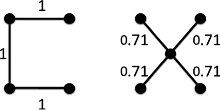
辛普森悖论的典型场景出现在录取率更高的院系男性申请者更多时。设某大学有医学院和兽医学院。医学院申请的男生 900 人，录取 480 人，录取率 53%；女生 300 人，录取 180 人，录取率 60%。兽医学院申请的男生 100 人，录取 20 人，录取率 20%；女生 300 人，录取 90 人，录取率 30%。在每个学院内部女生录取率都更高，但全校汇总男生录取率 50%（1000 人申请 500 人录取），女生仅 45%（600 人申请 270 人录取）。

帕隆多悖论的一个版本是：赌局一总是输 1 美元；赌局二若轮数不能被 3 整除则输 2 美元，能被 3 整除则赢 3 美元。每局单独看都是期望亏损，但策略性地在赢的轮次玩赌局二，其余轮次玩赌局一，每三轮可稳赚 1 美元。

Kooti、Hodas 与 Lerman 2014 提供了相关实证。关于税收的简易计算：设收入为 I，税率 t，减税幅度为 c，收入增幅为 r。减税前收入 I×t，减税后 I(1+r)×t(1-c)，政府收入增加的条件可化为 r > c(1+r)。

Ledyard、Porter 与 Wessen 2000 讨论了市场机制在多维有效载荷问题上的优势。物理学家 Eugene Wigner 1960 用“好得不合情理”形容数学模型在物理科学中的有效性。Ziliak 与 McCloskey 2008 指出社会科学模型在解释变差方面的局限。Porter 与 Smith 2007 也做了类似讨论。

Squicciarini 与 Voigtländer 2015 以及 Mokyr 2002 涉及创新史。美国财政部网站提供了相关数据。20 世纪 90 年代中期，美国俄亥俄州哥伦布市约 60% 的新餐馆后来关闭，没有一家获得政府救助，市场经济本就包含破产，见 Parsa 等 2005。

国际货币基金组织 2009 年《全球金融稳定报告》指出金融机构间的连接强度基于投资组合价值的相关性，尤其在极端事件日。Geithner 2014 记录了危机中的决策。Weisberg 2012 介绍旧金山湾物理模型在政策中的应用。Stone 等 2014 与 Dunne 1999、Raby 2001 也提供了案例。

## 03 多模型思维

Levins 1966 提出多模型的核心思想。Page 2007、2017 进一步发展了该框架。关于群体智慧见 Surowiecki 2006，狐狸与刺猬的比喻见 Tetlock 2005，计算机科学的集成方法见 Patel 等 2011。

Lu 和 Page 2009 证明独立模型需要唯一的分类集合。多样性预测定理的细节见本人的《多样性红利》《多样性与复杂性》等书，经济预测数据参考 Mannes、Soll 与 Larrick 2014。

用四幢平房说明误差分解。用 A、B、C、D 表示，A、B 无录音室，C、D 有录音室。
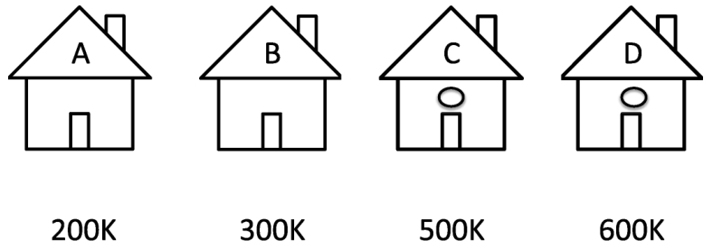
四幢平房及其市场价值

均值 400 000 美元，总变差 = (200-400)²+(300-400)²+(500-400)²+(600-400)² =100 000。若按录音室分类，真实均值分别为 250 000 美元和 550 000 美元，分类误差 = (200-250)²+(300-250)²+(500-550)²+(600-550)² =10 000。若模型预测 A、B 均为 300 000 美元，C、D 均为 600 000 美元，估值误差同样为 10 000。总模型误差 = (200-300)²+(300-300)²+(500-600)²+(600-600)² =20 000，可见总模型误差 = 分类误差 + 估值误差。

Brock 与 Durlauf 2001 的旋转玻璃模型处理二维社会互动，Edward Glaeser 等给出犯罪的一维模型，Drew Fudenberg 与 David Levine 构建了大脑的经济模型。

船舶设计提供了多模型的历史注脚。1858 年 Isambard Kingdom Brunel 设计的 SS Great Eastern 长近 220 米，因缺乏水动力模型而航行性能不佳，后用于铺设跨大西洋海底电缆。West 2017 讨论了多模型思维在船舶设计中的作用。

身体质量指数的例子：LeBron James 身高 6 英尺 8 英寸，体重约 250 磅，BMI 27.5；Kevin Durant 身高 6 英尺 9 英寸，体重 235 磅，BMI 25.2；2012、2016 年奥运会十项全能金牌得主 Ashton Eaton BMI 24.4；2008 年金牌得主 Brian Clay BMI 25.8。Flegal 等 2012 提供了流行病学背景。

尺度定律的直观比较：假设小鼠 3 英寸长、1 英寸高、1 英寸宽，大象 10 英尺高、10 英尺长、5 英尺宽。大象表面积约 400 平方英尺，即 57 600 平方英寸，体积约 500 立方英尺，即 864 000 立方英寸。West 2017 与同事提出新陈代谢随质量的 3/4 次方缩放，与 80 多年前的 Kleiber 定律相近。

Moss-Racusina 等 2012 的简历实验显示，相同简历仅名字改变，女性获得的报酬和评价就低于男性。在晋升概率 50% 对 40% 的假设下，男性成为 CEO 的概率约为连续 15 次晋升，概率比为 (1.25)^15 ≈28.4。Dyson 2004 讨论了相关议题。Breiman 1996 的集成学习为多模型提供了技术基础。

## 04 对人类行为者建模

Haidt 2006 与 Simler 与 Hanson 2018 提供了行为基础。一个预算分配的微积分例：收入 M，食品价格 1 美元，住房服务价格 P[H]，预算约束 M = F + P[H]×H，故 F = M - P[H]×H。效用函数
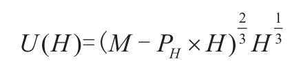
求 H 的最大值，导数为零
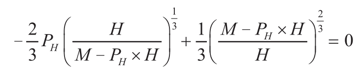
整理后可得 M = 3P[H]×H，即住房支出占收入的 1/3。在美国，这是一个不错的近似。

冯·诺依曼-摩根斯坦定理的要点是：若偏好满足完备性、传递性、独立性和连续性，则可由连续实值效用函数表示。完备性指任意两彩票可比较，传递性指偏好可传递，独立性指混合偏好保持顺序，连续性保证存在概率使人无差异。思路是设定最好结果效用为 1，最差为 0，再用概率标定中间结果，从而把排序转为数字。完整证明见 Von Neumann 与 Morgenstern 1953。

Rust 1987 的离散选择模型是经典应用。Camerer 2003 总结了行为实验。Harstad 与 Selten 2013 讨论了博弈中的学习。Myerson 1999 论证了理性选择作为基准的合理性。Camerer、Loewenstein 与 Prelec 2005 提供了早期综述。Kahneman 2011 的系统性偏差研究贯穿其中。

开放科学协作组织 2015 引发的复制研究显示可复制率约为原研究的 40%，后续研究得到相似比例。关于被试多样性 importance，见 Medin、Bennis 与 Chandler 2010。

# 模型不是答案，而是看世界的透镜

复杂世界里，数学模型像一组透镜。它们帮我们推演“可能发生什么”，也提醒我们：人的判断常常被框架、时间和经验规则牵着走。关键是，透镜有焦距，模型也有边界。

## 一、人不是按公式做决定的

Berg与Gigerenzer对过度数学化的心理模型提出过明确批评，提醒我们别把模型当成真实心理过程的完整复制。前景理论的经典例子很能说明问题：同一种治疗方案，在收益框架下，多数医生会选择肯定能救40%患者的方案A；可一旦换成损失框架，同一事实被表述为肯定有60%患者死亡，多数医生就会转向有50%机会无人死亡、也有50%机会所有人死亡的方案B’。框架一变，选择就变。

双曲贴现则解释了人们为何更看重眼前收益，其公式可以写成更一般的形式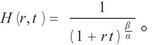。Smith的生态理性强调，要用经验和常识去重建理性：人遵循规则，但未必能清楚说出规则，不过规则本身是可以被发现的。基于方程和规则的模型也假设，行动者在相似博弈中会做出相似行为。

## 二、分布的形状，决定了世界的模样

正态分布是最常见的起点。方差是各数据点与均值距离平方的平均值，可写作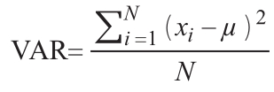；标准差则是它的平方根，即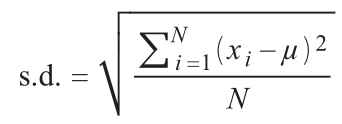。中心极限定理需要满足条件，林德伯格条件比较常见：随着变量数量无限增加，来自任何单一变量的总变差比例会收敛为零。在独立性假设下，一般表达式可写成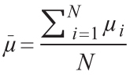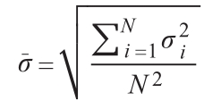，用σ替换σi后得到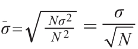。两个标准差对应的5%显著性只是一种惯例，虽然常受批评，却仍是社会科学中最常用的门槛；一个6%显著性水平的大相关系数，可能比4.9%显著性水平的小相关系数更值得注意。

对数正态分布来自随机变量的乘积。把乘积写成10的幂形式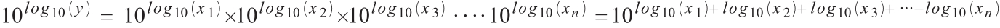，两边取对数后，变量y的对数就变成多个随机变量对数之和；只要这些对数随机变量的方差满足中心极限定理条件，它们的和就会呈正态分布。取对数后的方程可写为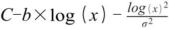。

幂律分布则自带标度不变性：改变衡量单位，分布形状不会变。常数C让所有结果的总概率等于1。恐怖袭击致死概率大体可写成0.06除以x的平方；对于只取整数的离散分布，可写成p(x)=0.608x^(-2)，因为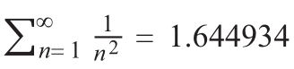。齐普夫词频和排名也遵循幂律：某个事件大于S_R的概率等于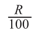；若R=3，则概率为3%，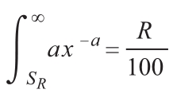，解得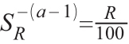，又可改写为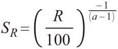；当a=2时，表达式变成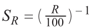。

幂律还意味着长尾：大量小事件合在一起，也能产生与大事件同等规模的经济价值。互联网让零售商能卖大量小众书籍、电影和音乐，一个只卖一本畅销书、卖出500万册的商家，利润可能与另一个卖1万种书、每种只卖500本的商家差不多。里氏震级是对数尺度，6级地震强度是5级的10倍。网络连通性提高，也可能降低失败概率。不过，幂律与对数正态有正式区别；许多曾被认定具有幂律特点的网络，实际上并不是幂律分布。

## 三、从线性到非线性，模型在逼近现实

线性模型常把因变量的对数写成自变量对数的线性和。取对数后，乘式变加式；反过来，也能写成乘积形式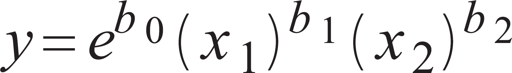。波尔多葡萄酒就是好例子：阿申费尔特用冬季降雨量、收获季降雨量和9月平均温度拟合对数线性模型，R²约83%，比葡萄酒专家更准确地预测价格，甚至能预测专家估值的变化。相关不等于因果；如果两个变量不相关，就不该期待它们之间存在因果关系。支持向量机与回归类似，但目标不同：它把数据分成正负组，寻找最大化到每组最近点距离的直线；若不存在这样的直线，就处罚偏离行为。回归则考虑所有点的距离。

非线性模型更贴近许多现实过程。指数增长中，30次倍增就是2³⁰，超过10亿。学习曲线、巧克力吃多后的厌恶感，都是非线性例子。定投也有趣：价格在20美元到10美元间波动时，你平均每年能买225股，比价格固定时买200股更多。柯布-道格拉斯模型中，指数a与1-a之和为1，意味着工人和资本同时加倍，产出也会加倍。增长模型里，第二年产出可表示为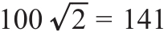，第三年则为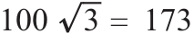；机器与产出的计算涉及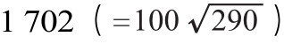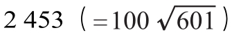。索洛模型的长期均衡可由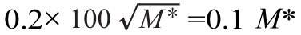求出；设定投资等于折旧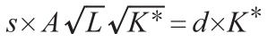，均衡机器数量满足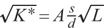，代回产出函数得到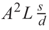。后发优势也很典型：没有固定电话的乡村地区，可以直接建设无线基站并提供手机服务。皮凯蒂的数据显示，1700年到2012年世界GDP年均增长仅1.6%，其中一半来自人口增长；把0.8%的年增长率代入72法则，300年间平均生活水平大约提高10倍。

## 四、价值、权力与连接

夏普利值衡量的是贡献。桨手能增加价值的概率是1/6，乘以期望增加值，总和等于博弈总价值10。想法贡献的例子同样直观：阿伦的6个想法中，2个独有、1个与贝蒂共同、3个所有人共同；他最先进入的概率是1/3，可增加6；第二进入增加2.5；第三进入增加2；夏普利值为3.5。贝蒂为3，卡洛斯为2.5，总和9正好等于所有想法总数。Banzhaf-Penrose指数则从“关键投票者”角度衡量政党权力。网络模型方面，已有全面讨论，社会科学中的应用也越来越广。

这些模型不替我们做决定，而是让我们看见选择背后的结构。模型能阐明可能发生的事，但假设、边界和人的经验同样重要。好的模型，不是给出唯一答案的机器，而是帮我们提出更好问题的透镜。

# 复杂系统笔记：从网络位置到传播曲线，再到“热手”的真相

如果把网络、传染病、信息熵、随机游走和路径依赖放在同一张桌上，会发现它们都在追问同一件事：局部规则怎样长成全局结果。以下是我重读后整理的一份长笔记，建议收藏慢慢看。

## 一、网络里，位置如何被计算

先看最短路径。对任意节点来说，最短路径可能落在1至4个节点的范围，也可能落在2至4个、3至4个的范围；把这些区间合起来，每个起点对应12个节点。平均而言，一个节点的最短路径就是走到另一个节点。于是每个节点的平均介数为1/12；对称性又保证所有节点拥有相同的介数。

社区发现算法也有类似的不确定性。不同算法给出的分区可能不同，因为可划分的方式数量不一样：一个100节点的网络，划分方法可以超过1.9亿种。即便算法相同，删边次序的随机性也会让结果变化。多做几轮、多换几种算法，推理会更稳。

度分布这边，中心极限定理告诉我们度近似正态，其均值为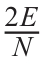，因为每条边连接两个节点。设节点i的度为d_i，平均度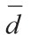可写成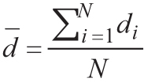；而平均度等于该节点的期望邻居数。计算“邻居的邻居”时，度为d_i的节点会被数d_i次——每个邻居都会数它一次。于是邻居的邻居总数N[2]可表示为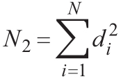；再除以邻居总数，得到N。因此只需证明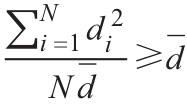，它可改写为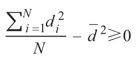。该式左侧正是度分布方差。只要任意两个节点度数不同，方差就为正，邻居的平均度便会高于节点的平均度。

四度朋友的数量，则按八类节点路径求和：CRCR=4 000 000、CRRC=4 000 000、RCRC=4 000 000、CRRR=800 000、RCRR=800 000、RRCR=800 000、RRRC=800 000、RRRR=160 000。

## 二、合作博弈与传播：从夏普利值到疫苗阈值

在一个合作博弈里，非零联盟只有{A,B}、{B,C}和{A,B,C}。前两个联盟的价值各为10；第三个联盟的独立价值是14，但它由两个价值10的联盟拼成，所以附加价值为14-10-10=-6。接着分配夏普利值：{1,2}中参与者1、2各得5；{2,3}中参与者2、3各得5；三人联盟里1、2、3各得-2。把这些值加总，就得到迈尔森值。

传播模型这边，广播、扩散、传染模型都假定离散时间（比如天或周），用差分方程连接“今天”和“明天”；若换成连续时间，需要微分方程和微积分，但定性结论不会变。

先看一个数值例子：把第一个方程代入第二个，得到36 000=20 000+20 000-P_broad×20 000，化简为4 000=P_broad×20 000，所以P_broad=0.2，N_POP=100 000。

扩散模型里，设每个应用的初始销量I=100。若P_diffuse=0.4、POP=1 000，第三期新增销量为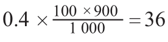；换一组参数P_diffuse=0.3、POP=100 000，第二期新增销量为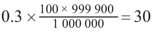；后续各期同理递推。Bass把率先采用技术或购买产品的人叫“创新者”，把跟随者叫“模仿者”。

SIR模型的基本再生数推导，从“感染人数很少”开始：此时易感者数量约等于相关人群，令初始感染者为很小的I0，可把感染者变化写成I0的线性函数。第一期感染人数为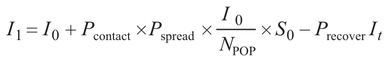。用N_POP近似S0后，式子变为I1=I0+P_contact×P_spread×I1-P_recover×I1。由此，感染者人数上升当且仅当P_contact×P_spread>P_recover，这等价于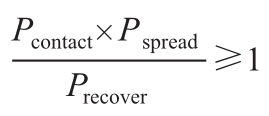。

强制隔离能把接触概率压到接近零，从而有效降低基本再生数，但成本很高。20世纪初，结核病（R0≈3）在美国每年导致超过10万人死亡；各州加征财产税，建强制性疗养院收容隔离病人。手术摘除肺叶、切除整个肺，甚至往肺部空洞塞乒乓球，最终都被证明无效。

疫苗阈值要在SIR模型中加入接种人群。传染病要传播，感染者必须接触未接种者（概率为1-V），接触概率为P_contact，并且疾病会扩散（P_spread）。第一期差分方程可写为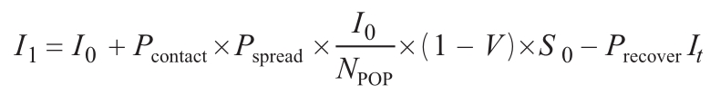。用S0=N_POP近似后，改写为I1=I0+P_contact×P_spread×I0×(1-V)-P_recover×I_t。感染者人数增加的条件是P_contact×P_spread×(1-V)>P_recover×I_t；它可重写为R0(1-V)≤1，展开为R0-1<V×R0，两边除以R0即可得到阈值：V需达到1-1/R0以上。

## 三、不确定性与随机游走：熵、热手与麦道夫

信息熵用二进制对数最直观：log2(4)=2，log2(2^N)=N；一般地，若a^y=x，则log_a(x)=y。信息熵的长形式为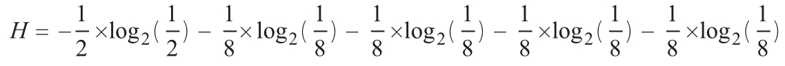，可化简为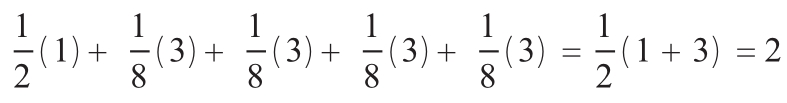。多样性指数是概率平方和的倒数，满足前两条公理以及乘法公理；当结果已知时，多样性为1。亚历山大列出15个属性，并自费出版四卷《秩序的本质》：第1册《生命现象》、第2册《创造生命的过程》、第3册《生活世界的愿景》、第4册《流光溢彩的大地》；其中第2册与这里讨论的主题最密切。

随机游走有两个经典结论：大数定律说平均比例会收敛，中心极限定理说白球比例呈正态分布。再看“热手效应”。一位三分命中率46%的球员，连续投中9个三分的概率约为1/1000（0.46^9）。如果他打10年NBA、约800场比赛，一次都做不到9投9中的概率约为47%（0.999^800）。统计学界为“热手”争论了30多年。行为反应必须计入：球员自认为手热，可能尝试更难的投篮；防守方觉得对方手热，也会收紧防守。特沃斯基等人没有发现支持热手的证据；但Miller和Sanjurjo（2015）指出，旧研究在条件概率计算中有推理错误，修正后反而支持热手。偏差来自采样：先收集多名球员的命中/不中序列，再计算随机选择的多次投篮后下一次命中的概率，这会引入微妙的统计偏差。以每人投4次、16种序列为例，连续两次命中后再投第三次的六种序列是BBBB、BBBM、MBBB、BBMB、BBMM、MBBM；BBBB有两个BB可选，其他序列只有一个，因此BBBB中的子序列被选中的概率只有BBMB中的一半。这个偏差的含义是：若不存在热手，采样程序会推出“命中后更可能不中”；但事实并非如此，所以命中后其实更可能命中。六种情况的平均值为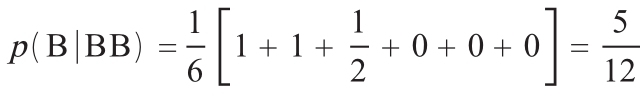。

麦道夫的故事则是另一个方向。他宣称客户每月回报1.5%，无论大盘如何都升值。衰退中保持正收益比跑赢市场更难；市场下跌时，即便战胜市场也可能出现负收益。大盘下跌了80多个月，他却一直声称正收益。即使做一个“英勇”假设：在大盘下跌超过3/4时他也能神奇赚钱，连续80期成功的概率也只有约十亿分之一（0.75^80）。

随机游走的标准差这样求：它是独立同分布随机变量之和，每个变量均值为0、取值为+1或-1，因此标准差为1。令σ=1，对总和套用西格玛平方根公式即可。N次投注后，期望值为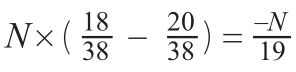；获胜概率约为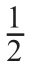，标准偏差可近似为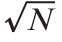，精确值为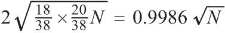。轮盘赌上，平衡轮盘各间隔等可能；桌面若有倾斜，球上坡时更容易从外缘掉落。多恩·法默、诺曼·帕卡德和友人用“可穿戴计算机”利用这一点，击败过轮盘赌。

## 四、路径依赖与风险：波利亚瓮的启示

波利亚瓮的证明要点是：前N期抽到K个白球的概率为1/(N+1)。K可从0到N，共N+1种可能。给定K个白球的序列，其概率是N个分数相乘：分母为2到N+1，分子为1到K（白球）和1到(N-K)（灰球）。分子乘积为K!×(N-K)!，分母乘积为(N+1)!。N期内排列K个球的方式数为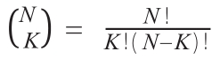，因此恰好抽到K个白球的总概率为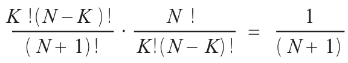。也可以用反证法：若长期60%结果为白，则瓮中60%的球应是灰色；但这又意味着60%的结果是灰色，矛盾，原命题得证。

用熵度量不确定性的模型，可参见Lamberson&Page（2012b）和Page（1997）。风险价值还有另一种算法：用年内任何时候损失超过10 000美元的概率来衡量。

## 延伸旁注与资料索引

一些旁注也值得记住：结构洞位置的填补者具有价值（Burt, 1995）；教师网络会影响教学（Frank et al., 2018）；条纹模型可解释某些对象为何难以成功回归均值（Groysberg, 2012）；SIR与群体免疫的社会科学分析见Tassier（2013）；复杂传染概念见Centola&Macy（2007）；得分序列呈反持续性，上次得分的队伍不太可能马上再得分（Peel&Clauset, 2015）；市盈率较低的股票往往跑赢市场（Shiller, 2005）。湖泊模型里直径呈幂律，面积作为直径平方的常数倍也呈幂律（Downing et al., 2006）。

文中涉及出处还包括：Newman, 2010；Watts&Strogatz, 1998；Ugander et al., 2011；Eom&Jo, 2014；Dodds、Muhamad&Watts, 2003；Jackson, 2008；Granovetter, 1973；Albert、Albert&Nakarado, 2004；Griliches, 1988；Bass, 1969；Dubos, 1987；Stein, 2011；Updike, 1960；Tweedle&Smith, 2012；Lamberson&Page, 2012b；数据源自网络；Christakis&Fowler, 2009；Smaldino, 2013；Wolfram, 2001；Page, 2007、2010a；Mlodinow, 2009；Taleb, 2001；Turchin, 1998；Suki&Frey, 2017；Chance, 2009；Miller&Sanjurjo, 2015；Newman, 2005；Levinthal, 1991；Axtell, 2001；Sneppen et al., 1995；Baxter, 2009；Samuelson, 1965；Grossman&Stiglitz, 1980；Lo&MacKinlay, 2007；Mauboussin, 2012；Hathaway, 2001；Pierson, 2004；Bednar&Page, 2007、2018；Page, 2006；Page, 1997。

11. 这里的所有推算都建立在一个前提上：当随机游走的长度是 N 时，其取值围绕均值的离散幅度，也就是标准差，等于 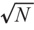。而大约 2.5% 的极端情况，则正好落在距离均值两个标准差之外的尾部。

### 15　局部互动模型
1. 在物理学的语境里，局部多数模型常被叫做伊辛模型。它属于投票者模型的一个分支，而投票者模型的基本设想是邻居群体会被随机抽样，且抽取的规模可以不同。可参考 Castellano、Fortunato&Loreto, 2009。
2. 对四边相连的元胞格子，先把上方边界与下方边界粘合，格子就变成圆柱状；再把左侧边界与右侧边界连起来，最终得到一个环面。
3. 局部多数模型还存在另一种实现方式：元胞可以被同步激活，也可以在遵循更新规则的情况下依次激活，其中处于少数派的元胞会优先倒向占多数的相反状态。若采用同步更新，模型便有可能出现循环状态。
4. 有关起立鼓掌现象的建模，可见 Miller&Page, 2004。
5. 涉及跨领域行为一致性的文化模型，可见 Bednar et al., 2010。
6. 这里同样先把顶部与底部接合成圆柱，随后把两端再连起，形成一个“细长”的环面。
7. 扩散反应类模型也能在狭窄区域产生条纹，在较宽区域产生斑点。借助这类模型，科研人员可以推断哪些动物会长条纹、哪些会长斑点、哪些会是纯色。决定因素是模式形成时哺乳动物胚胎的尺寸，而不是成体时的体型。正是因此，大象才不会长出斑点。可参考 Murray, 1988。
8. 这个比喻要感谢 Bernardo Huberman 提供。
9. 要完成严格证明，需要写一个计算机程序。该程序能够生成随机数字序列或随机图案，并说明生命游戏能够模拟通用计算机。形式化证明的核心是论证生命游戏在元胞自动机集合中是通用的。可参考 Berlekamp、Conway&Guy, 1982。
10. Dennett, 1991; Hawking&Mlodinow, 2011.

### 16　李雅普诺夫函数与均衡
1. Nagel, 1995.
2. 要感谢 Jenna Bednar，她不仅提供了关于逐底竞争的多个案例，也为本书提供了大量例子。
3. Page, 2001.
4. 外部性的存在，哪怕是负外部性，也并不意味着可以省去构造李雅普诺夫函数的必要。局部多数模型和路径选择模型都暗含了负外部性。在局部多数模型中，当某个元胞改变自身状态时，会对仍处相反状态的邻居施加负外部性；不过它与后来状态一致的邻居所产生的正外部性更大。
5. Guy, 1983. 若自认胆大，可以从 27 开始尝试。

### 17　马尔可夫模型
1. 严谨的学术论文需要借助统计手段更精确地估计转移概率并给出误差区间，还要检验这些概率在观察时段内是否保持稳定。若转移概率随人均收入而变化，则不稳定。可参考 Przeworski et al., 2000。
2. Flores&Nooruddin, 2016.
3. Tilly, 1998.
4. 采用瓷砖的人口比例，等于从油毡转向瓷砖的概率除以从油毡转向瓷砖的概率与从瓷砖转向油毡的概率之和，即 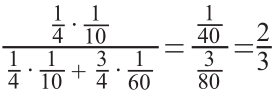。更一般的设定可以这样写。令 D 为拥有昂贵耐用品者的比例，C 为拥有廉价商品者的比例。再令 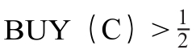 表示某人购买廉价商品的概率。令 REPLACE(C) 与 REPLACE(D) 分别表示两种产品的更换概率。若满足：
REPLACE(C)×1-BUY(C) > REPLACE(D)×BUY(C)
则购买廉价品的人会增多，同时拥有耐用品的人也会增多。根据假设，前半结论显而易见。要证明后半结论，先求出转移概率。个体从 D 转移到 C 的概率是 P(D,C)=REPLACE(D)×BUY(C)。同理，个体从 C 转移到 D 的概率是 P(C,D)=REPLACE(C)×1-BUY(C)。在均衡时，D - D×P(D,C)+ C×P(C,D)=D。令 C=(1-D)，可得 。若 P(C,D)>P(D,C)，则上式大于 0.5。该不等式与 REPLACE(C)×1-BUY(C)>REPLACE(D)×BUY(C) 等价。
5. McPhee, 1963; Ehrenberg, 1969. 他们提供了双重劣势的经验证据。证明该结论只需说明消费者在更换品牌时对任一产品的选择概率相同。
6. Briggs&Sculpher, 1998.
7. Schrodt, 1998.
8. Khmelev&Tweedie, 2001.
9. Khmelev&Tweedie, 2001.
10. Reynolds&Saxonhouse, 1995.
11. 请参见网络。
12. 构建这类模型的关键在于挑选有用的状态并赋予准确的转移概率。可参考 Langville&Meyer, 2012。
13. 在食物链中，一个物种与它所捕食的物种相连。可参考 Allesina&Pascual, 2009。
14. Russakoff, 2015.

### 18　系统动力学模型
1. Sterman, 2000.
2. 关于定性系统动力学模型价值的分析，可参考 Wellman, 1990。
3. 该模型的前提是所有野兔都死于狐狸捕食。对野兔其他死亡原因增加变量只会提高复杂度，却不会改变结论，因为这只是缩小了本模型中野兔增长率的取值范围。这里的符号  表示 H 的单位时间变化率，另一种写法是 。当野兔与狐狸数量的变化率皆为零时，即  时达到均衡。为求均衡，先取方程 gH - aFH =0，两边除以 H 得 g - aF =0，求解 F。随后取方程 bFH - dF =0，两边除以 F 得 bH - d =0，求解 H。
4. 要感谢多伦多大学的 Michael Ryall 提供了这个例子。
5. 该模型相关结果的综述，可参考 Meadows et al., 1972。
6. 这套模型通常被称为“罗马俱乐部”模型。戴维·洛克菲勒于 1968 年创立的罗马俱乐部资助了相关研究并推广其发现。
7. 通过在更小的范围内操纵变量，约翰·米勒能把模型的预测推至接近 300 亿。可参考 Miller, 1998。
8. Hecht, 2008；MacKenzie, 2012.
9. Sterman, 2006.
10. Glantz, 2008.

### 19　基于阈值的模型
1. Granovetter, 1978.
2. 爱彼迎的创始团队在 2008 年美国总统大选期间的做法是，推出 ObamaO's 与 Cap'n McCain's 谷物早餐，然后挨家挨户推销。
3. 关于旋转门模型，可参考 Jacobs, 1989。实证显示，在几乎不需要传统正规教育的职业，例如调酒与园艺，当工作场所女性员工占比达到 15% 时，男性往往选择离开或不进入。可参考 Pan, 2015。
4. Syverson, 2007.
5. Gammill&Marsh, 1988.
6. Easley et al., 2012.

### 20　空间竞争模型与享受竞争模型
1. Clark、Golder&Golder, 2008.
2. 对法律立场的分析，可参考 Martin&Quinn, 2002。
3. Hotelling 于 1929 年研究地理区位决策。Kelvin Lancaster 于 1966 年把 Hotelling 模型拓展到经济选择间的享受竞争；Downs 于 1957 年将其应用于政治学。
4. 提名得分模型提供了分配意识形态立场的更精细方法，但基本思想一致。可参考 Poole&Rosenthal, 1985。
5. 选择常数项 C 时要保证所有收益为正。可以把它设为理想点与可选点之间最大可能距离的任意值。
6. 构建分割线时假设消费者对两个属性的权重相同，也可纳入权重差异。若人们更看重含糖量而非可可含量，分割线会逆时针倾斜；在极端情况下若只重视含糖量，分割线将水平，并沿垂直轴均分 A 与 B。空间模型清晰展示了如何把直觉——更接近理想的东西更受偏好——转化为正式模型。一旦把备选方案如巧克力棒和消费者的理想点置于空间中，并按与理想点的距离排序偏好，就等价于给出效用函数。产品的效用等于其与理想点距离的倒数。
7. Havel, 1978.
8. Martin&Quinn, 2002.
9. McCarty, 2011. 这些比例会随党派忠诚度变化或表决法案类型变化而改变。
10. 形式上，若选民人数为奇数且二维中位数上存在选民理想点，则任何通过该中位数的直线都会把剩余理想点划分为两个等大的集合。可参考 Plott, 1967。
11. Richard McKelvey 于 1979 年证明，连续投票会在两个或以上维度导致政策混乱。McKelvey 慎重说明，该结论仅针对给定偏好下可能的结果序列，而非对投票过程的预测。也可参考 Kollman、Miller&Page, 1997；他们给出了多维空间模型的可计算版本，其中候选人会在不同行为假设下向中心移动。
12. 提议者可能不得不提出 41。
13. McCarty&Meirowitz, 2014. 他们对该模型及应用于政治学的其他博弈论模型做了更深入分析。
14. 关于拥有否决权投票者影响的进一步分析，可参考 Tsebelis, 2002。
15. 有关洛杉矶房价的研究估计通勤成本约为每小时 28 美元。可参考 Bajari&Kahn, 2008。
16. 计算如下。初始收入为价格乘以数量，记作 p×q。在稀疏市场，价格下降 10% 后收入下降 10%，销量增 8%，收入为 0.9p×1.08q =0.972p×q。在拥挤市场，价格下降后收入为 0.9p×1.33q =1.197p×q。

### 21　博弈论模型
1. 正式模型及证明如下。令 E*[i] 表示参与者 i 的努力水平。若获胜，收益为 M - E*[i]，否则为 -E*[i]。假设获胜概率等于其努力在总努力中的占比，即：

求解唯一的对称纳什均衡时，考虑当其他参与者均选择 E* 时，参与者 i 的最优努力。参与者 i 的收益为：

一阶导数为：

令一阶导数为零可得 。在对称均衡中 E*[i]=E*，代入即得结果。为证一阶条件为最大值，只需检验收益函数二阶导数为负。
2. 了解如何厘清网络效应，以及为何快照数据难以得出网络效应结论，可参考 Shalizi&Thomas, 2011。关于聚类行为与属性的案例，可参考 Christakis&Fowler, 2009。

### 22　合作模型
1. 可参考 2005 年《科学》杂志创刊 125 周年纪念特刊。
2. Martin et al., 2008; Biernaskie, 2011。
3. Zaretsky, 1998. 在银行案例中，若银行能赚取大量地理租金，ATM 会降低其利润吗？地理租金指客户因不愿长途跋涉到另一城镇银行而带来的额外利润。感谢 Simon Wilkie 及其他朋友与我共同讨论此例。
4. 技术上说，这证明了冷酷触发策略在概率性重复囚徒困境中是均衡策略。其他策略如针锋相对策略，与冷酷触发策略配对时也可成为均衡。
5. 当另一方采用冷酷触发策略时，背叛者首期可得 T，但此后每期收益最多为零。若双方均用冷酷触发策略，首期收益为 R。博弈进行两期的概率为 P，三期为 P²，N 期为 p^(N-1)。期望收益为：

 的证明如下。假设成立，两边同乘 (1-P)，右侧为 1，左侧为 (1+P+P²+…) - (P+P²+…) 也等于 1。
6. 只需重做保持合作的计算并把 P 降至  即可。若  不支持合作，则先以概率 P 继续数期，再以  的继续概率也不支持合作。
7. Novak 与 Karl Sigmund 于 1998 年称之为形象评分。也可参考 Bshary&Grutter, 2006。
8. 若假设能扩大鸣鸟领地，这两种攻击形式都可映射为背叛。可参考 Godard, 1993。把行动映射为带收益的博弈形式需要大量实地观察。
9. 四对组合值得重点说明。当针锋相对策略与冷酷触发策略配对时，双方永远合作，平均收益均为 3。当欺负好人策略自配时，前两轮背叛后永远合作，平均收益略小于 2。当冷酷触发与欺负好人配对时，冷酷触发首轮合作、欺负好人首轮背叛；第二轮双方背叛；第三、四轮冷酷触发背叛、欺负好人合作；此后双方一直背叛。冷酷触发收益序列为 1,2,4,4 然后恒为 2，平均约 2+。欺负好人收益序列为 4,3,1,1 然后恒为 2，平均恰为 2。当针锋相对与欺负好人配对时，首轮针锋相对合作、欺负好人背叛；第二轮双方背叛；第三轮欺负好人合作但针锋相对继续背叛；第四轮欺负好人再次合作、针锋相对恢复合作；此后双方永远合作。双方收益各有一个 1、一个 4、一个 2 及之后恒为 3，平均略小于 3。
10. 事实上，始终合作策略和冷酷触发策略都被针锋相对策略所支配。对任何对手策略，针锋相对至少不差于始终合作或冷酷触发。针锋相对支配始终合作，因其不会被始终背叛和欺负好人剥削；它支配冷酷触发，因其能与欺负好人合作，而冷酷触发无法原谅背叛。
在罗伯特·阿克塞尔罗德的经典实验中，他邀请各领域学者提交用于有一定继续概率的重复囚徒困境博弈的策略。14 个投稿中针锋相对表现最佳。随后 62 人再次投稿，针锋相对再次胜出。阿克塞尔罗德归因于该策略合作、惩罚且宽容。冷酷触发缺乏宽容，因而无法与欺负好人重启合作。可参考 Axelrod, 1984。表 22-1 未给出所有策略的平均收益，因这隐含假设各策略等概率。种群可能多为针锋相对，也可能多为欺负好人，也可能混杂始终合作与始终背叛。

**藏在脚注里的策略地图**

有些著作正文讲主张，脚注却放了一套完整的模型。最近整理的一组附录式笔记，从“为何会合作”一路推到“制度怎么设计”“我们怎样学习和探索”。单看碎片，像散点；串起来，则是一张关于选择与规则的地图。

**一、合作的起步比维持更苛刻**

先放一个极端的数值设定：诱惑报酬是奖励报酬的四倍，记作 T=4S，同时整个群体里只有百分之五的成员愿意协作。按此参数，折扣因子 P 绝不会低于；若目标只是把既有的协作保留住，P 只需跨过。把数值固定为 T=4、R=3，协作能够出现要满足，能够持续则要满足。可见“让协作诞生”和“让协作存活”并非同一道门槛。

一般情形的推导也清楚。设群体中 θ 的成员采用以牙还牙或冷酷触发，剩下 1-θ 的成员始终背叛；每个人都与群体里所有其他人对弈。以牙还牙对以牙还牙，每一期都能拿到 R，期望收益写成；以牙还牙碰到始终背叛，只能得到 -S；始终背叛碰始终背叛双方都是零；始终背叛碰到以牙还牙却能拿到 T。这样算来，以牙还牙的平均收益是，始终背叛的平均收益则是 θ×T。前者压过后者的充要条件是，等价写法是。当 θ 很小时，会膨胀得非常大，满足条件变得极难。于是协作的涌现比协作的维系困难得多，Boyd 2006 对此有更细的讨论。

这套分析源自 Nowak 2006。Nowak 还指出，重复互动、声誉与血缘都能为合作提供土壤。

在网络结构里，边缘节点会模仿邻里里表现最好的行动。按设定，相邻的背叛者收益都是零；协作的邻居能获得 K×B-D×C，只要成立，这项收益就为正。群体选择的基本思路可参见 Wilson 1975。

Travisen 与 Nowak 的模型也可简述。把 N 个个体分成 M 个大小各异的群体，每内群体都运行协作行动模型并给每个个体一个表现分。个体 i 被挑中的概率等于 i 的表现除以全部 N 个体的表现之和，随后把该个体的一个克隆放回同一群体。若加入克隆后群体规模超过阈值，则以概率 1-q 从该群体随机剔除一名成员，以概率 q 把该群体拆成两半，成员随机分配到两边；为保持群体总数不变，再随机移除一个既有群体。当 M 很大且拆分很少发生 q 很小的时候，协作者的数量会增加当且仅当成立。完整说明见 Nowak 2006。

现实管理里也能看到相似逻辑。敏捷管理倡导者 Michelle Peluso 担任 IBM 首席营销官时，组建了若干相互竞争的团队，每个团队的表现对其他团队透明，然后奖励表现最好的团队，Dan 2018 有记述。这种做法借鉴了敏捷编程：把写代码、测程序、与用户互动并行推进，而不是瀑布式的顺序推进。

还有一种更宽容的策略叫慷慨的以牙还牙：先协作，只在部分时候惩罚背叛。在会出错的互动里，它优于标准以牙还牙和“赢了坚持输了改”的策略，Rand et al. 2009；Wu&Axelrod 1995 可参考。另见 Axelrod&Pienta 2006。

**二、集体行动、公共品与拥堵**

围绕集体行动，文献线索包括 Hardin 1968；Diamond 2005；Ostrom 2005；Ostrom、Janssen&Anderies 2007。

社会最优的推导：设每人投入 X 于公共品，整体效用为。对 X 微分并令为零得到，进而 X=N。对称纳什均衡的推导假定他人都投入相同数额 A，自己投入 Y，效用写成。微分令零得到；整理并平方后有 Y+(N-1)A=1。对称时 Y=A，于是。

这在哲学上对应功利主义。John Rawls 1971 提出另一种标准：最大最小原则，理想结果应最大化最弱者的效用。Rawls 要求在无知之幕后做判断——不知自己贫富、名望、能力与环境阻碍，进而给最弱者更高权重，而功利主义给每个人同等权重。

更一般的效用记作。在对称纳什均衡设定下，其他人投入 A，个体 j 投入 Y，共同收入记为 I，则个体 j 的效用为。对 Y 微分令零得到；整理后是。对称时 Y=A，故。两边平方可得［（1-α）+αN］²=NY，这意味着。Cornes & Sandler 1996 可作补充。

更贴近现实的设定会引入非线性拥塞成本，甚至 S 形。这能刻画道路类资源：初期其他使用者几乎不影响个人利益，但到某个临界点资源因过度拥挤而失效。

设使用资源的人数为 M，总效用为 B-θ×M。微分令零得到 B-2Mθ=0，求解得。求纳什均衡时把不使用的收益设为零，于是人们会使用资源直至边际收益等于外部选项，即。另一个公园例子里，最大收益 B 被设为种群规模 N 以降维。总效用可写成 (N-M)×M+3N-(N-M)×(N-M)，也就是 4(N-M)M。微分得 4N-8M=0，求得 M=N/2，于是总效用等于。均衡要求两公园边际效用相等，即 (N-M)=3N-3(N-M)，可改写为 N=4M。把 M 与 N-M 代入效用函数即可算出总量。

均衡消费也可类似求得：令 R*=(1-g)(R*-C*) 解出 R* 即可。Kurlansky 1998 有相关讨论。关于增长顺序为何会抵消，可看两期例子：第一年增速 20%，资源剩 96=80×1.2；第二年增速 30%，资源变为 98.8=(96-20)×1.3。若交换增速，第一年后有 104，第二年后有 100.8=(104-20)×1.2。Ostrom、Janssen&Anderies 2007；Craine&Dybzinski 2013；Ostrom 2010；Ostrom 2004 均可参考。

**三、机制设计与拍卖**

机制设计部分可参见 Ledyard、Porter&Rangel 1997。以帕累托有效为例，3 人的四种收益组合：{(3,3,4),(9,0,0),(0,8,1),(2,2,3)}。除 (2,2,2) 外均可视为帕累托有效，但 (2,2,3) 被 (3,3,4) 所支配。Hurwicz&Schmeidler 1978 有经典讨论。

拍卖例子里，第三位竞买人可能略高于 60 美元出价，为简便取等于 60 美元。

证明通常假设值服从均匀分布，但结论在其它分布下依旧成立。假设其它 N-1 位竞买人的出价等于真实价值乘以。若其它竞买人的价值乘以小于 b，则出价 b 会胜出。发生概率等于。于是高于所有其它 N-1 个出价的概率是该值的 N-1 次幂。若真实价值为 V，出价 b 的期望收益为 (V-b) 乘以 b 为最高出价的概率。于是期望收益写成。最大化时对 b 微分令零得到。化简得 V(N-1)-Nb=0，重写为。要证最高出价者的期望支付等于第二高出价的期望值，注意从区间 [0,1] 均匀抽取 N 个随机值，最高出价期望为，第二高期望为。于是最高出价者的期望收益等于，恰与第二高相同。

作者特别指出 Roger Myerson 是其博士导师，并因此获得诺贝尔经济学奖。

全支付拍卖中，当价值位于 [0,1] 时，最优策略可表示为：价值 V 的人出价。于是三人情形下，价值为的人将出价。实验证据见 Lucking-Reiley 1999；eBay 实验见 Morgan&Hossain 2006；木材拍卖证据见 Athey、Levin&Seira 2011。另见 Ostrovsky、Edelman&Schwarz 2007；Page 2012。

**四、信号：成本制造可信度**

信号如何驱动行为与选择，Simler&Hanson 2018 里有更多例子。

设弱者类型发送信号的成本为 MC。若所有 S 个强者都发出信号，则收益为。于是若，弱者就不会发送信号。若分离收益超过所有 N 个个体分摊信号时的，强者更偏好发送信号。先前计算表明使弱者不发送信号的最小信号为。因此若我们M，弱者将不再发出信号。而要让强者更偏好发送信号，必须保证。两边除以 B 乘以 C 可得。该式可化为 (C-c)N≥CS，亦可写成 C(N-S)≥cN。

经济学家 Michael Spence 提出此种可能性，并因在就业市场中提出教育无功能价值的模型 Spence 1973 获诺贝尔奖。孔雀尾羽过大也会降低适合度 Zahavi 1975。Bird&Smith 2005；Smith&Bird 2003 可参考。

**五、学习：复制动态与经验权重**

学习心理学的研究范围更广。一个人可学事实如阿肯色州首府，也可学隐性知识如烤面包、修发动机、写程序，也可掌握知识体系如有机化学。Thorndike 1911；Rescorla&Wagner 1972 为起点。这里描述的模型基于 Rescorla&Wagner 1972；Herrnstein 1970；Bush&Mosteller 1955；Cyert&March 1963；Bendor、Diermeie&Ting 2003；Epstein 2014。

参数 γ 的选取必须保证备选方案权重为正。若 γ 超过最高可能渴望水平与最小奖励差距的倒数即可做到。Bendor&Swistak 1997 有讨论。

若构建有限种群的复制者动态模型且后继种群随机抽取，则最优备选方案可能无法再现。若如此，复制动态就找不到最优选择，因它无法把备选方案重新引入种群。Fudenberg&Levine 1998；Camerer 2003 有相关分析。

该博弈还有一个混合策略均衡：2/3 选经济型汽车，1/3 选油老虎。但按这里的学习规则，该均衡不稳定，故忽略。形式化记作：P(经济型,1)=0.5，P(油老虎,1)=0.5，收益(经济型,1)=1.5，收益(油老虎,1)=2，平均收益=1.75。应用复制方程可得 P(经济型,2)=，以及 P(油老虎,2)==0.57。Frank 1985；Waltz 1979；Powell 1991 可参考。

Vriend 2000 分析了相似收益结构并解释为生产相同产品并同时定量的企业竞争，即古诺竞争模型。

罗斯-伊雷夫学习模型更新第 t 期备选方案 k 的权重 W(k,t+1)=(1-r)×W(k,t)+Δ(k,t,e)。其中 r 为新近度参数。若行动 k 被选中，Δ=(1-e)×收益(k,t)；若未选中，Δ=e×收益(k,t)。参数 e 决定未选中备选方案的权重。Camerer&Ho 1999。

该分析紧随 Bednar 和 Page 2007、2018 的思路，并借鉴 Greif 2006 的模型。Bednar 和 Page 强调初始行动对均衡涌现的重要性，Greif 更侧重信念的作用。也可参见 Gilboa&Schmiedler 1995 的基于案例决策理论；关于身份在经济选择中的作用，见 Akerlof&Kranton 2010。

为证复制动态结果，注意当且仅当 (1-B)×200+B×220>(1-B)×180+300B 时，按文化规范行动收益更高。整理得 20(1-B)>80B，结果得证。

**六、多臂老虎机：探索与利用**

多臂老虎机与经济现象的相关性见 Bergemann&Valimaki 2008；Hills et al. 2015 提供更广讨论；技术细节与启发式比较见 Scott 2010。

Gittins 与 Jones 1972 首描述最优规则。Gittins 指数可表述为贝尔曼方程，适用于通过一系列选择产生收益的问题，依赖价值函数构造，该函数等于收益序列总和，未来收益按当前利率贴现。Roberts 2004 可参考。

Jake Bowers 等人 2017 对美国农业部农场服务机构小额贷款项目的实验分析，为此类问题提供了现实注脚。

这些脚注看似零散，实则指向同一主题：人从不孤立决策，而是在规则、信息、经验与群体结构中不断校准。合作有门槛，制度有激励，信号有成本，学习有路径，探索也有代价。

## 书页角落的硬核智慧：从政治声望、崎岖景观到不平等的代际密码

别急着跳过书末注释。真正有嚼头的模型思维，常常就藏在这些小字里。把这些零散材料串起来看，你会发现它们谈的其实是同一件事：现实世界很复杂，而多模型思维能帮我们看清复杂背后的结构。

### 一、经济繁荣会改写政治声望的“如果”

这组政治声望假设的数据出处，可以追到2012年《华盛顿邮报》和Dann（2016）。一个有趣的假设是：假如阿尔·戈尔、乔治·H. W. 布什和希拉里·克林顿当时坐在总统位子上，那么经济繁荣大概率会给他们添上更亮的光环。围绕选情与经济景气的关系，较早的梳理可见Markus（1988）；更近的证据由Fair（2012）提供；候选人及政党效应量级的证据则见Campbell、Dettrey与Yin（2010）。

### 二、崎岖景观：多样性为什么值钱

想更深入理解多样性的价值，可以翻《多样性红利》。NK模型的完整介绍见Kauffman（1993）。当N为20、K为19时，可以推导局部峰值与全局峰值的期望值。每个属性的贡献均匀分布在［0，1］区间，其均值为、方差为。每个备选方案的价值等于20个属性贡献的平均值，因此根据中心极限定理，这些值服从均值为、方差为的正态分布。N=20时，每一个标准偏差的大小为。局部峰值的平均值可估算为0.609：可以认为，从该分布中随机抽取21次，其中最好的那一次就是一个局部峰值，其期望值近似等于从正态分布中抽出的、让对应的备选方案都落在更低一侧的那个值，它比平均值约低两个标准偏差。用正态分布计算器算出的期望平均值正是0.609。全局峰值的期望值0.759则来自另一个事实：全局峰值拥有所有2²⁰个备选方案中的最高值。每个备选方案都可视为从该分布中抽出的一个值，其期望值近似等于从正态分布中抽出的、使对应的备选方案都偏低的值；计算器给出的期望平均值为0.759。全局峰值的值，应当比100万次抽取中的最高值还更高。

Wright（2001）的研究认为，这类整合重组既助推人类与人类社会的出现，也为当代技术与科学进步提供助力。Kaufman（1993）和Miller&Page（2007）则用“有趣的中间状态”来形容复杂性。

### 三、复杂性之外，还有制度细节

美国制度里有一个细节：专利申请若拖过三年才获批，保护期并不从申请日算，而是从专利发布日起算17年。Boldrin与Levine（2010）对此有讨论。

### 四、多模型思维落地：成瘾、不平等与代际黏性

按正文给出的概率，统计均衡可以精确到：无痛70.7%、阿片19.5%、上瘾9.8%；换到第一种情形，这三个数字变成76.3%、21.5%和2.2%。Wakeland、Nielsen与Geissert（2015）提供了相关依据。这个结果背后要感谢Abbie Jacobs——她手头有需要的模型与数据，帮我把结果算了出来。Wilkinson与Pickett（2009）的相关论述也值得对照。

杜尔劳夫曾在芝加哥大学贝克尔·弗里德曼研究所2015年11月6日举办的“了解不平等及其应对措施”会议上作过评论。有关不平等的更多线索，可参见Goldin与Katz（2008）、Acemoglu与Autor（2011）、Murphy与Topel（2016）。理论工具方面，Mas-Colell、Whinston与Green（1995）是常被引用的基础。

Kaplan与Rauh（2013a）以及Jones与Kim（2018）的模型，把能力当作企业家创意可扩展性的代理变量；若想追溯更早的研究，Frank（1996）讨论过不同职业间的不平等如何生成；Xie、Killewald与Near（2016）也可一并参考。Ormerod（2012）对此有分析；同一作者（2012）还细致描述了连通性日益增强怎样把不平等推高。Cancian与Reed（1999）、Schwartz与Mare（2005）也提供了相关证据。Greenwood等（2014）的研究同样值得注意；他们给出的估计值为0.34，而不是0.43。

### 五、基尼系数与代际传递：一组算术

基尼系数刻画的是收入分布与平均分布之间的偏离程度。设S(P)为最底层P%人口拿到的总收入份额；举例说，最底层30%的人若只拿到总收入的2%，则S(30)=2，基尼系数按计算。收入若完全均匀，即，基尼系数为0；反过来，若全部收入集中在最顶层1%手里，那么所有P<100时S(P)=0，而S(100)=1，基尼系数便达到1。

再看代际流动的一组算术：孩子落入四个类别的概率分别为0.6、0.25、0.1、0.05。也就是说，高收入者的下一代有60%仍为高收入，中高收入者的下一代有20%升入高收入，中低收入者的下一代有15%升入高收入，低收入者的下一代只有5%升入高收入。于是，高收入者的孙辈仍为高收入的比例为0.6×0.6+0.25×0.2+0.1×0.15+0.05×0.05=0.4275；低收入者的孙辈升入高收入的比例为0.6×0.05+0.25×0.1+0.1×0.15+0.05×0.7=0.105。Pfeffer与Killewald（2017）、Kaplan与Rao（2013b）也可作为进一步阅读的线索。

所以，注释不是装饰，而是把模型串成网的那根线。政治声望、崎岖景观、复杂性、制度细节、成瘾均衡、收入分布与代际传递——它们看似分散，背后却都指向同一种能力：用多个模型观察世界，而不是只拿一把锤子找钉子。