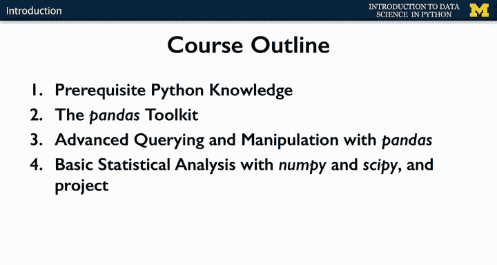

# 课程一：专项课程导论 🎯

在本节课中，我们将要学习密歇根大学《Python用于数据科学实践》专项课程的整体介绍。我们将了解课程结构、选择Python作为教学语言的原因，以及第一门课程的具体内容安排。

欢迎来到Python数据科学导论。

这门课程是一个更大的Python数据科学专项课程五门课程中的第一门。

每门课程都基于之前课程的知识逐步构建，旨在让你全面了解数据科学，同时帮助你培养实践数据科学的技能。

这个专项课程属于中级难度。

我们期望你过去学习过一些基础的编程和统计学知识。

在这个专项课程中，我们专注于使用Python编程语言教授应用技能。

数据科学中可以使用许多其他工具。

例如像R这样的专门统计分析语言，或者像Java和C这样的更通用的编程语言。

我们选择Python作为本专项课程的基础，主要有三个原因。

第一，它易于学习。

Python现在是向大学生介绍编程的首选语言，在美国排名前十的计算机科学项目中，有八个使用它。

Python程序通常具有最少的模板代码，这些模板代码你可能在其他语言中见过，并且对于你可能需要完成的典型任务，它提供了更自然的构造。

如果你有编程经验但没有Python特定经验。

你可以非常快速地掌握Python。

第二，它功能全面。

Python是一种非常通用的编程语言，拥有大量内置库，并且在处理数据、网络编程和数据库方面表现出色。

它很成熟，并且有大量资源可用，从书籍到在线课程。

最后，Python拥有大量重要的数据科学库可供使用。

这些库的基础被称为SciPy生态系统，它甚至有自己的系列会议。

我们将用于完成作业的界面叫做Jupyter Notebooks，以及前两门课程的主要库（Pandas和Matplotlib）都是SciPy栈的一部分，为进入机器学习、文本挖掘和网络分析领域提供了极好的基础。

这第一门课程分为四个模块。

第一个模块侧重于准备先决条件，并回顾Python语言的一些基础知识。

如果你已经掌握了Python并且希望接受挑战，请不要担心。

我们这里也包含了一些高级Python内容。

这些高级Python内容对于专项课程的其余部分并非严格必需。

但你在网络上或更广泛的数据科学主题（如大数据和实时分析）中可能看到的许多例子，可能需要了解其中一些更专业的功能。

上一节我们介绍了课程的整体结构和选择Python的原因，本节中我们来看看第一门课程的具体模块内容。

在第二个模块中，我们将深入研究pandas工具包。

pandas工具包是Python数据科学的基础，它提供了一种以表格形式思考数据的数据结构。

这个工具包帮助将R语言中存在的功能引入Python世界，并在过去五年中得到了广泛采用。

pandas背后的许多思想与关系理论相似。

因此，如果你有数据库背景，你会发现pandas环境相当自然。

同时，一些更高级的查询和操作pandas数据框的方法（如布尔掩码和分层索引）与数据库中的方法不同，需要仔细讨论。

所以我们将在本课程的第三个模块中讨论这些。

本课程的最后一个模块专门用于课程项目，在那里你将获取一些数据集，合并并清理它们，然后处理数据并回答问题。

在这一周，我们将讨论基本的统计测试和方法，并确保你为进入下一门课程打下坚实的基础。

同时，课程项目的目的是展示你将混乱数据操作成连贯内容所获得的技能。

在深入编程基础之前，我们将更多地讨论什么是数据科学以及它为何席卷全球。

---

本节课中我们一起学习了《Python用于数据科学实践》专项课程的总体介绍，了解了课程目标、Python的优势以及第一门课程四个模块（Python基础、pandas工具包、高级数据操作和课程项目）的核心内容。这为我们后续的学习奠定了清晰的路线图。