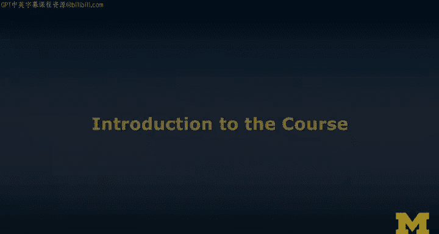
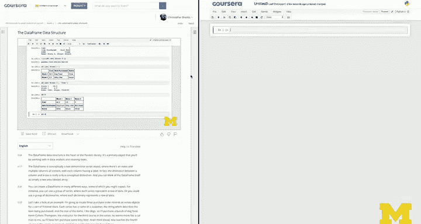
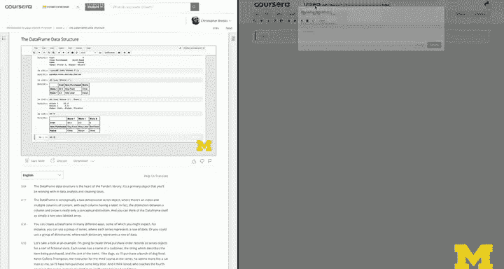
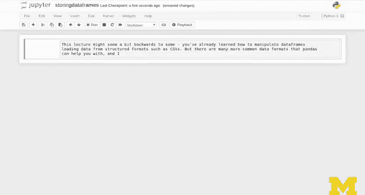
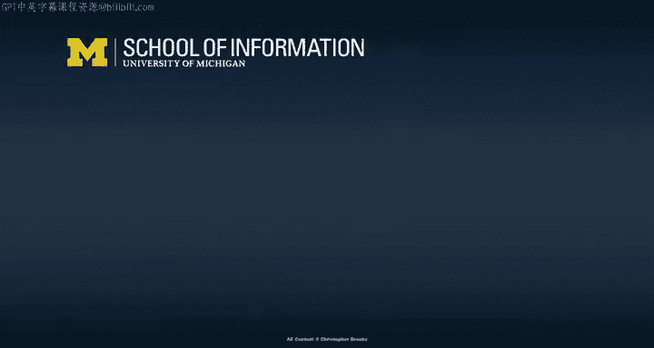

# 密歇根大学《Python用于数据科学实践》第1课：课程简介 📘

在本节课中，我们将要学习这门课程的整体介绍、学习目标以及推荐的学习方法。课程的核心是使用Python的pandas库进行数据操作，这是数据科学工作的基础。

## 课程概述与目标 🎯

我是克里斯·布鲁克斯，密歇根大学信息学院的教员。这门课程是关于数据操作的，数据操作是数据科学家工作的基石。即使随着你在该领域调查和技能的深入，这一点也不会改变。

在本课程中，我们将教你使用出色的pandas库。它非常适合数据操作，是Python领域事实上的标准。完成本课程后，你应该能熟练使用这个库。

我们将教你如何获取数据、清理数据、如何操作和连接数据，以及如何对该数据进行基本的推断。

我们期望你已经具备一些Python技能和一些统计学技能。但本课程是一个通过实践来构建这些技能的地方。课程平台侧边栏会有一些课程资源，描述了你获得Python经验的其他途径。

## 独特的教学与学习方法 💡

上一节我们介绍了课程目标，本节中我们来看看本课程采用的教学方法。

我为这门课程录制讲座的方式非常特别。我采用了一种教程风格，你看到的大部分内容实际上是我在Jupyter笔记本中键入代码的屏幕录像。

我在这其中做了一些独特的事情。首先，你会看到我所有的文本，我代码中的所有注释都是实时的。因此，你既能阅读也能听讲。

但我想与你分享一个我认为对学习以及使用Jupyter笔记本学习非常有效的策略。现在让我们来看看课程平台的一些内容。

这是左侧的Coursera课程平台。在右侧，我打开了Jupyter笔记本。这实际上是我用来演示的一门MOOC课程。

当你在课程中打开一个视频时，比如说这个关于数据框的视频，你会看到它是一个常规的教学视频。视频中会有一些讲解，但大部分内容会是这样的：我在Jupyter笔记本中逐步讲解示例。

我认为学习本课程最有效的方式实际上是进入你的Jupyter系统。右侧这里就是。会有一个关于Coursera Jupyter平台的单独视频。但为了真正创建一个新的Python笔记本，它是空的，你可以以讲座名称命名它。

例如，这个讲座是关于数据框的。然后从头开始跟着我做，并自己输入代码。所以在这里，我们可能会回到视频开头。在这里你可以看到，在这个例子中我正在查看一些热爱板球的国家。你可以在这里输入“cricket loving countries”，然后跟着示例操作。

这样做的好处是，你可以在任何时候暂停视频，进行探索，开始查看替代方案，并开始形成问题。这在观看视频时非常有效，能进行主动学习，而不是被动地观看视频。

## 视频功能与学习建议 📺

上一节我们介绍了主动学习的方法，本节中我们来看看视频提供的其他功能和学习建议。

视频还有一些其他功能。特别是，你可以增加或减少视频的播放速度。这对于复习也很有用。实际上，我认为高速播放视频非常棒。我经常以这种方式观看许多教育视频，主要是在我已经完成练习并体验过一次之后。当我只想快速回顾内容时，我会以大约1.5倍或2倍的速度播放，并尝试吸收那些内容。

我们为这门课程构建视频的方式（坦率地说，这对我来说也是新的，我很乐意得到你的反馈）是，视频中也包含了完整的文字记录。因此，你应该能够同时阅读和收听视频。

反复练习绝不会错。所以，请在观看教学视频时，打开一个空白的笔记本，跟着操作，看看你是否可能误解了某些内容。

## 互动与分享 🤝

以下是关于课程互动的一些建议。

你可以进行不同的探索，与你偏离的方向，并与班上其他同学分享你的发现或问题。

## 总结 📝

本节课中我们一起学习了《Python用于数据科学实践》第一课的简介。我们了解了课程的核心目标是掌握pandas库进行数据操作，包括数据获取、清理、连接和基本推断。我们介绍了一种通过Jupyter笔记本进行主动学习的有效方法，即边看视频边动手实践。我们还探讨了利用视频变速播放和文字记录进行复习的技巧。最后，我们鼓励大家在实践中探索，并与同学交流分享。