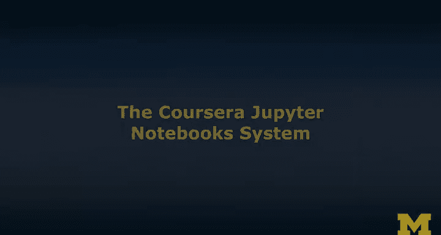
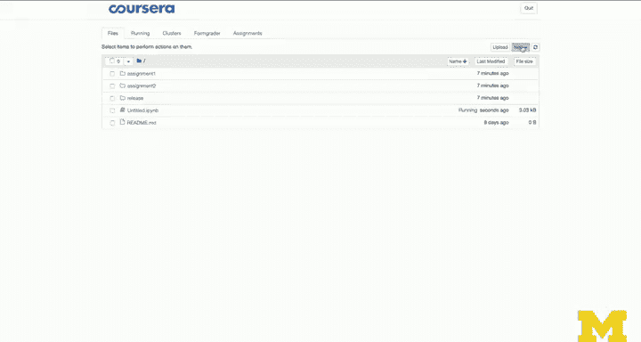
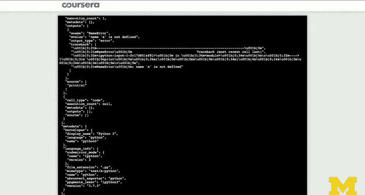
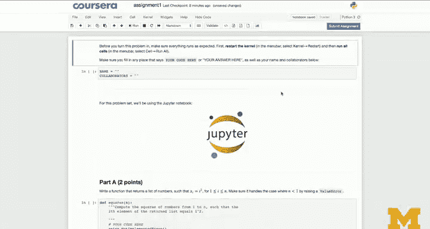
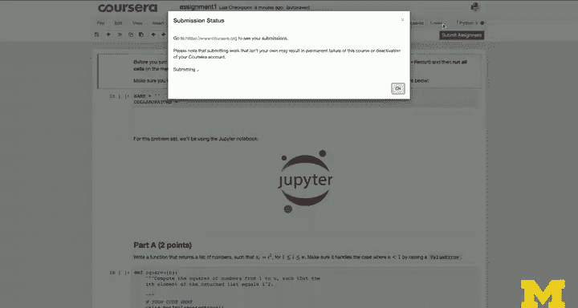
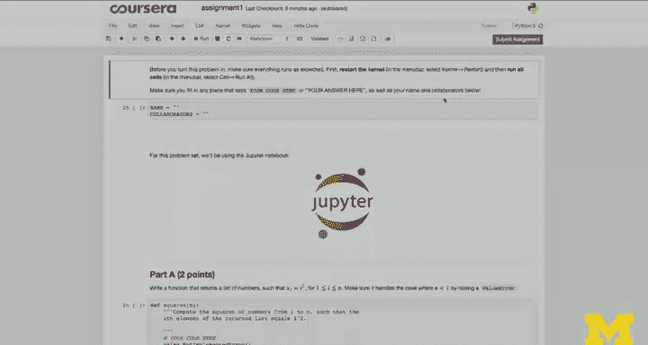
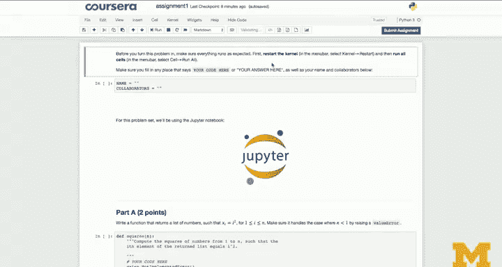
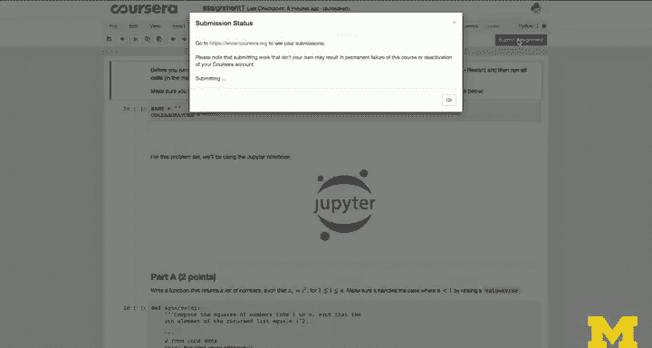

# 课程三：Jupyter笔记本系统入门指南 🚀




在本节课中，我们将学习Coursera平台内置的Jupyter笔记本系统。这个系统允许你在网页浏览器中完成作业、编写代码，甚至查看课程内容。它是一个非常强大的工具，能极大地提升你的学习体验。

## 概述

Jupyter笔记本系统是这门课程的核心工具之一。它提供了一个交互式的编程环境，让你能够直接在浏览器中编写和运行Python代码。本节将带你快速了解该系统的基本功能和使用方法。

## 目录树界面

当你登录Coursera的Jupyter系统后，首先看到的是目录树界面。你可以随时点击Coursera徽标返回这个界面。

这个界面显示了你文件系统的根目录。在这里，你可以看到已创建的文件夹和文件，例如一个名为`readme.md`的Markdown文本文件。

以下是创建新内容的方法：
*   点击“New”按钮旁的下拉箭头。
*   选择创建“Folder”（文件夹）、“Text File”（文本文件）、“Terminal”（终端）或“Python 3 notebook”（Python 3笔记本）。

## Python笔记本核心功能

上一节我们介绍了如何创建新文件，本节中我们来看看最核心的Python 3笔记本。

创建Python 3笔记本后，你会进入编辑界面。界面中的每一行被称为一个“单元格”。单元格主要有两种类型：代码单元格和Markdown单元格。

在代码单元格中，你可以直接编写Python代码。例如：
```python
x = 5
print(x)
```
编写代码后，点击运行按钮即可执行该单元格，输出结果会直接显示在单元格下方。

Jupyter笔记本的一个关键特性是它维护了一个持续的Python解释器状态。这意味着你运行过的变量和结果会被保留。例如，在定义了`x = 5`之后，在另一个单元格中运行`print(x + 1)`，会得到输出`6`。

在界面右上角，你可以看到内核的状态提示，例如“内核空闲”。

## 内核管理与调试

有时你可能会运行一些耗时或出错的代码。例如，运行一个无限循环：
```python
while True:
    i = 1
```
此时，单元格旁边的星号`*`和右上角变黑的圆圈都表示内核正在运行。

如果你遇到代码无响应的情况，可以采取以下操作：
*   **中断内核**：类似于在键盘上按`Ctrl+C`，可以随时停止当前运行。
*   **重启内核**：这相当于重启Python解释器。重启后，之前定义的变量状态会丢失。例如，重启后再打印`x`，会得到`NameError`错误。

此外，你还可以使用“运行所有上方单元格”、“清除输出”等功能来管理笔记本。

## Markdown单元格与文本编辑

除了代码，你还可以将单元格切换为Markdown格式，用于编写带格式的文本。

在Markdown单元格中，你可以使用特定语法来设置标题、加粗文本等。运行该单元格后，它会渲染成美观的格式。本课程中的许多说明文本都采用这种方式呈现。

## 终端功能

让我们回到目录树界面。另一个强大的功能是你可以打开一个终端。



终端让你以用户`Jovian`的身份登录到一个底层的Linux虚拟机（Docker容器）。你可以使用基本的Linux命令，例如：
*   `ls`：列出文件系统。
*   `cat [文件名]`：查看文件内容，例如`cat untitled.ipynb`会显示笔记本的JSON源码。



你还可以使用`conda`或`pip`来安装新的Python包。虽然在第一门课程中可能不需要频繁使用终端，但了解它的存在和功能很有必要。

## 作业提交与验证

最后，我们来看看作业在Jupyter系统中的样子。







加载一个作业后，你会看到一个蓝色的“提交”按钮。点击它即可将编程作业部分提交到Coursera。

为了帮助你完成作业，系统中内置了一些单元测试。在做作业时，你可以点击“验证”按钮，系统会运行这些测试并给出反馈，提示你哪些单元格还需要修改。





提交作业后，你还会获得一个URL链接，可以随时回去查看作业的提交状态。

## 总结

本节课我们一起学习了Coursera Jupyter笔记本系统的基本操作。我们了解了如何创建和运行代码单元格与Markdown单元格，如何管理内核状态，如何使用终端，以及如何提交和验证作业。

这个系统功能丰富，支持许多快捷键和插件。虽然你也可以在个人电脑上安装Jupyter，但使用课程内置的这个集成环境非常方便。你的文件存储是以课程为单位的，但你也可以从目录树下载文件，并转移到其他课程中使用。


希望你会喜欢这个课程和Coursera平台提供的强大功能。