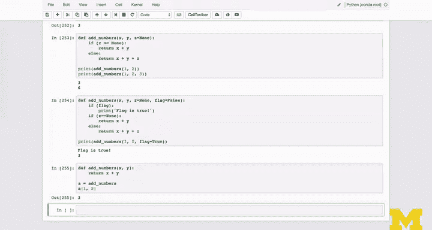

# 4：Python基础入门 🐍


## 概述

在本节课中，我们将要学习Python编程语言的基础知识。课程内容涵盖Python的基本特性、交互式编程环境的使用方法，以及如何定义和使用函数。无论你是否有编程经验，本教程都将以简单直白的方式引导你理解核心概念。

---

## Python语言简介

上一节我们介绍了课程概述，本节中我们来看看Python语言的基本特性。

Python是一种高级语言，这意味着它更易于人类阅读而非机器执行。它也是一种解释型语言，这意味着代码无需直接编译为机器码即可运行。Python通常以交互方式使用，这与Java或C等需要先编译后运行的语言不同。

在Python中，你可以启动交互式解释器，逐行编写代码，解释器会即时评估每一条语句。这种方式对于需要大量探索的任务（如数据清洗）非常有用。

Python是动态类型语言，类似于JavaScript。这意味着声明变量时，无需预先指定其类型，你可以在后续代码中将其重新赋值为不同类型的值。

```python
x = 10      # x是一个整数
x = "hello" # x现在是一个字符串
```

由于没有编译步骤，你需要在使用功能时检查其是否存在，或者尝试使用并捕获可能发生的错误。

---

## 交互式编程环境

上一节我们了解了Python的特点，本节中我们来看看如何在交互式环境中使用它。

Coursera平台允许你通过两种方式在浏览器中运行Python代码。第一种是使用交互式提示，问题会出现，你可以在浏览器中尝试解决。第二种是使用集成的Jupyter Notebook。

Jupyter Notebook允许你将代码划分为多个“单元格”，并按需执行这些单元格。这些笔记本为你的学习提供了半永久性的存储，你可以在不安装任何软件的情况下进行编程实验。

所有作业都将在Jupyter Notebook中完成。当然，你也可以在自己的计算机上下载并安装Python、Jupyter以及本课程所需的所有相关库。

---

## 编写第一个Python代码

以下是编写第一个Python代码的步骤：

1.  打开Jupyter Notebook环境。
2.  在第一个单元格中，输入你的代码。
3.  按`Shift + Enter`或点击工具栏中的播放按钮来运行单元格。

让我们看一个简单的例子。以下代码设置两个变量并将它们相加：

```python
x = 1
y = 2
x + y
```

运行此单元格后，输出结果`3`会立即显示在下方。Python解释器是**有状态**的，这意味着变量在不同单元格之间持续存在。

如果你返回修改了之前单元格中的内容，必须重新执行该单元格才能使更改生效。“重启并运行全部”功能特别有用，它会清除解释器状态并重新运行当前笔记本中的所有单元格。

---

## Python函数基础

上一节我们运行了简单的代码，本节中我们来看看如何组织代码——使用函数。

Python使用传统的软件结构，如函数。以下是一个将之前代码重构为函数的例子：

```python
def add_numbers(a, b):
    return a + b
```

`def`语句表示我们正在定义一个函数。属于该函数的每一行代码都需要使用制表符或空格进行缩进。

在交互式环境中，当使用`Shift + Enter`评估语句时，结果会立即打印在下方。

---

## 函数的特性与细节

以下是Python函数的一些重要特性和细节：

*   **无返回类型声明**：由于Python是动态类型语言，你无需指定函数的返回类型。
*   **可选的返回语句**：函数可以不使用`return`语句。在这种情况下，函数会返回一个特殊值`None`，它类似于Java中的`null`，表示没有值。
*   **默认参数值**：你可以为函数参数设置默认值。例如：
    ```python
    def add_numbers(a, b, c=None):
        if c is None:
            return a + b
        else:
            return a + b + c
    ```
    这意味着你可以用两个或三个参数调用`add_numbers`函数。
*   **关键字参数**：你可以通过参数名来传递值，这称为关键字参数。例如：
    ```python
    def configure(verbose=True, flag=False):
        # 函数体
        pass

    configure(flag=True)  # 仅设置flag参数
    ```
*   **函数是一等公民**：在Python中，你可以将函数赋值给变量。这意味着你可以将函数作为参数传递给其他函数，从而实现一些基本的函数式编程。例如：
    ```python
    my_function = add_numbers
    result = my_function(5, 3)  # 调用变量，实际上调用了add_numbers
    ```

---

## 总结




本节课中我们一起学习了Python编程语言的基础知识。我们了解了Python作为高级、解释型、动态类型语言的特点，熟悉了在Jupyter Notebook交互式环境中编写和运行代码的方法。我们重点学习了如何定义和使用函数，包括函数的参数、返回值、默认值以及将函数作为变量使用的概念。掌握这些基础知识是进行后续数据科学实践的重要第一步。