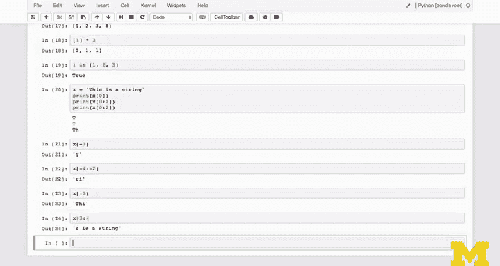
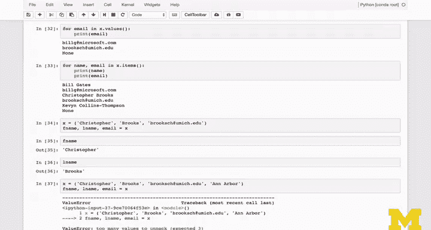

# 5：Python类型与序列 🐍


在本节课中，我们将要学习Python中的基本数据类型以及三种核心的集合类型：元组、列表和字典。理解这些类型是进行数据操作和分析的基础。

## 概述

Python虽然没有静态类型，但每个值都有其类型。`type()` 内置函数可以显示给定引用的类型。常见的类型包括字符串、整数、浮点数以及函数类型。对象拥有与其关联的属性，这些属性可以是数据或函数。

Python围绕不同类型的序列或集合构建。我们将讨论三种原生的集合类型：元组、列表和字典。

## 元组

上一节我们介绍了Python的类型系统，本节中我们来看看第一种集合类型——元组。

元组是一个变量序列，其本身是**不可变**的。这意味着元组中的项目有顺序，但一旦创建就不能更改。我们使用圆括号 `()` 来书写元组，并且可以混合其内容的类型。

```python
my_tuple = (1, 2, ‘hello‘, ‘world‘)
```

请注意，字符串可以使用单引号或双引号表示。

## 列表

列表与元组非常相似，但它是**可变**的，因此你可以更改其长度、元素数量和元素值。列表使用方括号 `[]` 声明。

以下是修改列表内容的几种方法：

*   **`append()` 函数**：允许你将新项目追加到列表的末尾。

列表和元组都是可迭代类型，因此你可以编写循环来遍历它们持有的每个值。通常，如果你想查看列表中的每个项目，可以使用 `for` 语句。这类似于Java和C#中的 `foreach` 循环，但请注意不需要指定类型。

```python
my_list = [1, 2, 3]
for item in my_list:
    print(item)
```

## 序列的访问与操作

列表和元组也可以像其他语言中的数组一样，通过使用方括号运算符（称为索引运算符）进行访问。列表的第一个项目从位置 **0** 开始。要获取列表的长度，我们使用内置的 `len()` 函数。

还有一些其他常见的函数，如 `min()` 和 `max()`，它们可以查找给定列表或元组中的最小值或最大值。

Python列表和元组也允许一些基本的数学运算：

*   **加号 `+`**：连接列表。
*   **星号 `*`**：重复列表的值。

一个非常常见的运算符是 `in` 运算符。它检查集合成员资格，并根据一个项目是否在给定列表中返回布尔值 `True` 或 `False`。

我们将在未来几周深入研究运算符和特殊类型的序列，届时我们将探讨一种称为“广播”的技术。

## 切片操作

也许你可以对列表执行的最有趣的操作称为**切片**。虽然用于访问元素的方括号数组语法可能看起来与你其他语言中看到的相似，但在Python中，索引运算符允许你提交多个值。

切片参数说明如下：

*   第一个参数是起始位置。如果这是唯一元素，则返回列表中的一个项目。
*   第二个参数是切片的结束位置，并且是**不包含**的。因此，如果你用第一个参数为0，下一个参数为1进行切片，那么你只会得到一个项目。



通过一个例子来解释会容易得多。Python的一个方便之处在于，所有字符串实际上都只是字符列表。因此，切片在它们身上效果很好。

```python
x = “hello”
print(x[0])    # 输出 ‘h‘
print(x[0:1])  # 输出 ‘h‘
print(x[0:2])  # 输出 ‘he‘
```

我们的索引值也可以是负数，这非常酷，这意味着从字符串的末尾开始索引。

```python
print(x[-1])      # 输出 ‘o‘ (最后一个字母)
print(x[-4:-2])   # 输出 ‘el‘ (从倒数第四个到倒数第二个位置)
```


最后，如果我们想隐式地引用字符串的开头或结尾，可以通过将参数留空来实现。

```python
print(x[:3])  # 输出 ‘hel‘ (从第一个字符到位置3)
print(x[3:])  # 输出 ‘lo‘  (从第四个字符到列表末尾)
```

切片是Python语言的核心，也是Python科学计算的重要组成部分，尤其是在你开始操作矩阵时。我们将在下一个模块中更多地讨论切片。

## 字符串操作

现在，我稍微离题一下，谈谈操作字符串。切片并不是操作字符串的唯一方式。一个常见的活动是基于子字符串分割字符串，即遍历字符串，寻找模式并适当地分割它。这称为正则表达式评估，我们将在专门处理文本挖掘的部分详细讨论这一点，因为它是一个非常常见的操作。

但Python有一些用于文本分析的基本工具，我将在这里向你展示它们。正如我们所见，字符串只是字符列表。因此，你可以对列表执行的操作，也可以对字符串执行。这意味着你可以使用加号运算符连接两个字符串，并且乘以字符串将重复给定的字符串。你也可以使用 `in` 运算符搜索字符串。

字符串类型有一个名为 `split()` 的相关函数。此函数基于简单模式将字符串分解为子字符串。

```python
full_name = “Christopher Paul John Smith“
name_parts = full_name.split(‘ ‘)
print(name_parts)  # 输出 [‘Christopher‘, ‘Paul‘, ‘John‘, ‘Smith‘]
```

结果是一个包含四个元素的列表。我们可以使用索引运算符选择第一个元素作为名字，最后一个元素作为我的姓氏。

## 字典

在进一步讨论字符串之前，我想谈谈字典。字典与列表和元组相似，因为它们都包含项目集合，但字典是**带标签的集合**，没有顺序。这意味着对于你插入字典的每个值，还必须提供一个键来取出该值。在其他语言中，这种结构通常称为映射。在Python中，我们使用花括号 `{}` 表示字典。

```python
email_dict = {‘Chris‘: ‘chris@umich.edu‘, ‘Jenny‘: ‘jenny@umich.edu‘}
print(email_dict[‘Chris‘])  # 输出 ‘chris@umich.edu‘
```

字典中用于键或值的类型可以是任何类型，如果你愿意，也可以是混合类型。我们可以使用我们习惯的相同索引运算符（在赋值语句的左侧）向字典添加新项目。

你可以通过多种方式迭代字典中的所有项目：

*   首先，你可以迭代所有键，然后根据需要取出内容。
*   或者，你可以迭代值而忽略键。
*   最后，你可以使用 `items()` 函数同时迭代值和键。

最后一个例子有点不同，它是一个称为**解包**的示例。在Python中，你可以有一个序列（一个值列表或元组），并且可以通过一个语句中的赋值将这些项目解包到不同的变量中。

```python
person_tuple = (‘Chris‘, ‘Smith‘, ‘chris@umich.edu‘)
first_name, last_name, email = person_tuple
```

在底层，Python解包了元组并按顺序分配了这些变量。如果我们给元组添加第四个项，Python不知道如何解包它，因此会出现错误。



## 总结

本节课中我们一起学习了Python的核心内置类型和集合。我们探讨了不可变的元组、可变的列表以及键值对结构的字典。我们学习了如何访问序列元素、使用切片操作数据、进行基础的字符串处理，以及利用解包功能高效地处理数据。这些是Python编程，特别是数据科学中数据处理的基础。在下一讲中，我们将简要回顾字符串，然后开始处理一些数据文件。