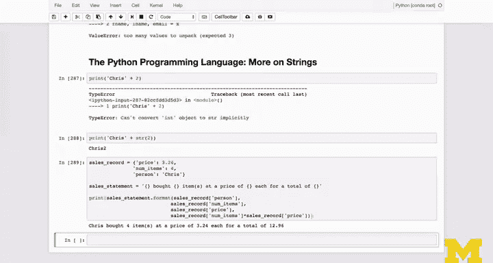

# 6：Python用于数据科学实践 📚

## 概述：Python字符串进阶 🧵

在本节课中，我们将要学习Python字符串处理的进阶知识。我们将探讨Python 3中字符串的Unicode本质，并学习如何使用强大的字符串格式化语言来优雅地组合和输出文本信息。

---

## 字符串与Unicode 🌍

上一节我们介绍了列表和切片，其中也谈到了字符串。你已经见过通过`split`函数和直接索引来拆分字符串的方法。

Python中的字符串处理有时会令人感到困惑，因此我想分享更多关于字符串处理机制的细节，以便你了解它们。

在Python 3中，字符串默认基于Unicode。在早期计算中，字符串的字符被限制在256个不同的值内。这足以涵盖所有大小写的拉丁字母以及单个数字。这种编码被称为ASCII，相当紧凑。

但世界不仅仅运行在拉丁字符上。需要支持非英语语言，以及那些不常用于单词但常用于其他地方的字符，例如数学运算符。

Unicode转换格式（UTF）试图解决这个问题。它可以用来表示超过一百万个不同的字符。这不仅包括你可能预期的人类语言，还包括像表情符号这样的符号。

Python 3默认使用Unicode，因此在处理国际字符集时没有问题。

---

## 字符串格式化语言 ✨

除了Unicode，Python还使用一种特殊的语言来格式化字符串的输出。动态类型的一个挑战是，当你必须自己进行类型转换时，情况会有点不明确。

我们在上一讲中看到，如果我们想打印一个名字和一个数字，如果不先调用`str`函数将数字转换为字符串，就无法使用连接操作。

这会产生很多看起来混乱的代码，其中每个你想要连接的运算符都被包裹在这个`str`函数中。

Python字符串格式化迷你语言允许你编写一个包含变量占位符的字符串语句。然后，你可以按名称或按顺序传递这些变量，Python会为你处理字符串操作。

以下是一个例子。

想象我们有一个包含订单详情的字典，其中包括商品数量、价格和一个人的名字。我们可以编写一个销售声明字符串，使用花括号来包含这些项目。然后，我们可以在该字符串上调用`format`方法，并传入我们想要替换的适当值。

现在，字符串格式化语言允许你做的远不止这些。你可以控制许多不同的方面，例如浮点数的小数位数，是否想在正数前加上加号，设置字符串的对齐方式为左对齐或右对齐，甚至启用科学计数法。

我已经在课程资源中链接了文档页面，能够使用字符串库和格式化语言将是你第一次作业的重要组成部分。

---

## 总结与展望 🔮

本节课中我们一起学习了Python字符串的Unicode基础以及强大的字符串格式化功能。这是一个简短的讲座，但字符串操作是数据清洗的重要组成部分。在本课程的作业中，你将学到更多关于字符串操作的知识。

在下一个视频中，我们的研究生助理将向你展示如何通过读写分隔数据文件来进行一些基本的数据分析。